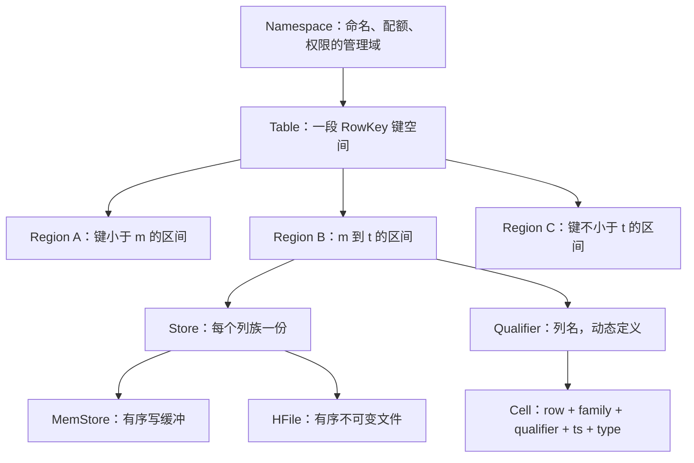
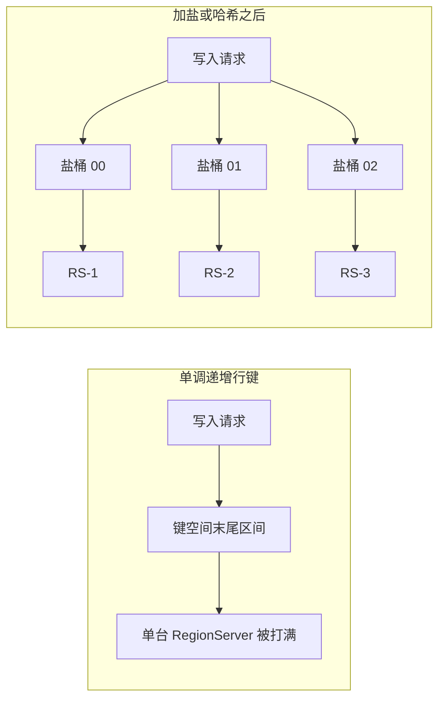
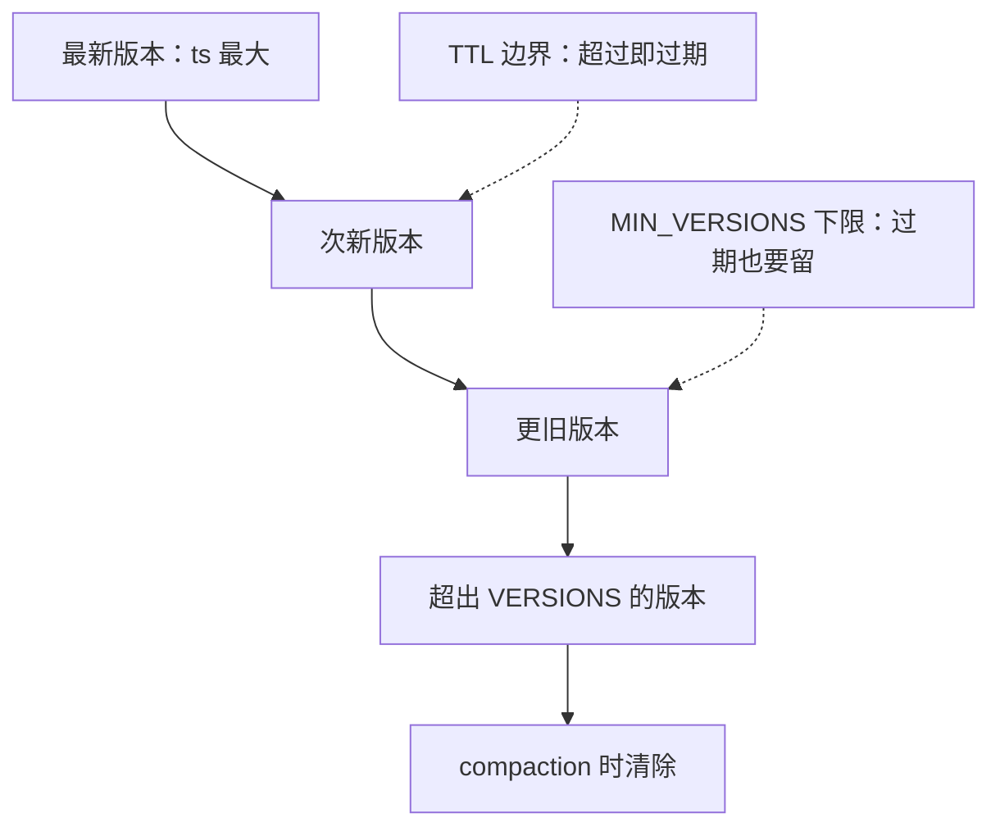
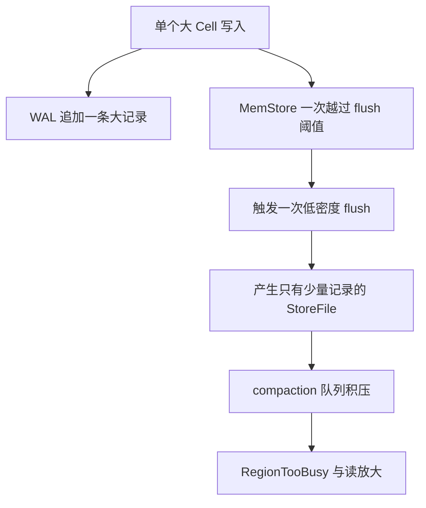

# HBase 数据模型深度解析——RowKey、列族、Cell 与多版本机制

**摘要：**

HBase 的数据模型常被讲成一张四维坐标表：RowKey、列族、列限定符、时间戳，四个维度各管一件事。这种讲法没有错，但它把因果关系讲反了。HBase 的表之所以长成这样，是因为它必须先是一段按字节排好序的键空间，然后才谈得上行列与版本。本文以字典序为主线重新组织数据模型：先把 Namespace、Table、Region、ColumnFamily、Qualifier、Cell 这六段地址放回各自的物理位置，说明表在物理上就是 RowKey 区间的集合，范围扫描的高效与写入热点的顽固都从这条排序规则派生；再拆开 Cell 的字节布局，算清行键长度如何逐 Cell 放大存储，以及在 MemStore 与 WAL 上为什么没有编码可以抵消这份放大；然后把 RowKey 设计收敛成长度、唯一性、散列、顺序、不可变五条判据与四个反模式，给出加盐、哈希、反转、取模四种打散手段的代价对照；最后处理多版本与墓碑——VERSIONS、TTL、MIN_VERSIONS 如何共同决定一个版本能活多久，Delete 为什么只是一次写入，它为什么必须等到 major compaction 才让磁盘真的下降，以及客户端指定时间戳在这套机制里埋下的两个坑。文中所有容量数字都标注为示例推算，只用于说明量级关系。

---

## 第 1 章 表的真相：排序规则先于行列结构

### 1.1 一个被跳过的形容词

在 2006 年那篇奠定整个列族存储谱系的论文里，Bigtable 把自己的数据模型描述成一个稀疏的、分布式的、持久化的多维有序映射（sparse, distributed, persistent multi-dimensional sorted map）。这句话里的每个形容词后来都被反复引用，但真正决定使用体验的是最容易被跳过的那一个：**有序**。HBase 作为 Bigtable 的开源实现，把这个 sorted 落成了最朴素的形式——整张表按照 RowKey 的字节序排列，没有例外，没有分区内的局部重排，也没有二级索引来兜底。

笔者见过的多数 HBase 入门材料，都从这里直接跳到"四维坐标"的表格：RowKey、Column Family、Column Qualifier、Timestamp，四行字讲完，接着就是 Shell 命令。这样讲出来的数据模型是一张静态的概念表，看不出任何性能后果。可 HBase 用起来处处反直觉的地方，恰恰全部来自那条排序规则：为什么范围扫描快得像顺序读文件？为什么单调递增的主键会把集群写垮？为什么删了五百 GB 数据，磁盘占用纹丝不动？这三个问题的答案不同，根源却是同一个。

本文属于本列的机制篇。HBase 是什么、适合什么场景，属于概览性内容，不在本文重复；本文只回答两件事：每个机制在内核里究竟怎么实现，以及出问题时该看哪个判据。LSM-Tree 与 HDFS 作为底座，本文只取结论——写路径没有原地更新，HFile 最终落在 HDFS 上——细节分别见 [[01 LevelDB 全局架构——LSM-Tree 的写优化设计]] 与 [[04 HDFS 数据读写流程——Pipeline 写入与机架感知读取的底层路径]]。

### 1.2 把表理解成"键空间的分段"

换个视角看表。假设有一个无限长的、按字节排好序的键空间，从全零字节串一直到全 FF 字节串。建一张 HBase 表，本质上是在这个键空间里划出一段区间；表里的每一行，就是这段区间里的一根钉子，钉在某个确定的字节位置上。行与行之间的顺序，不是插入顺序，不是修改时间顺序，而是字节比较的结果。

这个视角能立刻解释掉一批现象。写入不是"追加到文件末尾"，而是"插进有序结构的正确位置"，所以写入与主键的大小关系无关，只与主键落在哪个区间有关。读取一个范围，不是"遍历全表再过滤"，而是"从起点所在的区间开始，顺序往后走，走到终点为止"。删除不是"抹掉某个位置"，因为有序结构里的位置由键决定，键不能凭空消失，只能写一个标记告诉后来者"这个位置之前的版本不算数了"。

### 1.3 五层结构加一个数据叶子

从管理边界到数据单元，HBase 的地址是一路收窄的：Namespace 圈定管理域，Table 圈定键空间，Region 把键空间切成区间，ColumnFamily 把区间内的数据按存储单元切开，Qualifier 定位到列，Cell 才是真正被写入的字节。前五层是结构，最后一层是叶子。下图把这六段地址与它们的物理归属放在一起。

图中最容易读错的一处，是 Region 与 Table 的关系。Table 看起来是容器，其实只是一组区间的名字；Region 才是物理实体，它承载一个键区间，并且可以在集群里被搬来搬去。另一处容易读错的是 ColumnFamily 与 Store 的关系：列族在逻辑上是列的归类，在物理上就是一个 Store，而 Store 的内部结构由 MemStore 与若干 HFile 组成。下表把这六段的职责与约束并排列出。

| 层级 | 是否必须预定义 | 物理对应 | 设计约束 |
| :--- | :--- | :--- | :--- |
| Namespace | 否，可动态创建 | HDFS 上的一级目录，加上配额与 ACL 记录 | 只影响管理与配额，不参与数据路由 |
| Table | 是 | 一组 Region 的集合 | 表名参与 meta 行键，改名要动 meta |
| Region | 否，按数据自动分裂或预分区 | 一个键区间 [startKey, endKey)，由某台 RegionServer 服务 | 边界就是 RowKey 边界，热点与它直接相关 |
| ColumnFamily | 是，建表时确定，改要走 DDL | 每个 Region 上一个 Store，内含 MemStore 与 HFile | 数量决定内存与文件数下限，通常不超过 3 个 |
| Qualifier | 否，写入时即定义 | Cell 键的一部分，没有独立元数据 | 无法高效枚举，只能扫描后去重 |
| Cell | 否 | 一个 KeyValue 字节串 | 五元组加类型，大小受上限约束 |

读完这张表就能发现，HBase 把"哪些东西需要事先想清楚"和"哪些东西可以随手加"分得很干脆：列族必须提前定，列名可以随时加，行可以随便来，区间由系统自己切。这种划分不是随意的，它对应的是"要不要预先分配物理资源"这条线——列族要占 MemStore，所以必须提前定；列名不占独立资源，所以可以动态；Region 要占一台机器的服务能力，所以由系统按负载切，也可以人为预分区。

### 1.4 排序规则的三条下游后果

把有序这件事讲透，后面所有章节都可以看成它的推论。

第一条后果是范围扫描高效。同一个区间内的数据在物理上相邻，扫描一段连续键只需要定位一次起点，然后顺序读，I/O 模式接近顺序访问。

第二条后果是写入热点。既然键有序，那么持续写入比现有最大键更大的键，就等于持续往同一个区间的尾部挤，而这个区间只由一台 RegionServer 服务。时间戳做主键、自增 ID 做主键，都会稳定地制造这种局面。

第三条后果是删除与更新都退化成写入。有序结构不支持就地把一个键改成另一个键，也不支持把某个位置的值抹掉；改主键等于删旧行加插新行，删数据等于写一个墓碑。这条后果直接决定了多版本机制与 compaction 的存在必要。

> [!info] 一条线索贯穿全篇
> 后文讨论的每一个机制，都可以问一句"它是排序规则的哪一部分"。Region 是排序规则的切分，RowKey 设计是排序规则的调参，多版本是排序规则在时间维度上的延伸，墓碑是排序规则对删除的妥协。

---

## 第 2 章 Namespace 与 Table：管理边界，不是物理边界

### 2.1 Namespace 解决的是"谁的表"

Namespace 是 0.98 版本引入的组织机制，在此之前所有表共享一个全局命名空间。它解决的问题很具体：多个团队共用一套集群时，表名冲突、权限无法按业务授予、配额无法按业务限制。引入之后表名变成 `namespace:table` 的形式，HDFS 上的目录也多了一层 `<namespace>`。

它在文件系统上确实对应一级目录，但在数据路由里完全不出现——客户端定位一行数据，靠的是"表名 + RowKey"，Namespace 只是表名的一部分。这意味着 Namespace 提供的隔离是管理层面的：命名不冲突、ACL 可分组、配额可按域统计。它不提供物理隔离，两个 Namespace 的表完全可能落在同一台 RegionServer 的相邻 Region 上。

HBase 保留了两个内置 Namespace。`hbase` 存放系统表，包括 `hbase:meta`（Region 路由表）、`hbase:namespace`（Namespace 元数据）、`hbase:quota`、`hbase:acl`、`hbase:rsgroup` 等；`default` 是未指定命名空间时的落点。系统表也在同一套存储引擎上，这意味着系统表同样是按 RowKey 有序的普通表，只不过它们的行键由系统生成。

### 2.2 配额与它的边界

Namespace 的配额通过属性设置，常见的是表数量上限与 Region 数量上限，属性名形如 `hbase.namespace.quota.maxtables` 与 `hbase.namespace.quota.maxregions`（具体键名以对应版本的 shell 文档为准）。这两项要真正生效，前提是集群打开了配额功能（`hbase.quota.enabled`），这一项的默认值在不同版本间有过变化，以对应版本文档为准。空间配额走的是另一套 quota 体系，记录在 `hbase:quota` 表中。

配额能挡住"某个业务把集群撑爆"，但挡不住"某个业务把集群写热"。原因还是排序规则：配额统计的是表的数量与 Region 的数量，而热点是"所有写入挤在少数几个 Region 上"，Region 总数完全可能达标甚至很健康。这一点后文第 6 章会展开。

### 2.3 表是一份描述符加一堆区间

从实现上看，一张表由两部分构成。一部分是 `TableDescriptor`，记录列族列表、分裂策略、Region 副本数、协处理器、表级属性等；它被持久化在 `hbase:meta` 里，也会被 Master 缓存。另一部分是实际承载数据的 Region 集合，每个 Region 有自己的 `RegionInfo`（表名、起始键、结束键、regionId、副本 id）。

这个二分带来一个容易被忽略的成本：每多一张表，就多一批 Region；每多一个 Region，每个列族就多一组 MemStore 与文件句柄。空表不占数据空间，但占 Region 名额、占 meta 行、占 RegionServer 的打开文件数与内存下限。所以"小表随便建"在 HBase 里不成立，几百张几 MB 的小表会让 MemStore 总量下限与 meta 规模同时变得难看；列族侧的具体约束留给 [[01 HBase 的诞生——为什么 HDFS 不够用，列族存储的设计哲学]] 展开。

---

## 第 3 章 Region：RowKey 区间的物理划分

### 3.1 区间是半开的，边界是键

Region 用一个**半开区间** [startKey, endKey) 描述自己负责的键范围。第一个 Region 没有 startKey，等价于负无穷；最后一个 Region 没有 endKey，等价于正无穷。这个半开语义很关键：如果某个键正好等于 endKey，它不属于当前 Region，而属于下一个 Region。所有区间拼起来恰好覆盖整个键空间，不重不漏。

于是"表在物理上按 RowKey 字典序排列"这句话有了精确含义：把所有 Region 按 startKey 排序，就得到整张表的有序视图；每个 Region 内部，数据也按同一个比较器有序（MemStore 里的 `CellSet` 底层是一个按 `CellComparator` 排序的跳表结构，HFile 里的数据块同样按键有序）。全局有序不是靠某一次的排序动作实现的，而是靠"每个局部有序 + 区间首尾相接"拼出来的。

### 3.2 一次读请求怎么找到那个 Region

客户端不知道也不应该知道 RowKey 落在哪台机器上，它只知道表名和键，剩下的交给 `hbase:meta`。meta 表本身是一张普通表，行键由表名、Region 起始键、regionId 拼成，`info:regioninfo` 列存着序列化后的 `RegionInfo`，`info:server` 存着当前服务该 Region 的 RegionServer。定位的过程是：在 meta 表上找"起始键不大于目标键、且结束键大于目标键"的那条记录。

实现上这一步是 meta 表上的一次短扫描：先正向找起始键不小于目标键的第一条，如果目标键落在它之前，就反向取前一条。取到之后，客户端缓存这个映射，后续请求直接发往对应 RegionServer；只有当区间发生分裂、迁移，或者服务端返回"Region 不在线"一类的错误时，才重新查 meta。下图把这条链路画成一次完整的定位。

meta 表自身也会分裂，它的位置由集群注册中心提供（2.x 起不再有 `-ROOT-` 表，ZooKeeper 或等价的 registry 直接给出 meta 的 Region 位置）。这条链路上任何一环出问题，现象都是"元数据不可用"或"Region 不在线"，与数据模型本身无关，排查路径留给 [[03 HBase 整体架构——Master、RegionServer 与 ZooKeeper 的三角协作]]。

### 3.3 前缀扫描为什么高效

前缀扫描的高效可以拆成三层解释，而不是一句"因为有序"。

第一层省在 Region 数量上。给定前缀 P，所有以 P 开头的键构成一个连续区间 [P, P 的后继)，客户端只需要定位这个区间的起点，就只会碰到覆盖这个区间的那些 Region，通常是 1 个，最多几个。前缀越长，区间越窄，碰到的 Region 越少。

第二层省在文件定位上。进入 Region 之后，MemStore 是有序结构，可以对 P 做一次定位；HFile 有块索引（每个数据块记录首键），可以在索引上跳到第一个不小于 P 的块；块内再顺序比较。整个过程是"两次定位加顺序扫描"，与表的总行数无关。

第三层省在提前终止上。`Scan` 的 stopRow 是排他的，读到不小于 stopRow 的键就可以停；2.x 的 `Scan.setRowPrefixFilter(prefix)` 会把这件事封装好，服务端因此知道扫描有界，不必读完整个 Region。前缀扫描的高效来自**区间有界**，而不是来自 Bloom Filter——布隆过滤器只帮点查，对范围扫描没有帮助。

这里有一个常被忽略的语义细节：`startRow` 是包含的，`stopRow` 是不包含的。想要包含终点，要么用 2.x 提供的 `withStopRow(row, true)` 重载，要么把 stopRow 改成终点的后继（对前缀而言就是 append 一个 0xFF 字节或做字节进位）。写错一位，边界那一行就会时有时无，而这类问题在测试数据量小时往往不显形，上线后变成偶发丢行。

### 3.4 分裂是数据分布的下游结果

Region 的边界不是设计时确定的，而是运行时长出来的（预分区除外）。分裂策略按 Store 的大小判断是否该切：2.x 的默认策略是 `SteppingSplitPolicy`，`hbase.hregion.max.filesize` 的默认值是 10 GB，此外还有一个 `hbase.hregion.max.filesize.jitter` 的抖动系数（默认 0.25，具体以对应版本为准），把阈值在两侧随机浮动，避免同一批 Region 同时触线、同时分裂，形成分裂风暴。分裂本身在 2.x 由 Master 通过 procedure 发起并协调，RegionServer 承担实际的文件切分与上报；`hbase.regionserver.regionSplitLimit`（默认 1000）给单个 RegionServer 的 Region 数量加了一个软上限。

这套机制的工程含义是：分裂点由数据在键空间里的密度决定，而不是由业务语义决定。如果写入集中在键空间尾部，那么分裂出来的新区间也集中在尾部，热点不会因为分裂而缓解——反而会持续制造新 Region，让"末尾 Region"这个角色不断轮换。这一点在第 6 章会用一个具体例子算清。

因此"预分区"是必要的事前声明。建表时给出 splitKeys（Shell 里用 `SPLITS` 或 `NUMREGIONS` 加 `SPLITALGO`，也可以用 `RegionSplitter` 工具），等于提前把键空间按预期分布切好，让写入从第一天起就落在多个 Region 上。预分区的键必须与 RowKey 的散列方式一致：如果 RowKey 是"盐值 + 业务键"，splitKeys 就要按盐值切；如果 RowKey 是十六进制的哈希值，就用十六进制等分。两者不一致，预分区就只是切了空气。Region 的迁移、均衡与分裂细节见 [[08 HBase Region 分裂与负载均衡——水平扩展的工程底层]]。

---

## 第 4 章 ColumnFamily 与 Qualifier：物理单位与动态列

### 4.1 列族是唯一需要提前决定的物理资源

列族（Column Family）是 HBase 里唯一必须在建表时声明的结构。原因不在语义，在资源：一个 Region 上的一个列族对应一个 Store，Store 有自己的 MemStore（内存配额）、自己的 HFile 集合（文件句柄与 compaction 单位）、自己的压缩与编码策略、自己的 TTL 与版本数。允许运行时随意加列族，等于允许运行时随意申请内存与文件资源，这在分布式系统里是不可接受的。

列族的数量与命名都直接影响存储效率。列族名在每个 Cell 的键里都要存一份，长度字段只有一个字节，所以名字上限 255 字节，但工程上应该压到一个字母。更深的影响在内存：每个 Region 的每个列族都有一个 MemStore，`hbase.hregion.memstore.flush.size` 的默认值是 128 MB，这是单个 MemStore 的 flush 触发阈值；`hbase.regionserver.global.memstore.size`（默认占堆的 40%）是所有 MemStore 的总上限，超过之后写入会被阻塞并强制 flush。

这里要修正一个常见的算例错误。有材料这样算：3 个列族、200 个 Region、每 MemStore 128 MB，得出"总 MemStore 内存 76.8 GB"。128 MB 是阈值不是常驻占用，真实占用取决于写入速率与 flush 时机，绝大多数 MemStore 平时远小于阈值。但这个算法作为容量规划的上界是有意义的：在最坏情况下，每个 MemStore 都可能涨到阈值附近而不触发全局限制，此时内存需求就是"列族数 × Region 数 × 阈值"。把它当实际值会误判成"必须换大内存机器"；当作上界，结论就变成"列族数每翻一倍，最坏情况的内存上界翻一倍"，所以列族数宜压到 3 个以内。

### 4.2 Qualifier 的动态性：自由与代价同时成立

列限定符（Qualifier）是列族内的列名，也是字节数组，没有类型，可以为空，可以在写入时第一次出现。新增一列不需要任何 DDL，`Put` 时带上一对新名字即可；删除一列也不需要 DDL，把它下面的 Cell 都删掉即可。稀疏性由此而来：不同行可以有完全不同的列集合，不存在的列不占任何空间。

但这份自由有一个必须说清的代价：HBase **无法高效地列出**某个列族下所有的 qualifier。原因在存储格式里——qualifier 没有独立的元数据，它只是 Cell 键的一段字节，与 row、family、timestamp 一起被序列化进每个 KeyValue。列族之所以能被列出来，是因为列族记录在 `TableDescriptor` 里，是一份可以被读取的元数据；qualifier 没有这样一份清单，它只存在于数据里。

于是"枚举一行的所有列"要读这一行（`Result.getFamilyMap(family).keySet()`），"枚举一张表出现过的所有 qualifier"只能扫全表、在客户端去重。中等规模的表还能靠 `Scan` 加 `ColumnPrefixFilter` 缩小范围，大表上这就是一次全表扫描加上一份可能很大的去重集合。`Scan` 能按列过滤，但不能发现列，这两件事在 HBase 里是不对称的。

| 判据 | 适合固定 qualifier | 适合动态 qualifier |
| :--- | :--- | :--- |
| 列集合是否可枚举 | 业务能给出完整字段清单 | 字段随实体变化，无法穷举 |
| 是否需要按列聚合 | 需要跨行按列统计、对账、审计 | 只按行整体读写，不做列级聚合 |
| 是否有列级治理需求 | 需要权限、血缘、Schema 演进记录 | 无需列级治理 |
| 单行 cell 数量 | 每行几列到几百列，规模可控 | 每行可能上千列，且无上界 |
| 列名是否承载数据 | 列名只是字段名 | 列名本身就是数据（如被关注者 ID） |
| 典型结构 | 用户画像、订单主表、设备属性 | 倒排索引、标签集合、指标名不定的事件 |

判据的核心只有一条：如果某天需要回答"这张表有哪些列"，固定 qualifier 的答案在读元数据，动态 qualifier 的答案在扫全表。需要前者就固定，不需要就放开。

### 4.3 把数据放进 qualifier 的边界条件

"列名即数据"是 HBase 被低估的一项能力。以关注关系为例：行键是关注者或被关注者，列名是对方的 ID，值只是一个占位符，那么"关注"是一次 Put，"取关"是一次 Delete，"是否关注"是一次 Get，全部是 O(1) 操作，不需要读改写整个列表。这与把关注列表塞进一个 JSON 数组的写法相比，并发行为和存储效率都好得多。

不过这条路有三个边界。第一，列名在每个 Cell 的键里重复存储，列名越长、cell 越多，键开销越大，压缩前的膨胀非常可观。第二，单行 cell 数量没有硬上限，但一行有几十万个 cell 时，读这一行就要在服务端与客户端之间搬运几十万个 Cell，`hbase.client.scanner.max.result.size`（默认 2 MB）会保护单次返回量，却保护不了整行的总内存。第三，列名承载数据意味着列集合无法预先声明，也就无法为不同列设置不同的 TTL 与版本数——这些策略只能按列族设置，粒度到不了列。

这三个边界合起来给出一条实用判断：把 qualifier 当数据用，适合"每个实体只有几十到几千个动态属性、且属性之间不需要差异化策略"的场景；一旦属性数量上不封顶，或者不同属性需要不同的生命周期，就该把属性下沉到行键里，用多行承载，而不是让一行无限膨胀。

---

## 第 5 章 Cell：五元组与字节布局

### 5.1 一个 Cell 到底存了什么

逻辑上，一个 Cell 由五部分组成：行键、列族、列限定符、时间戳、类型。类型描述这个 Cell 是一次写入还是某种删除标记，2.x 里类型占一个字节，取值来自 `KeyValue.Type` 枚举：`Put` 为 4，`Delete` 为 8，`DeleteFamilyVersion` 为 10，`DeleteColumn` 为 12，`DeleteFamily` 为 14，另外还有用于查找边界的 `Minimum`（0）与 `Maximum`（255）。除此之外，2.x 的 Cell 还允许带标签（tags），用于单元格级权限与可见性表达式，序列化在值之后。

物理上，一个 Cell 就是一个 KeyValue 字节串，格式为：4 字节的键长度、4 字节的值长度、键、值，若带标签再追加 2 字节的标签长度与标签内容。键的内部又分七段：2 字节的行长度、行键、1 字节的列族长度、列族、列限定符、8 字节的时间戳、1 字节的类型。qualifier 没有独立的长度字段，它的长度由键长度减去前面各段反推得出。

| 字段 | 字节数 | 含义 | 对设计的影响 |
| :--- | ---: | :--- | :--- |
| keylength | 4 | 键的总长度 | 固定开销，无法优化 |
| valuelength | 4 | 值的长度 | 固定开销 |
| rowlength | 2 | 行键长度 | 上限 32767 字节，决定行键长度天花板 |
| row | 变长 | 行键本身 | 每个 Cell 重复一份，是放大主因 |
| familylength | 1 | 列族名长度 | 上限 255 字节，越短越好 |
| family | 变长 | 列族名 | 每个 Cell 重复一份 |
| qualifier | 变长 | 列名，无独立长度字段 | 由键长度反推，无法单独编码优化 |
| timestamp | 8 | 版本时间戳 | 每个版本都要 8 字节 |
| type | 1 | 写入或删除标记 | 决定同时间戳下的排序优先级 |
| tags | 2 + 变长 | 可选标签 | 用了权限标签就会增加 |

把固定开销加起来：键长度 4、值长度 4、行长度 2、列族长度 1、时间戳 8、类型 1，共 **20 字节**。这 20 字节是每个 Cell 无论如何都要付的底价，行键、列族名、列名、值都在这之上。一个只有 10 字节值的小 Cell，其存储成本里有三分之二可能是键与元数据。

### 5.2 RowKey 在每个 Cell 里重复一遍

行长度字段是 2 字节的短整型，HBase 里对应的常量是 `HConstants.MAX_ROW_LENGTH`，取值 `Short.MAX_VALUE`，也就是 32767 字节。这个上限来自更底层的文件格式对键长度的约束。网上流传的"行键最大 64 KB"是早期说法，在 2.x 的实现里应以代码常量为准；无论取哪个数，工程上都远用不到——行键长度的实际约束来自存储放大，而不是这个上限。

放大的机制很直接：一行有 N 个 Cell，行键就要在这 N 个 Cell 的键里各存一份。一行十个列，十六字节的行键就要重复十次，一百字节的行键就要重复一千字节。这与"每个 Cell 都自带完整地址"的设计是一致的——正因为每个 Cell 自带完整地址，读取任意一个 Cell 都不需要依赖上下文。

把这个放大算成具体数字：假设一张表十亿行，每行十个 Cell，列族名一个字节，列名八字节，值二十字节，三副本，来看行键长度的影响。

| 行键长度 | 每 Cell 键开销 | 单行十个 Cell | 十亿行原始数据 | 三副本合计 |
| ---: | ---: | ---: | ---: | ---: |
| 10 字节 | 39 字节 | 590 字节 | 约 590 GB | 约 1.77 TB |
| 16 字节 | 45 字节 | 650 字节 | 约 650 GB | 约 1.95 TB |
| 100 字节 | 129 字节 | 1.49 KB | 约 1.49 TB | 约 4.47 TB |
| 256 字节 | 285 字节 | 3.05 KB | 约 3.05 TB | 约 9.15 TB |

（以上为示例推算，按十进制 GB/TB 计，不含压缩与数据块编码的影响，只用于说明量级关系。）

这张表揭示的关系是线性的：行键每多一字节，每个 Cell 就多一字节，总存储就多"字节数 × 行数 × 每行列数"。从 16 字节到 100 字节，每个 Cell 只多了 84 字节，总存储却从 1.95 TB 涨到 4.47 TB。

### 5.3 数据块编码能抵消多少

有人会拿数据块编码（Data Block Encoding）来给长行键辩护：HFile 的块内编码会把相同前缀省掉，同一行的十个 Cell 行键完全相同，编码之后就只剩一份，放大不就被抵消了吗。

这个辩护**只在文件层面成立**，在写路径上不成立。块编码作用于写入 HFile 的那一刻，而 Cell 在此之前已经以原始形式走过了一遍完整链路：客户端序列化成 RPC 消息、RegionServer 解析成 Cell 对象放进 MemStore、同时写进 WAL，这三处都是原始格式，行键一字不少。MemStore 与 WAL 恰好是写路径上内存与带宽压力最大的两处。所以块编码能改善的是磁盘占用与读放大，改不了"长行键拖慢写入"这件事。2.x 里块编码默认是 `NONE`，要不要开、开哪一种，属于 HFile 层面的取舍，细节见 [[04 HBase 存储引擎深度解析——LSM-Tree、MemStore 与 HFile 的设计奥秘]]。

### 5.4 同一行内 Cell 的排序

Cell 的比较顺序是：先比行键，再比列族与列名的拼接，再比时间戳（新的在前），最后比类型（类型码大的在前）。这个顺序有两个直接后果。

一是读一行时拿到的列是按列名字典序排列的，不是按写入顺序。依赖"列的顺序"做业务逻辑的代码，在 HBase 上必然出错。

二是同一时间戳下，删除标记排在写入之前。源码比较类型时用的是"类型码大的先"，`DeleteFamily`（14）、`DeleteColumn`（12）、`Delete`（8）都排在 `Put`（4）之前。这意味着如果一次删除与一次写入被赋予了完全相同的时间戳，删除会赢。这条规则是"删除优先"的字节级来源，也是后文讨论客户端指定时间戳风险时的一个伏笔。

---

## 第 6 章 RowKey 设计的五条判据

### 6.1 长度：以"键开销不超过值的一半"为界

第一条判据是长度。行键越短越好，这不是审美偏好，而是第 5 章算出来的线性放大。经验区间是 10 到 100 字节，多数业务落在 16 到 32 字节之间。落到具体设计上，有三条做法可以直接用。

一是把数字编码成定长大端字节，而不是字符串。八字节的 long 表示数值，既短又保持数值序；字符串 `"12345"` 是五字节，看似更短，但不同长度的数字混在一起会破坏数值序（`"10"` 排在 `"2"` 之前），要靠左补零修回来，补零之后又变长。

二是压缩时间戳的表示。毫秒级时间戳要八字节，秒级只要四字节，够用到 2106 年。若业务只需要秒级精度，省下的四字节会乘以 Cell 总数。

三是避免把可读性当成设计目标。`"user_id:12345:event_type:click:ts:1705291800000"` 这样的行键人读起来很舒服，但它有五十多个字节，其中冒号和字段名占了大半，而这些信息完全可以用定长二进制表达，长度能压到二十字节以内。

判据可以写得更具体一些：行键长度的下界是"能唯一定位一行"，上界可以取"每个 Cell 的键开销不超过值大小的一半"。超过这条线，存储成本里键的占比就会明显高于数据本身，这时应该回头检查行键是不是塞了不该塞的东西。

### 6.2 唯一性：幂等的前提

第二条判据是唯一性。行键是表内主键，同一行键、同一列族、同一列名、同一时间戳的两次写入，后写覆盖先写；在默认版本语义下，这表现为一次更新。这个性质带来两个后果。

好的后果是幂等：重试一次写入不会产生两行，这在对账、补数、消息重投的场景里是刚需。坏的后果是覆盖：如果行键的区分度不够，两条本该并存的数据会互相覆盖，而且不会报错。行键只用了用户 ID、却想记录同一用户的多次事件，第二次写入就会把第一次盖掉，现象是"数据莫名少了一半"。

唯一性的判据是：行键的组合必须能唯一确定一条业务记录，且这个组合在写入侧是可计算的、不需要先读后写的。需要"先查一下有没有重复再写"的设计，在 HBase 上会退化成低效的读改写。

### 6.3 散列：单调递增是热点的标准配方

第三条判据是散列。这是五条里最需要工程判断的一条，因为它的失败模式在功能测试里完全看不出来——数据一条不少，只是全压在一台机器上。

热点的机制在第 3 章已经埋好：Region 按行键区间切分，写入持续产生更大的行键，就持续落在键空间末尾的那个区间，而该区间只由一台 RegionServer 服务。用时间戳开头的事件表是标准配方：`20260115093000-web-001`、`20260115093001-web-002`，键越来越大，写入越来越挤。自增 ID、Snowflake ID、递增订单号，都是同一个配方换了名字。

下图对比两种行键分布下的写入落点。

打散有四种常用手段，代价各不相同。

| 方法 | 做法 | 写入分布 | 范围扫描 | 额外代价 | 适用场景 |
| :--- | :--- | :--- | :--- | :--- | :--- |
| 加盐 salt | 取行键哈希模桶数，拼成定长前缀 | 均匀 | 失效，需并行扫描全部桶 | 桶数变更要全表重写 | 写入量极大、查询以点查为主 |
| 哈希前缀 hash | 用 MD5 或 Murmur 的前几字节做前缀 | 均匀且可重现 | 失效 | 前缀有碰撞风险，需拼原始键保唯一 | 单一写入源、按业务键点查 |
| 反转 reverse | 把行键字节序倒过来 | 取决于尾部基数 | 仅对"尾号区间"有效 | 边界需反向映射，语义不可读 | 手机号、IP、前缀固定的编号 |
| 取模 mod | 业务键对 N 取模做前缀 | 均匀且确定 | 失效 | N 变更要重写，且会周期性重现 | 需要可预测分桶的离线导入 |

四种方法的共同代价是同一件事：范围扫描。一旦行键被打散，按业务维度的时间范围查询就不能再靠一次顺序扫描完成，而要向所有桶发起并行扫描再在客户端归并，读放大与延迟都随桶数上升。

这里要澄清一个常见混淆：把时间戳倒序（`Long.MAX_VALUE - ts`）**不属于打散手段**。它解决的是"同一前缀下最新的排在最前"这个排序需求，让"取最近 N 条"可以只读前 N 条就停。倒序之后时间戳仍然单调递减，写入仍然落在同一个区间，热点一点没缓解。倒序与散列解决的是两个不同的问题，经常被一起用，但不能互相替代。

散列设计的判据是：如果写入速率在单台 RegionServer 的能力之内，不要散列，把全局有序完整保留下来；只有当写入速率确实压不住、且查询以点查为主时，才引入前缀散列，并同时接受范围扫描的读放大。桶数一旦引入就要按未来两三年的写入量预留，因为改桶数意味着全表重写。

### 6.4 顺序：把查询模式编码进键的字节序

第四条判据是顺序。既然键有序，那么"把最常用的查询维度放在前缀位置"就能让范围扫描天然命中。复合行键的设计就是把查询语义预编码进字节序。

以一张用户行为事件表为例。需求按频率排序是：查某个用户最近的行为、查某个用户在某个时间段的行为、按事件类型统计。行键可以设计成"盐值 + 用户 ID + 倒序时间戳"：盐值负责打散写入，用户 ID 负责把同一用户的数据聚在一起，倒序时间戳负责让最新的排在最前。查最近 N 条，就是从该用户的前缀起点开始顺序读 N 条；查时间段，就是把倒序时间戳的边界算出来作为 startRow 与 stopRow。

字段顺序的取舍在这里体现得最清楚。用户 ID 放在时间戳之前，是因为"按用户查"比"按时间查"更常用；如果反过来，按用户查就要跨整张表扫。HBase 没有二级索引，也没有优化器来纠正这个决定，**字段顺序就是执行计划**。这一点与 B+ 树索引的"最左前缀"原则形似，但更严格：B+ 树还可以靠覆盖索引或索引合并绕一绕，HBase 只能接受"前缀不匹配就全表扫"。

顺序还有一个小技巧值得写进判据：如果业务需要"最新在前"且同时需要按时间范围查询，倒序时间戳是唯一能同时满足两者的编码方式；如果只需要"最新在前"而不需要范围，用版本机制（同一 Cell 多版本）也能达到目的，但读的时候要指定版本数，且历史版本会被 compaction 清理，不如行键可靠。

### 6.5 不可变：改行键等于删加插

第五条判据是**行键不可变**。HBase 没有"修改行键"这个操作，因为行键是数据在有序结构里的位置，改位置只能删掉旧位置、在新位置插入。这个限制带来一条设计红线：不要把会变化的属性编进行键。

常见的踩法是状态。订单表用 `status + orderId` 做行键，本意是"按状态查订单"，但订单状态会流转，每次流转都要删旧行、写新行，产生一次墓碑加一次写入，而且旧行所在的 Region 会积累待清理的墓碑。正确的做法是把状态放进 Value 或列名，需要按状态查询时另建索引表（或用 Phoenix 这类带二级索引的方案）。

判据是：行键里出现的每个字段，都必须在行的整个生命周期内不变。会变的字段如果一定要参与查询，办法是把它放到值里再加一张索引表，或者在设计时就接受"只按不变的维度查询"。

---

## 第 7 章 四个反模式与它们的症状

把第 6 章的五条判据反过来用，就是四个高频反模式。它们的共同点是在小数据量下完全正常，数据量上来之后突然变成事故。

| 反模式 | 典型症状 | 根因 | 改法 |
| :--- | :--- | :--- | :--- |
| 时间戳开头 | 单台 RegionServer 的写入 QPS 打满，其他机器空闲；`hbase:meta` 频繁更新 | 键单调递增，写入全部落在末尾区间 | 盐值或哈希前缀打散；或改用倒序时间戳加维度前缀 |
| 超长行键 | 同样行数占用远高于预期；MemStore 压力大、flush 频繁；RPC 报文偏大 | 行键在每个 Cell 重复，且 MemStore 与 WAL 无编码收益 | 定长二进制编码，压缩时间戳，砍掉可读性字段 |
| 二进制与字符串混用 | 范围扫描结果与预期不符；负数或大小写排序异常；边界行丢失 | 字节序是无符号比较，与数值序、字符序不一致 | 统一用大端定长编码，负数用可排序编码，字符统一 UTF-8 |
| 用行键存大对象 | 单个 Cell 接近上限；Region 无法有效分裂；写入报单元格过大 | 行键上限 32767 字节，且每个 Cell 复制一份 | 大对象放 Value，超大对象走 HDFS 存路径或 MOB |

第一类反模式的隐蔽性在于它不报错：现象是延迟上升、写入队列堆积、"十台机器只有一台在干活"。判断方法是看 Region 级写入分布——写入集中在少数键区间位于键空间一端的 Region，就是热点，与机器性能无关。

第二类反模式的量化影响在第 5 章已经算过。这里补充一个判断依据：如果一张表的平均 Value 大小远小于行键长度，说明行键设计已经失衡，因为键比数据还贵。

第三类反模式的细节在 2.x 的编码工具里：`Bytes.toBytes(long)` 产生的是补码大端字节，负数的高位是 0xFF，字节序比较时负数会整体排到正数之后，与数值序相反。同样地，用字符串存数字会因为长度不同而破坏数值序，用 `String.compareTo` 比较会和字节序比较在非 ASCII 字符上分叉。修法是统一编码：整数用定长大端，需要带符号排序时用 `OrderedBytes` 提供的可排序编码（`encodeInt32`、`encodeInt64`、`encodeNumeric`），字符一律 UTF-8，且在行键里不要混用两种表达同一语义的编码。

第四类反模式的边界在 `HConstants.MAX_ROW_LENGTH`：32767 字节是硬上限，超过直接写不进去。但远在这个上限之前，放大就已经不可接受了，所以实用判据是"行键不应该承载任何变长的大数据"，行键只承载定位信息。

---

## 第 8 章 多版本：追加写模型的必然产物

### 8.1 更新为什么变成新版本

LSM-Tree 不支持原地更新，所有写操作都是追加。这条结论在本列其他篇目里已经展开，这里只取它的直接后果：一次"更新"在存储层就是一次写入，新数据带着一个更大的时间戳落在旧数据旁边，旧数据没有被覆盖，只是被遮住了。

多版本机制就是这个模型的配套。每个 Cell 保留若干个版本，版本之间按时间戳排序，读取时按需返回几份。2.x 的 `KeyValue` 比较器里有一段注释特意说明这个方向：比较时间戳时把较新的排在较旧的前面，看上去像是写反了，但这是故意的——这样迭代 MemStore、读取 StoreFile 时，最先遇到的就是新版本。

这个排序方向决定了三件事：`Get` 默认只返回最新版本（`maxVersions` 默认 1，`Scan` 也一样）；要读历史版本必须显式调 `setMaxVersions(n)` 或设置时间范围；同一个 Cell 的多个版本在物理上相邻，读一个版本会顺带经过其他版本。

### 8.2 列族级的三组旋钮

版本相关的配置都挂在列族上，粒度到不了列。2.x 的默认值是：`VERSIONS`（保留的最大版本数）为 1，`MIN_VERSIONS` 为 0，`TTL` 为 `Integer.MAX_VALUE`（即永不过期），`KEEP_DELETED_CELLS` 为 `FALSE`，`NEW_VERSION_BEHAVIOR` 为 `false`。

三组旋钮的配合方式需要说清。`VERSIONS` 是数量上限，超过就丢最旧的；`TTL` 是时间上限（单位为秒），超过就丢过期的；`MIN_VERSIONS` 是保留下限，即使在 TTL 之外也要至少留这么多份。前两者不是简单的"任一满足即清理"，因为 `MIN_VERSIONS` 会挡住 TTL 的清理：列族设置了 `TTL = 2592000`（30 天）、`MIN_VERSIONS = 2` 时，一份已经过了 30 天的数据，如果它是该 Cell 最新的两份之一，就仍然会被保留。

2.x 还提供了一个组合方法 `setVersionsWithTimeToLive(retentionInterval, versionAfterInterval)`，它的实现是：把 `VERSIONS` 设成 `Integer.MAX_VALUE`、`TTL` 设成保留区间、`KEEP_DELETED_CELLS` 设成 `TTL`。效果是"保留区间内保留全部版本，区间之外只保留指定份数"，适合既要审计近期变更、又不想长期存全部版本的场景。

| 配置项 | 默认值 | 作用 | 调大的代价 | 调小的代价 |
| :--- | :--- | :--- | :--- | :--- |
| VERSIONS | 1 | 每 Cell 保留的最大版本数 | 存储与读合并开销按倍数上升，compaction 更难收敛 | 历史版本不可读，审计与回放能力丢失 |
| MIN_VERSIONS | 0 | TTL 之外仍保留的版本数 | TTL 的清理效果被削弱，过期数据长期占位 | 最新状态可能随 TTL 一起消失 |
| TTL | 永不过期 | Cell 的存活时间（秒） | 过期数据长期占用存储与 compaction 带宽 | 数据过早消失，且依赖时间戳是否正确 |
| KEEP_DELETED_CELLS | FALSE | 是否保留被墓碑遮住的 Cell | 存储不降，墓碑与旧数据都留着 | 快照与时间点查询读不到已删数据 |
| NEW_VERSION_BEHAVIOR | false | 版本比较是否纳入 MVCC 序号 | 语义更接近"写入顺序"，但依赖 HBASE-15968 之后的行为 | 只按时间戳判版本，客户端时钟问题会放大 |

### 8.3 版本与 TTL 的过期判定

TTL 的判定基准是"服务端当前时间减去 Cell 的时间戳"，超过 TTL 即视为过期。过期的 Cell 在读取时不会被返回，在 compaction 时被物理清除。这里有两个容易被忽略的边角。

一是**未来时间戳**。如果某个 Cell 的时间戳大于服务端当前时间，那么它与"当前时间"的差是负数，永远不会超过 TTL，也就永远不会过期。客户端指定了一个超前的时间戳，这条数据就会在 TTL 体系里"永生"，直到有人手动处理。

二是墓碑与 TTL 的关系。TTL 清理不需要墓碑参与，它是按时间直接淘汰；而 Delete 留下的墓碑要等 compaction 才能清。两者的差别意味着"用 TTL 做数据生命周期管理"比"用 Delete 批量删"干净得多——前者不产生墓碑，后者会产生一大批墓碑并把磁盘占用拖到下一次 major compaction。

下图把一个 Cell 的版本栈与两条清理边界画在一起。

### 8.4 版本数对存储的放大

版本数对存储的影响是乘性的，而且很容易被低估。假设一张表十亿行、每行十个 Cell、每个 Cell 平均 65 字节，每列在生命周期内被更新 20 次，来看不同 `VERSIONS` 下的稳态存储。

| VERSIONS | 稳态保留版本数 | Cell 总数 | 未压缩数据量 | 三副本合计 |
| ---: | ---: | ---: | ---: | ---: |
| 1 | 1 | 100 亿 | 约 650 GB | 约 1.95 TB |
| 3 | 3 | 300 亿 | 约 1.95 TB | 约 5.85 TB |
| 5 | 5 | 500 亿 | 约 3.25 TB | 约 9.75 TB |

（以上为示例推算，假设所有版本都能存活到 compaction 之后，实际会受 TTL、压缩与 compaction 时机的共同影响。）

这张表说明的是：`VERSIONS` 从 1 调到 5，存储不是简单地乘以 5 就结束了，读路径上"合并多个版本"的开销也在增加——一次 Get 要跨过 5 个版本才能确定最新值，`Scanner` 的合并逻辑同样要处理这 5 份。所以调大版本数的代价要按"存储 × 读放大"两项一起估，而不是只看存储。

版本机制也有它的能力边界。它不适合当审计日志：compaction 会按 `VERSIONS` 与 `TTL` 裁掉版本，想长期留存变更必须另建表或落到外部存储。它也不适合当"精确的历史回放"：同一时间戳的多次写入在默认语义下只按时间戳排序，回放顺序可能与实际写入顺序不符，除非打开 `NEW_VERSION_BEHAVIOR`。

---

## 第 9 章 墓碑：删除为什么是一次写入

### 9.1 Delete 写进去的是什么

在有序的、追加写的存储里，删除无法通过"抹掉一个位置"完成，因为旧数据可能已经落在多个不可变的 HFile 里，而 HFile 一旦写完就不再修改。唯一可行的办法是写一个标记，告诉后续的读取与合并过程："这个键在某个时间点之前的版本都不算数"。这个标记就是墓碑（tombstone），在字节层面它就是一个类型不为 `Put` 的 Cell。

墓碑与普通 Cell 共享同一套键结构：有行键、列族、列名、时间戳，只是多了一个类型字节。它同样先写 WAL、再进 MemStore、最后随 flush 落成 HFile。所以**删除就是一次写入**，在写路径上与普通写入没有区别，代价也一样——一次 RPC、一次 WAL 追加、一次 MemStore 插入。这个设计让删除的写入成本很低，但把清理成本推迟到了 compaction。

### 9.2 四种删除各自的墓碑范围

客户端 API 侧有若干个删除方法，落到存储层是四种墓碑，范围各不相同。理解它们的差别，是判断"删完之后为什么还能读到"的前提。

| API | 墓碑类型码 | 列名 | 覆盖范围 | 未来时间戳 |
| :--- | ---: | :--- | :--- | :--- |
| `addFamily(family)` | DeleteFamily，14 | 空 | 该列族下时间戳不大于墓碑时间戳的全部版本 | 不受影响 |
| `addColumns(family, qualifier)` | DeleteColumn，12 | 指定 | 该列时间戳不大于墓碑时间戳的全部版本 | 不受影响 |
| `addColumn(family, qualifier, ts)` | Delete，8 | 指定 | 该列时间戳等于指定 ts 的那一个版本 | 不受影响 |
| `addFamilyVersion(family, ts)` | DeleteFamilyVersion，10 | 空 | 该列族下时间戳等于指定 ts 的那批版本 | 不受影响 |

四种墓碑的共同点是"只覆盖时间戳不大于墓碑自身时间戳的版本"。这一点在 `Delete` 的 javadoc 里写得很明确：不指定时间戳时，墓碑的时间戳取服务端的当前时间，因此时间戳在未来的 Cell 不会被删除。这不是实现缺陷，而是设计使然——未来时间戳的数据在语义上属于"还没发生"的版本，删除一个"现在"的动作不应该影响它。

墓碑的写入还有两处容易被忽略的成本。第一处是删除不存在的键也会写墓碑：删除操作不检查目标是否存在，直接写标记。所以"先 Get 确认存在再 Delete"是纯浪费，只会多一次 RPC，墓碑一个不少。第二处是 `addColumn(family, qualifier)` 不带时间戳时，服务端要先做一次 Get 找到该列最新版本的精确时间戳，再用那个时间戳写墓碑，javadoc 直接把它标成"一次昂贵的调用"。批量删单版本时应尽量自己带上时间戳，避免服务端逐列回查。

### 9.3 墓碑什么时候真正消失

墓碑只是标记，真正把数据从磁盘上抹掉的是 compaction。这里有一条容易误解的规则：不是所有 compaction 都能丢墓碑。

丢墓碑的前提是"这次合并的输入文件集合，覆盖了所有可能包含被删数据的文件"。只有满足这个前提，才能保证被墓碑遮住的数据不会在某个没参与合并的文件里"复活"。minor compaction 只挑一部分文件合并，通常无法保证这一点；major compaction 把该 Store 下的所有文件合成一个，才满足前提。所以墓碑的清理事实上要等到 **major compaction**，这也是"删了数据磁盘不降"的直接原因。下图把墓碑从写入到被清除的路径串起来。

major compaction 由 `hbase.hregion.majorcompaction` 控制周期（默认 7 天），并有一个抖动系数 `hbase.hregion.majorcompaction.jitter`（默认 0.5），把执行时间在周期两侧随机散开，避免全集群同时进入大合并。这个抖动是必要的：大合并会带来显著的写放大与 I/O 峰值，全集群同时做会把读延迟一起拖垮。compaction 的选型与调优见 [[07 HBase Compaction 机制深度解析——Minor、Major 与写放大的三角关系]]。

还有两个配置会改变墓碑的命运。`hbase.hstore.time.to.purge.deletes` 默认是 0，含义是"未来时间戳的墓碑也照常在下一个 major compaction 里清掉"；把它设成大于 0 的毫秒值，则带未来时间戳的墓碑会保留到"墓碑时间戳加这个值"之后的那个 major compaction。`KEEP_DELETED_CELLS` 则是另一个方向：设成 `TRUE` 或 `TTL` 时，被墓碑遮住的 Cell 会被保留下来，供 raw 扫描与时间点查询读取，代价是存储降不下来。这两个配置是排查"删除之后数据还在"时的第一检查项。

### 9.4 删除的工程判据

把上面几条合起来，可以得到一组可操作的判断。

如果删除的数据量很大（比如按天清理历史分区），不要用 Delete 逐行删，改用 TTL。TTL 是按时间淘汰，不产生墓碑，也不依赖 major compaction，清理是渐进且可预期的。

如果必须用 Delete，删完之后不要立刻盯着磁盘占用，去看 StoreFile 数量与 compaction 队列。磁盘占用要等 major compaction 之后才会下降，而 major compaction 可能被推迟到周期点，也可能被 compaction 队列里的积压拖后。

如果要判断墓碑是否成了问题，看两个指标：单次 Get 的延迟分布（墓碑越多，读路径要跳过的版本越多），以及 compaction 的输出与输入比例（墓碑占比高的 Store 合并后体积下降明显，但合并本身消耗大量 I/O）。

还有一个反直觉的推论：频繁的"删除再写入"模式比"只写入"更贵。每次删除都留一个墓碑，每次写入都留一个版本，两者叠加会让同一个键在 StoreFile 里占据多份记录，compaction 要反复合并它们。重写同一批键的业务（比如状态机频繁流转），应该考虑换行键结构，把"流转"变成"新增一行"，而不是原地覆盖。

---

## 第 10 章 Cell 的物理大小上限

### 10.1 三层上限

单个 Cell 的大小受三层限制，层次不同，触发点也不同。

第一层是客户端限制。`hbase.client.keyvalue.maxsize` 默认 10 MB，限制单个 KeyValue 的字节数。它的注释解释了动机：单个条目无法被切开，如果太大，会导致 Region 无法再分裂，所以要把上限设在 Region 大小的一个零头。

第二层是服务端限制。`hbase.server.keyvalue.maxsize` 默认也是 10 MB，限制单个 Cell 的大小（含值与全部键字段），目的是防止大对象把 RegionServer 的堆打爆。

第三层是行级限制。`hbase.table.max.rowsize` 默认 1 GB，限制一次 Get 或 Scan 在未开启行内扫描时单行的总大小，超过时客户端会收到 `RowTooBigException`。

三层限制的数值都在 `hbase-default.xml` 里，具体取值以对应版本文档为准，但量级关系是稳定的：单 Cell 十 MB 量级，单行 GB 量级。

### 10.2 大 Cell 怎么拖垮 MemStore

MemStore 的 flush 判定有两种触发方式：周期性检查 MemStore 是否超过 `hbase.hregion.memstore.flush.size`（默认 128 MB），以及写入时判断是否需要主动 flush。flush 的完整触发链路、WAL 的写入顺序与持久性保证见 [[05 HBase 写入链路深度解析——WAL、MemStore Flush 与持久性保证]]，这里只关心单 Cell 大小对阈值判定的影响。一个 Cell 如果本身就接近这个阈值，那么一次 Put 就能把 MemStore 从"远低于阈值"推到"超过阈值"，触发一次 flush。

问题不在 flush 本身，而在 flush 出来的文件质量。一个 100 MB 的 Cell 落成一个 HFile，这个文件里**只有一条记录**，块的密度极低，索引与布隆过滤器的开销占比极高，后续的 compaction 要把这种低密度文件反复合并。如果这种写入持续发生，每个 Region 都会积累大量"一条记录一个文件"的 StoreFile，`hbase.hstore.compactionThreshold` 很快被触发，compaction 队列积压，读放大随之上升。

更糟的情况是阻塞。`hbase.hregion.memstore.block.multiplier` 默认 4，当某个 Region 的 MemStore 总量超过"flush 阈值乘该系数"时，写入会被直接阻塞，客户端收到 `RegionTooBusyException`。单个超大 Cell 会让 MemStore 迅速逼近这条线，而且因为 flush 需要把大 Cell 完整写出去，flush 本身耗时也长，阻塞窗口被拉长。下图把这条因果链画出来。

### 10.3 大 Cell 与分裂

Region 分裂是按文件切的，切点落在某两个键之间。如果一个 Cell 本身就接近 Region 大小的一半，切点就无处可落——切在哪里都会让某个子 Region 超过阈值。这正是客户端限制注释里说的那个风险：单个条目太大，会让 Region 无法继续分裂。

对写入侧的影响是连锁的：Region 无法分裂，写入又持续进来，就让这个 Region 越来越大，最终要么触发分裂失败，要么靠人工介入。对读侧的影响是单行读取的内存峰值：一行如果有几百 MB，`hbase.client.scanner.max.result.size` 与 `hbase.server.scanner.max.result.size` 只能限制单次返回，限制不了整行。

### 10.4 该不该存大对象

判断可以按尺寸分档。

| 单值大小 | 判断 | 理由 |
| :--- | :--- | :--- |
| 小于 100 KB | 直接放 Cell | 与阈值差两个数量级，对 flush 与 compaction 无实质影响 |
| 100 KB 到 1 MB | 谨慎放，需评估占比 | 单独不致命，但如果单表大量出现，等价于把 Cell 平均大小抬高一个量级 |
| 1 MB 到 10 MB | 拆分或外置 | 已在 flush 阈值的百分之一以上，频繁写入会让 flush 变得低效 |
| 大于 10 MB | 拒绝 | 触碰客户端与服务端限制，写入直接失败 |

外置有几条路。中等大小的对象可以拆成多个 Cell（分片存），读的时候按分片拼回；不可变的大文件（图片、音视频、归档）应该存到 HDFS 或对象存储，HBase 只存路径与元数据；确实需要在 HBase 里存中等大小二进制且读取模式是整块读的场景，可以用 MOB（Medium Object）机制，把超过阈值的值拆到单独的 MOB 文件，`MOB_THRESHOLD` 默认 100 KB。MOB 的代价是 compaction 变成两套（普通文件与 MOB 文件分开合并），运维复杂度上升。

一个实用的判据是看"Value 大小与行键长度的比例"。如果平均 Value 只有几十字节而行键有上百字节，说明这张表的问题不在大对象而在行键；如果平均 Cell 到 MB 级，问题就在对象本身，得考虑外置。

---

## 第 11 章 时间戳从哪来

### 11.1 默认由服务端生成

客户端构造 `Put` 时如果不指定时间戳，Cell 的时间戳字段是 `HConstants.LATEST_TIMESTAMP`，取值 `Long.MAX_VALUE`。这是一个哨兵值，表示"请服务端填写当前时间"。RegionServer 在处理写入时，把 **LATEST_TIMESTAMP** 替换成自己的当前时间（通过 `EnvironmentEdgeManager`，可被测试用的假时钟替换），然后落 WAL、进 MemStore。

这个默认行为保证了时间戳在集群内的单调性大致可控：同一台 RegionServer 上，后写入的 Cell 时间戳不会小于先写入的。跨 RegionServer 时，靠的是机器时钟同步；客户端时钟不在 HBase 的校验范围内，2.x 的实现也没有为这一点提供开关。

### 11.2 客户端指定时间戳的三种风险

客户端可以通过 `Put.setTimestamp(ts)` 指定时间戳。这个能力在数据回放、幂等导入、历史数据迁移里是必需的——回放要保留原始时间，导入要保证多次执行结果一致。但它引入三类风险，且都不报错。

第一类是"未来时间戳"。客户端时钟快了几分钟，写进去的时间戳就比服务端时间大。后果有三层：`Get` 默认取最新版本，这个"未来"的版本会成为最新值；后续的真实写入时间戳更小，会被它遮住，于是业务侧看到"写成功了但读出来是旧值"；Delete 不带时间戳时用服务端当前时间做墓碑，覆盖不了这个未来版本，于是**删不掉**。

第二类是"过去时间戳"。客户端时钟慢了，新写入的时间戳比旧版本还小，`Get` 取最新版本时仍然返回旧值，表现为更新丢失。这种现象在监控上完全看不出来——写入成功、无错误、无重试，只是读到的值不对。

第三类是版本序错乱。多个写入端时钟不一致时，同一 Cell 的版本顺序可能与实际写入顺序相反。默认版本语义只比时间戳，不比 MVCC 序号，所以读到的"最新版本"可能真的是先写的那一条。2.x 提供了 `NEW_VERSION_BEHAVIOR` 开关，打开后版本比较会把 MVCC 序号一并纳入（HBASE-15968），代价是语义变复杂、且并非所有旧数据都符合新语义。

### 11.3 该不该用客户端时间戳

如果写入端只有一个、且它的时钟受控（与集群同一个时间源），客户端时间戳是可用的，但要限制在一个合理窗口内，避免写入未来时间。

如果写入端有多个、时钟不受控，不要用客户端时间戳，让服务端生成。需要保留原始业务时间时，把业务时间放进 Value 或列名，让时间戳只承担版本职责。

如果业务依赖 TTL 或 Delete 生效，客户端时间戳必须与集群时间严格对齐，否则会出现"该过期的不过期""该删的删不掉"，因为这两套机制都直接读 Cell 的时间戳。

> [!warning] 两个必查项
> 排查"数据读不到最新值"时，先查写入方是否指定了时间戳、写入方与集群的时钟差多少；排查"删不掉"时，先查目标数据的时间戳是否大于服务端当前时间。这两个方向比查 Region 状态有效得多。

---

## 第 12 章 数据模型的边界：原子性、原子操作与过滤

数据模型只回答"数据长什么样"，不回答"一次操作保证什么"。这两件事在 HBase 里常被混为一谈，后果是应用把跨行事务的期待写进去，然后在并发下出错。

第一条边界是原子性的粒度。HBase 只保证单行原子：同一行上多个列、多个列族的 Put 与 Delete 要么全生效、要么全不生效，跨行与跨表都没有事务。想在行内做"条件满足才写"，2.x 用 `CheckAndMutate`（`checkAndPut`、`checkAndDelete` 的继任者），它在同一个行锁内完成读、判断、写，是乐观锁的基础。库存扣减这类操作会把冲突压到同一行上，行锁竞争与重试开销随之上升。

第二条边界是原子操作。`Increment` 与 `Append` 由服务端持行锁完成读改写，返回值即操作后的结果，适合计数与追加字段；两者都使用 `LATEST_TIMESTAMP`、由服务端取当前时间，不接受客户端指定时间戳，天然避开第 11 章那类时钟问题，但每次调用都是一次行锁加一次写入，高频计数器会把瓶颈压在单行之上。

第三条边界是过滤。`Scan` 与 `Get` 能在 RegionServer 端挂 Filter，`RowFilter`、`PrefixFilter`、`ColumnPrefixFilter`、`ValueFilter`、`SingleColumnValueFilter` 与 `FilterList` 各有用途，但凡是按值比较的过滤器都要读出每个 Cell 的值才能判断，减少的是网络传输量而不是扫描量。所以 Filter 是结果集裁剪，不是定位手段；需要按非行键字段查询时，正确做法是设计匹配的 RowKey 或另建索引表。

三条边界都由同一个前提推出来：行键是唯一的位置坐标。原子性以行为单位，原子操作靠行锁，过滤拿不到位置信息，三者都受这一条约束。

---

## 第 13 章 结语

回到开篇的那句话：HBase 的表不是容器，而是一段有序键空间的视图。Namespace 与 Table 是这段空间的命名与所有权，Region 是它的分段，ColumnFamily 是分段内的存储单元，Qualifier 是单元内的列坐标，Cell 是真正落盘的字节。六段地址每一段都能在排序规则里找到位置。

RowKey 设计的五条判据与四个反模式，本质上都是在这条规则上做取舍：长度换存储，散列换吞吐，顺序换查询，不可变换掉一类运维事故。多版本与墓碑则是追加写模型的代价转移——把"更新"与"删除"都变成写入，把清理成本推迟到 compaction。理解了这层因果，遇到"写入慢""磁盘不降""读不到最新值"这类现象时，判断顺序就不再是从监控面板开始，而是从数据模型的哪一处约束被违反开始。

这套模型没有给出免费的选项：保留全局有序就要接受末尾区间被写热，用散列换吞吐就要接受范围查询变成并行扫描，留多版本支撑审计就要接受存储与读合并的双份开销。每一条都是同一类交换——把确定性从一个地方挪走，换到另一个地方。笔者更愿意把它看成一份合同：按字节序给出确定的位置与版本顺序，代价是位置写下就不再改、删除只留标记、容量要提前算清。

数据模型的价值不在于记住六个名词，而在于知道哪一个名词是自己能调的旋钮。HBase 把这个旋钮交给应用，也把权衡的责任一并交了出来。

---

## 参考资料

1. Apache HBase Reference Guide — Data Model：https://hbase.apache.org/book.html#datamodel
2. Apache HBase Reference Guide — HBase and Schema Design：https://hbase.apache.org/book.html#schema
3. Chang, F., et al. Bigtable: A Distributed Storage System for Structured Data. OSDI 2006：https://research.google/pubs/pub27898/
4. Apache HBase 2.5 API — `KeyValue`（键与值的字节布局、`Type` 枚举、时间戳比较方向）：https://hbase.apache.org/2.5/devapidocs/org/apache/hadoop/hbase/KeyValue.html
5. Apache HBase 2.5 API — `Delete`（四种删除的墓碑范围与时间戳语义）：https://hbase.apache.org/2.5/devapidocs/org/apache/hadoop/hbase/client/Delete.html
6. Apache HBase 2.5 `hbase-default.xml`（各配置项的默认值与含义）：https://github.com/apache/hbase/blob/branch-2.5/hbase-common/src/main/resources/hbase-default.xml
7. Apache HBase 2.5 `HConstants`（`MAX_ROW_LENGTH`、`LATEST_TIMESTAMP`、`FOREVER`）：https://github.com/apache/hbase/blob/branch-2.5/hbase-common/src/main/java/org/apache/hadoop/hbase/HConstants.java
8. Apache HBase 2.5 `ColumnFamilyDescriptorBuilder`（`VERSIONS`、`MIN_VERSIONS`、`TTL` 等默认值）：https://github.com/apache/hbase/blob/branch-2.5/hbase-client/src/main/java/org/apache/hadoop/hbase/client/ColumnFamilyDescriptorBuilder.java

---

> [!note] 思考题
> 1. 如果把行键设计成"盐值 + 用户 ID + 倒序时间戳"，那么按用户查询"最近 N 条"只需一次有界扫描，按时间范围查询全表则要并行扫描所有盐桶。盐桶数量增加时，这两类查询的代价如何此消彼长，你会用什么指标来定这个数量？
> 2. 假设业务需要保留每个 Cell 最近 10 个版本用于审计，同时又希望磁盘占用可控。VERSIONS、TTL、MIN_VERSIONS 三者应该如何组合，才能既满足审计窗口、又让过期数据真正被清掉？
> 3. 一个表的 Delete 操作非常频繁，每次删完磁盘占用都不下降，运维要靠手动 major compaction 才能回收空间。除了改成 TTL 之外，还能从行键设计与写入模式上做哪些调整来减少墓碑的数量？
> 4. 客户端在数据回放时指定了原始时间戳，其中一部分时间戳超前于服务端当前时间。这类数据在 TTL、Delete、Get 三个路径上分别会表现成什么现象，如何在不改写数据的前提下把它们找出来？
> 5. 单个 Cell 达到 5 MB 的表，其 MemStore flush 与 Region 分裂分别会出现什么异常表现，为什么 hbase.client.keyvalue.maxsize 的默认值要设在 10 MB 而不是更大？