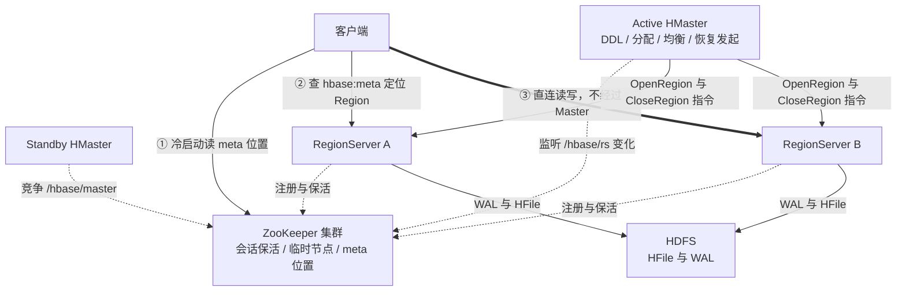
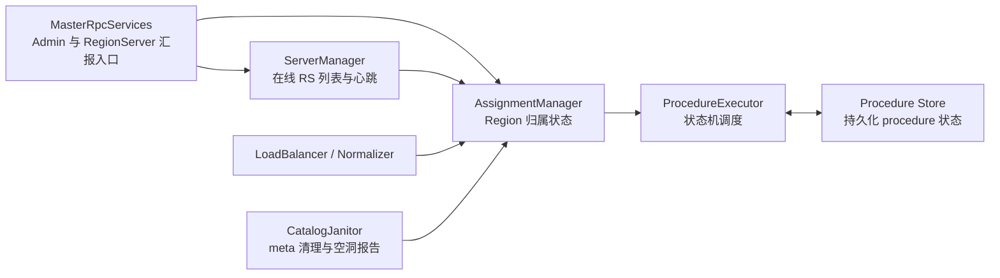
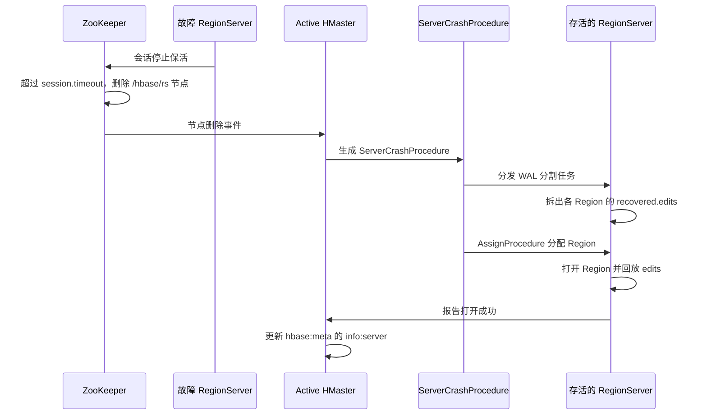
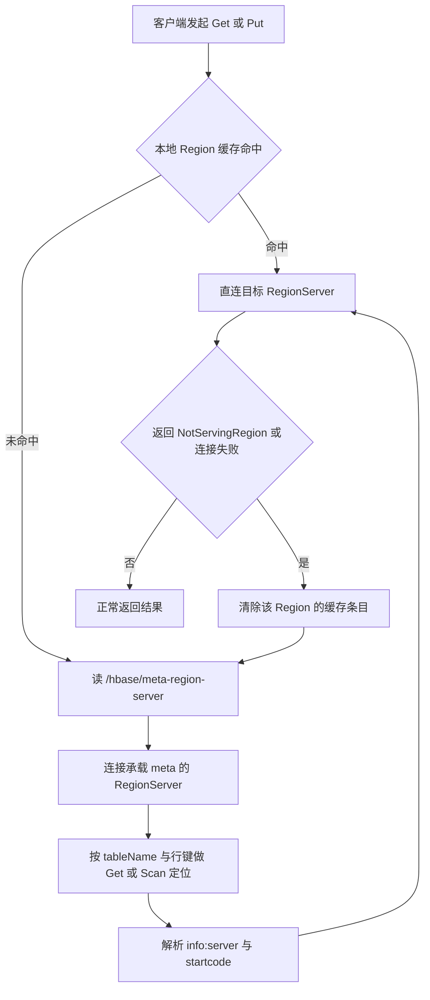
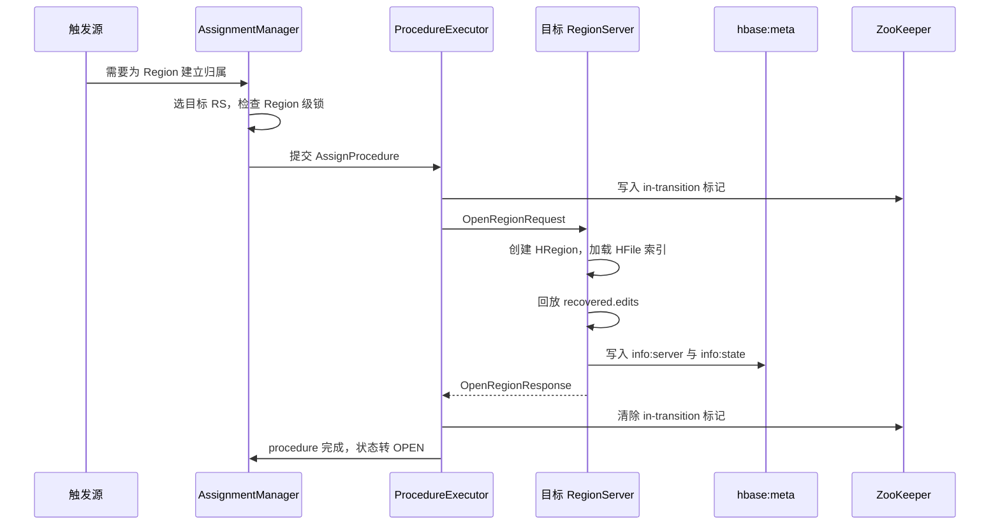
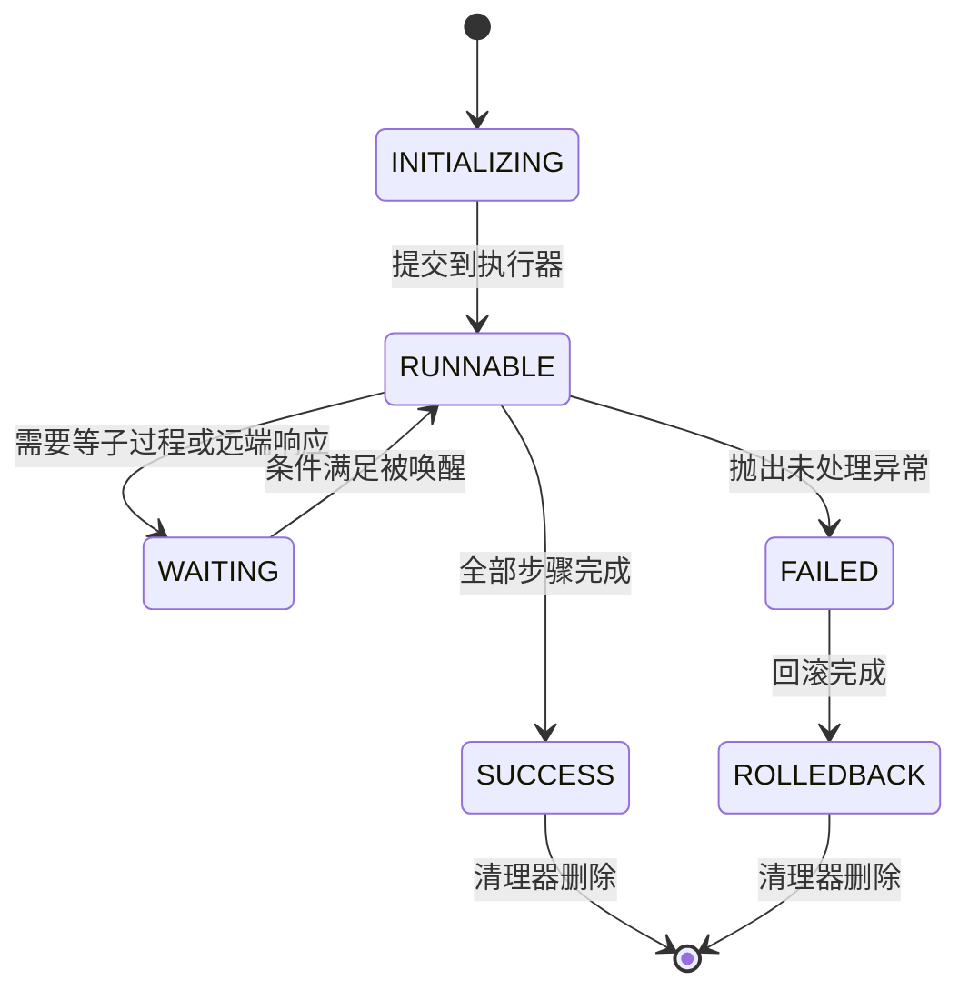

# HBase 整体架构——Master、RegionServer 与 ZooKeeper 的三角协作

**摘要：**

三个角色之间最容易被画错的地方，是依赖线的粗细并不相同，三条线断掉之后的处置方向也完全不同。HMaster 只做管理，它缺席时每一次 Put 照样成功，只有建表、改列族、Region 迁移与 `hbase:meta` 的维护停下来；RegionServer 扛着全部读写，挂一台只丢一段行键范围；ZooKeeper 只存几百字节的协调信息，可它一挂，客户端连"数据在哪"都问不出来。本文以 2.x 的 AMv2 与 procedure 机制为准，1.x 的差异在对应位置标注，沿这三条依赖线拆解协作机制：先给三份职责清单与各自的失败形态，再用 `hbase:meta` 的两级寻址说明客户端为什么绕过 Master，接着走完 Region 分配从 `AssignmentManager` 到 `OpenRegion` 的完整链路，把 in-transition 状态在 procedure store、`hbase:meta` 与 ZooKeeper 上的三种载体对齐，最后落在 2.x 的 `ProcedureV2` 状态机与 `ServerCrashProcedure` 的恢复流程上。2.x 把 Region 的权威状态从 ZooKeeper 迁进了可持久化的 procedure store，这次搬迁改变了排障时的观察点。文末给出六个故障形态的日志关键字与判据，以及三个常见误判——把 Master 当单点、把 `zookeeper.session.timeout` 调小、把 `hbase:meta` 的问题当用户表问题排查。

---

## 第 1 章 三条依赖线：一次凌晨的误判

设想某个工作日的凌晨两点，值班工程师被一条告警叫醒：HBase 全部业务表写入超时，客户端日志里刷满了三行完全相同的堆栈。他先看 Master 的进程，发现三小时前就退出了，日志末尾是一段 OOM 之后的退出记录；接着看 RegionServer，八台全部在线，JVM 内存水位正常，GC 时间也正常；最后才想起 ZooKeeper，登上去一看，三节点里有两个处于不可用状态，剩下那个还在不停打印连接被拒绝。

三小时无人察觉的那个进程，和两分钟就让全公司报警的那个进程，恰恰是多数人直觉里重要性排序的两个极端。

这条告警的处置结论并不复杂：ZK 的多数派丢失之后，RegionServer 与 ZK 的会话陆续过期，`processEphemeralNodeDeletion` 把 `/hbase/rs/` 下的临时节点逐个删掉；Master 本来应该对此作出反应，但它自己已经不在了，于是没有任何人启动恢复流程。两个独立的故障叠加在一个夜里，把一个朴素的判断暴露了出来——决定集群能不能干活的那个组件，往往**不在性能图表的显著位置**。

本章的任务不是复述三个角色的名字，而是把三条依赖线画准：谁依赖谁、依赖的是什么、这条线断了以后还能撑多久。以下讨论默认读者已经知道 HBase 是什么、适合什么场景；这里只关心依赖关系断在哪里、断了之后怎么判。

### 1.1 控制面、数据面、协调面

把一张 HBase 部署图按"流量性质"重新着色，会得到三个平面上差异极大的三条流。

**数据面**是客户端与 RegionServer 之间的 RPC，`Put`、`Get`、`Scan`、`Increment`、`CheckAndPut` 全在这条线上，请求体从几十字节到几十兆不等，延迟以毫秒计，吞吐随节点数线性增长。这条线上没有 Master，也没有 ZooKeeper。

**控制面**是 Master 与 RegionServer 之间的指令流，内容是 `OpenRegion`、`CloseRegion`、`SplitRegion`、`FlushRegion` 这类动作，频率以分钟甚至小时计，但每一次都要求正确执行且可恢复。这条线断了，数据面照跑，控制的意图落不了地。

**协调面**是三个角色各自与 ZooKeeper 的会话流。RegionServer 和 Master 都在 ZK 上持有临时节点，靠会话保活；客户端在冷启动或缓存失效时向 ZK 读一次 `hbase:meta` 的位置。这条线的流量极小，小到几百字节的读写，但它是另外两条线成立的前提。

| 角色 | 在不在这条主路径上 | 挂掉后仍然可用的能力 | 立刻失去的能力 | 恢复手段 |
| --- | --- | --- | --- | --- |
| HMaster | 不在数据面，在控制面 | 全部已有 Region 的读写、Meta 表的读取 | DDL、Region 分配与迁移、负载均衡、meta 清理、故障恢复的发起 | 由 Standby 通过 ZK 选举接管，秒级到分钟级 |
| RegionServer | 在数据面，是唯一执行者 | 其他 RegionServer 上的 Region 完全不受影响 | 它承载的那段行键区间的读写 | Region 重新分配加 WAL 回放，分钟级 |
| ZooKeeper | 不在数据面，但掐住元数据入口 | 已经建连且缓存未失效的读写，短暂维持 | 新客户端定位、Master 选举、RS 存活判定、meta 位置查询 | 恢复 ZK 多数派；无降级路径 |

这张表的最后一行是理解整套架构的钥匙：Master 与 RegionServer 都有替代路径，ZooKeeper 没有。这个不对称不是设计缺陷，而是分布式协调服务的固有属性——一个提供强一致协调的组件，本身就很难被"缓存"或"降级"绕过，因为它的价值恰恰在于"此刻大家看到的是同一份状态"。

### 1.2 依赖的三种质感

同样是"依赖"，三个角色之间的线在质感上差得很远，混在一句话里说"HBase 依赖 ZooKeeper"，几乎必然会推出错误的运维结论。

第一种是**会话依赖**。RegionServer 与 ZK 之间的连接是一个长会话，会话活着，代表"这个进程此刻还在"；会话过期，ZK 删除临时节点，Master 据此判定它死了。这条依赖的特点是双向且即时的：ZK 短时间不可用不会立刻杀死会话，但只要超过 `zookeeper.session.timeout`，会话就必然失效，没有讨价还价的余地。

第二种是**元数据依赖**。客户端要读写某一行，得先知道这一行在哪个 Region、这个 Region 在哪个 RegionServer；这个映射存在 `hbase:meta` 表里，而 `hbase:meta` 的位置存在 ZK 的 `/hbase/meta-region-server` 节点里。这条依赖的特点是分段可缓存：ZK 那一段只在一个客户端的冷启动或者 meta 位置变更时才走一次，meta 那一段则由客户端按 Region 逐条缓存，命中时不产生任何远程调用。

第三种是**决策依赖**。Region 该放到哪台机器、表能不能建、分裂出来的两个女儿 Region 什么时候上线，这些是 Master 的决策，RegionServer 只负责执行。这条依赖的特点是低频且可排队：决策缺席时，已经分配好的 Region 继续服务，只有需要新决策的请求会挂在 Master 的 RPC 队列里，等它回来。

把三种质感分开之后，前面那个凌晨的场景就能一句句拆开：ZK 丢失多数派，先断的是会话依赖，八台 RegionServer 在 90 秒量级内全部被 ZK 判定为过期；Master 已死，决策依赖本来就断了三小时，只是这期间没有新的分配需求，所以无人察觉；最后元数据依赖无法重建，因为新客户端拿不到 meta 位置。三个故障的结果叠加成一条告警，而任何单个故障都不会造成这个局面。

### 1.3 与 HDFS 三角的对照

把 HBase 的三角与 HDFS 的 NameNode / DataNode / JournalNode 摆在一起看，差异集中在一个位置上：主节点在不在数据路径里。

HDFS 的客户端打开一个文件，要先向 NameNode 要块位置，再直连 DataNode 读数据；NameNode 虽然不搬运数据字节，却参与每一次打开文件的决策，所以 NameNode 不可用时，新的读写都停住，只能消费已缓存的块位置。HBase 把这一步彻底下放了：Region 位置这份映射被做成了一张普通的 HBase 表，也就是 `hbase:meta`，它可以被 BlockCache 缓存、可以被 Bloom Filter 加速、也可以分裂成多个 Region，客户端查一次就能缓存住，之后直连 RegionServer。

Bigtable 论文里写过一句判断：客户端直接与 tablet server 通信做读写，不必访问 master。HBase 把这句话落到了实现里，两者的区别可以概括成一句话：HDFS 把元数据集中在一个进程的内存里，HBase 把元数据下放成了一张表。前者让主节点的内存成为稀缺资源，后者的天花板则落在"客户端缓存失效的瞬间会有多密集的请求打到 meta 上"。这笔账在 [[02 HDFS 整体架构全景——NameNode、DataNode 与 Client 三角关系]] 里已经算过一次，HBase 的算盘打得更彻底一些——代价是控制面的复杂度上升，Master 需要一套可持久化的流程框架来保证"做了半截的操作"能被接着做完。

图里那条加粗的箭头值得单独看一眼：它是唯一一条走数据的边，两端分别是客户端与 RegionServer。Master 在这张图上只有两条细虚线——一条连着 ZK，一条连着 RegionServer，都不承载数据字节。故障影响面的大小，本质上由图里每条边的粗细和数量决定。

---

## 第 2 章 HMaster：只做管理，缺席时谁在兜底

### 2.1 能力边界：五种操作，一条判据

Master 的职责可以被压缩成一句话：所有需要"全局唯一决策"的操作都归它，所有需要"逐行搬运数据"的操作都不归它。

具体展开是五类。**表的生命周期**：`createTable`、`deleteTable`、`truncateTable`、`modifyTable`（改列族属性）、`enableTable`/`disableTable`，这些操作要同时改动 `hbase:meta`、HDFS 目录与多个 RegionServer 的状态，属于典型的多方一致问题。**Region 的分配与迁移**：决定每个 Region 由哪台 RegionServer 服务，包括启动时的初始分配、RegionServer 故障后的重新分配、跨机器的迁移。**负载均衡**：周期性地计算出迁移计划，`hbase.balancer.period` 默认 300000 毫秒，也就是五分钟一轮。**`hbase:meta` 的维护**：`CatalogJanitor` 定期扫描 meta，清理已合并或已分裂的旧行，并报告空洞与重叠。**故障恢复的编排**：感知 RegionServer 下线之后，启动 WAL 分割与 Region 重分配。

判断一个操作要不要 Master，有个很省事的办法：问它是否会改变"某一行数据归谁管"。会，就归 Master；不会，就不归。`Put` 不改变归属，所以不归 Master；`splitRegion` 改变了两个女儿 Region 的归属，所以归 Master。

### 2.2 为什么 DDL 非要经过 Master

一个自然的疑问是：建表这件事，客户端直接把 `hbase:meta` 里该写的行写进去，再让某个 RegionServer 把 Region 打开，不行吗。

不行，问题出在"多步操作的原子性"。建一张表至少要动三处：在 HDFS 上创建 `/hbase/data/<namespace>/<table>` 目录、在 `hbase:meta` 里写入新 Region 的行、让目标 RegionServer 真正把 Region 打开并进入可服务状态。这三步之间任何一步失败，都会留下一个"半张表"：目录建了但 meta 没写，是垃圾目录；meta 写了但 Region 没打开，是客户端能查到位置却连不上的死 Region；Region 打开了但 meta 没写，是无人知晓的孤儿 Region。

1.x 时代，Master 的处理方式是尽力而为：每个 handler 自己做状态记录，失败后重试，Master 进程中途崩溃则靠重启扫描来对账。这套办法在正常情况下够用，在"Master 在做一半 DDL 时被 kill -9"这种场景下就会留下不一致，需要人工跑 `hbck` 收拾。2.x 的答案是把每个 DDL 包装成一个可持久化的 procedure，用状态机表达"此刻进行到哪一步"，进程崩溃后由新 Master 从持久化状态接着跑，这就是 `ProcedureV2`（后文简写 Pv2）的基本思路，具体机制放在第 7 章展开。

### 2.3 决策与执行的分离

Master 决定 Region 的归属，但打开和关闭 Region 这件事是 RegionServer 干的。这条分工在代码里的体现很直白：Master 侧的 `AssignmentManager` 持有一份内存中的 Region 状态表，它把状态变化翻译成一串 procedure，procedure 通过 RPC 向目标 RegionServer 发 `OpenRegionRequest`；RegionServer 的 `RSRpcServices` 收到请求后打开 Region，然后回一个 `OpenRegionResponse` 说明成功还是失败。

这条分工有个不太显然的后果：Region 状态存在三个地方，而且三者可能短暂不同步。Master 的内存里是一份，`hbase:meta` 的 `info:state` 列是一份，ZooKeeper 上可能还有一个表示"正在迁移"的节点。判断 Region 状态不能只看其中任何一个，三者的对应关系见第 6 章。

### 2.4 Master 缺席的三类隐性代价

"Master 挂了集群照跑"这句话在读写层面是对的，但它容易被读成"Master 挂多久都没关系"，这就错了。Master 缺席超过一段时间，会累积三类代价，且这些代价在恢复之后才爆发。

第一类是决策积压。客户端发来的 `createTable` 请求会在 RPC 层堆积，超时后返回 `PleaseHoldException` 或 `MasterNotRunningException`；如果业务侧有自动化建表脚本，此时会重试，Master 恢复瞬间可能被一波重试打满 handler。

第二类是分裂停滞。RegionServer 自己可以决定何时分裂，但分裂出来的女儿 Region 需要 Master 分配归属才能上线，在此期间父 Region 保持只读——写入继续落在父 Region 上，等到 Master 回来，才有一次集中的 Region 打开动作。对写入量大的表，这几小时里父 Region 会长得比平时更大。

第三类是恢复能力归零。RegionServer 故障之后，没有人启动 `ServerCrashProcedure`，故障机上承载的 Region 就一直处于不可用状态（恢复链路的完整步骤见 [[09 HBase 高可用与容灾——崩溃恢复、备份与复制|WAL 分割与恢复]]）；`CatalogJanitor` 也停摆，meta 里的垃圾行越积越多，等 Master 回来看见的可能是一张需要 `fixMeta` 收拾的元数据表。

| Master 状态 | Put / Get / Scan | 建表与改表 | Region 分裂后的上线 | RS 故障后的恢复 | 负载均衡 |
| --- | --- | --- | --- | --- | --- |
| Active 在线 | 正常 | 正常 | 正常 | 自动发起 | 每 5 分钟一轮 |
| 主备切换中（秒级到分钟级） | 正常 | 阻塞在 RPC 队列 | 短暂停滞 | 等新 Master | 暂停 |
| 长时间缺席（小时级） | 正常，直到需要新分配 | 全部失败 | 女儿 Region 不上线，父 Region 只读 | 不发起，Region 不可用 | 停止 |
| 全部 Master 退出且无备 | 同上，但无恢复路径 | 全部失败 | 永久停滞 | 永久停滞 | 停止 |

### 2.5 内部组件与它们的失败方式

Master 不是一个整体，它对外的能力由几个内部模块共同支撑，这些模块各自的失效方式不同，读日志时能对上号。

`ServerManager` 维护在线 RegionServer 列表，监听 `/hbase/rs/` 下节点的增删，同时处理 RegionServer 的心跳汇报。它出问题时，典型表现是 Master 的 Web UI 上 RegionServer 列表与实际不符，或者日志里出现 `Server <serverName> is not online` 之类的判定。

`AssignmentManager`（2.x 的 AMv2）维护 Region 的归属状态，并把每次状态迁移翻译成 procedure。它最怕的是"状态发散"：内存里的状态、procedure 里的状态、meta 里的状态三者对不上，此时 Region 就会卡在 in-transition，客户端拿到的位置指向一台已经不再服务它的机器。

`LoadBalancer` 与 `RegionNormalizer` 负责均衡，前者按 Region 数量与负载做迁移计划，后者按存储量做归并。它们的失效不会影响可用性，只会让集群慢慢长歪。

`CatalogJanitor` 扫描 meta、清理垃圾行并报告空洞与重叠。它停摆的后果是元数据膨胀与 `hbck` 报告的 holes 数量上升。

`ProcedureExecutor` 是 Pv2 的调度器，持有若干工作线程，把 RUNNABLE 状态的 procedure 取出来执行，把 WAITING 状态的挂起等条件满足。它的线程池被打满时，表现是"所有 DDL 都变慢"，而不是报错——这一条在排查"建表卡住"时经常被忽略。

这张图里有一条值得记住的不对称：所有模块都依赖 `ProcedureExecutor` 推进，而 `ProcedureExecutor` 又依赖 procedure store 的读写。当有人报告"建表一直挂着"，最快的判据不是看 Master 的 CPU，而是看 procedure 队列里那条记录的 `state` 与 `server_name` 字段——前者告诉你它卡在哪个阶段，后者告诉你它在等谁。

---

## 第 3 章 RegionServer：读写全在这里，故障形态也全在这里

### 3.1 一个 RS 的内部结构

RegionServer 是整个集群唯一执行数据读写的进程，它的内部可以按"一次写请求经过什么"来切分：`RSRpcServices` 接收 RPC，按 Region 分发到对应的 `HRegion`，`HRegion` 先追加 WAL 再写 MemStore，MemStore 超过阈值后由 Flush 线程落成 HFile，HFile 由 Compaction 线程合并，读取时先查 BlockCache 再查 MemStore 与 HFile。

这套结构在 [[05 HBase 写入链路深度解析——WAL、MemStore Flush 与持久性保证]] 与 [[06 HBase 读取链路深度解析——BlockCache、Scanner 与多版本合并]] 里逐层拆过，此处只需记住两个对架构判断有用的事实。第一，WAL 是 RegionServer 级别的，不是 Region 级别的：一台 RS 上所有 Region 的写入混在同一组 WAL 文件里，这正是故障后需要"分割"的原因——必须按 Region 把日志拆开，才能交给不同的接管者回放。第二，MemStore 是 Region 与列族的笛卡尔积：一台 RS 上 200 个 Region、每个 2 个列族，就是 400 个 MemStore，每个都占堆内存，这也是"选一个大 Region 还是很多小 Region"这类容量问题的源头，相关取舍见 [[08 HBase Region 分裂与负载均衡——水平扩展的工程底层]]。

### 3.2 心跳的两条线

RegionServer 的"活着"由两条完全独立的通道定义，混淆这两条线是误判 RS 状态的首要原因。

第一条是向 Master 的汇报，周期由 `hbase.regionserver.msginterval` 控制，默认 3000 毫秒。汇报内容是 `RegionServerReport`：本机的负载统计、当前服务的 Region 列表、以及 Master 需要知道的一些计数器。Master 的 `ServerManager` 收到之后更新该 RS 的最后汇报时间。这条通道只影响 Master 对负载的认知，不影响别的。

第二条是向 ZooKeeper 的会话保活，周期与会话超时相关，最终由 `zookeeper.session.timeout`（HBase 默认 90000 毫秒）约束。ZK 的客户端会在后台按 `tickTime` 的整数倍发送 ping，只要会话在超时窗口内有一次成功的交互，会话就延续；一旦窗口内没有任何交互，ZK 服务端删除该会话创建的所有临时节点，其中包括 `/hbase/rs/<hostname>,<port>,<startcode>`。

这两条线的关键区别在于"谁说了算"：Master 认不认为 RS 活着，看的是 ZK 上的临时节点，而不是自己收到的汇报。所以出现"Master 的 UI 上 RS 还在、但 ZK 上 `/hbase/rs` 已经空了"这种局面时，真相是 ZK 那边判了死刑，Master 只是还没来得及处理。

### 3.3 单台 RS 故障的完整链路

一台 RS 死掉之后，集群要经过五个阶段才恢复到"数据可读写"，每个阶段都有对应的日志与判据。

第一阶段是感知。ZK 在会话过期后删除临时节点，Master 的 `ServerManager` 在 `/hbase/rs/` 上收到节点删除事件，日志里会出现 `Processing expiration of <serverName>` 一类记录。这一段耗时的下界就是 `zookeeper.session.timeout`，具体数值在第 3.6 节推算。

第二阶段是登记故障。Master 为这台 RS 生成一条 `ServerCrashProcedure`，用它把"这台机器以及它承载的全部 Region"作为一个整体来处理。进入这一步之后，Region 在 AMv2 里的状态被标记为需要重新分配，客户端再访问这些 Region 会得到 `NotServingRegionException` 或者定位失败。

第三阶段是 WAL 分割。故障 RS 的 WAL 目录下有一组文件，每个文件里混着多个 Region 的写入。2.x 把这件工作做成了分布式任务：任务通过 ZK 上的节点分发，由存活的多台 RegionServer 并行认领，各自把分到的 WAL 片段按 Region 拆成 `recovered.edits`，写到该 Region 目录下。这一段是恢复耗时的大头，因为要读的字节数正比于故障前的写入量。

第四阶段是 Region 重新打开。`AssignProcedure` 把每个 Region 分配给一台新的 RS，新 RS 打开 Region 时先读 HFile 的索引，再把 `recovered.edits` 里序列号大于已落盘数据的部分回放进 MemStore。这里有个幂等设计值得单独看一眼：`recovered.edits` 的文件名携带序列号，回放时只处理序列号大于该 Region 所有 HFile 最大序列号的部分，所以同一份日志重复回放不会造成重复写入。

第五阶段是上线。新 RS 打开成功后向 Master 报告，`hbase:meta` 的 `info:server` 列更新为新归属，客户端在缓存失效后重新定位，请求恢复。

### 3.4 三类故障，三种数据风险

同样是"RS 不可用"，进程被杀、机器断电、网络隔离的后果差别很大，因为本地未落盘的数据还在不在，完全取决于故障类型。

| 故障类型 | 检测依据 | 本地未落盘数据 | 主要风险 | 恢复动作 |
| --- | --- | --- | --- | --- |
| 进程崩溃（kill -9、OOM 退出） | ZK 会话超时 | 随进程消失 | 无，WAL 已持久化在 HDFS | 标准 ServerCrashProcedure |
| 机器断电、磁盘损坏 | ZK 会话超时 | 随机器消失 | WAL 尾部可能因 HDFS 租约未续而截断 | 同上，另有 HDFS 层面副本修复 |
| 网络隔离（进程活着但连不上 ZK） | ZK 会话超时，进程侧稍后才发现 | 进程内存里仍有一份 MemStore | 双写窗口，见 3.5 节 | RS 自杀，Master 重新分配 |

前两种是干净的失败：进程或机器没了，内存里的 MemStore 一起没了，但 WAL 已经写到 HDFS，回放即可。第三种最麻烦，因为进程还活着、还能接收客户端的 TCP 连接、还能往 MemStore 写数据，而集群这边已经认定它死亡并开始重新分配。

### 3.5 「RS 还活着，ZK 认为它死了」

这个场景在 2.x 里有一道防线，理解这道防线在哪一层，决定了排查时该看什么日志。

第一层防线在 RS 自己身上。ZK 的会话一旦过期，RS 里的 ZK 客户端会收到 `Expired` 事件，RegionServer 的处理是主动 abort——日志里会出现类似 `ZK session expired, aborting` 的记录，进程随后退出。这是"自杀"语义：宁可自己死，也不带着一份已失效的集群身份继续服务客户端。之所以这样设计，是因为一个无法在 ZK 上保活的 RS，已经无法确认自己对某个 Region 是否仍有独占权，继续写就是在赌。

第二层防线在 WAL 的 HDFS 租约上。接管者回放之前要先对故障 RS 的 WAL 文件做租约恢复，这一步会强制抢占文件的写入租约；原 RS 如果还活着并试图继续写入，会因为租约丢失而失败，随后的 abort 是必然结果。换句话说，即使 session 过期的判定出了偏差，HDFS 的租约机制也会保证"同一份 WAL 只有一个写者"。

第三层防线是回放的幂等。`recovered.edits` 的文件名带序列号，打开 Region 时只回放序列号高于已落盘 HFile 最大值的那部分，重复回放不会叠加数据。这一层解决的是"回放了一半又被中断"的问题，而不是双写问题。

三层防线的边界要说清楚：它们能保证"已确认写入的数据不丢、不重复"，但无法保证"假死期间原 RS 收到的、还没返回客户端的那部分写入一定生效"。客户端在这段窗口里若收到超时，重试即可；这类写入本来就没有向客户端确认过，按协议不算丢失。

### 3.6 时间窗的量化推算

下面把几条线换算成时间，供值班时心算。数值按默认配置做示例推算，不是实测数据。

ZK 判定一个会话过期的时间，大致是 `zookeeper.session.timeout` 加上一个 tick 的调度延迟。HBase 默认 `zookeeper.session.timeout` 为 90000 毫秒，ZK 的 `tickTime` 默认 2000 毫秒（HBase 内置启动的 ZK 常用 6000 毫秒），因此从 RS 停止保活到临时节点被删除，量级在 90 秒到 96 秒之间。这是故障检测的下界，也是所有 MTTR 讨论的起点。

从节点被删除到 ServerCrashProcedure 被调度，是 Master 的事件处理延迟，量级在秒以内；如果 Master 本身不在线，这一段就无限长——这正好解释了第 1 章那个夜晚。

WAL 分割与 Region 打开的耗时没有通用公式，它取决于故障前该 RS 的写入量、Region 数量与 HFile 数量。按示例推算：一台 RS 上有 200 个 Region、WAL 文件总量 8 GB，分割阶段受 HDFS 读取带宽与并行度约束，若 10 台 RS 并行认领、每台每秒处理 50 MB，分割约需十几秒；打开阶段 200 个 Region 分摊到 20 台 RS，每台 10 个 Region，单个 Region 打开（读索引、回放 edits）按 1 到 3 秒估算，几十秒可以完成。整体 MTTR 落在分钟量级，但这条估算对"Region 数量多、单 Region 大"的集群会严重低估，因为打开 Region 的时间随 HFile 数量增长，而 HFile 数量又由 Compaction 状况决定。

> [!warning] 时间窗的运维含义
> 检测延迟由 `zookeeper.session.timeout` 决定，恢复延迟由数据量决定，两者是独立的旋钮。把 session timeout 调小只会缩短前一段，对后一段毫无帮助，却会放大误判概率；真正压缩后一段的手段是控制 Region 数量、保证 Compaction 跟得上、以及让 WAL 分割有足够的并行度。把两个旋钮混为一谈，是"调参之后故障恢复没变快"这类抱怨的常见来源。

---

## 第 4 章 ZooKeeper：为什么它挂了全完

### 4.1 ZK 上到底存了什么

打开一个运行中的 HBase 集群的 ZK 客户端，`ls /hbase` 看到的东西少得让人意外：几个目录，每个目录下面几个子节点，节点里的数据大多是几十到几百字节。这套结构承担了整个集群的"谁是谁"。

| Znode 路径 | 内容 | 节点类型 | 写入者 | 读取者 |
| --- | --- | --- | --- | --- |
| `/hbase/master` | 当前 Active Master 的服务器名 | 临时 | Active Master | Standby、RegionServer、运维工具 |
| `/hbase/backup-masters/<host>` | 备 Master 的身份登记 | 临时 | 每个备 Master | Active Master、Web UI |
| `/hbase/rs/<host,port,startcode>` | 在线 RegionServer 的登记 | 临时 | 每台 RegionServer | Master 的 ServerManager |
| `/hbase/meta-region-server` | `hbase:meta` 主副本所在 RS 的描述 | 持久 | 承载 meta 的 RegionServer 或 Master | 所有客户端 |
| `/hbase/table/<tableName>` | 表的启用状态，如 `ENABLED`、`DISABLED` | 持久 | Master | 客户端、RegionServer |
| `/hbase/table-lock/<tableName>` | 表级操作锁，防止并发的 disable 与 create | 临时 | Master | Master |
| `/hbase/namespace/<ns>` | Namespace 的定义 | 持久 | Master | 客户端、Master |
| `/hbase/hbaseid` | 集群的唯一标识，防止配置串集群 | 持久 | 首个启动的 Master | 所有组件 |
| `/hbase/region-in-transition/<encoded>` | Region 正在迁移的状态标记 | 临时 | Master | 客户端、运维工具 |
| `/hbase/splitWAL/<task>` | 分布式 WAL 分割的任务节点 | 临时 | Master 与参与分割的 RS | 参与分割的 RS |

这张表可以按"节点类型"分成两半，这个分法比按功能分更有信息量。**临时节点**那一半的意义是"我这个进程此刻还在"，会话一断节点就消失，这是 HBase 用 ZK 做存活检测的全部原理；持久节点那一半的意义是"这份配置或状态被某个进程改成了这样"，它不随会话消失，只能被显式改写。`/hbase/hbaseid` 还顺便解决了客户端误连到别的集群 ZK 的问题：标识不匹配就直接报错，而不是悄悄读到别人的元数据。

### 4.2 三种用法：临时节点、持久节点、版本号

第一种用法是互斥。ZK 保证同一个路径下只能存在一个同名节点，创建成功即代表抢到锁。HMaster 的选举就建立在这一点上：所有 Master 都去创建 `/hbase/master`，成功者成为 Active，失败者转为 Standby 并注册 `/hbase/backup-masters/<host>`，同时在该节点上挂一个 Watch。

第二种用法是存活探测。临时节点的生命周期与会话绑定，进程挂了、网络断了、会话超时了，节点都会被删除。RegionServer 的注册、Master 的注册都属此类。这套机制的精确性来自 ZK 的会话语义：不存在"节点还在但进程已经僵死"的中间态，因为保活是客户端的义务，不保活就过期。

第三种用法是版本号 CAS。ZK 的每个节点有一个 `version`，`setData` 可以带期望版本，版本不符则失败。HBase 用它实现一些轻量的状态机，譬如表的启用状态变更、区域迁移标记的改写。这套用法的价值在于"读-改-写"可以变成原子的：先 `getData` 拿到版本，再带版本写回，中间被别人改过就失败重试。

三种用法对应三种失效模式，这一点常被忽略。互斥失效会让两个 Master 同时认为自己可用；存活探测失效会让 Master 误判 RS 死亡并触发大规模迁移；CAS 失效会让状态更新被静默覆盖。所以 ZK 出问题时，表现不是单一的"不可用"，而是按恢复快慢呈现几种不同的坏法。

### 4.3 Master 选举的真实过程

选举过程本身很短，但它的几个细节决定了主备切换的表现。

Active Master 启动时先初始化内部组件，再向 ZK 创建 `/hbase/master` 临时节点，节点数据是自己的服务器名（`host,port,startcode` 形式）。创建成功则进入 Active 状态，开始监听 `/hbase/rs/`、扫描 `hbase:meta`、启动 `ProcedureExecutor` 的恢复流程。创建失败说明已有 Master 在位，自己转入 Standby，读取当前 `/hbase/master` 的数据知道对手是谁，并在该节点上设置 Watch。

Active 退出时（正常 stop 或进程死亡），临时节点被删除，所有 Standby 的 Watch 同时被触发，它们重新竞争创建节点，抢到的那台完成初始化后接管。这里有个容易忽略的细节：接管不是瞬间完成的，新 Master 要把 procedure store 里未完成的 procedure 重新装载、扫描 `hbase:meta` 重建 Region 状态、重新初始化 `ServerManager`。这段时间里客户端发来的 DDL 会收到 `PleaseHoldException`，含义是"Master 还在初始化，请稍后重试"，而不是"集群坏了"。

主备切换期间有一类操作会失败得比较隐蔽：正在进行中的 DDL。1.x 时代靠 handler 重试，切换后可能留下半成品；2.x 时代，未完成的 procedure 会被新 Master 从 store 里取出继续执行，客户端感知到的只是这次调用的延迟变长。这是 Pv2 在运维层面最实际的收益，虽然它同时也是"为什么 procedure 会卡住"这个新问题的来源。

### 4.4 ZK 不可用的四个阶段

ZK 故障对 HBase 的影响分阶段，每阶段的判据与处置都不同；分清楚阶段，才不至于把"网络抖动"当成"集群崩溃"来处理。

| 阶段 | 判据 | 客户端表现 | 集群表现 | 处置方向 |
| --- | --- | --- | --- | --- |
| 抖动，短于会话超时 | 单个 ZK 节点重启，多数派仍在 | 无感知，或偶发一次定位重试 | 无 | 观察，不动作 |
| 超过会话超时，多数派仍在 | ZK 日志有大量会话过期，RS 日志出现 `ZK session expired` | 新连接定位失败，重试后可能成功 | 部分 RS 自杀，Master 触发 ServerCrashProcedure | 先恢复 ZK 抖动源，再等 Region 收敛 |
| 多数派丢失 | ZK 无法完成任何写，`/hbase` 下节点不可写 | 全面失败，元数据查询超时 | 所有 RS 在超时后自杀，Master 可能已失效 | 恢复 ZK 多数派是第一优先级，不要动 HBase |
| ZK 恢复瞬间的雪崩 | ZK 恢复后大量会话重建 | 定位请求集中打到 meta | 全部 RS 重新注册，Master 重新扫描 meta 并做大规模分配 | 限流客户端重连，观察 procedure 队列 |

第四阶段是最容易被低估的。ZK 恢复并不等于 HBase 恢复：所有 RegionServer 都要重新注册、所有临时节点要重建、Master 要重新扫描 `hbase:meta` 并按 ServerCrashProcedure 处理那一批"刚刚死过"的机器；期间会有大量 Region 处于 in-transition，客户端密集重试，meta 表承受集中查询。这个雪崩的持续时间往往比 ZK 故障本身长得多。

### 4.5 为什么它是唯一没有降级路径的依赖

有人会问：既然客户端会缓存 Region 位置，那 ZK 挂了以后，缓存还有效的客户端是不是可以继续读写。

严格按机制推演，答案是"可以，但窗口极短，实际不可依赖"。可以，是因为客户端读写走的是与 RegionServer 的直接连接，只要连接还在、缓存的位置还有效、目标 Region 没有被迁移，读写就不需要 ZK 参与。窗口极短，是因为 RegionServer 自己在 ZK 会话过期后会主动 abort，一旦 RS 退出，客户端的连接就断了，缓存再有效也没有对端可以发送。

换句话说，ZK 挂了"HBase 全停"这件事，**执行者是 RS 的自杀逻辑**，而不是客户端的定位失败。这个区分在排查时很有用：如果你看到客户端在报定位错误但 RegionServer 进程都还在，那问题多半在 ZK 的读路径或者客户端配置；如果看到 RegionServer 成批退出，那才是会话过期的连锁反应。

没有降级路径的根因在于一致性要求。Region 的归属必须全局唯一，任何一个时刻都不能有两台 RS 同时认为自己服务同一个 Region；这份"唯一性"需要一个所有参与者都认可的仲裁者，ZK 就是这个仲裁者。换成 etcd 或用 Raft 自建协调层的尝试改变的是技术栈，不是"必须有一个协调层"这个事实。

---

## 第 5 章 hbase:meta：一张系统表的特殊地位

### 5.1 meta 存什么，行键怎么排

`hbase:meta` 是一张普通的 HBase 表，只是它的内容描述了所有其他表的位置。每一行对应一个 Region，行键的形式是 `<tableName>,<startKey>,<encodedRegionName>`，三个分量用逗号分隔。

这个行键设计是整张表可用性的关键。因为 HBase 按行键字典序存储（[[02 HBase 数据模型深度解析——RowKey、列族、Cell 与多版本机制|行键与 Region 的对应关系]]），所有属于同一张表的 Region 天然聚在一起，同一张表的 Region 又按 `startKey` 升序排列；客户端要查"某张表里行键 X 属于哪个 Region"，只需要用 `<tableName>,<X>` 做一次 `Get` 的最近匹配，就能定位到起始键不大于 X 的那一行，不必扫描整张 meta 表。

| 列 | 内容 | 用途 |
| --- | --- | --- |
| `info:regioninfo` | RegionInfo 的序列化形式，含表名、起止键、RegionId | 客户端据此判断该 Region 是否覆盖目标行键 |
| `info:server` | 当前服务该 Region 的 RegionServer 名 | 客户端据此建立直连 |
| `info:serverstartcode` | 该 RegionServer 的启动码 | 区分同名机器重启前后的身份，避免把 Region 定位到上一个进程 |
| `info:state` | Region 状态，如 `OPEN`、`CLOSING`、`SPLITTING` | Master 与 hbck 判断状态是否收敛 |
| `info:splitA`、`info:splitB` | 分裂后两个女儿 Region 的 RegionInfo | 分裂完成后的对账依据 |
| `info:mergeA`、`info:mergeB` | 合并前的两个源 Region | 合并过程的记录，由 CatalogJanitor 清理 |

`info:serverstartcode` 这一列值得单独说一句。它解决的是"机器名相同但进程换了"的歧义：RegionServer 的标识是 `host,port,startcode` 三元组，其中 `startcode` 是进程启动时的时间戳。同一台机器重启一次 RegionServer，`host` 与 `port` 都没变，只有 `startcode` 变了；只记 `host,port` 就可能把客户端指向一个已经退出的进程。这个看似冗余的字段，是"身份"与"位置"分离的体现。

### 5.2 两级寻址与客户端缓存

客户端的定位过程是**两级寻址**：第一级从 ZK 拿到 `hbase:meta` 主副本的位置，第二级用 `hbase:meta` 拿到目标用户 Region 的位置，然后直连目标 RegionServer 执行读写。

图里那条回环是这套机制的真正核心。定位信息不是一成不变的，Region 会迁移、会分裂、会因故障被重新分配，所以客户端必须准备好"用过期位置发请求、被拒绝、刷新、重试"这条路径。这条路径的设计取向是乐观的：默认缓存有效，出错才刷新。它的好处是稳态下零额外开销，坏处是迁移发生时出现一小批必然失败的请求。

关于第一级，有一个流传很广的错误描述需要纠正。`/hbase/meta-region-server` 节点里存的不是一段可直接读的字符串，而是一个序列化的结构（`MetaRegionServer`，包含服务器名、启动码与副本编号），需要用 HBase 提供的工具类解析。老文章里那种"`zkClient.getData` 拿到 `host:port` 字符串"的写法，在真实集群上会得到一段二进制。

关于第二级，还有一个经常被问到的参数：客户端的 meta 位置缓存有没有过期时间。翻 2.x 的默认配置，找不到所谓 `hbase.client.meta.cache.ttl` 这个参数——2.x 的客户端（`ConnectionImpl` 与 `AsyncConnectionImpl`）维护的 Region 位置缓存没有定时过期，它靠错误驱动失效：收到 `NotServingRegionException`、连接被拒、或者 Region 迁移通知时清除对应条目。这个参数在 1.4 与 2.x 的默认配置里都查不到，但多份资料仍在引用，多半是从更早的实现或另一层客户端继承下来的说法；按 2.x 的代码，缓存是否失效取决于"有没有收到错误"，而不是"缓存放了多久"。这一点直接影响容量规划：一个长时间不访问某张表的客户端，它的缓存不会自动过期，一旦该 Region 迁走，第一次请求必然要付一次重定位的代价。

### 5.3 meta 自己也会分裂、也会挂

`hbase:meta` 的地位特殊，但它并不特殊对待自己的可用性——它自己也是一张表，也有 Region，也需要被分配、被打开、被服务。

默认情况下 meta 只有一个 Region，这与早期的 `-ROOT-` 表有关。0.96 之前存在三级结构：ZK 存 `-ROOT-` 的位置，`-ROOT-` 存 `.META.` 的位置，`.META.` 存用户 Region 的位置；`-ROOT-` 那一级被去掉之后，三级变两级，ZK 直接指向 meta。这个简化解释了为什么 ZK 上只有一个 `meta-region-server` 节点，也解释了"元数据寻址是两跳"这个心智模型的来源。

meta 只有一个 Region 时，它的上限由单个 RegionServer 的读取能力决定。集群规模上去之后，几万个 Region 的元数据都压在一台机器上，客户端在缓存集中失效时会把请求打到这里，这个单点会变成瓶颈。所以 2.x 允许 meta 分裂成多个 Region，行键前缀按表名分区，客户端仍按同样的方式定位，只是第一跳之后可能落到 meta 的不同 Region 上。分裂这件事对运维的含义是：meta 不再是"一个 Region 的容量"，而是"一张可以扩展的表"，但它仍然不是免费的——meta 分裂需要额外的 procedure 与元数据搬迁，规划时要留出余量，相关取舍与普通 Region 的分裂是同一套逻辑。

meta 的不可用比任何用户表不可用都要严重，因为它是所有定位的前提。判据很清楚：如果所有用户表同时报定位失败、客户端在查询 meta 时超时、ZK 上 `/hbase/meta-region-server` 节点为空或指向一台已退出的机器，那么问题在 meta，不在任何一张用户表。此时的处理顺序是先让承载 meta 的 RegionServer 恢复或者重新分配 meta Region，而不是去逐个检查用户表的状态。

### 5.4 2.x 的几处变化

从 1.x 到 2.x，meta 相关的实现有几处变化，它们影响排障时的预期，值得单独列出。

第一处是 meta 副本。2.x 支持为 meta 配置多个副本（`hbase.meta.replica.count` 默认 1，`hbase.meta.replicas.use` 默认 false），副本是主副本的只读镜像，按 HBase 的 Region 副本机制刷新。开启之后，客户端在主副本不可达时可以尝试读副本定位 Region，从而缩短 meta 故障的不可用窗口。代价是额外的存储与刷新开销，以及"副本可能落后"这个必须被接受的语义——副本读到的是稍早的位置，客户端拿它去访问失败后仍需重试主路径。

第二处是 meta 的存储位置与归属。1.x 的 meta 数据目录与用户表并列，2.x 随着 AMv2 与 procedure 机制重写，meta Region 的打开、关闭、迁移全部纳入 procedure 管理，Master 启动流程里多了一段"确保 meta 已在线"的强制步骤；具体目录布局随版本变化，以对应版本文档为准。

第三处是状态载体。1.x 把 Region 的迁移状态大量依赖 ZK 上的临时节点来表达，2.x 的 AMv2 把权威状态搬到了 Master 的 procedure store 与 `hbase:meta` 的 `info:state` 列，ZK 上的 `/hbase/region-in-transition` 退化为观测与兼容用途。这个迁移的后果是：2.x 里"Region 卡住"的判据不能再只看 ZK 节点，必须同时看 procedure 队列与 meta 的 state 列。

| 检查对象 | 1.x 的含义 | 2.x 的含义 | 判据用途 |
| --- | --- | --- | --- |
| `/hbase/region-in-transition/<encoded>` | 迁移状态的权威来源 | 观测用标记，权威在 procedure store | 快速判断是否在迁移，不能作为唯一依据 |
| `hbase:meta` 的 `info:state` | 状态快照 | 与 AMv2 内存状态一致的快照 | 判断 Region 是否已标记 OPEN 或 CLOSING |
| procedure store 里的 procedure | 不存在 | 每次状态迁移的权威记录 | 判断"谁在等谁"，见第 7 章 |
| `/hbase/meta-region-server` | 单节点 | 主副本位置，副本另有登记 | 判断 meta 主副本在哪台机器上 |

### 5.5 判据：meta 的问题与用户表的问题怎么分

把 meta 的故障误判成用户表的故障，是运维里代价很高的一种错误，因为处置方向完全相反：用户表的问题通常靠等待 Region 收敛或者重启相关 RegionServer 解决，meta 的问题必须动分配甚至动元数据。

| 现象 | 更可能是用户表问题 | 更可能是 meta 问题 |
| --- | --- | --- |
| 失败范围 | 集中在某几张表、某段行键 | 所有表同时失败，包括从未访问过的表 |
| 客户端异常 | `NotServingRegionException`，重试后换个 Region 可能成功 | 定位阶段就失败，`MetaTableAccessor` 相关堆栈，重试全部失败 |
| Master 侧 | 有明确的 assign 与 unassign 记录 | `hbase:meta` 的 Region 处于非 OPEN 状态，或 Master 停在初始化阶段 |
| ZK 侧 | `/hbase/rs` 有一两个节点消失 | `/hbase/meta-region-server` 为空，或指向已退出的 RS |
| hbck 输出 | 局部 holes 或 overlaps | 大范围 holes，meta 行缺失，`extraRegionsInMeta` 大量出现 |
| 处置 | 等待收敛，必要时 `assigns` 单个 Region | 先恢复 meta Region 的归属，再处理用户 Region |

那张表里"包括从未访问过的表"这一行是最有效的判据。用户表的故障总是局部的，因为每张表的 Region 分布在不同机器上；当一张三个月没人碰过的表也失败时，问题几乎一定在共享的那一层。

---

## 第 6 章 Region 分配的完整链路

### 6.1 分配请求从哪里来

一次"把某个 Region 打开在某台 RegionServer 上"的动作，可能由六种事件发起，来源不同，判据也不同。

集群启动时的引导分配，把 meta 与用户 Region 的初始归属建立起来。RegionServer 掉线之后的重新分配，由 `ServerCrashProcedure` 触发。分裂完成后的女儿 Region 上线，由分裂 procedure 收尾时触发。手工迁移，`move` 命令或者 HBCK2 的 `assigns`。负载均衡产生的迁移，由均衡器周期触发。表级操作引发的分配，譬如 `disable` 要先 unassign 全部 Region、`enable` 要重新 assign、`truncate` 要先删后建。

这六种来源最终都汇到同一个出口：`AssignmentManager` 生成一个 procedure，交给 `ProcedureExecutor` 执行。

### 6.2 AMv2 的状态机与 procedure 类型

在 2.x 的 AMv2 里，每次 Region 状态迁移都用一个 `TransitRegionStateProcedure` 的子类表示，常用的三个是 `AssignProcedure`（把 Region 从不可用变成可用）、`UnassignProcedure`（反过来）、`MoveRegionProcedure`（先 unassign 再 assign，并带上目标机器）。

这三个类型的选择规则很朴素：如果只是让 Region 有归属，用 Assign；如果只是撤回归属，用 Unassign；如果指定了目标机器，用 Move。之所以不合并成一个"设置归属"的操作，是因为三者的失败语义不同——分配失败可以重试到别的机器，撤回失败通常意味着目标 RegionServer 已经不可达，迁移失败则要决定是退回原机器还是继续找新机器。

序列化是这套设计的另一个重点。AMv2 对同一个 Region 的多个操作做串行化：一个 Region 在任意时刻只允许一个 in-flight 的迁移 procedure。这条约束保证了"状态不会同时被两个 decision 推着走"，代价是当某个 procedure 卡住时，同一 Region 后续的所有操作都要排队——这正是"Region in transition 卡住"会扩散成"这张表的分配全部停滞"的原因。

### 6.3 从决策到打开：六步链路

把一次分配拆开看，从 Master 决定到 RegionServer 报告成功，中间是六步。

第一步是选目标。`AssignmentManager` 的 `RegionPlacer` 按均衡策略挑一台机器，同时检查是否有冲突的锁。第二步是提交 procedure，持久化之后才允许执行，这一步保证"即使 Master 此刻崩溃，新 Master 也知道有一个 Region 需要被打开"。第三步是写 in-transition 标记，让外部观测者知道这个 Region 正在动。第四步是把 `OpenRegionRequest` 发给目标 RS。第五步是 RS 打开 Region 并写 meta。第六步是清除标记。

其中第四步到第五步之间是耗时最长、也最容易卡住的部分。RegionServer 打开一个 Region 要做的事比字面上多：创建 `HRegion` 对象、为该 Region 的每个列族初始化 `HStore`、读取每个 HFile 的 trailer 与索引、判断是否需要回放 `recovered.edits`、建立 WAL 的写入通道。Region 越大、HFile 越多，这一步越慢；如果此时 HDFS 有抖动，读索引的过程会显著拉长。

### 6.4 in-transition 状态的三种载体

"Region 处于迁移中"这件事，在 2.x 里同时体现在三个地方，它们的时间戳并不完全一致，理解这一点是判断"卡住"还是"正在动"的前提。

第一处是 procedure store。这是**权威记录**，包含 procedure 的类型、当前状态、参数、以及"在等哪台服务器"。它决定了崩溃恢复之后 Master 会接着做什么。

第二处是 `hbase:meta` 的 `info:state` 列。它是一份快照，反映 Region 在状态机上的位置，取值包括 `OPEN`、`OPENING`、`CLOSING`、`CLOSED`、`SPLITTING`、`SPLIT`、`MERGING`、`MERGED` 等。注意 `SPLITTING` 与 `SPLIT` 是两个不同状态：前者表示分裂正在进行，Region 仍由原机器服务但不可写；后者表示分裂已经完成，等待女儿 Region 上线。

第三处是 ZK 上的 `/hbase/region-in-transition/<encodedRegionName>` 临时节点。它的数据是一个序列化的状态结构，节点存在即表示"此刻有迁移在进行"。2.x 里它的权威性下降，但作为快速判据仍然好用：看 ZK 上有没有这个节点，比查 procedure 队列快得多。

| 载体 | 权威性 | 更新时机 | 排障时的用法 |
| --- | --- | --- | --- |
| procedure store | 最高 | 每次状态迁移前后 | 判定"谁在等谁"，看 `server_name` 字段 |
| `hbase:meta` 的 `info:state` | 中 | Region 打开或关闭成功时 | 判定 Region 是否已可达 |
| ZK 的 `/hbase/region-in-transition` 节点 | 低，观测用 | 迁移开始与结束时 | 快速判断是否在迁移 |
| AMv2 内存状态 | 中，进程内 | 实时 | 只在 Master 进程内可见，靠 UI 与日志 |

### 6.5 卡住的判据与处置

判据的第一步是确认"卡住"而不是"正在动"：正在动的 in-transition 会在一段时间后消失，卡住的会长期存在且相关指标不再变化。经验阈值是单个 Region 打开耗时的若干倍——中小 Region 几十秒、大的几分钟，超过十分钟无变化就该视为卡住。

第二步是定位卡在哪一环。用 hbase shell 的 `list_procedures` 看 procedure 队列，找到与目标 Region 相关的 `AssignProcedure` 或 `UnassignProcedure`；如果 `server_name` 字段为空，说明它在等某个 RegionServer 的响应，此时去看那台 RS 是否在线、它的 handler 是否打满、它的日志里有没有 `OpenRegion` 相关的异常。如果 `server_name` 有值但状态长时间停在 `WAITING`，通常是它在等一个前置条件，譬如元数据写入。

第三步才是处置。1.x 的工具是 `hbck -fixAssignments`，它会尝试重新分配那些处于不一致状态的 Region；2.x 的对应工具是 HBCK2（`hbase-hbck2.jar`），对应的命令是 `assigns`（强制分配）与 `unassigns`（强制撤回），以及对 meta 不一致的 `fixMeta`。两者的差别不只是命令名：2.x 的 `assigns` 直接向 Master 提交新的 procedure，绕过了 AMv2 的串行化检查，所以它能把卡住的 Region 强推过去，但也可能造成同一 Region 的两个 procedure 竞争——这是"强制修复"必须承担的风险，操作前应确认它真的卡住了。

> [!info] 强制修复的边界
> HBCK2 的 `assigns` 与 `unassigns` 是"绕过调度"的操作，不是"修复状态"的操作。它们能把一个卡住的 Region 推到 OPEN，但如果卡住的根因是 RegionServer 打开失败（譬如 HFile 损坏、HDFS 读超时），强推只会让它换一台机器再卡一次，并且留下一串失败的 procedure 记录。判断根因的方法很直接：看那台 RS 的日志里 `OpenRegion` 失败的具体异常，`NotServingRegionException` 是状态问题，`IOException` 与 HDFS 相关堆栈是数据问题，`OutOfMemoryError` 是资源问题。

---

## 第 7 章 ProcedureV2：把控制面操作变成可恢复的状态机

### 7.1 1.x 的控制面为什么不可靠

1.x 的 Master 处理一次建表，走的是一条同步的 handler 路径：解析请求、在 HDFS 上建目录、写 `hbase:meta`、向 RegionServer 发 `OpenRegion`、等待响应、把结果返回客户端。这条路径上每一步都有重试，但重试状态存在进程内存里，Master 进程一死，内存里的进度就没了。

后果不是"操作失败"这么简单，而是"操作失败在半路"。新建的表可能目录建了、meta 没写；`disable` 可能已经把部分 Region 撤下来了，剩下的还在服务；`truncate` 可能删了一半 Region。这类残留要靠人跑 `hbck` 逐项检查，检查逻辑本身还不完备——这正是 2.x 重写控制面的动机。

### 7.2 procedure 的状态机与持久化

Pv2 的思路是把每一个控制面操作建模成一个可持久化的状态机。一次 `createTable` 不再是一段顺序代码，而是一个 procedure：它有唯一 ID、有类型、有参数、有当前状态，每一步执行完就把状态写进 store，崩溃重启后从 store 里读出来接着跑。

状态集合是这套框架的骨架，理解这几个状态就能读懂 procedure 的日志与 shell 输出。

| 状态 | 含义 | 下一步会怎样 |
| --- | --- | --- |
| `INITIALIZING` | 刚被创建，尚未进入调度 | 提交后转为 `RUNNABLE` |
| `RUNNABLE` | 可以执行，等待空闲工作线程 | 被执行器取走并推进 |
| `WAITING` | 在等前置条件或子 procedure 完成 | 条件满足后被唤醒 |
| `WAITING_TIMEOUT` | 带超时的等待 | 超时后继续执行或失败 |
| `SUCCESS` | 执行成功 | 由清理线程从 store 删除 |
| `FAILED` | 执行失败 | 触发回滚，最终转为 `ROLLEDBACK` |
| `ROLLEDBACK` | 回滚完成 | 由清理线程从 store 删除 |

持久化是这套框架能"接着跑"的前提，而这部分在 2.x 内部换过一次实现。2.0 到 2.2 用的是 WAL 型的 procedure store，Master 把自己的 procedure 状态写进一组独立的 WAL 文件，目录名 `MasterProcWALs`，与 RegionServer 的数据 WAL 分开（HBASE-20550 补充了这段设计的说明）；2.3 起换成把 procedure 存在 Master 本地的一个内部 Region 里，序列化数据放在 `proc:d` 列，目录改为 `MasterProcs`（HBASE-23326）。这个变化对运维的直接影响是：查"卡住的 procedure"时，2.3 之前是翻 Master 的 WAL 目录，2.3 之后是看这个内部 Region 与 procedure store 的指标，路径不同但语义一致。社区文档里常说的 `hbase:proc` 指的就是后者，具体表名与列布局以对应版本为准。

另有几处设计细节在排障时会遇到。每个 procedure 带一个 `nonce`，用于跨 Master 切换的去重，避免同一个请求被提交两次。procedure 可以派生子 procedure，父 procedure 在子 procedure 全部完成后才继续，`ServerCrashProcedure` 就是典型的多子结构。procedure 还可以主动 `yield` 让出执行权，这意味着同一条 procedure 可能反复在 `RUNNABLE` 与 `WAITING` 之间切换，从 shell 输出上看是"状态一直在跳"，不能据此判定异常。

### 7.3 ServerCrashProcedure 的全流程

`ServerCrashProcedure` 是 Pv2 在运维上最有存在感的一个 procedure，它把"一台 RegionServer 死了"这件事的全部善后工作打包成一个可恢复的整体。

第一步是登记。Master 在 `ServerManager` 里把这台机器标记为失效，删除它在 `/hbase/rs` 的登记记录（如果还在），并确认它名下的 Region 列表。第二步是分割 WAL，这一步在 2.x 里被拆成独立的子 procedure，由存活的 RegionServer 并行认领任务，把故障机器的 WAL 按 Region 拆成 `recovered.edits`。第三步是逐 Region 分配，为每个 Region 提交 `AssignProcedure`，分配到新机器上并等待打开成功。第四步是收尾，清理故障机器的残留状态，把 procedure 标记为完成。

这条链路的关键性质是幂等与可中断：任何一步失败，procedure 会回到 `WAITING` 或 `RUNNABLE` 重试；Master 在中间崩溃，新 Master 从 store 里读出来接着做。代价是"整体完成时间"可能被拖长——一台机器的 200 个 Region 分配过程中，只要有若干个卡在打开失败，整个 SCP 就迟迟不结束。这时候不要急着 kill，先看那些失败的 Region 是什么原因，`NotServingRegionException` 可以等，HDFS 相关的 `IOException` 需要先修存储。

### 7.4 procedure 卡住的判据

判断 procedure 是否卡住，靠三个观察点，按顺序看。

第一看队列整体。`list_procedures` 会列出当前未被清理的 procedure，包括 ID、状态、名称与参数。如果队列长度在几分钟内持续增长而完成数不增长，说明执行器整体被堵住了，常见原因是工作线程池打满或者 store 写入变慢——后者在 Master 磁盘抖动时会明显。

第二看单条记录。找到与目标 Region 或目标机器相关的那条，读它的状态与目标服务器字段（部分版本的 shell 输出给出 `server_name` 列，另一些版本要从参数里解析）；若它停在 `WAITING` 且该字段为空，说明它还在等前置条件（譬如等另一个 procedure 完成、等某个 RegionServer 汇报），此时要顺藤摸到前置的那条。

第三看锁。2.x 的 `list_locks` 会列出 procedure 持有的命名空间锁、表锁与 Region 锁。一次 `disable` 会持有表锁直到全部 Region 撤回完成，如果这条 procedure 卡住，同一张表上的 `enable`、`alter`、`truncate` 全部会被挡在锁外面——这解释了"为什么一条 procedure 卡住会让整张表都无法操作"。

处置上先确认根因在不在 RegionServer 侧（机器活着吗、handler 满吗、HDFS 正常吗），再决定是否用力：根因在服务端就等或修服务端，确实是调度状态发散才用 HBCK2 的 `bypass` 结束这条 procedure，或用 `scheduleRecoveries` 重排某台机器的恢复。`bypass` 的语义是"跳过这条 procedure 的执行直接标记完成"，它不会帮你把没做完的事做完，所以被 `bypass` 掉的 Region 往往需要紧接着手工 `assigns`。

### 7.5 rsgroup：分组之后边界变了什么

2.x 引入的 RegionServer Group（rsgroup）把 RegionServer 分成若干组，表绑定到组上，Region 只会在组内的机器之间分配与迁移。它的动机是资源隔离：把在线业务与离线批处理放进同一个 HBase 集群，用组把两边的机器隔开，避免离线任务的写入把在线业务的 Region 挤走。

功能默认关闭，由 `hbase.rsgroup.enabled` 打开；表与组的绑定写在表属性 `hbase.rsgroup.name` 里；组内均衡与全局均衡是两套逻辑，`balance_rsgroup` 只在自己的组内搬 Region。

用不用 rsgroup，判据可以落在三个问题上。

| 判据 | 倾向用 rsgroup | 倾向不用 |
| --- | --- | --- |
| 集群上是否跑着 SLA 差异很大的多类业务 | 是，隔离能防止互相拖累 | 否，同质负载不需要 |
| 机器规模 | 至少每组 3 台以上，有余量做组内均衡 | 只有两三台机器，分组后每组无余量 |
| 是否接受资源利用率下降 | 接受，隔离的代价就是碎片 | 不接受，希望所有机器吃满 |
| 运维能力 | 有人维护组划分与组内均衡 | 无人维护，分组会慢慢长歪 |

分组不是免费的。组与组之间不均衡时，集群整体会显得"一半忙一半闲"，而自动均衡只在组内生效；调整分组需要移动机器，移动过程会触发 Region 迁移；组划分错了，排查"为什么这张表的 Region 都挤在几台机器上"要多查一层配置。这些代价与收益的对比，和所有资源隔离方案是同一个结构：隔离换稳定，共享换效率，没有两边都占的选项。

---

## 第 8 章 六个故障形态与判据

前面几章拆开了机制，本章收拢成一张可以贴进值班手册的表。六种形态覆盖了"看起来像集群挂了"的绝大多数场景，每种都给出日志关键字与判据。

| 故障形态 | 典型日志或异常 | 判据 | 处置方向 |
| --- | --- | --- | --- |
| `RegionServer is not online` | 客户端 RPC 层报该异常；Master 侧 `Server <name> is not online` | meta 的 `info:server` 指向一台 Master 不认识的机器 | 等 ServerCrashProcedure 完成，或对单个 Region 执行 `assigns` |
| `PleaseHoldException` | 客户端建表或管理调用被拒；Master 日志 `Master is initializing` | ZK 上 `/hbase/master` 有节点但 Master 仍在初始化 | 等待；超过数分钟则看 procedure store 重放与 meta 扫描进度 |
| Region in transition 卡住 | ZK 上 `/hbase/region-in-transition` 节点长期存在；`list_procedures` 有长期 `WAITING` 的分配过程 | 同一 Region 十分钟以上无状态变化，相关指标持平 | 定位根因后，用 HBCK2 的 `assigns` 或 `bypass` 强推 |
| `hbase:meta` 不可用 | 所有表同时定位失败；`MetaTableAccessor` 相关堆栈；`/hbase/meta-region-server` 为空 | 包括从未访问过的表也失败，且客户端拿不到 meta 位置 | 先恢复 meta Region 的归属，不要先去动用户表 |
| Master 挂后不能 DDL | 建表、改表、`disable` 全部失败；`MasterNotRunningException` | 读写正常但管理调用全挂，ZK 上 `/hbase/master` 无节点 | 确认 Standby 接管；短暂窗口内不要跑 hbck 或批量建表 |
| ZK 挂后全停 | RegionServer 成批打印 `ZK session expired` 并退出；客户端全面定位失败 | `/hbase/rs` 节点批量消失，RS 进程数下降 | 第一优先级恢复 ZK 多数派，不重启 HBase |

六条里有三条的处置方向是"等"，这是刻意的：恢复流程本身带有重试与幂等设计，人为介入往往比等待更危险。分界线是状态是否还在变化——in-transition 集合在缩小说明在收敛，长时间不动才考虑动手。

另外三条的共同点是**先修前提**：meta 不可用时用户表的异常是症状，ZK 不可用时 HBase 的异常是症状，Master 缺席时 DDL 失败是症状。把症状当病因，典型结果是"重启了 RegionServer，问题还在，还多了一批 in-transition"。

---

## 第 9 章 三个反例与参数取舍

### 9.1 反例一：把 Master 当单点

"Master 是单点，所以要给它更多资源、要缩短切换时间、要让客户端能连多个 Master"——这套推论从第一个前提就开始偏。Master 不在数据路径上，它的负载与数据读写量几乎无关，加资源解决不了它真正的问题；切换时间的长短只影响 DDL 的可用性，不影响读写；客户端也从来不连 Master 做读写。

真正该关心的是 Master 缺席时的三类代价（第 2.4 节），以及主备切换的正确性。切换的正确性依赖两件事：procedure store 的完整性与 meta 扫描的正确性。前者要求 Master 的存储可靠，后者要求 meta 没有大面积不一致，这两件事都不是加内存能改善的。反过来，一个常见的资源错配是把 Master 与 RegionServer 混部，让 Master 的 handler 与 JVM 与数据面争抢资源——这类问题在"Master 为什么老是不稳"的抱怨里出现频率很高。

### 9.2 反例二：把 `zookeeper.session.timeout` 调小

调小这个参数的理由听起来很正当：故障检测更快，MTTR 更短。问题在于它同时提高了误判概率，而误判的代价是"正常机器被判死"，触发一轮本不该发生的 Region 迁移。

假设集群网络存在偶发的百毫秒级抖动和每天数次的秒级抖动，把会话超时从 90 秒压到 30 秒，等于把"容忍的连续失联时长"压到三分之一；原本能扛过去的抖动，现在可能让一批 RegionServer 同时过期，Master 会同时启动多个 ServerCrashProcedure，WAL 分割任务堆积，Region 大面积漂移。等到网络恢复，集群要花比抖动本身长得多的时间收敛。

反过来调大也有代价。会话超时是故障检测的下界，调大到 180 秒意味着任何真实的机器故障都要等三分钟才被发现，这三分钟里故障机器上的 Region 完全不可用；同时，网络隔离场景下的"双写窗口"也被拉长。所以这个参数的取值不该拍脑袋，而应该由两个量夹出来：网络抖动的长尾（取 P99.9 的连续失联时长）决定下界，业务能接受的最长不可用时间决定上界，取值落在两者之间并留出余量。

### 9.3 反例三：把 meta 的问题当用户表问题

看到"某张表写入失败"，直觉是查这张表；看到"多张表失败"，直觉是查这些表共用的 RegionServer。这两步都没错，但漏掉了第三种可能：所有表共用的那一层是 `hbase:meta`，而它的故障表现与"多张表失败"高度相似。

区分的判据在第 5.5 节给了，最有效的一条是"是否包括从未访问过的表"。另一条是异常发生的阶段：用户表的问题发生在拿到 Region 位置之后（`NotServingRegionException`、连接被拒），meta 的问题发生在拿位置的过程中（定位超时、meta 查询失败）。这两条判据合起来，基本可以在几分钟内把方向定下来。

把方向搞错的后果不只是浪费时间。把 meta 的问题当用户表问题处理，常见的动作是对相关 RegionServer 做重启，而 meta 本身可能正处于一个不该被打断的分配过程中，重启会把一个可恢复的状态变成一个需要 `fixMeta` 收拾的状态。

### 9.4 参数取舍

把本篇涉及的参数集中在一张表里，重点是每个方向上的代价，而不是推荐值。

| 参数 | 默认值 | 调大 | 调小 |
| --- | --- | --- | --- |
| `zookeeper.session.timeout` | 90000 毫秒 | 误判减少，但故障检测变慢、双写窗口变长 | 检测更快，但网络抖动易触发成批误判与迁移 |
| `hbase.regionserver.msginterval` | 3000 毫秒 | Master 收到的负载汇报更稀疏，状态刷新变慢 | 汇报更密，Master 与 RS 的 RPC 开销上升 |
| `hbase.balancer.period` | 300000 毫秒 | 均衡更迟钝，倾斜持续时间变长 | 迁移更频繁，稳态被反复打断 |
| `hbase.master.balancer.maxRitPercent` | 1.0 | 允许同时迁移的 Region 比例更高，收敛快但抖动大 | 迁移更保守，收敛慢但稳态更安静 |
| `hbase.master.regions.recovery.check.interval` | 1200000 毫秒 | 打开失败的 Region 重试更稀疏，恢复更慢 | 重试更密，故障 Region 会反复占用打开资源 |
| `hbase.meta.replica.count` | 1 | meta 读可用性提高，代价是额外存储与刷新开销 | 无副本，meta 主副本故障时必须等重新分配 |
| `hbase.rsgroup.enabled` | false | 获得隔离能力，代价是利用率与运维复杂度 | 全集群共享资源，隔离需求靠物理拆分解决 |

这张表里最容易被误调的是第一行：它看着像"检测灵敏度"，实际是"误判与延迟的交换比"；网络没有明显抖动时，默认值往往比手工调过的值更稳，因为它是按"容忍偶发抖动"选的。

---

## 第 10 章 结语

把三个角色放回一张图上，能看清一件事：HBase 的可用性不是由"哪个组件最强"决定的，而是由依赖线的粗细决定的。Master 与数据面之间没有依赖线，所以它可以缺席数小时而业务无感；RegionServer 与数据面之间是唯一的实线，所以它一挂就只有一段行键不可用；ZooKeeper 与所有角色之间都是细线，可细线一断，粗线也随之失效，因为 RegionServer 会主动退出、客户端会失去定位能力。

这套结构里没有哪个角色是多余的，也没有哪个角色是不可替代的：Master 有 Standby，RegionServer 有 WAL 与重新分配，ZooKeeper 有它自己的多数派。真正需要运维记住的是每种故障的半径与恢复路径的方向——读写失败先看 RegionServer 与 meta，管理操作失败先看 Master，全局同时失败先看 ZooKeeper。判断方向对了，剩下的是耐心等 procedure 收敛；方向错了，每一次"重启一下试试"都在把可恢复的状态推向不可恢复。

---

## 参考资料

1. Apache HBase Reference Guide — Architecture: https://hbase.apache.org/book.html#architecture
2. Apache HBase Reference Guide — AMv2 Description for Devs: https://hbase.apache.org/book.html#amv2
3. Apache HBase Reference Guide — Procedure Framework (Pv2), HBASE-12439: https://hbase.apache.org/book.html#pv2
4. Chang, F., et al. "Bigtable: A Distributed Storage System for Structured Data." OSDI, 2006.
5. HBASE-20550 MasterProcWAL 与 AMv2 状态持久化说明: https://issues.apache.org/jira/browse/HBASE-20550
6. HBASE-23326 用 Region 承载 procedure store: https://issues.apache.org/jira/browse/HBASE-23326
7. Apache HBase Operator Tools（HBCK2）: https://github.com/apache/hbase-operator-tools
8. Apache ZooKeeper Documentation — ZooKeeper Sessions: https://zookeeper.apache.org/doc/current/zookeeperProgrammers.html
9. HBase RegionServer Grouping: https://hbase.apache.org/book.html#rsgroup

---

> [!note] 思考题
> 1. Master 不在数据路径上，所以它挂掉时读写照常；那么为什么生产环境仍然要为 Master 配 Standby，而不是接受"Master 挂了就等它回来"？
> 2. `zookeeper.session.timeout` 同时决定故障检测延迟与误判概率，如果你的集群每天有数次秒级网络抖动，你会把它调大还是调小，依据是什么？
> 3. 2.x 把 Region 的权威状态从 ZooKeeper 搬到了 procedure store 与 `hbase:meta`，这次搬迁给排障带来的最大变化是什么？
> 4. `hbase:meta` 的主副本故障会让所有表同时不可用，为什么社区不把 meta 的定位信息也放到每个客户端本地缓存里，彻底去掉这个单点？
> 5. rsgroup 用资源隔离换来了稳定性，代价是利用率下降；在什么规模的多租户集群上，这笔交换是划算的？
