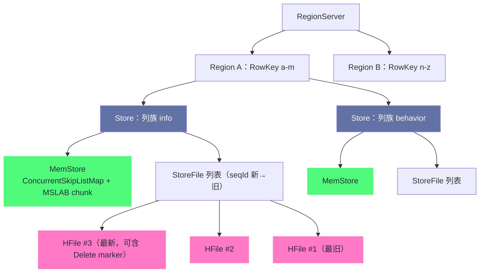
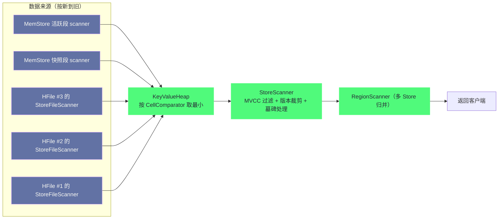
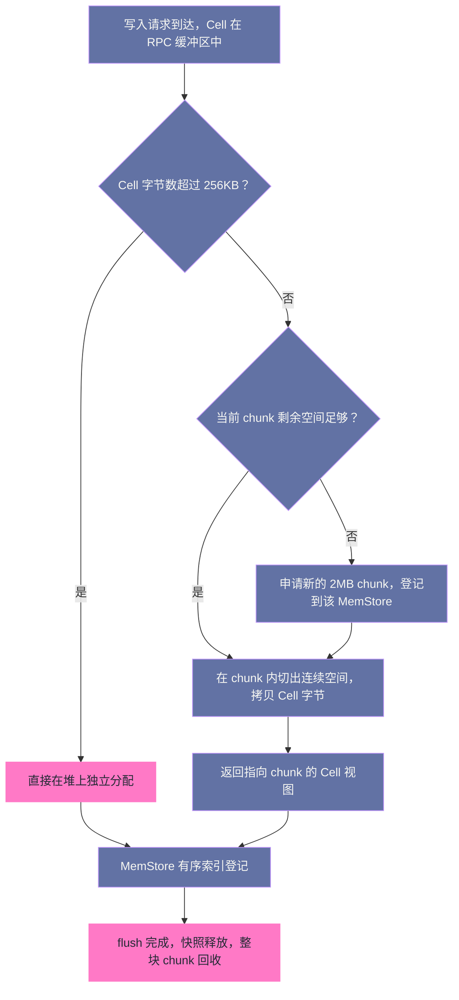
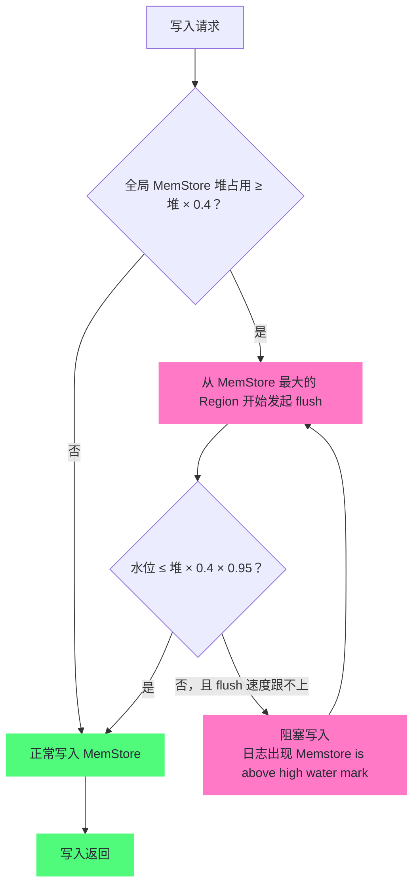
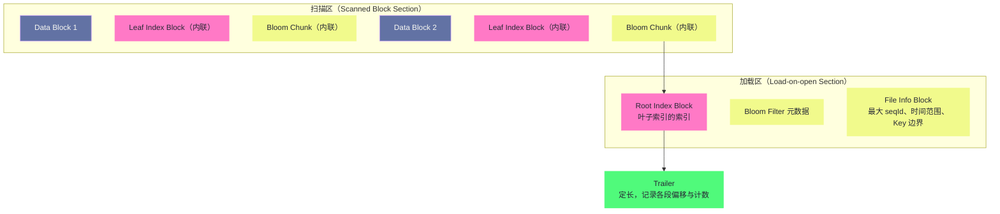
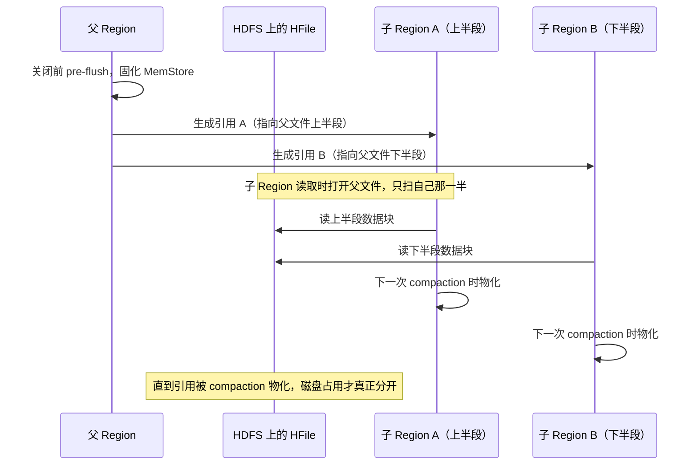

# HBase 存储引擎深度解析——LSM-Tree、MemStore 与 HFile 的设计奥秘

**摘要：**

本篇不回答"该不该用 HBase"，只回答"它内部怎么转、卡住时怎么判"。LSM-Tree 为什么适合写密集负载，属于选型层面的话题；真正让运维在半夜坐起来的是另一类问题：一次写入为什么忽然卡住几十秒、一个 Region 分裂之后磁盘占用为什么没有翻倍、一个 HFile 的 block 到底该取 64KB 还是 256KB。这些问题都落在同一个尺度上——一个 Store 的内部。本文把镜头推进到 Store 这一层：先拆开 `Region` → `Store` → `MemStore` + `HFile` 的三层结构，看清 MemStore 用 `ConcurrentSkipListMap` 维护的有序性、快照交接，以及 `memstore.getScanners()` 如何把全部 HFile 与 MemStore 塞进同一个 `StoreScanner` 做归并；再解释 MemStoreLAB 为什么不直接分配对象，而是从 2MB 的 chunk 里切内存。随后给出 flush 的六种完整触发条件，逐条说明各自在保护什么、越线之后是阻塞还是拒绝；接着拆 HFile 的块布局、block 大小与压缩编码的判据、Bloom Filter 的两种粒度，以及 HFile 的写入流程和 `hbase.hstore.blockingStoreFiles` 造成的写阻塞。Region 分裂后靠引用文件共享父文件的那段过程，也在这里解释清楚。最后把六种故障形态、三个"调大就好"的反例与量化推算归到同一套判据上。

---

## 第 1 章 Store：Region 之下真正落盘的那一层

### 1.1 三个层级，三种职责

HBase 的物理结构通常被画成"表 → Region → Store → HFile"四层，但决定一次写入要付出多少代价的，往往是被跳过的那一层：Store。Region 是分配与调度的单位，它按 RowKey 区间切分，被 Master 搬来搬去，裂成两个之后整个集群的负载分布都跟着变化；Store 是存储的单位，每个列族一个 Store，flush 在这里发生，compaction 在这里发生，读的**归并**也在这里发生。把两者混在一起看，最容易出现的错位是"明明是某个列族的 MemStore 撑爆了内存，却在 Region 层面找答案"。

三层对象的职责边界，可以用一张表钉住。

| 层级 | 数量由什么决定 | 谁持有它 | 生命周期里的关键动作 | 出问题时的连锁反应 |
| :--- | :--- | :--- | :--- | :--- |
| Region | 表的总数据量与分裂策略 | `HRegionServer` | 分裂、迁移、上下线 | 迁移会连带搬走它的全部 Store；分裂会改写 StoreFile 的引用关系 |
| Store | Region 数 × 列族数 | `HRegion` 内部的 `List<Store>` | flush、compaction、读归并 | 内存按 Store 计量，文件数按 Store 计数，阻塞也按 Store 判定 |
| MemStore | 每个 Store 一个 | `HStore` | 接收写入、拍快照、刷盘 | 撑爆即触发 flush，越过倍数阈值即拒绝写入 |
| HFile | 每次 flush 至少一个 | `StoreFileManager` | 只写一次，之后只读 | 数量过多拖慢读取与打开，超过阈值阻塞写入 |

一个 Region 内所有 Store 共享同一个 WAL 段，但各自拥有独立的 MemStore 与独立的 StoreFile 列表，这一点是后面所有机制的前提。

### 1.2 一个 Store 里面有什么

把一个 Store 剖开，能看到三样东西：一个 MemStore、一列 StoreFile、以及一套记录文件代数与 compaction 状态的账本。

MemStore 只有一份，它承接这个列族的全部写入，按 `(row, family, qualifier, timestamp 降序)` 排序，等待被刷成文件。StoreFile 有多份，每一份背后是一个已经写完、不再修改的 HFile，外加读取它所需的元数据与序号（seqId）。账本记录的是这些文件的代际关系：哪个是刚 flush 出来的、哪些正在被 compaction 重写、哪些是分裂留下的引用。

StoreFile 的排列顺序不是随意的，列表按 seqId 从新到旧排列。读取一个具体的 Cell 时，引擎从最新的文件开始找，找到第一个满足版本数与 TTL 约束的值就可以停手——如果最新的文件里已经出现了这一行的 Delete marker，后面更旧的文件连打开都不必打开。这个顺序换不来多少理论上的复杂度改善，却是实际读延迟能压住的关键：绝大多数点查在最新的一两个文件里就结束了。

HFile 的**不可变性**同样值得强调。一个 HFile 写完就被封存，任何修改都只能通过"读出来、合并、写成新文件"完成，也就是 compaction。这不是实现上的偷懒，而是 LSM-Tree 全部收益的来源：文件不可变，读取时就不需要加锁，块可以被任意缓存与共享，副本之间也不需要协调。同一套动作在 [[中间件/Leveldb/00 专栏导览|LevelDB]] 里以更长的链条演进过，MemTable 与 SSTable 是同源的另一副面孔，两者的差别落在文件组织与合并策略上，而不在“先写内存、再刷文件”这条主干上。

### 1.3 列族的物理含义：Store 就是隔离边界

列族在逻辑上是"一组列的集合"，在物理上就是一个 Store。这句话听起来平淡，但把它乘上集群规模，账单立刻显形。

假设一张表有三个列族，集群里有一千个 Region，那么这个表对应三千个 Store，也就是三千个 MemStore。每个 MemStore 都要从 2MB 的 chunk 里分配内存（MSLAB 的机制见 2.5 节），三千个活跃 Store 的固定开销就是 6GB 量级；全局 MemStore 水位统计的是这三千个 MemStore 之和，而不是"每个 Region 128MB"这种直觉上的乘法；flush 的粒度是 Store 或者 Region，表中某一个列族写入暴涨，另一个列族即使一动不动，也会被同一场 flush 波及。

> [!info] 列族数量的经验法则来自物理账单
> "列族不超过三个"不是风格建议，而是 Store 粒度的直接后果：列族数会同时乘进内存固定开销、flush 频率、读归并的宽度与 compaction 的并行度。数据模型层面的约束，最终都换算成这一层的资源账。

三层结构的关系可以画成一张图，注意 MemStore 与 StoreFile 是同级的两个写入去向，而不是先后串联的两级。

这张图里有一个容易被读错的地方：MemStore 不是"StoreFile 的缓存"，它是一个独立的、与磁盘文件并列的数据来源。读一个 Store 时，MemStore 与所有 HFile 是一起参与归并的，谁也不是谁的替补。

---

## 第 2 章 MemStore：一个能拍快照的有序映射

### 2.1 四件必须同时成立的事

MemStore 要同时满足四个互相牵制的要求，任何一个做不到，写入链路就会在某个角落崩掉。

它必须有序。写入的 Cell 是乱序到达的，而 flush 出来的 HFile 要求整体有序，如果 MemStore 无序，flush 就得先做一次外部排序，那等于把随机写又请回来了。

它必须支持多版本。同一个 `(row, family, qualifier)` 下可能有多个时间戳的值，还有 Delete marker，读取时要按版本数裁剪、要识别**墓碑**。

它必须可交接。flush 是一次耗时操作，期间新的写入不能停下来等它，所以 MemStore 要能在不中断写入的前提下被"冻住"一块。

它必须可计量。flush 阈值、全局水位、阻塞阈值都按字节判定，MemStore 要能随时给出自己的大小。

前三条决定了数据结构的选择，第四条决定了阈值的口径。MemStore 维护两个量：一个是数据量，即所有 Cell 按序列化格式累加后的字节数；另一个是堆占用，包含对象头、引用与对齐填充。单 Store 的 flush 阈值与倍数阈值判定用的是前者，全局水位用的是后者，而 JVM 感受到的也始终是后者——这是"明明配置写了 128MB，堆却涨到 200MB"的常见来源，也是后文所有量化推算都要先声明口径的原因。

### 2.2 CellSet 与 ConcurrentSkipListMap

MemStore 的骨架是一个有序映射，在 HBase 1.x 的实现里叫 `CellSet`，内部就是 `ConcurrentSkipListMap<Cell, Cell>`：键与值都是同一个 Cell，值存在的意义只是让映射能复用同一套比较逻辑。

排序规则由 `CellComparator` 定义：先比 RowKey 的字节序，再比列族、列限定符，然后比时间戳（降序，新的在前），时间戳相同时再比 Cell 的类型，保证同一坐标下的 Put 与 Delete marker 有确定的先后。

为什么是跳表而不是红黑树，答案在并发而不是复杂度上。红黑树插入后为了维持平衡要做旋转，旋转会同时改动多个节点的指针，必须靠锁保护；跳表的插入被拆成"定位插入点、改底层链表指针、按概率提升索引层"三个局部动作，前两步可以靠 CAS 完成，多个写线程可以同时推进而无需全局锁。`TreeMap` 加一层 `synchronized` 也能用，但在每秒数十万次写入的场景里，那把锁会把所有 handler 线程串成一队。

跳表还有一个顺带的收益：它天生支持有序遍历。flush 时从最小键开始 `next()` 一路走下去，得到的就是有序的 Cell 序列；读取时把 MemStore 包成一个 scanner 交给归并器，也不需要额外排序。**有序性**因此不只是"方便范围扫描"，而是 flush 能作为纯**顺序写**完成的前提。

代价同样明确：跳表的每个节点都是一个独立对象，带着多层指针数组，海量小 Cell 会让堆里布满了互相指向的小对象。这正是 MemStoreLAB 要解决的问题。

### 2.3 双缓冲：快照如何与写入共存

如果 MemStore 只有一份数据结构，flush 期间就必须锁住它，把写入全部挂起；上百 MB 的数据刷成文件是一次以秒计的耗时操作，这段时间的写入延迟足以让上游业务判定故障。

HBase 的做法是拍**快照**。HBase 1.x 的实现里，MemStore 持有 `active` 与 `snapshot` 两个 `CellSet`，flush 触发时在极短的时间内完成一次指针交换：原来的 `active` 变成 `snapshot` 被冻住，同时挂上一个新的空 `active` 继续接收写入。锁只覆盖交换动作，耗时的序列化与写盘在没有锁的情况下进行，写入方几乎感知不到这次交接。

HBase 2.x 把这个思路做成了段（Segment）模型。活跃段（MutableSegment）承接写入，刷盘前被转成不可变段（ImmutableSegment），`getScanners()` 返回的就不止一个数据来源，而是"若干不可变段 + 一个活跃段"。多出来的这层结构换来一个能力：**内存内 compaction**。`hbase.hregion.compacting.memstore.type` 可以设为 `none`、`basic` 或 `eager`，`basic` 把快照段里基于跳表的索引重排成紧凑的偏移数组，`eager` 还会在内存里合并重复版本；默认并不开启，是否开启要按版本文档与实测决定。重排之后，同样数量的 Cell 在堆上占用的指针与对象头大幅减少，代价是每次段转换都要多花一次 CPU。

快照的生命周期有一个容易被忽略的细节：快照被冻结后，在 flush 完成之前不能释放，于是同一个 Store 会同时持有"快照"与"活跃"两份内存，MemStore 的峰值可能接近两倍的 flush 阈值。**全局水位**默认落在堆的 0.4 而不是更高，与这个瞬时双份占用有直接关系——水位要按峰值算，不能按稳态算。

快照的边界还与 MVCC 的读点对齐：flush 只覆盖读点之前的写入，读点之后到达的写入留在活跃段里，靠 WAL 保证持久性。这条边界保证了快照内部的 Cell 都属于"已提交且不会再被回滚"的集合，写进 HFile 之后不需要额外的清理逻辑。

### 2.4 getScanners()：把 HFile 与 MemStore 放进同一个归并器

读取一个 Store 时，引擎先做的是"收集数据来源"，而不是"读取数据"。

`Store.getScanner(scan)` 沿着两个方向收集：对 StoreFile 列表里的每个文件，判断它的 Key 范围是否与本次 Scan 相交、Bloom Filter 是否允许跳过，通过的生成一个 `StoreFileScanner`；对 MemStore 调用 `getScanners(readPoint)`，拿到覆盖快照段与活跃段的 scanner。1.x 里这些 MemStore 侧的 scanner 叫 `MemStoreScanner`，2.x 改由段自己提供（`Segment.getScanner(readPoint)`），语义一致：在给定的读点上、在自己的数据范围内，按同一个比较器吐出有序的 Cell。

两路来源收集完，交给 `StoreScanner`。`StoreScanner` 用这些 scanner 建一个 `KeyValueHeap`，也就是按 `CellComparator` 排序的最小堆，然后 `seek` 到 Scan 的起点，之后每次 `next()` 取出当前最小的那个 Cell，并让对应的子 scanner 前进一步。归并过程中它还要做三件语义工作：按 MVCC 读点过滤掉未提交的写入，按版本数与 TTL 裁剪掉不该返回的旧值，识别 Delete marker 并吃掉被它遮蔽的旧版本。

`getScanners()` 这一层的意义在于把"读放大"从抽象概念变成了可以数的东西：一次 Scan 要归并的参与方数量，等于落在 Key 范围内的 HFile 数加 MemStore 的段数。Bloom Filter 与 BlockCache 都在各自的子 scanner 内部生效——Bloom 决定某个文件要不要参与，BlockCache 决定某个块要不要真的去 HDFS 读——但它们不改变归并的结构。读取路径上块的淘汰策略、`HFileScanner` 的 seek 细节与 Scanner 的租约续期，属于 [[06 HBase 读取链路深度解析——BlockCache、Scanner 与多版本合并]] 的范围，这里只需要记住：StoreScanner 负责的是"有序归并加语义过滤"，它本身不做 I/O 优化。

多版本与墓碑的字节级语义，包括同一个坐标下多个时间戳如何排序、Delete 与 DeleteColumn 的区别，在 [[02 HBase 数据模型深度解析——RowKey、列族、Cell 与多版本机制]] 中已经拆过；本篇关心的是归并器的输入有几个、顺序为什么一致。

### 2.5 MemStoreLAB：把上亿个小对象关进大块里

MemStore 里存的是 Cell，一个 Cell 通常几十到几百字节。一个 128MB 的 MemStore 意味着几十万到上百万个对象，如果每个 Cell 都是独立分配的 Java 对象，堆上就会出现典型的"小对象海"：分配速率高、晋升快、老年代被切得七零八落，Full GC 的停顿会从毫秒级跳到秒级。

MemStoreLAB（Memory Store Local Allocation Buffer，MemStore 本地分配缓冲）的思路与 JVM 的 TLAB 同源：不再为每个 Cell 单独分配对象，而是从一个较大的 chunk 里切一段连续空间出来，把 Cell 的字节拷贝进去，返回一个指向这段空间的 Cell 视图。chunk 默认 2MB，由 `hbase.hregion.memstore.mslab.chunksize` 控制；一个 chunk 填满后再申请下一个；flush 完成、快照被释放时，整块 chunk 一次性归还，而不是逐个小对象回收。

为什么必须拷贝？进入 MemStore 的 Cell 最初来自 RPC 请求的缓冲区，那个缓冲区的生命周期只到请求结束；MemStore 要长期持有这些字节，就必须把内容搬到自己的地盘。拷贝还带来两个副作用，都是正向的：chunk 内的 Cell 在物理上连续，flush 遍历时是顺序内存访问而不是指针乱跳；内存内 compaction 可以把"每个 Cell 一个对象"的索引改写成"每个 Cell 一个偏移量"的数组，因为数据本来就在同一块内存里。

不是所有 Cell 都走 chunk。单个 Cell 超过 `hbase.hregion.memstore.mslab.max.allocation`（默认 256KB）时，会退回普通的堆内分配，否则一个超大 Cell 会独占一个 2MB 的 chunk，浪费严重。这个阈值的存在说明 MSLAB 的假设是"小对象占绝大多数"，一旦业务里出现大 value，分配路径就会分叉。

MSLAB 的代价藏在粒度里。内存是按 chunk 记账的，一个几乎空的 MemStore 也会占住一个 2MB 的 chunk，所以"每个 Store 最少 2MB"是这个机制的下限。集群里 Store 数量很大时，这笔固定开销不小：三千个活跃 Store 各持一个 chunk，就是 6GB；如果每个 Store 平均持有两到三个 chunk（活跃段一个、快照段一个、正在填充的一个），量级还要翻倍。这不是精确测量，而是按 2MB 粒度做的示例推算，用来判断"多列族、多 Region"的集群为什么内存总是不够。

MSLAB 与垃圾回收的关系还有另一面。chunk 是长期存活的大数组，在 G1 下，大小超过 region 一半的对象会被当作 humongous object 单独分配，绕过常规的年轻代路径。以堆 8GB、Region 数两千为例，G1 的 region 尺寸约 4MB，2MB 的 chunk 正好踩在门槛上；这种情况下每次申请 chunk 都可能触发 humongous 分配，MSLAB 本想减轻 GC 压力，反而换了一种压力。把 chunk 大小与 G1 region 尺寸放在一起看，比单独记住"2MB 是默认值"更有用。

| 配置 | 默认值 | 调大的代价 | 调小的代价 |
| :--- | :--- | :--- | :--- |
| `hbase.hregion.memstore.mslab.enabled` | `true` | 关闭后回到逐对象分配，堆碎片与 GC 扫描成本上升 | 保持开启则小 MemStore 有 2MB 粒度开销 |
| `hbase.hregion.memstore.mslab.chunksize` | 2MB | chunk 变大，单 Store 固定占用上升，G1 下更易成为 humongous object | chunk 变小，申请次数与跨 chunk 的 Cell 变多，chunk 利用率下降 |
| `hbase.hregion.memstore.mslab.max.allocation` | 256KB | 大 Cell 也进 chunk，浪费 chunk 空间、加剧碎片 | 更多中等大小的 Cell 走独立分配，MSLAB 的收益面变窄 |
| `hbase.hregion.compacting.memstore.type` | 不开启内存内 compaction | `eager` 多花 CPU 在段转换上，flush 前的延迟抖动更明显 | 不开启则快照段索引更大，堆占用更高 |

---

## 第 3 章 flush 的六种触发条件

### 3.0 六条触发路径的分工

"MemStore 满了就刷盘"是一句正确的废话。真实系统里有六条互相独立的触发路径，它们服务的对象各不相同：前两条盯容量，第三条自保，第四条为恢复速度兜底，第五条由人触发，第六条修正列族之间的不公平。把这些路径混在一起，就会出现"调了 flush.size，写阻塞照样发生"的误判。

| 触发条件 | 配置与默认值 | 判定口径 | 直接后果 | 是否阻塞写入 |
| :--- | :--- | :--- | :--- | :--- |
| 单 Store 数据量越线 | `hbase.hregion.memstore.flush.size` = 128MB | 该 Region 某个 MemStore 的 Cell 数据量 | 该 Region 的 Store 被刷成新文件 | 否 |
| RegionServer 全局水位越线 | `hbase.regionserver.global.memstore.size` = 0.4；`…size.lower.limit` = 0.95 | 本机所有 MemStore 的堆占用之和 | 按 MemStore 大小从大到小刷，直到降到下限以下 | 刷不动时阻塞写 |
| MemStore 越过倍数阈值 | `hbase.hregion.memstore.block.multiplier` = 4 | 数据量 > flush.size × 4，即 512MB | 抛 `RegionTooBusyException` 拒绝写入 | 是，直接拒绝 |
| WAL 文件数越线 | 1.x `hbase.regionserver.maxlogs` = 32；2.x 用 `hbase.regionserver.wal.max.multiplier` 动态推算 | 当前未被回收的 WAL 文件数 | 刷掉最老 WAL 覆盖的 Region，让段可删 | 否，但会造成批量小文件 |
| 人为操作 | `flush` 命令、`Admin` API、Region 下线 | 立即 | 整表或整 Region 刷盘 | 否，但会制造 IO 峰值 |
| 列族级阈值 | `hbase.hregion.percolumnfamilyflush.size.lower.bound`，默认 16MB 量级 | 只对超过下限的列族刷 | 大列族刷、小列族留在内存 | 否 |

### 3.1 单 Region 的 MemStore 越过 flush.size

这是最常被提起的一条：某个 MemStore 的数据量超过 128MB，就把它刷成文件。

判定口径是 Cell 数据量而不是堆占用，这一点前面提过，这里补上它为什么会带来偏差：128MB 的数据量在堆上可能对应 160MB 到 200MB 的实际占用，取决于 Cell 的平均大小与对象头开销。配置写的是 128MB，机器感受到的更多，两者之间的差值随着 Cell 变小而放大。

触发动作由两条路径共同完成，而不是每次写入都精确判断一次。后台线程按 `hbase.server.thread.wakefrequency`（默认 10 秒）的周期扫描 RegionServer 上的 Region，发现有 MemStore 越线就发出 flush 请求；写入路径在越线时也会主动请求一次。请求进入 flush 队列后按 Region 去重，同一个 Region 在队列里只有一份，重复请求被合并。这意味着 flush.size 是一个**软阈值**：从越线到真正开始刷盘，中间可能隔着一次检查周期，实际数据量会明显超过 128MB，尤其是在写入速率很高的 Region 上。

触发之后刷哪些 Store，取决于 flush policy。默认策略是整 Region 的 Store 一起刷，简单、可预测，也让 WAL 回收变得干净：一个 Region 的全部 Store 都完成 flush，覆盖它的 WAL 段才可能被判定为可删。启用 `FlushLargeStoresPolicy` 之后，只有超过下限的列族参与本次刷盘，其余列族留在内存里——这会把 WAL 段的回收拖住，是小列族换来的隐性成本。

只刷一部分 Store 也不是不可以，但那样一来 WAL 段仍然被未刷的 Store 引用着，无法删除，WAL 会继续增长，最终由第四条路径兜底。HBase 选择"以 Region 为单位刷干净"，本质上是在用一次较大的 IO 换取 WAL 回收的确定性。

### 3.2 RegionServer 的全局水位：从最大刷起

单个 MemStore 的 128MB 之和，可能远远超过一台机器的堆。全局水位的职责就是在整机尺度上兜住内存，配置项是 `hbase.regionserver.global.memstore.size`，默认 0.4，意思是所有 MemStore 的堆占用加起来不超过堆的 40%；`hbase.regionserver.global.memstore.size.lower.limit` 默认 0.95，表示一次回收要把水位压到上限的 95% 以下，也就是堆的 38% 左右。

为什么触发之后要"多刷一点"而不是刚好压到上限？因为回收动作有延迟，如果只刷到 40% 就停手，下一次写入立刻又会越线，系统会陷入"刚刷完就要再刷"的抖动；留出 2 个百分点的缓冲，是给下一次写入留的呼吸空间。

选择顺序是从 MemStore 最大的 Region 开始刷。这个策略很朴素：同样的刷盘成本，从最大的那块开始能最快把水位降下来，用最少的文件数换回最多的内存。`MemStoreFlusher` 维护的队列按 MemStore 大小排序，回收时逐个取出，直到水位落到下限以下。

这条路径的代价不在单次刷盘，而在连锁反应。全局水位一旦越线，往往同时有多个 Region 的 MemStore 都比较大，一轮回收会产出许多新文件；这些文件立刻抬高每个 Store 的文件数，把 compaction 队列推满，接着 `hbase.hstore.blockingStoreFiles` 与写阻塞开始接力。生产上"一次写入高峰之后 compaction 队列积压几小时"的现场，源头经常在这里。

还有一层语义需要说清：全局水位到达上限时，写入被阻塞而不是被拒绝。阻塞意味着 handler 线程停在写入路径上等待，客户端看到的是超时或者延迟飙升；等待期结束的条件是水位回落。阻塞不制造错误，只制造延迟，而延迟在分布式系统里通常会以"超时重试"的形式放大成更大的流量，这是写入侧的经典**正反馈**陷阱。

### 3.3 倍数阈值：先拒绝，再谈保护

如果 flush 完全跟不上，全局水位也压不住，最后一道闸门是 `hbase.hregion.memstore.block.multiplier`，默认 4。它把"单 Region 允许的 MemStore 上限"定在 flush.size 的 4 倍，即 512MB；一旦某个 MemStore 越过这条线，写入这个 Region 的请求会被直接拒绝，抛出 `RegionTooBusyException`。

这条路径与上一条的区别在于"拒绝"和"阻塞"：全局水位满的时候，写入是排队等待；单 Region 越过**倍数阈值**的时候，写入是立刻失败。前者把压力转成延迟，后者把压力转成错误，两者都会让上游难受，但后者的边界更硬——它保证单个 Region 不可能无限膨胀，把所有 RegionServer 的堆吃掉。

为什么是 4 倍而不是 2 倍？一种合理的理解是：2 倍留给 flush 的时间太短，一次 flush 从入队、序列化到写完文件，中间还要和 compaction 抢 IO，稍慢一点就触发拒绝；4 倍留出了大约三个 flush 周期的时间窗，让系统有机会自己恢复。这个数字是经验值，不是推导出来的最优解，把它当成"缓冲窗口的宽度"来理解比当成"保护上限"更准确。

`RegionTooBusyException` 并不表示 Region 掉线。Region 仍然在线、仍然能读，只是拒绝写入；客户端重试同一条记录通常无济于事，因为 MemStore 的大小不会因为重试而下降。这类错误要靠降低写入速率或者扩大 flush 能力解决，而不是调大倍数——把倍数调大只是把拒绝变成更晚的拒绝，中间那段多出来的内存会以 GC 停顿或 OOM 的形式还回来。

### 3.4 WAL 文件数：为恢复速度兜底

前三条都在管内存，第四条管的其实是 WAL 的回收速度。

WAL 文件是滚动生成的，旧的 WAL 文件只有在"它覆盖的所有 Region 都已 flush"之后才能删。这条规则会产生一种尴尬局面：某个 Region 的写入极少，它的 MemStore 永远也长不到 128MB，于是永远不触发 3.1 的刷盘；但覆盖它的那段 WAL 文件因此被钉住，无法删除。写入量大的 Region 不断滚动新的 WAL 文件，旧的又删不掉，`oldWALs` 目录越堆越高，NameNode 上的文件数跟着上涨，RegionServer 崩溃后需要重放的日志也越来越多。

第四条路径就是为这种情况准备的：当未被回收的 WAL 文件数超过上限，HBase 会找出最老的那批 WAL 文件，把它们覆盖的 Region 全部刷一遍，哪怕这些 Region 的 MemStore 只有几 MB。低写入的 Region 在这里是"陪跑"的，它被刷盘不是因为自己撑不住，而是因为它挡住了别人的日志回收。

上限的算法在两个大版本之间变过。1.x 用固定值 `hbase.regionserver.maxlogs`，默认 32；2.x 改为 `hbase.regionserver.wal.max.multiplier`（默认 2），按 `max(32, 堆大小 × global.memstore.size × 倍数 / 单个 WAL 文件大小)` 动态推算，WAL 文件大小的默认口径与 HDFS block size 相关。改动的理由很实际：固定 32 对现代堆大小来说太小，会让 RegionServer 为了回收日志而做大量与容量无关的 flush（见 HBASE-14951，参考资料中有链接）。具体参数在不同小版本上的含义有差异，部署前以对应版本文档为准。

这条路径的判据是"WAL 文件数与 oldWALs 目录的增长速度"。如果 oldWALs 持续堆积而写入并不高，说明有 Region 在拖住日志回收，此时该查的是 Region 的写入分布与 flush 策略，而不是继续调大 MemStore 阈值。

### 3.5 人为触发：flush 命令与 Region 下线

`flush` 命令是最容易被滥用的一个。它在 HBase Shell 与 `Admin` API 里都有，可以按表、按 Region、按 RegionServer 触发；Region 被关闭、被迁移、RegionServer 下线之前，也会做一次 pre-flush（当 MemStore 超过 `hbase.hregion.preclose.flush.size` 的量级时先固化再关），以保证关闭过程不出意外。

人为触发的代价经常被低估：一次全表 flush 会把所有 Region 的 MemStore 同时写出去，等于在集群上制造一次 IO 峰值，紧接着是一批新文件引发的 compaction。在写入高峰执行手动 flush，等同于自己给自己制造一次抖动；在 compaction 队列已经积压时执行，会把积压推得更深。

它真正的用途是控制变量：发布前把数据固化，避免升级过程中靠 WAL 恢复；迁移前把 MemStore 清空，减少迁移过程中的重放量；压测前把状态归零；排查读取异常时排除 MemStore 的干扰。用一次可控的 IO 峰值换取一个干净的状态，这是值得的；用它在出问题时"试试看"，则通常只是把问题挪到下一个小时。

### 3.6 列族级 flush：修正 Store 之间的不公平

一个 Region 里有多个列族时，"整 Region 一起刷"会造成明显的不公平：一个写入量是另外九个一百倍的大列族，每次都拖着九个小列族一起刷，刷出来的是大量几乎空白的文件。这些小文件同样要参与读取归并、同样要进入 compaction 队列，收益却接近于零。

列族级 flush 就是来修这个的。启用 `FlushLargeStoresPolicy` 后，触发时只刷那些超过下限的列族，其余留在内存。下限的取值是 `hbase.hregion.percolumnfamilyflush.size.lower.bound`（默认 16MB 量级，不同版本文档里的键名有 `…lower.bound` 与 `…lower.bound.min` 的差异）与"flush.size 除以列族数"两者的较大者——前者防止下限被算得太小，后者保证列族多的时候不会只刷一个。

这条路径的代价藏在 WAL 回收上。小列族长期不刷，覆盖它们的 WAL 文件就长期不能删，压力转嫁给 3.4；同时这些小列族的内存一直占着，全局水位并不会因为它们"不值得刷"而降低。所以它的适用前提很明确：列族之间的写入量差异足够大，且全局内存水位还有余量。列族数量少、写入分布均匀的表，开启它不会带来什么好处。

### 3.7 两难：刷得太勤与不刷

flush 的阈值本质上是在两个方向的坏结果之间选一个。

刷得太勤，每个文件都很小，Store 的文件数上升得快。文件数一多，读一个 Key 要归并的来源变多，读放大上升；compaction 要处理的小文件变多，队列积压，写带宽被重写消耗；积压到一定程度，`hbase.hstore.blockingStoreFiles` 开始阻塞写入，问题从"读变慢"升级成"写不动"。刷得太勤还会让 WAL 频繁滚动，oldWALs 目录与 NameNode 的压力跟着上来。

不刷，内存里堆着大量未固化的数据。全局水位被推高，写入被阻塞；RegionServer 崩溃后要重放的 WAL 变多，恢复时间变长；读取时要归并的内存段更多，虽然有 BlockCache 帮忙，但内存段的扫描成本并不低。

两个方向都没有"正确值"，只有与负载匹配的值。判断是否匹配，看的不是配置本身，而是三个反馈信号：flush 之后每个 Store 的 StoreFile 数、compaction 队列的长度与等待时间、以及写入延迟的 P99。文件数稳定在个位数、队列不积压、延迟没有毛刺，说明当前阈值与负载是匹配的；任何一项持续恶化，都是失衡的信号。

| 现象 | 更可能的原因 | 调整方向 | 不该做的事 |
| :--- | :--- | :--- | :--- |
| StoreFile 数长期在 20 以上，compaction 队列积压 | flush 过勤或 compaction 能力不足 | 提高 flush.size、增加 compaction 线程、检查限速 | 调大 blockingStoreFiles |
| 写入延迟出现周期性毛刺，MemStore 水位反复触顶 | flush 触发太集中、Region 过大或热点集中 | 预分区打散热点、拆分大 Region | 调大 block.multiplier |
| 崩溃恢复时间长，WAL 重放慢 | 未刷数据太多、WAL 文件过大 | 降低 flush.size、控制单 Region 写入量 | 只加内存不调阈值 |
| oldWALs 持续增长 | 低写入 Region 钉住日志 | 检查 Region 写入分布、必要时手动 flush | 无限调大 maxlogs |

量化一下这个两难的分量。假设单个 Region 的 MemStore 阈值为 128MB，Region 总量约 10GB 量级，那么一个 Region 的生命周期里会产生几十次 flush，也就有几十个文件进入 compaction；如果阈值为 256MB，文件数减半，但单次 flush 的耗时与瞬时内存翻倍。这个推算说明的是方向而不是绝对值：阈值翻倍换来文件数减半，代价是内存峰值与单次 IO 峰值同步翻倍，是否划算取决于集群的 IO 余量与堆余量，不存在通用答案。至于 WAL 重放，恢复时间的下界由"未刷数据量 ÷ 重放吞吐"决定，在重放吞吐为每秒几十 MB 的假设下，几百 MB 未刷数据对应的是十秒量级的恢复窗口，几个 GB 则要按分钟算——这也解释了为什么不能为了减少文件数而无限提高 flush.size。

---

## 第 4 章 HFile：不可变文件里到底有什么

### 4.1 五个设计目标与三个版本

HFile 是 HBase 在 HDFS 上的文件格式，对应 BigTable 论文里的 SSTable。它的结构由五个目标共同约束：给定一个 RowKey 要在不扫全文件的前提下定位到目标数据；给定起止 RowKey 要能顺序读完区间；相同前缀的数据要能压得下去；写入之后不再修改，可以把结构针对读优化到极致；还要能在不读数据块的情况下判断某个 Key 是否可能在这个文件里。

版本演进留下的痕迹不多，但值得记住：

| 版本 | 引入版本 | 核心改进 |
| :--- | :--- | :--- |
| HFile v1 | HBase 0.20 | 单层索引，只有数据块与简单索引，大文件时索引整体驻留内存 |
| HFile v2 | HBase 0.92 | 多级块索引（根/中间/叶子）、块内联索引与 Bloom、加载区与扫描区分开 |
| HFile v3 | HBase 0.98 | 在 v2 的块布局上补充 Cell Tag 与加密相关字段 |

HBase 2.x 写入的是 v3，块布局与索引结构沿用 v2，差别主要在 Cell 的附加信息。所以讨论 HFile 的物理结构时，说 v2 就够了。

### 4.2 物理布局：索引是内联的，不是堆在文件尾

很多资料把 HFile 画成"数据块一堆、Bloom 一堆、索引一堆、Trailer 在最后"，这个画法会让人误以为索引集中在文件末尾。v2 的真实布局是分区的：

每一批数据块写出后，紧跟着写它对应的叶子索引块与 Bloom chunk，三者交错前进。这样做的原因是"写完才能知道"：一个数据块的首个 Key 与文件偏移，只有在这个块真正写出去之后才有确定值，索引项只能就地追加。把索引全部攒到文件末尾再写，在 HDFS 上意味着要维护一份与文件等量的内存索引，代价随文件变大而不可控。

文件末尾的 Trailer 是定长的，记录扫描区、加载区的偏移与条目计数、压缩算法与 comparator 等信息。打开一个 HFile 的 I/O 次数因此可以压到两次：先按定长读末尾的 Trailer，知道加载区位置；再一次读整段**加载区**，把根索引、Bloom 元数据、File Info 一起拿进来。之后的点查全在内存索引的引导下进行，只在命中数据块时才发生真实 I/O。

### 4.3 Data Block 的大小怎么定

Data Block 是压缩、校验与缓存的基本单位，默认 64KB。建表时通过列族的 `BLOCKSIZE` 属性设定；用 MapReduce 直接生成 HFile 时，对应的是 `hbase.mapreduce.hfileoutputformat.blocksize`；有些资料里以 `hbase.hfile.blocksize` 之名给出的全局默认值，与具体版本的配置体系对应关系并不一致，落地前以目标版本文档为准。

块大小是一个纯粹的权衡，判断依据只有两个：**读放大**与索引大小。

块大，一个块里装更多 Cell，索引项变少，顺序扫描时连续读的效率更高，压缩率也更好（压缩算法在更大的上下文里更容易找到重复）；代价是点查时要多读一些用不上的字节，块在缓存里换出时损失的信息量也更大。

块小，点查只读需要的部分，缓存粒度更细；代价是索引项成倍增加，索引本身占内存，块内可压缩的上下文变少。

| 块大小 | 每块 Cell 数（按 100 字节一个 Cell 的示例推算） | 10GB 文件的叶子索引项 | 点查单次读取的浪费 | 更适合 |
| :--- | :--- | :--- | :--- | :--- |
| 16KB | 约 160 个 | 约 65 万项 | 很小 | 点查密集、RowKey 随机、缓存紧张 |
| 64KB | 约 650 个 | 约 16 万项 | 中等 | 通用场景，读写混合 |
| 256KB | 约 2600 个 | 约 4 万项 | 较大 | 顺序扫描密集、批量导出、大范围 Scan |

这些数字是按"Cell 平均 100 字节、索引项约 32 字节"做的示例推算，用来比较数量级，不是某个集群的实测值。它们想说明的是：块大小每翻两番，索引项就少四分之三，点查浪费的字节同步上涨。索引项的绝对量在 10GB 文件上不过是几 MB，真正吃掉内存的是数据块缓存，所以块大小对索引的影响远小于对缓存命中率与扫描吞吐的影响。

### 4.4 索引、加载区与打开成本

多级索引是 v2 最重要的改进。叶子索引的每一项记录一个数据块的首个 Key 与它在文件中的位置；根索引是叶子索引的索引，常驻内存；当索引大到根索引一项对一叶都放不下时，中间层才会出现。多数文件的索引只有两级，根索引只有几十到几百个条目。

打开 HFile 的成本因此与文件数线性相关，而不是与文件大小相关。打开 200 个 HFile 需要约 400 次寻址（Trailer 加加载区），每次都要走一次 HDFS 的远端读取；RegionServer 重启后接管的 Region 越多、每个 Store 的文件越多，冷启动越慢。这也是控制 StoreFile 数量的第二个理由——第一个理由是读放大，第二个是打开成本，两个理由指向同一个结论。

读取时数据块经 `HFileScanner` 定位：根索引在内存里给出叶子块位置，读叶子块得到数据块偏移，读数据块后在块内按编码规则解出 Cell。BlockCache 命中时这一步全部在内存里完成，未命中才落到 HDFS。块缓存的实现选型与命中率优化属于 [[06 HBase 读取链路深度解析——BlockCache、Scanner 与多版本合并]] 的内容。

### 4.5 压缩与编码：两套不同的省空间手段

压缩作用于"块"这个整体，编码作用于"块内 Cell 的排列方式"。两者可以叠加，也可以只开一个。真正生效的压缩设置写在列族的 `COMPRESSION` 属性上，有些资料以 `hbase.regionserver.hfile.compression` 之名描述服务端的默认压缩口径，两者的对应关系随版本而异，建表时按列族显式指定最稳妥。

| 压缩算法 | 压缩比量级 | 解压 CPU | 适用 |
| :--- | :--- | :--- | :--- |
| NONE | 1x | 无 | 点查密集且 CPU 已是瓶颈、或数据本身已压缩 |
| GZ | 高 | 高 | 冷数据归档，能接受较高解压延迟 |
| SNAPPY | 中 | 中 | 通用默认，兼容性好 |
| LZ4 | 中 | 低 | 热数据，读多写少且要求低延迟 |
| ZSTD | 高 | 中到高（可调级别） | 冷热混合、磁盘与网络带宽紧张 |

| 编码方式 | 块内布局 | 解码代价 | 适用 |
| :--- | :--- | :--- | :--- |
| NONE | 每个 Cell 完整存储 | 无 | 随机点查为主、CPU 紧张 |
| DIFF | 与前一个 Cell 做差分，只存变化的字节 | 需从前一个 Cell 顺序解码 | 同前缀数据多、顺序扫描 |
| FAST_DIFF | 与前一个 Cell 差分，键长与值长在多数情况下可省略 | 定位到块内任意位置要先回到块首 | 写入与扫描都多、CPU 有余量 |
| PREFIX | 按 RowKey 前缀共享，同前缀的键只存增量 | 需按前缀链解码 | 长 RowKey、同前缀批量写入 |
| ROW_INDEX_V1 | 在 FAST_DIFF 基础上加块内行索引 | 比 FAST_DIFF 多维护一份行索引 | 大块内的行级跳转 |

该用什么组合，取决于"CPU 与 I/O 谁更紧"以及"读的形式"。

热数据、点查与扫描混合、集群 CPU 有余量，用 LZ4 加 FAST_DIFF：解压快、块内解码能把同前缀的重复压掉，磁盘与网络带宽省下来，BlockCache 能装更多块。

冷数据、归档查询、IO 是瓶颈而 CPU 空闲，用 ZSTD 加大块，压缩比换来的空间能显著降低扫描时的实际读取量。

点查占绝对多数、CPU 已经吃紧，压缩选 NONE 或 SNAPPY，编码用 NONE：此时省下的 I/O 已经被 BlockCache 消化，再叠一层编解码只是把 CPU 推向饱和。

有一点需要提醒：压缩与编码的收益只在 BlockCache 未命中时兑现。缓存命中率很高的热表，压缩算法对延迟几乎无影响，但对磁盘占用与 compaction 的读写量影响仍在——compaction 要读旧文件、解压、重新编码、压缩、写新文件，压缩率越高，compaction 的 I/O 越少、CPU 越多。

### 4.6 Bloom Filter：两种粒度与它们的取舍

Bloom Filter 用一段位数组与 k 个哈希函数回答一个问题：这个 Key 有没有可能在这个文件里。它的保证是单向的——真正存在的 Key 一定返回"可能"，不存在的 Key 有一定概率被误判为"可能"。误判的代价是多读一个文件，漏判的代价是数据丢失，所以这个方向不能反。

HBase 支持三种粒度，通过列族的 `BLOOMFILTER` 属性配置：

| 粒度 | 过滤对象 | 每个条目的空间 | 空间随什么增长 | 适用 |
| :--- | :--- | :--- | :--- | :--- |
| NONE | 不过滤 | 0 | — | 以全表扫描或大范围 Scan 为主 |
| ROW | 整行 | 每个 RowKey 约 10 bit 量级 | 行数 | 整行读取、Get 取整行或大部分列 |
| ROWCOL | 行加列限定符 | 每个 (RowKey, Qualifier) 组合约 10 bit 量级 | 实际存在的 Cell 数 | 宽表、每次只取少数列、点查多 |

ROWCOL 并不总是更好。它的条目数是"实际存在的 Cell 数"，在 100 列、行行写满的宽表里就是 ROW 的 100 倍，位数组跟着涨 100 倍；这些位数组在打开文件时要读、在缓存里要占位置，误判率却没变。它真正的价值场景是稀疏宽表：一行有 1000 个可能的列，实际只写了 5 个，每次 Get 只取其中 1 个，此时 ROW 级别的过滤只能说"这一行在这个文件里"，ROWCOL 才能说"这一行的这一列在这个文件里"，省掉的是整行读取的代价。

判据可以写得很短：读整行用 ROW，读少数列且表宽用 ROWCOL，几乎不点查用 NONE。误判率与位数组大小的关系是经典的 `p ≈ (1 - e^(-kn/m))^k`，每个 Key 分到约 10 bit 时误判率在百分之一量级（示例推算）；继续加大位数组能把误判率压到千分之一，但空间与读取开销同步上涨，收益递减很明显。

Bloom 的数据放在 HFile 的 Bloom chunk 与元数据块里，打开文件时读入元数据，位数组按块按需读取或被缓存。它属于"用少量内存换大量 I/O 跳过"的机制，在文件数多的 Store 上收益最大——而这恰恰是 flush 过勤与 compaction 不及时造成的局面，机制之间互相咬合的地方往往就在这里。

---

## 第 5 章 HFile 的写入流程与写阻塞

### 5.1 一个 HFile 是怎么被写出来的

flush 的最后一公里是 HFile 的写入，过程可以拆成六步。

第一步，创建 writer。RegionServer 在 HDFS 的**临时目录**里建一个文件，初始化 `HFile.Writer`，同时准备好三样内存结构：块缓冲、索引写入器、Bloom 写入器。

第二步，按序追加 Cell。从 MemStore 的快照里顺序取出 Cell（它本来就是有序的），逐条追加进块缓冲；缓冲达到目标块大小就封块。

第三步，封块并写盘。封块时做三件事：按列族配置的编码方式重排块内 Cell，按压缩算法压缩，加上块头与校验和后写入文件。写完立刻记下一个索引项——这个块的首个 Key、文件偏移、压缩后大小——并把这个块里的 Key 喂给 Bloom 写入器。

第四步，重复直到快照读完。数据块、叶子索引块、Bloom chunk 交替落盘，文件顺序增长。

第五步，写加载区。所有数据块写完后，把内存里的索引汇总成根索引块，把 Bloom 的位数组与元数据写成元数据块，把最大 seqId、Key 边界、时间范围写进 File Info。

第六步，写 Trailer 并关闭文件。Trailer 必须最后写，因为它要记录前面所有段的偏移与计数。

这套顺序解释了一个常见的疑问：为什么 HFile 不能在写入过程中被读到一半。答案不在读取端，而在写入端——索引与 Bloom 元数据在数据块写完之前根本不存在，文件在关闭前也没有可用的 Trailer。

### 5.2 原子可见性靠的是临时目录与重命名

新文件先写在临时位置，关闭之后再移动到 Region 的目录下。HDFS 的重命名是原子的（这条语义来自 [[大数据/Hadoop/HDFS/00 专栏导览|HDFS]]，HBase 只是使用者），读取方要么看到一个完整的 HFile，要么什么都看不到，不会读到写了一半的文件。

这条规则对 flush、compaction、Region 分裂产出的文件一视同仁。它也解释了为什么"文件数"与"打开成本"之间不是简单的相加关系：只有已经出现在 Region 目录里的文件才参与读路径，临时文件不在此列，但它们会占用 HDFS 的元数据与磁盘空间，在写入异常时留下的临时文件还会变成需要手工清理的垃圾。WAL 的 sync、group commit 与崩溃后的重放流程在 [[05 HBase 写入链路深度解析——WAL、MemStore Flush 与持久性保证]] 中已经展开，本篇只追到文件落盘为止。

### 5.3 blockingStoreFiles：写入"卡住"的经典原因

一个 Store 的文件数超过 `hbase.hstore.blockingStoreFiles`（默认 16）时，写入会阻塞，直到 compaction 把文件数降下来，或者 `hbase.hstore.blockingWaitTime`（默认 90000 毫秒）到期后放行。

这条机制的设计意图是保护读路径：文件数越多，读放大越严重，打开成本越高，与其让读慢慢烂掉，不如让写先停一停，给 compaction 腾出资源。但在真实故障里，它经常表现为"写入卡住 90 秒、然后恢复、过一阵又卡"的周期性抖动，日志里出现 `Too many store files` 字样。

为什么会形成周期？因为触发它的往往不是写入本身，而是 flush 与 compaction 之间的速度差。flush 产生文件，compaction 消耗文件；当 compaction 因为限速、线程不足、磁盘带宽被抢、或者单次合并的文件过大而变慢时，文件数就会持续上涨。到了 16 这个阈值，写入被拦住，compaction 拿到更多资源把文件数压下去，写入恢复；只要 compaction 的长期吞吐低于 flush 的产出，这个循环就会一直重复。

更隐蔽的一层是"文件多的时候 flush 也会被延迟"：当文件数已经超过阈值，新的 flush 请求会被推迟，MemStore 继续在内存里堆积，直到全局水位把压力转成全局 flush。于是"文件数多"与"内存高"两个症状会同时出现，只看其中一个很容易误判。

| 配置 | 默认值 | 调大的代价 | 调小的代价 |
| :--- | :--- | :--- | :--- |
| `hbase.hstore.blockingStoreFiles` | 16 | 文件数上限放宽，读放大与打开成本上升，compaction 单次合并的文件更多、更慢，阻塞时间反而更长 | 写阻塞更早发生、更频繁，写入吞吐被压制 |
| `hbase.hstore.blockingWaitTime` | 90000ms | 写入被拦住的时间更长，上游超时与重试放大 | 阻塞很快被放行，文件数继续上涨，读路径持续恶化 |
| `hbase.hstore.compactionThreshold` | 3 | compaction 更晚触发，文件数更容易堆到阈值 | compaction 更频繁，写放大与 IO 压力上升 |

判断该不该动这几个值，看的不是写入延迟的绝对值，而是文件数的趋势：如果文件数在两次 compaction 之间持续上涨并且回不到低位，问题是 compaction 能力不足，调大阈值只是把阻塞换成读放大；如果文件数长期稳定在低位但仍然偶发阻塞，才需要怀疑阈值本身设得过于保守。

### 5.4 写入流程的边界

这条链路里没有任何一步是"写完就完事"的。flush 只是把内存变成了文件，文件还要在后续的 compaction 中被合并、被清理旧版本；WAL 段要等到覆盖的 Region 全部 flush 完才能删；Region 分裂之后，新的子 Region 还要靠引用文件把父 Region 的文件"借"过来用，直到下一次 compaction 才真正拆分。这条尾巴值得单独拆开看。

---

## 第 6 章 StoreFile 与引用：分裂之后发生了什么

### 6.1 StoreFile 不只是 HFile

StoreFile 是 HFile 在 Region 语境下的包装。它由三部分组成：磁盘上的 HFile、读取这个文件所需的元数据（Key 边界、最大 seqId、Bloom 与索引的位置）、以及一个单调递增的 seqId。seqId 决定了它在 StoreFile 列表中的位置，也决定了读路径从哪个文件开始找。

把 StoreFile 与 HFile 区分开，是为了理解一个容易被误读的事实：StoreFile 可以不是"一个完整的文件"。Region 分裂之后，子 Region 的 StoreFile 可能只是一个指向父 Region 文件的引用，占用的磁盘空间接近于零。

### 6.2 分裂不搬数据

Region 分裂的触发条件是 Store 的总大小超过阈值（阈值本身由 `hbase.hregion.max.filesize` 一类配置决定，2.x 还带随机抖动），分裂点取自 Region 内部的某个 RowKey，分裂阈值与分裂策略的细节见 [[08 HBase Region 分裂与负载均衡——水平扩展的工程底层]]。分裂时父 Region 会先关闭：关闭前做 pre-flush，把 MemStore 固化，保证子 Region 拿到的是稳定的文件集合。

真正发生的事情是：父 Region 的文件不动，两个子 Region 各自生成一个**引用文件**，分别指向父文件的上半段与下半段。引用文件的名字里编码了父 Region 与 HFile 的标识、以及自己是上半段还是下半段；读取时，子 Region 打开父 HFile，但只扫描落在自己 RowKey 区间内的那一半。

这解释了一个常见的观察：分裂刚发生时，集群的磁盘占用既不增加也不减少。数据没有被复制，两个子 Region 共享同一个物理文件；HDFS 上的副本数也没有翻倍。

### 6.3 下一次 compaction 才真正拆分

引用文件不是终态，它只是分裂过程中的过渡。当子 Region 的 Store 执行 compaction 时，引用文件参与读、但它指向的是父文件的一半，compaction 只能把这一半读出来，写成属于自己 Region 的新文件。到这一步，磁盘上的数据才真正从一份变成两份（如果两个子 Region 都完成了 compaction），父文件在没有任何引用之后被删除。

这条设计的取舍很清楚：分裂必须是快的，因为它发生在写入路径上，Region 不可用期间该区间的写入会失败或排队；而数据搬迁是慢的，它被推迟到 compaction 这个本来就存在的后台动作里。用延迟搬迁换分裂的低成本，代价是分裂后的读写路径要能理解"引用"这个概念，且 compaction 要多处理一种文件类型。

引用对读也有细微影响。Bloom Filter 是按整个 HFile 建立的，子 Region 只读一半，但过滤时用的仍是整份 Bloom，理论上会多一些**假阳性**；BlockCache 也不区分"这一半"与"另一半"，两个子 Region 读不同的数据块，缓存的利用率取决于访问分布。这些影响通常可以忽略，但如果分裂频繁、引用文件长期不物化，读放大就会累积——这也是 compaction 积压的一种隐性代价。

运维上有一个直接判据：Region 分裂后，`storeFileCount` 会在两个子 Region 上各出现一份引用，看起来文件数翻倍而数据量没变；如果引用文件在很长时间内没有被 compaction 处理掉，说明 compaction 队列在处理别的事情，或者这些 Store 的写入量太低、长期排不上队。前者要查 compaction，后者要在低峰期主动 compact。

---

## 第 7 章 六种故障形态与判据

同一个"写入异常"的表象，可能来自六个完全不同的层次。把日志关键字与机制对上，能省掉大量猜测。

| 故障形态 | 典型日志关键字 | 机制根因 | 判据与处置 |
| :--- | :--- | :--- | :--- |
| Region 拒绝写入 | `RegionTooBusyException` | 单 Region 的 MemStore 越过 flush.size × block.multiplier | 看该 Region 的 MemStore 数据量与写入速率，先降速或扩 Region，再查 flush 为何跟不上 |
| 文件数超限 | `Too many store files`、`Blocking updates` | Store 的文件数越过 blockingStoreFiles，compaction 跟不上 flush | 看 compaction 队列长度、线程数、限速与磁盘 IO；不要先调阈值 |
| 全局内存压力 | `Memstore is above high water mark`、`Blocking updates on` | 所有 MemStore 之和越过堆的 40%，回收速度不足 | 看最大 MemStore 的 Region、写入尖峰分布、BlockCache 与 MemStore 的比例 |
| WAL 堆积 | oldWALs 目录持续增长、日志中的 WAL 滚动 | 低写入 Region 钉住日志段，无法回收 | 看各 Region 的写入分布，必要时手动 flush 低写入 Region |
| HFile 损坏 | `ChecksumException`、`CorruptHFileException`、读块失败 | 磁盘、网络或写入异常导致块内容与校验和不符 | 定位文件与块，走 HDFS 副本或快照恢复，用 hbck 检查引用与元数据，最后才接受数据损失 |
| GC 异常 | 长 Full GC、`humongous` 分配、晋升失败 | MSLAB chunk 与堆布局不匹配，或 MemStore 峰值过高 | 看 chunk 大小与 G1 region 尺寸、对象分配直方图，调 chunk 或加堆、减 Region 与列族 |

这张表最有用的一点是把"写阻塞"拆成了三层：单 Region 的拒绝、全局水位的等待、Store 文件数的等待。三者的日志关键字不同，处置方向也不同。

如果日志里是 `RegionTooBusyException`，问题在单个 Region 的 MemStore 涨得太快，先看这个 Region 是不是热点、RowKey 是否集中，再看 flush 的落盘速度是不是被 HDFS 拖慢。

如果日志里是 `Memstore is above high water mark`，问题在整机内存的总量，先看是哪些 Region 占了最多，再决定是加 RegionServer、拆 Region，还是把 flush.size 调小让内存更早释放。

如果日志里是 `Too many store files`，问题在 compaction 与 flush 的速度差，先看 compaction 队列是不是一直非空、限速是不是卡住了吞吐，再看是不是 flush 太勤。

HFile 损坏的处置要更谨慎。校验和不符说明数据块的字节已经不可信，先确认是单块还是整文件、HDFS 上的副本是否还有一份好的（HDFS 自身的块校验与副本修复有时能解决），再考虑用快照或备份集群恢复；`hbck` 在这里的作用是确认引用与元数据的一致性，而不是修复数据块本身。任何"先删掉那个文件试试"的操作，都要在确认数据可接受损失之后再做。

GC 这一类问题最容易被误判成"内存不够"。MSLAB 的 chunk 是长期存活的大数组，堆越大、Region 越多，chunk 的分布越容易让 G1 的 humongous 区域堆积；判据不是看堆的使用率，而是看 GC 日志里 humongous 分配的比例、老年代的碎片程度，以及 chunk 大小与 G1 region 尺寸的比值。

---

## 第 8 章 三个"调大一点就好了"的反例

前面所有机制都指向同一个结论：阈值是结果，不是原因。但运维现场最顺手的动作恰恰是调大阈值，下面三个是代价最大的。

| 反例 | 短期效果 | 长期代价 | 正确的方向 |
| :--- | :--- | :--- | :--- |
| 调大 `global.memstore.size` | 写阻塞推迟，写入吞吐短时恢复 | 挤压 BlockCache 与其他堆内结构，flush 更集中更猛烈，GC 压力与恢复时间同步上升 | 按 BlockCache 需求反推比例，MemStore 与 BlockCache 大致各占四成、其余留给其他结构；容量不够就加机器 |
| 调大 `block.multiplier` | `RegionTooBusyException` 消失 | 单 Region 可以占用更多内存，拒绝变成更晚的拒绝，最终以长 GC 或 OOM 的形式兑现 | 查 flush 为什么跟不上：HDFS 慢、compaction 抢 IO、Region 过大或热点集中 |
| 调大 `blockingStoreFiles` | 写阻塞次数减少 | 文件数上限放宽，读放大与打开成本上升，compaction 单次合并更多文件、耗时更长，阻塞时间反而拉长 | 查 compaction 能力：线程数、限速、策略选择、磁盘带宽 |

第一个反例的机制值得展开。MemStore 与 BlockCache 争的是同一块堆，前者多占一个百分点，后者就少一个百分点。把全局水位从 0.4 提到 0.5，看起来只是让写入多撑一会儿，实际发生的是读缓存容量下降、命中率下降、每次 miss 都要回到 HDFS；同时 0.5 的 MemStore 意味着崩溃后要重放的数据更多，恢复时间变长。HBase 的默认比例不是随手定的，它背后是"写入、读取、其他结构三分天下"的经验平衡。

第二个反例的机制在于阈值的位置。倍数阈值是最后一道闸门，它把"内存失控"转成"写入失败"，这个转换本身就是一种保护。把闸门往后挪，多出来的那段内存不会消失，只会让 RegionServer 在越线之后多撑一段时间，然后以更难看的方式倒下：Full GC 停几十秒，或者直接 OOM 被系统杀掉，此时受影响的是整台机器上的所有 Region，而不是一个 Region 的写入。

第三个反例的机制在于文件数与 compaction 成本的非线性。compaction 一次合并的文件越多，单次耗时越长，占用磁盘带宽越久；文件数上限放宽之后，compaction 要处理的集合变大，完成一次合并的时间变长，而写入还在持续产生新文件，积压反而更容易发生。数据量相同的情况下，合并大集合的总成本高于分多次合并小集合，这是 minor compaction 的策略要考虑"选哪几个文件"而不是"全合并"的原因，具体的选择策略属于 [[07 HBase Compaction 机制深度解析——Minor、Major 与写放大的三角关系]] 的范围。

三个反例有一个共同点：它们都在回答"怎么让报警消失"，而机制问题需要回答"为什么会产生这个状态"。阈值调大之后报警确实会消失一段时间，但那是把问题从可见状态推到了不可见状态。

---

## 第 9 章 结语：Store 是权衡落地的最小单位

LSM-Tree 的取舍听起来很宏观：顺序写换读放大，内存换磁盘。但在 HBase 里，这些取舍没有一处是抽象的，它们全部落在一个 Store 上——一个列族、一个 MemStore、一列按新旧排列的文件。

MemStore 选择了跳表，是因为并发写入比理论上的常数因子更重要；选择了双缓冲与段化，是因为 flush 期间不能停写；选择了 MSLAB，是因为海量小对象的分配成本最终会以 GC 的形式收账。HFile 选择了多级索引与内联块，是因为打开成本必须与文件大小解耦；选择了不可变，是因为读路径不能有锁。flush 的六条触发路径各有各的服务对象：容量、内存、恢复速度、人的操作、列族之间的公平，任何一条被单独调参，都会被另一条找回来。

因此判断一个 HBase 集群的健康状况，看的不是配置值是否符合某个"最佳实践"，而是三个反馈信号：flush 之后每个 Store 的文件数、compaction 队列的长度、写入延迟的 P99。这三个信号互相牵制，任何一项持续恶化都意味着某条路径上的速度差在扩大。把阈值调大能让信号暂时好看，但速度差本身没有变，它会在别处重新显形。

理解了这一层，再去看 Region 分裂、compaction、读取链路，就会明白它们不是四套独立的机制，而是同一个 Store 在不同时间尺度上的四种表现。

---

## 参考资料

1. Apache HBase Reference Guide（StoreFile、HFile、MemStore 与 flush 相关配置）：https://hbase.apache.org/book.html
2. Apache HBase Reference Guide — HFile 章节：https://hbase.apache.org/book.html#hfile
3. HFile format version 2 design document（加载区、内联块与 Trailer 的设计说明）：https://issues.apache.org/jira/secure/attachment/12478329/hfile_format_v2_design_draft_0.1.pdf
4. HBASE-14951: Make hbase.regionserver.maxlogs obsolete（WAL 文件数上限的动态推算）：https://issues.apache.org/jira/browse/HBASE-14951
5. HBASE-14906: Improvements on FlushLargeStoresPolicy（列族级 flush 的下限口径）：https://issues.apache.org/jira/browse/HBASE-14906
6. O'Neil, P., Cheng, E., Gawlick, D., O'Neil, E. "The Log-Structured Merge-Tree (LSM-Tree)." Acta Informatica, 1996.
7. HBase 存储文件 HFile 结构解析：http://hbasefly.com/2016/03/25/hbase-hfile/

---

> [!note] 思考题
> 1. 一个 MemStore 的数据量是 100MB，堆占用却接近 150MB，差额来自哪里？如果按堆占用来设定 flush.size，会发生什么？
> 2. 在 32GB 堆的 RegionServer 上，全局水位 0.4 与单 Region 128MB 同时成立时，最多能容纳多少个"刚好没越线"的 Region？这个上限与 Region 数量的规划是什么关系？
> 3. 分裂后的子 Region 只读父文件的一半，Bloom Filter 却按整个文件建立，这对读放大有什么影响？
> 4. blockingStoreFiles 与 blockingWaitTime 的组合，在 compaction 长期跟不上时会形成怎样的周期？为什么调大阈值不能消除它？
> 5. ROWCOL 级别的 Bloom 在稀疏宽表上省掉的是什么 I/O？换成行行写满的宽表，同样的配置为什么会变成负担？
