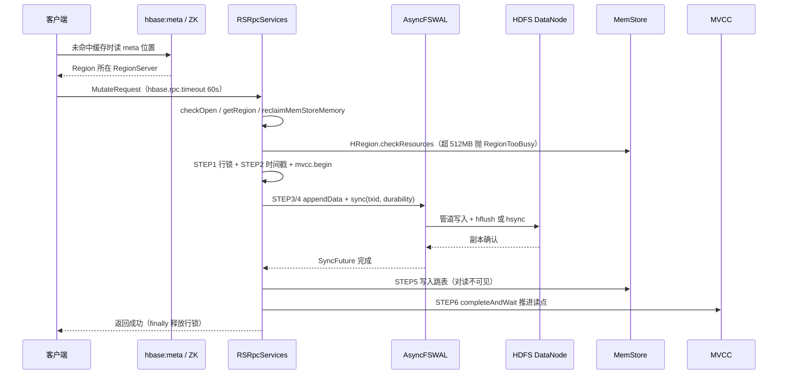
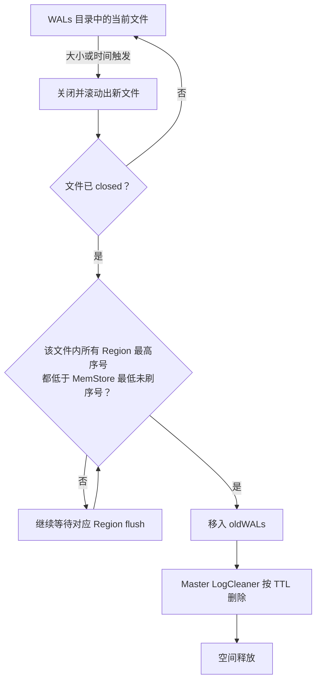
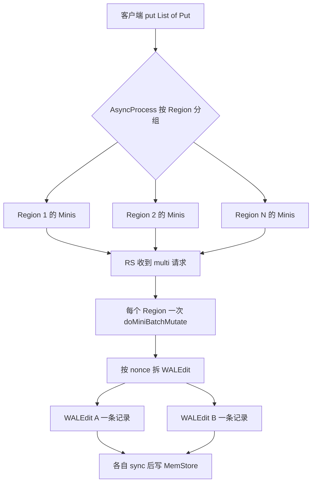

# HBase 写入链路深度解析——WAL、MemStore Flush 与持久性保证

**摘要：**

一次 `put` 拿到成功返回，究竟哪些字节已经离开了客户端进程、哪些还停在 RegionServer 的页缓存里、哪一种断电会让它消失，这是 HBase 写入链路上最容易被含糊带过的一段。本文按调用栈把这条链摊开：客户端如何定位 Region 并发出 `MutateRequest`，`RSRpcServices.mutate` 之后 `HRegion.doMiniBatchMutate` 的六个 STEP 各做什么，`wal.appendData` 与 `sync` 在物理上分别意味着什么，MemStore 写入与 MVCC 推进又如何决定"对读可见"。在此基础上给出两组判据：`Durability` 五级各自丢弃什么、在哪一种故障下丢弃；`WALEdit` 的原子性究竟覆盖到哪一层，批量写入的"跨行原子"为什么只是同 Region 范围内的偶然产物。文章随后处理三个工程问题：客户端缓冲（`hbase.client.write.buffer`）该不该调大，六种写入故障各自长什么样、靠什么关键字判定，以及 WAL 目录持续增长时应该先看哪个计数。全文的落点是一句判断：持久性是一条从客户端堆内存一直铺到 DataNode 磁盘的链，任何单个开关只改变链上某一段的承诺。

> [!info] 本篇的边界
> 大数据概览那一组 survey 里，HBase 只被交代"是什么、适合什么"；本列写另一层：机制在 RegionServer 内部怎么落地、参数调大调小各付什么钱、出问题时日志长什么样。WAL 的物理前提（HDFS 只能追加，`append`、`hflush`、`hsync` 的语义）见 [[大数据/Hadoop/HDFS/00 专栏导览|HDFS]]，LSM 的写放大与 MemStore、HFile 的结构见 [[中间件/Leveldb/00 专栏导览|LevelDB]] 与 [[04 HBase 存储引擎深度解析——LSM-Tree、MemStore 与 HFile 的设计奥秘]]；崩溃之后的 WAL 切分与重放见 [[09 HBase 高可用与容灾——崩溃恢复、备份与复制]]；读侧如何把 MemStore 与多个 HFile 合并成一个视图见 [[06 HBase 读取链路深度解析——BlockCache、Scanner 与多版本合并]]；Compaction 与 WAL 保留时长的联动见 [[07 HBase Compaction 机制深度解析——Minor、Major 与写放大的三角关系]]。这几处已定稿，本文只引用结论。

---

## 第 1 章 成功的定义：一条写路径上的五道门

先钉住一个问题：当支付回调服务拿到一次 `put` 的成功返回，并据此把"订单已支付"写进业务流水，这一刻哪些字节真正离开了这台 RegionServer 的堆内存？如果三秒之后整排机柜断电，这笔订单还在不在？

这个问题没有单一答案，因为"成功"要穿过五道门：客户端调用返回、RegionServer 接收并处理完 RPC、WAL 追加完成、WAL 同步完成、MemStore 里的数据对读线程可见。五道门的顺序是固定的，但每一道门的物理含义不同，配置能改的只是其中两三道。把这条路径按调用栈摊开，是后面所有判据的地基。

### 1.1 客户端：定位 Region 与构造请求

HBase 2.x 的 `Table.put(Put)` 最终落在 `HTable.put` 上：先 `validatePut` 检查行键非空、列族存在、单行大小不超限，再构造一个 `ClientServiceCallable`，其 `rpcCall()` 里用 `RequestConverter.buildMutateRequest` 把 Put 编码成 `MutateRequest`，然后通过 `rpcCallerFactory.<Void>newCaller(writeRpcTimeoutMs).callWithRetries(callable, operationTimeoutMs)` 发出。这里有两个超时参数值得记住：`writeRpcTimeoutMs` 默认取 `hbase.rpc.timeout`（默认 60 秒），也可由 `hbase.rpc.write.timeout` 单独覆盖，它是单次 RPC 的等待上限；`operationTimeoutMs` 来自 `hbase.client.operation.timeout`（2.5 的 `hbase-default.xml` 里默认 1200000 毫秒，即 20 分钟），是整次操作连同重试在内的总预算。两者不是一回事，后面第 7 章讨论写超时时要分开看。

定位责任在 `Connection` 一层。客户端缓存了 `TableName + RowKey → RegionServer + Region` 的映射，命中时路由开销接近于零；未命中或缓存失效时，它先找 `hbase:meta` 所在 RegionServer，而 meta 的位置来自 ZooKeeper 上的 `meta-region-server` 节点，再读 meta 行拿到目标 Region。这条链上的任何一环缺失，写请求都发不出去，所以第 7 章会把"meta 不可用"单独列成一种故障形态。

单条与批量在这里分叉：`put(Put)` 走 `ClientServiceCallable`，一条 Put 一次 RPC；`put(List<Put>)` 走 `batch(puts, results, writeRpcTimeoutMs)`，由 `AsyncProcess` 按 Region 分组后并发投递。这个分叉决定了后文关于"批量原子性"与"客户端缓冲"的两处结论，先记下。

### 1.2 服务端：从 RSRpcServices.mutate 到 doMiniBatchMutate

RegionServer 侧的第一站是 `RSRpcServices.mutate(RpcController, MutateRequest)`。它做四件固定的事：`checkOpen()` 检查服务器状态（已 abort 抛 `RegionServerAbortedException`，已停止抛 `RegionServerStoppedException`，文件系统不可用抛 `RegionServerStoppedException`，还没上线抛 `ServerNotRunningYetException`）；`getRegion(request.getRegion())` 把 `RegionSpecifier` 换成 `HRegion`，找不到就是 `NotServingRegionException`；`reclaimMemStoreMemory()` 在全局 MemStore 超过高水位时阻塞当前 handler；最后按 mutation 类型分派，Put 走 `put(...)` 帮助方法，内部调用 `region.put(put)`。

`HRegion.put` 的骨架很薄，但每一行都有代价：

```java
public void put(Put put) throws IOException {
  checkReadOnly();
  checkResources();          // 粗检查 MemStore 用量，超限抛 RegionTooBusyException
  startRegionOperation(Operation.PUT);
  try {
    return mutate(put);      // → batchMutate → MutationBatchOperation → doMiniBatchMutate
  } finally {
    closeRegionOperation(Operation.PUT);
  }
}
```

`checkResources()` 是"写放大前的闸门"，它比较的是 `memstoreSize` 与 `blockingMemStoreSize`（后者等于 `hbase.hregion.memstore.flush.size` 乘 `hbase.hregion.memstore.block.multiplier`，默认 128MB 乘 4，即 512MB）。超过就抛 `RegionTooBusyException("Over memstore limit=...")`，而不是默默排队。这个选择在 2.x 里是有意的：阻塞会把压力堆在 RPC 队列上，最终以 `CallQueueTooBigException` 或客户端超时的形式爆出来，抛错至少能把"这个 Region 满了"这个事实直接送到客户端。

真正的主体在 `doMiniBatchMutate(BatchOperation)` 里，源码用六个 STEP 注释把顺序钉死，值得逐条抄下来对照：

| STEP | 源码动作 | 物理含义 | 失败后果 |
| :--- | :--- | :--- | :--- |
| 1 | `lockRowsAndBuildMiniBatch` 获取行锁 | 同一行的并发写在此串行化 | 拿不到行锁，超时抛异常 |
| 2 | `prepareMiniBatchOperations` 打时间戳 | 时间戳在锁内取，保证后来者更新 | 列族不存在等写入失败状态 |
| 3 | `buildWALEdits` 组装 WALEdit | 一批 Cell 打包成一条日志记录 | 无（纯内存构造） |
| 4 | `doWALAppend` 追加并同步 WAL | 数据先落到 HDFS 写管道 | 同步失败即 abort RegionServer |
| 5 | `writeMiniBatchOperationsToMemStore` | 写入跳表，对 MVCC 尚不可见 | 极少失败，异常即 abort |
| 6 | `completeMiniBatchOperations` 推进 MVCC | 数据对读线程可见 | 无 |

这六步的顺序不是实现者的偏好，而是被"失败时能退回到什么状态"约束出来的。第 1 章余下的部分就论证这一点。

### 1.3 为什么 WAL 必须在 MemStore 之前

不妨反过来设想：如果把顺序改成先写 MemStore，再写 WAL，会发生什么。

第一种情形，MemStore 写完、WAL 写失败。此时内存里已经有一套读者可见或即将可见的数据，而磁盘上没有任何可以重演的记录。HBase 没有 undo log，也没有把已写入跳表的 Cell 逐条撤回的机制，唯一的选择是让整个 RegionServer 退出，把内存丢掉；可如果再往前一步，客户端已经收到成功，这笔数据就彻底消失了。

第二种情形，MemStore 写完、WAL 还没来得及写，进程被 kill。内存里的数据随进程消失，客户端可能已经拿到成功，也可能没有；HBase 无法区分这两种情况，因为没有任何持久记录能证明"这次写发生过"。

第三种情形，先 WAL 后 MemStore，WAL 同步完成之后进程崩溃。MemStore 确实丢了，但 WAL 里有完整的一条记录，新的宿主在打开 Region 时重放它，数据回到 MemStore。这条路上唯一会丢的是"WAL 同步尚未完成"的写，而那时客户端还没拿到成功，丢与不丢对客户端是一致的。

三种情形对比下来，规则就出来了：**把不可逆的那一步放到最后**。WAL 追加与同步是可逆的（失败了可以 abort，集群里没有半成品），MemStore 写入在"已经对读者可见"之后才是不可逆的。所以顺序只能是 WAL 先行。

> [!note] 一个比喻
> 这就像银行柜台的复核流程：柜员先在传票上写清"谁、什么时间、改了什么"，传票进了流水号才动账本。传票是唯一能在事后重演的依据；账本改错了可以冲正，传票没写就动账，事后无从查起。比喻的技术限定在于，HBase 的"传票"不是一张纸，而是一份三副本、带管道的 HDFS 文件，它的可靠性取决于同步动作做到了哪一层，这正是第 3 章要拆的内容。

### 1.4 数据在哪一刻"对读可见"

WAL 同步完成并不等于数据可读。第 5、6 步之间还隔着 MVCC。

`doMiniBatchMutate` 在 STEP 2 里调用 `mvcc.begin()` 拿一个 `WriteEntry`，此时分配的写号（write number）大于当前的读点（read point），这批 Cell 即使已经进了跳表，读线程也看不到。STEP 5 把 Cell 写进 MemStore 之后，STEP 6 调 `completeAndWait(writeEntry)`，读点推进到该写号，数据才对读可见。源码里 `completeAndWait` 位于 try 块内、行锁释放位于 finally，也就是说原子的边界是"写完内存并推进读点"，这一步完成之后才释放行锁，才轮到 RPC 返回。

一次 put 从客户端到可见的完整时序如下，图中把 WAL 同步、MemStore 写入与 MVCC 推进画成三个依次发生的事件。



由此可以给"成功"一个分层定义：客户端拿到返回，意味着数据已追加进 WAL 并完成了当次 sync、已写入 MemStore、已推进 MVCC、已释放行锁；但"是否落到 DataNode 的磁盘上"取决于 sync 用的是 `hflush` 还是 `hsync`，而"这台机器没了以后它还在不在"取决于 WAL 是否已经复制到别的 DataNode。这两件事分别由 `hbase.wal.hsync` 与 HDFS 副本数决定，与"返回成功"不是同一件事。**返回成功不等于已经落盘**，把这两层混为一谈，是后面绝大多数误配的源头。

顺便说清一处读源码时的困惑：单条写走的方法叫 `mutate`，批量写走的方法叫 `multi`，服务端分别落在 `RSRpcServices.mutate` 与 `RSRpcServices.multi`，但两者最终都汇聚到 `HRegion.batchMutate` 再到 `doMiniBatchMutate`。所以下文的六个 STEP 对单条与批量都成立，差别只在一次 mini batch 里装了几条 mutation。

---

## 第 2 章 WAL 的物理形态：一组顺序文件的生命周期

WAL 在概念上是一本流水账，在物理上是一组会被反复关闭、归档、删除的文件。这一章回答三个问题：一个 RegionServer 到底有几个 WAL，一条记录里装了什么，这些文件在什么条件下能被扔掉。

### 2.1 一个 RegionServer 一组 WAL，meta 单独一组

常见说法是"每个 RegionServer 有且仅有一个 WAL"，这个说法在 1.x 时代基本成立，在 2.x 里需要修正一笔。

2.x 的 `WALFactory` 按 provider 管理 WAL 实例，`hbase.wal.provider` 的默认值是 `defaultProvider`，对应 `AsyncFSWALProvider`（环境不满足时会回退到 `FSHLogProvider`）。所有普通 Region 的写入共享同一个 provider 下的 WAL 实例，这是为了顺序 I/O：几百个 Region 的追加写合并成一条文件尾部写入，磁盘不必在多个文件之间来回寻道。

但 `WALFactory.getWAL(RegionInfo)` 对 meta 有一处特判：当 `region.isMetaRegion()` 且副本号为默认值时，返回 `metaProvider` 的 WAL，而 meta provider 由 `hbase.wal.meta_provider` 配置。也就是说，**meta 的 WAL 是独立的**，不与普通 Region 混在一起。原因不难推：普通 Region 的写入是流量的主体，一旦把 meta 的日志混进同一条文件，meta 的持久化进度就被普通 Region 的 flush 节奏拖着走；分开之后，meta 的 WAL 可以独立滚动、独立归档，也避免了"一个热点表把 meta 的恢复时间拖长"。

这个特判在 `HRegion.sync` 里还有第二道保险：meta Region 的同步不走 durability 分支，直接 `wal.sync(txid)`，无论表级 durability 被设成什么。

### 2.2 一条 WAL 记录：WALKey 与 WALEdit

WAL 文件里的一条记录由两部分拼成：描述这条记录属于谁的 `WALKeyImpl`，以及承载实际数据的 `WALEdit`。字段构成如下。

| 部分 | 关键字段 | 作用 | 判读时的用途 |
| :--- | :--- | :--- | :--- |
| WALKeyImpl | `encodedRegionName` | 记录归属的 Region | WAL 切分时按它分桶 |
| WALKeyImpl | `tableName` | 所属表 | 恢复日志落到哪个表目录 |
| WALKeyImpl | `logSeqNum`（txid） | RegionServer 内单调递增的写入序号 | flush 进度与归档判定的唯一标尺 |
| WALKeyImpl | `writeTime` | 写入时刻 | 恢复时的时间参考，非版本号 |
| WALKeyImpl | `clusterIds` | 复制链路的集群标识 | 跨集群复制去重 |
| WALKeyImpl | `nonceGroup` / `nonce` | 幂等写入的配对标识 | 重放时的去重依据 |
| WALEdit | `cells` | 本次写入的全部 Cell | 一条记录内的原子单位 |
| WALEdit | `isMetaEdit` | 是否为系统编辑 | 区分用户数据与元数据变更 |

`logSeqNum` 是这套结构里最重要的一个数。它是 RegionServer 内的单调序号（客户端拿到的 `Result` 里不含它，但 flush、归档、重放三条路径都靠它对齐）。Region 把 MemStore 刷成 HFile 时，会把"已持久化到的最大序号"记住；WAL 文件能不能归档，取决于它里面所有 Region 的序号是否都已经被刷掉。这也是为什么第 7 章判断"WAL 目录涨"时要先看每个 Region 的最低未刷序号，而不是看磁盘配额。

### 2.3 滚动：四种触发条件

WAL 文件不是无限追加的，它在四种情况下会被关闭并换新文件。

| 触发条件 | 配置 | 默认值 | 判定依据 |
| :--- | :--- | :--- | :--- |
| 文件写满 | WAL 块大小乘滚动比例 | 块大小取 2 倍 DFS 块，比例 0.5 | `writer.getLength() > logrollsize` |
| 时间到点 | `hbase.regionserver.logroll.period` | 3600000 毫秒（1 小时） | `needsPeriodicRoll` |
| 副本不足 | `hbase.regionserver.hlog.tolerable.lowreplication` | 取 WAL 目录的文件系统默认副本数（通常 3） | 管道副本数低于该值 |
| 显式请求 | 由代码调用 `requestLogRoll` | 无 | 譬如 Region 下线、服务器关闭 |

文件写满这一条常被误记成"1GB 一滚"。按 2.x 的实现，异步 provider（`AsyncFSWALProvider`，默认）把 WAL 块大小取成 DFS 块的两倍，滚动比例 0.5；文件系统 provider（`FSHLogProvider`）则取一倍块大小、比例 0.95。两条算法殊途同归，都让一个 WAL 文件落在与 DFS 块同一个量级（典型 128MB 级），而不是 1GB。HBASE-19148 改这一处时给的注释很坦率：1.x 是在块写满 95% 时才滚，实测来不及在块边界之前完成滚动，于是改成两倍块大小、50% 就滚，账面上文件大小与 1.x 接近，但留出了足够的滚动时间。这个细节说明滚动的目的不是"攒够再滚"，而是"在块边界之前滚完"。

时间滚动与大小滚动是并列的，不是互斥的：一小时内写入量很大，就由大小触发；写入量很小，就由时间触发。后者保证即使业务停了，旧 WAL 也会被关闭，从而有机会被归档。这一点对低频写入的表很重要，否则一条只写了几 MB 的 WAL 会一直挂在 WALs 目录里，等不到"关闭"就不会进入归档判定。

### 2.4 归档与清理：两个目录与两道条件

WAL 文件的生命周期跨越两个目录：正在写的放在 `WALs/<server>,<port>,<startcode>/`，不再需要的移到 `oldWALs/`，最后由 Master 的日志清理线程删除。

能不能从 WALs 移到 oldWALs，由 `AbstractFSWAL.cleanOldLogs()` 判定，条件只有两条，且都必须成立：文件已经关闭（`closed` 为真），并且 `sequenceIdAccounting.areAllLower(sequenceNums)` 返回真。后者的含义是：这个 WAL 文件里记录的"每个 Region 的最高序号"，都已经小于该 Region 当前 MemStore 中尚未持久化的最低序号，也就是这个文件里的编辑全部被刷盘覆盖了。源码的注释写得很直白：只有当所有序号都比内存里的更老，这个 WAL 才可以被回收。**序号是唯一标尺**，磁盘配额、文件数量都不是判据。

第二道条件发生在 oldWALs 里。移到 oldWALs 只是"不再被需要"，不等于"立刻删除"；删除由 Master 的 LogCleaner 负责，`hbase.master.logcleaner.ttl` 默认 600000 毫秒（10 分钟），也就是文件在归档目录里至少停留十分钟。这个设计留出了排查窗口：复制链路、备份工具、事后分析都可能还要读旧日志，立刻删掉会让这些消费者失去数据源。

顺带澄清一个容易混用的参数：`hbase.regionserver.hlog.splitlog.writer.threads`（默认 3）不是清理参数，它是故障恢复时 WAL 切分的写入线程数，控制的是把一条大 WAL 按 Region 拆成多个 `recovered.edits` 文件时的并行度。把它调大，缩短的是崩溃恢复时间，与 WAL 目录能否变短无关。



### 2.5 WAL 目录一直在涨，先看哪个计数

"WAL 目录涨"是运维里最常见也最容易误判的现象，因为它其实混着三种完全不同的情况。

| 现象 | 含义 | 判据 | 处置方向 |
| :--- | :--- | :--- | :--- |
| `WALs/` 下文件数持续增加 | 有 Region 或列族的 MemStore 长期未刷 | 看最低未刷序号对应的 Region，通常伴随 `Too many WALs` 日志 | 排查该 Region 的 flush 是否被阻塞 |
| `WALs/` 下文件总量大但数量稳定 | 单个文件写得多，写入量大 | 文件大小接近滚动阈值 | 正常，除非同时出现归档失败 |
| `oldWALs/` 持续增长 | 归档正常，删除跟不上 | LogCleaner 是否存活、TTL 是否被调大、是否有复制队列积压 | 检查 Master 日志清理与复制状态 |

第二种情况是健康的，第三种要看归档目录的清理进度，只有第一种是真正的风险信号。风险信号的关键字在 RegionServer 日志里非常明确：`Too many WALs; count=..., max=...; forcing (partial) flush of ... region(s)`。它由 `AbstractFSWAL.findRegionsToForceFlush()` 打出，触发条件是未归档 WAL 数超过 `hbase.regionserver.maxlogs`。在文件系统 provider 的实现里，显式配置这个键还会打出 deprecated 警告；默认值由"全局 MemStore 大小乘 2 除以滚动大小"推算，且不小于 32。触发之后，RegionServer 会从最老的那个 WAL 出发，找出持有序号最低的 Region 与列族，对它们发起一次强制（可能是部分列族的）flush，把序号推上去，好让老文件能归档。

这条路径解释了一个反直觉的现象：WAL 太多时，HBase 不是先删日志，而是先逼 Region 刷盘。因为删日志会丢数据，逼 flush 只是把数据从内存搬到 HFile，代价可控。这也意味着当 `Too many WALs` 反复出现时，问题通常不在 WAL 本身，而在某些 Region 的 MemStore 迟迟刷不下去。

更麻烦的是它会形成反馈环。flush 变慢，WAL 的归档就滞后，未归档文件数向 `maxlogs` 逼近，于是触发强制 flush；强制 flush 与正常 flush 抢同一批 HDFS 写入带宽与 flusher 线程（`hbase.hstore.flusher.count` 默认只有 2），整体 flush 速度反而更慢，WAL 继续涨。判断是否已经进入这个环，可以同时看三个数：未归档 WAL 文件数、RegionServer 的 MemStore 总量、以及 flusher 队列的排队长度。三者同向上升时，单纯调大 `maxlogs` 只会把环撑得更大，正确的做法是找出那个"写得多、刷得慢"的 Region，从行键分布或列族设计上解决。

---

## 第 3 章 sync 的真实语义：hflush、hsync 与那条被记错的因果链

前一章说 WAL 记录会被"同步"，这一章要问：同步到底同步到了哪一层。答案决定了"返回成功"到底是哪一种承诺。

### 3.1 HDFS 写管道的两层落点

HBase 的 WAL 文件写在 HDFS 上，RegionServer 是 HDFS 客户端。一次 `write()` 的路径是客户端缓冲、到第一个 DataNode、再沿管道传到第二、第三个 DataNode。这条路径上有两个可以停下来确认的位置，对应两个 API：

- `hflush()`：把客户端缓冲推出去，并等待管道上所有 DataNode 确认收到。数据此时在 DataNode 的内存（页缓存）里，没有落盘。RegionServer 崩溃不影响它，DataNode 进程崩溃会丢，整机断电会丢。
- `hsync()`：在 `hflush()` 的基础上，让每个 DataNode 对文件执行 `fsync()`，数据从页缓存进入磁盘。代价是等待磁盘确认，延迟明显高于 `hflush()`。

这两个 API 的语义差异在 HADOOP-6313 里有完整讨论，`Durability` 枚举的 javadoc 也直接引用了它：`SYNC_WAL` 的定义是"刷到文件系统实现，但不一定刷到磁盘"，`FSYNC_WAL` 才是"强制落盘"。三层落点与各自能抵御的故障如下。

| 落点 | 触发动作 | RegionServer 进程崩溃 | DataNode 进程崩溃 | 整机断电 |
| :--- | :--- | :--- | :--- | :--- |
| 客户端缓冲与管道中 | 无 sync | 丢 | 丢 | 丢 |
| DataNode 页缓存 | `hflush` | 不丢 | 丢 | 丢 |
| DataNode 磁盘 | `hsync` | 不丢 | 不丢 | 不丢（副本层面另论） |


图里可注意一点：`hflush` 保证的是"三个副本都收到了"，不是"磁盘上有"。这一点常被误解为"hflush 就等于没保证"，其实它挡住了最常见的一类故障（RegionServer 进程崩溃、单机重启），挡不住的是 DataNode 侧的内存丢失与整机断电。**hflush 只到页缓存**，这句话应该和"它已经比不刷强得多"一起记住。

### 3.2 hbase.wal.hsync 改的是哪一件事

`hbase.wal.hsync` 在 2.x 里默认是 `false`（`HRegion.DEFAULT_WAL_HSYNC`）。多数资料把它描述成"每次写是否 fsync"，方向没错，但作用点需要说准。

`HRegion` 在构造时用这个开关推导默认 durability：

```java
boolean forceSync = conf.getBoolean(WAL_HSYNC_CONF_KEY, DEFAULT_WAL_HSYNC);
// 全局默认 durability：开了 hsync 就是 FSYNC_WAL，否则 SYNC_WAL
Durability defaultDurability = forceSync ? Durability.FSYNC_WAL : Durability.SYNC_WAL;
this.regionDurability = this.htableDescriptor.getDurability() == Durability.USE_DEFAULT
    ? defaultDurability : this.htableDescriptor.getDurability();
```

也就是说，`hbase.wal.hsync=true` 改的是"没有显式指定 durability 的写入"的默认级别，把它们从 `SYNC_WAL`（`hflush`）提升为 `FSYNC_WAL`（`hsync`）。而如果某个写在代码里显式 `setDurability(Durability.SYNC_WAL)`，它仍然按 `SYNC_WAL` 的定义走 `hflush`，因为 `Durability` 的 javadoc 已经把 `SYNC_WAL` 定义成"不保证落盘"。这一点在排查时很实用：全局开了 hsync，并不等于表里每一笔写都 hsync。

> [!warning] 一处常见的键名笔误
> 有些材料把控制 sync 的开关写成 `hbase.regionserver.wal.sync.enabled`。2.5 的 `hbase-default.xml`、`HRegion` 与 `AbstractFSWAL` 里都没有这个键，真正生效的是 `hbase.wal.hsync`（是否把默认 durability 提升为 FSYNC_WAL）与 `hbase.regionserver.optionallogflushinterval`（延迟刷日志时代的兜底间隔，见 3.3）。遇到不认识的键，先回 `hbase-default.xml` 与源码常量里查一遍，再决定改哪个。

### 3.3 optionallogflushinterval 与"可能丢一秒"的归属

`hbase.regionserver.optionallogflushinterval` 是一个有年头的参数。在 0.90 与 0.94 的 `hbase-default.xml` 里，它的值是 1000 毫秒，描述是"如果日志没有攒够足以触发一次 sync 的条目，就按这个间隔同步一次"。它服务的场景叫延迟刷日志（deferred log flush）：写入只追加进内存缓冲区，由后台按周期补一次 sync，从而把多次写入的 sync 开销摊薄。代价写在官方文档里也很清楚：如果 RegionServer 在这段时间内挂掉，尚未刷出的编辑就丢了。

到了 2.x，这个键在 `hbase-default.xml` 里已经找不到，异步同步的语义改由 durability 承担：`ASYNC_WAL` 只追加、不等待同步，`SYNC_WAL` 每条等 `hflush`，`FSYNC_WAL` 每条等 `hsync`。官方参考指南的 "Deferred Log Flush" 一节仍写着"默认值 1000 毫秒"，指的是这套延迟刷日志行为的时间窗，而不是默认写入的行为。

于是"HBase 可能丢一秒数据"这句话的归属就要拆开看：

| 配置组合 | 每条写的同步动作 | 丢数据的窗口 | 一句话判据 |
| :--- | :--- | :--- | :--- |
| 默认（`SYNC_WAL` + `hsync=false`） | 每条 `hflush` | 管道与页缓存层丢失：DN 崩或整机断电 | 丢的是"已确认但未落盘"的数据，不是"没写出去"的数据 |
| `FSYNC_WAL` 或 `hsync=true` | 每条 `hsync` | 只剩 DN 磁盘损坏与副本不足 | 代价是每条写多一次磁盘确认 |
| `ASYNC_WAL`（延迟刷日志） | 不等待，由后续同步或滚动带出 | 旧版本由 1000 毫秒的兜底间隔界定，2.x 则取决于下一次同步何时发生 | 这才是"可能丢一秒"说法的出处 |

把这三行记住，就能回答一个高频问题：默认配置下丢失窗口其实与"一秒"无关，它是"从最后一次 `hflush` 成功到磁盘真正落盘之间的所有数据"；而"一秒"是 `ASYNC_WAL` 的窗口——**丢一秒属于 ASYNC_WAL**，两者被混淆之后，才会出现"HBase 默认能丢一秒，所以要求零丢失就得开 hsync"这种半对半错的推理。要求零丢失的正确做法是 `FSYNC_WAL`（或 `hsync=true`）加上 HDFS 侧的副本与机房保障，单靠一个参数不够。

### 3.4 组提交：一次 sync 服务一批写

如果每条写都独立等一次 `hflush`，高并发下 RegionServer 就会卡在等确认上。2.x 的 `AsyncFSWAL` 用的是"单消费者加环形缓冲"的结构来合并同步请求。

写入线程调用 `append` 时，把数据封装成 append 事件投进环形缓冲，`consumeExecutor` 这个单线程按顺序取出、写入输出流；需要同步的线程则投一个 sync 事件并带一个 `SyncFuture`，然后 `blockOnSync` 等待。消费线程把缓冲里攒下的 append 都写完，再对当前 writer 发起一次同步：`sync(AsyncWriter writer)` 里判断这次该用 `hflush` 还是 `hsync`（`isHsync` 检查这一批的 future 里有没有强制同步的请求，没有则退回全局设置），然后只调用一次 `writer.sync(shouldUseHsync)`。同步完成后 `finishSync()` 从 `syncFutures` 有序集合里取出所有序号不大于已同步位点的 future，逐个标记完成，等待中的写入线程同时被唤醒。

这就是组提交的全部机制：它不是"定时攒批"，而是**一次同步服务一批写**。它带来的直接后果有两个：并发越高，单条写分摊的同步代价越低；但某一条写如果抢在批次边界上，就要多等一个批次的时间。这解释了为什么同一个集群里，写入 P99 延迟对并发度敏感——批次越大，尾部的等待越长。

顺带说一句实现选型：`hbase.wal.provider` 默认的 `AsyncFSWALProvider` 走异步管道，文件系统 provider 的 `FSHLog`（2.x 仍可显式选用）走同步流加 `SyncRunner` 线程池。前者在高并发下线程阻塞更少，后者在超大规模 WAL 文件与老 Hadoop 版本上更稳。两者共享同一套 durability 语义，切换 provider 不会改变任何一级 durability 的承诺范围。

---

## 第 4 章 Durability 五级：五种承诺与各自的失败面

`Durability` 是 HBase 把"持久性"做成可选项的地方。它的五个取值都能被代码判定、被表描述符继承、被单个操作覆盖，所以持久性在这里是一个可配置项，而不是一句形容词。理解它的关键是：每个级别的差别不在"写不写"，而在"等不等"和"等到哪一层"。

### 4.1 五个级别的定义

`Durability` 枚举的注释里写明了顺序要求：取值必须按持久性递增排列，因为实现里用 `ordinal()` 做比较（譬如 `regionDurability.ordinal() > Durability.ASYNC_WAL.ordinal()` 用来判断"这个表要不要同步"）。五个级别与它们的实际动作如下。

| 级别 | 定义 | 实际动作 | 谁在用 |
| :--- | :--- | :--- | :--- |
| `USE_DEFAULT` | 表级时表示用全局默认（`SYNC_WAL`）；操作级时表示用表的设置 | 解析到表或全局默认 | 绝大多数写入，因为客户端默认值就是它 |
| `SKIP_WAL` | 不写 WAL | 只写 MemStore | 可重跑的导入、可再生缓存 |
| `ASYNC_WAL` | 异步写 WAL | 追加但不等同步，由后续同步或滚动带出 | 延迟刷日志的旧用法 |
| `SYNC_WAL` | 同步写 WAL，刷到文件系统实现但不保证落盘 | `hflush` | 默认级别（`hsync=false` 时） |
| `FSYNC_WAL` | 同步写 WAL 并强制落盘 | `hsync` | 金融、账务、不可重算的数据 |

`USE_DEFAULT` 放在第一位不是随手排的：表描述符层面它表示"用全局默认"，操作层面它表示"用表的设置"，两个含义都要保留，所以它必须是第一个值，源码注释里也专门交代了这一点。

### 4.2 服务端如何解析这五个级别

`HRegion.sync(txid, durability)` 是全链路唯一决定"要不要等、等到哪一层"的地方，switch 的每个分支都对应一条承诺：

```java
private void sync(long txid, Durability durability) throws IOException {
  if (this.getRegionInfo().isMetaRegion()) {
    this.wal.sync(txid);                          // meta 永远同步，不受 durability 影响
  } else {
    switch (durability) {
      case USE_DEFAULT:
        if (shouldSyncWAL()) this.wal.sync(txid); // 看表的 regionDurability
        break;
      case SKIP_WAL:   break;                     // 连 WAL 都没写，无需同步
      case ASYNC_WAL:  break;                     // 写了但不等
      case SYNC_WAL:   this.wal.sync(txid, false); // hflush
                       break;
      case FSYNC_WAL:  this.wal.sync(txid, true);  // 强制 hsync
                       break;
      // default 分支抛 RuntimeException，此处节选
    }
  }
}
```

这段代码有三处值得停在原地看一会儿。第一处是 meta 的特判：`hbase:meta` 的写入永远同步，因为 meta 丢一条记录就意味着 Region 位置信息失真，整张表都可能不可用。第二处是 `SKIP_WAL` 分支为空——其实更早的 `buildWALEdits` 阶段就已经把这个 mutation 跳过了，`recordMutationWithoutWal` 会单独计数，所以这里无事可做。第三处是 `SYNC_WAL` 传 `false`、`FSYNC_WAL` 传 `true`：`forceSync` 参数最终决定 `AsyncFSWAL` 在合并同步时用 `writer.sync(true)` 还是 `writer.sync(false)`，也就是 `hsync` 与 `hflush` 的分界点。

把上面的解析过程画成判定树，一次写入最终落到哪一级、执行哪一种同步动作，路径是唯一的。

```mermaid
%%{init: {'theme': 'dracula'}}%%
flowchart TD
    A[一次写入进入 doWALAppend] --> B{是 hbase:meta 吗}
    B -->|是| C[wal.sync 走默认同步动作]
    B -->|否| D{WALEdit 的 durability}
    D -->|SKIP_WAL| E[不写 WAL，只进 MemStore]
    D -->|ASYNC_WAL| F[写 WAL，不等同步]
    D -->|USE_DEFAULT| G{表描述符 durability}
    G -->|USE_DEFAULT| H{regionDurability}
    H -->|SYNC_WAL| I[wal.sync txid false 即 hflush]
    H -->|FSYNC_WAL| J[wal.sync txid true 即 hsync]
    D -->|SYNC_WAL| I
    D -->|FSYNC_WAL| J
    C --> K[成功返回]
    F --> K
    I --> K
    J --> K
    style E fill:#44475a,stroke:#ff79c6
    style J fill:#50fa7b,stroke:#50fa7b
```



图里绿色的终点是"强制落盘"的分支，灰色的是"不写日志"的分支，两者在图上只差一层判断，在故障面前差的是整批数据。`regionDurability` 这一层就是 3.2 里由 `hbase.wal.hsync` 推导出来的值：开了 hsync 它就是 `FSYNC_WAL`，否则是 `SYNC_WAL`。

### 4.3 五级判据表：丢什么、什么时候丢

把代码映射成运维可用的判据，是这一章真正要交付的东西。下表按故障类型列，不是按参数列。

| 故障 | `SKIP_WAL` | `ASYNC_WAL` | `SYNC_WAL` | `FSYNC_WAL` |
| :--- | :--- | :--- | :--- | :--- |
| RegionServer 进程崩溃 | 已写内存的数据全丢 | 上一个同步周期之后的丢 | 不丢 | 不丢 |
| DataNode 进程崩溃 | 不影响（本就没写 WAL） | 同左 | 副本数决定，多数场景不丢 | 不丢 |
| 整机断电 | 全丢，且无从恢复 | 最多丢一个周期 | 页缓存中的数据丢 | 不丢（除非磁盘损坏） |
| HDFS 写管道异常 | 无感 | 同步时暴露 | 写入失败，RegionServer abort | 同左 |
| 错误可被上游补偿 | 可以，若源数据在 | 可以，若业务容忍 | 视补偿能力 | 视补偿能力 |

这张表最重要的信息是最后一行：`SKIP_WAL` 与 `ASYNC_WAL` 是否可接受，不取决于 HBase 能不能保证，而取决于业务有没有"重放"的能力。这也是 4.5 给准入判据的原因。

### 4.4 表级与操作级：两个设置入口

HBase 允许在两个粒度上设置 durability，且操作级优先。

| 粒度 | 设置方式 | 生效范围 | 注意 |
| :--- | :--- | :--- | :--- |
| 表级 | `TableDescriptorBuilder.setDurability(Durability)`（1.x 为 `HTableDescriptor.setDurability`） | 该表所有未显式设置的写入 | 只对新写入生效，已写入的数据不受影响 |
| 操作级 | `Mutation.setDurability(Durability)`，如 `Put.setDurability` | 单条 Put、Delete、Increment | 同一批次里可以混用，逐个解析 |
| 全局默认 | `hbase.wal.hsync` | 把 `USE_DEFAULT` 的解析结果从 `SYNC_WAL` 改成 `FSYNC_WAL` | 不影响显式写了 `SYNC_WAL` 的操作 |

关于表级设置，需要澄清一处资料错位：`hbase.table.durability` 这个键在 2.5 的 `hbase-default.xml` 里并不存在（全文件检索无此配置），表级 durability 在 2.x 由表描述符承载，这是 HBASE-8375 引入的路径。早期文档里出现的同名配置说法，应视为版本错位，实际配置时以对应版本的 `hbase-default.xml` 与 `TableDescriptorBuilder` 的 API 为准。另一种常见做法是在建表后对少数表单独调低 durability，这时改的是表描述符，改完需要等新的写入才生效。

### 4.5 什么业务能用 SKIP_WAL

`SKIP_WAL` 不是什么野路子，HBase 自己在 Region 的 `put` 路径上就为它留了分支（`recordMutationWithoutWal`），BulkLoad 与 MapReduce 导入是它的主要使用者。但它有明确的准入条件，四条同时成立才建议使用，判据可以压缩成一句话：**准入条件是可重放**。

第一，源数据必须在别处完整存在，且可以从头重跑。历史订单回灌属于这一类：原始数据在 Hive 表或 HDFS 上，Job 失败重跑一次即可。若源数据本身只存在于这次写入中，`SKIP_WAL` 等于把唯一副本放在内存里。

第二，写入过程必须幂等，或者重跑能覆盖而不是叠加。纯 `Put`（覆盖写）天然幂等；`Increment` 与 `Append` 不幂等，重跑会重复累加，这类操作即使在导入场景也该保留 WAL。

第三，写入窗口内不能有"读后写"的依赖。`SKIP_WAL` 的数据只存在于 MemStore，一旦 RegionServer 崩溃，还没 flush 的部分会消失，而 flush 的时点不可控；如果下游在窗口内读取并据此做了决策，恢复后就会出现"决策依据消失"的不一致。

第四，要有明确的失败兜底。推荐的做法是导入任务结束时显式触发 flush 或等待 Region 完成刷盘，再校验行数，而不是写完就认为成功。

四条之外还有一条隐性前提：这条路径上的 RegionServer 必须是"可替换"的。如果某个表的数据量极大、恢复要靠 WAL 重放才能补齐，那么即使源数据齐全，`SKIP_WAL` 也会让恢复窗口内的数据状态变得不可预测——重跑导入的耗时不等于重放 WAL 的耗时，两者对线上可用的影响完全不同。

> [!warning] 反例：用 SKIP_WAL 图性能
> 把在线写入的表临时改成 `SKIP_WAL` 来"扛峰值"，是最常见也最贵的误用。峰值期间正好是 MemStore 压力最大、flush 最频繁、RegionServer 最容易出问题的时候，恰恰是 WAL 最该在的时候。真正需要扛峰值，应该调 flush 策略、加 RegionServer、或者把非关键数据分流到另一张表，而不是关掉持久性。

---

## 第 5 章 WALEdit 的原子性：一条日志记录的覆盖范围

前四章把"一条写"当作一个整体，这一章要拆开它：一条 WAL 记录里可以装多个 Cell，这个"装"的边界由谁决定，又给了什么保证。

### 5.1 WALEdit 的边界由 nonce 决定

`doMiniBatchMutate` 的 STEP 3 调用 `MutationBatchOperation.buildWALEdits`，它遍历这一批里所有 mutation，把每个 mutation 的 Cell 加进当前的 `WALEdit`；只有在 nonce 发生变化时才新起一个 `WALEdit`。也就是说：

- 普通 Put 没有 nonce（`HConstants.NO_NONCE`），同一批里所有 Put 的 Cell 会进入同一个 `WALEdit`；
- `Increment`、`Append`、`CheckAndMutate` 带 nonce，不同的 nonce 会拆成不同的 `WALEdit`，每个 `WALEdit` 对应一次幂等写入。

这条规则解释了一个常被忽略的事实：**原子性边界是 WALEdit**，它的边界是"一次幂等写入所覆盖的全部 Cell"，而不是常规理解的"一行"。一批写同一个 Region 的多行数据，如果都不带 nonce，它们会共享一个 `WALEdit`、一个 txid、一条 WAL 记录。

### 5.2 一条 WALEdit 为什么是原子的

WAL 是一条记录一条记录写的，每条记录带一个 trailer，重放时按记录边界读取。因此同一个 `WALEdit` 里的 Cell 在物理上不可能只写进去一半：要么整条记录完整落盘并被重放，要么这条记录根本不存在。

这个物理性质是"行级原子"的实现基础，但真正的原子性还缺两块拼图，都在内存侧。第一块是行锁：STEP 1 对涉及的行逐个加锁，同一行的两个写操作在服务端串行，不会出现"你写一半我插进去"的交叉。第二块是 MVCC：STEP 2 拿写号，STEP 5 写跳表，STEP 6 推进读点，读线程只能看到读点之前的数据，所以在读点推进之前，没人能看到"只写了一半"的行。

这里要修正一个流传很广的说法：MVCC 的写号并不是存在 Cell 的 Timestamp 字段里的。Timestamp 是用户可见的版本号（业务指定的时间或服务端时间），而写号存在 Cell 的序号字段上，源码里是 `PrivateCellUtil.setSequenceId(cell, sequenceId)`，也就是常说的 memstore 时间戳（memstoreTS）。两者在 flush 之后命运也不同：写号在数据落成 HFile 之后就失去意义，保留下来的是 Timestamp。把两者混为一谈，会导致排查"为什么读到了旧版本"时方向完全跑偏。

### 5.3 批量写入的原子性覆盖到哪里

`put(List<Put>)` 在客户端被 `AsyncProcess` 按 Region 分组，每组发一个 multi 请求；服务端每个 Region 独立执行一次 `doMiniBatchMutate`。于是原子性的实际覆盖范围是这样的。

| 写入形态 | 服务端发生了什么 | 原子性覆盖范围 | 判定依据 |
| :--- | :--- | :--- | :--- |
| 单行多列 Put | 一个 WALEdit，一个 txid | 该行全部 Cell | 行级原子，最常用 |
| 同一 Region 多行 Put（同批） | 同一 mini batch 里合并成一个 WALEdit | 这一批全部 Cell（偶然） | 只在"同批、同 Region、无 nonce 拆分"时成立 |
| 跨 Region 的 Put 列表 | 拆成多个 mini batch，各自一个 WALEdit | 每个 Region 内独立 | 没有任何跨 Region 保证 |
| `RowMutations` | 服务端按行加锁并原子执行 | 单行 | 服务端保证，跨行无效 |
| `CheckAndMutate` | 带 nonce 的原子读改写 | 单行 | nonce 保证重放幂等 |

第二行那个"偶然"值得展开。同一 Region 的多行写入之所以看上去原子，是因为它们恰好进了同一个 `WALEdit`，重放时整条记录一起生效；但只要这批数据跨了 Region（客户端分组时被拆开），或者混进了带 nonce 的操作（`buildWALEdits` 拆成多条），这个性质就消失了。更麻烦的是，这个边界由客户端分组与服务端 nonce 共同决定，业务代码很难感知。所以工程上的正确态度是：**批量不提供跨行事务**，需要原子的数据要么放在同一行，要么用 `RowMutations`、`CheckAndMutate` 明确表达。

`MultiRowMutation` 这类协处理器端点，常常被误认为"跨行事务"。它的形态是 HBase 自带的示例端点（`MultiRowMutationEndpoint`）：客户端通过 `exec` 把多行的修改打包进一次服务端调用，端点在服务端按行加锁、顺序执行，因此能做到"同一 Region 内的多行尽量一起成功"。但它的语义边界很清楚：不跨 Region、不做两阶段提交、失败不回滚已完成的部分，与关系型数据库的事务不是一个量级的东西。跨行的强原子性在 HBase 里始终需要应用层补偿或外部事务协调，把 `MultiRowMutation` 当成替代品，等于把一致性责任从数据库挪到了自己身上却没有意识到。

### 5.4 批量请求在服务端的拆分路径

把客户端到服务端的拆分画出来，原子性的边界就很直观了：客户端一次 `put(List)`，按 Region 切成若干组，每组对应一个 `MultiAction`，服务端每个 Region 各自执行一次 mini batch，各自产生自己的 WALEdit。



图里 A 到 B 的分组在客户端完成，B 之后各组相互独立，任何一组失败都不会回滚其他组，失败的那一组由客户端按 `RetriesExhaustedWithDetailsException` 报上来，重试的粒度是单个 Region 的 mini batch，而不是整个 List。

---

## 第 6 章 客户端缓冲：write.buffer 什么时候把数据交出去

到这一章为止讨论的都是服务端。但对写入吞吐影响同样大的一层在客户端：缓冲攒批。它决定了应用调用 `put` 之后，数据在客户端进程里还能停留多久。

### 6.1 BufferedMutator 的三个 flush 触发点

客户端缓冲不在 `Table` 上，而在 `BufferedMutator` 上。`BufferedMutatorImpl.mutate` 把 mutation 累加进内部队列并累加 `currentWriteBufferSize`，然后调用 `doFlush(false)`；`doFlush` 的判断是：若缓冲大小不超过 `writeBufferSize` 且条数没到 `maxMutations`，就继续接收，否则把当前队列交给 `AsyncProcess` 提交。此外还有两个出口：显式调用 `flush()`（内部走 `doFlush(true)`，全部提交并等待），以及 `close()`。2.x 还提供了一种按时间触发的兜底刷新（`writeBufferPeriodicFlush`），用于防止长时间达不到阈值的写入永远留在内存里。

`hbase.client.write.buffer` 的默认值是 2097152 字节（2MB）。这个值的含义常被误读成"每次 RPC 的包大小"，其实是"客户端攒批的阈值"：攒满才发，没攒满就等下一次或等显式 flush。

缓冲的三个出口可以用一张判定图收敛：写入先入队，然后按"是否超阈值、是否有显式 flush、是否触发周期兜底"三条路决定何时交给 `AsyncProcess`。

```mermaid
%%{init: {'theme': 'dracula'}}%%
flowchart TD
    A[mutator.mutate] --> B[写入队列，累加 currentWriteBufferSize]
    B --> C{超过 writeBufferSize<br/>或达到 maxMutations？}
    C -->|是| E[doFlush 提交 AsyncProcess]
    C -->|否| D{显式 flush 或 close？}
    D -->|是| E
    D -->|否| F{周期兜底时间到？}
    F -->|是| E
    F -->|否| G[继续留在客户端内存]
    E --> H[按 Region 分组发送]
    H --> I[等待服务端确认]
    style G fill:#44475a,stroke:#ff79c6
    style I fill:#50fa7b,stroke:#50fa7b
```



图中灰色的出口是最容易被忽略的一条：**入队成功不等于服务端确认**。业务代码只看到 `mutate` 返回，就以为数据已经写进 HBase，而实际上它可能还停在客户端堆里，这是 6.4 那个反例的根源。

### 6.2 put(List) 不走缓冲

另一个高频混淆点是 `put(List<Put>)`。2.x 的 `HTable.put(List<Put>)` 实现是：

```java
public void put(final List<Put> puts) throws IOException {
  for (Put put : puts) validatePut(put);
  Object[] results = new Object[puts.size()];
  batch(puts, results, writeRpcTimeoutMs);   // 直接走批量 RPC，不经客户端缓冲
}
```

也就是说，`put(List)` 是"一次性把这一批发出去并等待"，它本身已经做了批量化，但绕过了 `hbase.client.write.buffer` 这一层。想用缓冲攒批，必须显式拿 `BufferedMutator`，用 `mutator.mutate(put)` 而不是 `table.put(put)`。这个区别直接影响"该不该调大缓冲"的答案：调的是 `BufferedMutator` 的缓冲，不是 `put(List)` 的批量大小。

### 6.3 该不该调大：五个维度的判据

缓冲调大只买到一样东西：更少的 RPC 与更少的 WAL 同步次数。代价分布在五个维度上，逐项权衡之后才谈得上调。

| 维度 | 调大的后果 | 调小的后果 | 判据 |
| :--- | :--- | :--- | :--- |
| 吞吐 | RPC 与 sync 次数下降，吞吐上升 | 请求数上升，吞吐受限 | 单条写入远小于缓冲阈值时收益明显 |
| 单条延迟 | 数据在客户端等待更久 | 更快发出 | 交互式写入不要超过几十毫秒的等待 |
| 客户端内存 | 每个 Mutator 常驻更多堆 | 更省 | 大量线程各持一个 Mutator 时尤其要算 |
| 服务端内存 | 一次请求携带更多数据，handler 占用更高 | 更轻 | 官方建议按 `write.buffer × handler.count` 估 |
| 失败重放成本 | 一次失败要重发更多数据 | 重发量小 | 大缓冲必须配合可幂等的写入 |

第五行是很多团队忽略的：缓冲越大，进程崩溃或 RPC 失败时"还没交出去"和"要重发"的数据越多。写入本身不幂等（譬如 `Increment`）时，大缓冲加自动重试会放大重复写入的风险，这时要么减小缓冲，要么把重试交给上层的幂等设计。

### 6.4 反例：缓冲调到 64MB 却一小时不 flush

笔者见过的一种配置是把 `writeBufferSize` 调到 64MB，理由是"减少 RPC"，但业务侧每秒只有几百条写入，攒满 64MB 需要一个多小时，而代码里既没有周期 flush，也没有在批次结束时 `flush()`。结果很微妙：应用日志显示"写入成功"（因为 `mutate` 只是入队，不抛错），监控里 RegionServer 的写入量却几乎为零，直到某次发布重启，几百万条数据随进程消失。

这个例子的判据很清晰：缓冲的意义是"用延迟换吞吐"，如果写入速率本身撑不满阈值，缓冲就变成了"只延迟不换吞吐"。此时正确做法是显式按时间 flush（或在批次边界 flush），并且把"入队成功"与"服务端确认"在日志里区分开。

---

## 第 7 章 写入故障的形态、判据与处置

写入链路的每一道门都可能关上，但关法不同、日志关键字不同、处置方向也不同。这一章按"客户端看到什么、服务端日志里有什么、根因在哪"三列，把高频故障逐个固定下来。

### 7.1 RegionTooBusyException：Region 满了

`RegionTooBusyException` 在 2.5 里继承的是 `IOException`（不是 `DoNotRetryIOException`），这意味着客户端会把它当作**可重试的拒绝**，按退避策略重发。这一点常常被误解成"服务端拒绝就该换机器"，其实客户端的默认行为是重试同一个 Region，压力会回到原处。

服务端有两个抛出点。第一个在 `HRegion.checkResources()`：`memstoreSize` 超过 `blockingMemStoreSize`（默认 128MB × 4 = 512MB），日志是 `Over memstore limit=..., regionName=..., server=...`。第二个在 `HRegion.lock()`：获取 Region 写锁（`updatesLock` 的读锁）超时，日志是 `Failed to obtain lock; regionName=..., server=...`，等待时间取 `maxBusyWaitDuration` 与 `busyWaitDuration × multiplier` 的较小值。

与之相邻但不同的一种情况是全局水位：RegionServer 的 MemStore 总量超过 `hbase.regionserver.global.memstore.size`（默认堆的 0.4）时，`reclaimMemStoreMemory()` 会阻塞 handler 线程并强制 flush，日志是 `Blocking updates for ...`。这时客户端看不到 `RegionTooBusyException`，而是表现为延迟上升、最终超时或 `CallQueueTooBigException`。两种现象的处理方向相反：前者要减小单 Region 的写入或加快 flush，后者要扩 RegionServer 或降低整体写入量。

### 7.2 NotServingRegionException：Region 已经不在这台机器上

Region 迁移、分裂、关闭期间，客户端手里的路由会短暂失效，请求打到旧宿主就会收到 `NotServingRegionException`。它的语义很干净：这并非拒绝服务，只是"你找错地方了"。客户端收到后会清掉本地路由缓存、重新读 meta、再发一次，**刷新路由再重试**，正常情况下一两次就恢复。

真正需要关注的是持续出现。如果同一个 Region 的 `NotServingRegionException` 反复出现，通常说明它卡在 Region in transition（RIT）：分裂或迁移的 procedure 没有走完，meta 里的位置与实际的宿主不一致。这时看 Master 的 procedure 状态比看 RegionServer 日志更有用。

### 7.3 PleaseHoldException 与 ServerNotRunningYetException：还没准备好

这两个异常长得像，来源不同，处置也不同。

`PleaseHoldException` 来自 Master 的 `HMaster.checkInitialized()`，固定文案是 `Master is initializing`。Master 启动、故障切换、或者刚重启的 RegionServer 还没被处理完时，客户端的定位与管理类调用会撞上它。它的语义是"稍后再来"，客户端重试即可。

`ServerNotRunningYetException` 来自 RegionServer 的 `RSRpcServices.checkOpen()`，文案里带服务器名，语义是"这台 RegionServer 还没上线"。集群滚动重启时它出现的频率最高，通常伴随 Region 正在重新分配。

两者都不该被当成数据问题：它们出现的时刻，数据要么还在旧宿主上，要么正在被重放，处置方式是等而不是修。

### 7.4 SocketTimeoutException：写请求在路上超时

写超时是另一种性质的问题：请求发出去了，但在 `hbase.rpc.timeout`（默认 60 秒）内没等到响应。客户端此时的处境最尴尬——它不知道服务端到底写没写成功，于是只能重试，而重试可能造成重复写入（对 `Increment` 尤其危险）。

这里要把三个参数的分工说清。

| 参数 | 默认值 | 管什么 | 调小的代价 | 调大的代价 |
| :--- | :--- | :--- | :--- | :--- |
| `hbase.rpc.timeout` | 60000 毫秒 | 单次 RPC 等待上限（写可由 `hbase.rpc.write.timeout` 覆盖） | 抖动容忍度下降，误判增多 | 慢请求占用 handler 更久 |
| `hbase.client.operation.timeout` | 1200000 毫秒 | 整次操作含重试的总预算 | 快速失败，但可能过早放弃 | 卡死时间变长 |
| `hbase.client.retries.number` | 15 | 最大重试次数 | 恢复能力下降 | 重试风暴放大服务端压力 |
| `hbase.client.pause` | 100 毫秒 | 首次重试间隔，之后按退避增长 | 恢复变慢 | 退避过长，吞吐下降 |

超时的根因通常在服务端：handler 被打满、GC 停顿、flush 阻塞、或者 Region 正在迁移。客户端参数只能决定"等多久、重几次"，治不了根因；把重试次数调大往往只是把雪崩推迟几十秒。

重试还有一个放大效应值得算一笔账（示例推算）。一个客户端把失败请求重试 15 次，退避从 100 毫秒起步、按倍率增长，按 HBase 的重试退避规则会很快到达每十秒一次的节奏；如果同时有一百个客户端都在重试，服务端收到的请求量就不是"一百个失败请求"，而是"一百乘十五"个。这些请求本身也会占用 handler、参与排队，于是新一轮超时又会产生新的重试。这就是为什么服务端过载时要先限流或降级，而不是让客户端"多试几次"。

### 7.5 WAL 目录涨：归档停在哪一环

`WALs/` 目录持续增长，说明有 WAL 文件已经关闭却迟迟不能被归档。归档的两道条件在第 2 章已经拆过，排障时只需要判断卡在哪一道：文件没有关闭，通常意味着滚动没有发生（时间与大小都没触发，或者日志滚动线程异常）；文件已关闭却无法归档，意味着某个 Region 的最低未刷序号停滞。

判据落在三个观测点上：未归档 WAL 数与 `maxlogs` 的距离、RegionServer 的 MemStore 总量、以及 flusher 队列是否有积压。如果只有第一个在涨，多半是某个 Region 的 flush 被阻塞；如果三个一起涨，说明已经进入 flush 追赶不上的状态。处置方向是找出那个持有序号最低的 Region（日志里 `Too many WALs` 一行会列出待强制 flush 的 Region 与列族），再看它的写入是否集中在少数行键上。

### 7.6 Too many WALs：强制 flush 的连锁

`Too many WALs; count=..., max=...; forcing (partial) flush of ... region(s)` 这条日志出现时，说明自动补救已经启动：RegionServer 正在对持有序号最低的 Region 发起强制 flush，好让老 WAL 能归档。它是一条"已经在自救"的信号，不是故障本身。

需要警惕的是它的频率。偶然出现一次，通常随一次写入高峰过去；同一个 RegionServer 反复打印，说明根因没有解决——要么某些 Region 的 MemStore 长期刷不下去，要么 flusher 线程根本不够用。这时调大 `maxlogs` 只是把触发点往后推，会让下一次恢复需要重放的日志更多，代价更贵。

### 7.7 WAL 同步失败：RegionServer 为什么不惜退出

WAL 同步失败是写路径上最严重的一类错误，因为它意味着"数据可能已经写进内存，但持久化保证已经失效"。服务端的处理是 `abort`：主动终止自己，让 ZooKeeper 会话过期，由 Master 发起恢复。

这个选择看起来过激，但用第 1 章的顺序论证就能理解：一旦同步失败，RegionServer 无法区分哪些写入已经安全、哪些没有；如果继续服务，它就可能对客户端确认一些永远无法恢复的数据，或者让读线程看到无法重放的状态。**同步失败即退出**，至少能保证"不确认没有持久化的写入"。这是 HBase 在可用性与一致性之间的一次明确下注：宁可短暂不可用，不接受静默丢数据。

### 7.8 hbase:meta 不可用：所有写都会失败

meta 的特殊性在于它是"定位的定位"。客户端的路由缓存能撑一阵，但一旦缓存失效（Region 迁移、客户端重启、新表首次访问），就必须读 meta；meta 所在 Region 不可用，读不到新位置，写请求连发都发不出去。

meta 的写入本身也走正常路径：它也是一个 Region，也有 WAL（独立的 meta WAL）、MemStore、flush。区别在于它在 `HRegion.sync` 里被特判为永远同步，且它的可用性被整个集群依赖。因此运维上有一条硬规则：任何会长时间影响 meta 所在 RegionServer 的操作（大规模迁移、重启、磁盘替换），都要先确认 meta 的位置与副本策略。

### 7.9 判定表：六种故障与两处相关现象

把上面这些收进一张表，作为排障时的对照。

| 故障 | 客户端现象 | 服务端关键字 | 根因方向 | 处置 |
| :--- | :--- | :--- | :--- | :--- |
| Region 内存超限 | `RegionTooBusyException`，重试后仍失败 | `Over memstore limit=` | 单 Region 写入过猛或 flush 跟不上 | 分散行键、加快 flush、扩 Region |
| 锁等待超时 | `RegionTooBusyException` | `Failed to obtain lock` | 热点行或长事务占锁 | 检查热点行，缩短单次写入 |
| Region 迁走 | `NotServingRegionException` | `Region ... is not online` | 迁移、分裂、RIT | 等 procedure 完成，查 RIT |
| 集群启动 | `PleaseHoldException` / `ServerNotRunningYetException` | `Master is initializing` / `not running yet` | 初始化未完成 | 等待并限制重试频率 |
| 写超时 | `SocketTimeoutException` | 无（请求未完成） | handler 饱和、GC、flush 阻塞 | 查 handler 队列与 GC |
| WAL 太多 | 延迟上升、偶发失败 | `Too many WALs; count=` | 有 Region 长期不 flush | 查最低未刷序号对应 Region |
| meta 不可用 | 定位失败、写请求发不出 | meta Region 不在线 | meta 宿主异常或长时间不可用 | 优先恢复 meta Region |

---

## 第 8 章 量化：WAL 开销与批量收益的示例推算

这一章的数字全部是示例推算，用来建立量级感，不是任何真实集群的测量值。所有假设都写在括号里，替换成自己集群的参数即可重算。

### 8.1 单笔写入的延迟构成

假设一次 `hflush` 的端到端等待约 1 毫秒（同机房、三副本管道），一次 `hsync` 约 2 到 3 毫秒（多一次磁盘确认），一次 RPC 往返约 0.3 毫秒。在这组假设下，单笔 `SYNC_WAL` 写入的延迟大致是：路由（缓存命中，近似 0）加 RPC 0.3 毫秒加 WAL 追加与 `hflush` 约 1 毫秒加 MemStore 写入（微秒级）加 MVCC 推进（取决于前序写，通常小于 1 毫秒），合计 2 毫秒上下。

把 `hsync` 打开，单笔延迟会多出 1 到 2 毫秒，量级上升 50% 到 100%。HBASE-19024 在引入 `hbase.wal.hsync` 时提到过，他们本地测试中 `hsync` 相对 `hflush` 的延迟影响在 10% 到 15% 之间——这个数字与上面的粗算不矛盾，因为真实集群里 RPC、排队、GC 的占比更高，同步动作只是其中一段。差距的大小恰恰说明：单看"同步方式"无法判断整体延迟，要看同步在端到端里占多大份额。

### 8.2 批量与单条的差距

假设一批 100 条写入同一个 Region，单条写入走一次 RPC 加一次同步，批量写入走一次 multi RPC 加一次同步（同批合并成一个 WALEdit）。

| 指标 | 逐条写入（100 次调用） | 批量写入（1 次调用） | 倍率（示例推算） |
| :--- | :--- | :--- | :--- |
| RPC 次数 | 100 | 1 | 100 倍 |
| WAL 同步次数 | 100 | 1 | 100 倍 |
| 服务端 mini batch 次数 | 100 | 1 | 100 倍 |
| 单条分摊延迟 | 约 2 毫秒 | 批次总耗时约 2 毫秒，分摊到每条约 0.02 毫秒 | 约 100 倍（分摊口径） |
| 客户端内存峰值 | 小 | 与批量大小成正比 | 需按堆预算 |

这张表解释了一个常见误解："批量写入一定更快"。它快在固定开销被摊薄（RPC、同步、锁竞争），但单条分摊的延迟下限仍是那一次同步的时间；如果业务对单条延迟敏感，批量反而把等待拉长了。批量的真正收益出现在"吞吐优先、延迟可接受"的导入场景。

### 8.3 调参矩阵：每个开关的两面

| 配置 | 调大的收益 | 调大的代价 | 调小的收益 | 调小的代价 |
| :--- | :--- | :--- | :--- | :--- |
| `hbase.regionserver.handler.count` | 并发处理能力上升 | 线程切换与内存占用上升，WAL 同步竞争加剧 | 上下文开销低 | 请求排队，延迟上升 |
| `hbase.hregion.memstore.flush.size` | flush 次数少，HFile 少 | 单次 flush 更久，崩溃恢复更慢 | flush 更平滑 | HFile 增多，Compaction 压力上升 |
| `hbase.hregion.memstore.block.multiplier` | 能容忍更大的 MemStore 峰值 | 一次 flush 的数据量更大，恢复更慢 | 更早触发拒绝，保护内存 | 写入更容易被拒 |
| `hbase.client.write.buffer` | RPC 少，吞吐高 | 客户端内存与重放成本上升 | 延迟低，失败代价小 | RPC 多，吞吐受限 |
| `hbase.regionserver.logroll.period` | 滚动少，文件少 | 单个 WAL 更大，恢复更慢 | 归档更及时 | 文件多，滚动开销上升 |
| `hbase.regionserver.maxlogs` | 容忍更多未归档 WAL | 恢复时要重放的日志更多 | 更早触发强制 flush | 更容易因 flush 抖动而影响写入 |
| `hbase.wal.hsync` | 单条写持久性提升到落盘 | 每条写多一次磁盘确认 | 延迟低 | 断电窗口存在 |

这张表没有"推荐值"，因为每一行都是同一笔账的两面：调大是把成本从"写入路径"挪到"恢复路径"或"内存"，调小则相反。选择哪一个方向，取决于业务更怕哪一种故障。**调参是挪账，不是消账**，这是第 8 章所有表格共享的一句注脚。

### 8.4 三个反例

第一个反例是用 `SKIP_WAL` 图性能。它的收益看起来直接（少一次 HDFS 写入），代价却全部转移到了"恢复"这一侧：崩溃时丢的是内存里的数据，而 MemStore 的 flush 时点不可控，丢多少全看运气。用它换来的吞吐，本质上是把持久性抵押给了故障概率。

第二个反例是 `hsync=false` 却要求零丢失。`hflush` 只保证数据到了 DataNode 的页缓存，整机断电仍会丢。要求零丢失的正确组合是 `FSYNC_WAL`（或 `hsync=true`）加上 HDFS 副本与机房层面的保障，而不是把 `hsync` 关掉再指望副本数兜底。

第三个反例是缓冲调大但不 flush。缓冲只在"攒满"或"显式 flush"时把数据交出去，写入速率撑不满阈值时，数据会在客户端内存里一直等；进程重启即丢，而应用日志上全是成功。缓冲与 flush 策略必须成对出现。

---

## 第 9 章 结语

把全文收束成一条主线：HBase 的写入不是"一次写"，而是一条由五道门串起来的链，每一道门都只承诺自己那一段。

客户端的 `put` 承诺的是"请求已经发出"；`RSRpcServices` 承诺的是"这台服务器还愿意处理"；WAL 的追加承诺的是"记录进了管道"；同步动作承诺的是"到了 DataNode 的页缓存或者磁盘"；MVCC 推进承诺的是"对读线程可见"。**五段承诺**叠起来，才是业务感知到的"写成功了"。任何一次排障，本质上都是判断"链断在哪一段"：看到 `RegionTooBusyException`，断在内存；看到 `SocketTimeoutException`，断在等待；看到 `Too many WALs`，断在 flush；看到 WAL 同步失败导致的 abort，断在持久化。

这条链也解释了为什么参数调优总是"挪账"而不是"消账"。`hbase.wal.hsync` 把成本从"断电窗口"挪到"每条写的磁盘确认"；`hbase.client.write.buffer` 把成本从"RPC 次数"挪到"客户端内存与重放代价"；`hbase.hregion.memstore.flush.size` 把成本从"flush 频率"挪到"恢复时长"。没有一个开关能同时改善两端，所谓最佳配置，只是在已知业务更怕哪一种故障的前提下，选了代价更小的那一侧。

因此判断一次写入是否"安全"，不该问"HBase 可靠吗"，而该问三个具体问题：这条链上哪几段被我改过，我改的那一段承诺到什么程度，以及如果这一段失效，业务有没有重放或补偿的能力。三个问题都有答案，持久性才是一个可管理的属性，而不是一句口号。

---

## 参考资料

1. Apache HBase. *Apache HBase Reference Guide*（Write Path、Deferred Log Flush、WAL 相关章节）. [book.html](https://hbase.apache.org/book.html)
2. Apache HBase. `hbase-default.xml`（2.5 分支，各参数默认值的权威来源）. [GitHub](https://github.com/apache/hbase/blob/branch-2.5/hbase-common/src/main/resources/hbase-default.xml)
3. Apache HBase. `HRegion.java`（`doMiniBatchMutate` 的 STEP 1 至 6、`sync(txid, durability)` 的 switch）. [GitHub](https://github.com/apache/hbase/blob/branch-2.5/hbase-server/src/main/java/org/apache/hadoop/hbase/regionserver/HRegion.java)
4. Apache HBase. `AbstractFSWAL.java`（`findRegionsToForceFlush`、`cleanOldLogs`、`hbase.regionserver.maxlogs` 的取值）. [GitHub](https://github.com/apache/hbase/blob/branch-2.5/hbase-server/src/main/java/org/apache/hadoop/hbase/regionserver/wal/AbstractFSWAL.java)
5. Apache HBase. `AsyncFSWAL.java`（环形缓冲、`SyncFuture`、组提交的同步合并）. [GitHub](https://github.com/apache/hbase/blob/branch-2.5/hbase-server/src/main/java/org/apache/hadoop/hbase/regionserver/wal/AsyncFSWAL.java)
6. Apache HBase. `Durability.java`（五个级别的定义与顺序约束）. [GitHub](https://github.com/apache/hbase/blob/branch-2.5/hbase-client/src/main/java/org/apache/hadoop/hbase/client/Durability.java)
7. Apache Hadoop JIRA. *HADOOP-6313: Expose HDFS file flush/sync semantics*（`hflush` 与 `hsync` 的语义来源）. [JIRA](https://issues.apache.org/jira/browse/HADOOP-6313)
8. Apache HBase JIRA. *HBASE-19024: Configurable default durability for synchronous WAL*（`hbase.wal.hsync` 的引入与延迟影响）. [JIRA](https://issues.apache.org/jira/browse/HBASE-19024)
9. Apache HBase JIRA. *HBASE-19148: WAL roll size and block size accounting*（WAL 块大小取 2 倍 DFS 块、50% 滚动的由来）. [JIRA](https://issues.apache.org/jira/browse/HBASE-19148)
10. Apache HBase JIRA. *HBASE-8375: Durability setting per table*（表级 durability 走表描述符的由来）. [JIRA](https://issues.apache.org/jira/browse/HBASE-8375)

---

> [!note] 思考题
> 1. 如果把一个表的 durability 从 `SYNC_WAL` 改成 `ASYNC_WAL`，单条写延迟会明显下降，但"丢一秒"的窗口从哪一刻开始算？请沿 `doWALAppend` 到下一次同步的路径把它标出来。
> 2. 同一个 RegionServer 上，A 表用 `FSYNC_WAL`、B 表用 `SYNC_WAL`，两者共享同一个 WAL 实例。一次组提交里同时有 A 和 B 的写入时，这次物理同步会走 `hsync` 还是 `hflush`，为什么？
> 3. `hbase.regionserver.maxlogs` 触发的是"强制 flush"而不是"删日志"，这个选择保护了什么、又放大了什么代价？
> 4. 批量写入 100 行同一 Region 的数据，其中 99 条成功了、1 条因列族不存在失败。服务端会在哪一步发现失败？已经写进 WAL 的那部分会不会被重放？
> 5. 如果业务确实需要"跨两行原子"，在 HBase 里可以怎么设计？请比较"合并到同一行"、"应用层补偿"与"引入外部事务协调"三条路的代价。