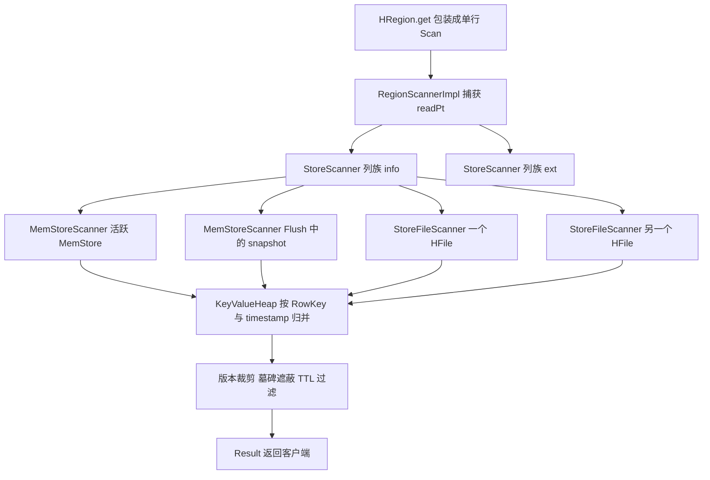
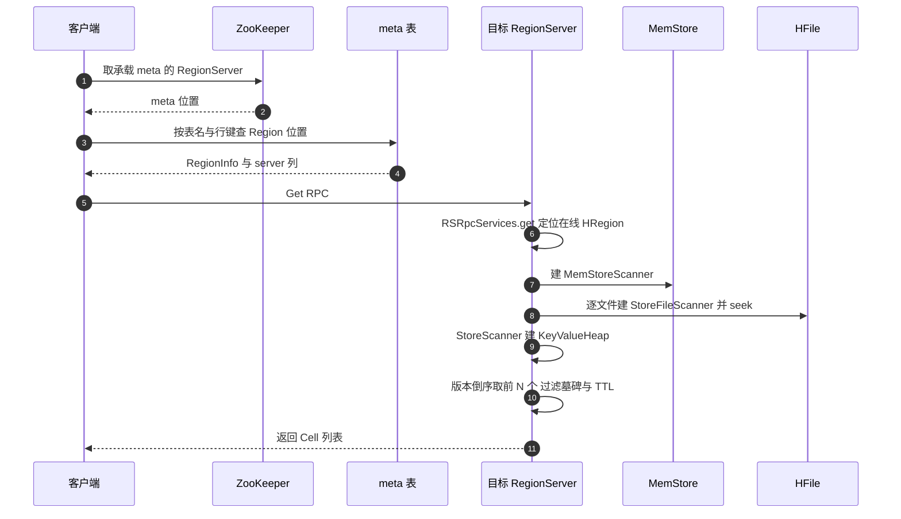
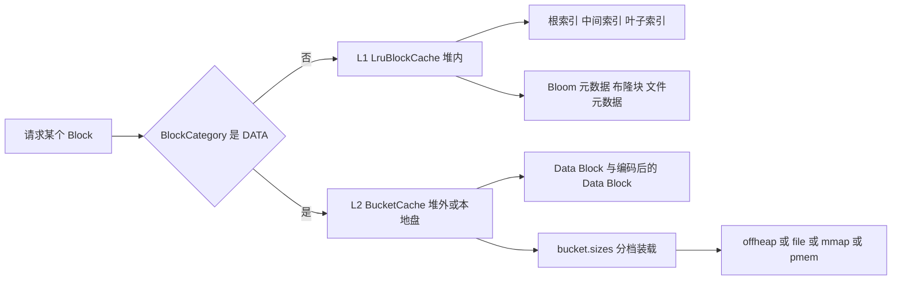
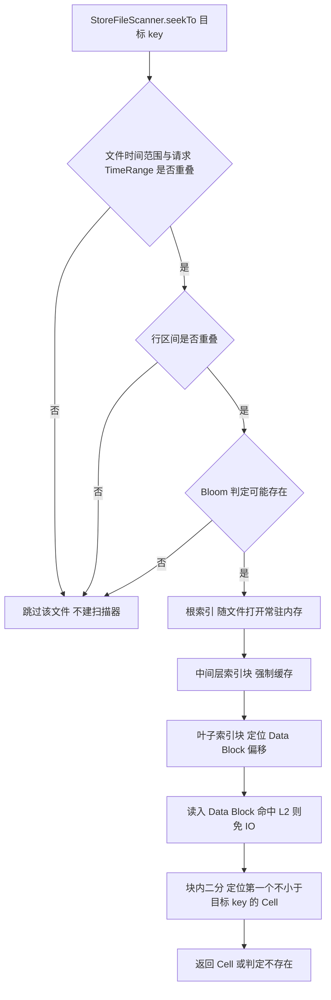
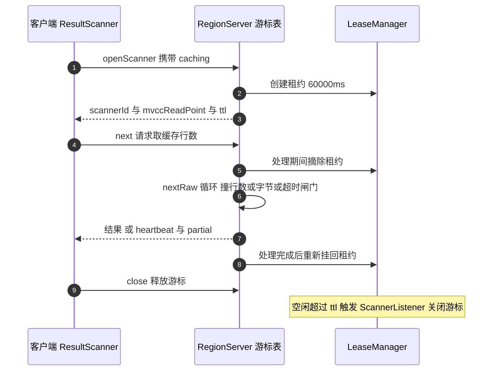
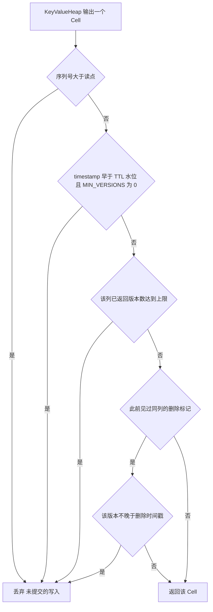

# HBase 读取链路深度解析——BlockCache、Scanner 与多版本合并

**摘要：**

读取在 HBase 里从来不是"查一个位置"，而是一次归并。同一行的数据可能同时躺在活跃的 MemStore、正在落盘的 snapshot、以及磁盘上数量不等的 HFile 里，一次 `Get` 必须在 RegionServer 内部把这些数据源全部打开，按 RowKey 与 timestamp 拼成一路有序流，再过滤掉尚未提交的写入、超出 TTL 的旧值、以及已被墓碑遮蔽的版本。读取路径的设计目标不是让每次读都很快，而是让代价可预测：哪些读命中缓存、哪些读退化成一次磁盘寻道、哪些读要归并几十路数据源，都能从结构与配置上推算出来。

本篇按四个骨架拆这条链路：`RegionScannerImpl` 与 `StoreScanner` 的两层归并，以及"StoreFile 数 + 1"路扫描器带来的读放大；`BlockCache` 的两级布局，堆内 `LruBlockCache` 承载索引与 Bloom、堆外 `BucketCache` 承载 Data Block，以及这个分工背后 GC 与 I/O 的账；`HFileScanner` 从 Bloom 判定、三级索引到 block 内二分的 seek 过程；`Scanner` 的 caching、batch、lease 三道闸门与多版本合并规则。每一节都给出配置项与对应的判据，说明参数调到哪里、代价落在哪里、出问题时该看哪个异常。读完这些机制，应当能回答三个问题：一次 Get 的延迟花在哪几段，两级缓存各该配多大，读变慢时先看哪个异常、哪个统计量。

本列写的是每个机制怎么实现、出问题怎么判；HBase 是什么、适合什么场景，留给概览体例的那一列去讲。

---

## 第 1 章 一次 Get 要合并多少路数据

LSM-Tree 用顺序写换来了写入吞吐，代价是把"一行数据在哪里"这个问题从"一个地址"变成了"一组地址"。这一章先把这组地址找出来，看清归并动作发生在哪一层，后面几章的缓存、seek、版本过滤才有落点。

贯穿全篇的案例是一张订单表：RowKey 由商户号与订单号拼接而成，列族 `info` 存放订单状态、金额与更新时间，业务要求读到当前状态，同时保留最近三个版本用于对账。这个读法同时具备点查、多版本与列过滤三个特征，正好把读取链路上的机制都压出来。

### 1.1 同一行数据的五个可能位置

写入路径把数据先放进 MemStore，MemStore 满了 Flush 成一个 HFile，HFile 再由 Compaction 合并成更大的文件。这条链路走完之后，同一行的历史版本会分散在多个物理位置：

| 位置 | 数据何时落在这里 | 是否可能持有最新版本 | 读取代价 |
| :--- | :--- | :--- | :--- |
| 活跃 MemStore | 上一次 Flush 之后的所有写入 | 是，且必然最新 | 内存跳表查找，微秒级 |
| Flush 中的 snapshot | 正在落盘的那份 MemStore 副本 | 是 | 只读内存结构，微秒级 |
| 刚 Flush 出的 HFile | 一次 Flush 的产物，文件序号最新 | 是 | 命中 BlockCache 则免 IO，否则一次 HDFS 读 |
| Minor Compaction 后的中等文件 | 几次 Flush 合并的结果 | 可能 | 同上，且归并路数增加 |
| Major Compaction 后的大文件 | 全量重写后的结果 | 可能 | 同上，索引层数可能更深 |

这张表解释了一个常见误解：很多人以为"数据已经落盘了，读就只碰磁盘"。实际情况是，只要还有未 Flush 的写入，最新版本就只在内存里；只要发生过 Flush，旧版本就留在磁盘文件里；而 Compaction 只是把旧版本集中到更少的文件里，并不保证删除它们（墓碑的物理清除要等下一次重写）。HFile 内部的 Block、索引与文件元数据如何组织，见 [[04 HBase 存储引擎深度解析——LSM-Tree、MemStore 与 HFile 的设计奥秘]]。

### 1.2 客户端先问目录，再问数据

客户端并不知道某个 RowKey 属于哪个 Region。它先通过 ZooKeeper 拿到承载 `hbase:meta` 的 RegionServer 地址——2.x 里目录表只有这一层，`-ROOT-` 表在 0.96 前后就已经取消——然后按 `表名,起始行` 这样的行键去读 meta 行，取出两列关键信息：`info:regioninfo` 里的 RegionInfo（起止行、RegionId）与 `info:server` 里的目标 RegionServer 地址。

这一步的结果会被塞进客户端连接对象的 `MetaCache`，它的内部结构是"表名到有序映射，有序映射的键是 Region 起始行，值是 RegionLocations"。之后同一个连接上对同一张表、同一段行键区间的请求，直接命中缓存，不再往返 ZooKeeper 与 meta。缓存被清空的时机也很明确：RPC 返回 `NotServingRegionException`、Region 已经迁移、或者 meta 里的位置信息与客户端缓存不一致，客户端会把这一条位置记录作废并重新查一次目录。

路由本身几乎不构成延迟，但它决定了失败时的表象。Region 正在迁移的瞬间，客户端可能连续收到几个 `NotServingRegionException`，重试逻辑会重新查目录并打到新的 RegionServer 上；如果 meta 所在 RegionServer 不可用，客户端会卡在"拿不到目录"这一步，表现为长时间重试而不是某条数据读不到。这两类故障的处置完全不同，判断依据就是异常类型与客户端日志里是否出现定位 meta 的往返。

### 1.3 服务端：Get 其实是一次单行 Scan

请求到达 RegionServer 后，入口是 `RSRpcServices.get`。它先做三件事：检查服务是否已初始化完成（未完成时抛 `PleaseHoldException`，客户端重试即可）、按 Region 名取出在线的 `HRegion`（取不到抛 `NotServingRegionException`）、按表的配额检查本次读取是否超限。之后才进入真正的读路径。

这里有个容易被忽略的实现细节：`HRegion.get` 内部并没有一条专门的"点查快速路径"，它把 `Get` 包装成一个 `Scan`，再走扫描的通用逻辑。

```java
// HRegion.getInternal 的骨架，省略了 coprocessor 与统计
Scan scan = new Scan(get);                       // Scan 提供了以 Get 为参数的构造
try (RegionScanner scanner = getScanner(scan, null, nonceGroup, nonce)) {
  List<Cell> tmp = new ArrayList<>();
  scanner.next(tmp);                             // 只取一行
  for (Cell cell : tmp) {
    results.add(CellUtil.cloneIfNecessary(cell)); // 堆外 Cell 拷回堆内
  }
}
```

这段代码把读取的三个层次串了起来：`getScanner` 建出 `RegionScannerImpl`，`RegionScannerImpl` 在构造时抓取当前 MVCC 读点，并为每个列族建一个 `StoreScanner`，`StoreScanner` 再把 MemStore 与各个 HFile 的扫描器挂到一个 `KeyValueHeap` 上。`scanner.next(tmp)` 只取一行，取完立即关闭扫描器，所以 `Get` 的服务端开销集中在"建扫描器 + 定位 + 归并一次"。

`cloneIfNecessary` 这一行值得单独看。`BucketCache` 里缓存的数据块是堆外内存，被缓存块引用的 Cell 可能指向直接内存缓冲区，如果不拷贝就返回给上层，一旦缓存淘汰、块被回收，客户端拿到的就是悬空引用。HBase 2.x 在这里统一做一次按需拷贝，代价是每个返回值可能多一次内存复制，收益是堆外缓存的生命周期与读请求彻底解耦。理解了这一点，后面讨论"堆外缓存省下了什么、又付出了什么"时才有完整的账。

### 1.4 RegionScannerImpl 与 StoreScanner：两层归并

扫描器是一棵树，不是一条链。Region 级持有一个 `RegionScannerImpl`，它按列族各建一个 `StoreScanner`，自己再用一个 `KeyValueHeap` 把各列族的数据流归并成行级别有序的一路；`StoreScanner` 内部再把该列族下的所有数据源归并成列级别有序的一路。



`StoreScanner` 的构造过程可以拆成四步：向 `HStore` 要扫描器列表，`HStore.getScanners` 先按扫描的起止行过滤出可能与查询区间重叠的 StoreFile，再按 `maxSequenceId` 升序为每个文件建 `StoreFileScanner`，最后把 MemStore 的扫描器追加在末尾；对这些扫描器逐个 seek 到起始 key；把存活下来的扫描器交给 `new KeyValueHeap(scanners, comparator)`；此后每次 `next` 都从堆顶取一个 Cell。

有一个顺序约定值得记住：文件扫描器的先后由 `scannerOrder` 决定，序号越大表示那份数据越新。列表本身按 `maxSequenceId` 升序排出（旧文件在前），但归并时不看列表位置，只看比较器：两个 Cell 的行、列、时间戳与类型完全相同时，比较器用 `scannerOrder` 破平，让序号更大的扫描器排在堆顶。这个约定是第 6 章墓碑能生效的前提——同一次删除与更早的一次写入如果时间戳相同，必须保证删除先被看到。

### 1.5 KeyValueHeap：归并的代价是 log K

`KeyValueHeap` 是一个以扫描器为元素的最小堆，堆序由每个扫描器当前 `peek()` 到的 Cell 决定。取下一个 Cell 的动作是：从堆顶弹出扫描器，读它的下一个 Cell，若还有内容就把扫描器放回堆中。

```java
// KeyValueHeap.next 的核心，省略了异常与延迟关闭
Cell kvReturn = current.next();
Cell kvNext = current.peek();
if (kvNext == null) {
  current = pollRealKV();                 // 该路耗尽，换下一路
} else {
  KeyValueScanner topScanner = heap.peek();
  // 只有当前扫描器的新 key 不小于堆顶时，才有必要重新入堆
  if (topScanner != null && comparator.compare(kvNext, topScanner.peek()) >= 0) {
    heap.add(current);
    current = pollRealKV();
  }
}
```

这段代码里有个精巧的优化：如果当前扫描器读完一个 Cell 之后，下一个 Cell 仍然小于堆顶扫描器的 key，那么它必然还是最小值，根本不需要入堆再出堆。省掉的这次堆操作在纯顺序扫描里极为常见——同一路数据连续输出几十个 Cell 都不需要调整堆——所以归并的实际开销远低于教科书上"每个元素 O(log K)"的估计，只有数据源之间频繁交错时才会退化为完整的堆操作。

`K` 的规模决定代价。对一个列族而言，K 等于存活的 Scanner 数量，也就是"命中的 StoreFile 数 + MemStore 扫描器数"；对 Region 而言，还有一层按列族的堆，但列族数通常很小。归并的 CPU 开销在 K 是十几的时候可以忽略，K 到几十上百时就会体现在读延迟的尾部——这也是后文把"文件数"当成读路径第一成本项的原因。

### 1.6 一次 Get 打开了多少个扫描器

把上面的结构摊开算一遍。一次 `Get` 在服务端要建：

1. 每个涉及的列族一个 `StoreScanner`；
2. 每个列族下，与查询行区间重叠的每个 StoreFile 各一个 `StoreFileScanner`；
3. 每个列族下，MemStore 的扫描器一个（正常情况），若此刻正在 Flush，snapshot 也会贡献一个，变成两个。

于是单个列族、无并发 Flush 时，一次 `Get` 打开的扫描器数量是 `StoreFile 数 + 1`，并发的归并路数也是这个数字。这个加法就是**读放大**最原始的定义：读一行数据，要打开并归并这么多路数据源。第 2 章会把这个数字换算成 I/O 与延迟。



这张时序图里，真正花时间的只有两段：逐文件 seek 时可能触发的磁盘读，以及归并与版本过滤的 CPU。第一段由 BlockCache 与 Bloom Filter 决定，第二段由文件数与版本数决定，两者正好对应本篇后面两条主线。

---

## 第 2 章 读放大：文件数为何是读取的第一成本项

### 2.1 一个文件要付两次读，索引块通常免费

在 `StoreFileScanner` 上做一次 seek，理想情况下要触碰两类数据块：先用索引定位到目标 Data Block 的偏移，再把 Data Block 读进来。业界的经验是"一次随机读约等于**两次块读**"，来源就在这里。

不过索引块有一个特殊待遇：`HFileBlockIndex` 在向下遍历索引树时，无论调用方是否要求缓存，都会把中间层与叶子层索引块放进 BlockCache，源码里的注释写得很直白——索引块必须缓存，否则性能会变得极差。所以稳态下，一次 seek 的 I/O 成本主要是那一次 Data Block 读；索引块的读取只在缓存未命中或块被淘汰时发生。

这就形成了一个分层账本：索引与 Bloom 元数据的访问频率高、体积小，天然适合常驻内存；Data Block 体积大、访问局部性差，是 I/O 的真正大头。第 3 章的两级缓存布局，本质上是把这个账本落到了内存层次上。

### 2.2 Bloom 把"文件数"从乘法变成加法

没有 Bloom 时，每个候选文件都必须做一次 seek 才能确认"这个 key 不在里面"，于是 I/O 次数与文件数成正比。有了 Bloom，绝大多数文件在打开索引之前就被排除，I/O 次数退化成"1 次命中的文件 + 少量误判"。

| StoreFile 数 | 无 Bloom 的候选 seek 次数 | 有 Bloom（误判率 0.01）的期望 seek 次数 | 期望数据块读次数 |
| ---: | ---: | ---: | ---: |
| 3 | 3 | 1 + 2×0.01 = 1.02 | 约 1 |
| 10 | 10 | 1 + 9×0.01 = 1.09 | 约 1 |
| 30 | 30 | 1 + 29×0.01 = 1.29 | 约 1.3 |
| 100 | 100 | 1 + 99×0.01 = 1.99 | 约 2 |

表里的数字是示例推算：假设目标 key 只在一个文件里、BlockCache 对数据块全部未命中、误判率取代码默认的 0.01、忽略布隆过滤器本身的元数据块读。它想说明的是量级——文件数从 3 涨到 100，无 Bloom 时 I/O 涨 33 倍，有 Bloom 时只涨 2 倍。这也解释了为什么 Bloom 的收益随文件数增长而放大：文件越多，被它挡掉的无效 seek 越多。

范围 Scan 不在这个账本里。`StoreFileReader.passesBloomFilter` 只在 `scan.isGetScan()` 为真时才真正查询布隆过滤器，因为布隆过滤器只能回答"某个 key 在不在"，回答不了"这个区间有没有数据"。范围扫描在文件级只能靠行区间与文件首末 key 的比较来排除文件，剩下的候选文件必须逐个打开。扫描型负载的读放大，只能靠降低文件数来解决——也就是 Compaction 与合理的预分区。Compaction 的合并策略见 [[07 HBase Compaction 机制深度解析——Minor、Major 与写放大的三角关系]]，预分区与分裂见 [[08 HBase Region 分裂与负载均衡——水平扩展的工程底层]]。

### 2.3 blockingStoreFiles 是刹车，不是调优旋钮

HBase 用一个参数来兜底文件数失控：`hbase.hstore.blockingStoreFiles`，2.5 的默认值是 16。它的语义不是"文件数上限"，而是"当任一 Store 的文件数超过这个值时，阻塞该 Region 的写入，直到 Compaction 完成或者阻塞等待超时（`hbase.hstore.blockingWaitTime`，默认 90000 毫秒）"。

把这个参数和 Compaction 的阈值放在一起看，文件数的判据就清楚了：

| 文件数区间 | 含义 | 处置方向 |
| :--- | :--- | :--- |
| 1 到 3 | 稳态。`hbase.hstore.compactionThreshold` 默认 3，超过即触发 minor compaction | 正常，无需干预 |
| 4 到 10 | 正常波动。Compaction 正在追，`hbase.hstore.compaction.max` 默认 10 意味着一次最多合并 10 个 | 观察 Compaction 队列与吞吐 |
| 11 到 15 | Compaction 明显落后，读放大的 CPU 与 I/O 已经在涨 | 查 Compaction 是否被限速、磁盘是否饱和、是否有大文件卡住 |
| 16 及以上 | 写入已被阻塞，这是故障状态而不是容量状态 | 先恢复写入，再追 Compaction，不要在这个区间里调读参数 |

最后一档的处理顺序尤其要分清。文件数到 16 时，读性能已经不是主要矛盾——写入被阻塞意味着整条链路都在等 Compaction，此时去调 BlockCache 或 Bloom 都是错的方向。反过来，文件数长期在 5 到 10 徘徊、读延迟尾部很高，才是该去看 Compaction 策略与 BlockCache 命中率的场景。

---

## 第 3 章 BlockCache 的两级结构

### 3.1 以 Block 为粒度，是结构与 I/O 的共同选择

BlockCache 缓存的对象是 **HFile 的 Block**，不是 Cell，也不是整个文件。原因有两层：HFile 的组织单位就是 Block，索引记录的是每个 Data Block 的起始 key 与偏移，读路径天然以 Block 为单位进退；HFile Block 与 HDFS 的定位读在粒度上是对齐的：一次块读在 HDFS 侧就是一次带偏移与长度的读请求，不会因为缓存粒度与它错位而多读。HBase 的块读取最终落到 HDFS 的一次定位读上，该路径见 [[04 HDFS 数据读写流程——Pipeline 写入与机架感知读取的底层路径]]。

Block 的类型直接决定了缓存策略，因为不同类型的块在访问频率与体积上差了一个量级：

| Block 类型 | 内容 | 体积特征 | 访问频率 | 在 2.5 里的归属 |
| :--- | :--- | :--- | :--- | :--- |
| DATA / ENCODED_DATA | 实际的 KeyValue 序列 | 大，受列族块大小控制 | 取决于数据热度 | L2 BucketCache |
| LEAF_INDEX | 叶子索引，指向 Data Block | 小 | 每次 seek 都碰 | L1 LruBlockCache |
| INTERMEDIATE_INDEX | 中间层索引 | 小 | 每次 seek 都碰 | L1 LruBlockCache |
| ROOT_INDEX | 根索引，随文件打开加载 | 极小 | 常驻，几乎不淘汰 | L1 LruBlockCache |
| BLOOM_CHUNK | 布隆过滤器的分块数据 | 小 | 每次 Get 都碰 | L1 LruBlockCache |
| FILE_INFO / TRAILER | 文件级元数据 | 极小 | 打开文件时 | L1 LruBlockCache |

### 3.2 L1：LruBlockCache 的三档优先级

`LruBlockCache` 是堆内实现，2.5 的默认淘汰策略是 LRU（`hfile.block.cache.policy` 取 `LRU`）。它的内部不是一张统一的 LRU 表，而是按访问频次分成三个区：

- Single 区，默认占容量的 25%，块第一次进入缓存落在这里；
- Multi 区，默认占 50%，块被再次访问后晋升到这里；
- In-Memory 区，默认占 25%，列族标记了 `IN_MEMORY=true` 的块直接进这个区。

三个区的比例由 `hbase.lru.blockcache.single.percentage`、`hbase.lru.blockcache.multi.percentage`、`hbase.lru.blockcache.memory.percentage` 控制，默认值就是上面那组。淘汰阈值另有一组：`hbase.lru.blockcache.min.factor` 默认 0.95、`hbase.lru.blockcache.acceptable.factor` 默认 0.99，缓存用量越过可接受水位后，后台淘汰线程会把用量压回最小水位；`hbase.lru.blockcache.hard.capacity.limit.factor` 默认 1.2，到达这个硬上限时新块直接拒绝写入，防止缓存无限膨胀。

这个分区的设计目标是隔离访问模式。一次全表扫描会把大量只读一次的块灌进缓存，如果它们和点查的热点块抢同一个 LRU 队列，热点块会被挤出去。三档优先级的做法是：扫描块停在 Single 区，淘汰时先从这里下手；点查多次命中的块晋升到 Multi 区，被保护起来；显式声明 `IN_MEMORY` 的列族数据直接进第三区，连晋升过程都省了。

```xml
<!-- 列族级声明：把该列族的数据块钉在 In-Memory 区 -->
<property>
  <name>IN_MEMORY</name>
  <value>true</value>
</property>
```

在 2.5 里，L1 的淘汰策略除了默认的 `LRU`，`BlockCacheFactory` 还接受 `TinyLFU`、`AdaptiveLRU`、`IndexOnlyLRU` 三种取值，分别对应不同的淘汰算法与只缓存索引的取向；`hbase-default.xml` 的描述里只提了前两种，实际可用的取值以代码为准。这也是一处常见的文档滞后。

### 3.3 L2：BucketCache 的桶与 IOEngine

`BucketCache` 把块放在 JVM 堆外，或者放在本地 SSD 的一个文件里。它的分配单位是"桶"：启动时按 `hbase.bucketcache.bucket.sizes` 给出的尺寸列表把整块容量切成一档档大小不同的桶，每个块按自身大小向上取整装进合适的桶里。代码里的默认桶尺寸是 4KB 到 512KB 之间的 14 档，每档都多留 1KB，因为 HFile 里实际的块往往比列族上配置的块大小略大一点，不留这点余量就装不进去，所以默认列表是 5KB、9KB、17KB 一直到 513KB 这样的数字。尺寸列表必须是 256 的整数倍，否则读回缓存时会遇到块头校验失败。

桶化分配解决的是外部碎片问题。堆外内存一旦按块大小逐次申请，释放后留下的空洞无法被更大的块复用；预先切好固定尺寸的桶，就变成了"在对应档位里找一个空桶"，碎片被限制在同一档内部。代价是取整浪费——一个 40KB 的块装进 41KB 的桶，浪费 1KB；块大小分布越集中，浪费越少。

IOEngine 决定了堆外数据落在哪里，`hbase.bucketcache.ioengine` 的取值在 2.5 里包括：

| 取值 | 后端 | 适用条件 | 代价 |
| :--- | :--- | :--- | :--- |
| `offheap` | JVM 直接内存 | 内存充裕，希望零 GC 影响 | 占用 `-XX:MaxDirectMemorySize` 额度 |
| `file:` / `files:` | 本地磁盘或 SSD 上的一组文件 | 内存不足但有本地 SSD | 多一次本地盘 IO，需处理持久化元数据 |
| `mmap:` | 内存映射文件 | 希望借用页缓存且要跨重启保留内容 | 映射区不受 GC 管，但受操作系统页回收影响 |
| `pmem:` | 持久内存设备上的文件 | 有持久内存硬件 | 硬件依赖强，集群间不通用 |

`file:` 与 `mmap:` 后端还有一个附加项 `hbase.bucketcache.persistent.path`，它记录的不是块数据本身，而是"哪个块在文件的哪个位置"这份映射。没有这份映射，重启后文件里躺着一堆无法索引的块，等价于缓存被清空。

### 3.4 CombinedBlockCache：按 Block 类别分流

只有配了 `hbase.bucketcache.ioengine` 才会出现 L2；一旦 L2 出现，`BlockCacheFactory` 就把 L1 与 L2 组合成 `CombinedBlockCache`，两者不再是二选一的关系。分流规则写在 `cacheBlock` 里，只有几行：

```java
// CombinedBlockCache.cacheBlock 的核心判断
boolean metaBlock = buf.getBlockType().getCategory() != BlockType.BlockCategory.DATA;
if (metaBlock) {
  l1Cache.cacheBlock(cacheKey, buf, inMemory);   // 索引 Bloom 元数据进堆内
} else {
  l2Cache.cacheBlock(cacheKey, buf, inMemory);   // 数据块进堆外或本地盘
}
```

`BlockType` 的 `BlockCategory` 把块分成 DATA、INDEX、BLOOM、META 四类，判断条件等价于"只要不是数据块，就进 L1"。于是索引块、布隆块、文件元数据、Trailer 全部落在堆内缓存，数据块（含编码后的数据块）全部落在堆外或 SSD。

读取时先查 L1，未命中再查 L2。`CombinedBlockCache.getBlock` 会先用 `containsBlock` 探一次 L1，把这次探查计入一次 L1 未命中统计，再转到 L2。这个细节让两层的命中率可以分开统计，也解释了为什么看"总命中率"会得出偏乐观的结论——索引块的命中率通常接近 100%，会把数据块的糟糕命中率平均掉。

2.5 里还有一层设计选择：默认的 `CombinedBlockCache` 是非包容式的，L2 命中的块不会回填到 L1；另有一个 `InclusiveCombinedBlockCache` 用于外部缓存插件，命中后会往 L1 回填。对数据块而言，非包容式是合理的——它体积大，回填进堆内只会挤占索引块的位置。



### 3.5 为什么非要分成两级

把两级布局当成"堆内装不下就放堆外"是一种误读。真正的动机是两类块在三个维度上的差异太大，用同一种存储介质承载必然有一头受损。

第一个维度是**体积**。一个 64KB 的 Data Block，如果放在堆内，就变成一个存活时间不可控的大对象。堆内缓存的总量以 GB 计，意味着几十万个这样的对象散布在老年代里，任何一次 Full GC 都要扫描并压缩它们。G1 的 Humongous 区对大对象的处理更粗糙，块生命周期与 Region 生命周期不一致时，跨代引用还会拖慢回收。索引块与布隆块则是小对象（多数在 KB 级），对象头开销可接受，标量替换与 TLAB 分配都能吃下，堆内管理不是问题。

第二个维度是**访问频率**。索引块与布隆块是 seek 的前置条件：不打开索引就拿不到数据块偏移，不查布隆就不知道要不要打开索引。它们的访问次数与读请求数同阶，命中率天然接近饱和，放在堆内可以省掉一次堆外访问的边界成本。数据块的访问次数取决于数据热度，冷数据的块即便被缓存也很少再被命中，把它们放在堆外，淘汰时的代价只是释放一个桶，不产生垃圾对象。

第三个维度是**回收方式**。堆外缓存的内存可以在块被淘汰的瞬间还给操作系统，完全不经过 GC；堆内缓存即便做了 LRU 淘汰，对象也要等下一次 GC 才真正释放。对于读延迟敏感的系统，"淘汰不等于释放"是个隐患：缓存里堆满了逻辑上已淘汰但物理上还活着的块，堆占用迟迟降不下来，GC 压力反过来又影响读延迟。

把这三点合起来看，两级布局的分工是：小、频、必须命中的元数据留在堆内；大、稀、可容忍淘汰的数据块放到堆外。这不是缓存容量问题，而是"哪种回收机制适合哪种对象"的问题。

值得补一句代价。堆外缓存换来了 GC 友好，却把一部分复杂性转移到了别处：块引用计数、堆外缓冲区的申请与释放、Cell 指向堆外内存时的生命周期管理（就是第 1 章提到的 `cloneIfNecessary`）、以及直接内存的容量规划。这些成本不会消失，只是从 GC 日志转移到了"堆外内存用满时的 `OutOfMemoryError: Direct buffer memory`"。

### 3.6 该配多大：两块内存的账要一起算

BlockCache 不是独立预算，它和 MemStore 争的是同一块堆。2.5 的默认值是 `hfile.block.cache.size = 0.4`（堆的 40% 给 L1）、`hbase.regionserver.global.memstore.size = 0.4`（堆的 40% 给所有 MemStore），两者相加占掉 80%，剩下 20% 留给 RPC 线程栈、块编解码缓冲、Cell 对象与其他运行时结构。这个 40/40 的分配是 HBase 反复权衡后的默认值，不是随手写的。

于是"该配多大"的第一个判据是**加法**：`hfile.block.cache.size` 与 `hbase.regionserver.global.memstore.size` 之和不要越过堆的 0.8。越过之后，GC 会先以频繁的 Young GC 表现出来，再以 Full GC 与读延迟尖刺表现；写侧则会因为 MemStore 逼近上限而提前阻塞，形成"读也慢、写也卡"的复合症状。

第二个判据是**命中率**。缓存是否够大，不看容量数字，看 BlockCache 的统计：`CacheStats` 提供 `hitCount`、`missCount`、`getHitRatio()`，还按块类型提供了 `dataHitCount`、`leafIndexHitCount`、`bloomChunkHitCount` 等拆分计数。判断时要看数据块的命中率，不要看总命中率——索引块与布隆块的命中率接近饱和，会把数据块的缺口掩盖掉。数据块命中率长期偏低，说明工作集大于缓存容量，或者扫描流量在稀释缓存。

第三个判据是**延迟分布**。缓存命中时读延迟在亚毫秒到毫秒级，未命中时要叠加一次 HDFS 读，延迟跳到十几毫秒。若 P99 延迟呈现明显的双峰，且慢峰的位置与"未命中"的量级吻合，基本可以确认是缓存容量或命中率问题。

堆外部分单独规划。启用 `BucketCache` 之后，`hfile.block.cache.size` 只决定 L1 的大小，数据块在堆外另算，配置项是 `hbase.bucketcache.size`，单位是 MB，低于 1MB 时启动会直接抛参数异常。堆外内存的额度由 JVM 参数 `-XX:MaxDirectMemorySize` 控制，它不在 `-Xmx` 之内，因此规划公式是：

```text
进程物理内存 >= -Xmx + BucketCache 容量 + off-heap MemStore + 其他直接缓冲区 + 元空间 + 栈
```

其中 off-heap MemStore 由 `hbase.regionserver.offheap.global.memstore.size` 控制，默认 0 表示不用堆外 MSLAB，一旦启用，它和 BucketCache 争的是同一份直接内存额度。两份加起来超过 `-XX:MaxDirectMemorySize` 时，症状不是 GC 而是直接的 `OutOfMemoryError: Direct buffer memory`，异常栈里通常能看到 `ByteBuffer.allocateDirect` 或 `ByteBufferIOEngine`。

下面这组数字只用来演示账怎么算，不是推荐配置。一台 RegionServer 的 `-Xmx` 是 32GB，按默认分配，L1 约 12.8GB、MemStore 约 12.8GB；改成启用 20GB 的 BucketCache、把 `hfile.block.cache.size` 降到 0.05 之后，L1 只剩约 1.6GB，堆内空间让给了 MemStore 与运行时结构，但进程对物理内存的需求变成 32GB 堆加 20GB 直接内存再加预留，没有 64GB 以上内存的机器接不住这样一台 RegionServer。

| 配置项 | 默认值 | 调大的代价 | 调小的代价 |
| :--- | :--- | :--- | :--- |
| `hfile.block.cache.size` | 0.4 | 挤占 MemStore 与其他堆空间，GC 压力上升 | 索引块与布隆块被频繁淘汰，seek 前的元数据访问退化为磁盘读 |
| `hbase.bucketcache.size` | 未设置，等于不启用 | 占用直接内存，配置不当触发 Direct buffer OOM | 数据块命中率下降，读延迟向 HDFS 靠拢 |
| `hbase.regionserver.global.memstore.size` | 0.4 | 写侧缓冲变大、Flush 变少，但读侧缓存被压缩 | Flush 更频繁，文件数上升，读放大加剧 |
| `hbase.bucketcache.bucket.sizes` | 14 档默认值 | 大桶偏多会浪费容量 | 小桶偏多会让大块装不进任何桶，这些块不被缓存，后续读回落到 HDFS |
| `hfile.block.cache.policy` | LRU | `TinyLFU` 提升抗扫描能力但引入额外计数开销 | 策略选错会放大扫描污染 |
| `hbase.lru.blockcache.single.percentage` | 0.25 | 单次块占比过大，热点晋升空间被压缩 | 扫描块占比过小，一次扫描就能挤掉正常块 |

几个在旧文档与二手笔记里高频出现、却没出现在 2.5 的默认配置与 `BlockCacheFactory` 里的键名，值得辨析一遍。`hbase.regionserver.blockcache.size` 不存在，堆内 L1 的容量键是 `hfile.block.cache.size`，堆外 L2 的容量键是 `hbase.bucketcache.size`；`hbase.regionserver.blockcache.policy` 同样不存在，2.5 的策略键是 `hfile.block.cache.policy`，可取 `LRU`、`TinyLFU`、`AdaptiveLRU`、`IndexOnlyLRU`，并没有 `SLAB` 与 `ADAPTIVE` 这两个取值——`SlabCache` 是 0.9x 时代的实现，2.x 已经移除。所谓 `four-tier` 的四档权重也不见于 2.5 的 `BucketCache`，它的分档由 `hbase.bucketcache.bucket.sizes` 的 14 个桶尺寸决定；看到四档权重的描述时，多半是在讲更早版本的二级缓存实现，选型应以目标版本的代码与文档为准。顺带一提，早期用于按比例切分两级的 `hbase.bucketcache.percentage.in.combinedcache` 在 2.x 里也不再生效，源码读到它只会打一条警告。启动脚本里常见的 `-Dhbase.regionserver.offheap.bucketcache.size` 也属于这一类：2.5 只认 `hbase.bucketcache.size`（单位 MB）与 `hbase.bucketcache.ioengine`，多写的键不会生效，配置看起来改了，行为却没变。块大小同理，`hbase.hfile.blocksize` 不是 2.5 的键，块大小是列族属性 `BLOCKSIZE`，缓存侧与块尺寸对齐的参数叫 `hbase.blockcache.minblocksize`。

### 3.7 反例：把两块内存算成一块

最常见的错误配置是照着"BlockCache 越大越好"的经验把 `hfile.block.cache.size` 加到 0.6，而 `hbase.regionserver.global.memstore.size` 仍保持 0.4。两项相加已经是堆的 100%，留给其他结构的空间是零。这种配置不会立刻报错，它只是在等一个把堆推过临界点的时机：Region 数增长、Flush 抖动、一次大查询，都可能成为那个时机。具体的症状链与处置顺序放在第 8 章展开。

这个反例的教训不是"不要调缓存"，而是内存预算必须整体核算。HBase 的许多参数都作用在同一块堆上：`hfile.block.cache.size`、`hbase.regionserver.global.memstore.size`、处理线程数（栈空间）、扫描时的结果缓冲。单独把某一个调大，等于从其他项里偷偷抽走预算，崩溃只是时间问题。

---

## 第 4 章 HFileScanner 的 seek：从 Bloom 到 block 内二分

### 4.1 文件级的三道排除

一次 seek 在真正读数据块之前，要先过三道文件级的筛子，顺序是时间范围、行区间、布隆过滤器。

时间范围来自 `StoreFileReader` 记录的该文件最小与最大时间戳：如果 `Scan` 指定的 `TimeRange` 与文件的时间范围不重叠，整个文件可以直接跳过，连布隆过滤器都不用查。行区间检查比较扫描的起止行与文件的首末 key，不重叠同样跳过。布隆过滤器是最后一道，也是最细的一道：它只能回答"某个确定的 key 在不在这个文件里"，所以只在单行查询（`Get` 或起止行相等的 `Scan`）上生效。

这三道筛子共同决定了一个文件是否值得打开索引。过滤动作发生在 `StoreScanner.selectScannersFrom` 调用 `shouldUseScanner` 的时候，失败的扫描器会被直接关闭、不进入堆，因此被排除的文件不会产生任何归并开销。

### 4.2 索引是三层树，根索引常驻

HFile 的索引结构是三层：根索引、中间层索引、叶子索引。根索引不放在数据区，它随文件打开时一次性读入内存（load-on-open 段），因此定位的第一跳永远不需要 I/O。中间层与叶子层按需读取，但读到之后会被强制放进 BlockCache，`HFileBlockIndex` 的遍历循环里写得很清楚：只要当前层不是最后一层，索引块就必须缓存。

叶子索引的每一项记录一个 Data Block 的起始 key 与偏移，找到"第一个不小于目标 key 的项"就把 Data Block 的位置定下来了。索引块的大小由 `hfile.index.block.max.size` 控制，默认 131072 字节；这个值决定了一个索引块能容纳多少条目，也就间接决定了一层索引能覆盖多少数据块、整棵树有几层。块越大，索引层数越少、跳数越少，但单个索引块的读取成本与内存占用也越大。



### 4.3 块内定位与 nextIndexedKey

Data Block 读进内存之后，块内的 Cell 按序排列，定位方式是在块内做二分查找。二分的结果有两种：命中，或者落在两个 Cell 之间（表示目标 key 在下一块）。后一种情况需要靠 `nextIndexedKey` 判断是否要继续读下一块——索引里给每一块都记了"下一块的第一个 key"，扫描器据此决定继续还是收手。

这个机制的好处是避免越界读。一次范围扫描跨多个块时，扫描器不需要读到块的末尾才知道该不该换块，索引提供的边界 key 让它能在正确的块边界上停住。反过来，如果块内 Cell 的编码顺序被破坏（比如用了不兼容的编码器却用错误的解码方式读），二分就会给出错误位置，表现为读到错误数据或 `IOException`，而不是简单的"慢一点"。

### 4.4 Bloom 的两种粒度，什么时候 ROWCOL 才有意义

HBase 的布隆过滤器按列族的 `BLOOMFILTER` 属性选择粒度，默认是 `ROW`：

| 取值 | 判定对象 | 生效条件 | 内存代价 | 适用场景 |
| :--- | :--- | :--- | :--- | :--- |
| `NONE` | 不建布隆过滤器 | 无 | 无 | 纯范围扫描、几乎不做点查的列族 |
| `ROW` | RowKey | 单行查询（Get 或起止行相等的 Scan） | 低 | 点查为主、每行列数比较均匀 |
| `ROWCOL` | RowKey 加列限定符 | 单列 Get、或按单列过滤的扫描、或多列 Get 在 seekExact 中查 | 高，与列数成正比 | 宽表、稀疏列、按列过滤的点查 |
| `ROWPREFIX_FIXED_LENGTH` | 行键的固定长度前缀 | 按前缀命中的查询 | 取决于前缀长度 | 行键有规律前缀的设计，2.x 引入 |

`ROWCOL` 的收益只在"能指定到某一列"时才出现。单列 Get 时，`StoreFileReader.passesBloomFilter` 会把 RowKey 与列限定符拼成一个假 key 去查布隆过滤器，此时它能挡住"行在文件里、但这列不在文件里"的文件；多列 Get 时，文件级布隆过滤器查不了，只能交给 seek 阶段逐列查。一次查整行的 Get 用 `ROWCOL` **不会有任何额外收益**，只会付出更大的过滤器内存——这是选择粒度时最容易搞反的一点。

布隆过滤器的误判率由 `io.storefile.bloom.error.rate` 控制，代码里的默认值是 0.01；误判率越低，每个 key 需要的位数越多，过滤器占用的内存也越大。过滤器本身分成 128KB 左右一块的布隆块（`io.storefile.bloom.block.size` 控制），这些块和索引块一样，命中时被放进 L1。

### 4.5 blocksize 与 seek 的三角关系

块大小是读取路径上最典型的"两头都疼"的参数。列族级属性 `BLOCKSIZE` 决定 Data Block 的大小，默认 64KB。

块变大：索引项变少、索引树变矮、同样的数据量需要的索引块与 seek 跳数都下降，顺序扫描时预读效率也更高。代价是任何一次点查都要把一个更大的块读进内存，而且这个块要占掉更多缓存容量——点查密集的负载会明显感觉缓存"不经用"。

块变小：点查的粒度更精细，读进来的无效数据更少，缓存能装下更多"有用的"块。代价是索引项数量按比例上升，索引块变多、树变高，seek 时的索引跳数与索引内存占用一起增长；更小的块还意味着单位数据量的块头与校验开销占比上升，HFile 的整体体积变大。

| 块大小取向 | seek 跳数 | 单次读入量 | 索引内存 | 缓存效率 | 适合的负载 |
| :--- | :--- | :--- | :--- | :--- | :--- |
| 16KB 或更小 | 多 | 小 | 高 | 点查高、扫描低 | 随机点查为主、行长较小 |
| 64KB 默认 | 中 | 中 | 中 | 均衡 | 混合负载 |
| 256KB 或更大 | 少 | 大 | 低 | 扫描高、点查低 | 顺序扫描为主、批量分析 |

经验判据是让块大小与访问模式对齐：点查为主且行不大时，把块调小到 16KB 或 32KB 通常能减少每次读入的无效数据；扫描为主时保持 64KB 甚至更大，让一次读入能覆盖更多连续行。调整块大小只影响新写入的 HFile，已有文件要等 Compaction 重写之后才会采用新的大小。

---

## 第 5 章 Scanner 的四道闸门

### 5.1 服务端游标是有状态的

与 `Get` 取完一行就关扫描器不同，`Scan` 在服务端是一个长期存在的对象。`RSRpcServices` 用一个 `scanners` 映射保存所有活跃游标，键是 `scannerIdGenerator` 生成的 long 型 id 转成的字符串，值是 `RegionScannerHolder`，里面装着 `RegionScanner`、所属 Region、是否允许心跳、以及租约对象。打开扫描器的响应里会带上三个关键字段：`scannerId`（后续每次 next 都要带）、`mvccReadPoint`（本次扫描的可见性水位）、`ttl`（租约时长）。

这个设计把"扫描"从无状态请求变成了有状态会话，代价是服务端必须管理这些会话的生命周期。租约、关闭、超时清理这一整套机制，都是为这个有状态游标服务的。

### 5.2 caching 与结果大小是两道闸门

客户端一次 `next` 想让服务端返回多少行，由 `caching` 决定；服务端返回多少字节，由结果大小上限决定。两者是并行的闸门，**谁先到就按谁停**。

服务端的取行数直接来自请求里的 `numberOfRows`，源码注释写得很清楚——这就是 `scan.getCaching()`；如果请求里没带这个字段，默认按 1 行处理（关闭扫描器时按 0 行处理）。结果大小有两层限制：客户端侧是 `hbase.client.scanner.max.result.size`，默认 2MB；服务端侧是 `hbase.server.scanner.max.result.size`，默认 100MB，用来防止单次响应把服务端内存打爆。两者取小生效，并且单行数据超过限制时仍然整行返回——上限约束的是"一次响应"，不是"一行数据"。

客户端 `caching` 的默认值在 2.x 里换过一次语义。`Scan` 对象上的 `caching` 字段默认是 -1，表示"未指定"；未指定时读取配置项 `hbase.client.scanner.caching`，而 2.5 里这个配置项的默认值是 `Integer.MAX_VALUE`。这意味着默认情况下，服务端会一直取行，直到撞上 2MB 的字节上限或者取完 Region 内所有数据。这个设计的理由是：行的大小差异太大，用固定行数限制不如用字节数限制来得稳定。这里也没有 `hbase.client.scanner.caching.default` 这个键——常被误传的说法，正是把"`Scan` 字段默认 -1"与"配置项默认 `Integer.MAX_VALUE`"两个概念混成了一条。

| 闸门 | 配置项或参数 | 默认值 | 调大的代价 | 调小的代价 |
| :--- | :--- | :--- | :--- | :--- |
| 取行数 | `hbase.client.scanner.caching` | 2147483647 | 单次响应内存占用上升，一条慢请求可能拖过租约 | RPC 次数成倍增长，网络与服务端处理开销放大 |
| 客户端字节上限 | `hbase.client.scanner.max.result.size` | 2097152 | 客户端内存峰值上升，大结果集容易 OOM | 往返次数变多，单行超限时自动放宽 |
| 服务端字节上限 | `hbase.server.scanner.max.result.size` | 104857600 | 服务端在极端情况下可能被单次响应压垮 | 大行、宽行扫描被提前截断为多次响应 |
| 每行 Cell 数 | `Scan.setBatch(n)` | 无限制 | 单个 Result 体积大，客户端组装成本高 | 一行被拆成多次响应，必须处理 partial 语义 |

在笔者见过的代码里，把 `caching` 设成 1 多半来自对旧版默认值的模仿，属于历史遗留的坏习惯。早期版本的默认值设得很小，于是那个年代的文档与示例代码里到处是 `scan.setCaching(100)` 的写法；到了 2.x，如果照抄"设成 1 控制内存"的经验，一次扫描十万行的请求会变成十万次 RPC，网络往返与 RPC 队列排队直接把扫描拖慢一到两个数量级。反过来，把它设得极大也不是没有代价——单次响应变大意味着客户端要一次性消化更大的 `Result` 数组，堆压力随之上移。

### 5.3 batch 与心跳：大行如何不被超时打断

`batch` 控制的是"每行最多返回几个 Cell"，粒度比 `caching` 更细。设了 `batch` 之后，一个宽行会在多次 `next` 之间被拆开返回，服务端在 `ScannerContext` 里用 batch 上限控制单次 `nextRaw` 的输出量，客户端则通过 `Result.mayHaveMoreCellsInRow()` 判断这一行是否还没取完。

拆行带来一个新问题：如果一行有几十万个 Cell，服务端处理这一行的时间可能超过租约时长或 RPC 超时，客户端会误以为服务端失联。HBase 2.x 用心跳解决这个问题：服务端在接近超时前，把已经取到的部分结果作为一次"心跳响应"发回客户端，并在响应里标记 `heartbeatMessage`，客户端收到后继续发 next。超时时长的算法是取租约与剩余 RPC 超时中更小的那个，再折半，并设一个下限防止刚进入扫描就超时。

心跳只在客户端声明支持 partial 与 heartbeat 时才启用。如果客户端版本较老、不支持 partial 语义，服务端不会发心跳，此时唯一的办法是把 `batch` 与 `caching` 调小，让单次处理时间落在租约之内。

### 5.4 lease：游标的租约与过期

服务端为每个游标创建一个租约，时长来自 `hbase.client.scanner.timeout.period`，默认 60000 毫秒。`LeaseManager` 是一个独立线程，按固定频率检查到期租约；到期时回调 `ScannerListener`，关闭该游标并递增 `scannerLeaseExpired` 计数，日志里会看到 "Scanner lease ... expired" 这样的记录。

这里有个容易忽略的细节：服务端在处理一次 next 请求期间，会先把租约从 `LeaseManager` 里摘掉，处理完再挂回去。这样做的目的是避免"处理时间本身超过租约时长"导致游标被自己的处理过程判定过期。也就是说，租约度量的是两次请求之间的**空闲时间**，不是单次请求的耗时。

租约过期之后，客户端再发 next 会收到 `UnknownScannerException`。这个异常的消息文本本身就带着排查指引：可能是 scannerId 传错、两次请求之间等得太久导致租约过期、服务端正在关闭、或者升级过程中 RegionServer 重启；如果原因是等待过久，建议调大 `hbase.client.scanner.timeout.period`。这种设计把"客户端等太久"和"服务端丢游标"两个原因合并到了同一个异常里，所以排查时要先看服务端日志里有没有对应的 lease 过期记录。

顺带纠正一个常见的版本混淆：`hbase.regionserver.lease.period` 这个配置项在 0.96 之后就被标记为废弃，2.5 的服务端读的是 `hbase.client.scanner.timeout.period`。而在更早的 1.x 客户端里常见的 `ScannerTimeoutException`，在 2.5 的客户端源码里已经找不到——扫描超时通常表现为 `SocketTimeoutException`、包在 `RetriesExhaustedException` 里抛出，或者直接就是上面那个 `UnknownScannerException`。按旧文档去日志里搜 `ScannerTimeoutException`，很可能一无所获。

### 5.5 next() 与 next(N) 的层次差异

客户端 API 与服务端 API 在"取多少"这件事上并不对应。客户端的 `ResultScanner.next()` 返回一行，`next(int nbRows)` 返回多行，后者不会改变服务端的取数逻辑，只是在客户端缓存里多取几次；`ClientScanner` 会按 caching 预取，把结果放在本地缓存里供逐个消费。

服务端这边有三层方法：`next(List<Cell>)` 取一行，`next(List<Cell>, ScannerContext)` 在上下文限定的范围内取，`nextRows(int)` 直接取多行。`RSRpcServices` 的扫描处理走的是最后一个的等价形式——循环调用 `nextRaw`，把每个 `Result` 塞进响应，直到行数、字节数或超时任一闸门触发。

理解这个分层对调优很重要。客户端调 `caching` 影响的是 RPC 往返次数；客户端调 `next(N)` 影响的是本地调用次数；服务端调 `batch` 影响的是单行拆分的粒度。三者作用在不同层次，混着调会出现"改了没效果"的困惑。



### 5.6 反向扫描：换一种顺序走同一棵树

`Scan.setReversed(true)` 让扫描按 RowKey 降序返回。实现上换了两样东西：`RegionScannerImpl` 换成 `ReversedRegionScannerImpl`，`StoreScanner` 换成 `ReversedStoreScanner`，后者把内部的 `KeyValueHeap` 换成 `ReversedKeyValueHeap`，并把 seek 的动作从"找到第一个不小于目标的 key"改成"找到最后一个不大于目标的 key"。

反向扫描的起始定位比正向贵。从空起始行开始的正向扫描从文件的第一个块读起，反向扫描则要先定位到最后一个块（`seekToLastRow`）；而访问模式决定了文件开头的块更容易被反复读到、留在缓存里，末尾的块很少被碰到，定位它的第一次读大概率要落到 HDFS 上。行内顺序也有约束：反向扫描只反转行的顺序，同一行内部的 Cell 仍然按 timestamp 降序返回，`ReversedStoreScanner` 里甚至为此加了断言检查。

在 `ReversedStoreScanner` 上调用 `seek` 或 `reseek` 会直接抛 `IllegalStateException`，因为反向定位只能走 `backwardSeek` 与 `seekToPreviousRow`。落到 HFile 层，回退一行要靠 `seekBefore`，如果目标就在当前块的第一个位置，还得退回上一个块——这种"块内回退加跨块回退"的模式，与正向扫描的顺序预读完全相反，块缓存的空间局部性也更差。

实际影响有三条：反向扫描无法利用客户端的异步预取（`hbase.client.scanner.async.prefetch` 对反向扫描不生效），文件级布隆过滤器对扫描本来就无效，所以反向的范围扫描读放大与正向扫描同阶但常数更大。如果业务只是想取"某行最新一条记录"，用 `Get` 加 `setMaxVersions(1)` 比反向扫描便宜得多；反向扫描适合的是"取最近 N 行"这种天然需要逆序语义的场景。

---

## 第 6 章 多版本合并与墓碑

### 6.1 排序键的五层结构

归并的正确性依赖一个全序比较器。HBase 的 Cell 排序规则是固定的五层：RowKey 升序、列族名升序、列限定符升序、timestamp 降序、类型降序。

timestamp 降序这一条是故意的。源码注释写得很坦白：让旧时间戳排在前面看起来是错的，但这样迭代时新版本会第一个被遇到。于是读取路径永远先看到最新版本，取够 `maxVersions` 个之后就可以停止，不必遍历全部历史版本。

类型降序同样是有意为之。类型编码里 `Put` 是 4、`Delete` 是 8、`DeleteColumn` 是 12、`DeleteFamily` 是 14，数字大的排在前面，也就是删除标记排在写入之前。同一次删除与一次写入如果时间戳完全相同，删除会先被看到，从而遮蔽掉写入——这是墓碑能生效的排序基础。

### 6.2 MVCC 读点决定了哪些写入可见

`RegionScannerImpl` 在构造时抓取当前读点：强一致读用 `region.getReadPoint(isolationLevel)`，带 nonce 的操作从操作上下文里取。这个读点随后传给每个 `StoreScanner`，再由它传给每个 `StoreFileScanner`。

读点的作用是过滤"读开始之后才提交的写入"。写入侧的序列号分配与 MVCC 推进见 [[05 HBase 写入链路深度解析——WAL、MemStore Flush 与持久性保证]]，MemStore 里的 Cell 带着写入事务的序列号，序列号大于读点的直接跳过；HFile 里的数据理论上都已提交，但为了处理"一个正在 Flush 的 MemStore 被切成 snapshot"这类边界，`StoreFileScanner` 在需要时也会做一次读点过滤。这个机制保证了一次扫描看到的是一个一致的时间切片，而不是"读的过程中不断有新数据冒出来"。

### 6.3 maxVersions 与 TTL 在读取时也过滤

很多资料把 TTL 与多版本的清理都归给 Compaction，这是不完整的。Compaction 负责的是物理删除，读取路径上还有一层**逻辑过滤**，两者分工明确。

`StoreScanner` 构造时算出一个时间水位 `oldestUnexpiredTS = now - TTL`。如果列族配了 `MIN_VERSIONS` 大于 0，这个水位会被放宽：即使数据已经过期，也要保留至少这么多个版本，此时文件级的 TTL 排除会被禁用（只有 `MIN_VERSIONS` 为 0 才允许按 TTL 跳过整个文件）。逐 Cell 的过滤由查询匹配器完成，超出 TTL 且不满足 `MIN_VERSIONS` 的版本被标记为不可见，`maxVersions` 的裁剪同样是逐 Cell 计数——每个（行、列族、列）最多返回配置的版本数。

| 过滤动作 | 发生在哪里 | 发生在何时 | 结果 |
| :--- | :--- | :--- | :--- |
| 未提交写入的过滤 | `StoreFileScanner` 与 MemStore 扫描器 | 每次读取 | 读点之后的写入不可见 |
| TTL 过期 | 查询匹配器逐 Cell 判断 | 每次读取 | 过期版本不返回，但仍在磁盘上 |
| 超出 maxVersions | 查询匹配器逐 Cell 计数 | 每次读取 | 只返回最新 N 个版本，旧版本仍在磁盘上 |
| 墓碑遮蔽 | 查询匹配器 | 每次读取 | 删除标记生效，更老版本不返回 |
| 物理删除 | Compaction | 后台重写文件时 | 过期版本、被遮蔽版本、墓碑本身消失 |

这张表解释了一个运维中反复出现的疑问：为什么把 `VERSIONS` 从 5 改成 1 之后，磁盘占用没有立刻下降？因为读时过滤只影响返回结果，物理回收要等 Compaction 把文件重写一遍。同理，为什么 TTL 设成 7 天之后还能在 HFile 里看到 30 天前的数据？答案是一样的。

### 6.4 墓碑如何在归并中遮蔽旧值

删除在 HBase 里不是"抹掉一条记录"，而是**写一条删除标记**。标记本身也是 Cell，也有时间戳，也要参与归并排序：

| 删除方式 | 写入的标记类型 | 类型编码 | 作用范围 |
| :--- | :--- | ---: | :--- |
| `Delete.addColumn` | `Delete` | 8 | 精确删除某一列的某个版本 |
| `Delete.addColumns` | `DeleteColumn` | 12 | 删除某一列不晚于指定时间戳的所有版本 |
| `Delete.addFamily` | `DeleteFamily` | 14 | 删除整个列族不晚于指定时间戳的所有版本 |

归并过程中，匹配器维护着"当前行、当前列已经遇到过哪种删除标记"的状态。当它看到一个 `DeleteColumn` 或 `Delete` 标记，就记住这个列的删除水位；之后从这个数据源读出的更老版本一律丢弃。`DeleteFamily` 更高一层：整个列族在时间戳之前的版本都被遮蔽。因为排序保证了删除标记先于更老的写入出现，遮蔽只需要记住"最近一次见到的删除时间戳"，不需要回溯。

墓碑与 Bloom 之间还有一层配合。`DeleteFamily` 标记会让"某行曾经被整行删除"这件事散布在很多文件里，如果每次 Get 都要把所有文件的删除标记翻一遍，代价很高。HBase 为此给列族额外维护了一个 delete family 布隆过滤器（`passesDeleteFamilyBloomFilter`），用来快速判断"这个文件里到底有没有针对该行的整行删除记录"；没有就可以直接跳过，`deleteFamilyCnt` 为 0 时连过滤器都不必建。

### 6.5 Get 的 maxVersions 与时间范围

`Get` 与 `Scan` 都继承自 `Query`，因此 `setMaxVersions(n)`、`setTimeStamp(ts)`、`setTimeRange(min, max)` 这些方法在两者上同名同义，语义是"在列族配置允许的范围内进一步收窄"。具体生效的版本数是列族的 `VERSIONS` 与请求里 `maxVersions` 的较小值：列族配了 1 个版本，请求要 3 个也只能拿到 1 个。

这也是一处常见的误判来源。业务侧看到"读不到历史版本"，第一反应往往是"读取链路的版本合并有 bug"，实际原因通常是列族 `VERSIONS` 被设成了 1、或者 TTL 已经把旧版本判为过期、或者写入时客户端没指定时间戳导致所有版本挤在同一毫秒上。定位时按这个顺序排查：先看表描述里的 `VERSIONS` 与 `TTL`，再看返回结果的 Cell 时间戳是否如预期，最后才怀疑读取路径。版本与墓碑的语义边界见 [[02 HBase 数据模型深度解析——RowKey、列族、Cell 与多版本机制]]。



---

## 第 7 章 Data Block Encoding 的取舍

### 7.1 编码压缩的是 key 的重复，不是 value

HFile 里的 Data Block 由一串 Cell 组成，每个 Cell 的 key 部分包含行键、列族、列限定符、时间戳、类型五段。同一行的多个列共享行键，同一列的多个版本共享行键与列名，顺序写入的数据往往行键高度相似。Data Block Encoding 利用的正是这种重复：不改变逻辑结构，只改变块内 key 的物理表示。2.5 的 `DataBlockEncoding` 枚举有五种取值：

| 取值 | 编码方式 | 体积收益 | CPU 代价 | 适用判据 |
| :--- | :--- | :--- | :--- | :--- |
| `NONE` | 不做编码，key 原样存储 | 无 | 无 | 默认值；CPU 紧张或行长很短、收益不明显时 |
| `PREFIX` | 只存与上一个 key 的公共前缀长度与剩余后缀 | 前缀重复度高时明显 | 解码要按前缀逐段拼接 | 同一行多列、列名有共同前缀 |
| `DIFF` | 与上一个 key 做字段级差分，时间戳与类型用差分编码 | 比 `PREFIX` 更省 | 差分解码逻辑更复杂 | 时间序列、连续版本多 |
| `FAST_DIFF` | 在 `DIFF` 基础上优化常见值的编码，尽量少拷贝 key | 与 `DIFF` 接近或更好 | 比 `DIFF` 温和，实现上避免整 key 拷贝 | 大多数场景的通用选择 |
| `ROW_INDEX_V1` | 按行建索引，把同一行的 Cell 组织成可跳转结构 | 宽行收益大 | 必须解码整行结构才能取单列 | 宽行、按列随机访问多的表 |

这些取值是列族属性 `DATA_BLOCK_ENCODING`，2.5 的默认值是 `NONE`。这点需要说明白：编码本身不改变 API 语义，读的时候由读取端按块头里记录的类型解码，所以同一张表的不同列族可以各自选择；但对写入侧来说，编码会增加 Flush 与 Compaction 的 CPU 开销，这是选择编码时必须计入的账。 这套思路与 [[03 SSTable 的文件格式与 Block 结构]] 里块内的前缀压缩一脉相承。

### 7.2 收益与代价各自落在哪一侧

编码的收益有三个来源。第一是 HFile 体积变小，同样一份数据占用的 HDFS 空间更少，Compaction 要重写的字节数也更少；第二是同样大小的 BlockCache 能装下更多逻辑数据，因为缓存的是编码后的块，一个 64KB 的块里现在装着更多 Cell，命中率会相应提高；第三是读取时从 HDFS 拉取的字节数更少，在带宽受限的集群里这一项的影响可能最大。

代价集中在 CPU 与访问粒度上。解码是纯 CPU 操作，块读进来之后必须先解码才能二分，点查的 CPU 开销随之上升；`ROW_INDEX_V1` 更极端，它要求解码整行结构，一次点查一列也要付出整行解码的成本。另一个代价是"块内可见性"变差——编码后的块不再能直接做字节级比较，某些依赖原始字节的优化（譬如快速跳过、部分扫描）会失效。

判据可以归结成一句：写入侧 CPU 有余量、读取侧以扫描或范围查询为主时，启用 **`FAST_DIFF`** 通常划算；点查极密集、行长很小、CPU 已经吃紧时，保持 `NONE` 反而更稳。切换编码只影响新写入的文件，已有文件要等 Compaction 重写才会转换。

```java
// 列族级开启编码：对既有表是 schema 变更，对新文件生效
ColumnFamilyDescriptor family = ColumnFamilyDescriptorBuilder
    .newBuilder(Bytes.toBytes("info"))
    .setDataBlockEncoding(DataBlockEncoding.FAST_DIFF)
    .build();
```

---

## 第 8 章 六个故障形态与判据

读取链路的故障大多是"配置的账没算平"或者"某个上游机制没跟上"，纯粹的实现 bug 很少。下面六种形态覆盖了线上能见到的大部分情况，每一种都给出可观察的信号与处置方向。

| 故障形态 | 典型信号 | 判据 | 处置方向 |
| :--- | :--- | :--- | :--- |
| 扫描租约过期 | `UnknownScannerException`，消息建议调大扫描超时；服务端日志有 lease expired | 两次 next 之间的间隔大于 `hbase.client.scanner.timeout.period` | 调大超时、减少单次处理时长、检查客户端是否在做重计算 |
| 数据块命中率低 | `CacheStats` 里 `dataHitCount` 与 `dataMissCount` 比例失衡，总命中率却很高 | 数据块命中率低于索引块命中率一个量级，且 P99 延迟双峰 | 扩大 L2、降扫描流量、检查块大小与访问模式是否匹配 |
| 读放大过大 | 单次 Get 的候选文件数高，Compaction 队列积压 | Store 文件数长期大于 10，或触达 `hbase.hstore.blockingStoreFiles` | 先追 Compaction，再评估 Bloom 与预分区 |
| Region 不在线 | `NotServingRegionException`，客户端重试后可能自愈 | 伴随 Region 迁移或 RegionServer 重启日志 | 等迁移收敛；频繁出现则查负载均衡与 RegionServer 稳定性 |
| Bloom 不生效 | 点查 I/O 与文件数仍成正比，`bloomChunkHitCount` 很低 | 查询是范围扫描、或用 ROWCOL 却总查整行、或列族配了 `NONE` | 按访问模式重选粒度，点查场景确认是单行查询 |
| 堆外内存耗尽 | `OutOfMemoryError: Direct buffer memory`，栈里有直接内存分配 | BucketCache 容量加 off-heap MemStore 超过 `-XX:MaxDirectMemorySize` | 重算堆外预算，或改用 `file:` 引擎 |

### 8.1 把判据串成诊断顺序

把上面的信号串成一条诊断顺序，可以少走弯路：先看延迟分布的形状——整体上移的单峰多半是负载或 GC 问题，出现双峰则说明有慢路径被触发。双峰且伴随 `UnknownScannerException` 时，查两次 next 之间的间隔与租约配置；没有扫描异常却有 `NotServingRegionException`，查 Region 迁移与服务端稳定性；两类异常都没有，就把注意力转向文件数与 Compaction，这一项既能解释归并 CPU 上升，也能解释数据块命中率下降；最后才怀疑内存预算，出现 Direct buffer OOM 或 GC 尖刺时回头重算堆内与堆外的分配。

### 8.2 反例一：缓存与 MemStore 之和超堆

第 3 章已经拆过这个反例的结构，这里补上它的完整症状链。起因是把 `hfile.block.cache.size` 调到 0.6 而 `hbase.regionserver.global.memstore.size` 保持 0.4，堆预算被吃满。表现顺序是：Young GC 频率上升、单次 GC 停顿变长、某些请求的延迟突破租约阈值、客户端开始批量重试、重试又加剧服务端压力、最终 RegionServer 因心跳超时被 ZooKeeper 判定失联，Region 被重新分配。

处置不是把缓存调回去就完事，还要检查这次调整的动机——如果动机是"缓存命中率低"，那么正确的动作是降低扫描流量、扩大堆外 L2、或者调整数据模型提高局部性，而不是从 MemStore 的预算里挖一块给 BlockCache。

### 8.3 反例二：caching 设得太小

把 `caching` 设成 1 或 10 的代码，通常来自"控制内存"的直觉。后果是 RPC 次数按行数放大：扫描一百万行、caching 为 1 就是一百万次往返，即使每次往返只有 1 毫秒，累计也是十几分钟，而且这一百万次请求会持续占用 RPC 队列与 Handler 线程，把同一台 RegionServer 上的点查也拖慢。

判断这类问题看两个指标就够：扫描请求的 RPC 次数与返回行数的比值，以及 RPC 队列长度。前者远大于 1 且后者持续偏高，基本可以确认是 caching 或结果大小上限设置过小。

### 8.4 反例三：blocksize 设得太小

把 `BLOCKSIZE` 从 64KB 调到 4KB，初衷通常是"点查少读无用数据"。代价是索引项数量按数据块数量等比增长：一份 1GB 的文件，64KB 块约有 1.6 万个数据块，4KB 块就是 26 万个，索引块数量、索引树层数、索引占用的 BlockCache 容量全部跟着上涨。索引块虽然单个体积小，但数量一多，L1 的容量会被索引挤占，数据块的命中率反而下降。

更隐蔽的代价是 seek 跳数。索引树从两层变成三层甚至四层，每次 seek 要多读一到两个中间层索引块，虽然这些块通常命中缓存，但多出来的内存访问与比较次数会体现在高并发下的 CPU 使用率上。块大小的调整应该以访问模式为依据，而不是以"读得越少越好"的直觉为依据。

### 8.5 判据的用法

把这六个形态放在一起看，会发现它们的排查入口高度集中在三类可观察量上：异常类型（`UnknownScannerException`、`NotServingRegionException`、`OutOfMemoryError`）、缓存统计（分块类型的命中与未命中计数）、以及文件数。异常类型直接指向机制层的问题，缓存统计指向内存预算与访问模式，文件数指向上游的 Compaction 是否跟得上。

真正需要经验的是判据的组合。单个信号往往有多个解释，譬如读延迟高可能是缓存不够，也可能是文件数太多导致归并 CPU 上升，还可能是某次 GC 停顿。判据的价值在于把可能性收敛——先看延迟分布形状（单峰还是双峰），再看异常类型，最后用缓存统计与文件数交叉验证，三步之内基本能定位到具体机制。

---

## 第 9 章 结语：成本不会消失，只会被摊开

读取链路的复杂度不是设计者刻意制造的，它是 LSM-Tree 写入模型的必然对价。写入要把随机写变成顺序写，就必须接受"同一行分散在多处"；分散之后，读就得归并，归并就有读放大，读放大就要用缓存与过滤器去抵消。这条因果链上的每一环都不是可选项，只能选择把成本摊在哪个环节。

把这篇讲过的机制按"抵消什么成本"重新排一遍，脉络就清楚了。`KeyValueHeap` 用 CPU 换正确性——它不减少数据源，只保证多路数据能被正确拼成一路；Bloom Filter 用内存换 I/O——它以极小的误判率把绝大多数无关文件挡在索引之外；BlockCache 用内存换 I/O 与延迟——把热块留在离 CPU 更近的介质上；两级缓存的分工则是在内存内部再做一次取舍，把 GC 敏感的大对象挪出堆，把访问频繁的小对象留在堆内；Data Block Encoding 用 CPU 换体积与带宽；Compaction 用**写放大换读放大**，把文件数压下来。

每一组交换都有明确的代价落点，所以调优的起点不是"哪个参数能调"，而是"当前瓶颈落在哪一组交换上"。文件数多的时候调缓存是无效的，因为瓶颈在归并路数与 Compaction；缓存命中率低的时候调 blocksize 可能有效，但如果访问模式本身是随机点查、工作集远大于内存，那再大的缓存也只是把命中率从 30% 抬到 40%。反过来，如果延迟双峰明显、文件数正常、命中率也正常，那问题多半不在读路径，而在 GC、网络或客户端。

这也是 HBase 读路径最容易被误读的地方：它看起来像一堆可以独立调整的参数，实际上共享同一份内存预算、同一套文件生命周期、同一个租约时钟。任何一个参数的最优值都取决于其他参数当前的取值，所谓最佳配置，只是在特定数据形态与访问模式下的一组暂时平衡。行文至此，能给出的最可靠建议是：先测量，再定位到具体的那一组交换，然后只动那一组的参数。

---

> [!note] 思考题
> 1. 一次 Get 在服务端会被包装成单行 Scan，走的是与范围扫描相同的归并逻辑。如果给 `Get` 单独做一条"直接定位到唯一文件"的快速路径，需要哪些信息才能保证正确性，又会牺牲哪些通用性？
> 2. 两级缓存把索引与 Bloom 放在堆内、数据块放在堆外。如果某个列族的数据块本身很小（譬如行很短、块只装了几十个 Cell），这个划分还成立吗，你会怎么调整？
> 3. 范围扫描在文件级无法利用布隆过滤器。有没有办法在不改变 HFile 格式的前提下，让范围扫描也享受到类似的"文件级排除"？
> 4. 墓碑遮蔽依赖"删除标记排在更老版本之前"这个排序约定。如果客户端在写入删除时指定了一个比最新版本更早的时间戳，读取路径会出现什么结果？
> 5. 租约度量的是两次 next 之间的空闲时间，而不是单次请求耗时。这个设计在客户端做重试时会带来什么边界情况？

## 参考资料

- [1] Apache HBase Reference Guide — BlockCache 与堆外缓存: https://hbase.apache.org/book.html#block.cache
- [2] Apache HBase Reference Guide — offheap blockcache: https://hbase.apache.org/book.html#offheap.blockcache
- [3] HBase 2.5 默认配置 hbase-default.xml（原文）: https://raw.githubusercontent.com/apache/hbase/rel/2.5.0/hbase-common/src/main/resources/hbase-default.xml
- [4] HBase 2.5 `BlockCacheFactory` 源码: https://raw.githubusercontent.com/apache/hbase/rel/2.5.0/hbase-server/src/main/java/org/apache/hadoop/hbase/io/hfile/BlockCacheFactory.java
- [5] HBase 2.5 `CombinedBlockCache` 源码: https://raw.githubusercontent.com/apache/hbase/rel/2.5.0/hbase-server/src/main/java/org/apache/hadoop/hbase/io/hfile/CombinedBlockCache.java
- [6] HBase 2.5 `StoreScanner` 源码: https://raw.githubusercontent.com/apache/hbase/rel/2.5.0/hbase-server/src/main/java/org/apache/hadoop/hbase/regionserver/StoreScanner.java
- [7] HBase 2.5 `HFileBlockIndex` 源码: https://raw.githubusercontent.com/apache/hbase/rel/2.5.0/hbase-server/src/main/java/org/apache/hadoop/hbase/io/hfile/HFileBlockIndex.java
- [8] Apache HBase Reference Guide — Bloom Filter: https://hbase.apache.org/book.html#bloom.filters.when
- [9] HBASE-26036 关于 Get 返回堆外 Cell 的拷贝: https://issues.apache.org/jira/browse/HBASE-26036
- [10] HBASE-5974 关于 nextCallSeq 与乱序 next 的保护: https://issues.apache.org/jira/browse/HBASE-5974