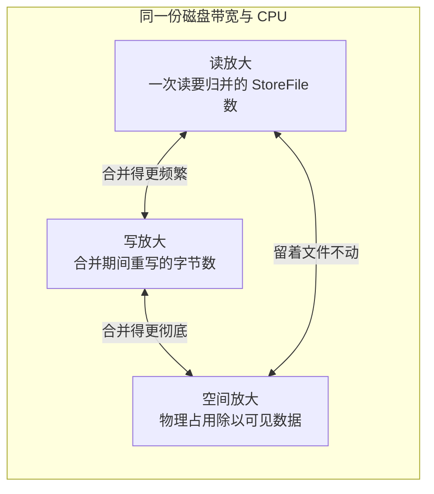
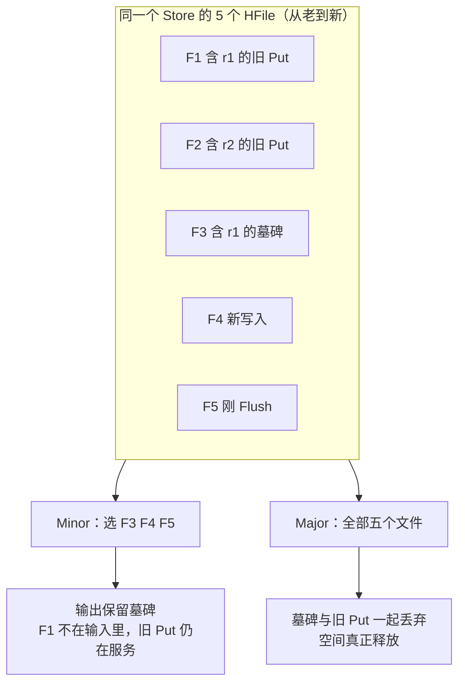
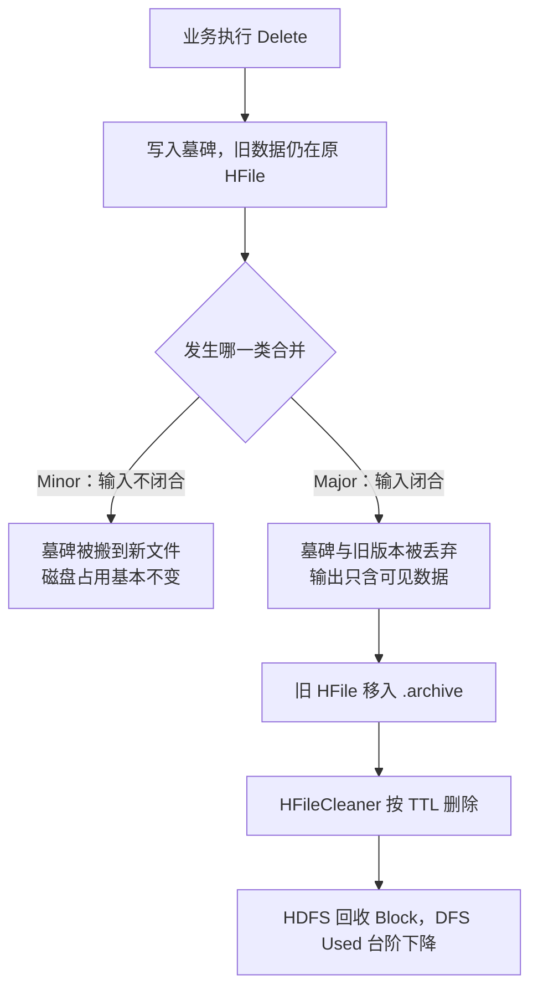
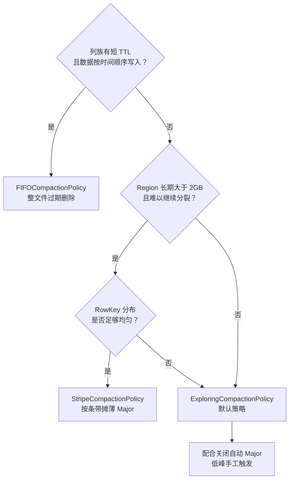
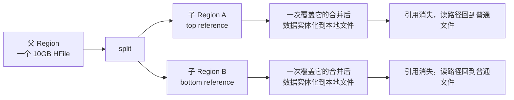

# HBase Compaction 机制深度解析——Minor、Major 与写放大的三角关系

**摘要：**

如果要在 HBase 的所有后台机制里挑一个"最容易变成运维事故"的，答案多半不是 WAL，也不是 Region 分裂，而是 Compaction。它一头连着写入链路产生的 HFile 堆积，一头连着读路径要归并的文件数量，中间还夹着"删除的数据什么时候才真正从磁盘上消失"这个几乎所有团队都问过的问题。本文把 Compaction 拆成两条线来讲：一条是机制线，逐个交代 Minor 与 Major 在选择范围、墓碑清理、版本裁剪上的差别，回答"只有 Major 才真正释放空间"这一结论的确切边界，并给出从墓碑写入到 HDFS 回收 Block 的三层时间账；另一条是权衡线，把读放大、写放大、空间放大放在同一张图上，论证三者为什么在给定资源下不能同时最优、策略的差别实质上就是"选择牺牲哪一项"，再用三份算例把量级关系落成数字。文章的落点是运维判据：两个线程池与限速器如何决定合并的真实吞吐，编码压缩如何把 I/O 问题转成 CPU 问题，分裂留下的引用文件为什么必须等合并才消解，以及六类故障各自的观测信号与三个被反复踩到的反例。

---

## 第 1 章 一张"删了数据、磁盘不降"的工单

### 1.1 问题的现场

2006 年 Google 的 BigTable 论文把 LSM-Tree 式的存储组织带进了工业界，2008 年 HBase 作为 Hadoop 的子项目出现，2010 年毕业成为 Apache 顶级项目；这套设计能撑起海量写入的根本原因，是把随机写变成了顺序写——数据先进内存里的 MemStore，攒够了就整块刷成磁盘上的 HFile，追加而不修改。代价则被推迟到"以后"：文件越来越多，删除和更新只是追加新的标记，旧数据一个字节都没少。

这笔账最终要在 Compaction 上结清。这类工单的典型现场是这样的：某电商订单表按合规要求清理 90 天前的历史数据，DBA 写了分批 Delete，删掉十几亿行、上 TB 的逻辑数据，两周后回看 HDFS，`DFS Used` 只降了几个百分点。运维的第一反应往往是"删除没生效"，于是再删一遍，磁盘依旧。真正的原因在于，Delete 在 HBase 里并不删除任何东西，它只是又写了一条墓碑（Tombstone）记录；而被墓碑覆盖的旧数据、墓碑自身、以及过期版本，都要等到一次"看得见所有文件"的合并发生之后才会从盘上消失，这种合并就是 Major Compaction。

### 1.2 一个机制，三种放大

Compaction 之所以是 HBase 最大的运维痛点，不在于它复杂，而在于它同时是三个互相拉扯的指标的唯一调节阀：

- 它把多个 HFile 合成更少的文件，直接决定一次 Get 需要归并多少个文件，也就是**读放大**；
- 它自己要把参与合并的数据整份读出再写回，是**写放大**的主要来源，在 HDFS 三副本下还要再乘一次网络流量；
- 它是唯一能丢弃墓碑与过期版本的路径，决定**空间放大**能不能回落。

三者共用一个资源池——磁盘带宽、网络带宽、CPU、BlockCache 的有效容量。资源给定，我们每把其中一项往好里推，另外两项通常都要付账。这张图给出了三者之间的张力方向，具体论证留到第 6 章。



### 1.3 本文的边界与版本口径

这个专栏的定位需要先说清：`读书笔记-大数据概览` 那一列是概览口径，回答"HBase 是什么、适合什么"；本列回答"每个机制怎么实现、出了问题怎么判"，因此凡是涉及分布式文件系统与 LSM 结构本身的部分，只给一句结论并挂上已有的双链，不重复展开——HFile 与 Store 的组织见 [[04 HBase 存储引擎深度解析——LSM-Tree、MemStore 与 HFile 的设计奥秘]]，读路径上的 BlockCache 与归并见 [[06 HBase 读取链路深度解析——BlockCache、Scanner 与多版本合并]]，Flush 如何产生 HFile 见 [[05 HBase 写入链路深度解析——WAL、MemStore Flush 与持久性保证]]。

版本口径取 HBase 2.x（以 2.5 为准）。相对 1.x，与本篇相关的变化有几处：DDL 与分裂等运维动作改由 Master 的 ProcedureV2 框架驱动，分裂不再是 RegionServer 单方面发起；`hbase:meta` 变成一张普通表而不再是特殊的目录结构，它也参与同样的 Compaction 规则；RegionServer 分组（rsgroup）与重写后的 AssignmentManager 改变的是 Region 的落位与迁移节奏，因而间接改变了合并请求在机器之间的分布；`hbase.hregion.max.filesize` 的默认值在 2.x 为 10GB，并带 `hbase.hregion.max.filesize.jitter` 的抖动。凡本文未能在文档中核实到确切默认值的参数，都会标注"以对应版本文档为准"。

---

## 第 2 章 一次 Compaction 到底做了什么

### 2.1 五个阶段

无论 Minor 还是 Major，一次 Compaction 在代码层面都走同一条流水线，区别只在"输入集合怎么选"和"过滤规则开到哪一档"。这条流水线由 `HStore`、`CompactSplit`、`CompactionRequest`、`DefaultCompactor` 几个类串起来：

1. 选文件：由 `CompactionPolicy` 的实现类（`ExploringCompactionPolicy` 等）在当前的 `StoreFileManager` 文件列表上选出一个子集，形成 `CompactionRequest`；
2. 建扫描器：为每个被选中的 StoreFile 打开一个 `StoreFileScanner`，用 `StoreScanner` 把多个有序流包装成一路归并输入，底层是 `KeyValueHeap`（按 row、family、qualifier、timestamp 降序、type 的复合比较器排序）；
3. 边合并边过滤：`CompactionScanQueryMatcher` 决定每一个 Cell 是保留、丢弃还是"暂留"。TTL 过期、超出 `maxVersions` 的旧版本、被墓碑覆盖的 Put 在这里被淘汰；墓碑本身是否保留，取决于这次合并能不能保证"所有更老的、可能含同一 Key 的文件都在输入集合里"；
4. 写新 HFile：过滤后的 Cell 流被顺序写入新的 `HFile`（可能是多个，见 2.3），写入时按列族配置重新做编码与压缩，这也是 Compaction 属于 CPU 密集操作的原因；
5. 原子替换：新文件落盘并 close 之后，`HStore` 更新文件列表，旧文件被移出服务集合并进入归档目录，随后由 HFileCleaner 延迟清理。

对上层读请求来说，第 5 步是一次"文件列表的切换"：切换之前读到的全是旧文件，切换之后读到的是新文件加上未被选中的文件。列表切换在 RegionServer 内是原子的，因此不会出现"读到一半文件消失"的情况，但一个正在进行的 Scan 可能跨过切换点，需要在新列表上继续（这部分与租约、Scanner 续读的细节在 [[06 HBase 读取链路深度解析——BlockCache、Scanner 与多版本合并]] 里）。

### 2.2 归并的对象是"同一行的所有版本"

Compaction 的最小处理单位不是行，而是 Cell 的排序序列。相同 RowKey、相同列族的 Cell 在归并流里彼此相邻，按时间戳从新到旧排开，墓碑（`DeleteFamily`、`DeleteColumn`、`Delete`）也作为带类型的 Cell 参与排序。`CompactionScanQueryMatcher` 一边走这个序列，一边维护当前行的删除信息：先遇到墓碑就记下来，后续同 Key 的更老版本即可丢弃；`maxVersions` 的作用是给每一列保留前 N 个版本，其余丢弃。

这套规则解释了一个常被误解的现象：更新并不占用额外空间，至少在逻辑上是如此——写入新版本后，旧版本在读取时不可见，但在物理上仍然存在，直到某次合并把它裁掉。`maxVersions` 调大并不会让写变慢多少，但会让空间放大与合并时的过滤成本同步上升，这也是第 6 章算例中的一项输入。

### 2.3 输出不一定只有一个文件

"Major Compaction 把一个 Store 的所有 HFile 合成一个"是教科书说法，也是默认模型的正确抽象，但工程判断上要留一个例外与一个前提。例外是 `StripeCompactionPolicy`：每个条带各自输出一个文件，条带数不变，文件数就不会收敛到一。前提是"合成一个"本身不等于"清理完成"——真正的判据是该 Store 的墓碑与过期版本还会不会被读路径跳过，而这只有输入闭合才能保证。此外，Major 只覆盖请求创建时磁盘上的那些文件，合并期间新 Flush 出来的 HFile 自然不在其中，所以"Major 完成后文件数不为 1"并不必然意味着合并失败了。

### 2.4 顺序 I/O 不等于免费

Compaction 的读是多个 HFile 的顺序读，写是新 HFile 的顺序写，没有随机寻道，这是它能够与在线读写并存的前提。但顺序不等于免费：HDFS 上的顺序读写仍然要占 DataNode 的磁盘带宽与网络带宽，三副本还要走 pipeline；一台 RegionServer 上并发的 Compaction 越多，每次 Flush 能拿到的带宽就越少，Flush 变慢又会让 MemStore 水位升高，最终触发写入限流或阻塞。这条反馈回路是第 7 章"Compaction 跟不上"判据的物理基础。

---

## 第 3 章 Minor Compaction：有选择的整理

### 3.1 三条边界

Minor Compaction 是 HBase 里执行最频繁的一类合并，它在一个 Store（Region 内的一个列族）范围内，从现有 HFile 中挑一部分合成为更少的文件。与 Major 相比，它有三条明确的边界：

- 不清理墓碑：它无法证明"更老的文件里没有同一 Key 的数据"，因此墓碑必须保留，作为后续合并的判断依据；
- 不保证回收过期版本：它可以在本次输入集合内部裁掉超出 `maxVersions` 的版本，但对于"更老文件里还有同 Key 更老版本"的情形无能为力；TTL 过期数据同理，只有整个文件都过期时才有机会被整体处理；
- 不跨 Store、不跨 Region：合并的作用域是单个 Store，既不会把两个列族的数据放在一起，也不会把两个 Region 的数据放在一起。后者在工程上意味着一件事——跨 Region 的垃圾没有"合并"这条出路，只能各自等自己的 Major，或者先做 Region 合并。

第三条边界常被忽略，但它解释了不少"Region 数很多、每个 Region 都不大、垃圾却清不掉"的场景：每个 Region 的 Store 都在按自己的节奏等 Major，Region 越多，越容易出现"每个 Region 都只差一次 Major"的长期状态。

### 3.2 墓碑为什么不能在这个阶段清掉

要理解 Minor 为什么保守，不妨先把删除的可见性规则摆出来。假设同一个 RowKey 在两个文件里：老文件 `A` 里有一条 `Put`，新文件 `B` 里有一条 `Delete`。读取时按时间戳判定，`Delete` 更新，所以该行不可见。此时如果一次合并只选了 `B` 和一个更新的文件 `C`，并且顺手把墓碑清掉，会发生什么？合并后 `B` 里那条 `Delete` 消失，而 `A` 里的 `Put` 还在服务集合中，读取该行时会重新看到它——数据"复活"了。

由此得到墓碑清理的充要条件：只有当所有可能包含同一 Key 更老版本的文件都参与了同一次合并，才能安全地丢弃墓碑，并把被它覆盖的数据一并丢弃。Major Compaction 把整个 Store 的文件全部纳入，天然满足；Minor Compaction 的输入是一个子集，不满足，因此只能把墓碑原样搬到输出文件里，等下一次合并再判。把两种合并各自选中哪些文件画在同一组文件上，差别一目了然：



上图是理解本篇最核心结论的钥匙：Minor 与 Major 的差别不是"合并得多与少"，而是**输入集合是否闭合**。闭合的那一次，才可以做不可逆的删除；不闭合的那一次，只能做搬运。

### 3.3 `hbase.hstore.compactionThreshold` 与触发路径

触发 Minor 的经典参数是 `hbase.hstore.compactionThreshold`，默认值为 3，语义是"一个 Store 的文件数超过这个值才考虑合并"。HBase 2.x 里它有一个新名字 `hbase.hstore.compaction.min`，两个键同时存在时以新键为准，旧键留着是为了兼容历史配置——这一点值得注意，因为在老集群上改 `compactionThreshold` 而不生效，往往就是新键已经被显式设置过。

触发路径有三条：

- Flush 之后检查：每次 MemStore 刷成 HFile，`HStore` 都会检查文件数是否达到阈值，达到就向 `CompactSplit` 提交请求；
- 周期扫描：`CompactionChecker` 线程按固定周期（10 秒级）遍历本机所有 Store，补上那些"文件数够但没被 Flush 路径触发"的情形，同时负责判断 Major 是否到期；
- 阻塞兜底：文件数超过 `hbase.hstore.blockingStoreFiles`（默认 16）时，Region 会阻塞该 Region 的写入，并把该 Store 的合并请求立刻排入队列、不再等周期扫描，详见第 7 章。

还有一条容易漏掉的路径：Region 刚打开的那段时间。RegionServer 启动或 Region 迁移之后，MemStore 是空的，文件数就是磁盘上的既有存量，只要这个基数已经偏高，接下来的几轮 Flush 就会把文件数推过阈值，因此重启一台负载较高的 RegionServer 之后，十几分钟里出现一波合并 I/O 几乎是必然的。

### 3.4 文件选择：`ratio` 与 `min.size` 的分工

一个 Store 有 N 个文件时，选哪几个合并，直接决定单次合并的读写量与长期的文件数曲线。HBase 的判断标准是"大小可比性"：把大小相近的文件合成一个，单次 I/O 可控；把 1KB 和 10GB 放在一起合，等于把整个大文件重写一遍，收益却只有一个文件数。

具体规则由 `hbase.hstore.compaction.ratio`（默认 1.2）表达：对一个按大小升序的候选窗口，只有当"窗口内较小文件的大小乘以 ratio"不小于"窗口内更大文件的大小之和"时，这个窗口才被认为值得合并。直观地说，小文件的总量必须与大文件相称，合起来才划算。围绕这条主规则，还有四个边界参数：

- `hbase.hstore.compaction.min`（默认 3）：一次合并至少要有的文件数，低于此数不值得启动；
- `hbase.hstore.compaction.max`（默认 10）：一次合并最多纳入的文件数，控制单次 I/O 的上限；
- `hbase.hstore.compaction.min.size`（默认 134217728，即 128MB）：小于这个体积的文件不看 ratio，一律可以被选入，避免"永远不满足比例条件的小文件"长期滞留；它的默认值与 `hbase.hregion.memstore.flush.size` 的默认值相同，但两者是独立的键：一旦把 Flush 大小改小而不动它，每个新文件都会小于 min.size 而被无条件选入候选，合并触发频率随之上升，而几个小文件合出来的结果可能仍然小于 min.size，于是又被立刻选入下一轮；
- `hbase.hstore.compaction.max.size`（默认 `Long.MAX_VALUE`）：超过这个体积的文件不参与 Minor，把大文件留给 Major 处理。

`ratio` 的方向要记清：调大（譬如从 1.2 到 1.8）会让更多"大小悬殊"的窗口被判定为值得合并，单次合并更大、文件数下降更快、写放大更高；调小（譬如 1.0）则更挑食，单次合并更小、写放大更低，但文件数容易在高位徘徊。这个参数没有"最佳值"，只有"匹配当前 I/O 预算的值"，第 6 章的算例会给出估算方法。

---

## 第 4 章 Major Compaction：换回空间的唯一常规路径

### 4.1 定义与它能做而 Minor 不能做的四件事

Major Compaction 把该 Store 的所有 HFile 纳入一次合并。输入集合闭合之后，四类"垃圾"才第一次可以被安全地丢弃：

- 墓碑：`Delete`、`DeleteColumn`、`DeleteFamily` 在合并中可以连同被覆盖的数据一起消失，删除从逻辑语义变成物理事实；
- 过期版本：超出 `maxVersions` 的历史版本被裁掉；
- TTL 过期数据：时间戳早于 TTL 边界的 Cell 被过滤，磁盘空间真正释放；
- `DeleteFamily` 的完整生效：删除某个列族某一时刻之前的全部数据这类操作，在 Minor 阶段只是加了一条范围墓碑，要等 Major 才把范围内的旧数据整体清掉。

### 4.2 "删了数据磁盘不降"的完整答案

这个问题的答案有三层，缺一层就会得出"HBase 不回收空间"的错误结论。

第一层在 HBase 内部：删除只是写墓碑，只有输入闭合的合并才能丢弃被删除数据，也就是只有 Major（或策略上等价的整体合并、或 FIFO 策略下的整文件过期）才回收空间。Minor 阶段被合并的文件在物理上并没有变小多少，它只是把墓碑和数据重新排列了一遍。

第二层在归档机制：Major 完成之后，旧 HFile 并不会立刻从 HDFS 上删掉，而是被移动到表的 `.archive` 目录，等 HFileCleaner 按 `hbase.master.hfilecleaner.ttl`（默认 5 分钟量级，以对应版本 `hbase-default.xml` 为准）确认无人引用后才真正删除。因此在 Major 刚结束时看 `DFS Used`，常常还是原样。

第三层在 HDFS：文件被删除后，DataNode 上的 Block 回收也有延迟，删除报告需要经过 NameNode 的处理周期。三层都走完之后，磁盘占用才会出现台阶式下降。把这条三段式的回收路径按时间展开，就是下面这条链路：



这也是为什么"先确认最近一次 Major 是什么时候"应当成为这类工单的第一个动作：Region 侧记录了最近一次 Major 的时间戳（`lastMajorCompactionTs`），通过 RegionServer 的 JMX 或 `admin` 接口能读到；如果这个时间戳是几天甚至几周之前，而自动 Major 又被关掉了，那么磁盘不降就不是故障，而是配置的必然结果。

### 4.3 触发方式：7 天、抖动与手工

自动 Major 的周期由 `hbase.hregion.majorcompaction` 控制，单位毫秒，默认 604800000，即 7 天。这个默认值配上 `hbase.hregion.majorcompaction.jitter`（默认 0.5）使用：如果所有 Region 都严格按 7 天触发，一个由数千个 Region 组成的集群会在大致相同的时刻集体发起 Major，形成周期性的 I/O 风暴。抖动的意义就是把触发时刻打散，具体是"在基线上随机延后一段比例"还是"在基线两侧浮动"，各版本实现略有差异，效果一致——同一批 Region 不会同时动。

手工触发有三个粒度，对应 `Admin` 接口里的三个方法（Shell 的 `major_compact` 是它们的包装）：

```shell
# 整表
hbase> major_compact 'ods_order'
# 指定列族
hbase> major_compact 'ods_order', 'info'
# 指定 Region（迁移后修复、单点问题定位时用）
hbase> major_compact 'a1b2c3d4e5f6...'
```

有一个细节决定运维脚本怎么写：`major_compact` 只是把请求放进合并队列，命令返回并不代表合并完成。要判断是否真的做完，得看队列长度与该 Store 的 `lastMajorCompactionTs`，而不是看命令是否成功返回。

### 4.4 代价：写放大等于参与合并文件的总大小

Major 的代价可以精确表述：它要把该 Store 当前所有 HFile 的字节完整读一遍、把过滤后的结果写一遍，因此单次写放大的下限就是"该 Store 的文件总大小"。一个 50GB 的 Store，一次 Major 至少产生 50GB 的读和接近 50GB 的写；在 HDFS 三副本下，这 50GB 写入在网络上要按 pipeline 复制三份。再叠加在线流量的读取，RegionServer 的磁盘与网络带宽会被压到一个很窄的余量里。

这还只是带宽账。Major 期间，服务该 Store 的读请求仍要访问旧文件（新文件尚未切换），于是同一份磁盘要同时承担"合并读、合并写、业务读"三种负载；合并完成后短期内，被替换掉的旧文件在 BlockCache 里的数据块全部失效，新文件的块还没预热，读延迟会出现一段波动。这类波动不是"缓存被合并写满了"，而是"缓存里原来的东西没了"——两者的处置方式不同，判断依据是命中率曲线的形状而非绝对值。

### 4.5 生产上为什么关掉自动 Major

自动 Major 的问题不在于它做错了什么，而在于它的触发时机由时间决定，而不是由负载决定。生产集群的低峰与高峰差别可能是数倍带宽，7 天的定时器撞上高峰就是一次事故；更麻烦的是 Major 请求会在队列里堆积，一旦某个 Region 的 Major 迟迟跑不完，后续请求持续入队，队列长度本身会变成新的问题。

因此常见做法是把 `hbase.hregion.majorcompaction` 设为 0，关闭自动触发，改由调度系统在低峰期按表轮转：

```xml
<property>
  <name>hbase.hregion.majorcompaction</name>
  <value>0</value>
</property>
```

这个选择必须配三件事才成立：一是轮转表清单，按数据量与重要性排序，重要表频率高一些，冷表可以按月；二是限速与并发控制，Major 期间用吞吐控制器把合并速度压在可接受范围（第 7 章），并避免多张大表同时 Major；三是完成度监控，把每个表的 `lastMajorCompactionTs` 当作 SLA 指标看，超过预定周期未完成就告警。缺了第三件，关掉自动 Major 就变成了"永久不做 Major"，空间放大与读放大会一路累积，最后以一次更难收拾的方式爆发。

---

## 第 5 章 三种策略与"该用哪个"的判据

### 5.1 `RatioBasedCompactionPolicy`：贪心的第一版

这是 HBase 早期唯一的策略，思路是沿着文件列表从老到新滑动一个窗口，窗口内文件满足 ratio 条件就继续扩张，一旦不满足就停止，取第一个满足最小文件数的窗口提交。它的优点是实现简单、每次只做局部决策；缺点是"第一个可行解"未必是好解——在文件大小分布不均匀时，它会挑到一个只含两三个小文件的窗口，合并完文件数下降有限，过一会儿又要再合一次，长期写放大偏高。

### 5.2 `ExploringCompactionPolicy`：默认策略

0.96 之后成为默认策略，思路从"第一个可行解"改成"在所有可行解里挑一个最好的"。它对每个可能的起点增量扩张候选窗口，在满足 `ratio`、`max.size`、`max` 个数的约束下，按两个优先级比较：文件数最多的优先，其次总字节数最小的优先。前者对应"合并效果"，后者对应"I/O 代价"，两个目标一起看，比贪心稳得多。

不妨用一组具体文件体会差别（示例推算，单位为 MB，按从老到新排列）：`[100, 10, 8, 5, 4]`。贪心从最老的 100 开始算，`100 × 1.2` 远大于后面四项之和，窗口直接不成立，只能退而求其次去试更小的窗口，最终常常只选到一两个文件；`ExploringCompactionPolicy` 会试到 `[10, 8, 5, 4]` 这个窗口——四个文件总量 27MB，彼此大小可比，合并一次能让文件数从 5 降到 2，I/O 只有 27MB，明显是更好的解。

### 5.3 `StripeCompactionPolicy`：给大 Region 分而治之

Stripe 策略针对的是"Region 太大导致 Major 代价不可接受"这个具体问题。它把一个 Store 的 RowKey 空间按字典序切成若干条带（Stripe），每个条带内部独立维护文件集合，合并只在条带范围内发生，于是"一次 50GB 的 Major"被摊成"十次 5GB 的条带合并"。开启方式是通过 `hbase.hregion.stripe.compaction.policy` 指定策略实现，条带数量与各层最小合并文件数由另一组 `hbase.hstore.stripe.*` 参数控制，具体键名与默认值以对应版本的 `hbase-default.xml` 为准。

它的收益与代价都很清楚：收益是避免了超大 Region 的整库重写，空间回收可以按条带渐进完成；代价是多了一层路由——每次读写都要先确定目标 RowKey 落在哪个条带，条带边界信息要常驻内存，且 RowKey 分布严重倾斜时条带大小不均，最大的那个条带又变回了老问题。因此它的适用条件写得很窄：Region 长期大于 2GB 且难以再分裂、RowKey 分布相对均匀、团队能接受多一层调优复杂度。

### 5.4 `FIFOCompactionPolicy`：TTL 场景的例外

FIFO 策略严格来说不是"合并"，而是"按文件整体过期来删除"。它扫描 Store 的文件列表，把整个文件的数据都超过 TTL 的那些文件直接删掉，不做任何重写。对日志、埋点、会话这类"按时间顺序写、TTL 短且均匀"的数据，它把写放大压到接近零，空间也能回收——这是 Minor 之外另一条能真正还空间的路径，只是它只对整文件过期成立。

代价在读放大：文件不会被合并，数量随 Flush 持续增长，直到过期被删；如果 TTL 与写入速率的组合不合适（写入快、TTL 长），文件数会先涨到触发阻塞，再被删掉一批，形成锯齿。用它之前要先算清楚"稳态文件数 = TTL 时长除以 Flush 间隔"，再对照 `hbase.hstore.blockingStoreFiles`。

### 5.5 四种策略的横向对比与判据

| 策略 | 合并范围 | 写放大 | 读放大 | 空间回收 | 适用判据 |
| :--- | :--- | :--- | :--- | :--- | :--- |
| `RatioBasedCompactionPolicy` | 局部窗口，贪心选第一个可行解 | 中偏高（重复合并小文件） | 中偏高 | 依赖 Major | 仅存量集群兼容，新表不建议 |
| `ExploringCompactionPolicy` | 局部窗口，全局择优 | 中 | 低到中 | 依赖 Major | 默认选项，绝大多数在线表 |
| `StripeCompactionPolicy` | 条带内合并 | 中偏低（单次摊薄） | 低 | 条带内渐进回收 | Region 大于 2GB 难分裂、RowKey 均匀 |
| `FIFOCompactionPolicy` | 不合并，整文件过期删除 | 接近零 | 高（文件数随 Flush 增长） | 整文件回收 | TTL 短、按时间顺序写、读以点查为主 |

把选择逻辑画成判定顺序会更直观——先问数据生命周期，再问 Region 规模，最后才落到默认策略：



---

## 第 6 章 三角关系：为什么三者不能同时最优

### 6.1 三个量的度量方式

要把"三角"讲成可论证的命题，先得给三个量一个可计算的形态。设某个 Store 在统计窗口内的用户写入字节为 `W`，参与合并的文件总字节为 `ΣC`，物理占用为 `P`，逻辑可见数据为 `L`：

- **写放大** = `ΣC / W`，直观含义是"用户写一个字节，磁盘上被写了几个字节"；HDFS 三副本下网络侧还要再乘副本数；
- **空间放大** = `P / L`，删除与更新越多、Major 越少，这个比值越大；
- **读放大** 没有单一公式，工程上取"一次点查平均要碰的 StoreFile 数"乘"单文件探测成本"（Bloom 过滤后的索引查找与可能的磁盘读）。文件数从 100 降到 5，读放大的改善通常不是线性的，因为 Bloom 过滤本身已经把大部分文件挡在门外，但"要打开的 Reader 数、要建的 Scanner 数、要归并的堆节点数"都随文件数增长。

### 6.2 三者的耦合方向

读放大与写放大方向相反：减少文件数唯一的手段是更频繁、更彻底地合并，而每一次合并都要把参与的文件读一遍写一遍。这里有个容易算错的点——不是"合并一次就把数据重写一次"这么简单，数据会随着不断被小合并、再被大合并而重复重写，一条记录从 Flush 到最终落进大文件，可能经历三到五次重写，`ΣC / W` 因此是层数的函数，而不是"1 加 1 次 Major"。

写放大与空间放大也方向相反：能回收空间的合并是"输入闭合"的那种，也就是代价最大的那种。少做 Major 能省下当期的写放大，但墓碑与旧版本会一直占着盘，空间放大随时间单调上升；而 Major 一旦执行，当期又会出现"新旧文件并存"的临时空间峰值，`P` 在合并窗口内会短暂跳高。

空间放大与读放大方向相同但要分阶段看：文件越多、越老、垃圾越多，读要碰的文件与要跳过的版本都越多。因此在"完全不做合并"的极端下，读放大与空间放大同时恶化——这也是为什么"省 I/O 就少合并"不是一条可长期成立的路。

### 6.3 论证：单一资源下的零和

把三个量放在同一个资源约束下看，结论会变得很直接。RegionServer 的可用资源是磁盘带宽 `B`、网络带宽 `N`、CPU `C`（合并要解码、过滤、重新编码）与 BlockCache 容量 `M`。用户写入速率 `W` 给定之后，合并可支配的带宽是 `min(B, N) − 用户读写占用`，这是一个常数。于是：

- 提高合并频率或扩大每次合并的输入集合，能让读放大下降，但 `ΣC` 上升，写放大上升，并且挤占用户读写的带宽，把延迟推高；
- 降低合并频率，写放大下降、带宽让给业务，但文件数上行，读放大与空间放大同时上行；
- 想同时压住读放大和空间放大，就必须做"输入闭合的合并"，而这是写放大的最大值所在，并且带来临时空间的峰值。

也就是说，在资源给定的平面上，三个目标构成的可行域是一条边界（**帕累托前沿**），前沿上的每一个点都意味着牺牲了某些东西；**三种放大不能同时最优**，只存在"对当前业务最重要那一个指标最优"的选择。

> [!info] 边界要记清
> 三角关系描述的是"资源给定"时的取舍；改变硬件、数据模型或策略，推动的是整条前沿，而不是在前沿的某一点上做微调。前者是架构决策，后者是参数调整，两者能换来的收益量级不同。

这个命题有一个重要的补充：前沿本身可以被外力推动。带宽翻倍、CPU 更宽裕、开启条带策略把大 Major 摊薄、或者数据本身具备短 TTL 顺序写特性（FIFO 可以让写放大趋近零），都会让整条前沿向外移动。所以真正的调优不是"在旧前沿上找点"，而是"先看能不能把前沿推出去，再在前沿上选点"——前者靠硬件与数据建模，后者才是参数。

### 6.4 取舍表与三份算例

| 业务诉求 | 优先压低 | 必然付出的代价 | 典型手段 | 风险点 |
| :--- | :--- | :--- | :--- | :--- |
| 点查延迟敏感（在线交易、画像查询） | 读放大 | 写放大升高，后台 I/O 占比变大 | 较小 `ratio`、较小 `blockingStoreFiles`、更勤的 Minor | 合并与业务抢带宽，P99 抖动 |
| 写入吞吐优先（日志、IoT 采集） | 写放大 | 读放大与空间放大升高 | 大 `blockingStoreFiles`、FIFO、降低 Major 频率 | 文件数高位运行，故障恢复变慢 |
| 存储成本敏感（冷数据、归档） | 空间放大 | 写放大出现周期性尖峰 | 定期 Major、编码压缩、TTL | Major 期间临时空间翻倍 |
| 恢复时间敏感（大规模集群运维） | 恢复成本 | 需要更多合并、更多 I/O | 控制文件数上限、避免超大 Region | 参数收紧后合并压力上升 |

三份算例把上面的定性关系落成数字，全部按示例推算给出，只用于说明量级关系，不代表任何真实集群的基准：

**算例一（写放大）**：某 Store 稳态每天产生 48 个 128MB 的 HFile，即用户写入 `W = 6GB/天`。在 `compaction.min = 3`、`ratio = 1.2` 的默认配置下，文件大致按三级合并收敛到接近 Region 上限的体积，一条记录平均被重写约 4 次（三次 Minor 加一次 Major），于是 `ΣC ≈ 4 × 6GB = 24GB`，写放大约 4 倍；若 HDFS 副本数为 3，网络侧写入量约为 72GB/天。把 `ratio` 调大到 1.8，合并更积极，层数可能降到 3 层，但每次合并的输入更大，写放大未必下降——这正是"调参要算总账"的原因。

**算例二（读放大）**：某 Store 有 120 个 HFile，一次点查按 Bloom 过滤后平均命中 3 个文件，需要建立 120 个 Scanner、归并 120 路输入；合并到 8 个文件后，Bloom 命中仍是 2 到 3 个，但 Scanner 数与堆规模降了一个数量级，单次点查的 CPU 与打开 Reader 的开销随之下降。读放大的改善主要发生在"归并路数"这一项上，而不是磁盘读取次数上——这也是为什么文件数从 120 降到 8 的体感远大于从 8 降到 1。

**算例三（空间回收与 Major 时间）**：某 Store 物理占用 50GB，其中约 30% 是被墓碑覆盖的旧数据与过期版本，逻辑可见数据约 35GB。执行一次 Major：读 50GB，写约 35GB，若限速设为 100MB/s，仅写侧就需要约 350 秒，加上读侧与三副本 pipeline，端到端通常在十几分钟到一个小时量级（示例推算，取决于文件数、Cell 大小与磁盘并发）。完成后空间放大从约 1.43 回落到接近 1，但 `DFS Used` 的台阶要等归档清理与 HDFS 回收之后才出现。

---

## 第 7 章 并发控制、限速与"跟不上"的判据

### 7.1 两个线程池与一条分界线

RegionServer 的合并请求由 `CompactSplit` 分派到两个线程池：小合并池 `hbase.regionserver.thread.compaction.small`（默认 1 个线程）与大合并池 `hbase.regionserver.thread.compaction.large`（默认 1 个线程）。分界依据是本次合并的输入总大小与 `hbase.regionserver.thread.compaction.throttle` 的比较——超过阈值视为大合并，走 large 池；否则走 small 池。阈值的默认值不是一个固定字节数，而是由 `hbase.hregion.memstore.flush.size` 与 `hbase.hstore.compaction.min` 推导出来的量级，因此改 Flush 大小时它会跟着变（具体推导系数与默认取值以对应版本的 `hbase-default.xml` 为准）。

分成两个池的用意是隔离：一次大合并（尤其 Major）会长时间占用线程与带宽，如果和日常小合并挤在一个池里，小合并就得排队，文件数会在排队期间继续上涨。不过默认各 1 个线程意味着**默认配置下合并是串行的**，这是"合并跟不上"最常见的结构性原因，而不是某个参数配错了。

### 7.2 `blockingStoreFiles` 的阻塞语义

`hbase.hstore.blockingStoreFiles` 默认 16，是 HBase 防止文件数失控的最后一道闸：当某个 Store 的文件数超过这个值，Region 会**阻塞写入**，同时立即为该 Store 提交一次高优先级的合并请求（不再等后台检查周期），让合并尽快把文件数压下去。阻塞不是无限期的，`hbase.hstore.blockingWaitTime`（默认 90000 毫秒）到期后，即使合并还没完成也会放行写入——这是一个明确的取舍：宁可让文件数继续增长，也不能让写入永久停摆。

> [!warning] 阻塞是保护机制在兜底
> 把 `hbase.hstore.blockingStoreFiles` 调高可以让告警消失，但文件数、读放大与 Region 打开时间会一起变差。判断该不该动这个参数，先看合并能力是否真的提升了，而不是看告警是否安静。

这个"放行"带来的后果要提前想清楚。阻塞期间客户端的写入请求会变慢甚至超时，放行之后又会有一批积压写入涌入，Flush 频率随之上升，产生更多 HFile，把阻塞再次触发。所以在监控上，阻塞事件的次数比阻塞的时长更有诊断价值：偶发一次是保护机制在工作，周期性反复出现则说明合并能力与写入速率已经结构性失衡。

### 7.3 单次合并的粒度与校验

两个不那么显眼但会影响稳定性的参数：

- `hbase.hstore.compaction.kv.max`（默认 10）：每一次从归并流中取出处理的 Cell 数量上限。它存在的意义是控制单次处理的内存驻留，防止宽行或大 Cell 场景下把过多数据同时拉进内存。调大能减少批处理开销、提升单次合并吞吐，代价是每批的内存峰值上升；在 Cell 很大（数百 KB）的表上，这个值应该保持保守。
- `hbase.regionserver.compaction.verify.checksums`（默认 false）：开启后合并时会逐块校验 checksum，把 HDFS 层的静默损坏在合并阶段暴露出来。代价是额外的 CPU 与读开销，适合放在低峰的 Major 上作为定期体检，而不是给所有 Minor 打开。

### 7.4 限速器：把合并的胃口调成可接受

HBase 2.x 默认的吞吐控制器是 `PressureAwareCompactionThroughputController`，它按"压力"调节合并速度：文件数在正常范围时按 `hbase.hstore.compaction.throughput.lower.bound`（默认 50MB/s）限速，尽量少打扰在线业务；文件数逼近 `blockingStoreFiles` 时提升到 `hbase.hstore.compaction.throughput.higher.bound`（默认 100MB/s），优先避免写入阻塞。这种"平时慢、紧急快"的自适应，比固定限速更贴合真实负载。

需要注意限速是按 RegionServer 汇总的，不是按 Store 或按线程。也就是说，一个有 200 个 Region 的 RegionServer 上，所有合并共享这 50 到 100MB/s 的额度；Region 越密集，单个 Region 分到的合并速度越慢，"跟不上"的风险越集中。

### 7.5 配置的代价对照

| 配置项 | 默认值 | 调大的代价 | 调小的代价 |
| :--- | :--- | :--- | :--- |
| `hbase.regionserver.thread.compaction.small` | 1 | 并发小合并变多，随机 I/O 与上下文切换上升，挤占用户带宽 | 小合并排队，文件数下降慢，易触发阻塞 |
| `hbase.regionserver.thread.compaction.large` | 1 | 多个大合并并发，HDFS 带宽被摊薄，单次合并耗时变长 | 大合并串行，Major 排队时间变长 |
| `hbase.hstore.blockingStoreFiles` | 16 | 阻塞更难触发，但文件数上限抬高，读放大与恢复成本上升 | 阻塞频繁，写入延迟抖动，业务侧超时增多 |
| `hbase.hstore.blockingWaitTime` | 90000 | 写入可能长时间卡住，客户端超时先于放行发生 | 保护形同虚设，文件数在放行后继续失控 |
| `hbase.hstore.compaction.ratio` | 1.2 | 单次合并更大，写放大上升，合并耗时变长 | 更挑食，小文件滞留，读放大偏高 |
| `hbase.hstore.compaction.max` | 10 | 单次 I/O 变大，大合并更容易超时 | 文件数收敛慢，极端分布下难以降到阈值以下 |
| `hbase.hstore.compaction.throughput.lower.bound` | 50MB/s | 平时合并更激进，业务 I/O 被挤占 | 平时合并过慢，文件数缓慢上行 |
| `hbase.hstore.compaction.throughput.higher.bound` | 100MB/s | 紧急时冲击更大，可能出现 I/O 尖峰 | 紧急时救不回来，阻塞时间变长 |

### 7.6 "Compaction 跟不上"的判据

笔者不建议靠感觉判断这件事，用四组信号交叉验证更可靠：

| 信号 | 观测位置 | 判据 | 说明 |
| :--- | :--- | :--- | :--- |
| 合并队列长度 | hadoop-metrics2 的 `compactionQueueSize`（`Hadoop:service=HBase,name=RegionServer,sub=Server`），部分监控模板把它记作 `hbase.regionserver.compactionQueueSize` | 持续大于线程数的数倍且不回落 | 请求入队速度长期高于出队速度，是"跟不上"最直接的证据 |
| 队列构成 | RegionServer 日志与 Web UI 中的合并请求记录 | 大合并请求占比高，单次大合并耗时显著长于平均 | 大合并占住 large 池，小合并请求全部排在后面 |
| 写入阻塞事件 | 日志中的 `Blocking updates` 与 `blockingWaitTime` 相关记录 | 按小时统计的阻塞次数呈上升趋势 | 偶发是保护，周期性出现是失衡 |
| 文件数分布 | 每个 Store 的 `storeFileCount` 的 P95 与最大值 | P95 接近 `blockingStoreFiles`，最大值长期贴在阈值上 | 说明合并能力刚好压在临界点，没有余量 |

再补一个常被忽略的间接信号：`flushQueueSize` 与 Flush 耗时的同步上升。合并抢走带宽会让 Flush 变慢，Flush 变慢让 MemStore 更早触顶，于是 Flush 更频繁、产生更多 HFile——这条正反馈一旦形成，单看 compaction 指标会以为是"合并不够快"，实际是"合并把 Flush 拖慢了"。观测顺序应当是：先看 Flush 队列与耗时，再看合并且队列，最后才看文件数。

---

## 第 8 章 编码与压缩：Compaction 的 CPU 账

### 8.1 合并是一次重新编码

HFile 里的数据块不是裸 Cell，而是按列族的 `DATA_BLOCK_ENCODING` 编码过的（`PREFIX`、`DIFF`、`FAST_DIFF`、`ROW_INDEX_V1` 等）。合并时数据被解码成 Cell 流、过滤、再按当前列族配置重新编码写出。这就是为什么 Compaction 既是 I/O 密集也是 CPU 密集：`FAST_DIFF` 这类前缀编码在编码阶段要做前缀比较与偏移重写，`ROW_INDEX_V1` 还要维护行级索引结构，Cell 越小、版本越多，单位字节的编码开销越高。

由此得到一个与运维直接相关的结论：**旧文件不会自动重编码**。已有 HFile 的头部记录了它自己被编码与压缩的方式，读路径能正确解码，所以改配置不会读错数据；但要让新配置覆盖整个 Store，必须等这些文件被合并重写，通常需要一次 Major。这也解释了为什么"改了压缩算法，磁盘没降"是正常现象，而不是配置没生效。

### 8.2 压缩算法与合并的交互

`COMPRESSION` 决定 Flush 时的输出压缩，`COMPACTION_COMPRESSION` 决定合并输出时的压缩（可以不同，例如日常 Minor 不压缩以减少 CPU，Major 时才压）。这与编码是两笔独立的 CPU 账：压缩比越高，读时解压的 CPU 越多；合并时解压旧块再压缩新块，等于把 CPU 开销又付一遍。在合并高峰期，压缩算法选得重（如 GZ 一类高压缩比算法）会显著拉长单次合并时间，进而延长队列。

### 8.3 该不该开压缩、开哪种编码的判据

| 场景特征 | 建议 | 依据 | 代价 |
| :--- | :--- | :--- | :--- |
| 写入量极大、磁盘紧张、读以点查为主 | 开轻量压缩（SNAPPY 一类），编码用 `FAST_DIFF` | 顺序写场景压缩收益高，点查不需要全解压 | 合并时多一次解压与压缩的 CPU |
| CPU 已接近饱和、延迟敏感 | 压缩保持不变或降级，编码保持 `FAST_DIFF` | 合并与业务争 CPU 时，压缩是放大器 | 磁盘占用上升，I/O 传输量变大 |
| Cell 很小、列族列数多 | 编码用 `PREFIX` 或 `ROW_INDEX_V1` | 前缀重复率高，编码收益明显 | 编码 CPU 上升，合并变慢 |
| 需要定期体检数据完整性 | 低峰 Major 时开 `verify.checksums` | 把静默损坏暴露在可控窗口 | 单次 Major 时间变长 |
| 大 Cell、宽行 | 压缩可以开，编码保持简单 | 大 Cell 的编码收益有限，CPU 花在压缩上更划算 | 单块内存占用高，注意 `kv.max` |

判据的核心是资源归属：如果 RegionServer 的 CPU 有富余而磁盘是瓶颈，压缩与编码都值得开；反过来，CPU 已经被合并与业务读吃满时，再加重压缩等于给本已排队的合并再加一道工序。

---

## 第 9 章 Compaction 与 Region 分裂的相互牵制

### 9.1 分裂由文件总大小触发

Region 分裂的触发条件是 Store 的文件总大小超过 `hbase.hregion.max.filesize`（2.x 默认 10GB），并带 `hbase.hregion.max.filesize.jitter` 的抖动，避免同一批 Region 同时分裂。注意它看的是文件总大小，不是文件数：一个文件数很多但总体积不大的 Region 不会因为"文件太多"而分裂，而一个只有两个超大文件的 Region 到了 10GB 就会分裂。这条规则把"文件数问题"和"容量问题"分成了两条独立的演化线，也意味着分裂并不能缓解文件数过多导致的读放大。

在 2.x 里，分裂由 Master 侧的 ProcedureV2 驱动（`SplitTableRegionProcedure`），RegionServer 执行实际的拆分与元数据更新，这与 1.x 由 RegionServer 自主发起有本质区别：分裂变成了一次可追踪、可重试的分布式过程，也因此会与合并争抢同一批 Store 的锁。

### 9.2 分裂留下的是"引用文件"

分裂并不是把父 Region 的 HFile 复制成两份——那代价太大。实际做法是：父 Region 关闭后，两个子 Region 各自拿到一组指向父文件的引用文件（Reference File），上半区是 top reference，下半区是 bottom reference，语义是"父文件里属于我这个区间的那一段"。读取时，引用文件所在的 Scanner 会按引用类型做区间裁剪：top 引用跳过起始之前的部分，bottom 引用在越过终点后停止。引用文件的产生与消解可以画成一条单向路径：



### 9.3 引用要等合并才真正拆开

引用文件在磁盘上并不占额外空间（它只是指向父文件的一段），但它带来两个运维后果：其一，读路径要多处理一层引用语义，半引用还会让 Scanner 跳过一段数据，这是分裂后短期内读性能不如预期的原因之一；其二，只有一次覆盖到它的合并发生之后，数据才会被真正复制到子 Region 自己的文件里，引用随之消失。

因此"分裂完成"与"分裂生效"是两件事。判断引用是否还在，可以看 Region 目录下的文件是否带引用标记，也可以看 Store 的 `storeFileCount` 与实际数据量是否明显不匹配（文件数不多、单文件很大、总量却只有一半）。如果一个大表在短时间内连续分裂多次，引用会层层叠加，读放大与合并复杂度都会上升——这也是"分裂不是越勤越好"的另一面：分裂把容量压力转成了引用与合并压力。

顺带一个容易被忽略的交互：分裂前的 Region 如果正在做 Major，分裂请求会被推迟到合并结束；反过来，分裂刚完成的 Region 上若有大量引用文件，合并选择逻辑会优先把引用纳入候选，否则引用永远不会被消解。两者互为前置，这也是"分裂与合并要放在同一个低峰窗口里安排"的原因。

---

## 第 10 章 六个故障形态与判据

按出现频率从高到低，Compaction 相关的故障可以归成六类。每一项都给出可观测的判据与处置方向，日志关键字按片段给出，具体措辞随版本略有差异。

| 故障形态 | 典型日志或指标 | 判据 | 处置方向 |
| :--- | :--- | :--- | :--- |
| `Too many store files` | 日志中的 store 文件数告警、`storeFileCount` 持续上行 | 单个 Store 文件数长期高于 `compaction.min` 的数倍且不回落 | 查合并线程是否被大合并占满、查 Flush 是否过频、必要时临时提高合并线程 |
| `Blocking updates` | 日志中的阻塞记录、写入延迟曲线出现平台 | 阻塞按小时重复出现，且 `blockingWaitTime` 到期放行后才恢复 | 加合并能力而不是抬阈值；同时评估 Region 数量与单机 Region 密度 |
| Compaction 队列堆积 | `compactionQueueSize` 持续高于线程数数倍 | 队列不回落，且大合并请求占比高 | 拆分大 Region、限制并发大合并、评估是否该用条带策略 |
| Major 长时间不完成 | `lastMajorCompactionTs` 长期不更新、Major 请求在队列中挂住 | 单次 Major 超过预定窗口仍未更新完成时间 | 降低单次 Major 的数据量（分表、条带）、核对限速是否过低、查是否有 Region 迁移干扰 |
| `Compaction failed` | 日志中的合并失败记录与异常栈 | 同一 Store 反复失败，或合并后 HFile 校验异常 | 查 DataNode 磁盘与网络、查 checksum 校验结果、必要时触发一次带校验的 Major |
| 磁盘空间突增 | `DFS Used` 阶跃上升，且与合并时间相关 | 合并窗口内占用上涨接近输入文件总大小 | 按 1.5 倍预留磁盘、限制同时进行的合并数、把 Major 排到低峰 |

笔者把每一类都展开两句。`Too many store files` 通常不是参数问题而是能力问题：合并线程数、限速、单机 Region 密度三者之一不足以匹配写入速率；`Blocking updates` 是它的下游症状，先出现阻塞说明文件数已经越过了阈值，处置顺序应当是"提升合并吞吐、降低 Flush 频率、最后才考虑调大阈值"。队列堆积往往由大 Region 引起：一次 50GB 的 Major 会把 large 池占住几十分钟到小时级，期间所有需要 large 池的合并全部排队，这条因果链在监控上看是"队列长"，在根因上是"Region 太大"。

`Compaction failed` 容易被当成 HBase 的 bug，实际多数来自底层：DataNode 短暂不可用导致读失败、checksum 校验失败、合并期间 RegionServer 被重启导致请求中断（重启后 Region 打开时会重新检查文件数，通常能自愈）。处置的第一步是确认失败是否可重现，第二步是查是否有 HDFS 层的副本问题，第三步才是调整合并参数。

磁盘突增是最容易误判的一类：它看起来像"泄露"，实质是合并的**临时空间**需求——合并期间新旧文件并存，峰值约为输入文件总大小。一个按 70% 使用率运行的集群，遇到一次 50GB 的 Major 就可能把磁盘打到水位以上。这类问题的正确答案在容量规划里，而不是在合并参数里。

---

## 第 11 章 三个反例

### 11.1 开着自动 Major 上生产

第一种反例是把默认配置直接带上生产，7 天定时 Major 保留着。它的问题不是"Major 有害"，而是触发时刻与负载无关：抖动只打散了 Region 之间的同步，没有改变"高峰也可能轮到 Major"这件事。一旦某天高峰撞上几张大表的 Major，表现就是写入延迟整体抬升、RegionServer 带宽打满、队列堆积，而排查者往往先去怀疑写入链路与 GC。

更隐蔽的版本是"半关"：把 `hbase.hregion.majorcompaction` 设成 0，但没有建轮转机制与完成度监控，于是 Major 从"定时失控"变成"永远不做"。半年前删掉的数据还在盘上，空间放大一路爬升，读放大也随版本堆积变差，直到某次容量告警才被发现。

### 11.2 把 `compactionThreshold` 调得很大

第二种反例的动机通常是"合并太频繁，占用 I/O"，于是把 `hbase.hstore.compactionThreshold` 从 3 调到 10 甚至 20。直觉上是"少合几次省点带宽"，实际效果相反：文件数在高位运行，读放大居高不下；每次合并启动时输入文件更多，单次 I/O 更大，反而更容易在高峰撞上带宽墙；更麻烦的是文件数长期贴着 `blockingStoreFiles`，稳定性余量被吃掉。

正确的方向是"降低每次合并的成本"而不是"减少合并次数"：把 `ratio` 调小、把 `max` 调小、用限速把合并摊到全天，让合并变得"细水长流"；确实需要少合并的场景（短 TTL 顺序写）应当换 FIFO 策略，而不是靠抬高阈值硬扛。

### 11.3 调大 `blockingStoreFiles` 掩盖问题

第三种反例最危险，因为它在短期内"有效"：把 `blockingStoreFiles` 从 16 调到 200，阻塞告警立刻消失，延迟曲线也变好看了。但阻塞本身就是保护机制，它用"写入变慢"换"文件数不失控"；把阈值抬高等于拆掉这道闸，让文件数继续涨，读放大、合并耗时、Region 打开时间全部随之恶化。

RegionServer 重启时的代价尤其明显：一个 Store 有 200 个文件，Region 打开要逐个校验、加载元数据、重建 Scanner，恢复时间可能从秒级变成分钟级；一次全集群滚动重启，这个差异会放大成小时级的可用性事件。因此 `blockingStoreFiles` 的正确用法是"在合并能力确实提升之后同步微调"，而不是"用来消除告警"。

---

## 第 12 章 结语

Compaction 值得单独用一篇来讲，是因为它把 LSM 架构的所有代价集中到了一个后台机制上：读放大要它来降，空间放大要它来还，而它自己就是写放大的来源。三种放大共用同一份磁盘与 CPU，因此不存在"三个都调好"的配置，只存在"按业务重要性排序后接受哪种代价"的选择；前面关于 Minor 与 Major 的机制差别，最终都指向这一条——Minor 是在不闭合的输入上做搬运，Major 是在闭合的输入上做删除，前者维持秩序，后者归还空间，两者缺一，系统要么读得慢，要么装得满。

由此也可以看出调优的正确姿态：先看能不能推动前沿（数据模型、TTL、条带、硬件），再在前沿上选点（线程、限速、ratio），最后才是用参数掩盖症状。把 `blockingStoreFiles` 调大、把阈值调大、把限速关掉，都属于把问题往后推的做法，短期指标好看，长期恢复成本更高。

关于 Region 大小与合并代价的关系，还有一层没有展开：分裂策略与合并策略都盯着"文件总大小"，但两者的时间尺度不同，一个以小时计，一个以天计，它们之间的错配才是容量规划里最难调的部分。它的完整拆解在 [[08 HBase Region 分裂与负载均衡——水平扩展的工程底层]]，而把这些判据串成一套可执行诊断流程的，是 [[10 HBase 生产调优实战——从诊断到落地的系统方法论]]。

---

## 关联篇目与阅读路径

| 篇目 | 与本篇的关系 | 建议阅读时机 |
| :--- | :--- | :--- |
| [[04 HBase 存储引擎深度解析——LSM-Tree、MemStore 与 HFile 的设计奥秘]] | HFile 结构、Store 组织与三种放大的结构性来源 | 读本篇第 2、6 章之前 |
| [[05 HBase 写入链路深度解析——WAL、MemStore Flush 与持久性保证]] | Flush 如何产生 HFile、阈值如何决定文件产生速率 | 读本篇第 7 章之前 |
| [[06 HBase 读取链路深度解析——BlockCache、Scanner 与多版本合并]] | 读路径如何归并多文件、版本与墓碑在读取侧如何处理 | 读本篇第 3、6 章之前 |
| [[08 HBase Region 分裂与负载均衡——水平扩展的工程底层]] | 分裂阈值、引用文件与合并的交互 | 读本篇第 9 章之后 |
| [[10 HBase 生产调优实战——从诊断到落地的系统方法论]] | 把本篇判据组织成诊断流程 | 全篇读完之后 |

---

## 参考资料

1. Apache HBase Reference Guide — Compaction: https://hbase.apache.org/book.html#compaction
2. Apache HBase 2.5 `hbase-default.xml`（参数默认值来源）: https://github.com/apache/hbase/blob/rel/2.5.0/hbase-common/src/main/resources/hbase-default.xml
3. `ExploringCompactionPolicy` API 文档: https://hbase.apache.org/2.3/devapidocs/org/apache/hadoop/hbase/regionserver/compactions/ExploringCompactionPolicy.html
4. Stripe Compaction 设计文档（HBASE-7667）: https://issues.apache.org/jira/browse/HBASE-7667
5. Chang F., et al. Bigtable: A Distributed Storage System for Structured Data. OSDI 2006: https://research.google/pubs/pub27898/
6. 深入理解 HBase Compaction 机制: https://cloud.tencent.com/developer/article/1488439
7. HBase Compaction 参数调优: https://cloud.tencent.com/developer/article/1635417
8. HBase Compaction 策略解析: https://lihuimintu.github.io/2019/06/06/HBase-Compaction/

---

> [!note] 思考题
> 1. 一个 Store 在关闭自动 Major 之后，文件数稳定、读延迟也稳定，但三个月后的一次容量审计发现空间放大到了 2.3。在不做 Major 的前提下，有没有别的手段能把空间放大压回去？FIFO 与条带策略各自在什么条件下成立？
> 2. Minor 无法清理墓碑的论证依赖"输入集合不闭合"这一点。如果某次 Minor 恰好选中了从最老到最新的全部文件，它是否等价于一次 Major？HBase 的选择逻辑会不会走到这种情形，又为什么不能依赖它？
> 3. 把 `blockingStoreFiles` 从 16 调到 200 能让告警消失，但会让 RegionServer 重启后的恢复时间显著变长。请估算一个有 200 个 Region、每个 Region 平均 3 个列族的 RegionServer，在两种配置下打开 Region 的文件扫描量差异，并说明这个差异为什么会出现在可用性指标上。
> 4. 写放大的算例里，一条记录平均被重写 4 次。如果把 Flush 大小从 128MB 调到 32MB，这个次数会怎么变，读放大会怎么变，而 HDFS 网络侧的写入量又会怎么变？
> 5. 限速器按 RegionServer 汇总额度。当一个 RegionServer 承载 300 个 Region 时，单个 Region 分到的合并速度可能只有几百 KB/s。这种情形下应当调整限速、减少 Region 密度，还是拆集群？请给出你的判断依据。