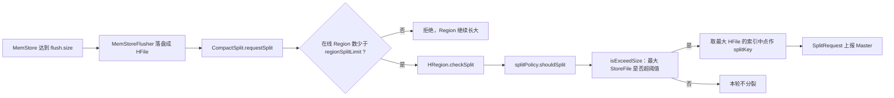
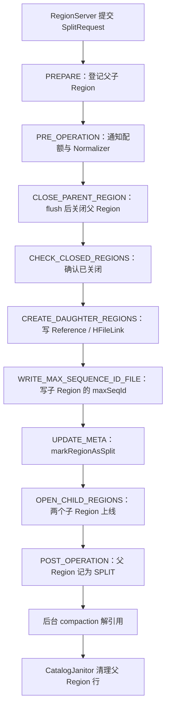
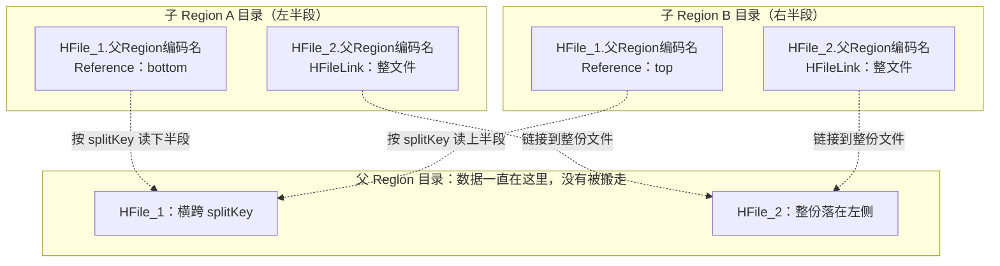
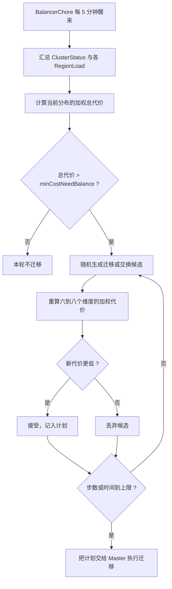
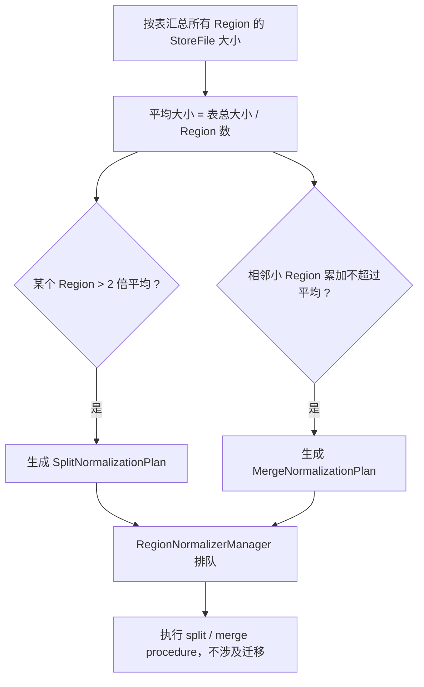
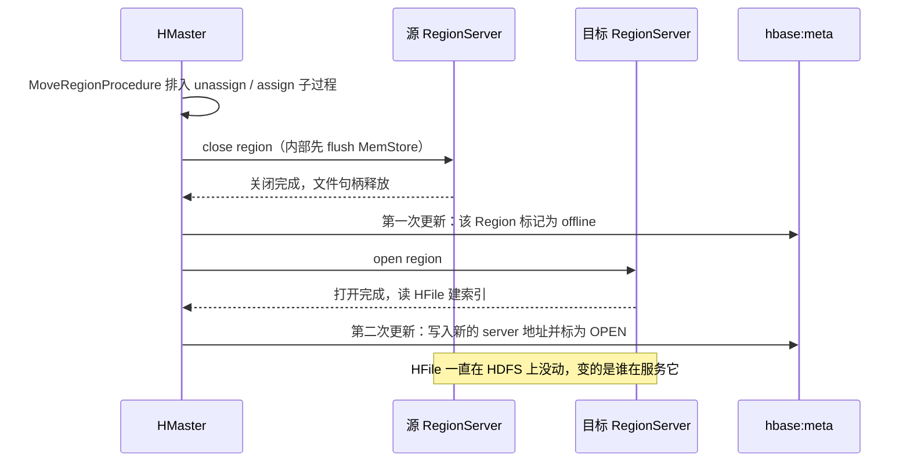

# HBase Region 分裂与负载均衡——水平扩展的工程底层

**摘要：**

HBase 常被描述成"加机器就能扩容"，这句话省掉了一个前提：数据要能被切得足够碎，碎片还要能被摊到足够多的机器上。切碎靠 Region 分裂，摊开靠负载均衡，而这两件事的自动化程度完全不同。分裂是自动的——RegionServer 在 MemStore 落盘之后检查 HFile 大小，越过 `hbase.hregion.max.filesize`（2.x 默认 10GB，叠加 jitter 抖动）就提交分裂请求，Master 侧的 `SplitTableRegionProcedure` 只生成指向父 HFile 的 Reference 文件，把两个子 Region 注册进 `hbase:meta`，几乎不搬运数据；真正的数据重写要等下一次 compaction。负载均衡则不是自动的——它按周期醒一次，用六个维度的加权代价决定要不要搬，而它搬动的粒度是 Region，不是行。本文按这条主线拆开讲：分裂的状态机与 Reference 机制、各分裂策略的判据、预分区的数量算法、`StochasticLoadBalancer` 的代价函数、`RegionNormalizer` 与 merge 的边界、Region 迁移的代价，最后给出六个故障形态的判据与四个反例，并说明分裂、均衡、归一化三者各自管哪一段。读完应当能回答两个问题：为什么分裂之后磁盘占用没有变，为什么均衡器永远治不好热点行。

---

## 第 1 章 两个机制，一条主线

2006 年 Google 的 BigTable 论文里，tablet 是可以被反复切分的：一张表装下几千 TB 数据，靠的不是某一台机器足够大，而是 tablet 切碎之后能挪到任意一台 tablet server 上。HBase 继承了这个设计，把 tablet 改称 Region，把"能切"包装成了"无限水平扩展"。这个包装里藏着两个彼此独立的机制，它们经常被混为一谈，工程上出问题也多半是因为混为一谈：分裂（Split）负责让每一片足够小，负载均衡（Load Balancing）负责让每一片落在合适的机器上。

概述性的材料回答的是 HBase 是什么、适合什么场景；本篇关心的是另一层东西——机制在代码里怎么走、参数调大调小各自付出什么代价、线上出现什么现象时可以判定是它出的问题。这两层不是深浅之分，而是问题类型之分：前者决定要不要选 HBase，后者决定选了之后能不能撑住。

### 1.1 一个 Region 一直长大，会碰到三堵墙

建表时默认只有一个 Region，所有写入都落在它身上。如果没有任何切分机制，这个 Region 会一直长下去，直到撞上三堵墙。

第一堵是 compaction 的代价没有上限。Major Compaction 要把一个 Store 下的全部 HFile 读出来、归并、再写回去，Region 越大，这一次归并搬动的字节越多。一个 500GB 的 Region 做一次全量归并，读与写各 500GB，在 HDFS 三副本的语境下，底层网络与磁盘的搬运量还要再放大，耗时以小时计，期间同一台机器上的其他 Region 的读写延迟会被拖着走。

第二堵是单点负载无法分散。HBase 的并行度来自"多个 Region 分布在多台 RegionServer 上"，而一个 Region 在同一时刻只由一台 RegionServer 服务。Region 越大，落在它身上的请求就越集中，集群机器再多也帮不上忙——这是分区键设计里最经典的困境，只是换了个名字。

第三堵是恢复时间。RegionServer 挂掉之后，它名下的 Region 要在别的机器上重新打开，过程中要重放 WAL、要重新读 HFile 建立索引。Region 越大，这段时间越长，而这台机器上其他 Region 的不可用窗口也跟着变长。

这三堵墙指向同一个结论：单个 Region 的大小必须有一个上限，而这个上限只能靠切分来维持。HBase 给的默认上限是 10GB，理由并不神秘：10GB 的 Region 做一次全量归并的代价还能接受，再大就要开始和在线业务抢 IO 了。

### 1.2 朴素的分裂方案为什么不成立

要让 Region 变小，最直觉的做法是暂停服务、把数据物理地分成两半、写成两个新目录，然后恢复。这个方案在工程上不可行，原因有两个：一是 10GB 数据的复制在 HDFS 上不是瞬间完成的，即便按顺序读写算，也要几十秒到几分钟；二是这段时间里该 Region 完全不可读写，业务侧的感知是超时和重试风暴，而重试风暴又会打垮集群里其他还健康的节点。

HBase 的选择是另一条路：**分裂时不复制任何数据**，只在子 Region 的目录里写下几个指向父 Region 的 HFile 的引用文件。父 Region 的 HFile 原地不动，两个子 Region 各拿一把"半把钥匙"，读的时候只取属于自己那半段 RowKey 的块。这个动作的耗时与数据量基本无关，只与 HFile 的个数相关。

> [!note] 一个类比
> 这像是把一本按字母排序的厚词典分给两个人用：不去复印内页，而是各自拿一张索引卡，写着"我负责 A–M，去原书第 1 到 800 页找"。书还在书架上，谁需要就按索引卡去翻。等哪天要真正分家，再做一次复印——那一步才是昂贵的，但它可以慢慢来。

### 1.3 分裂自动，均衡不自动

把这两个机制摆在一起看，会发现它们的自动化程度是刻意做成不同的。

分裂是**被动触发**的：只要 Region 的 HFile 超过阈值，RegionServer 自己就会发起，不需要人批准，也不受"集群整体是否均衡"的影响。均衡是**周期性审视**的：Master 每隔一段时间看一次全局，判断"当前分布值不值得搬"，然后决定搬或者不搬。前者是局部的、必须发生的；后者是全局的、可选的。

这个差别不是实现偷懒，而是目标函数不同。分裂的目标函数只有一个：别让单个 Region 太大。均衡的目标函数是一组互相冲突的指标：Region 数要匀、读写请求要匀、数据要尽量本地、搬运本身又有代价。前者可以就地做决定，后者必须权衡。

由此带出本篇的主线：**分裂是自动的**，**均衡不是自动的**，这两件事要分开管。把两者混在一起管，常见的后果是"Region 数看着很匀，但热点还在"或者"均衡器刚搬完，分裂又把分布打乱了"。

---

## 第 2 章 一次分裂到底做了什么

### 2.1 触发点：MemStore 落盘之后的一次检查

分裂不是在写入路径上同步发生的，它挂在 flush 之后。MemStore 涨到 `hbase.hregion.memstore.flush.size`（默认 128MB）被刷成 HFile（flush 的完整触发条件见 [[05 HBase 写入链路深度解析——WAL、MemStore Flush 与持久性保证|写入链路一篇]]），落盘完成后，`MemStoreFlusher` 的 flush 处理线程会顺手向 `CompactSplit` 提交一次分裂检查。`CompactSplit` 里有一个独立的线程池负责分裂，线程数由 `hbase.regionserver.thread.split` 控制，默认只有 1——这意味着分裂请求天生是排队串行的，一个 RegionServer 不会同时执行两次分裂。

检查的入口是 `HRegion.checkSplit()`，它做三件事：先问策略要不要分（`splitPolicy.shouldSplit()`），再算出分裂点（`getSplitPoint()`），最后把结果交给 `CompactSplit` 提交请求。判定要不要分的动作落在 `isExceedSize()` 里，比较的对象是一个字节数阈值；而比较哪些文件，由 `hbase.hregion.split.overallfiles` 决定：默认 `false`，只看该 Region 里**最大的那一个 StoreFile** 是否超阈值；设成 `true`，则看该 Region 所有 Store 的 HFile 大小之和。前者更宽松，一个列族很大而另一个很小的时候，不会因为总和超限就分裂；后者更贴近"这个 Region 整体占了多少磁盘"的直觉。

这条链路上还有一个全局闸门：`hbase.regionserver.regionSplitLimit`，默认 1000。`CompactSplit` 在放行之前会看本机在线 Region 数，超过上限的 90% 就开始打告警日志，达到上限就直接拒绝新的分裂请求。它不是硬性的 Region 数上限，而是一根刹车线——踩住之后，Region 不会再分裂，但会继续长大。



### 2.2 阈值怎么算：10GB 与 jitter

默认阈值来自 **`hbase.hregion.max.filesize`**，`HConstants` 里的 `DEFAULT_MAX_FILE_SIZE` 是 10GB（10737418240 字节）。这个值可以被表或列族的 `MAX_FILESIZE` 属性覆盖：`ConstantSizeRegionSplitPolicy` 在初始化时先读表描述符上的 `getMaxFileSize()`，读不到才回落到配置项。

真正让阈值不是一个整数的是 jitter。策略类初始化时读 `hbase.hregion.max.filesize.jitter`，默认 0.25，然后算出一个落在 ±12.5% 区间内的随机偏移量，直接加到阈值上。源码注释的原话是 "Default jitter is ~12% +/-"。也就是说，一批配置相同的表，在 10GB 附近的分裂点会落在 **8.75GB 到 11.25GB** 之间，各台机器、各个 Region 彼此错开。

为什么要抖？如果所有 Region 的阈值都是精确的 10GB，那么一批同时开始写入的表会在几乎同一时刻集体撞线，几十个分裂请求同时涌向 Master，串行执行的分裂线程池被塞满，Region 长期停在 `SPLITTING`，客户端看到的是 `Region in transition` 与重试。jitter 把这条同步的线打散成一个区间，用随机化换取了系统层面的平滑。

### 2.3 1.x 与 2.x 的差别

把版本差异摊开来看，会更清楚这条演进线不是在改算法，而是在改"默认值把用户带到哪里"。

| 版本段 | 默认 `max.filesize` | 默认分裂策略 | jitter | 分裂由谁执行 |
| :--- | ---: | :--- | :--- | :--- |
| 0.90 ~ 0.92 | 256MB（0.90）、1GB（0.92） | `ConstantSizeRegionSplitPolicy` | 无 | RegionServer 本地执行 |
| 0.94 ~ 1.4 | 10GB | `IncreasingToUpperBoundRegionSplitPolicy` | 有，默认 0.25（1.x 后期引入） | RegionServer 本地执行 |
| 2.x（以 2.5 为准） | 10GB | `SteppingSplitPolicy` | 有，默认 0.25 | Master 的 `SplitTableRegionProcedure` |

三行里最容易被误读的是 jitter。坊间常说"2.x 引入了 jitter"，严格讲不准确：`hbase.hregion.max.filesize.jitter` 这个参数在 1.x 后期的策略类里就已经出现，取值与算法和 2.x 相同。2.x 真正的变化是默认策略换成了 `SteppingSplitPolicy`，以及分裂动作从 RegionServer 搬进了 Master 的 ProcedureV2 框架。前者改变了阈值函数，后者改变了执行位置与可观测性——在 2.x 里，一次分裂在 Master 上是一个有状态、可回滚、可在 Web UI 里追踪的 procedure，而在 1.x 里它是 RegionServer 内部一段没有统一状态机的逻辑。

把分裂搬进 Master 的副作用是权限与责任的转移：RegionServer 只负责关闭父 Region、上报分裂请求，真正创建子 Region 目录、写引用文件、更新 meta 的动作都在 Master 上完成。好处是元数据变更集中在一处，状态可追踪、可回滚；坏处是所有分裂都要过 Master 的 procedure 队列，分裂密集时 Master 的调度与状态维护会成为新的瓶颈点——这也是为什么 jitter 在 2.x 里更显得重要。

### 2.4 从 SplitRequest 到子 Region 上线

一旦 Master 接收了分裂请求，剩下的动作由 `SplitTableRegionProcedure` 按状态机推进。2.5 的状态序列是这样的：

1. `SPLIT_TABLE_REGION_PREPARE`：准备阶段，登记父 Region 与两个子 Region 的描述。
2. `SPLIT_TABLE_REGION_PRE_OPERATION`：分裂前动作，通知配额管理器与 Normalizer，触发 coprocessor 钩子。
3. `SPLIT_TABLE_REGION_CLOSE_PARENT_REGION`：关闭父 Region，先 flush 残留的 MemStore，再关文件句柄。父 Region 在 Master 的 `RegionStates` 里被标为 `SPLITTING`，从这一刻起不再接受读写，集群里出现一个短暂的不可用窗口。
4. `SPLIT_TABLE_REGIONS_CHECK_CLOSED_REGIONS`：确认父 Region 已经彻底关闭，避免一边关一边分。
5. `SPLIT_TABLE_REGION_CREATE_DAUGHTER_REGIONS`：在表目录下创建两个子 Region 目录，为每个 HFile 写引用文件。这一步是分裂的主体，也是在 Master 上并行执行的。
6. `SPLIT_TABLE_REGION_WRITE_MAX_SEQUENCE_ID_FILE`：把父 Region 的最大序列号写进两个子 Region 的 WAL 目录。
7. `SPLIT_TABLE_REGION_PRE_OPERATION_BEFORE_META` / `UPDATE_META` / `PRE_OPERATION_AFTER_META`：更新 `hbase:meta`，父行打上分裂标记并记下两个子 Region，两个子 Region 各自新增一行。
8. `SPLIT_TABLE_REGION_OPEN_CHILD_REGIONS`：给两个子 Region 追加分配子过程，让它们在被选中的 RegionServer 上打开。
9. `SPLIT_TABLE_REGION_POST_OPERATION`：收尾，父 Region 在内存状态里记为 `SPLIT`，等待清理。



第 5 步值得停一下。`createDaughterRegions` 先在表目录下建好两个子 Region 的目录，再对每个列族的每个 HFile 调一次 `HRegionFileSystem.splitStoreFile`，这些拆文件的动作被丢进一个固定大小的线程池并发执行，超时上限由 `hbase.master.fileSplitTimeout` 控制（没配则回落到 `hbase.regionserver.fileSplitTimeout`，默认 600000 毫秒）。超时并不是"分裂失败"，它只是一个保护阈值，防止某个坏文件把 procedure 永久挂住。

### 2.5 Reference 文件：不复制数据的关键

`splitStoreFile` 为每个 HFile 决定一件事：这个文件是整份落在某一侧，还是横跨分裂点。判断方法很朴素——读文件的第一个 Key 和最后一个 Key，和 splitKey 比较。如果文件的所有 Key 都小于 splitKey，它整份属于左边的子 Region；都大于，整份属于右边；只有横跨 splitKey 的文件才需要"切半"。

两种情形产生两种不同的指针：

- 整份落在某一侧时，HBase 创建的是一个 **HFileLink**，本质是一个指向父文件的链接，附带一条反向引用，让父文件不被误删。这种情况在分裂点落在一个大文件的边界附近时出现，代价比 Reference 还低。
- 横跨分裂点时，HBase 创建的是一个 **Reference 文件**，文件名是"父 HFile 名 + 点号 + 父 Region 的编码名"，落在子 Region 的列族目录下。文件内容很小，只记录 splitKey 和方向：是取小于 splitKey 的下半段（bottom），还是取大于等于 splitKey 的上半段（top）。

读取时，子 Region 的 Store 打开这个 Reference 文件，底层实际拿到的是一个 `HalfStoreFileReader`：它把真正的父 HFile 打开，但对外只暴露属于自己那半段的 Key 范围。上层的 `StoreScanner` 完全不知道这件事——它拿到的仍然是一个可以 seek、可以顺序扫描的 StoreFile，只是这个"文件"的边界被裁剪过。

这里要注意一个容易忽略的事实：**两个子 Region 的 Reference 文件同名**。因为文件名里的后缀是父 Region 的编码名，而两个子 Region 引用的都是同一个父文件，所以目录里会出现两份同名的引用，各自落在自己的 Region 目录下，靠目录区分归属，靠文件内容区分上下半段。

### 2.6 分裂前后的目录视图

把目录摊开看，分裂到底改了什么就一目了然了。



目录结构上多了两个子 Region 的文件夹，每个文件夹里多了若干个几十字节到几 KB 的引用文件，父 Region 的 HFile 一个字节都没动。这正是"分裂几乎零 IO"的全部含义——**代价只与 HFile 的个数相关**，与数据量无关。

> [!info] 一个常见的误解
> 很多人第一次看到分裂后的 `hbase:meta`，会以为数据已经被切成了两半。实际上此刻两个子 Region 的"数据"是同一批 HFile，只是读取时各自裁剪了范围。如果这时直接用 `hdfs dfs -du` 看表目录，占用不但没降，反而因为多了一份引用文件而略微上升——这一点在第 2.7 节会算清楚。

### 2.7 为什么分裂之后磁盘占用没变

这是本篇最值得记住的一条结论：**分裂本身几乎零 IO**，真正的数据重写发生在下一次 compaction。

分裂只写引用文件，父 HFile 原样保留。子 Region 上线之后，各自的 Store 里躺着一批 Reference。当 compaction 选中这些 Reference 时，才会发生真正的数据搬动：读父 HFile，按 splitKey 过滤出属于自己的一半，写成新的 HFile，然后删掉 Reference。等两个子 Region 都完成了这一步，父 HFile 才没有任何引用，可以被归档删除。哪些文件会在什么时候被选中、限速参数如何影响这件事情的进度，[[07 HBase Compaction 机制深度解析——Minor、Major 与写放大的三角关系|Compaction 一篇]] 里有完整讨论，笔者在这里只关心它与分裂交接的那一面。

这个设计把一次昂贵的操作拆成了"快速提交 + 慢速后台"两段，代价被推迟，但并没有消失。我们算一笔账会更清楚（下面的数字是示例推算，不是某一个真实集群的测量值）：一个 10GB 的 Region，假设有 10 个 1GB 的 HFile 横跨分裂点。

| 阶段 | 读 | 写 | 说明 |
| :--- | ---: | ---: | :--- |
| 分裂本身 | 每个 HFile 读首末 Key，约几十 KB 量级 | 20 个引用文件，KB 量级 | 与数据量无关，秒级完成 |
| 子 Region A 的 compaction | 10GB（读 10 个父 HFile 的对应半段） | 约 5GB | 新文件落在 A 的目录 |
| 子 Region B 的 compaction | 10GB（同一批父 HFile 的另一半） | 约 5GB | 新文件落在 B 的目录 |
| 父文件归档 | — | — | 两个子 Region 都不再引用后删除 |

也就是说，一次分裂在 compaction 阶段引起的总读写量大约是父文件大小的 4 倍——父文件被读了两次（每个子 Region 各读一遍），新数据又被写了两份（合计等于父文件大小）。这与"分裂不复制数据"并不矛盾：分裂当时确实没有复制，复制发生在之后；而且如果父文件在 compaction 之前就被别的合并动作消化掉，这笔账还会变。

由此可以解释几个线上现象。分裂完成时，表的 HDFS 占用不变，甚至因为引用文件而略增；随后的一段时间里，集群会出现一轮以两个子 Region 为单位的 compaction 流量；如果这台机器同时有别的表在分裂，IO 会被叠加，表现为"分裂之后反而更慢"。判断一个集群是否刚经历大规模分裂，看的不是分裂日志，而是"文件数先增后减、IO 在分裂后的一两个小时内偏高"这个组合。

### 2.8 父 Region 的收尾

分裂的"提交点"在 `UPDATE_META`。Master 的 `AssignmentManager.markRegionAsSplit` 一次写入三件事：父 Region 行上写 `info:splitA` 与 `info:splitB` 两个列，记下两个子 Region 的名字；给两个子 Region 各写一行完整的位置信息；父 Region 在内存状态里标成 `SPLIT`。

父 Region 的行不会立刻消失，它要等到 `CatalogJanitor` 定期扫描 meta 时才被清理；Region 与 meta 的整体分配关系在 [[03 HBase 整体架构——Master、RegionServer 与 ZooKeeper 的三角协作|整体架构一篇]] 里已经铺开，这里只看与分裂相关的那两次写入。这个"先标记、后清理"的顺序是必要的：如果先删父行，一旦有客户端还拿着旧的 Region 位置缓存，就会找不到路由；留着父行，客户端至少能从 `splitA`/`splitB` 里读出该往哪走。

还有一个容易被跳过的细节：`WRITE_MAX_SEQUENCE_ID_FILE` 把父 Region 的最大序列号写到两个子 Region 的 WAL 目录。这样做是为了防止父 Region 的旧 WAL 在崩溃恢复时被重放到子 Region 上——那些编辑已经在父 HFile 里了，再放一遍就是重复数据。这类"看起来多余的一步"，恰恰是分布式系统里把正确性做扎实的地方。

---

## 第 3 章 分裂策略：什么时候切、在哪里切

分裂策略回答两个问题：多大算大，从哪里切。前者是阈值函数，后者是分裂点的选取规则。两者都由 `RegionSplitPolicy` 的子类实现，配置项是 `hbase.regionserver.region.split.policy`，也可以在建表时按表覆盖。

### 3.1 分裂点怎么选

分裂点由 `HStore.getSplitPoint()` 给出，取的是**最大的那个 StoreFile 的索引中点**：读 HFile 的根索引块，拿到数据块的首个 RowKey，选一个位于文件字节量中点的 RowKey 作为 splitKey。按字节量而不是按行数，是为了让两个子 Region 的磁盘占用接近；如果按行数切，平均行长差异大的表会切出一大一小两个 Region。

这个规则有一个前提：RowKey 在字节空间里大致均匀。若 RowKey 是"固定前缀 + 递增后缀"，字节中点往往落在某个前缀簇的中间，切出来的两个 Region 数据量可能严重不均，甚至出现"边界落在同一个前缀内部"这种把一组相关数据劈开的结果。这正是 `KeyPrefixRegionSplitPolicy` 存在的原因，也是 [[02 HBase 数据模型深度解析——RowKey、列族、Cell 与多版本机制|RowKey 设计]] 要解决的问题。

### 3.2 ConstantSizeRegionSplitPolicy：一把固定的尺

逻辑最简单：任何一个 Store 的最大 HFile 超过 `hbase.hregion.max.filesize` 就分裂。在 0.94 之前它是默认策略，而上限在这几个版本里换过三次：0.90 是 256MB，0.92 调到 1GB，0.94 直接跳到 10GB 并换上动态阈值策略。演变方向很直白——上限太小时 Region 切得太碎，管理开销压过来；上限调大之后，又需要另一种策略让新表先快速铺开。

它的缺陷不在算法而在默认值带来的行为：表从 0 长到 10GB 的整个过程里只有一个 Region，哪怕集群有一百台机器，这张表的写入也只能压在一台上。对大数据量的表来说，前几个小时的写入全部落在单点；对小表来说，它可能永远只有一个 Region，均衡器再努力也无从下手。

### 3.3 IncreasingToUpperBoundRegionSplitPolicy：立方曲线

0.94 起成为默认策略，思路是"表刚建时用小阈值催它快点分家，分到一定数量后回到上限"：

```
阈值 = min( 本机同表 Region 数的立方 × 2 × flush.size, max.filesize )
```

按 flush.size 128MB、max.filesize 10GB 算出来的曲线是这样的：

| 本机同表 Region 数 | 计算 | 实际阈值 |
| ---: | :--- | ---: |
| 1 | 1³ × 256MB | 256MB |
| 2 | 2³ × 256MB | 2GB |
| 3 | 3³ × 256MB | 6.75GB |
| 4 及以上 | 超过上限 | 10GB |

这条曲线的意图是好的，问题出在中间那两档：2GB 和 6.75GB 既不够大也不够小，业务往往在这个阶段遭遇抖动——Region 数不够多，热点还在；阈值又比上限低，分裂比后期频繁，compaction 跟着变密。更麻烦的是它只看"本机同表 Region 数"，如果一堆 Region 恰好都分到了同一台机器，阈值就会被压得很低，分裂得更凶。

### 3.4 SteppingSplitPolicy：两档跳变

2.x 的默认策略，实现只有一行有效逻辑：本机同表只有一个 Region 时，阈值取 `2 × flush.size`（默认 256MB）；否则取 `max.filesize`（带 jitter，约 10GB）。

相比立方曲线，它把中间那两档砍掉了，行为更容易预测：第一次分裂来得很早，让表快速铺开；之后所有 Region 都按统一的 10GB 标准分裂。代价是"从 2 个 Region 直接跳到 10GB 阈值"这个陡坡——如果一张表的数据量刚好在几 GB 到十几 GB 之间，它可能只有两三个 Region，其中有的已经很大，却迟迟不再分裂。

### 3.5 KeyPrefixRegionSplitPolicy 与 DelimitedKeyPrefixRegionSplitPolicy

这两个策略继承自 `IncreasingToUpperBoundRegionSplitPolicy`，只改一件事：分裂点。前者按固定前缀长度截断 splitKey（表属性 `KeyPrefixRegionSplitPolicy.prefix_length`），后者按分隔符截断（表属性 `DelimitedKeyPrefixRegionSplitPolicy.delimiter`）。

效果是保证同一个前缀的所有行落在同一个 Region 里。这听起来与"分散"相反，实际用途是保住业务上的聚簇语义：如果 RowKey 的前缀是租户 ID 或设备 ID，同一前缀的行往往被一起扫描，把它们放在同一个 Region 里可以避免跨 Region 的扫描与拼接。反过来说，如果前缀本身的分布是倾斜的（某个租户的数据占了 80%），这个策略会把倾斜固化下来，变成永久热点。它的正确用法是这样：业务上需要按前缀预分区的效果，又不愿完全关掉自动分裂时，用它在"自动"与"可控"之间取一个折中——分裂照旧发生，只约束落刀的位置。两个类在 2.5 里都已被标注为 `@Deprecated`，官方倾向是用预分区加合适的 RowKey 设计来替代。

### 3.6 BusyRegionSplitPolicy：按阻塞率切

这个策略不看大小，看压力：如果一段时间内被阻塞的写请求比例超过 `hbase.busy.policy.blockedRequests`（默认 0.2），且 Region 的存活时间超过 `hbase.busy.policy.minAge`（默认 10 分钟），就触发分裂，聚合窗口默认 5 分钟。它解决的是"Region 不大但压力很集中"的场景——比如某几个热点行把 MemStore 撑到 block 阈值，写入被反压。不过它治标不治本：分裂只能把 RowKey 空间切开，如果热点就在同一个 RowKey 上，切完还是热点。

另外还有一个 `DisabledRegionSplitPolicy`，直接禁止自动分裂。它适合预分区已经算得很准、并且有外部系统按时间或按量管理 Region 的场景；用错的话，Region 会一路长到 compaction 撑不住为止。

### 3.7 该用哪个

| 策略 | 阈值来源 | 适用场景 | 不该用的场景 |
| :--- | :--- | :--- | :--- |
| `SteppingSplitPolicy` | 1 个 Region 时 256MB，之后 10GB + jitter | 2.x 通用默认，无需改动 | 数据量跨几个 GB 且需要尽早铺开的表 |
| `IncreasingToUpperBoundRegionSplitPolicy` | 立方曲线，上限 10GB | 1.x 存量集群 | 新集群，中间档位会带来抖动 |
| `ConstantSizeRegionSplitPolicy` | 固定 10GB + jitter | 想精确控制 Region 大小、可预测性强 | 小表、写入从一开始就很猛的表 |
| `KeyPrefixRegionSplitPolicy` | 同 Increasing，但分裂点按前缀截断 | 前缀有业务聚簇语义，且预分区需求强 | 前缀本身倾斜、租户数据量差异悬殊 |
| `DelimitedKeyPrefixRegionSplitPolicy` | 同上，按分隔符截断 | RowKey 用分隔符分段，需要保住段内聚簇 | 分隔符在 RowKey 里出现位置不固定 |
| `BusyRegionSplitPolicy` | 阻塞写请求比例 | 区域性压力集中，且热点跨多个 RowKey | 单行热点，切了也没用 |
| `DisabledRegionSplitPolicy` | 不分裂 | 预分区精确、有外部 Region 管理 | 没有外部管理手段时用，Region 会失控长大 |

一句判据：能算清数据量和 RowKey 分布的，用预分区加 `DisabledRegionSplitPolicy`；算不清的，用默认的 `SteppingSplitPolicy` 让系统自己长；前缀有聚簇语义的，才考虑 `KeyPrefixRegionSplitPolicy`。

---

## 第 4 章 预分区：把第一次分裂提前到建表之前

### 4.1 不预分区到底会怎样

默认建表只有一个 Region。写入开始之后，这个 Region 要长到 256MB 才会触发第一次分裂（`SteppingSplitPolicy` 的特例），再长到 10GB 才会有第二次。这意味着从建表到 Region 数达到两位数，中间隔着几十 GB 的写入量。在这段时间里，无论集群有多少台 RegionServer，这张表的写入都只落在一台机器上。

这个窗口有多长，取决于写入速率。按每台机器 20MB/s 的有效写入算（示例推算），256MB 的第一刀大约在十几秒后，但第二次分裂要等到 10GB，也就是 8 分钟以上；如果写入速率更低，这个窗口会拉到几小时。业务侧的观测是：导入初期 RegionServer 的 CPU 和 IO 集中在一台上，其他机器空闲，导入总耗时被单机吞吐卡住。

预分区的做法是把这条曲线掰直：建表时就按 RowKey 空间切出 N 个边界，让 N 个 Region 从一开始就分布在 N 台（或若干台）机器上。写入的第一秒就是并行的，不需要等待自然分裂。

### 4.2 三种落地方式

第一种是建表时直接给 splitKey 数组：`createTable(desc, splits)`，Java API 与 shell 的 `create 't', 'f', SPLITS => ['10','20','30']` 是同一个入口。splits 数组里是 N-1 个边界，产生 N 个 Region。

第二种是 `SPLIT_FILE`：把边界写进一个文件，建表时指向它。适合边界由外部系统算出来、数量较多（几百上千）的场景，避免在命令行里塞一个巨大的数组。

第三种是 `RegionSplitter` 工具，自带两种切分算法：`HexStringSplit` 把 RowKey 当作十六进制字符串均分，`UniformSplit` 把 RowKey 当作任意字节序列均分。它们解决的是"边界怎么生成"的问题——均匀的字节分割能保证每个 Region 的键空间大小相同，但不能保证数据量相同，这一点后面会讲。

譬如手工给边界时，最常见的两种设计是十六进制区间（`00`、`10`、`20`……）和加盐前缀（`0|`、`1|`、`2|`……）。前者适合 RowKey 本身是散列值的表，后者适合 RowKey 有天然顺序（如时间戳、自增 ID）但又必须打散的表：把盐值放在最前面，让顺序写入先被盐打散，再在每个盐桶内部保持有序。

### 4.3 分多少个：两条约束，取合理区间

Region 数量由两条互相拉扯的约束决定。

第一条来自数据量：总数据量除以单个 Region 的目标大小。目标大小通常取 5GB 到 10GB，取 10GB 意味着分裂阈值一到就会触发分裂，取 5GB 则留出一倍的余量。这条约束给出的是**下限**——Region 数少于这个值，每个 Region 就会超过目标大小，compaction 与恢复的代价随之抬上去。

第二条来自机器数：Region 数应当与 RegionServer 数成比例。业界常用的经验区间是每台机器 20 到 200 个 Region。低于 20，一台机器故障后它名下的 Region 要挤到剩下的机器上，形成瞬时过载；高于 200，每个 Region 的 MemStore 结构、文件句柄、meta 行都要占资源，Master 的分配与恢复也会变慢。

不妨把两条约束合起来，写成一条取值规则：先算数据量给出的下限，再算机器数给出的区间，取两者的交集；如果交集为空，说明数据量撑不起这个机器规模。写成分段形式是这样：

- 理想值 = max(数据量 ÷ 目标大小, 机器数 × 20)，但不超过 min(机器数 × 200, 数据量 ÷ 2GB)。
- 若"机器数 × 20"已经超过"数据量 ÷ 2GB"，交集为空，说明集群的机器数相对数据量太多，此时按数据量走，接受"这张表只用到少数几台机器"的事实，不要为了铺满而把 Region 切到每片一两百 MB。
- 若"数据量 ÷ 目标大小"超过"机器数 × 200"，说明单表 Region 太多，应当调大目标 Region 大小或者加机器。

规则里的 2GB 不是官方门槛，而是经验上的止损线：每片 Region 低于这个量级，flush 与 compaction 的开销占比就会明显上升，管理成本压过并行收益。

| 数据量 | 目标 Region 大小 | 按数据量算 | RS 数 | 机器数下限（×20） | 机器数上限（×200） | 建议 Region 数 |
| ---: | ---: | ---: | ---: | ---: | ---: | ---: |
| 100GB | 10GB | 10 | 10 | 200 | 2000 | 10（数据量太小，按数据量走） |
| 1TB | 10GB | 100 | 10 | 200 | 2000 | 200，每 Region 约 5GB |
| 10TB | 10GB | 1000 | 20 | 400 | 4000 | 1000，每 Region 约 10GB |
| 100TB | 10GB | 10000 | 50 | 1000 | 10000 | 10000，每 Region 约 10GB |

表里第二行是最容易踩空的一格：1TB 数据按 10GB 算只有 100 个 Region，10 台机器平均每台 10 个，低于经验下限。把 Region 数抬到 200、每个 Region 约 5GB，是拿"更早分裂"换"故障时更平滑的迁移"，这笔交易在机器数不多的集群里通常划算。

### 4.4 与 MemStore flush.size 的配合

预分区的数量不能脱离 `hbase.hregion.memstore.flush.size` 单独看。这个参数默认 128MB，决定了 MemStore 多久落一次盘；还有一个配对的 `hbase.hregion.memstore.block.multiplier`，2.5 里默认 4，意思是 MemStore 涨到 flush.size 的四倍时，写入会被直接阻塞，客户端拿到 `RegionTooBusyException`。

如果 Region 太小，比如每个只有 200MB，那么一次 flush 就写掉近一半的空间，Region 很快又逼近分裂阈值；更糟的是 flush 频率高，每次落盘产生一个小 HFile，compaction 要不停地把这些小文件合起来，写放大直线上升。反过来，如果 Region 很大而 flush.size 很小，HFile 个数会多，读放大又会变差。

一个粗略的配比是：单个 Region 的目标大小至少是 flush.size 的几十倍。按 10GB 与 128MB 算，约 80 倍，这个比例下每次 flush 产生的文件相对整个 Region 很小，compaction 有足够的空间做分层合并。若把 flush.size 调大到 256MB，Region 目标大小也应相应上调，或者接受更频繁的分裂。

### 4.5 预分区会失效的四种情形

预分区不是一次性投入就能永久生效的，它在四种情形下会失效。

一是边界算错。按"ID 范围均分"切出来的 Region，遇到真实数据集中在前 10% 的 ID 区间时，第一个 Region 会迅速膨胀，其余 Region 空闲。这时候分裂会在第一个 Region 上照常发生，但整体分布仍然是歪的。

二是数据倾斜。即使边界按字节均分，某些 RowKey 对应的行就是更多、更大（大客户、热门商品），Region 大小会在运行期逐渐分化，预分区只能保证起点公平，不能保证终点公平。

三是时间序列的天然倾斜。按时间分区（每天一个 Region）的表，写入永远落在最新的那个 Region 上，历史 Region 只读不写。这种设计下"热点"是结构性的，预分区数量再多也没用，需要的是把写入按盐值或哈希打散。

四是 Region 数算得太多。预分区 5000 个 Region 而实际数据只有 500GB，每个 Region 100MB，结果是 Master 要管理 5000 个 Region，每次重启恢复要打开 5000 次，而每个 Region 的数据还不够做一次像样的 compaction。这时候该做的是合并，不是继续预分区。

---

## 第 5 章 负载均衡：搬 Region，而不是搬数据

### 5.1 均衡器看到的世界是 Region 粒度的

Master 上有一个 `BalancerChore`，按 `hbase.balancer.period` 的周期醒来，默认 300000 毫秒，也就是 5 分钟。它拿到的是 `ClusterStatus`：每台 RegionServer 报上来的 Region 列表，以及每个 Region 的 `RegionLoad`——读请求数、写请求数、StoreFile 大小、MemStore 大小、文件个数。均衡器就在这个数据面上做决定。

理解这一点很关键：**均衡器的输入是 Region**，它不知道哪一行热。一个 Region 里有一千万行，其中一行占了 90% 的读，在均衡器眼里这个 Region 只是"读请求多"，它能做的只有把整个 Region 搬到另一台机器，或者不搬。这就是后面"热点治不好"的根源，也是必须把均衡与热点分成两个问题来看的原因。

### 5.2 代价函数与它们的权重

2.x 默认的 `hbase.master.loadbalancer.class` 是 `StochasticLoadBalancer`（1.x 用的也是它，它在 0.9x 后期接替了只按 Region 数分配的 `SimpleLoadBalancer`）。它把"分布好不好"拆成六个维度的代价函数，再加上本地性与迁移成本两类修正项，每个函数输出 0 到 1 之间的归一化代价，乘以各自的权重后求和。笔者以 2.5 的源码为准，把权重列在下表里：

| 代价函数 | 默认权重 | 衡量什么 | 调大的后果 | 调小的后果 |
| :--- | ---: | :--- | :--- | :--- |
| `RegionCountSkewCostFunction` | 500 | 各 RS 的 Region 数偏差 | 更执着于把 Region 数拉平，可能为凑数而搬 | Region 数可以歪，靠其他维度兜 |
| `ReadRequestCostFunction` | 5 | 各 RS 读请求速率偏差 | 更倾向把读热点搬走 | 读负载可以集中 |
| `WriteRequestCostFunction` | 5 | 各 RS 写请求速率偏差 | 更倾向把写热点搬走 | 写负载可以集中 |
| `MemStoreSizeCostFunction` | 5 | 各 RS 的 MemStore 总量偏差 | 更在意内存压力均衡 | 允许内存使用不均 |
| `StoreFileCostFunction` | 5 | 各 RS 的 StoreFile 总量偏差 | 更在意磁盘占用均衡 | 允许磁盘占用不均 |
| `ServerLocalityCostFunction` | 25 | 文件与 RS 同机的比例 | 更保守，不愿牺牲本地性 | 更激进，接受远程读 |
| `RackLocalityCostFunction` | 15 | 文件与 RS 同机架的比例 | 更在意机架级本地性 | 允许跨机架读 |
| `MoveCostFunction` | 7（低峰 3） | 本次要搬多少个 Region | 更不愿意搬，计划更保守 | 更愿意搬，收敛更快 |

Region 数那一项的权重是 500，比读写请求高两个数量级。源码注释给的理由很直白：按个数均衡是最通用的数据均衡手段，因为请求速率和文件大小都是波动的，而个数是稳定的。这也解释了为什么很多人觉得均衡器"只会数 Region"——在绝大多数时候，它确实主要在做这件事。

除了这六项，还有一类只在 Region 副本（Region Replication）开启时才生效的代价函数，比如副本同机、副本同机架，逻辑是别让同一 Region 的多个副本挤在一台机器上。



### 5.3 随机爬山：为什么不用最优解

我们把 M 个 Region 分到 N 台机器上，可能的分配方案是 N 的 M 次方量级，求最优是个 NP 难问题。`StochasticLoadBalancer` 的做法是随机爬山：从当前分布出发，随机生成一个小改动（把一个 Region 从 A 搬到 B，或交换两台机器上的两个 Region），算新分布的总代价，变好就接受、变差就丢弃，如此重复。

三个参数决定了它什么时候停：`hbase.master.balancer.stochastic.maxSteps` 默认 1000000 步，`hbase.master.balancer.stochastic.maxRunningTime` 默认 30000 毫秒，两者先到先停。另有一个更重要的门槛 `hbase.master.balancer.stochastic.minCostNeedBalance`，2.5 里默认 0.025：只有当前分布的总代价超过 2.5%，均衡器才会动手。这个门槛是"别没事找事"的保险，避免为了 1% 的改善触发几十次迁移。

随机爬山的工程意义在于用"足够好"换"算得完"。它不保证找到最优分布，但在几十台机器、几万个 Region 的规模下，它能在半分钟内给出一个明显改善的方案，而精确算法可能要跑几个小时。这类取舍在分布式调度里很常见：调度器的价值不在于最优，而在于及时。

### 5.4 周期、开关与范围

`hbase.balancer.period` 默认 5 分钟，这是"醒来的频率"，不是"每次都要搬"。醒来之后如果满足以下任一条件，本轮直接跳过：Master 还在初始化；有 Region 处于 `SPLIT`、`SPLITTING` 或迁移中；某台 RegionServer 刚下线、还没稳定；均衡开关被关掉。这些跳过条件的设计意图是让均衡不与故障恢复、不与分裂抢同一个 Region。

`hbase.master.loadbalance.bytable` 默认 `false`，意思是把整个集群放在一起算，而不是逐表算。这个默认值有讲究：逐表均衡容易得到"每张表在每个 RS 上各分几个"的漂亮结果，但会让每台机器上的表种类变多，文件句柄和 MemStore 结构随之增加；全集群一起算则允许某张表集中在一部分机器上，换取资源使用的整体效率。

开关与手动触发通过 shell 完成：`balancer_enabled` 查状态，`balance_switch false` 关掉，`balancer` 手动跑一次。手动 `balancer` 也会检查这个开关：开关关着时，命令直接返回、不做任何事。所以维护窗口里的正确顺序是先关自动、做完变更、再打开开关并在需要时手动跑一次，忘了第三步就会留下一个长期不均衡的集群。

### 5.5 均衡器治不了什么

有一类现象会让人误以为均衡器坏了：各台机器的 Region 数几乎一样，读写请求总量也差不多，但某个 Region 的请求量是其他 Region 的十几倍，客户端延迟集中在这个 Region 所在的那台机器上。

这不是均衡器的问题，是数据分布的问题。分裂把 RowKey 空间切成几段，热点行落在哪一段，那一段就是热的；均衡器最多把这个热的 Region 搬到另一台机器，热点本身没有消失。而且 `ReadRequestCostFunction` 用的是滚动平均（`hbase.master.balancer.stochastic.numRegionLoadsToRemember` 默认保留 15 个采样窗口），短时间的尖峰不一定能把总代价推过 2.5% 的门槛，均衡器可能压根不会为它动手。

判据可以写得很具体：你不妨同时看两处指标——如果各 RS 的 Region 数差异在 10% 以内，而某个 Region 的读请求量是同一张表内 Region 中位数的 5 到 10 倍以上，并且连续几个均衡周期都如此，那就可以判定是热点行，而不是分配不均。处置方向在 RowKey 设计上——加盐、反转、哈希前缀，或者把热点行拆到独立的表里用不同的分区策略，这些在第 02 篇里有完整讨论。均衡器在这个问题上的正确姿势是"别指望它"。

---

## 第 6 章 RegionNormalizer：改边界，而不是改位置

### 6.1 它和均衡器不是一回事

均衡器动的是位置：Region 的边界不变，只是从一台机器换到另一台。`RegionNormalizer`（2.x 的 Region 归一化子系统）动的是形状：边界本身被重画，Region 被切开或者被合并。

用图书馆打比方：均衡器是馆际调拨，把整个书架从 A 馆搬到 B 馆，书架里的书和分类不变；Normalizer 是重新决定每个书架覆盖哪一段索书号，可能把两个半空的书架并成一个，也可能把一个塞爆的书架拆成两个。前者解决"哪个馆太挤"，后者解决"书架划分得合不合理"。

这个分工决定了它们解决的问题不同：预分区估错了、大量删除之后留下一堆空 Region、某些 Region 因为历史原因特别大——这些是形状问题，均衡器无能为力，要靠 Normalizer。

### 6.2 计划是怎么算出来的

2.x 默认的 `SimpleRegionNormalizer` 逻辑不复杂：先按表汇总所有 Region 的 StoreFile 大小，算出表的总大小与平均每个 Region 的大小；然后对每个 Region 判断——如果它超过平均值的两倍，生成一个分裂计划。合并那一侧是沿 Region 链扫一遍，把相邻的小 Region 连续累加，只要累加和不超过平均值就继续纳入，凑够两个以上就生成一个合并计划。分裂的优先级高于合并，同一个周期里先处理超大的 Region。所有计划交给 `RegionNormalizerManager` 排队，由 worker 依次执行。



注意它执行的是 split 与 merge 的 procedure，不是 move。所以 Normalizer 不会带来"Region 搬家"的开销，但会带来"Region 短暂不可用"的开销——split 与 merge 都要先关闭涉及的 Region。

合并这一侧有额外的门槛，防止 Normalizer 把不该合的东西合掉：`hbase.normalizer.merge.min.region.count` 默认 3，表里 Region 太少就不考虑合并；`hbase.normalizer.merge.min_region_age.days` 默认 3，太新的 Region 不合并，避免刚建表就折腾；`hbase.normalizer.merge.min_region_size.mb` 默认 1，表内 Region 的平均大小低于这个值时就整体不做合并；`hbase.normalizer.merge.merge_request_max_number_of_regions` 默认 100，一次合并请求涉及的区域数有上限。分裂与合并两个方向还各有一个开关：`hbase.normalizer.split.enabled` 与 `hbase.normalizer.merge.enabled`，默认都开。

周期由 `hbase.normalizer.period` 控制。同一个参数在不同版本上差别不小：1.4 里默认 1800000 毫秒（30 分钟），2.5 里改成了 300000 毫秒（5 分钟）。升级时如果没注意这一点，Normalizer 的动作频率会提高六倍。

### 6.3 三处常见误解

第一处是名字。有一种流传较广的叫法，把 2.x 的 Region 归一化能力称作 `hbase:normalizer`，听起来像一张系统表。实际上 2.x 里没有这张表：Normalizer 是 Master 内部的一组类（`RegionNormalizerManager`、`SimpleRegionNormalizer`、`RegionNormalizerChore` 等），输入是 `hbase:meta` 里的 Region 边界与各 RS 报上来的大小，输出是 split/merge 计划，中间没有任何独立的持久化表。把它当成一张表去找，会白费很多时间。

第二处是能力。有一种说法是 Normalizer 能把 Region 数"严格均分"。这不准确：它按**大小**归一，不按个数。某张表如果数据分布本身是均匀的，按大小归一会顺带把个数拉平；但如果分布倾斜，它会把大的切开、小的合并，最终每个 Region 大小接近而个数未必均等。想要个数均等，那是均衡器的事，权重 500 的 `RegionCountSkewCostFunction` 就在干这个。

第三处是范围。Normalizer 与 `rsgroup`（RegionServer 分组）没有直接关系。rsgroup 场景下，均衡由 `RSGroupBasedLoadBalancer` 负责，它在每个组内部再委托一个普通均衡器；Normalizer 不在组内做二次分配，它只按表看大小。

### 6.4 什么时候该开

| 场景 | 建议 | 理由 |
| :--- | :--- | :--- |
| 预分区估错，Region 大小两极分化 | 开，并且先跑一次手动 `normalize` | 这正是它设计要解决的问题 |
| 大批量删除后留下大量空 Region | 开 | 小的相邻 Region 会被合并，回收管理开销 |
| 表按时间分区，写入永远落在最新 Region | 不开，或只开 split 方向 | 它会试图合并历史小 Region，破坏按时间分区的语义 |
| 写入热点导致的倾斜 | 开了也没用 | 它按大小归一，热点与大小未必相关 |
| 表有强业务边界（按租户、按类型预分区） | 谨慎，先关 per-table 开关 | 合并可能跨过业务边界，把不该放在一起的数据并到一个 Region |
| Region 数已接近 RS 承载上限 | 只开合并、关掉分裂 | 目标是减少 Region 数，分裂的方向正好相反 |

开启有三层：集群级 `normalizer_switch true`，表级属性 `NORMALIZATION_ENABLED`（表级默认关闭；2.5 起可以用集群配置 `hbase.table.normalization.enabled` 改这个默认值，它本身也默认 `false`），以及单次手动触发 `normalize`。三层里最容易漏的是表级——只开了集群开关而没给表打属性，Normalizer 会安静地什么都不做。

---

## 第 7 章 Region 迁移：一次搬家的账

### 7.1 MoveRegionProcedure 做了什么

迁移是均衡器的最小执行单元，2.x 里对应 `MoveRegionProcedure`：先把"把 Region 从源机器上摘下来"和"把 Region 挂到目标机器上"这两个动作作为子过程排进队列，前者是关闭，后者是打开。整个过程都走 ProcedureV2，因此可以在 Master UI 里看到当前卡在哪个状态。



### 7.2 代价清单

一次迁移的代价可以拆成五项，每一项都有对应的观测点。

第一项是关闭前的 flush。为了让目标机器打开 Region 时不需要重放 WAL，源机器在关闭前会把残留的 MemStore 刷成 HFile。这会产生一个或多个小文件，进而增加后续 compaction 的负担，写入越密集的表这一项越贵。反过来看，如果关闭失败、或者源机器在迁移途中失联，目标机器打开 Region 时就得重放该 Region 的 WAL 尾段，那笔开销与写入量成正比——顺利的迁移之所以没有这笔账，正是因为关闭前做了 flush。

第二项是 **BlockCache 变冷**。源机器上为该 Region 缓存的数据块，在 Region 关闭后成为无法再命中的垃圾，只能等 LRU 慢慢淘汰；目标机器上一切从零开始，热点查询要重新走磁盘。迁移后的一段时间内，该 Region 的读延迟会明显上升。

第三项是 `hbase:meta` 的两次写入。关闭时标记 offline，打开时写入新的 server 地址。两次写入都要过 meta 的 Region，大集群里 meta 本身也可能成为瓶颈，这是 Region 总数不宜过多的一个理由。

第四项是 `Region in transition` 窗口。从关闭到打开完成，这个 Region 不可服务，客户端拿到 `NotServingRegionException` 后清空位置缓存、重新查 meta、重试。窗口通常在秒级，但迁移频繁时，客户端会持续处于"重试—刷新—重试"的状态。

第五项是数据局部性下降。HFile 在 HDFS 上没动，动的只是服务它的机器；如果新机器不是文件副本所在的 DataNode，每次读都要走网络。局部性要等下一次 compaction 在目标机器上重写 HFile 才会恢复，这也是 `ServerLocalityCostFunction` 权重被给到 25 的原因——均衡器知道搬家的这项成本。

### 7.3 split policy 与 split limit 的运维含义

`hbase.regionserver.region.split.policy` 决定分裂的阈值函数，前面已经讨论过；`hbase.regionserver.regionSplitLimit` 则是刹车，默认 1000，按"这台 RegionServer 当前在线 Region 数"计。它有两个行为需要记住：在线 Region 数超过上限的 90% 时开始告警，达到上限时拒绝新的分裂请求。

这意味着调大 limit 并不能解决 Region 过多的根本问题。它能做的只是把"分裂停止"的时刻往后推，代价是单机 Region 数继续增长，MemStore 结构、文件句柄、meta 行数、重启恢复时间都跟着涨。真正该做的是回头看预分区数量与 `max.filesize` 是否匹配：如果每台机器上的 Region 数长期逼近 1000，通常是 Region 切得太碎，或者目标 Region 大小设得太小。

---

## 第 8 章 合并 Region：把切碎的东西收回来

### 8.1 小 Region 太多会怎样

Region 数的成本不是线性的。每多一个 Region，就要多一份 meta 行、多一组文件句柄、多一个 MemStore 结构、多一次 RegionServer 重启时的打开动作。Region 数到几万之后，Master 重启后的分配过程会从分钟级拉长到十几分钟，期间大量 Region 处于 RIT；HDFS 上则表现为表目录下小文件密集，NameNode 的元数据压力上升。

小 Region 还会让 compaction 变得尴尬：每个 Region 的数据量都不足以撑起一次有意义的合并，compaction 只能在很小的文件之间反复搬运，写放大比例很高。用一句不严谨但直观的话说，Region 切得太碎，等于把"并行度"换成了"管理开销"。

### 8.2 merge 的机制

合并是分裂的反向操作，入口是 shell 的 `merge_region 'encodedNameA', 'encodedNameB'`，或者 Admin API 的 `mergeRegions`。第三个参数 `forcible` 管的是相邻性：默认只允许合并首尾相接的两个 Region，传 `true` 可以跳过这项检查。跨机的合并不需要搬数据（两边的 HFile 都在同一张表的目录下），但两个 Region 都要先关闭，可用性窗口比同机合并更长。

背后的 `MergeTableRegionsProcedure` 与分裂同构：关闭涉及的 Region，在合并后的 Region 目录下为原来的每个 HFile 写一个引用（引用方向取整个文件），更新 meta 让两个旧 Region 行消失、一个合并后的 Region 行出现，然后打开新 Region。真正的数据合并同样推迟到 compaction，由 `GCMergedRegionsProcedure` 负责清理旧目录。

也就是说，**merge 和 split 一样是零拷贝的**：合并当时只是把两批文件的引用挂到一个目录下，物理重写在后台完成。这也意味着 merge 之后的一段时间里，该 Region 的文件数不会立刻减少，反而可能因为引用文件而短暂增加。

### 8.3 合并的判据与抖动

该不该合并，可以用三个条件筛：两个 Region 相邻（否则合并后的 RowKey 区间不连续）；两者大小之和明显小于分裂阈值，最好留出 20% 以上的余量；两者都不是热点、都不在迁移中、所在表未被禁用。第一条是语义要求，后两条是工程要求。

余量这一条对应一个常见的抖动：把两个 6GB 的 Region 合成一个 12GB 的 Region，合并完成的下一秒，`SteppingSplitPolicy` 发现它超过 10GB，立刻又把它切开。结果是 Region 数在几个周期里反复震荡，每次都伴随关闭、打开、meta 更新。避免的方法很直接：合并前先算合并后的预估大小，确保它落在 `max.filesize` 的 80% 以下；如果业务确实需要更大的 Region，就把 `max.filesize` 调大，让分裂阈值与合并目标之间有足够的空隙。

---

## 第 9 章 六个故障形态与判据

线上的 Region 相关问题，绝大多数可以归到这六类里。判据写成"看什么指标、看到什么值、对应什么结论"，比记配置项更实用。

| 形态 | 现象与判据 | 常见根因 | 处置方向 |
| :--- | :--- | :--- | :--- |
| Region 数不均衡 | 各 RS 的 Region 数极差超过 20%，且持续多个均衡周期 | 均衡开关被关、RIT 长期存在、bytable 与 rsgroup 限制了范围 | 查 `balancer_enabled` 与 RIT，手动 `balancer`，必要时重启 Master 重置状态 |
| 热点 Region | Region 数均衡，但单个 Region 的读写量是表内中位数的 5 到 10 倍以上 | RowKey 顺序或倾斜，热点行集中在同一段区间 | 改 RowKey 设计（加盐、哈希、反转），必要时拆表 |
| Region in transition 卡住 | 某个 Region 长期处于 `SPLITTING`、`CLOSING`、`OPENING`，`list_rit` 一直有输出 | 目标 RS 失联、procedure 卡在某个状态、meta 与 RS 状态不一致 | 看 Master 日志里 procedure 停在哪个 state，再决定重试还是 `hbck` |
| 分裂风暴 | 分裂队列积压，短时间大量 SPLIT，compaction 排队变长，写入延迟上升 | 一次性灌入大量数据、多张表同时跨过阈值、分裂线程池只有 1 个 | 预分区、降低写入速率、临时关自动分裂、调大 `max.filesize` |
| merge 后又被立刻分裂 | Region 数在几个周期内反复增减，日志里 merge 与 split 交替出现 | 合并目标接近或超过分裂阈值，Normalizer 与分裂策略参数打架 | 合并前留 20% 余量，或调大 `max.filesize` 拉开两个阈值 |
| `hbase:meta` 的 Region 太多 | `hbase:meta` 自身分裂出多个 Region，客户端定位要两次跳转，meta 读延迟上升 | 全集群 Region 总数过多，单 Region 装不下所有 Region 行 | 减少 Region 总数（合并、调大 `max.filesize`），而不是给 meta 加机器 |

几个形态需要再补两句判据上的细节。

`Region in transition` 是最容易误判的一类。**RIT 本身是正常状态**，分裂、迁移、故障恢复都会产生 RIT，正常情况下几秒内消失。判据不是"有没有 RIT"，而是"同一个 Region 的 RIT 持续超过几分钟，且状态没有前进"。这时要看的不是 RS 日志，而是 Master 上该 procedure 的当前状态——卡在 `CLOSE_PARENT_REGION` 说明关闭动作没完成，卡在 `OPEN_CHILD_REGIONS` 说明目标机器打不开 Region，两种情况的处置完全不同。

分裂风暴的判据要看组合：分裂队列长度持续大于 0、compaction 队列同时变长、写入延迟抬升、RS 的 IO 打满。单看分裂日志会误判，因为分裂本身很快，真正拖慢集群的是随后的 compaction。这也是第 2.7 节那笔 IO 账的现实版本——分裂不贵，解引用贵。

`hbase:meta` 的 Region 数是一个容易被忽略的指标。所有用户 Region 的行都写在 meta 里，meta 自己也按 RowKey 分区。当全集群 Region 数达到几万时，meta 会分裂成多个 Region，客户端定位一个用户 Region 需要先定位 meta 的 Region，多一次网络往返。这时候的正确动作是减少 Region 总数，而不是想办法优化 meta——meta 的容量问题本质上是 Region 切得太碎的症状。

---

## 第 10 章 反例与量化

### 10.1 四个反例

第一个反例是不预分区就直接灌数据。建表之后立刻起几十个写入线程，所有请求都打在那一个 Region 上，前几十分钟的导入速率被单机吞吐锁死；等 Region 开始分裂，又要经历一轮 compaction 与迁移，导入窗口被拉得更长。正确做法是先算数据量与 RowKey 分布，切出足够的 Region，再开始导入。

第二个反例是用 **自增 ID 或时间戳** 做 RowKey。写入永远追加到 RowKey 空间的末尾，也就是永远落在最后一个 Region 上；分裂只能让这个"最后一个"不断变化，不能让写入分散。这类表在任何时刻都只有一个热点 Region，无论预分区多少个都没用——第 02 篇里讨论的加盐、哈希前缀，解决的正是这个问题。

第三个反例是拿均衡器当热点药。看到某台机器负载高，就手动 `balancer` 或者调大读写请求的权重，指望把热点搬走。搬走之后热点跟着 Region 到了新机器，全局延迟没有改善，反而多了一次迁移的代价。均衡器与热点是两个维度的问题，混淆它们只会浪费运维窗口。

第四个反例是让 Region 数远超 RegionServer 数。比如 20 台机器上放 5 万个 Region，平均每台 2500 个。表面上看并行度很高，实际上每个 Region 的数据少得可怜，compaction 在极小的文件之间反复搬运，Master 的分配与恢复时间被拉长，meta 也要分裂。Region 数的经验区间是每台机器 20 到 200 个，超出上限时该做的是合并与调大目标大小，而不是继续加 Region。

### 10.2 量化基线

下面这张表把本篇涉及的关键量收在一处，数值来自 2.5 的默认配置与公开的运维经验，标注"经验"的行是实践建议而非官方默认值。

| 指标 | 基线 | 越界的含义 |
| :--- | :--- | :--- |
| 单 Region 目标大小 | 5GB 到 10GB | 过小则管理开销高，过大则 compaction 与恢复变慢 |
| `hbase.hregion.max.filesize` | 10GB（默认） | 调小可以加快分裂，代价是 Region 数变多 |
| jitter 幅度 | 0.25，即 ±12.5% | 调到 0 会让分裂同步化，更容易形成风暴 |
| 每 RS 的 Region 数 | 20 到 200（经验） | 低于 20 故障迁移集中，高于 200 资源占用高 |
| 全集群 Region 数 | 10 万以内（经验） | 超过后 Master 恢复与 meta 定位都会吃紧 |
| RS 间 Region 数差异 | 10% 以内 | 超过 20% 且持续，说明均衡没生效 |
| RS 间请求量差异 | 30% 以内 | 超过则要判断是分配问题还是热点问题 |
| 数据局部性 | 0.9 以上 | 低于 0.8 说明迁移或写入模式有问题 |
| 分裂队列长度 | 通常为 0 | 持续大于 0 说明分裂在排队 |
| RIT 数量 | 正常为 0 | 长期非 0 要看程序卡在哪个状态 |

### 10.3 分裂与解引用的时间账

分裂到底多快，是设计预分区与运维窗口时最常被问到的问题。下面的数字是按机制推算的量级，不是某个集群的实测值，用来说明"哪些步骤决定耗时"。

| 步骤 | 耗时量级 | 决定因素 |
| :--- | :--- | :--- |
| 关闭父 Region 前的 flush | 百毫秒级 | 残留 MemStore 的大小，128MB 量级时较快 |
| 逐个 HFile 读首末 Key | 与文件个数成正比，通常百毫秒内 | HFile 个数与索引块是否在缓存 |
| 写引用文件 | 几十毫秒 | 引用文件数量，每文件一到两个，KB 级 |
| 更新 meta | 一次 RPC，毫秒到十毫秒级 | meta 所在 Region 的负载 |
| 打开两个子 Region | 每台百毫秒到秒级 | HFile 索引加载、Region 数、磁盘状态 |
| 后台解引用 compaction | 与数据量成正比 | 父文件大小、compaction 吞吐、限速配置 |

把前五行加起来，一次正常分裂的 RIT 窗口大致在秒级，这与"分裂对业务几乎无感知"的说法吻合。真正拖时间的是最后一行：一个 10GB 的 Region 分裂，父文件的每一半都要被读一遍、写一遍，这笔 IO 在分裂完成后的一两个小时内才会陆续发生。所以分裂的"快"是提交阶段的快，不是总成本的低——把这两件事分开看，才不会在容量规划时算错账。

---

## 第 11 章 结语

Region 的分裂与均衡，本质上是把"一个能变大的东西"拆成"很多能搬动的东西"，再决定这些东西怎么摆。HBase 在这条路上做了三个分工：分裂管形状，阈值加 jitter，让每个 Region 不超过可控上限；均衡器管位置，用多维代价在 Region 粒度上做取舍，代价是它看不见行级的热；Normalizer 管大小分布，用 split 与 merge 把形状修正回平均值附近。三者各管一段，谁也替代不了谁。

分工清楚之后，很多问题的答案就变得单调：Region 数不均衡去查均衡器与 RIT，大小两极分化去查预分区与 Normalizer，延迟集中在一个 Region 就去改 RowKey。反过来，把这三件事混成一件，就会陷入"搬了还是慢、分了还是不匀"的循环。

至于参数，10GB、0.25、5 分钟这些默认值是起点不是答案，它们要跟着数据量、机器数与业务形态一起调整，这里没有哪一步可以省掉：不分裂，单个 Region 会拖垮 compaction 与恢复；不均衡，机器再多也只用到一部分；不做归一化，预分区的误差会一直留在表里。能省的只有参数上的过度调整——把阈值、权重、周期改到偏离业务形态的程度，收益往往抵不过新引入的抖动。这一层留给 [[10 HBase 生产调优实战——从诊断到落地的系统方法论|调优一篇]]。

---

## 参考资料

- [1] Apache HBase Reference Guide — Region Splitting: https://hbase.apache.org/book.html#regions.arch
- [2] Apache HBase Reference Guide — Manual Region Splitting Decisions: https://hbase.apache.org/book.html#manual_region_splitting_decisions
- [3] Apache HBase Reference Guide — Region Normalizer: https://hbase.apache.org/book.html#normalizer
- [4] HBase 2.5 源码 — ConstantSizeRegionSplitPolicy（阈值与 jitter 的实现）: https://github.com/apache/hbase/blob/branch-2.5/hbase-server/src/main/java/org/apache/hadoop/hbase/regionserver/ConstantSizeRegionSplitPolicy.java
- [5] HBase 2.5 源码 — SplitTableRegionProcedure（分裂状态机与 meta 更新）: https://github.com/apache/hbase/blob/branch-2.5/hbase-server/src/main/java/org/apache/hadoop/hbase/master/assignment/SplitTableRegionProcedure.java
- [6] HBase 2.5 源码 — StochasticLoadBalancer 与各 CostFunction 的默认权重: https://github.com/apache/hbase/blob/branch-2.5/hbase-server/src/main/java/org/apache/hadoop/hbase/master/balancer/StochasticLoadBalancer.java
- [7] HBase 2.5 源码 — SimpleRegionNormalizer（平均大小与合并门槛）: https://github.com/apache/hbase/blob/branch-2.5/hbase-server/src/main/java/org/apache/hadoop/hbase/master/normalizer/SimpleRegionNormalizer.java
- [8] HBASE-13008: Better default for hbase.regionserver.regionSplitLimit parameter: https://issues.apache.org/jira/browse/HBASE-13008

---

> [!note] 思考题
> 1. 分裂只写引用文件，真正的数据重写推迟到 compaction。如果一张表在分裂后立刻停止写入、也不再触发 compaction，父 Region 的 HFile 会一直保留，磁盘占用也不会下降。这种"延迟回收"在容量规划时应该怎么计入？
> 2. `SteppingSplitPolicy` 在只有一个 Region 时用 256MB 阈值，之后直接跳到 10GB。这个陡坡对数据量恰好在几 GB 到十几 GB 之间的表意味着什么？有没有更平滑的阈值函数？
> 3. 均衡器按 Region 粒度计算读写代价，热点行的问题它治不了。如果把 Region 切得更小，让热点行单独占一个 Region，是否能缓解延迟？代价是什么？
> 4. Normalizer 按平均大小做 split 与 merge，而均衡器按 Region 数做分配。两者同时开启时，会不会出现"刚合并完就被均衡器搬走、搬完又被 Normalizer 拆开"的循环？如何用配置避免？
> 5. `hbase.regionserver.regionSplitLimit` 默认 1000，是刹车而不是容量规划工具。如果一个集群的每台机器都长期接近这个上限，应该先调参数还是先改预分区？判断依据是什么？