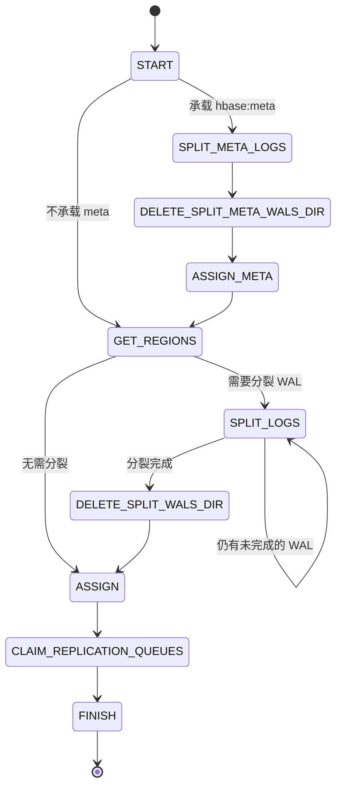
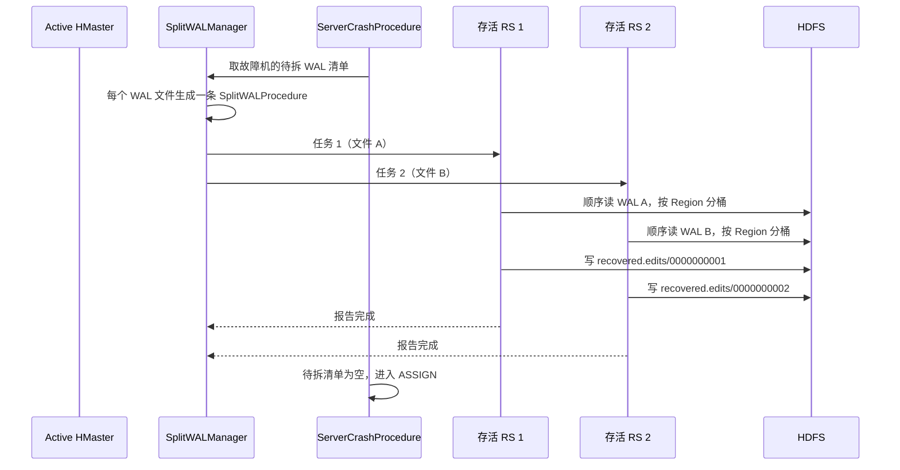
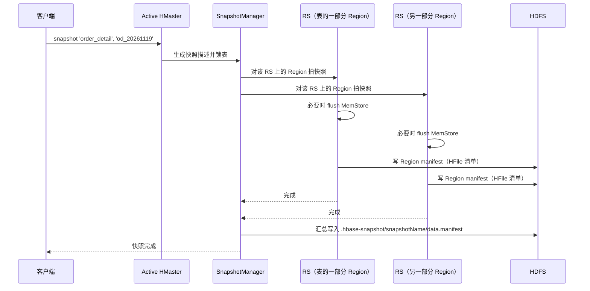
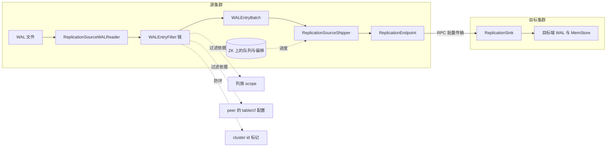
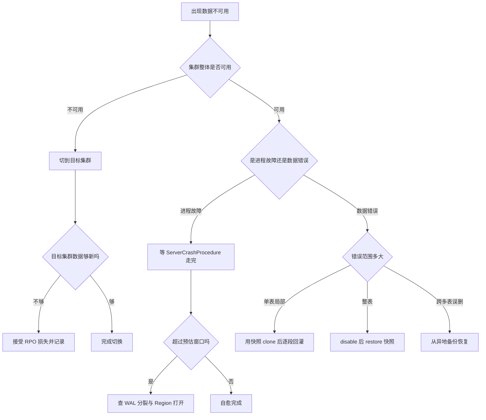

# HBase 高可用与容灾——崩溃恢复、备份与复制

**摘要：**

"HBase 高可用"这句话在运维会上经常被当成一件事讨论，实际上它是三件事，而且三件事的解法彼此不能替代。进程死了，靠的是 WAL 分裂加 Region 重分配，把一台机器上的 MemStore 从日志里重放出来，数据一条不丢，代价是几分钟的不可用；数据被写错或删错，靠的是快照与备份，把表回滚到某个时间点，代价是这段窗口里的新数据要一起放弃；整个机房没了，靠的是复制与异地导出，让另一份数据在别处活着，代价是常态化的带宽与一致性让步。本篇按这三层组织：先拆开 `ServerCrashProcedure` 的状态机、WAL 分裂的内部结构与恢复时间的四项构成，再讲快照为什么"只记文件名"却能占住空间、`clone`/`restore`/`export` 各自解决什么问题、`hbase backup` 为何不在 2.5 里，然后讲复制以 WALEdit 为单位传播时的 at-least-once 语义与队列积压判据，最后给出故障类型 × RTO × RPO × 成本的三层判据表、六个故障形态的定位方法与三个常见反例。读完之后应当能回答两个问题：只做 RegionServer 高可用为什么不够，以及快照为什么不能当备份用。

---

## 第 1 章 一次停机，三种解法

### 1.1 凌晨那条"RS 不在线"

凌晨两点四十七分，值班手机弹出一条告警：某台 RegionServer 进程退出，`zookeeper.session.timeout` 到点后临时节点消失，业务错误码从 `NotServingRegionException` 变成重试超时。四点出头最后一次 `assign` 完成，读写恢复；整个过程两个多小时，其中真正的恢复只有几分钟，剩下的是值班同学在"要不要手工干预"上反复犹豫。

三周之后，同一个集群又出了一次事，这次没有任何进程退出，所有指标都正常，只是某张订单表的某一天数据被一条写错的清理脚本删掉了。第二天早上发现时，HDFS 上的三副本忠实地保存着"被删掉"这个事实，进程级高可用对此无能为力。再往后是一次跨机房演练，报告上的数字是 RPO 十一分钟——因为复制链路在那天下午就已经开始积压。

三次故障，同一张表，三种解法。把它们混成一件事去谈"高可用"，就会在第二次、第三次故障里重复犯错。

### 1.2 三层的失败对象不同

分层的依据不是"影响面大小"，而是失败对象的性质。进程级故障里坏掉的是"执行者"，数据本身没问题，日志和 HFile 都还在 HDFS 上，解法是换一个执行者、把内存里的部分重放出来，恢复之后数据一条不少。数据级故障里坏掉的是"内容"，执行者一直健康、副本一直完整，但完整地记录了一个错误状态，解法必须依赖一份"故障发生之前"的拷贝，把时间倒回去。集群级故障里坏掉的是"整个环境"，进程、数据、元数据、ZooKeeper 一起没了，解法只能是"另一份数据在另一个地方活着"，新旧程度由复制延迟决定。

笔者习惯用一辆车的三重保险打比方：安全带对应进程级，不防事故，只保证事故之后人还在、能重新上路；行车记录仪加定期拍照对应数据级，出了事故可以复盘到事故发生前的某一帧；异地备用车对应集群级，车库塌了还有一辆能开。

这个比方有一个限定要提前说清：HBase 的三层并不像三份独立采购的保险那样彼此无关，它们共享同一套底层机制（WAL、HFile、HDFS），也共享同一批故障模式。快照占住的空间会拖慢 Compaction，复制积压会占用 RegionServer 的缓冲，而进程级的高可用本身又依赖 ZooKeeper 与 HDFS 的健康。分层的价值在于把"该由哪一层负责"问清楚，而不是宣称某一层能兜住全部。

### 1.3 时间与数据量的两把尺子

衡量容灾方案的两个基本量，一个是恢复时间目标（Recovery Time Objective，RTO），指从故障发生到服务恢复所能容忍的时长；另一个是恢复点目标（Recovery Point Objective，RPO），指恢复之后最多允许丢掉多长时间内的数据。这两把尺子必须成对使用，因为绝大多数方案都是"用 RPO 换 RTO"或者反过来。

进程级方案的性质是 RTO 非零、**RPO 等于零**。WAL 在返回客户端成功之前就已经同步到 HDFS，所以只要 HDFS 还在，已经确认的写入一条都不会丢，代价是这段时间里 Region 不可读写。数据级方案的性质是 RTO 与数据量成正比、RPO 等于备份间隔。用快照回滚一张 2TB 的表，本质上要把快照引用的 HFile 重新挂回表目录并做一次全量校验，时间以小时计；而它能恢复到的最近时点，取决于上一份快照或备份是什么时候做的。集群级方案的性质是 RTO 取决于切换流程、RPO 取决于复制延迟，两者都由"另一份数据"的新鲜程度决定，而新鲜程度又直接对应常态化的网络与计算成本。

三层放在一起，就有了下面这张对照。表中"主要手段"一列只写主干机制，细节留在后面三章。

| 层级 | 失败对象 | 数据是否会丢 | RTO 量级 | RPO 量级 | 主要手段 | 常态成本 |
| :--- | :--- | :--- | :--- | :--- | :--- | :--- |
| 进程级 | 一台 RegionServer 的执行能力 | 不会丢，未刷盘部分从 WAL 重放 | 分钟级 | 零 | `ServerCrashProcedure`、WAL 分裂、Region 重分配 | 无额外存储，只需冗余机器 |
| 数据级 | 表里的内容被写错、删错、损坏 | 会丢，丢到最近一次备份之后 | 小时级 | 备份间隔 | snapshot、`ExportSnapshot`、备份系统 | 快照保留的旧 HFile 占空间 |
| 集群级 | 整个集群（机房、供电、网络） | 会丢，丢到复制延迟之前 | 十分钟到小时级 | 秒到分钟 | Replication、异地导出 | 常态化带宽与目标集群资源 |

请注意"数据是否会丢"一列的口径：进程级写"不会丢"，前提是 HDFS 健康且 WAL 已 sync；若故障同时波及 HDFS，或写入用的是不落盘的持久性等级，这个"不会丢"就不成立，那属于另外两层的责任。

### 1.4 本篇的边界与版本口径

本篇讨论的是 HBase 2.x（以 2.5 的代码与默认值为准）里"出问题之后怎么恢复、怎么判断"这一层。概述性的材料回答"HBase 是什么、适合什么场景"，这一列要回答的是每个机制在代码里怎么落地、参数调大调小各自付出什么代价、线上出现什么现象可以判定是它出的问题。两者的区别不是深浅，而是问题类型。

有几处边界先划清。HMaster 与 ZooKeeper 的失败形态、`hbase:meta` 两级寻址、AMv2 的状态机与 procedure 框架，判据在 [[03 HBase 整体架构——Master、RegionServer 与 ZooKeeper 的三角协作|整体架构一篇]] 里拆过，本篇只在"恢复链路"这个视角上引用结论。WAL 的物理结构、`WALKey` 与 `WALEdit` 的字段、滚动条件与 sync 语义，见 [[05 HBase 写入链路深度解析——WAL、MemStore Flush 与持久性保证|写入链路一篇]]，本篇只关心"分裂时怎么用它"。Compaction 与 HFile 的引用关系、`archive` 目录的生命周期，见 [[07 HBase Compaction 机制深度解析——Minor、Major 与写放大的三角关系|Compaction 一篇]]，本篇只用到它的结论：旧文件不会立刻被删，而是先进归档区再由清理器裁决。

版本口径上有三处变化必须提前标注，它们直接决定判断对不对。第一，1.x 的"分布式日志重放"（Distributed Log Replay，DLR）相关配置 `hbase.master.distributed.log.replay`、`hbase.regionserver.disallow.writes.when.recovering`、`hbase.regionserver.wal.logreplay.batch.size` 在 2.0 随该特性一起移除，2.x 的等价能力分散在"并行 WAL 分裂"与"Region 打开时各自重放"两处，没有总开关。第二，WAL 分裂的协调方式在 2.x 有两条路径，默认走 procedure 分发而不是 ZooKeeper 分发，`hbase.split.wal.zk.coordinated` 默认 `false`。第三，`hbase backup` 相关模块在整个 2.0 到 2.5 的发行版里都不存在，2.6 才回到代码库，第 3 章会展开。

---

## 第 2 章 进程级：一台 RegionServer 死了以后

### 2.1 检测只是第一段，不是恢复

RegionServer 存活性的判定链路本身很短：每个 RS 启动时在 ZooKeeper 的 `/hbase/rs/` 下创建临时节点，节点名形如 `host,16020,<startcode>`，之后靠会话保活维持这个节点；会话一旦过期，临时节点被删除，Active Master 在 `/hbase/rs/` 上收到节点删除事件，日志里出现 `Processing expiration of <serverName>` 一类的记录。

这条链路的耗时下界由 `zookeeper.session.timeout` 决定，2.5 的默认值是 90000 毫秒。RS 侧的处理不是"重新注册"而是主动终止：ZK 客户端收到 `Expired` 事件后，`HRegionServer` 走 abort 路径，宁可自己死掉，也不带着失效的集群身份继续服务客户端。之所以做得这么绝，是因为一个无法在 ZK 上保活的 RS 已经无法确认自己对某个 Region 是否还有独占权，继续接请求就是在赌。失败形态与三档风险（进程崩溃、机器断电、网络隔离）在架构一篇里已经拆过，这里只取一个结论：从集群视角看，这三种故障最终都被折叠成同一件事——这台机器上的所有 Region 被置为 `UNASSIGNED`，等待重新安放。

所以"恢复时间"这个词有两个起点，混用就会得出错误结论。业务感知的不可用窗口从故障发生算起，等于"**检测时间 + 恢复时间**"；而所有优化手段压的都是后半段——调 `zookeeper.session.timeout` 只能动前面那 90 秒，动不了后面那几分钟。这个区分在第 2.7 节的判据里会反复用到。

### 2.2 ServerCrashProcedure：把一台机器的善后做成状态机

1.x 的故障处理是一串散落在 Master 内部的异步动作：先分 meta，再分用户 Region，WAL 分裂由另一套 `SplitLogManager` 异步推进，彼此之间没有统一的进度视图，Master 一重启就得靠扫描状态重新拼。2.x 把这些动作收进了一条 procedure，叫 `ServerCrashProcedure`，它的输入只有一个 `ServerName`，输出是"这台机器上的 Region 全部有了新归属、它的复制队列全部被接管、它的 WAL 目录被清理"。

这条 procedure 的状态序列如下（以 2.5 的 `ServerCrashState` 为准）：从 `SERVER_CRASH_START` 开始，先判断故障机是否承载 `hbase:meta`，如果承载则走 `SPLIT_META_LOGS` → `DELETE_SPLIT_META_WALS_DIR` → `ASSIGN_META` 这条优先支路，**meta 必须先活过来**，否则整张路由表失效、所有 Region 都无从定位；随后进入 `GET_REGIONS` 拿到故障机上的 Region 清单，再进 `SPLIT_LOGS` 把普通 Region 的 WAL 拆开，等分裂全部完成后 `DELETE_SPLIT_WALS_DIR` 清理目录，接着 `ASSIGN` 触发重分配，最后 `CLAIM_REPLICATION_QUEUES` 接管这台机器原来的复制队列，收尾在 `SERVER_CRASH_FINISH`。另有一个细节能说明这套状态机的演进方式：`HANDLE_RIT2` 在 2.5 的枚举里仍留着，但已经是空转——HBASE-20634 之后第二次 handleRIT 不再必要，保留它只是为了兼容旧版本已持久化的 procedure 记录。

这张图有三处值得单独看一眼。其一，meta 的处理被放在最前面，而且用的是单独一轮分裂加单独一次分配，这不是代码组织的偶然，而是依赖顺序的必然：`hbase:meta` 决定每个 Region 在哪台机器上，meta 不可用时即便用户 Region 已经打开，客户端也定位不到。其二，`SPLIT_LOGS` 是一个可重入的自循环状态，每次检查发现还有 WAL 没拆完就回到自身，直到待拆清单为空；这意味着 WAL 分裂是整条 procedure 里唯一"可能长时间停留"的阶段，其余阶段都是秒级跳转。其三，procedure 是持久化的状态机，Master 中途换了或自己重启，新的 Active Master 会从 procedure store 里读出来继续跑，不需要人工重放。

这里还要纠一个在 1.x 语境下流传很广的说法：WAL 分裂由 ZooKeeper 上的任务节点分发。2.x 确实保留了那条路径（`SplitLogManager` 加各 RS 上的 `SplitLogWorker`，参数是 `hbase.splitlog.manager.unassigned.timeout` 默认 3 分钟、`hbase.splitlog.max.resubmit`、`hbase.splitlog.zk.retries`），但默认已经不走它：`hbase.split.wal.zk.coordinated` 的默认值是 `false`，也就是由 Master 侧的 `SplitWALManager` 把 WAL 文件切成任务，用 `SplitWALProcedure` 逐个领取，再由 `SplitWALRemoteProcedure` 下发到不同的存活 RegionServer 上执行。两条路径的差别不只是实现位置，更在可观测性：procedure 路径能在 Master 的 procedure 列表里看到每个文件的排队与执行状态，ZK 路径只能去翻 znodes。

### 2.3 WAL 分裂：为什么非拆不可

一个 RegionServer 上的所有普通 Region 共享同一组 WAL 文件，这是顺序 I/O 的代价换来的设计。每条 WAL 记录由 `WALKey` 与 `WALEdit` 组成，`WALKey` 里带着 `encodedRegionName` 与 `logSeqNum`，也就是说"这条写入属于谁"这个信息是逐条携带的，而文件本身是按时间顺序摊开的混合体。故障之后，这些 Region 会被分给不同的机器，可能落在同一台上，也可能落在十台上；每台机器打开自己接手的 Region 时，只应该看到属于自己的那些日志。

于是分裂要做的事情就确定了：顺序读一遍故障机的 WAL 文件，**按 `encodedRegionName` 分桶**，把每个桶里的记录按 `logSeqNum` 顺序写到该 Region 目录下的 `recovered.edits` 子目录里，文件名用序号命名。写成文件而不是直接把条目发给某个 RS，有两个原因：一是接管者尚未确定，分裂的时候还不知道哪个 Region 会被分到哪台机器；二是重放必须在打开 Region 的路径上做，因为只有那里才知道这个 Region 的 HFile 已经覆盖到哪个序号，才能决定哪些条目是多余的。

分裂的并行度来自两处：文件级的并行（多个 WAL 文件被分给多台 RS 同时处理），以及单文件内部的并行（`WALSplitter` 用写线程池把桶写出去，由 `hbase.regionserver.hlog.splitlog.writer.threads` 控制）。真正的瓶颈通常不在 CPU 而在 HDFS 的读带宽与 NameNode 的元数据压力：一次分裂要顺序读故障机写入的全部 WAL 字节，读的字节数正比于"故障发生前这台机器上累计的、尚未被 HFile 覆盖的写入量"。

### 2.4 WALSplitter 内部的四个旋钮

`WALSplitter` 的实现细节决定了"分裂到底慢在哪"，其中四个旋钮最值得记住，因为它们各自对应一种不同的代价。

| 配置 | 2.5 默认值 | 作用 | 调大的代价 | 调小的代价 |
| :--- | :--- | :--- | :--- | :--- |
| `hbase.regionserver.hlog.splitlog.writer.threads` | 3 | 单文件内并发写 `recovered.edits` 的线程数 | 打开的文件句柄增多，NameNode 压力上升，争夺 HDFS 写带宽 | 单文件成为串行瓶颈，分裂尾部长 |
| `hbase.regionserver.hlog.splitlog.buffersize` | 128MB | 分裂时的读缓冲，单次读入的字节上限 | 单台 RS 的内存与 GC 压力变大 | 读放大的次数变多，HDFS 上的小 I/O 增加 |
| `hbase.hlog.split.skip.errors` | false | 遇到坏 WAL 文件时是否跳过 | 跳过意味着那条日志里的数据永久丢失，而流程可以继续 | 不跳过意味着无限重试，分裂可能永久卡住 |
| `hbase.wal.split.to.hfile` | false | 分裂时直接把条目写成 HFile，而不是 `recovered.edits` | 分裂阶段变重，且绕过了打开 Region 时的序号过滤，可能写出冗余数据 | 保持两段式，分裂快但后续 opening 阶段有额外重放与 flush |

第三行是两个坏选择之间的取舍，也是最容易被误读的一个参数。默认值 `false` 的含义是"**遇到坏文件不跳过**、反复重试"，立场很清楚：宁可卡住等人来处理，也不要静默丢数据。线上真遇到"某个 WAL 文件因为 HDFS 块损坏或写入截断而拆不动"时，第一反应不该是改这个参数，而应先确认那条 WAL 里是否还有尚未落盘的数据——如果故障前该 Region 已经全部 flush，这个文件里的条目都是多余的，跳过是安全的；如果还有未落盘的数据，跳过就等同于选择丢弃。

第四行的 `hbase.wal.split.to.hfile` 是 2.x 后期引入的优化，思路是把"先写 recovered.edits、再让打开者读一遍写进 HFile"压缩成一次写。它省掉一次读，代价是分裂阶段必须知道每个 Region 当前 HFile 的序号上界才能正确去重，而那个上界在分裂时并不总是完整可得，所以它默认关闭。

还有一个容易被忽略的过滤逻辑：分裂在读每条记录时会先查该 Region 的"最后已刷盘序号"（last flushed sequence id），序号小于等于它的条目直接被丢弃。这条过滤把"WAL 里有很多早已落盘的重复写入"这个现实问题挡在了分裂阶段，效果是 `recovered.edits` 的体积远小于 WAL 的原始体积。理解这一点，才能解释为什么"WAL 有 8GB"不等于"要重放 8GB"——真正要重放的是那些还没来得及 flush 的尾部。

### 2.5 打开 Region 时的重放

分裂产物落在 `hbase:meta` 记录的表目录下，形如 `/hbase/data/<namespace>/<table>/<encoded_region>/recovered.edits/`，文件名取自这批条目里最小的那条序号（同一个 Region 若有多个 WAL 文件都含未落盘数据，会出现多个文件，读时按序号排序合并）。接管者打开 Region 时按序号排序遍历，只重放序号大于该 Region 所有 HFile 已覆盖上界的条目，把它们当作普通写入灌进 MemStore，随后触发一次 flush 落成新的 HFile，最后删掉整个 `recovered.edits` 目录。

这条路径的幂等性由两件事保证。一是序号：同一份 edits 重复重放时，第二次的序号已经不再大于 HFile 的上界，整份文件被跳过。二是 MVCC 与时间戳：Cell 的版本号来自写入时刻，重放不改变它，重复应用只是把同一个版本再写一遍。这两条合起来回答了"恢复做到一半又崩了怎么办"——重新来一遍即可，不会叠加、不会错乱。

打开失败的处理在 `AssignRegionHandler` 里，日志关键字是 `Failed to open region <region>, will report to master`，Master 侧随后重试分配，重试仍失败则升级为 `Failed to open region ... and can not recover`。这个关键字对应第 6 章六个故障形态中的最后一个。

Region 打开有两个放大器，它们在第 2.6 节会直接进入时间公式。第一，单个 Region 的打开时间与它名下的 HFile 个数正相关，因为要逐个读索引块与 Bloom 过滤器并构建 reader，而 HFile 个数由 Compaction 的健康程度决定。第二，打开动作有并发上限，`hbase.regionserver.handler.count`（默认 30）决定 RS 同时处理多少操作，恢复期间它会被"大量 Region 同时要打开"和"正常业务请求"一起挤占。

### 2.6 恢复时间拆解

把上面几节合起来，一次 RS 崩溃之后业务感知的不可用窗口可以拆成四段，每段的决定因素完全不同。

| 阶段 | 耗时量级 | 主要决定因素 | 主要手段 |
| :--- | :--- | :--- | :--- |
| 检测（ZK 会话过期） | 约 `zookeeper.session.timeout` | 会话超时配置、ZK tick 调度 | 调小超时（换来误判风险） |
| procedure 调度与 meta 恢复 | 秒级 | Master 的 procedure 线程数、meta 所在机器状态 | 保证 `hbase.master.procedure.threads` 充足 |
| WAL 分裂 | 十几秒到几分钟 | WAL 总字节数、参与并行的 RS 数、HDFS 读带宽 | 提高分裂并行度、控制 WAL 体量 |
| Region 打开与重放 | 几十秒到几分钟 | Region 数、单 Region 的 HFile 数、未刷数据量 | 控制 Region 数量与大小、保证 Compaction |

下面的数字是按上表做的示例推算，不是某个集群的实测值，用途只是说明"哪一段值得优化"。设定：故障机承载 300 个 Region，故障前该机的 WAL 总量 6GB，其中尚未落盘（序号高于各 Region 已刷上界）的部分约 1.5GB，集群还有 20 台存活 RS。

检测段固定为 90 秒。procedure 调度与 meta 处理，按秒级计，取 5 秒。分裂段取决于并行度：假设 8 台 RS 各领到一部分文件、每台的有效读速率约 40MB/s，6GB 需要 6×1024÷(8×40)≈19 秒，再加上每个文件打开与收尾的固定开销，按 40 秒估。打开段：300 个 Region 摊到 20 台 RS，每台 15 个，单个打开按 1 到 3 秒计，每台 15 到 45 秒，取 30 秒；那 1.5GB 待重放数据被打散到各 Region，按本地写 HFile 的速率再算几十秒。四段相加，业务感知的不可用窗口在 3.5 到 5 分钟之间。

这个推算该看的是各段占比：**检测占了四成**且完全不由数据量决定，分裂与打开占一半以上且几乎全部由"这台机器上压了多少东西"决定。讨论"故障恢复慢"而不区分这两类原因，就得不出可执行的结论。

### 2.7 为什么恢复可能很久：三条判据

第一条判据是 Region 数与 WAL 体量的乘积。分裂的字节量取决于 WAL 总量，打开的时间取决于 Region 数，**两者相乘决定下限**。譬如一台机器上放 300 个平均 200GB 的 Region，与放 100 个平均 600GB 的 Region，分裂字节量可能相当，不过前者的打开阶段长得多，因为打开是"每个 Region 一次"的固定成本叠加。判断办法很直接：看故障机的 Region 数与 `WALs/<serverName>/` 目录的总大小，两个数字都在高位就不要期待分钟级恢复。

第二条判据是 WAL 文件的个数与单个文件的大小。滚动由 `hbase.regionserver.logroll.period`（默认 3600000 毫秒）与 `hbase.regionserver.maxlogs`（默认 32）共同约束，效果是"一小时一滚、最多留 32 个文件"。文件太少太大，单文件分裂成为串行瓶颈；文件太多太小，每个文件的打开与收尾开销叠加，NameNode 上的元数据操作也变多。这条判据在"分裂卡住"时尤其有用：如果 procedure 里同一个文件长时间停在 `SPLIT_LOGS`，问题不在并行度，而在那个文件本身——要么特别大，要么读不动。

第三条判据是故障前的 flush 状况。如果 Compaction 长期跟不上、HFile 数量膨胀，"最后已刷盘序号"就推进得慢，需要重放的尾巴变长，`recovered.edits` 也大；反过来，flush 节奏正常、Region 大小适中的集群，重放段往往只占整个窗口的一小部分。这条判据把"恢复慢"与"Compaction 有病"两个看似无关的现象连了起来，也是 [[10 HBase 生产调优实战——从诊断到落地的系统方法论|调优一篇]] 那条主线的一个侧面。

对应的优化手段按段对应：检测段只能动 `zookeeper.session.timeout`，但从 90 秒调到 30 秒意味着 GC 停顿超过 30 秒的 RS 会被误判为死亡，误判的代价是一次不必要的 WAL 分裂。分裂段能动并行度、`hbase.regionserver.hlog.splitlog.writer.threads`，以及根本性的"少攒 WAL"。打开段能动 Region 数量与大小、`hbase.regionserver.handler.count`，以及保证 Compaction 不积压。至于 1.x 那个"分布式日志重放"开关，2.x 里已经没有对应旋钮。

### 2.8 三个反例

第一个反例是把 `zookeeper.session.timeout` 当成恢复时间的总开关。调小它只让告警来得更早，不动分裂、打开与重放，还会把 GC 停顿误判成宕机，制造出本不需要的分裂；判断这类改动是否值得，要拿"误判率"和"检测时间"两个数一起算。

第二个反例是以为 WAL 分裂由 Master 单点完成。这是 1.x 早期的认知，2.x 的分裂默认由各 RS 并行执行、Master 只做编排；分裂慢时该看 RS 负载与 HDFS 带宽，而不是给 Master 加内存。

第三个反例是以为"重放会重放整个 WAL"。分裂阶段按已刷盘序号过滤，重放阶段再按 HFile 上界过滤，两层之后真正被应用的条目通常远少于 WAL 体积；把 WAL 体积直接当成要重放的数据量，会在容量与时间评估上系统性高估。

---

## 第 3 章 数据级：快照、导出与"备份"这个词的歧义

### 3.1 三副本为什么不等于备份

HDFS 的三副本解决的是"某个数据块所在的磁盘或机器坏了"这一类问题：块丢失之后，NameNode 会从其他副本重新复制一份，最终状态与故障前完全相同。它的前提是被保护的"内容"本身没有变化——副本机制只能保证"同样的内容存在三份"，不能判断这三份内容是否正确。

数据级故障恰恰破坏了这个前提。譬如一条写错的清理脚本把某天的数据删掉，HBase 会在三份副本上一致地执行删除；一次误执行的 `drop` 把表连同目录一起移除，三副本同样一致地消失。这类故障的共同点是"故障发生在应用层，存储层全程健康"，副本数再多也没用，唯一可行的路径是回到一份故障发生之前的拷贝。于是数据级方案的第一个判据就清楚了：它是否保存了"过去某一时刻"的完整状态，以及这份状态是否与当前集群在故障域上分离。快照满足前半句，后半句要看它放在哪里，这是第 3.6 节的主题。

### 3.2 快照只记录了一份文件清单

HFile 一旦写成就不再修改，Compaction 的做法是"读旧文件、写新文件、丢掉旧文件"，而不是原地更新。这个不可变性让"拍摄某一时刻的表状态"可以退化成一件很轻的事：只要记下这一刻每个 Region 的每个 Store 目录下有哪些 HFile，就足以在将来把表还原成那一刻的样子，数据块一个字节都不用搬。

实现上分为两个角色。Master 侧由 `SnapshotManager` 与 `TakeSnapshotHandler` 驱动，前者负责把快照请求落到 HDFS、后者负责按表分派；RegionServer 侧对每个 Region 执行"准备快照描述、必要时 flush、把该 Region 的 StoreFile 清单写进一份 manifest"。所有 Region 的 manifest 汇总成快照的 `data.manifest`，与表描述符一起放在根目录下的 `.hbase-snapshot/<snapshotName>/` 里。整个过程中真正被写入 HDFS 的只有**这些 KB 级的元数据文件**。两个超时参数值得记住：`hbase.snapshot.region.timeout` 与 `hbase.snapshot.master.timeout.millis` 默认都是 300000 毫秒，前者限定单个 Region 拍快照的等待时间，后者限定 Master 侧的整体等待；Region 多、MemStore 大时容易撞上它们。

这张图里有两处细节决定了快照的性质。第一处是"必要时 flush"：默认行为是先 flush 再拍，把内存里的数据也包含进快照，代价是每个 Region 一次 flush，快照的耗时与 Region 的数量和 MemStore 的体量相关；如果业务能接受"内存中的数据可能不在快照里"，可以加 `SKIP_FLUSH => true`，快照会变成近乎纯粹的元数据操作，但语义上就不再是"这一刻的完整表"。

第二处是"逐 Region 分派"，它决定了快照不是瞬时的。客户端发出命令之后，Master 要把请求逐台送到承载该表的 RS，每台再逐个处理自己名下的 Region，这个过程从几秒到一分钟不等，取决于集群规模与当时负载。所以快照描述的是一个"窗口"而不是一个"点"：在窗口期内并发写入的数据，有可能进入快照，也有可能不进入，而且无法预知。把快照当成"某一毫秒的数据库锁一致视图"，是对它最典型的误读，排在第二位的误读是"快照会立刻占双倍空间"（见第 3.3 节）。

### 3.3 空间是怎么被占住的

Compaction 丢掉旧 HFile 的动作不是 `delete`，而是把文件移到根目录下的归档区 `archive/`，再由 Master 上的清理器（`CleanerChore` 及其清理插件）决定何时真正删除。这个中间层原本是为了不打断正在读旧文件的请求，却同时成了快照体系能够成立的支点。

`SnapshotManager` 启动时会把 `SnapshotHFileCleaner` 加进清理器的插件列表。清理器每次扫描归档区，都把候选文件交给各插件投票，`SnapshotHFileCleaner` 的逻辑是：查一遍所有已完成与进行中的快照，凡仍被任何快照引用的 HFile 一律投反对票。查清单要读 HDFS、代价不低，所以它内部维护一份带刷新周期的缓存，周期由 `hbase.master.hfilecleaner.plugins.snapshot.period` 控制，默认 300000 毫秒。

空间的账于是能算清：快照创建时几乎不占空间；此后每一次 Compaction，被替换下来的旧 HFile 进入归档区，只要还在某个快照的清单里就**一直留着**；新数据落在新 HFile 里正常占用。快照的"额外"占用等于从创建到当下被 Compaction 替换掉的旧文件总量——写得多、Compaction 频繁、保留得久，三者相乘就是账单。删掉快照之后引用消失，下一轮清理才把文件真正删除。

> [!note] 一处常见的术语错误
> 很多资料把快照描述成"给 HFile 建硬链接"，这个说法有两处不对。其一，HDFS 不支持硬链接，没有 POSIX 那样多目录项指向同一 inode 的机制；其二，快照创建时根本没有创建任何链接文件，只写了 manifest。HBase 里真正叫 link 的是 `HFileLink`，一种内容为"指向某个归档文件的相对路径"的普通小文件，它在 clone、restore 这类"用快照造新表"的操作里才被创建，用来让新表的 Store 目录引用归档区的旧 HFile。在 `archive/.links` 下看到的小文件来自 clone 出来的表，与"快照创建"是两个阶段。

### 3.4 clone、restore 与 export 的分工

三种用法都建立在同一份 manifest 上，语义差别很大，选错会把恢复时间放大一个数量级。

| 操作 | 语义 | 是否复制数据 | 目标表可写 | 前提条件 | 耗时量级 |
| :--- | :--- | :--- | :--- | :--- | :--- |
| `snapshot` | 记录当前状态 | 否，只写元数据 | 原表不受影响 | 表可以是 enable 状态 | 秒到分钟 |
| `clone_snapshot` | 用快照造一张新表 | 否，靠 HFileLink 引用归档文件 | 是，写入产生新文件 | 目标表名不存在 | 秒到分钟 |
| `restore_snapshot` | 把原表回滚到快照点 | 否，重挂文件引用 | 是，回滚后继续可写 | 表必须先 disable | 分钟到小时 |
| `ExportSnapshot` | 把快照搬到另一个集群 | 是，真实复制 HFile | 目标集群内可再 clone | 目标集群可达且版本兼容 | 与数据量成正比 |

`clone` 与 `restore` 的关键差别在"原来的那份数据还留不留"。clone 是加法：原表继续跑，新表引用归档区的旧文件，两边写入互不影响，适合灰度对比、事故取证、从历史状态拉表做分析。restore 是替换：表内容整体换成快照点的内容，之后的写入全部作废，适合"误删之后回滚"，但必须先 `disable`，回滚期间这张表完全不可用。

restore 还有一道保险：`hbase.snapshot.restore.take.failsafe.snapshot` 默认 `true`，即动手回滚之前先给当前状态拍一张快照，名字形如 `hbase-failsafe-<快照名>-<时间戳>`。这道保险的意思是"回滚本身也可能是个错误决定"，留一条退路，代价是多花一次快照的时间并多占一份空间。

`ExportSnapshot` 是四个里唯一真正搬数据的：它跑一个 MapReduce 作业，把快照引用的 HFile 从源集群归档区复制到目标集群对应目录，常用参数是 `-mappers`、`-bandwidth`（每 mapper 限速）、`-chuser`。因为它是"读源集群、写目标集群"，所以同时受两端带宽约束，也所以它是跨机房容灾里唯一能把数据真正搬离故障域的动作。

### 3.5 hbase backup 的机制，以及它为什么不在 2.5 里

社区曾经在 `hbase-backup` 模块里做过一套完整的备份系统（HBASE-7912），设计思路很清晰，即便现在用不上也值得理解，因为自己搭备份系统时绕不开同样的几个决定。

全量备份是"快照加导出"：对每张表拍临时快照，用与 `ExportSnapshot` 相同的通路把快照引用的文件复制到备份根目录，再删掉临时快照。增量备份不复制表数据，而是把上次备份以来的 WAL 收集起来，用 MapReduce 作业（`WALPlayer`）把 WAL 条目按表转成 HFile 再复制过去；恢复时先铺全量、再按顺序叠增量，从而恢复到任意增量点。备份元数据（备份 id、表清单、时间点、阶段状态）存在 HBase 自己的系统表里，`hbase backup create/describe/history/delete` 操作的就是这套元数据。

问题出在工程成熟度上。这套东西在 2.0 发布前被判定为不够稳定，HBASE-19407 把它从 branch-2 整体移除，所以 2.0 到 2.5 的发行版里既没有 `hbase backup` 命令，也没有 `hbase-backup` 模块，它到 2.6 才回到代码库。后果很实际：按 2.6 之后的文档在 2.5 集群上配备份，第一步就卡在"命令不存在"。

在 2.5 上做等价的事，合理组合是"快照 + `ExportSnapshot` + 自建增量"：全量按天拍快照并导出到备份集群或对象存储，增量走业务侧双写、订阅变更日志，或借用复制链路持续送到一个专用备份集群再拍快照。前者 RPO 由业务侧决定，后者由复制延迟决定，后者更省事，但把复制当成了备份，边界见第 4.5 节。

### 3.6 快照为什么不能替代备份：一条判据

判断一份数据够不够格叫"备份"，只需要问一句：它与被保护对象**是否在同一个故障域里**。

快照存放在同一个 HBase 根目录下（`.hbase-snapshot/`），引用的 HFile 在同一个 HDFS 归档区里，依赖的 `hbase:meta`、ZooKeeper、NameNode 也全是同一套。这意味着它能扛住的故障只有一类：数据在逻辑上被改错、被删错，而集群本身还活着。一旦故障上升到"整个 HDFS 不可用"或者"机房断电"，快照和被它保护的数据一起消失——它与数据的相关性太高，不足以算作独立的一份。

按这个判据去排，各种手段的"备份资格"是这样的：同集群快照不合格；`ExportSnapshot` 到同机房的另一套 HDFS 能扛单集群故障，扛不住机房级故障；`ExportSnapshot` 到异地或对象存储才算真正意义的备份；Replication 到另一个机房提供的是"可用的另一份数据"而不是"某个历史时点的拷贝"，它扛得住机房故障，扛不住逻辑错误（错误会同步过去）。四种能力互补，把其中一个当成全部，就是第 6 章要讲的第一个反例。

### 3.7 两个反例

第一个反例是把快照当备份：`list_snapshots` 列出的快照全在同一个根目录、同一套 HDFS 里，它在"集群还在"时非常有用，在"集群没了"时等于不存在。

第二个反例是在"快照占空间"这件事上走两个极端。一端是以为快照一创建就翻倍占空间，于是不敢用；另一端是以为快照不占空间，于是每小时拍一张、保留三个月。真实情况介于两者之间：创建瞬间几乎为零，此后随 Compaction 与写入量线性增长，增长的部分是"本来该被回收但被引用住"的旧文件。可操作的做法是把"快照额外占用"当成一个需要监控的指标，与集群剩余容量一起看，再按"能接受回滚到多久以前"确定保留窗口——一般业务按天保留七天左右，重要表可以按小时保留一天、按天保留一个月，分档保留比"全都留着"省得多。

---

## 第 4 章 集群级：Replication 复制的边界

### 4.1 复制的单位是一条 WALEdit

跨集群复制没有复用快照那套文件引用机制，它走另一条路：把源集群的 WAL 记录（`Entry`，即 `WALKey` 加 `WALEdit`）按顺序读出来，通过网络送到目标集群，在那里当作本地写入重新应用。目标集群收到的是**操作而非文件**，目标端的 Region 像处理客户端请求一样处理它们，写自己的 WAL 与 MemStore，最终形成自己的 HFile。

这个选择带来两个直接后果。好的一面是目标端布局可以完全不同——Region 边界、HFile 组织、甚至表结构在兼容范围内有差异都能工作。不好的一面是吞吐与延迟受"源端读 WAL、网络传输、目标端重新写入"三段串联约束，跨机房时网络往返与目标端写入放大都会体现在延迟上。

参与复制的组件构成一条单向管道：源端每台 RS 上有 `ReplicationSource`，由 `ReplicationSourceManager` 统一管理，内部按 WAL 文件组织队列，由 `ReplicationSourceWALReader` 逐条读 WAL、按过滤条件筛选、攒成 `WALEntryBatch`（单批上限受 `replication.source.size.capacity` 的 64MB 与 `replication.source.nb.capacity` 的 25000 条约束），再由 `ReplicationSourceShipper` 交给复制端点（`ReplicationEndpoint`，跨集群的默认实现是 `HBaseInterClusterReplicationEndpoint`）。目标端由 `ReplicationSink` 接收并批量应用。队列进度写在 ZooKeeper 节点上而不是内存里，所以源端 RS 崩了之后接管者能把队列接过去接着发。

图中的过滤链不是可选项，而是一串必须按顺序执行的判断：`ScopeWALEntryFilter` 负责按列族的 `REPLICATION_SCOPE` 过滤，`NamespaceTableCfWALEntryFilter` 负责按 peer 上配置的表与列族白名单过滤，`ClusterMarkingEntryFilter` 负责给通过的条目打上本集群的 id、并在发现目标集群 id 已在标记里时丢弃，`SystemTableWALEntryFilter` 负责把不该复制的系统表编辑拦下。多集群环形拓扑下防重复扩散靠的就是第三个过滤器，这与邮件系统里的"已收件人列表"是同一个思路。

### 4.2 粒度：peer、表、列族、scope

复制的开关不是全局布尔量，而是三层配置的合取。第一层是 peer（代码里是 `ReplicationPeer` 与 `ReplicationPeerConfig`），即"往哪个集群复制"，用 `add_peer` 建立，`CLUSTER_KEY` 写目标集群的 ZK 地址，peer 禁用后队列保留但不再发送。第二层是 peer 上的表与列族配置，可以只复制某些表、某些列族，也可设成全量复制。第三层是列族自己的 `REPLICATION_SCOPE`：0 表示不复制，1 表示普通异步复制，2 表示串行复制（serial replication）。三层都通过，一条 WALEdit 才会被发出去。

scope 取 2 的串行复制是 2.x 引入的，用于解决第 4.3 节要讲的乱序问题。它依赖 `hbase:meta` 里一个特殊列族 `rep_barrier`：Region 每次发生 open、split、merge 这类改变归属的事件时，都往这个列族写一条带 open 序号的记录。复制端读到一个条目时先查目标 Region 的 barrier 序列，判断是否已越过"必须等前面条目发完"的边界，只有边界之内才允许发送。这套机制让"同一 Region 的写入按客户端提交顺序到达目标端"成为可能，代价是发送端频繁读 meta、吞吐低于普通复制，且 Region 频繁迁移时更容易被挡住。

> [!info] 一个命名上的坑
> 控制"目标集群里有多少台 RegionServer 充当复制接收端"的参数叫 `replication.source.ratio`，注意它没有 `hbase.` 前缀，默认值是 0.5（1.x 是 0.1，2.0 起改成了 0.5）。它的作用位置在目标端：`ReplicationSinkManager` 会取目标集群 RegionServer 总数乘以这个比例并向上取整，随机选出这么多个 sink，之后所有批次的发送就在这个小池子里随机挑一台。所以它既不控制源端的并发度，也不控制队列长度，把它当成"复制线程数比例"是一个常见的误读。

### 4.3 一致性：at-least-once 加乱序

HBase 官方文档对复制语义有一句很明确的表述：对启用了复制的列族，复制系统提供的是 at-least-once 投递；无法送达目标端时系统会重试，重试的方式"可能重复某条消息"，而且非串行模式下"不保证客户端编辑的投递顺序"。这句话把三件事说完了：**可能重复、可能乱序**、在链路最终恢复的前提下不会漏。

重复与乱序都不是实现缺陷，而是"异步加失败重试"的必然产物。重复来自重试：目标端已写入但确认丢失时源端会重发。乱序来自故障恢复的独立性：一台源端 RS 挂掉之后，它未发完的队列被接管者接手，而接管者当前正在发的批次可能来自故障之后的新数据，于是"旧的没发完、新的已到达"。官方文档还补了一句：正因为 at-least-once 加无顺序保证，应用若使用非幂等操作（典型是 `Increment`），目标集群的数据可能与源集群不一致。

这条性质决定了适用范围。对"以最新值覆盖"为主的写入（完整行的 Put、携带时间戳的版本），重复与乱序通常无害：同一个 Cell 重复写是幂等的，旧版本因时间戳更旧而不会覆盖新版本，两边最终收敛。对"读改写"语义的操作（Increment、Append、CheckAndMutate），乱序与重复都会改变结果，这类表要么改用串行复制，要么不指望复制端与源端严格一致。

还有一类乱序不在官方那句话里，但在真实集群里很常见：Region 迁移。Region 从 A 机迁到 B 机，A 机上还有未发完的队列，B 机已经开始产生新写入；如果 B 机的批次先到，目标端会先看到新数据、再看到 A 机补发的旧数据。对携带时间戳的 Put 仍然无害；对删除标记则可能出现"删了又活过来"的观感——删除标记被后到的旧 Put 覆盖。这属于顺序问题，不是数据损坏。

### 4.4 队列积压：判据与代价

复制的健康程度几乎全部体现在队列上。源端的队列不是内存里的一条链表，而是"还没发完的 WAL 文件清单"，存在 ZooKeeper 上；每台 RS 每个 peer 各有一条队列。所谓积压，就是这条清单变长、最老的文件迟迟发不出去。

| 配置 | 2.5 默认值 | 作用 | 调大的代价 | 调小的代价 |
| :--- | :--- | :--- | :--- | :--- |
| `replication.source.ratio` | 0.5 | 目标集群中充当 sink 的 RS 比例 | 目标端接收并发上升，跨机房带宽压力集中 | sink 池过小，单台 sink 成为瓶颈 |
| `hbase.replication.source.maxthreads` | 10 | 单个 source 并行发批次的线程上限 | 源端 CPU 与网络竞争加剧，可能挤占业务读写 | 单 peer 吞吐下降，跨机房大流量时更容易积压 |
| `replication.source.size.capacity` | 64MB | 单批数据量的字节上限 | 单批传输时间变长，失败重传的代价变大 | 批次变碎，RPC 次数上升，吞吐下降 |
| `replication.source.nb.capacity` | 25000 | 单批条目数上限 | 内存占用上升，GC 压力增大 | 小条目场景下批次过早截断 |
| `replication.source.log.queue.warn` | 2 | 队列长度的告警阈值（按 WAL 文件数） | 告警变迟钝，积压发现得晚 | 正常抖动也会刷告警 |

判断积压要看三个地方，顺序不能颠倒。第一是源端 RS 的日志，队列长度超过阈值时会打印 `WAL group <id> queue size: N exceeds value of replication.source.log.queue.warn`，这是最早的信号。第二是指标：`source.sizeOfLogQueue` 是队列里的 WAL 文件数，`source.ageOfLastShippedOp` 是最后一条成功送达的条目距今多久，后者更能反映"目标端还剩多少数据没看到"，因为它**直接对应 RPO**。第三是端到端延迟，用一条带时间戳的探针写入去测，这是唯一能反映真实业务 RPO 的手段，前两个指标都只是代理量。复制延迟可以粗算：一批 64MB 的数据走 200Mbps 的跨机房链路，光传输就要 64×8÷200≈2.6 秒，加上目标端重放与下一批排队的开销，正常态端到端延迟在秒级；链路打满时延迟按积压字节数除以有效带宽增长，这正是 RPO 从秒级滑向小时级的机制（示例推算，非实测）。顺带澄清一个键名：2.5 里没有 `hbase.replication.rpc.timeout`，每次复制调用受 `hbase.rpc.timeout`（默认 60000 毫秒）约束，重试倍率由 `replication.source.socketTimeoutMultiplier` 控制。

处置方向按原因分三类。带宽不够（跨机房链路打满）时，调大 `replication.source.per.peer.node.bandwidth` 没有意义，那只是在源端限速，解法是扩容链路或减少复制范围（把必要列族之外的 `REPLICATION_SCOPE` 设 0）。目标端写入跟不上（sink 侧 compaction 或 flush 压力大）时，要看目标集群的写负载而不是源端参数。源端发不出去且日志大量重试时，要怀疑 peer 配置错误或目标集群不可达——这里有一个必须知道的坑：`replication.source.regionserver.abort` 默认 `true`，复制失败超过重试上限后源端 RS 会主动 abort，一次配置错误可以演变成一连串 RS 重启，进而触发第 2 章的恢复链路。

### 4.5 复制与快照的分工

这两者经常被放在同一个句子里说"做容灾要用复制加快照"，但它们解决的是完全不同的问题，把它们的分工写清楚，比记住任何一个参数都重要。

| 维度 | Replication | Snapshot / ExportSnapshot |
| :--- | :--- | :--- |
| 传播内容 | WALEdit（逻辑操作） | HFile（文件引用或文件拷贝） |
| 时效 | 实时，延迟秒到分钟 | 定期，间隔由策略决定 |
| 方向 | 单向或双向，可多目标 | 单向导出 |
| RPO | 等于复制延迟 | 等于备份间隔 |
| 能否恢复逻辑错误 | 不能，错误会同步过去 | 能，回到故障前的时点 |
| 能否恢复集群级故障 | 能，前提是目标集群独立 | 能，前提是导出的副本在别的故障域 |
| 常态成本 | 带宽、目标集群常驻资源 | 存储空间、导出作业的带宽 |
| 主要风险 | 积压、乱序、非幂等操作的偏差 | 快照占空间、保留策略失控 |

由此可以给出一条判据：需要"另一份随时可接管的数据"就用复制，需要"某个历史时点的完整拷贝"就用快照导出；前者是运行态冗余，后者是静态存档，不能互相顶替。至于"双向复制等于多活"，要额外加一串前提——双向复制让两个集群互相看到对方写入，冲突解决靠时间戳，依赖读改写语义的逻辑会在两边产生分歧，环形拓扑下还要靠 cluster id 防扩散。多活是应用层需要配合设计的架构问题，不是打开一个 peer 就能得到的结果。

### 4.6 两个反例

第一个反例是"开了复制就等于跨机房容灾做好了"。复制只保证"数据在往那边流"，不保证"流得完"：链路打满、目标端 compaction 跟不上、peer 被误禁用，任何一种都会让 RPO 从秒级滑到小时级。演练时如果不测量端到端延迟，只看 `add_peer` 成功，就会得到第 1 章里那个"演练报告写 RPO 十一分钟"的结果。

第二个反例是把复制当备份。复制会把源端的逻辑错误一并带过去，误删一张表，几秒之后目标端也删了；想靠"目标端还有一份"来救，往往来不及，因为错误是确定性的、同步的。要救逻辑错误，必须有一份"故障发生之前"的拷贝，那是快照与导出的职责。

---

## 第 5 章 副本 Region：能读的那一份，不是能接管的那一份

### 5.1 两种传播方式

副本 Region（region replica，社区文档里也叫 secondary replica）是另一件常被归到"高可用"名下的机制：给一个 Region 额外维护若干副本，放在别的 RegionServer 上专门分担读请求。副本数不在集群配置里设，而是表描述符上的属性（`REGION_REPLICATION`）；每份 Region 有一份主副本（primary）负责全部写入，其余都是副本。

副本怎么拿到数据，2.x 有两条互斥的路径。第一条是文件刷新：副本不接收写入，只定期去 HDFS 重新列一遍主副本的 Store 目录，发现新 HFile 就打开、发现旧文件消失就关闭，参数 `hbase.regionserver.storefile.refresh.period` 默认 0 即关闭。这条路简单，但只能看到已落盘的数据，副本永远落后一次 flush。第二条是异步 WAL 复制：`hbase.region.replica.replication.enabled` 默认 `false`，打开后用内部复制端点在 RS 之间传播主副本的 WAL 编辑，副本按序应用。3.0 之前这条路径以普通复制框架的形式出现，第一次出现副本数大于 1 的表时会创建一个名为 `region_replica_replication` 的 peer，在 `list_peers` 里看到它不必意外。

还有一个细节决定副本何时开始能读：副本打开之后不是立刻服务的，要等 master 把"该 Region 已 open"的事件也传过来，在此之前读请求会被拒绝，错误信息是 `The region's reads are disabled`，目的是防止副本带着过期状态对外服务。参数 `hbase.region.replica.wait.for.primary.flush` 默认 `true`，要求副本观察到主副本完成一轮完整 flush 后才开始服务；关掉能加快上线，代价是 Region 迁移前后副本的读可能"回到过去"。另有一个 `hbase.region.replica.storefile.refresh.memstore.multiplier`（默认 4），在内存压力下触发副本的文件刷新，属于资源保护阀门。

### 5.2 读语义：TIMELINE 与"可能倒退"

副本读是最终一致的读，不是强一致读，它属于一个独立的一致性档位。客户端要读副本，必须显式声明 `Consistency.TIMELINE`；这个档位的语义是"优先读主副本，主副本不可用时退到副本"，代价是允许读到的数据比之前读到过的更旧——也就是**时间线可能倒退**。

这种"允许倒退"在什么场景下可以接受，取决于业务对数据的用法。离线分析、报表、导出、全量扫描这类"读一批数据算一个结果"的场景完全够用，因为它们的正确性不依赖"读到最新"。而"读出来判断再写回去"的场景（库存扣减、状态机流转）绝对不能读副本，读到旧值再写回去会直接把数据写坏，这跟第 4.3 节里讲的非幂等操作是同一类风险。

副本与主副本之间没有"接管"关系。主副本所在的 RS 挂了，集群的处理方式仍然是走第 2 章那条链路：把主副本重新分配到别的机器，副本则跟随主副本一起被重开。也就是说，副本 Region 提高的是"读的可用性与吞吐"，不是"写的可用性"，更不是"故障时的接管能力"。把这两件事混起来的直接后果是：有人以为配了三个副本就不怕 RS 宕机，结果故障时写入照样停了几分钟，副本一点忙都帮不上。

### 5.3 什么时候该用，代价是什么

判据可以写成一句话：读是瓶颈、且业务能接受读到稍旧的数据，就该用；写是瓶颈、或者业务要求读到的就是最新值，就不该用。

| 维度 | 开副本值得 | 开副本不值得 |
| :--- | :--- | :--- |
| 负载形态 | 读多写少，单 Region 读热点明显 | 写为主，或读写都均匀分布 |
| 数据用途 | 扫描、报表、离线导出、幂等查询 | 读改写、库存、状态机、计费 |
| 一致性要求 | 可接受 TIMELINE、可接受短暂落后 | 要求读到最新已提交值 |
| 容量代价 | 有富余的堆内存与磁盘 | 内存与磁盘已经紧张 |
| 运维代价 | 能接受多一份 compaction 与 flush 开销 | 希望 Compaction 压力尽量小 |

代价一侧常被低估的是资源。每个副本都是一个完整的 Region：有自己的 MemStore、HFile 集合与 Compaction 任务。三副本意味着同样的数据在集群里出现三次（在 HDFS 副本之外再乘三），写放大也按副本数放大。读扩展带来的收益如果只有百分之几十，而写放大与内存占用翻了几倍，这笔账通常不划算。

`hbase:meta` 的副本是另一个话题：meta 是所有定位的入口，给它加副本能降低"meta 所在 RS 抖动导致全集群定位失败"的概率。这里有两处版本变化：`hbase.meta.replica.count` 在 2.4 起已废弃，正确做法是 `alter` meta 表的 region replication；而 `hbase.meta.replicas.use` 默认 `false`，即便加了副本，客户端默认也不读副本，需要显式开启。两条合起来说明：给 meta 加副本有效，但它不是"打开就生效"的开关。

### 5.4 反例：副本不是接管者

把 Reader 当高可用用，是这三层里最隐蔽的反例，因为它在压力测试里表现很好——读吞吐确实上去了，主副本所在机器重启时读请求确实有一部分还能服务。但它的失效边界在写入侧：主副本一旦不可用，写请求就停在那里等重新分配，副本不会接手写入，也不会被提升为新的主副本。所以副本 Region 从未改变"一台 RS 挂掉需要几分钟恢复"这个事实，它只是让这期间的一部分读请求有地方可去。判断高可用是否合格，要拿"写入中断时长"当指标，而不是"读成功率"。

---

## 第 6 章 三层怎么组合：判据、六个故障形态与边界

### 6.1 故障类型 × RTO × RPO × 成本

把前面四章的结论压成一张表，就是本篇最该记住的判据表。表中 RTO 与 RPO 都是量级而非承诺值，实际数值取决于集群规模与运维熟练度；成本一列写常态下持续付出的东西，一次性投入不计。

| 故障类型 | 典型现象 | 该用哪层 | RTO 量级 | RPO 量级 | 常态成本 | 不适用时的后果 |
| :--- | :--- | :--- | :--- | :--- | :--- | :--- |
| 单台 RS 进程崩溃 | Region 大面积 `NotServingRegion` | 进程级，无需人工 | 分钟级 | 零 | 冗余机器 | 不配置也能自愈，只是慢 |
| 单台 RS 磁盘坏、HDFS 副本修复 | 部分块降级，读写变慢 | 进程级加 HDFS 自身 | 分钟级 | 零 | HDFS 三副本空间 | 副本不足时可能真的丢块 |
| 误删数据、误 drop 表 | 表或某段数据消失 | 数据级，`clone` 或 `restore` | 小时级 | 备份间隔 | 快照占空间 | 只能靠 binlog 类旁路重建 |
| 表结构或数据被程序写坏 | 值错误但结构完整 | 数据级，回滚到快照点 | 小时级 | 备份间隔 | 备份存储 | 错误会随复制扩散 |
| 单集群整体不可用 | 全部 RS 失联、ZK 不可用 | 集群级，切到目标集群 | 十分钟到小时级 | 复制延迟 | 跨机房带宽与目标集群 | 只能等集群恢复 |
| 机房级灾难 | 供电、网络、机房整体失效 | 集群级加异地导出 | 小时级 | 导出间隔 | 异地存储与定期导出 | 同城备份一起消失 |

这张表要解决的是"选型时问错问题"的毛病。常见的问法是"我们做了 RS 高可用，够不够"，这个问题本身就错位了：RS 高可用只覆盖第一、二行，第三到第六行它一行都覆盖不了。正确的问法是"我们能接受每一类故障丢多少、停多久"，然后逐行去填方案。

### 6.2 只做 RS 高可用为什么不够

第一，它保护的是"执行者"，不是"内容"。进程级机制的输入是 WAL 与 HFile，输出是"数据一条不少地回到可读状态"；如果内容本身是错的，它会把错误内容一条不少地恢复出来。三副本、WAL 重放、Region 重分配，这套能力在"误删"面前全部无效。

第二，它依赖的前提在集群级故障里不成立。进程级恢复的隐含前提是"HDFS 健康、ZooKeeper 健康、还有一个 Active Master 在调度"，机房级故障把这几个前提同时打掉，此时 `ServerCrashProcedure` 连被调度的机会都没有。

第三，它的 RPO 是零，代价是 RTO 非零；很多业务的真实诉求是"不能停"，需要的是"另一份能立刻接管的数据"而不是更快的恢复。反过来，复制的 RTO 接近零，RPO 却不是零，也救不了逻辑错误。**三层各自守一段**，缺口只能由别的层补。

### 6.3 六个故障形态与判据

下面六个形态是这一层最常见的现场，每一个都给出"先看什么、再看什么、不要做什么"。

| 形态 | 关键现象与关键字 | 首个判据 | 处置方向 | 不要做 |
| :--- | :--- | :--- | :--- | :--- |
| RS 崩溃后恢复慢 | 客户端大面积 `NotServingRegionException`，Master 上 `ServerCrashProcedure` 长时间未完成 | 故障机 Region 数与 WAL 总字节数 | 等分裂走完；核对并行度与 HDFS 读带宽 | 反复重启 Master、手工 assign |
| WAL 分裂卡住 | procedure 停在 `SPLIT_LOGS`，日志反复重试同一文件 | 该 WAL 文件是否可读、是否异常大 | 先确认该文件内未落盘数据量，再决定跳过与否 | 直接把 `hbase.hlog.split.skip.errors` 改成 true |
| 快照占空间 | 归档区 `archive/` 持续增长，集群容量告警 | `list_snapshots` 的保留窗口与 Compaction 频率 | 清理过期快照，按档位保留 | 直接删归档区文件 |
| 复制积压 | 日志出现 `queue size ... exceeds value of replication.source.log.queue.warn` | `source.ageOfLastShippedOp` 与端到端探针延迟 | 按带宽、目标端写负载、peer 可达性三类原因分流 | 盲目调大 `replication.source.ratio` |
| `hbase:meta` 损坏 | 全集群定位失败，`hbase:meta` 所在 Region 打不开或内容不一致 | meta 是否能打开、HBCK Report 的缺失与多余 Region 清单 | 用 HBCK2 的 `fixMeta`、`reportMissingRegionsInMeta`、`extraRegionsInMeta` 定位修复 | 直接删 meta 目录重来 |
| Region 打不开 | `Failed to open region ... and can not recover` | 该 Region 的 HFile 是否完整、`recovered.edits` 是否可读 | 用 `hbase wal` 读编辑、必要时用 `WALPlayer` 提升为 HFile 或旁路 | 反复 assign 同一个 Region 制造重试风暴 |

六个形态里有三个属于本篇主线。"WAL 分裂卡住"与"RS 恢复慢"是同一段代码的两种表现：前者是单文件层级的问题（文件读不动、异常大、内容截断），后者是整体并行度与数据量的问题。判断时先看 procedure 的停留状态：停在 `SPLIT_LOGS` 且反复重试同一个文件名，按单文件问题处理；停在 `SPLIT_LOGS` 但文件名一直推进，按整体吞吐问题处理。

"hbase:meta 损坏"在所有形态里后果最重，因为它是全集群定位的入口。这里要区分"meta 坏了"与"meta 所在的 RS 坏了"：后者属于进程级故障，`ServerCrashProcedure` 会优先恢复 meta，前半分钟里客户端报的错与 meta 数据损坏看起来一样，处置却完全不同。区分办法是看 meta 所在 Region 能否被打开——能打开说明数据本身没问题，等分配走完即可；打不开才需要动用 HBCK2。工具形态上，2.x 的 `hbase hbck` 已以只读诊断为主，真正的修复命令在独立的 HBCK2 jar 里，用 `hbase hbck -j <hbck2.jar>` 运行，常用命令包括 `fixMeta`、`reportMissingRegionsInMeta`、`extraRegionsInMeta`、`assigns`、`bypass`、`scheduleRecoveries`。

"Region 打不开"的排查顺序是先看 HFile 完整性与 `recovered.edits` 可读性，再看是不是序号或引用文件的问题。两个能救场的工具：`hbase wal`（背后是 `WALPrettyPrinter`）能打出 WAL 或 `recovered.edits` 的内容，确认里面到底写了什么；`WALPlayer` 能把 WAL 或 edits 按表批量转成 HFile，用于"Region 打不开但数据必须救出来"。它们属于最后手段，用之前先把副本或归档文件拷到安全目录。

### 6.4 成本阶梯与演练

三层方案的投入不是线性的，按"每多花一份钱换来什么"排序，大致是四级阶梯。第一级是集群内冗余：足够的 RS、奇数台独立的 ZooKeeper、HDFS 三副本，成本最低，覆盖进程级与磁盘级故障。第二级是快照：几乎零边际成本，换来"能回滚到过去某个时点"，性价比最高，绝大多数集群都该有。第三级是异地导出：需要另一套存储与定期导出作业，换来"机房级故障时还有一份数据"，成本中等。第四级是复制加双集群：需要常驻目标集群与跨机房链路，换来"分钟级切换到可写状态"，成本最高，只有对 RTO 敏感的核心业务才需要。

比选型更容易被忽略的是演练。三层里只有进程级故障会在日常运维中被动发生、被动验证，数据级与集群级都必须主动演练：快照要定期验证"clone 出来能不能读、restore 回去对不对"；复制要定期测端到端延迟并写进演练报告，否则"以为 RPO 是秒级、实测十一分钟"会一直藏着。演练的价值在于把实际 RTO 与 RPO 从文档承诺变成可观测的数字。

---

## 第 7 章 结语

回到第 1 章的那三次故障，它们各自需要的其实是完全不同的东西：RS 崩溃需要的是一次可靠的重放，误删数据需要的是一份更早的拷贝，机房切换需要的是一份在别处活着的数据。HBase 把这三件事分别交给了 WAL 分裂、快照与导出、复制，三套机制的共同点只有"都建立在 HFile 与 WAL 之上"这一条，除此之外它们的输入、输出、失效边界互不相交。所以"高可用做到位了没有"这个问题，必须先限定在某一层里才有答案。

三层的分工可以各自用一句话概括。进程级的承诺是"已确认的写入不丢"，实现方式是让日志成为唯一的真相来源，代价是恢复期间的不可用；数据级的承诺是"能回到过去的某个时点"，实现方式是不复制数据、只保留对旧文件的引用，代价是保留窗口内的空间占用；集群级的承诺是"别处还有一份能用的数据"，实现方式是持续把变更送出去，代价是常态带宽与一致性让步。三句话里的每一个"代价"都是刚性的，没有哪个能靠调参消掉，只能靠接受它来换到对应的收益。

判据的落点因此不是"哪个方案更好"，而是"这个故障落在哪一层、这一层的失效边界在哪里"。快照在集群消失时失效，复制在非幂等写入与逻辑错误时失效，副本 Region 在需要写入时失效，进程级恢复在 HDFS 与 ZooKeeper 一起失效时失效。把这些失效边界列清楚，比记住任何一组参数都更有用，因为参数会随版本变化，而失效边界来自机制本身。

## 参考资料

- [1] Apache HBase Reference Guide — Cluster Replication: https://hbase.apache.org/book.html#_cluster_replication
- [2] Apache HBase Reference Guide — Propagating Writes to Region Replicas: https://hbase.apache.org/book.html#_propagating_writes_to_region_replicas
- [3] Apache HBase Reference Guide — Snapshot Space Usage Monitoring: https://hbase.apache.org/book.html#_snapshot_space_usage_monitoring
- [4] HBase 2.5.10 源码 — ServerCrashProcedure: https://github.com/apache/hbase/blob/rel/2.5.10/hbase-server/src/main/java/org/apache/hadoop/hbase/master/procedure/ServerCrashProcedure.java
- [5] HBase 2.5.10 源码 — WALSplitter: https://github.com/apache/hbase/blob/rel/2.5.10/hbase-server/src/main/java/org/apache/hadoop/hbase/wal/WALSplitter.java
- [6] HBase 2.5.10 源码 — SnapshotHFileCleaner: https://github.com/apache/hbase/blob/rel/2.5.10/hbase-server/src/main/java/org/apache/hadoop/hbase/master/snapshot/SnapshotHFileCleaner.java
- [7] HBase 2.5.10 源码 — ReplicationSinkManager: https://github.com/apache/hbase/blob/rel/2.5.10/hbase-server/src/main/java/org/apache/hadoop/hbase/replication/regionserver/ReplicationSinkManager.java
- [8] HBase 2.5.10 默认配置 hbase-default.xml: https://github.com/apache/hbase/blob/rel/2.5.10/hbase-common/src/main/resources/hbase-default.xml
- [9] HBASE-7912 HBase Backup and Restore: https://issues.apache.org/jira/browse/HBASE-7912
- [10] HBASE-19407 Remove backup/restore from branch-2: https://issues.apache.org/jira/browse/HBASE-19407
- [11] HBCK2（HBase Operator Tools）: https://github.com/apache/hbase-operator-tools/tree/master/hbase-hbck2

---

> [!note] 思考题
> 1. `ServerCrashProcedure` 把 meta 的恢复放在最前面，并且用单独一轮分裂与分配。如果一台机器同时承载 meta 与几百个用户 Region，这个优先级安排省下了什么，又让什么等得更久？
> 2. WAL 分裂的默认行为是"遇到坏文件不跳过、反复重试"。在"这条 WAL 里的数据其实早已落盘"与"里面有尚未落盘的数据"两种情况下，跳过与否的判断依据分别是什么？
> 3. 快照只记录文件清单，占用的空间来自被引用住的旧文件。如果一个快照保留窗口覆盖了三次重大 Compaction，删掉这个快照能立刻回收多少空间，回收动作由谁触发、在什么时候发生？
> 4. 复制的 at-least-once 加无顺序保证，对 Put 通常是安全的，对 Increment 却不安全。这个差别来自 HBase 的哪一层语义，串行复制又是如何把这层语义补回来的？
> 5. 副本 Region 提升的是读的可用性而非写入的接管能力。如果业务要求"读在 RS 故障时不受影响"，除了副本 Region，还有哪些手段可以达到同样效果，各自的代价是什么？