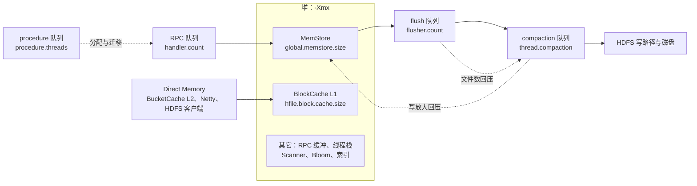
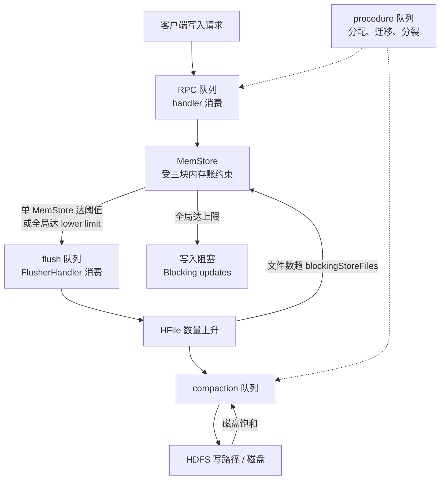
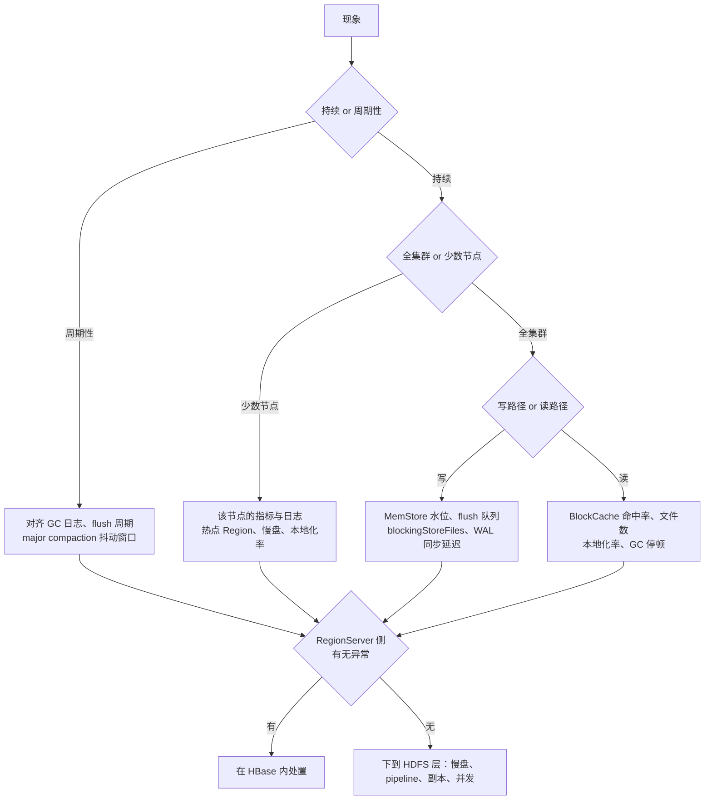
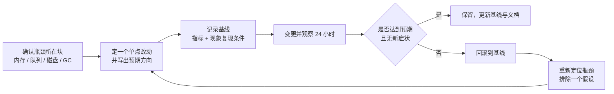
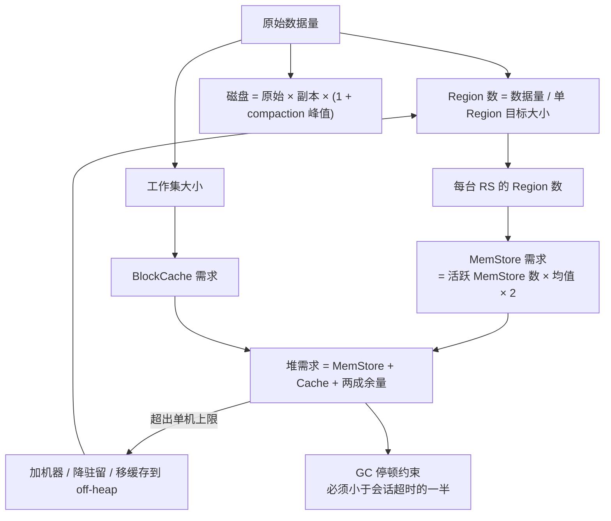

# HBase 生产调优实战——从诊断到落地的系统方法论

**摘要：**

关于 HBase 调优，流传最广的是一份份参数清单：MemStore 给多少、BlockCache 给多少、handler 开到几百、`blockingStoreFiles` 调到多少。清单本身没有错，但它回答不了生产现场真正的问题——为什么同一套参数换一个集群就失效，为什么两个参数一起改完之后延迟降了却说不清是谁的功劳，为什么把写入阻塞"调掉"之后读取的 P99 反而更差。本篇给出的替代方案是两本账和一棵树。两本账是：一个 RegionServer 的堆只有一块，MemStore、BlockCache 与 RegionServer 自身的对象必须装进同一个 `-Xmx`，2.x 的 off-heap BlockCache 只是把其中一笔挪到 Direct Memory，并没有新增内存；四条队列——RPC、flush、compaction、Master procedure——则是这块内存与下游磁盘之间唯一的缓冲带，队列的长度与消费速率决定了压力回传到哪里。一棵树是四层诊断决策树：指标、日志、Region 分布、HDFS，从现象出发判断应该先看哪一层而非全部看一遍；在此之上归纳六个典型症状的完整归因链，并给出"一次只改一个参数、留基线、观察 24 小时、保留或回滚"的执行纪律与容量规划的三个反推公式。

---

## 第 1 章 调优的对象：一块堆与四条队列

HBase 的调优资料多以清单形态流传，读者照着清单改参数，往往在第一次真正的故障面前就卡住：清单上每一项都是"调大或调小"，但没有任何一项告诉你，改了之后压力会跑到哪里去。笔者以为，调优之所以容易变成试错，是因为把参数当成了彼此独立的旋钮，而 RegionServer 里的参数从来不是独立的——它们共享同一批资源，一个参数的变化必然从另一个参数身上借债。真正需要建模的对象只有两个：一块堆内存如何切分，四条队列如何疏导。

### 1.1 参数清单为什么会失效

三个例子足以说明参数之间的借贷关系。

`hbase.hregion.memstore.flush.size` 调大，HFile 的生成速率下降，compaction 的输入随之减少，读写放大的三角关系会往好的方向走一截；但代价是单个 MemStore 的峰值更高，一次 flush 需要落盘的字节数更多，flush 期间新旧两份 MemStore 同时占着堆，于是"最坏时刻的堆占用"被抬高了。`hbase.regionserver.handler.count` 从 30 调到 200，RPC 处理并发上升，看上去是纯收益；但服务端每个 handler 在处理写入时都要实例化客户端的写缓冲（`hbase.client.write.buffer` 默认 2MB 量级），30 个 handler 是六十兆字节量级，200 个就是四百兆字节量级，再加上线程栈与锁竞争，这笔账记在"三块内存"的第三块里。`hbase.hstore.blockingStoreFiles` 从 16 调到 100，写入不再因为文件数超限而被阻塞，症状消失了；但每一次 Get 要在更多 HFile 里做归并，读放大上升，BlockCache 里被索引与 Bloom 元数据挤占的比例变高，命中率下降——问题只是从"写入阻塞"换成了"读取变慢"。

清单式调优的本质，是把瓶颈从一个资源搬到另一个资源，却不掌握搬运的方向。要掌握方向，就得换一个建模方式。

### 1.2 收敛到两个维度

一个 RegionServer 的全部性能表现，最终只落在两件事上：内存够不够分，队列够不够快地被消费。前者的约束是硬性的——越界就是 OOM 或长时间 Full GC；后者是柔性的——它会以延迟、积压、RIT 的形式表现出来，但不会立刻让进程死掉。

内存这一侧有三块：MemStore、BlockCache、以及 RegionServer 自身运行所需的对象（RPC 缓冲、线程栈、Scanner 持有的结果与快照、每个 StoreFile 的 Bloom Filter、HDFS 与 Netty 的缓冲）。三块之和必须小于等于堆，这是一条不等式，不是三条独立的预算线。

队列这一侧有四条：RegionServer 的 RPC 队列、MemStore 的 flush 队列、compaction 队列，以及 Master 的 procedure 队列。前三条在数据面，负责把写入流量逐步压到磁盘；第四条在控制面，负责把 DDL、Region 分配、迁移这些状态变更串行地推进下去。

这两个维度之所以足够覆盖绝大多数现场问题，是因为 LSM 结构的所有权衡最终都要经过它们。Region 数过多会让内存账被切碎——每多一个 Region 就多若干份 MemStore 结构；RowKey 热点会让单个 Region 的写入速率飙升，flush 队列与 compaction 队列同时变长；列族数从一变成五，MemStore 的份额被成倍占用，flush 频率上升，文件数上升，读放大上升。所有这些现象，向上都归结为"内存怎么分"，向下都归结为"队列怎么疏导"。

下面的图把这两个维度并到一张图里。左侧是堆内的三块与堆外的 Direct Memory，右侧是四条队列；实线表示内存被谁消费，虚线表示压力回传的方向。



### 1.3 四条执行纪律

在进入机制细节之前，先把纪律立起来，因为后文的每一个判据都要在纪律的约束下才有意义。

第一，先量化再动手。任何一个参数变更之前，必须能用一句话说清"哪个指标、在当前是多少、期望改到多少、依据是什么"。第二，一次只改一个参数。这不是洁癖，而是实验设计的基本要求：两个变量同时变化，观测到的结果无法归因到任何一个。第三，先留基线再改。基线要包含至少一个完整业务周期的指标，否则改完之后没有对照物，只能凭"感觉快了"。第四，观察 24 小时再决定保留或回滚——24 小时的理由在后面的第 6 章展开，它要覆盖一次 major compaction 的抖动、至少一次 GC 周期、以及一个业务峰值。

这四条纪律的敌人，是"一次改一堆参数然后祈祷"的做法，第 8 章会把它的害处逐条拆开。

---

## 第 2 章 三块内存：同一块堆的三次切分

> [!info] 本篇的边界
> MemStore 的 flush 判定与 HFile 的落盘格式见 [[04 HBase 存储引擎深度解析——LSM-Tree、MemStore 与 HFile 的设计奥秘]] 与 [[05 HBase 写入链路深度解析——WAL、MemStore Flush 与持久性保证]]，BlockCache 的两种实现与命中路径见 [[06 HBase 读取链路深度解析——BlockCache、Scanner 与多版本合并]]。本章只讨论一件事：这些机制各自要吃掉多少堆，以及它们如何在同一个 `-Xmx` 里争抢。

### 2.1 两个 0.4 是同一块内存的两部分

`hbase.regionserver.global.memstore.size` 的默认值是 0.4，`hfile.block.cache.size` 的默认值也是 0.4。后者在不同资料里有 `hfile.block.cache.size` 与 `hbase.regionserver.blockcache.size` 两种写法，2.x 的 `hbase-default.xml` 里生效的是前者——官方文档在解释这个参数时也承认这个命名并不直观，部署时以对应版本的 `hbase-default.xml` 为准。两个 0.4 都乘在 `-Xmx` 上，单位是**同一个堆**的比例，而不是两块各自预留的内存。理解这一点是理解 HBase 所有内存故障的起点。

很多集群出事，就出在这两个 0.4 被当成两份独立预算。把它们相加，0.8 已经用掉了八成堆，剩下两成要装下 RegionServer 的全部运行时开销；在一台 32GB 堆的机器上，这两成是 6.4GB，看起来不少，但下面三件事会把这块余量吃掉。

其一，MemStore 的水位不是硬墙。单个 MemStore 可以长到 `hbase.hregion.memstore.flush.size` 乘以 `hbase.hregion.memstore.block.multiplier`（默认 2）——也就是说单个 MemStore 在触发阻塞之前可以到 256MB；全局层面，写入要到 `global.memstore.size` 的上限才会被阻塞，而在此之前，RegionServer 只会在达到 lower limit（`hbase.regionserver.global.memstore.size.lower.limit`，默认 0.95，即上限的 95%）时开始挑选 Region 强制 flush。从"开始 flush"到"阻塞写入"之间有一段窗口，窗口里的写入仍在往堆里堆。

其二，flush 期间新旧两份 MemStore 同时存在。flush 的语义是把当前 MemStore 的内容做成快照写出去，写入并不停止，而是进入一个新的 MemStore；被快照的那一份要等 HFile 落盘完成才能释放。于是"峰值内存"约等于正常工作水位加上一次 flush 的体量，而不是正常工作水位本身。

其三，BlockCache 的淘汰不是瞬时的。LruBlockCache 内部按 single、multi、memory 三个分区组织，淘汰是分区内的近似 LRU，块在被驱逐之前仍占着堆；扩容、压缩、以及大量扫描带来的块涌入，都会让实际占用在短时间内贴住甚至略微超出目标比例，堆的碎片也会让"空闲内存"不能完全被复用。

把这三件事叠起来看，0.4 加 0.4 再加其它，就越过了堆。下面这个算例是示例推算，用来说明量级而不是给出结论：一台 32GB 堆的 RegionServer，MemStore 上限 12.8GB、BlockCache 目标 12.8GB，另有 120 个 Region、每 Region 三个列族，共 360 个 MemStore。若活跃 MemStore 的平均值做到 30MB（约为 flush 阈值 128MB 的四分之一，取这个值只是为了让数字贴近典型的混合负载），合计约 10.8GB，已经逼近 12.8GB；此时写入峰值只要再抬两成，就会先撞 lower limit 触发强制 flush、再撞 upper limit 阻塞写入，而 BlockCache 同时在 12.8GB 上满载，堆里给"其它"剩下的不到三吉字节，症状通常不是一条干净的 OOM，而是频繁的 Full GC 与随之而来的 ZooKeeper 会话超时。

### 2.2 给谁多少：三个判据

分配比例的判据不能是"集群读写比"这种粗粒度的统计，因为读写比描述的是请求数量，而内存吃的是字节与对象数。真正有效的判据有三个。

判据一是 MemStore 的需求量，由"写入速率乘以 flush 间隔"决定。写入字节速率越高、flush 阈值越大，同时在内存里悬着的 MemStore 就越多；它与 Region 总数没有直接关系，Region 数决定的是这笔内存被切成多少份，切得太碎会让每份都填不满 flush 阈值，反而产生大量小文件。

判据二是 BlockCache 的需求量，由"工作集大小乘以命中率目标"决定。工作集是可被反复访问的数据量，与总数据量无关；一个 10TB 的表如果只有 50GB 被反复读，BlockCache 给到 60GB 以上就不会有明显收益。

判据三是"其它"必须留出的份额，经验区间是 15% 到 20%，而且在启用 off-heap BucketCache 之后，这部分预算要从 Direct Memory 那一侧另记，不能再从堆里扣。

下表把三种典型负载形态的取值方向与代价并列，注意最后一列的代价不是补充说明，而是选择这个比例时必须接受的账单。

| 负载形态 | 判据怎么量 | MemStore | BlockCache | 其它 | 主要代价 |
| :--- | :--- | :--- | :--- | :--- | :--- |
| 写密集 | 写入字节速率高，Get QPS 低，活跃 Region 少而集中 | 0.5 | 0.3 | 0.2 | 读未命中上升；单次 flush 体量变大，重启后 WAL 回放的峰值内存更高；Region 迁移时 flush 停顿拉长 |
| 读密集 | 工作集可估且远小于总数据量，命中率为主要指标 | 0.3 | 0.5 | 0.2 | MemStore 天花板变低，写入尖峰更容易触发阻塞；flush 更频繁，文件数上升，读放大反而吃掉缓存 |
| 写读均衡 | 两者都无极端值，内存压力呈周期性 | 0.4 | 0.4 | 0.2 | 没有明显短板，但也没有余量应对热点 Region；一个热点就可能把全局水位推过 lower limit |
| 内存被切碎 | Region 数远超活跃 Region 数，列族数偏多 | 下调 Region 数或列族数，而非继续切比例 | 同左 | 保持 0.2 | 任何比例调整都只是缓解；真正的解法是减少分片数，见第 7 章 |

### 2.3 每 Region 的 MemStore 下限

有一个约束在参数文档里不显眼，但在容量规划时是决定性的：每个 MemStore 的合理下限就是 flush 阈值本身。低于这个值，MemStore 还没积累出规模就被刷出去，结果是大量体积很小的 HFile，文件数迅速撞上 `hbase.hstore.blockingStoreFiles`，compaction 队列随之积压。换句话说，把 flush 阈值调小来"降低内存压力"，代价是把压力转移给文件数。

由此可以反推一个 Region 数的上界：MemStore 上限除以（列族数乘以 flush 阈值乘以 2），其中 2 是 flush 期间双份占用的余量。仍用上面的例子：12.8GB 的 MemStore 上限，三个列族，flush 阈值 128MB，反推的结果是约十七个"满额"MemStore。这个数字显然远小于真实集群里上百个 Region，却并不矛盾——真实集群里绝大多数 Region 是冷的，它们的 MemStore 只有几兆字节。这恰好说明了正确的量：该用**活跃 Region 数**而不是"Region 总数"来做内存账，而活跃 Region 数在高峰期与低谷期可能相差一个数量级，这就是为什么按总数算出来的容量规划总是不够用。

### 2.4 off-heap：第二本账

HBase 2.x 的 BlockCache 支持两级结构：堆内的 LruBlockCache 作为一级（L1），堆外的 BucketCache 作为二级（L2）。L1 缓存所有类型的块，L2 主要缓存 DATA 块与其他块，两者的组合在 2.x 里是默认生效的（1.x 时代需要用 `hbase.bucketcache.combinedcache.enabled` 显式开启，该开关在 2.x 已不再需要，具体以对应版本的 `hbase-default.xml` 为准）。

BucketCache 的存储引擎由 `hbase.bucketcache.ioengine` 选择，常用的三个值是 `offheap`（DirectByteBuffer，进程外的堆但仍在进程的 direct memory 里）、`file`（映射到本地盘上的文件）、`mmap`。生产上最常见的是 `offheap`，因为它在提供一个不受 GC 管理的大缓存池的同时，读写延迟还接近内存。

账本的变化在这里：L2 不占 `-Xmx`，但占 **Direct Memory**。JVM 在未显式设置 `-XX:MaxDirectMemorySize` 时，其默认值等于最大堆，于是"堆 32GB 加 L2 32GB"的配置会直接越过 direct memory 上限，表现为 `java.lang.OutOfMemoryError: Direct buffer memory` 或更隐蔽的 Native memory 分配失败。正确做法是显式把 `-XX:MaxDirectMemorySize` 设为"堆 + L2 + 约 1GB"，那 1GB 留给 HDFS 短路读、Netty 与其他零散的 direct 分配。公开文档里给过一个算例：15GB 堆配 16GB off-heap BucketCache 时，`MaxDirectMemorySize` 可以取 32GB，正是按"堆 + L2 + 余量"的口径算出来的。

还有一个容易踩的取值陷阱：`hbase.bucketcache.size` 的语义在不同版本之间有过变化，数值小于 1 时曾被解释为堆的比例，大于 1 时按兆字节计。照抄博客里的 `0.4` 很可能配出一个只有零点几兆的缓存池。稳妥的写法是显式给兆字节数，并对照对应版本的 `hbase-default.xml` 确认语义。

两级缓存也不是免费的扩容。命中 L2 时，BucketCache 取出的是序列化后的字节缓冲，还要反序列化成堆内对象才能被 Scanner 使用，比命中 L1 多一次拷贝；因此它适合"工作集远大于堆"的随机读场景，对"小而极热"的数据意义不大——那种场景反而是 `IN_MEMORY` 列族更划算。下面的表把两套方案并排比较。

| 维度 | 全 on-heap（只用 LruBlockCache） | 两级（LruBlockCache + off-heap BucketCache） |
| :--- | :--- | :--- |
| 堆占用 | BlockCache 与 MemStore 直接争抢 `-Xmx` | L2 移出堆，堆内可全给 MemStore 与 L1 |
| GC 压力 | 缓存对象参与 GC，大堆长生命周期对象多，停顿难控 | 大头移出 GC 管辖，停顿显著可控 |
| 命中延迟 | 命中即堆内对象，路径最短 | L2 命中多一次反序列化与拷贝 |
| 配置复杂度 | 一个比例参数，改完即生效 | 需要同时配 ioengine、size、MaxDirectMemorySize，三者不一致就 OOM |
| 失效形态 | Full GC 或堆 OOM | Direct Memory OOM、或缓存池未按预期生效 |
| 适用场景 | 堆较小、命中率高、追求路径最短 | 工作集远大于堆、可接受毫秒级多一次拷贝 |

### 2.5 第三块内存里到底有什么

"其它"这一块常被当成模糊的余量，实际上它有明确的清单，每一笔都可以估出来。

RPC 层的缓冲按 `hbase.client.write.buffer`（默认 2MB 量级）乘以 handler 数估算；线程栈按每线程 1MB 量级乘以 handler 数估算，`hbase.regionserver.handler.count` 从 30 调到 200，仅此两项就是数百兆字节。未关闭的 Scanner 会持有 Result 对象与 MVCC 快照，客户端忘记 close 的 Scanner 是常见的堆泄漏源。每个 StoreFile 的 Bloom Filter 在打开时载入堆内，文件数多时这部分占用不可忽略。索引块与 Bloom 块走 BlockCache，但它们与 DATA 块争用同一个池子——这正是"文件数一多，命中率就掉"的真实机制：缓存容量没变，被元数据吃掉的比例变高了。此外还有 Netty 与 HDFS 客户端持有的 direct buffer，它们不在这块堆里，但与前文提到的 `MaxDirectMemorySize` 共用同一个额度。

### 2.6 GC 是内存账的租金

内存分完之后，还要为这块堆支付 GC 的租金。HBase 的 RegionServer 是大堆、长生命周期对象多、分配速率高的组合，GC 调优的目标不是"让 GC 更快"，而是"让停顿不越过某条线"，这条线由 ZooKeeper 的会话超时给出——一次 Stop-the-World 停顿如果超过了会话超时的一半，RegionServer 就可能在下一次心跳前被判死，这是第 5 章"RS 频繁挂"的一条主要归因链。

机制层面有两件事值得记住。`MemStoreLAB`（`hbase.hregion.memstore.mslab.enabled`，默认开启，Chunk 大小由 `hbase.hregion.memstore.mslab.chunksize` 控制，默认 2MB 量级）把大量小 Cell 收进少数大 Chunk，减少 Eden 区的分配压力与对象晋升，这一项是 HBase 能在几十吉字节堆上运行的基础设施，不建议关闭。另一件是 Humongous 分配：G1 中超过 Region 一半大小的对象会被当作巨型对象单独分配，而 MemStoreLAB 的 Chunk 正是这个量级，所以 `-XX:G1HeapRegionSize` 与 Chunk 大小的匹配关系会直接影响堆的利用率。

JDK 8 时代 CMS 仍是常见选择，参数的核心是把并发回收提前触发，避免并发模式失败退化为 Full GC：

```bash
# JDK 8 + CMS：提前触发并发回收，避免 Concurrent Mode Failure
HBASE_JVM_OPTS="-Xms32g -Xmx32g -Xmn8g \
  -XX:+UseConcMarkSweepGC -XX:+UseParNewGC \
  -XX:CMSInitiatingOccupancyFraction=70 -XX:+UseCMSInitiatingOccupancyOnly \
  -XX:+CMSParallelRemarkEnabled -XX:+CMSClassUnloadingEnabled \
  -Xloggc:/var/log/hbase/gc.log -XX:+PrintGCDetails -XX:+PrintGCDateStamps"
```

JDK 11 之后一线集群多已切到 G1，重点从"提前触发"变成"控制停顿目标与混合回收的节奏"：

```bash
# JDK 11 + G1：停顿目标、预留比例、并发线程数三者要一起给
HBASE_JVM_OPTS="-Xms32g -Xmx32g \
  -XX:+UseG1GC -XX:MaxGCPauseMillis=200 \
  -XX:G1HeapRegionSize=32m -XX:G1ReservePercent=15 \
  -XX:InitiatingHeapOccupancyPercent=60 -XX:ConcGCThreads=4 \
  -Xlog:gc*:file=/var/log/hbase/gc.log:time,uptime,level,tags"
```

堆大小与 GC 的关系不是单调的。堆越大，单次回收的成本与停顿越长，Full GC 的概率也随之上升；而堆太小又装不下内存账。合理的区间通常是"恰好装下三块内存再加两成余量"，而不是"机器有多少内存就给多少"。下表给出按 JDK 与堆规模选择 GC 的方向，取舍一栏是选择时必须认下的成本。

| 条件 | 选择 | 取舍 |
| :--- | :--- | :--- |
| JDK 8，堆 ≤ 24GB | CMS | 停顿可控但需要精细调优；并发模式失败会退化为 Full GC |
| JDK 8，堆 > 24GB | G1 | 分区回收适合大堆，但 Humongous 分配与 Region 尺寸需要匹配 |
| JDK 11 及以上 | G1 | 默认且成熟；停顿目标是软目标，设得过小会换来更频繁的回收 |
| 追求亚十毫秒停顿 | ZGC 一类低停顿收集器（需评估版本支持） | 吞吐与内存开销上升，HBase 生态的验证案例仍有限 |

---

## 第 3 章 四个队列：背压的可见形态

内存决定了"能装多少"，队列决定了"消化多快"。队列之所以值得单独建模，是因为它是唯一能把"下游变慢"翻译成"上游可观测现象"的结构：磁盘慢会让 compaction 队列变长，compaction 队列变长会让文件数不降，文件数不降会让 flush 被阻塞，flush 被阻塞最终表现为内存账上的 blocked updates。整条链路上，每一段都有队列或队列的等价物。

### 3.1 队列的三个观测量

判断一条队列是否健康，看的不是"有没有积压"，而是三个量：队列长度、元素在队列里的停留时间、以及消费速率相对于到达速率的关系。用排队论的定性版本说，队列长度约等于到达率乘以停留时间；因此长度持平时，说明系统处于稳态，短队列只是缓冲余量；长度持续单调上升，说明消费能力不足；而队列不长但请求延迟很高，说明瓶颈在单个请求的服务时间内，**不在排队**——这三种形态对应的处置完全不同。

### 3.2 RegionServer 的 RPC 队列

RegionServer 的 RPC 队列在最前面，`hbase.regionserver.handler.count` 决定有多少个 handler 线程从队列里取请求，默认 30。2.x 还为 `hbase:meta` 单独留了 `hbase.regionserver.metahandler.count`（默认 20 量级），因为元数据请求一旦排在业务请求后面，会连带拖慢所有 Region 的定位。

判据要分两步。第一步看队列指标：一般队列与优先级队列的长度（`numCallsInGeneralQueue`、`numCallsInPriorityQueue` 一类指标）是否持续大于零、活跃 handler 数是否贴住上限。第二步把 CPU 使用率作为分流器：CPU 高而队列长，说明处理本身是计算密集的，增加 handler 会有效但会同时抬高 GC 压力；CPU 不高而队列长，说明 handler **都在等**——等锁、等 HDFS、等 GC——此时增加 handler 只是让更多线程排到同一个等待点上，平均延迟反而更差。

`hbase.regionserver.executor.openregion.threads`（默认 3）管的是另一条小队列：Region 的打开。它不在业务 RPC 路径上，但在重启、大批量迁移、RIT 恢复时是决定恢复时长的关键——Region 打开得慢，迁移的每一步都被拉长；调大它的代价是同时打开大量 Region 带来的 BlockCache 预热与 `hbase:meta` 查询风暴，重启后的一段时间里读延迟会明显高于常态。

handler 调大的代价可以列成四条：常驻内存（缓冲与线程栈）、上下文切换与调度开销、Region 内部的读写锁竞争加剧、以及把压力更多地下推给 HDFS。四条里最后一条最容易被忽略，因为它是延后发生的。

### 3.3 MemStore 的 flush 队列

flush 队列有两个入口，对应三层水位。单 Region 单列族的 MemStore 达到 `hbase.hregion.memstore.flush.size`（默认 128MB）时，这个 MemStore 被排入 flush 队列；全局 MemStore 用量达到上限的 lower limit 时，RegionServer 会主动挑选最大的若干 Region 强制 flush；达到上限本身时，写入被阻塞。除此之外还有一条硬线：单个 MemStore 超过 flush 阈值乘以 `hbase.hregion.memstore.block.multiplier`（默认 2）时立即阻塞写入并抛 `RegionTooBusyException`——这条线比全局上限更早触发，是"单 Region 热点"最直接的证据。

消费端是 FlushHandler 线程池，线程数由 `hbase.hstore.flusher.count` 控制，默认 2。这个参数在不同版本与不同发行版的文档里出现过不同写法（也有资料称其为 `hbase.regionserver.thread.flush.handler.count`），部署时应以对应版本的 `hbase-default.xml` 为准，而不是照抄任何一份清单。

队列长了怎么判断，取决于到达率与服务时间哪个出了问题：如果 HDFS 的写延迟正常、flush 队列仍然堆积，那是消费端线程不足；如果 HDFS 写延迟本身就高，调大线程数只是让更多 flush 同时慢，磁盘更饱和。后一种情况下正确的动作是去 HDFS 那一层，或者降低写入速率、扩大 flush 阈值以减少 flush 次数。调大 flusher 的代价有三项：并发 flush 争抢 HDFS 带宽、小文件生成速率加快进而把压力推给 compaction 队列、以及 Region 选择的激进化可能把冷 Region 也刷出去，白白消耗 I/O。

### 3.4 compaction 队列

compaction 的执行由两个线程池分担：小合并池 `hbase.regionserver.thread.compaction.small` 与大合并池 `hbase.regionserver.thread.compaction.large`，默认都是 1；分界依据是本次合并的输入总大小与 `hbase.regionserver.thread.compaction.throttle` 的比较，而后者是由 flush 阈值与最小合并文件数推导出来的量级，因此改 flush 阈值时它会跟着漂移。合并策略一侧还有 `hbase.hstore.compaction.min`（默认 3）与 `hbase.hstore.compaction.max`（默认 10），以及文件数超限时的阻塞开关 `hbase.hstore.blockingStoreFiles`（默认 16）与配套的等待时间 `hbase.hstore.blockingWaitTime`（默认 90 秒）。策略如何选择文件、Stripe Compaction 与 FIFO 策略各适合什么数据形态，见 [[07 HBase Compaction 机制深度解析——Minor、Major 与写放大的三角关系]]，这里只看队列的到达率与服务时间。

队列的判据同样要先分"消费慢"还是"生产快"。队列持续积压且文件数不降，是消费能力不足——线程数不够、限速过低、或磁盘本身慢；队列持续积压但文件数在缓慢下降、同时 flush 频率很高，是生产过快——MemStore 太小、列族太多、或写入热点导致少数 Region 反复 flush。前者的处置是提高并发或放开限速，后者的处置是减少 flush 次数（调大阈值、减少列族、打散热点），而不是继续加线程。

调大 compaction 线程的代价，是与用户读共享同一批磁盘与 HDFS 带宽：并发合并把带宽摊薄，单次合并耗时变长，用户侧的读 P99 会明显抬高；大合并并发还会让 RIT 窗口变长，因为合并期间 Region 无法分裂也无法迁移。这也是为什么很多集群宁可让 compaction 慢一点，也不愿意让它与业务抢带宽。

### 3.5 Master 的 procedure 队列

控制面的队列是 Master 的 procedure 队列。2.x 把 DDL、Region 分配、迁移、分裂这些状态变更全部建模成 procedure：每一个都有持久化的状态机，每一步都可以在失败后重入，执行线程池由 `hbase.master.procedure.threads` 控制。这个参数的默认值在 2.x 里不是一个小数字——`MasterProcedureConstants` 把下限放在 16（1.4 分支上是 4），另外还有 `hbase.master.urgent.procedure.threads`（默认 1）专门留给服务器崩溃这类需要插队的紧急 procedure。

procedure 队列堵塞的机制与数据面完全不同：卡住的 procedure 通常不是在等 CPU，而是在等一个事件——等 RegionServer 的心跳、等某个 Region 打开完成、等 `hbase:meta` 的写入落盘、或者等另一个 procedure 持有的锁。这种等待是"逻辑上依赖"而非"算力不足"，所以调大 `hbase.master.procedure.threads` 只会让更多 procedure 一起堵在同一个等待点上，把一条队列变成一片停滞。判据要看 Master UI 的 procedure 列表与每一个 procedure 的当前步骤，以及 `hbase hbck` 报出的 RIT 清单；处置方向是修复被等待的那个对象（不可用的 RegionServer、不可读的 `hbase:meta`、失败的 Region 打开），而不是加线程。

只有在一种情况下调大这个参数是有意义的：集群规模大、DDL 与迁移操作密集、且每个 procedure 的步骤本身很快，此时线程池确实构成并发上限。代价是元数据的写竞争上升——每一次状态迁移都要落到 procedure store 与 Master 的 WAL 上，并发越高，这部分写越密集。

### 3.6 四条队列的联动

四条队列不是四个独立的池子，而是一条链上的四个缓冲段。写入从 RPC 队列进入，落到 MemStore；MemStore 满则进 flush 队列；flush 产生 HFile，文件数多了进 compaction 队列；compaction 的输出最终落到 HDFS 与磁盘。控制面的 procedure 队列则负责增删 Region、迁移、分裂这些会改变前三条队列容量的操作。



图的读法是沿箭头找压力。磁盘饱和会让 compaction 变慢，compaction 慢会让文件数不降，文件数不降会顶到 `blockingStoreFiles`，写入随即在 MemStore 入口被拦住。**背压的方向**只有一个：从磁盘指回内存。此时如果只在 MemStore 一侧调参数（譬如调大阈值），压力会继续往下游堆，最终以一次更长的阻塞或一次 compaction 风暴收场。

### 3.7 四条队列的速查

笔者把四条队列的参数、默认值、判据与代价压到一张表里，便于在故障现场快速定位。

| 队列 | 关键参数（默认值） | 队列长的判据 | 处置方向 | 调大的代价 |
| :--- | :--- | :--- | :--- | :--- |
| RPC | `hbase.regionserver.handler.count`（30）、`hbase.regionserver.metahandler.count`（20 量级） | 一般/优先级队列长度持续大于零，且 CPU 不饱和 | CPU 低先查等待（锁、GC、HDFS）；CPU 高再考虑加 handler | 内存与线程栈上升、锁竞争加剧、压力下推 HDFS |
| flush | `hbase.hregion.memstore.flush.size`（128MB）、`hbase.hstore.flusher.count`（2）、`block.multiplier`（2） | 全局 MemStore 占比贴住 lower limit，`Blocking updates` 出现 | 先判 HDFS 是否慢；慢则治下游，快则加 flusher 或降写入速率 | 抢 HDFS 带宽、小文件增多、compaction 压力上升 |
| compaction | `thread.compaction.small/large`（1/1）、`hstore.compaction.min/max`（3/10）、`blockingStoreFiles`（16） | 队列积压且文件数不降 | 分"消费慢"与"生产快"两条路径处置 | 与用户读抢带宽、读 P99 抬高、RIT 窗口变长 |
| procedure | `hbase.master.procedure.threads`（2.x 下限 16）、`urgent.procedure.threads`（1） | RIT 不收敛，procedure 停在同一步骤 | 修复被等待的对象（RS、meta、Region 打开） | 元数据写竞争上升；逻辑依赖不会因加线程而消失 |

---

## 第 4 章 四层诊断：从现象到该看哪一层

诊断最常见的浪费不是看得太少，而是看得太散：指标、日志、hbck、HDFS 全看一遍，把十分钟能定位的问题拖成半天。有效的做法是分层，并且知道每一层能回答什么问题、不能回答什么问题。四层由近及远：指标层回答"哪里不对"，日志层回答"发生了什么事件"，Region 分布层回答"是不是只有少数分片不对"，HDFS 层回答"是不是根本不在 HBase 这一层"。

### 4.1 第一层：看指标

指标有三个入口。JMX 与 Hadoop Metrics2 暴露的是全量指标，适合接监控系统做趋势与告警；RegionServer 的 Web UI（`/rs-status` 及其下面的 memoryStats、regions、tasks 等页面）适合现场快速确认单个节点的内存与任务；`hbase hbtop` 是 2.x 提供的实时监控工具，作用类似 Unix 的 top，可以按 Region、表、命名空间、RegionServer 四个维度排序与过滤，看谁在消耗请求与内存。

下表只列调优中最有判别力的指标，以及它们各自指向哪一层。阈值一列给的是方向而不是精确门限，因为不同集群的基线差异很大。

| 指标 | 含义 | 异常信号 | 指向 |
| :--- | :--- | :--- | :--- |
| MemStore 总占用与上限之比 | 全局水位 | 长期高于 lower limit，周期性顶到上限 | 内存账分配比例、写入速率、flush 消费能力 |
| BlockCache 命中率 | 读缓存有效性 | 持续低于八成，且工作集没有变大 | 文件数过多导致的元数据挤占、缓存比例不足 |
| 每 Store 的 HFile 数 | 读放大的直接来源 | 普遍超过 compaction 阈值数倍且不收敛 | compaction 队列、flush 频率 |
| flush 队列长度 | flush 消费能力 | 持续大于零且 MemStore 水位不降 | Flusher 线程、HDFS 写延迟 |
| compaction 队列长度 | 合并消费能力 | 持续积压且文件数不降 | 线程数、限速、磁盘 |
| RPC 队列长度与活跃 handler 数 | 入口压力 | 队列持续增长且 handler 贴住上限 | handler 数、单请求服务时间 |
| GC 停顿时间与频率 | 内存账的租金 | 单次停顿接近会话超时的一半 | 堆大小、GC 选择、对象分配速率 |
| WAL 同步延迟 | 写入持久化成本 | 同步延迟远大于追加延迟 | HDFS 写路径、WAL 磁盘 |

看指标有一条方法论上的要求：区分平均值与**分位数**，并优先相信分位数。HBase 的很多问题是长尾问题——平均写入延迟 5ms 而 P99 是 800ms，这时的平均值毫无诊断价值。另一条要求是对齐时间轴：把 MemStore 水位、flush 队列、compaction 队列、GC 停顿四条曲线画在同一张图上，周期性毛刺的因果关系往往一眼可见。

### 4.2 第二层：看日志

日志层回答的是"在某一时刻发生了什么"。RegionServer 的日志里有几类关键字，每一类都对应一个确定的机制，见下表。

| 日志关键字 | 含义 | 下一步 |
| :--- | :--- | :--- |
| `Slow ReadProcessor` / `Slow WriteProcessor` | 单次 RPC 的分段耗时超阈值 | 看分段里哪一段最长：等锁、读 WAL、写 MemStore、等 MVCC |
| `ResponseTooSlow` | 单次响应超过时间或体积阈值 | 阈值由 `hbase.ipc.warn.response.time` 与 `hbase.ipc.warn.response.size` 控制；超阈值说明该请求确实慢 |
| `Blocking updates` | 全局 MemStore 达到上限，写入被阻塞 | 回第 2 章算内存账，回 3.3 看 flush 消费能力 |
| `Stall updates` | 写入被暂停等待 flush | 同上，同时检查是否有热点 Region |
| `RegionTooBusyException` | 单个 MemStore 超过 multiplier 硬线 | 单 Region 写入热点或 flush 严重滞后 |
| `PleaseHoldException` / `Master is initializing` | Master 尚未完成初始化 | 看 Master 日志与 `hbase:meta` 是否可读 |
| `Region already in transition` | 同一个 Region 有并发状态变更 | 看 procedure 队列与 hbck 的 RIT 清单 |
| `Failed to open region` | Region 打开失败 | 看 HDFS 上该 Region 的目录与文件完整性 |
| `ZooKeeper session expired` | 会话超时 | 对齐 GC 日志与网络抖动时间 |

日志的使用有两个前提。其一是阈值要合理：把 `hbase.ipc.warn.response.time` 调到很小会让日志量爆炸，反而掩盖真正的异常。其二是日志要能与指标对齐：一条 `Blocking updates` 出现时，MemStore 水位曲线应当在同一分钟有对应的尖峰，两者对不上说明日志的时间戳或采集链路有问题，先修观测再谈调优。

### 4.3 第三层：看 Region 分布

指标与日志都正常、但集群整体表现不对时，问题往往在分布上。这一层要看三件事。

第一是一致性：`hbase hbck` 会报出 Region 的分配状态、`hbase:meta` 的一致性以及悬空的引用文件（输出项与参数在不同版本间有差异，以对应版本文档为准；2.x 另有 HBck2 的独立工具形态）。第二是分布的形态：Region 总数与大小分布，比总数更重要的是分布的方差——少数巨型 Region 说明预分区失效或分裂策略被改过，大量微小 Region 说明 Region 数超配。第三是热点：用 hbtop 按请求数排序，若单个 Region 的请求量是平均值的十倍以上，热点就已成立，此时任何内存与队列参数的调整都只是在给热点让路。

### 4.4 第四层：看 HDFS

HBase 的每一次 flush、每一次 compaction、每一次 WAL 同步，最终都落在 HDFS 的写路径上。DataNode 的慢盘、pipeline 恢复、副本不足、块报告延迟，都会以"HBase 慢"的形式呈现，而 HBase 侧的指标看起来一切正常。这一层的机制与调优方法不重复展开，见 [[大数据/Hadoop/HDFS/10 HDFS 性能调优与生产实践——小文件治理与存算分离的未来]]；在 HBase 现场只做四个快查：DataNode 磁盘利用率是否长期贴顶、是否有 `Slow BlockReceiver` 一类的慢节点日志、副本数是否被临时下调过、以及 DataNode 的并发传输线程数是否成为 pipeline 的上限。

判断是否该下到这一层，有个简单信号：HBase 侧的写延迟与 flush/compaction 延迟同时变差，而 RegionServer 的 CPU、内存水位都正常——三个维度的同时退化，通常意味着它们共享的下游出了问题。

### 4.5 从现象到该看第几层

把四层组织成决策树，入口是三个问题：现象是持续的还是一阵阵的、是全集群还是少数节点、是写路径还是读路径。树只用于决定"先看哪一层"，不是排除法——先看的那一层若给出确定结论，就不必再往下走。



---

## 第 5 章 六个症状的完整归因链

症状是现象，归因链是"从现象退到机制"的路径。下面六个症状覆盖了绝大多数现场工单，每一个都给出第一证据、排除顺序与处置方向；需要强调的是排除顺序本身——先排除什么、后排除什么，决定了诊断要花十分钟还是半天。

### 5.1 周期性延迟毛刺

毛刺的特征是延迟曲线在固定间隔上出现尖峰，间隔可能是几十秒、几分钟或一天。三个来源：flush 周期（写入速率稳定时，MemStore 填满的时间间隔是稳定的）、compaction 周期（尤其是不受控的 major compaction，默认七天的周期间还有 0.5 的抖动系数）、以及 GC 周期（大对象分配或缓存淘汰导致的老年代增长节奏）。

诊断的第一步是把毛刺的时间戳与三份日志对齐：GC 日志的停顿时间、RegionServer 日志里 `Blocking updates` 的出现时刻、以及 compaction 的起止时间。对齐之后通常只有一个来源能同时解释幅度与周期。第二步是看毛刺期间其他指标是否同步变化：MemStore 水位在毛刺前爬升、毛刺中骤降，是 flush 型；文件数在毛刺后下降、compaction 字节数在毛刺中冲高，是 compaction 型；堆占用锯齿状上升后回落、同时 CPU 出现瞬时打满，是 GC 型。

处置与代价要一起说。flush 型毛刺的处置是调大 flush 阈值降低频率，代价是单次 flush 体量与峰值内存上升，并且文件数会先降后升（阈值大了，小文件少了，但单个文件更大，compaction 的单次输入更大）；compaction 型毛刺的处置是把 major compaction 排到低峰并关闭自动触发，代价是需要运维排程且漏排会让空间放大累积；GC 型毛刺的处置是调整内存分配比例或换收集器，代价是前文提到的那本账要重算。

### 5.2 写入突然变慢

写入从平稳突然变慢，候选只有三个，且可以用日志关键字一次性分流。出现 `RegionTooBusyException`，是单 MemStore 撞上了 multiplier 硬线，根因是单 Region 写入热点或 flush 严重滞后；出现 `Blocking updates` 而不见 `RegionTooBusyException`，是全局 MemStore 撞上了上限，根因是内存账分配比例与写入速率不匹配；两个关键字都没有而写入延迟上升，要去看 WAL 同步延迟——同步延迟远大于追加延迟时，成本在 HDFS 的落盘确认上。

排除顺序按代价从低到高：先 grep 日志（秒级），再看 MemStore 水位曲线（分钟级），最后测 WAL 同步延迟（需要指标或压测）。处置分别对应：热点要打散（改 RowKey 或用预分区，见 [[02 HBase 数据模型深度解析——RowKey、列族、Cell 与多版本机制]]）、比例要重算（第 2 章）、WAL 要换到独立磁盘或调整同步模式（代价是持久性语义变化，不能作为默认手段）。

### 5.3 读变慢但 CPU 不高

"CPU 不高"这个线索的价值在于排除法：它说明瓶颈不在解压、比较、过滤这些计算环节，而在**等待**——等磁盘、等网络、等 GC。四个候选：BlockCache 命中率低、文件数多导致的读放大、数据本地化率低、以及 GC 停顿。

判据的先后顺序是：先看命中率与文件数（两者通常同时恶化，因为文件数多会挤占缓存元数据），再看本地化率（Region 的 HFile 与本机 DataNode 的重合度，完全本地化的集群在迁移或重启后会有一段低本地化期），最后用 GC 日志确认停顿是否落在读请求的时间窗口内。处置对应：命中率低而工作集可控时扩大缓存或减少文件数；文件数多时治 compaction 与 flush；本地化率低时等待或触发一次重写；GC 停顿则回到内存账。读链路的机制细节见 [[06 HBase 读取链路深度解析——BlockCache、Scanner 与多版本合并]]。

### 5.4 Region 一直 RIT

RIT（Region in Transition）表示某个 Region 处在中间状态：正在打开、正在关闭、正在分裂、正在合并或正在迁移。短暂 RIT 是正常的，持续数分钟的 RIT 一定是某个环节卡住了。四个候选：`hbase:meta` 不可用（它自身的 Region 打不开或被阻塞）、procedure 卡在等待步骤、目标 RegionServer 不可响应、以及上一次 split 或 merge 遗留的状态。

诊断顺序：先确认 `hbase:meta` 是否可读（用 hbase shell 的定位类命令或 hbtop 看该表 Region 的状态），再看 Master UI 的 procedure 列表里有没有停在同一步骤的条目，再看目标 RegionServer 的日志里有没有打开或关闭失败的记录，最后用 hbck 看一致性报告。处置要谨慎：在 procedure 仍在重试时强行 `assign` 或 `unassign`，可能把可恢复的状态变成需要人工修 meta 的状态。这一节的判断与 [[09 HBase 高可用与容灾——崩溃恢复、备份与复制]] 里的恢复路径是同一套机制。

### 5.5 RS 频繁挂

RegionServer 频繁挂是最容易误判的一类，因为"挂"的表象相同，原因却分属完全不同的层。五个候选：堆 OOM（内存账越界）、Direct Memory OOM（off-heap 缓存配得比 `MaxDirectMemorySize` 大）、ZooKeeper 会话超时（GC 长停顿或网络抖动）、磁盘满（HDFS 写失败导致 RegionServer 主动退出）、以及 WAL 文件数超过上限（宁可退出也不冒丢数据的风险，上限参数以对应版本为准）。

判据在**第一现场**就固定下来：进程退出时 JVM 会留下 `hs_err_pid` 文件，堆 OOM 与 direct OOM 在其中写得清清楚楚；GC 日志能确认停顿是否越过了会话超时的一半；`df -h` 与 HDFS 的容量报告确认磁盘；日志里的 `Aborting` 及其前缀确认是否主动退出。处置对应各自的层，但有一条共性：反复重启只能掩盖症状，因为重启后 Region 重新分配、BlockCache 冷启动、WAL 回放，集群在随后一段时间里更脆弱。

### 5.6 Master 频繁切换

Master 切换本身不丢数据，但切换期间所有 DDL 与 Region 分配停摆，RIT 会堆积，客户端的建表与迁移操作全部失败重试。三个候选：ZooKeeper 抖动（会话超时、连接数打满、ZK 自身 GC）、Master 的 GC 停顿（Master 堆通常配得比 RegionServer 小，容易被忽略）、以及网络分区导致备 Master 抢主。

判据是时间线：把 Master 日志里的 `Master is initializing`、ZK 日志里的会话过期、以及两台 Master 的 GC 日志对齐。处置方向：加大 Master 堆、把 ZK 会话超时与 GC 停顿目标匹配起来、以及检查 ZK 集群自身的负载。Master 侧的可用性设计见 [[09 HBase 高可用与容灾——崩溃恢复、备份与复制]]。

### 5.7 六症状的汇总

把六个症状的第一证据与处置方向并排，便于现场按图索骥。注意"先看哪一层"这一列——它决定了诊断的起点，而不是排除范围。

| 症状 | 先看哪一层 | 关键证据 | 常见根因 | 处置方向 |
| :--- | :--- | :--- | :--- | :--- |
| 周期性延迟毛刺 | 指标 + 日志（GC/flush/compaction 对齐） | 毛刺间隔与某类周期吻合 | flush 频率、自动 major compaction、GC 节奏 | 降频、排程、调 GC；代价是峰值内存或运维复杂度上升 |
| 写入突然变慢 | 日志 | `RegionTooBusyException`、`Blocking updates`、`ResponseTooSlow` | 热点 Region、内存比例失配、WAL 同步慢 | 打散热点、重算内存账、WAL 独立磁盘 |
| 读变慢但 CPU 不高 | 指标 | 命中率下降、文件数上升、本地化率低 | 读放大、缓存被元数据挤占、GC 停顿 | 治 compaction 与 flush、扩缓存、等本地化恢复 |
| Region 一直 RIT | Region 分布 + 日志 | procedure 停在同一步骤、`hbase:meta` 不可读 | meta 故障、procedure 依赖未满足、RS 不响应 | 修被等待对象，勿强行 assign |
| RS 频繁挂 | 日志 + 系统层 | `hs_err_pid`、GC 日志、磁盘与 WAL 数 | 堆/direct OOM、会话超时、磁盘满、WAL 超限 | 各自归因；反复重启只会让集群更脆弱 |
| Master 频繁切换 | 日志 + ZK | `Master is initializing` 频率、ZK 会话过期 | ZK 抖动、Master GC 停顿、网络分区 | 加堆、匹配超时、查 ZK 负载 |

---

## 第 6 章 调优的下手顺序与执行纪律

调优不是一次性的动作，而是一个带反馈的循环。顺序比手段重要：先确认瓶颈在哪一块（内存、队列、磁盘、GC），再定单点改动，再留基线，再观察一个完整周期，最后保留或回滚。跳过任何一步，后面都会以别的方式补回来。

### 6.1 一个完整循环



笔者以为，循环里有三个容易做错的点。其一是"确认瓶颈所在块"被跳过，直接从症状跳到参数；其二是基线的口径不统一，改动前后一个用平均值一个用分位数；其三是观察窗口不足 24 小时，导致还没等到一次 major compaction 或一次业务峰值就下结论。

### 6.2 为什么一次只能改一个参数

同时改多个参数有三个不可修复的问题。第一是**不可归因**：结果变好时不知道是谁的功劳，结果变差时不知道回滚哪一个，两种情况都让这次变更无法沉淀为知识。第二是不可回滚：三个参数一起回滚会把可能有效的那个也扔掉，下一次又要从零开始。第三是副作用叠加：handler 与 flush 阈值同时调大会同时抬高堆占用与文件数，两个副作用在同一条曲线上叠加，观测到的结果可能与任何一个单独改动都不同。

有人会说，生产故障等不起一次只改一个参数。这个反驳在应急场景下成立，但应急改动必须显式标注为"止血"而不是"调优"：止血的目标是让业务恢复，允许粗糙，事后必须回到单变量循环里重新验证。把止血当成调优的结论，是绝大多数"调优文档"最终不可复用的原因。

### 6.3 变更留档的最小字段

一次参数变更应该留下六个字段，缺一个就会在三个月后重复劳动：改的是哪个参数、原值与新值、改的依据（哪个指标、什么阈值）、预期方向与幅度、观察窗口与结论、以及是否保留。这六个字段同时也是回滚单——回滚只需要把新值换回原值，不需要重新推理一遍。

---

## 第 7 章 容量规划：把调优前置到设计

调优解决的是"已经建成之后的失衡"，容量规划解决的是"建成之前就失衡"。HBase 的容量有三本账：Region 数、堆大小、磁盘。三本账互相约束，任何一本单独算都会得出错误结论。

### 7.1 第一本账：Region 数

Region 数由数据量与目标单 Region 大小决定，再按 RegionServer 数摊开：Region 数约等于数据量除以单 Region 目标大小，再除以 RegionServer 数得到每台机器的 Region 数。单 Region 目标大小通常与 `hbase.hregion.max.filesize` 对齐（2.x 的默认值在 10GB 量级，并带有抖动以免同时分裂）；分裂策略、预分区与均衡器如何配合这个目标，见 [[08 HBase Region 分裂与负载均衡——水平扩展的工程底层]]。

以示例推算说明：10TB 原始数据、单 Region 目标 10GB，得到一千个 Region；十台 RegionServer，每台一百个 Region。这个数字看起来无害，但它要与第二本账对账——每台一百个 Region、三个列族，就是三百个 MemStore，若按 flush 阈值 128MB 算理论上限，是三十八吉字节以上，远超任何合理的堆。差异的来源在前文已经点明：绝大多数 Region 是冷的，真正要算的是活跃 Region 数。因此 Region 数的规划不能只按数据量算，还要按"写入活跃度"复核。

### 7.2 第二本账：堆大小

堆的需求可以写成三项之和：活跃 Region 的 MemStore 需求、BlockCache 需求、以及"其它"的两成余量。MemStore 需求等于活跃 MemStore 数乘以平均占用再乘以 2（flush 期间双份），平均占用不应按 flush 阈值算，而应按"写入速率乘以 flush 间隔"估；BlockCache 需求按工作集乘以命中率目标估。

用同一组示例数据复核：假设一千个 Region 里有一百个是热的，三个列族，平均 MemStore 占用按阈值的四分之一估为 32MB，MemStore 需求约 300 乘 32MB 再乘 2，约十九吉字节；BlockCache 若工作集为 200GB，按三成覆盖给六十吉字节；两项相加已经接近八十吉字节，加上两成余量接近一百吉字节。这个结果说明十台机器扛不住这样的负载，要么增加机器、要么降低活跃数据的驻留量（譬如缩短热点数据的 TTL，或改列族设计）、要么把 BlockCache 放到 off-heap 以换取堆内空间。**容量规划**的意义正在于：这个结论在设计阶段就能得出，而不必等到 OOM 之后。

### 7.3 第三本账：磁盘

磁盘需求等于原始数据乘以副本数再乘以（1 加 compaction 峰值系数）。副本数在 HDFS 侧配置，默认三副本；compaction 峰值系数取决于合并策略与 TTL——一次 major compaction 会把相关文件重写一遍，峰值期间旧文件与新文件同时存在，系数在 0.2 到 0.6 之间是常见区间，若关闭了自动 major compaction 而依赖手工排程，系数会随排程周期波动。此外还要留出 HDFS 的保留空间，否则 DataNode 会因容量不足拒绝写入，进而让 RegionServer 进入不可用状态。

三本账的相互约束可以画成一张图：Region 数增加会摊薄单 Region 的大小与 MemStore 均值，但会增加分片数与元数据开销；堆增加会放宽 MemStore 与缓存的空间，但会拉长 GC 停顿；磁盘增加不影响前两者，却是 compaction 与 TTL 策略的前提。



---

## 第 8 章 反例：四种看起来对的调法

反例的价值在于它们都"有道理"，而且在短期内往往真的有效，问题出在长期与副作用上。

### 8.1 MemStore 与 BlockCache 各配 0.4

这是最普遍的一种。两个 0.4 各自都是官方默认值，照抄看起来最安全，但两者相加是 0.8，剩下两成要装下 RegionServer 的全部运行时开销与 flush 期间的双份占用。在 Region 数不多、写入不猛的集群里，这个配置可以运行很久而不出问题，直到某一天写入峰值抬高、或者列族数被加了一个，堆就越界了。它的隐蔽性在于"默认值组合"本身带有权威感，而实际约束是**加法**而不是并列。

### 8.2 handler.count 无脑调大

RPC 队列一长就加 handler，是最直觉的动作，也是最容易把问题做坏的动作。handler 加倍的直接后果是常驻内存与线程栈翻倍、上下文切换上升、Region 内部的锁竞争加剧；如果瓶颈原本在 HDFS 或 GC（譬如 DataNode 的慢盘），加 handler 只会让更多线程排到同一个等待点上，平均延迟与 P99 同时变差。正确的动作是先看 CPU：CPU 高说明处理确实计算密集，加 handler 有依据；CPU 不高说明在等，加 handler 没有依据。

### 8.3 调大 blockingStoreFiles

`hbase.hstore.blockingStoreFiles` 从 16 调到 100 甚至 500，写入阻塞会立刻消失，工单也就"解决"了。代价是读放大：每一次 Get 要在更多 HFile 上做归并，BlockCache 里索引与 Bloom 元数据占比上升，命中率下降；更麻烦的是 compaction 的每次输入变大，单次合并耗时变长，遇到 Region 迁移或分裂时 RIT 窗口被拉长。这个参数的正确用法是把它当作**最后的安全阀**而不是"性能开关"，调大它等于把安全阀的阈值抬高，让系统在更危险的压力下继续运行。

### 8.4 一次性改一堆参数

把本章与前几章的参数一起改，是"调优周"常见的做法。它的问题在第 6 章已经拆过：不可归因、不可回滚、副作用叠加。除此之外还有一个组织层面的后果——参数变更记录变得不可读，下一位工程师面对一份改了十二个参数的变更单，只能选择全部保留或全部回滚，两种选择都在赌博。

| 反例 | 短期效果 | 长期代价 | 正确动作 |
| :--- | :--- | :--- | :--- |
| 两个 0.4 照抄 | 什么都不用想 | 叠加第三块内存后越界，症状是 GC 与频繁重启 | 先量"其它"的实际占用，再按判据表分配 |
| handler 无脑调大 | 队列暂时变短 | 内存、线程栈、锁竞争上升；等待型瓶颈下延迟更差 | 先看 CPU 再决定，等待型瓶颈去治等待 |
| blockingStoreFiles 调大 | 写入阻塞消失 | 读放大、命中率下降、RIT 窗口变长 | 当作安全阀；治 compaction 与 flush 的生产速率 |
| 一次改一堆参数 | 可能整体变好 | 无法归因、无法回滚、文档不可读 | 单变量循环，应急改动显式标注为止血 |

---

## 第 9 章 结语：一笔内存账与四条队列

行文至此，可以把整篇的方法论压缩成两句话：先算清一笔内存账，再理顺四条队列，然后用四层诊断把现象落到具体那一块上。

内存账的要害不是"给 MemStore 多少、给 BlockCache 多少"这两个数字，而是加法：三块之和必须小于堆，2.x 的 off-heap 缓存只是把其中一笔挪到 Direct Memory，账本从一本变成两本，因此 `MaxDirectMemorySize` 与 `hbase.bucketcache.size` 必须一起配，否则 OOM 会从堆转移到 direct memory，症状更难读。给谁多少的判据也不是读写比这种粗粒度统计，而是"写入速率乘 flush 间隔"与"工作集乘命中率目标"这两个可测量的量，外加"其它"必须留出的两成。

四条队列的要害不是"线程数调到多少"，而是背压的方向：磁盘慢会让 compaction 慢，compaction 慢会让文件数不降，文件数不降会顶住写入，写入被顶住最终体现在内存账上的 blocked updates。因此每一次"调大"都要问一句**压力去了哪里**——这是参数式调优与机制式调优的分界线。

四层诊断的价值在于收敛搜索范围：指标回答哪里不对，日志回答发生了什么，Region 分布回答是不是只有少数分片不对，HDFS 回答是不是根本不在这一层。六个症状的归因链之所以值得背下来，是因为它们把"从现象到机制"的路径固定成可复用的排除顺序，而不是每次重新猜。

最后是纪律。调优的成果很少来自某一次精彩的参数调整，更多来自"单变量、留基线、观察 24 小时、保留或回滚"这种笨办法的重复。集群的规模越大、负载越混合，这种重复的价值就越高，因为在一个有上百个 Region、多种读写模式的集群里，任何一次多参数变更都无法被解释，而无法被解释的变更，也就无法被继承。

---

## 参考资料

- [1] Apache HBase Reference Guide — Performance Tuning: https://hbase.apache.org/book.html#performance
- [2] Apache HBase Reference Guide — Block Cache（`hfile.block.cache.size` 与两级缓存说明）: https://hbase.apache.org/book.html#block.cache
- [3] Apache HBase Reference Guide — MemStore（`hbase.regionserver.global.memstore.size` 与 lower limit）: https://hbase.apache.org/book.html#memstore
- [4] Apache HBase hbtop 用户文档: https://hbase.apache.org/docs/hbtop/
- [5] Cloudera Runtime — Configure the off-heap BucketCache（`MaxDirectMemorySize` 的算法）: https://docs.cloudera.com/runtime/7.3.3/configuring-hbase/topics/hbase-configure-offheap-bucketcache-cli.html
- [6] Apache HBase `MasterProcedureConstants`（procedure 线程数常量）: https://hbase.apache.org/2.1/devapidocs/src-html/org/apache/hadoop/hbase/master/procedure/MasterProcedureConstants.html
- [7] Apache HBase — RegionServer 与 Region 的 Web UI 与指标路径: https://hbase.apache.org/book.html#trouble.rs
- [8] Hadoop — HDFS 性能与 DataNode 调优: https://hadoop.apache.org/docs/stable/hadoop-project-dist/hadoop-hdfs/HdfsDesign.html

---

> [!note] 思考题
> 1. 若一个集群的 Region 总数是活跃 Region 数的五倍，按照"活跃 Region 数"算出的内存账会明显好于按总数算出的账。这个差额在什么条件下会突然被抹平，进而让一个"一直很稳"的集群突然 OOM？
> 2. 两级缓存把 BlockCache 挪到 off-heap 之后，堆内空间被释放，但 L2 命中多了一次反序列化。在什么样的读写比例与工作集规模下，这次拷贝的成本会超过它带来的容量收益？
> 3. procedure 队列堵塞时增加线程数通常无效。请构造一个反例，说明在什么条件下 `hbase.master.procedure.threads` 确实构成瓶颈。
> 4. 四层诊断的默认顺序是"指标、日志、Region 分布、HDFS"，但如果最先怀疑的是磁盘慢，顺序是否应该反过来？代价是什么？
> 5. 单变量循环在应急场景下不成立。请设计一套既能在十分钟内止血、又能在事后保持可归因性的应急变更流程。