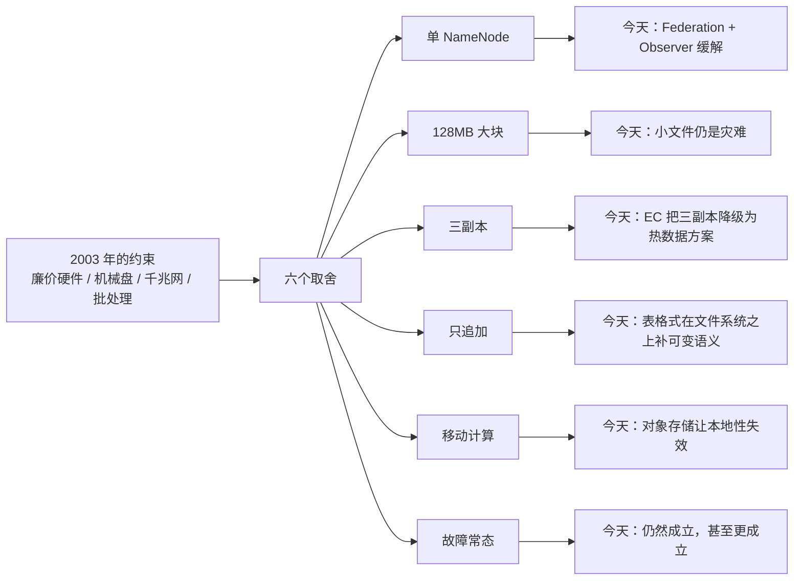
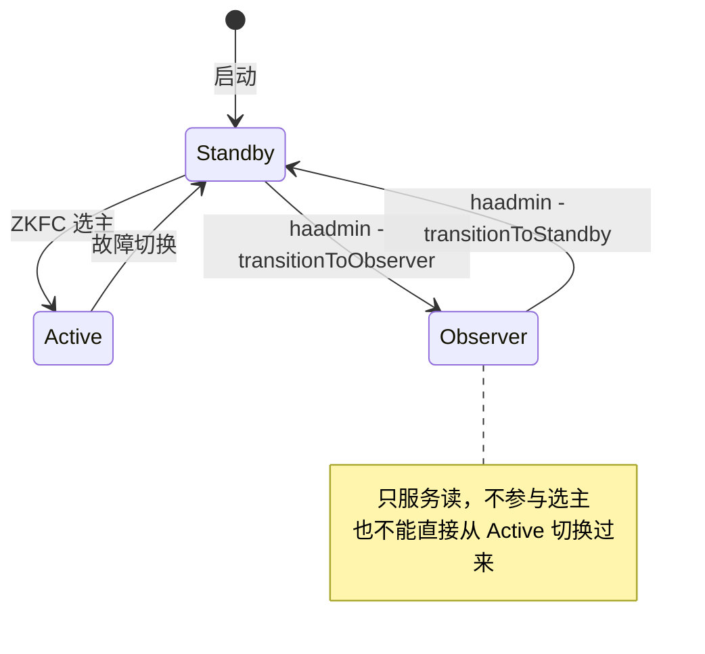
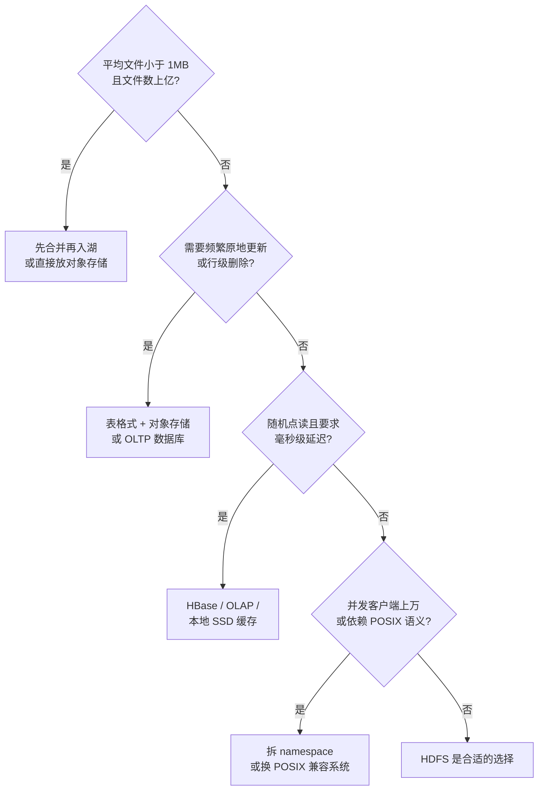
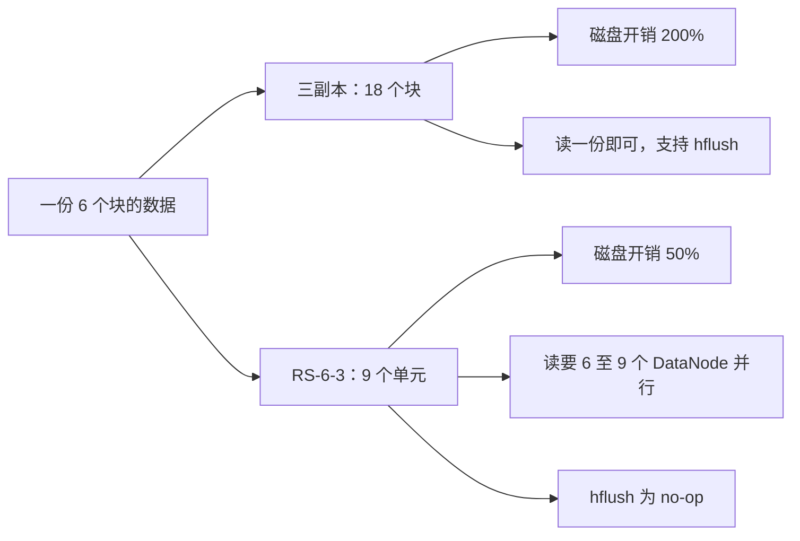

# HDFS 的诞生——大规模分布式存储的工程哲学

**摘要：**

HDFS 常被讲成一串"奇怪"的设计：元数据全放内存、块大得离谱、文件写完不能改、计算要贴着数据跑。这些选择在 2006 年前后都是被硬件价格与负载形态逼出来的最优解，但二十年过去，磁盘换成了 SSD、副本有了纠删码、存储搬到了对象存储，其中几项正在从资产变成负债。本文不做逐层的机制拆解，而是把六个取舍逐个拆成"初衷—代价—今天是否还成立"三段账：单 NameNode 用一致性换了内存天花板，大块用寻道时间换了元数据条目，三副本用三倍空间换了免运维的可靠，只追加用不可修改换掉了分布式锁，移动计算用调度弹性换了网络带宽，故障常态用软件换掉了硬件。随后回答三个今天才会被追问的问题：哪些负载根本不该交给 HDFS，纠删码如何把三副本从唯一选择降级成热数据的解，存算分离又如何把 HDFS 从存储层挤成缓存与临时区。结尾给出三张判据表与三个反例，落点是：设计有保质期，判断一个系统能不能用，要先看它当年的假设今天还剩几条。

> [!info] 本列定位
> 与概述篇的分工：概述篇讲 HDFS 是什么、能干什么，本列讲每个机制怎么实现、出问题怎么判。这一列里，机制层在 02 至 10 篇，逐层拆数据结构、写入、副本、HA、Federation、存储与恢复；判据层就是本篇，回答每个设计选择当年为什么成立、今天还剩几分、什么负载不该交给它。概述篇见 [[大数据/读书笔记-大数据概览/01 HDFS：分布式文件系统的数据可靠性与扩展性|HDFS：数据可靠性与扩展性]]，列内阅读顺序见 [[大数据/Hadoop/HDFS/00 专栏导览|HDFS 专栏导览]]；HDFS 为何撑不起随机读写、列族存储为何要另起一套引擎，见 [[大数据/HBase/01 HBase 的诞生——为什么 HDFS 不够用，列族存储的设计哲学|HBase 的诞生]]。

---

## 第 1 章 一条被地形塑形的河道

2003 年 10 月的 SOSP 上，Google 的三位工程师交出的不是一篇理论文章，而是一份工程报告：他们要在几千台会坏、会慢、会被换掉的商用 PC 上，存下整个互联网的网页，还要让成百上千台机器同时把这些网页扫一遍。这份报告后来被反复引用，多数引用停在"主从架构""三副本""大块"这些名词上，却很少追问一句：这些名词为什么必须是这副样子。

笔者的看法是，HDFS 更像一条被地形塑形的河道，而不是一座按图纸施工的大坝。地形是当年的硬件价格、磁盘特性、网络带宽和搜索公司的负载形态；河道是它最终长成的样子。地形一变，河道不会自己改向，水要么漫出来，要么绕道走。今天围绕 HDFS 的大部分争论——小文件、EC、存算分离——本质都是在讨论"地形变了，这条河道还够不够用"。

### 1.1 三堵墙

把时间拨回 2003 年，大规模存储要面对的是三堵墙。

第一堵是钱：当时企业级存储的主流答案是 SAN 或 NAS 加高端阵列，价格随容量超线性上涨，从 TB 级走到 PB 级，预算会先于技术崩掉。GFS 论文因此把"跑在廉价商用硬件上"写成设计目标，这不是姿态，而是唯一可行的经济学。

第二堵是带宽：集中式存储的对外总带宽是固定的，几百台计算节点同时扫数据时，阵列本身就是瓶颈；而批处理要的恰恰是几百 GB 到几 TB 的连续吞吐。把磁盘分散到每台机器上可以解决带宽，但会立刻引出第三堵墙。

第三堵是复杂度：数据分散在各节点本地盘上，就没有统一命名空间，应用得自己记住"数据在哪台机器"，容错也得应用自己实现。对搜索引擎这种要反复全量扫描的系统，这等于把分布式系统的全部难度下推给每一个业务团队。

GFS 与 HDFS 的解法是把第二堵墙的收益（本地盘带宽）与第三堵墙的解法（统一命名空间、自动副本）焊在一起：数据放在计算节点本地，但对外只暴露一棵目录树；可靠性不靠硬件，靠软件多存几份。这套组合在当年没有替代品，于是它成了此后十几年大数据基础设施的默认形状。它的直接回报是读吞吐随节点数近似线性增长：一百台节点各出 100MB/s，聚合就是 10GB/s 量级，这是任何集中式阵列都做不到的。

开源侧的落地稍晚一步。2004 年 Doug Cutting 与 Mike Cafarella 在做 Nutch 时把这套思路用 Java 实现成 NDFS，2006 年随 Hadoop 从 Nutch 独立而改名 HDFS，实现语言从 C++ 换成 Java，也让这套架构进入了开源生态的轨道；2010 年 Shvachko 等人的论文把它在生产规模下的实现完整披露出来。

### 1.2 设计是约束的函数

顺着这个视角看，HDFS 的每一个"奇怪"选择都能写成一个函数：给定当年的硬件与负载，求出吞吐最大、成本最低的那个点。

单 NameNode 是因为元数据操作必须快且必须一致，一个进程一把锁最省事；块大是因为机械盘寻道太贵，且元数据条目数直接吃 NameNode 内存；三副本是因为廉价盘的故障率不允许任何精巧的纠错方案；只追加是因为随机写会把一致性问题从"文件系统内部"扩散到"所有副本之间的协调"；移动计算是因为 PB 级数据搬一次就要把网络打满；故障常态则是因为几千台机器的规模让"每天坏一台"成为日常。

这些选择彼此咬合，任何一条单独拿出来都不成立。譬如"大块"之所以能成立，前提是"只追加、顺序读"，因为顺序读不在乎单次读多少；而"只追加"之所以能成立，前提是"移动计算"，因为批处理作业愿意等一个完整文件写完之后再开始。理解这种咬合关系，比记住六个名词重要得多。

### 1.3 地形变了

变化发生在三个方向。

硬件这边，机械盘让位给 SSD，随机读延迟从毫秒级掉到百微秒级，寻道时间这个当年推导块大小的核心变量，在闪存上几乎消失；同时单盘容量涨了两个数量级，节点数从几百涨到几千，故障从"偶发"变成"每天都有"。

负载这边，批处理不再是唯一形态。交互式查询、流式写入、增量更新、机器学习特征回灌，这些负载对延迟、对可见性、对原地修改的要求，与"写一次读多次"相差很远。

架构这边，对象存储成熟了，存算分离成了云上的默认姿势。数据不再必须与计算同生命周期，HDFS 也就不再必须是"唯一的存储层"。

三件事叠加的结果是：HDFS 没死，但它从"大数据存储的默认答案"退成了"特定负载下的一个选项"。本文要做的，就是把这个退化过程拆开，看看哪几个取舍还在挣钱，哪几个已经开始收利息。

下面这张图把约束、选择与今天的处境放在一条线上，后文按这条线展开。

### 1.4 继承了什么，又改了哪里

HDFS 不是 GFS 的逐行翻译：两者共享主从架构、大块、多副本、流水线写入与数据本地性，但在几处会影响使用的细节上分道扬镳，下表只列这些差异。

| 维度 | GFS | HDFS |
|---|---|---|
| 实现语言 | C++ | Java |
| 块与单元 | 64MB Chunk | 64MB 起，2.x 起默认 128MB Block |
| 并发写入 | 支持多客户端 record append，容忍副本间少量重复与空洞 | 单写入者租约，流水线全部确认才算成功 |
| 一致性模型 | 宽松，重复与空洞由应用处理 | 写入需流水线确认；hflush 保证可见，hsync 保证持久 |
| Master 高可用 | 有影子 Master 提供读服务 | 1.x 无 HA，2.x 起 QJM 主备，3.x 增加 Observer 读 |
| 命名空间扩展 | 论文未展开 | Federation 多命名空间，加 ViewFs 或 RBF 统一视图 |
| 冷数据冗余 | 三副本 | 三副本，3.0 起可选纠删码 |
| 快照 | 支持 | 支持（HDFS Snapshots） |

最后两行是 HDFS 后来补上的能力：Federation 与 EC 都不在 GFS 的设计里，它们是"单 NameNode"与"三副本"这两笔债的还款方式。也正因为是补丁，它们的语义边界比原生设计更窄：Federation 只扩集群总量、不扩单个命名空间，EC 用存储效率换掉了 hflush 与 append。

---

## 第 2 章 六个取舍：初衷、代价与今天的成色

这一章逐个过六个取舍。每个都按同一套问法：当年为什么这么选，不这么选会怎样，代价落在谁头上，今天这个代价还值不值。

### 2.1 单 NameNode：把一致性收进一个进程

元数据是 HDFS 最忙的部分。一次作业启动，几百个客户端同时 `open`、`getBlockLocations`、`listStatus`，这些请求全部打到 NameNode；一个文件写完关闭，NameNode 要落一条 edit log；DataNode 上线要发块报告，下线要被判死。这些操作有一个共同要求：必须看到一个一致的命名空间。

把命名空间放进一个进程，用一把读写锁保护，是这个问题的最短解。改名要么成功要么失败，不会出现"目录 A 改了、目录 B 没改"的中间态；块到副本的映射只有一份权威副本，不需要跨节点协商；也不必引入 Paxos 或 Raft 这类共识协议来维护元数据复制。用一句话概括：HDFS 拿**单点**换掉了分布式共识。

代价有三层：最表层是单点故障，NameNode 挂了整个集群不可用，这一层在 Hadoop 2.x 用 HA 解决。中间层是**内存天花板**，所有 INode 与块映射都必须在堆里，堆有多大，集群能装多少个"对象"就有多硬的上限，这一层用 Federation 缓解。最里层是写路径的串行性：命名空间修改事务在单个 NameNode 上串行提交，无论加多少台 DataNode，一个 namespace 每秒能处理的创建、改名、删除次数都不会随集群规模线性增长。这一层至今没有被真正解决，Federation 的做法是把 namespace 切开，而不是让一个 namespace 变快。

不这样选会怎样？若当年就做多主共享命名空间，就要处理跨节点元数据事务、目录锁、块映射冲突，复杂度向 Ceph 那一档靠拢，而 2006 年的团队与 Java 生态撑不起。所以这个取舍在当时是对的，它的债务是分期还的：先还可用性，再还容量，最后剩下的那部分，恐怕要等下一代系统来还。

### 2.2 大块：用寻道时间换元数据条目

块大小的经典推导是从寻道时间出发的：机械盘一次随机寻道约 5 到 10 毫秒，顺序读约 100MB/s，若希望寻道开销占比压到 1% 以下，一个块至少要读 100 倍于寻道时间的数据量，算下来约 100MB。128MB 落在这个区间内，且是 2 的整次幂，便于对齐与位运算。

这个推导只解释了"下限"。真正把默认值从 64MB 推到 128MB 的，是另外两笔账。一笔是元数据：NameNode 里每个块对应一个对象，块越大，同样字节数下的对象越少，堆就越省。另一笔常被忽略：客户端与 NameNode 的交互次数、以及 RPC 总量，都与块数成正比；一个 1TB 的文件用 64MB 块是 16384 个块，用 128MB 块是 8192 个块，后者的 `getBlockLocations` 调用少一半。

代价分散在三处：其一是尾块浪费：一个 130MB 的文件占两个块，第二个块只用了 2MB，但 NameNode 仍为它维护一个完整对象；这在 HDFS 里是常态而非异常，因为大多数文件的最后一块都是不满的。其二是任务粒度：MapReduce 的输入分片默认等于块大小，块越大，同样数据量下的 map 数越少，小作业的并行度会被块大小反向限制。其三是**小文件的结构性劣势**：小于一个块的文件仍然要占一个 INode 加一个块对象，块的物理空间不浪费，元数据一个字节都省不掉。

关于默认值的演变，有一处常见的误记需要纠正：`dfs.blocksize` 的官方默认值在 Hadoop 1.x 是 64MB，从 2.x 起改为 128MB，Hadoop 3.3.x 的**默认仍是 128MB**。生产集群里常见的 256MB 是运维侧的调优结果，不是官方默认，具体取值以对应版本的 `hdfs-default.xml` 为准。

今天这条取舍还成立吗？在机械盘为主的集群上，寻道推导依然有效；在 SSD 集群上，寻道的理由已经消失，128MB 之所以还合理，靠的是元数据与 RPC 摊销这两笔账，而不是 IO 特性。这也意味着块大小继续往上走的边际收益在收窄：256MB 省下的是 NameNode 内存与 RPC 次数，付出的是尾块浪费与任务粒度变粗，两边都不再是数量级差异。

### 2.3 三副本：用三倍空间换免运维的可靠

副本数是 HDFS 最直白的一笔交易：一份数据存三份，任意两份所在节点同时坏掉也不丢。放置策略再叠一层**机架感知**（Rack Awareness），默认是把第一份放在客户端所在节点或随机节点，第二份放在另一个机架，第三份放在第二份同机架的另一个节点。这样单节点故障、单机架故障都能被覆盖。

代价是 200% 的存储开销，以及三倍的写入网络流量。后一点常被低估：流水线写入虽然让每个 DataNode 只往下一跳发一次，但整条链路上流过的是完整的三份字节，机架间带宽要为副本付出真实成本。恢复时同样如此，一个节点退役，它上面的每个块都要从别的副本读一份再写一份。

为什么当年不选纠删码？因为 EC 在 2006 年的商用硬件上算不动。Reed-Solomon 的编解码要消耗 CPU，而那个年代的服务器 CPU 还要留给 MapReduce；更关键的是，EC 把"读一个块"变成"读多个块才能解码"，而当时的网络与磁盘都不便宜，用计算换存储的账算不过来。三副本是用最笨的办法买最省心的可靠性，这个选择在机械盘时代是对的。

今天这条取舍已经松动了。纠删码在 Hadoop 3.0 进入主线，把冷数据的存储开销从三倍压到一点五倍；同时"降副本"（把冷数据从 3 降到 2）也成了常见做法。三副本剩下的地盘是热数据、需要 `hflush` 的数据、以及小集群。第 6 章会把这张账算细。

### 2.4 只追加：用不可修改换掉分布式锁

HDFS 的文件生命周期是"创建、追加、关闭、只读"。关闭之后内容不可改；关闭之前也只能从末尾追加，且任何时刻只有一个写入者持有租约。

不支持随机改，直接省掉了三样东西：跨副本的位置更新协议、文件级的写锁管理、以及部分副本更新失败后的修复逻辑。写入路径因此可以简化成一条单向流水线：客户端切包，发给第一个 DataNode，逐个转发，逐个回 ack；所有副本按同一顺序接收同一串字节，一致性由顺序保证，而不是由协商保证。

代价是"更新"这件事被推给了上层。要在 HDFS 上改一行记录，实际做法是重写整个文件或整个分区：Hive 的 `INSERT OVERWRITE` 是重写分区，HBase 的 HFile 是不可变的、更新变成追加新版本再靠合并清理，数据湖的三种表格式则把"新文件加元数据指针替换"做成了一套提交协议。这些方案都不是 HDFS 的功能，而是对 HDFS 不可变语义的补偿。

这里有一个容易混淆的细节，与后文 EC 直接相关：HDFS 的 `hflush()` 与 `hsync()` 是两件事。`hflush()` 把客户端缓冲推出去，并等到流水线上所有 DataNode 确认收到，此时数据对新的读者可见，但不保证已落盘；`hsync()` 再往下等到 DataNode 落盘。可见性与持久性被拆成两个语义，这是所有"写入后立即可读"场景的基础，也是纠删码文件最尴尬的地方。

### 2.5 移动计算：用调度弹性换网络带宽

**数据本地性**（Data Locality）是 HDFS 与计算框架之间的一份协议，而不只是一个优化开关。客户端拿到的不是文件句柄，而是一组带节点地址的块位置；调度器据此把任务放到数据所在的节点，形成 NODE_LOCAL、RACK_LOCAL、ANY 三级本地性。三副本让每个块有三个可选位置，调度器有腾挪空间，这是副本数除了可靠性之外的第二个作用。

代价是计算与存储被绑在同一个生命周期里。扩容要两边一起扩，因为多出来的计算节点如果没有本地数据，本地性就没了；退役一个 DataNode 要先搬走它上面的数据，否则退役期间集群的读带宽会下降；资源利用率也被绑住，存储满而计算闲时，机器不能挪作他用。

在私有集群里，这笔交易的收益是实打实的：几千台机器的批处理作业，本地读与跨网络读的差别可以直接从作业时长上看出来。但一旦数据搬到了对象存储，本地性这个前提就不存在了，调度器能拿到的只有"远端对象"，此时讨论 NODE_LOCAL 已经没有意义。第 7 章会讲这一点如何改变了 HDFS 的角色。

### 2.6 故障常态：用软件换掉硬件

"组件失效是常态而非异常"是六条假设里最反直觉、也最持久的一条。它推导出了一整套自愈机制：DataNode 每 3 秒心跳，NameNode 在 `2 × dfs.namenode.heartbeat.recheck-interval` 加 `10 × 心跳间隔`，即默认约 630 秒（10.5 分钟）后判定节点死亡；副本管理器持续扫描副本数不足的块并触发复制；DataNode 侧的 `VolumeScanner` 定期扫描磁盘坏块并上报；块报告让 NameNode 掌握全量副本分布。

这笔账可以粗算：假设单盘年故障率取 2%（消费级磁盘的量级），一个 1000 节点、每节点 12 块盘的集群有 12000 块盘，按这个假设推算，平均每天约有 0.66 块盘失效——集群几乎每天都要处理一次磁盘故障。这个数字不是任何真实集群的实测值，只是用来说明量级的示例推算，但足以说明：在这种规模下，把可靠性寄托在单块盘上不成立。

今天这条假设不但成立，而且在云上变得更复杂。故障形态从"磁盘坏"扩展成"节点被回收、网络抖动、对象存储限流、宿主机迁移"，其中抢占式实例的回收频率远高于物理磁盘故障率。也就是说，HDFS 当年为"硬件会坏"设计的自愈逻辑，在弹性环境里依然需要，只是需要它的理由换了一个。

### 2.7 六个取舍的总账

把六条放在一张表里，能看清哪些是资产、哪些已经变成负债。

| 取舍 | 当年的初衷 | 付出的代价 | 今天的成色 | 主要缓解手段 |
|---|---|---|---|---|
| 单 NameNode | 用单进程换掉分布式共识，元数据操作快且强一致 | 单点、内存天花板、命名空间写路径串行 | 可用性与容量已缓解，写吞吐仍受限 | HA、Federation、Observer NameNode、RBF |
| 128MB 大块 | 摊薄寻道、压缩元数据条目与 RPC 次数 | 尾块浪费、任务粒度变粗、小文件结构劣势 | 大文件场景仍成立，小文件场景是灾难 | 合并写入、列式格式、HAR 归档 |
| 三副本 | 用软件冗余替代昂贵硬件 | 三倍存储、三倍写入网络、恢复搬三份 | 已从唯一解降级为热数据方案 | 纠删码、按温度分层降副本 |
| 只追加 | 省掉跨副本更新协议与写锁 | 无法原地更新，更新要靠重写 | 仍成立，可变语义上移到表格式 | Iceberg/Delta/Hudi、Hive ACID |
| 移动计算 | 避免 PB 级数据跨网络搬运 | 存算生命周期绑定、弹性差 | 私有集群成立，云上基本失效 | 存算分离、远端缓存、本地盘 HDFS 只做临时区 |
| 故障常态 | 软件自愈替代硬件可靠性 | 心跳与扫描的持续开销、副本恢复带宽 | 仍成立，故障形态改变 | 机架感知、VolumeScanner、EC 重建 |

六个取舍里，最耐用的是"故障常态"，最先失效的是"移动计算"，最容易被误解的是"大块"——很多人以为大块是为了顺序读性能，其实元数据才是主因。

把这张表落到两个最常被问到的参数上，具体默认值与版本差异以对应版本的 `hdfs-default.xml` 为准。

| 参数 | 调大或调高 | 调小或调低 |
|---|---|---|
| `dfs.blocksize` | 元数据与 RPC 摊销变好，尾块浪费与任务粒度变粗 | 尾块浪费与任务粒度变细，但 NameNode 对象数与 RPC 次数上升 |
| `dfs.replication` | 容错与并发读带宽上升，存储与写入网络按倍数上升 | 存储与写入网络下降，单节点或单机架失效就可能丢块 |

两个参数方向相反，本质是同一笔交易：用 NameNode 的资源换 DataNode 的资源。

---

## 第 3 章 单 NameNode 的三次补救与残留

单 NameNode 的债务分了三次还：HA 还可用性，Federation 还容量，Observer NameNode 还读吞吐。三次补救各自解决了什么、没解决什么，恰好勾勒出这个取舍的边界。

### 3.1 HA：修可用性，不修容量

Hadoop 2.x 的 HA 用 QJM（Quorum Journal Manager）把 edit log 写到一组 JournalNode 上，Standby 持续回放，ZKFC 负责健康检查与选主，切换时用 fencing 防止旧主继续对外服务。这套机制解决的是"NameNode 挂了怎么办"，它把不可用时间从"人工恢复数小时"压到"自动切换数十秒"。

但它不解决容量。Active 与 Standby 各自持有一份完整的命名空间，两份内存需求是一样的，天花板还在原地。HA 也没有改变写路径的串行性：同一时刻只有一个 Active 在处理命名空间修改，Standby 只是跟账。

### 3.2 Federation：切分命名空间，而不是扩容它

Federation 的做法是让多个 NameNode 各自管理一个命名空间（Namespace），各自持有一个块池（Block Pool），DataNode 同时向多个 NameNode 注册并存储多个块池的数据。客户端通过 ViewFs 或路由式联邦（Router-Based Federation，RBF）看到一棵合并后的目录树。

这里有一处语义差别：Federation 扩的是"集群能装多少"，不是"一个命名空间能装多少"。总量可以随 NameNode 数量线性增长，但单个命名空间仍然受单进程内存与写路径限制。跨命名空间的操作也失去了原子性，两个目录分属不同 NameNode 时，rename 无法原子完成，配额、快照、加密区都是命名空间内的概念。

因此 Federation 的适用判据不是"集群大了就上"，而是"能不能把业务按目录切开且接受跨切分的操作变弱"。切分粒度一旦定下就很难改，因为搬移目录意味着跨命名空间复制数据，这是一笔实打实的成本。

### 3.3 Observer：只分担读，且不能接管

Observer NameNode 是第三次补救，思路是把"读"从 Active 上分出去。Observer 像 Standby 一样持续跟 edit log 与块报告，但可以对外提供读服务；客户端通过 `ObserverReadProxyProvider` 优先把读请求发给 Observer，全部失败才回退 Active。

为了让"读自己的写"仍然成立，Observer 机制引入了 state ID：客户端每次写之后更新本地的 state ID，后续读把它带给 Observer，Observer 等自己的事务 ID 追上之后才返回结果；跨客户端的可见性靠 `msync()` 显式同步。这套设计很干净，代价是客户端侧要配置 proxy provider，且必须关掉 `dfs.namenode.accesstime.precision`——否则 `getBlockLocations` 会因为要更新访问时间而变成写请求，在 Observer 上全部失败并回退 Active，读扩展的收益直接归零。

有一点需要特别指出：截至 Hadoop 3.3.x，Observer NameNode **不参与故障切换**，官方文档明确写着该特性尚未实现。这意味着 Observer 只能分担读压力，不能在 Active 挂掉时顶上，HA 仍然需要至少两个可切换的 NameNode。把 Observer 当成"第三个 NameNode 副本"来规划容量，是一个常见误判。

下面这张状态图描述了三者之间允许的转换，注意 Active 与 Observer 之间没有直接通路。

三种补救的对比可以整理成一张表。

| 手段 | 解决什么 | 没解决什么 | 引入的代价 |
|---|---|---|---|
| HA（QJM） | NameNode 单点导致的不可用 | 内存天花板、写路径串行 | 三份 JournalNode、切换期间的短暂抖动、fencing 配置 |
| Federation | 集群总容量与业务隔离 | 单个命名空间的容量与写吞吐、跨命名空间原子性 | 切分粒度固化、ViewFs/RBF 配置、DataNode 多注册 |
| Observer NameNode | 读请求的吞吐与压力分摊 | 写吞吐、容量、故障接管 | 客户端 proxy 配置、state ID 与 msync 语义、必须关闭访问时间 |

### 3.4 残留的那部分债务

三次补救之后，剩下的问题集中在写路径上。命名空间的修改事务仍是单进程串行，创建、改名、删除这些操作无法靠加机器解决；块报告的处理也是集中的，几百万块的集群在启动时要先处理完所有 DataNode 的上报才能退出安全模式，节点越多、块越多，冷启动越慢；每一轮全量块报告都会短暂占用 NameNode 的锁，与客户端的读请求争抢。

这条残留债务解释了一个现象：大规模集群的容量规划，往往不是被磁盘容量卡住的，而是被"对象数"和"每秒元数据操作数"卡住的。

---

## 第 4 章 150 字节的乘法

小文件问题是 HDFS 最著名的痛点，但多数讨论停在"小文件多了 NameNode 内存不够"，很少有人把它算成一张可复算的表。这一章就做这件事。

### 4.1 两个对象，一笔账

NameNode 的堆里，与文件相关的对象主要两类：INode 记录文件或目录本身（名字、权限、时间戳、块列表指针），BlockInfo 记录块本身（块 ID、长度、副本所在 DataNode 列表）。社区与运维文档长期沿用的经验值是每个对象约 150 字节，这个数字会随 Hadoop 版本、对象属性（快照、加密、配额、存储策略）与 JVM 对象头开销浮动，量级是对的，精确值没有意义。

关键在于：这笔账是**按对象算**的，不是按字节算的。一个 1KB 的文件与一个 128MB 的文件，在 NameNode 里占的对象数一样——INode 一个、BlockInfo 一个。对象像门牌号，文件再小，门牌也得挂一块。文件小到 1KB，DataNode 的磁盘上确实只占 1KB（不会补齐到 128MB），但 NameNode 的内存一个字节都不省。

### 4.2 把乘法做完

假设每个小文件恰好一个块，按每对象 150 字节、INode 与 BlockInfo 各计一次，得到下表。表中所有数字都是按上述假设的示例推算，不是任何集群的实测值。

| 文件数 | INode 内存 | BlockInfo 内存 | 合计（双计） | 只计 INode（单对象模型） |
|---|---|---|---|---|
| 1000 万 | 1.5GB | 1.5GB | 3GB | 1.5GB |
| 1 亿 | 15GB | 15GB | 30GB | 15GB |
| 10 亿 | 150GB | 150GB | 300GB | 150GB |

1 亿小文件对应 **15GB 到 30GB** 的堆占用，10 亿对应 150GB 到 300GB。作为对照，若集群里都是 1GB 左右的大文件，1PB 数据只有约 100 万个文件、约 800 万个块，元数据合计不过 1GB 出头，NameNode 堆的压力可以忽略。同样是 1PB，文件数差了两个数量级，对象数也差了一个数量级以上，这就是小文件问题的全部来源。

还要再打一个折扣：堆不能全给元数据。edits 双缓冲、快照、RPC 队列、块报告队列、JVM 自身与 GC 预留都要占地方，实践中留给元数据的安全区间通常不到堆的一半。按一半算，一台 200GB 堆的 NameNode 大约能扛 3 亿到 6 亿个"文件加块"的组合；若把整堆都算给元数据，这个数字会翻倍。这也是为什么大集群的 NameNode 堆从 64GB 一路加到 200GB 以上，仍然会在小文件高峰期出现长 GC。

### 4.3 调大块救不了

一个常见的直觉是：既然块太小导致对象多，那把 `dfs.blocksize` 调到 256MB 或 1GB 不就行了？不行。块大小影响的是"一个大文件被切成几块"，不影响"一个小文件占几个对象"。一个 1KB 的文件无论块多大，都是 1 个 INode 加 1 个 BlockInfo；把块调到 1GB，只是让大文件的块数变少，小文件的对象数一个不少。

真正能改变对象数的只有一种办法：把多个小文件合并成一个大文件，让它们在 NameNode 里共享一个 INode 与一组块。HAR 归档、SequenceFile 容器、以及把数据写成 ORC 或 Parquet 这类"自带行组与索引的大文件"，走的都是这条路。列式格式之所以在大数据栈里成为默认，除了压缩率与列裁剪，还有一个不常被提起的原因：它天然把一批记录收进一个大文件，顺手解决了小文件问题。

### 4.4 内存之外的连带成本

小文件的代价不止内存，还有四笔。

第一笔是元数据操作次数：每个文件的创建、关闭、读取都对应至少一次 RPC，1 亿个文件的目录遍历会把 NameNode 的 RPC 队列打满，表现为 `Call queue is full` 与客户端超时。

第二笔是任务粒度：MapReduce 与 Spark 的输入分片按文件或块切分，小文件多意味着任务数多，每个任务的启动开销（JVM 启动、序列化、调度）远大于它处理的数据量，作业时间被固定开销吃掉。

第三笔是启动与检查点：NameNode 重启要回放 edit log、等 DataNode 上报块位置、达到副本阈值才能退出安全模式；块越多，这段冷启动越长。SecondaryNameNode 或 Standby 做检查点时要合并 FsImage 与 edits，对象数直接决定合并时长。

第四笔在 DataNode 侧：每个块在磁盘上是一个数据文件加一个元数据文件，小文件多了以后，DataNode 的目录项数量与 IOPS 压力都会上升，`VolumeScanner` 扫描一轮的时间也会变长。磁盘空间没浪费，但磁盘的 inode 与寻道预算被消耗了。

### 4.5 对象存储为什么不怕

同样存 1 亿个小对象，对象存储不会出现"单点内存爆掉"，原因是它的元数据索引由服务端分片维护，不依赖某个进程把全量对象放进内存。这是架构差异带来的天然优势，也是"小文件场景该换对象存储"这句话的底层依据。

但对象存储不是免费的。它的元数据操作是网络往返，`list` 按前缀分页返回，目录是被前缀模拟出来的，`rename` 往往要复制加删除。也就是说，小文件从"压垮 NameNode"变成了"压垮请求预算"：单次请求延迟几十毫秒，请求数按量计费，几百万次 list 与 get 会把成本和延迟一起推上去。判断小文件该放哪，本质是在"内存"与"请求"之间选一个更便宜的瓶颈。

---

## 第 5 章 四类不该交给 HDFS 的负载

HDFS 的边界不是一条线，而是四条。任何一条踩中，都说明这个负载与 HDFS 的假设不合。

### 5.1 低延迟随机读

HDFS 的读路径最短也要走一遍：客户端向 NameNode 要块位置，拿到一组 DataNode 地址，连上其中一个，从指定偏移读。即使全部命中缓存，这条路径也包含至少一次 RPC、一次建连、一次磁盘或页缓存访问，延迟通常在毫秒级，跨机架或冷读时到几十毫秒；这个量级对要求亚毫秒响应的在线服务来说已经是不可接受的开销。

[[大数据/HBase/01 HBase 的诞生——为什么 HDFS 不够用，列族存储的设计哲学|HBase]] 是这个问题最典型的回答。它没有试图让 HDFS 变快，而是把 HDFS 当成一个顺序设备：写入走 WAL 顺序追加，读取走 RegionServer 的 BlockCache 与 HFile 的块索引，只有缓存未命中时才回 HDFS 读一次；再用短路读（Short-Circuit Read）绕过 DataNode 进程直接读本地文件，把网络与协议开销削掉。HBase 的低延迟来自它在 HDFS 之上重建的**缓存与索引**，不是 HDFS 本身。这也解释了为什么 HBase 的性能高度依赖内存配比，而不是 HDFS 的块大小。

### 5.2 需要原地更新的场景

HDFS 只追加，所以"改一行数据"这件事必须由上层翻译成"写一批新文件，再原子地换掉旧文件"。三种表格式各自给了翻译方案：Iceberg 与 Delta 默认走**写时复制**（Copy-on-Write），改动落到新文件，提交时替换元数据指针；Hudi 提供**读时合并**（Merge-on-Read），把增量写成日志文件，读的时候再合并。

这套翻译的代价是写放大与文件膨胀。一次只改一行的操作，可能重写整个数据文件；即便走读时合并，增量文件也需要后台压缩来收敛，压缩不及时就会拖慢读。判断要不要在 HDFS 上做更新，不能只看"能不能实现"，要看更新比例与压缩预算：每天改动比例很低、且能接受分钟级可见性，表格式是合适的；如果要求秒级可见、且更新频繁，HDFS 加表格式这条链路会一直处在追赶状态。

### 5.3 海量并发客户端

NameNode 是单点，这个"单点"在容量之外还有一层含义：所有客户端的元数据请求都要经过同一组 RPC handler 线程。handler 数量是配置项，默认值不高，大型集群通常按节点规模上调，但单进程能处理的 RPC 数有上限。

粗略估算：1 万个并发客户端，每个客户端每秒做 10 次元数据操作（打开文件、取块位置、列目录），就是每秒 10 万次 RPC。这个量级会先把 RPC 队列填满，再表现为 `Slow RPC`、`Call queue is full`，最后传导成客户端超时与作业重试。对小文件密集的作业，元数据请求数与数据量完全不成比例，一条 `SELECT count(*)` 可能产生几十万次元数据调用。

缓解手段有三条：把客户端合并、把 namespace 切开（Federation，让请求分散到多个 NameNode）、把读请求分给 Observer。三条都不能让单个 namespace 的写路径变快，只能把压力摊开。

### 5.4 需要 POSIX 语义的应用

HDFS 提供的是"类文件系统"接口，不是 POSIX 文件系统。差异不在 API 名字，而在几处语义：不支持任意位置写入；不支持多写入者并发追加同一文件；不支持硬链接；不支持 `mmap`；没有文件锁；`rename` 在单个命名空间内是原子的，跨命名空间不是；打开中的文件被删除、目录被替换这些边界行为与本地文件系统并不一致。

很多应用在本地盘上跑得好好的，搬到 HDFS 上出问题，问题往往不在性能，而在这些语义。典型例子是依赖"写临时目录再原子 rename 成正式目录"的发布逻辑：在单命名空间内这是可行的，一旦目录跨了 Federation 的切分，原子性就消失了。又如依赖 `O_APPEND` 多进程并发写日志的采集器，在 HDFS 上必须改成每进程一个文件，再靠上层合并。

把差异做成一张表更直观，表中的对照对象是 ext4、XFS 这一档本地文件系统。

| 语义 | 本地 POSIX 文件系统 | HDFS |
|---|---|---|
| 任意位置写入 | 支持 | 不支持，只能追加 |
| 多写入者并发写同一文件 | 支持（互斥由应用负责） | 不支持，单写入者租约 |
| 文件锁（flock/fcntl） | 支持 | 不支持 |
| mmap | 支持 | 不支持 |
| 硬链接 | 支持 | 不支持 |
| rename 原子性 | 同一目录内原子 | 同一命名空间内原子，跨 namespace 不保证 |
| fsync 语义 | 返回即已落盘 | hsync 落盘，hflush 只保证可见 |
| 目录语义 | 真实目录项 | 命名空间节点，接近但不一致 |

这张表解释了为什么"能不能挂载"不是一个好问题：即便通过 NFS Gateway 或 FUSE 挂上，底下仍是这套语义，挂载层只能翻译接口，翻译不了保证。

### 5.5 该不该用 HDFS：一张判据表

把上面四条收敛成一张表。用法是先看文件大小、访问模式、更新模式、并发度这四行落在哪一侧，再看是否需要 POSIX 语义、以及数据生命周期与集群是否同寿。

| 维度 | 落在这一侧，HDFS 合适 | 落在这一侧，考虑替代 | 替代方向 |
|---|---|---|---|
| 文件大小分布 | 平均远大于 128MB，单文件几百 MB 到数 GB | 平均小于 1MB，或文件数上亿 | 对象存储；或先合并再入湖 |
| 访问模式 | 顺序全扫、批量分析、一次写多次读 | 随机点读、毫秒级延迟、频繁小批读 | HBase、OLAP 引擎、本地 SSD 缓存 |
| 更新模式 | 只追加、按分区重写、可接受分钟级可见 | 频繁原地更新、行级删除、秒级可见 | 表格式加对象存储；OLTP 数据库 |
| 并发度 | 几十到几百个客户端，元数据 QPS 在万级以内 | 上万并发客户端，元数据 QPS 十万级 | 拆 namespace；对象存储；合并客户端 |
| POSIX 语义 | 只需要路径、目录、原子 rename（单 namespace 内） | 需要并发写、文件锁、mmap、硬链接 | JuiceFS、CephFS 等 POSIX 兼容系统 |
| 数据生命周期 | 数据与集群同寿，长期驻留本地盘 | 冷数据多、需要按需弹性、多引擎共享 | 存算分离，热数据缓存加对象存储 |

下面这张决策树把同样的判据排成执行顺序，从最常见的否决项开始问。

需要说明的是，这张表判的是"主存储该放哪"，不是"能不能用 HDFS"。一个系统完全可以主存储放对象存储，同时用一块 HDFS 做临时区与缓存，两者并不互斥，第 7 章会讲这种组合。

---

## 第 6 章 纠删码：把三倍变成一点五倍

三副本统治了 HDFS 十几年，直到纠删码（Erasure Coding，EC）在 Hadoop 3.0 进入主线。它改变的不只是存储成本，还有"三副本是不是唯一选择"这个判断本身。

### 6.1 三副本贵在哪

官方文档把三副本的开销写得很直白：默认 3 副本在存储空间与其他资源（譬如网络带宽）上有 **200%** 的额外开销。一份 6 个块的文件，三副本占 18 个块的空间；而这 18 个块里，有 12 个块在整个生命周期内可能从未被读过一次。

冷数据的处境更尴尬：它占着与其他数据一样的副本预算，却几乎不产生读流量。于是问题变成：能不能用更少的冗余换取同等甚至更高的容错？

### 6.2 EC 的做法：条带、块组与校验单元

EC 把文件切成更小的单元再编码。RS-6-3 的含义是：每 6 个数据单元加 3 个校验单元组成一个条带（Stripe），9 个单元分布在 9 个不同的 DataNode 上；这 9 个单元构成一个**块组**（Block Group），块组是 NameNode 管理的单位。任意 3 个单元丢失，都可以用剩下的 6 个解码恢复。可以把一个条带想成九块拼图：丢三块仍能拼回原图，但每次看整张图，都得先把散在九个节点上的碎片取回来。

几个具体参数值得记住：内置策略有五个：`RS-3-2-1024k`、`RS-6-3-1024k`、`RS-10-4-1024k`、`RS-LEGACY-6-3-1024k`、`XOR-2-1-1024k`，其中 `RS-6-3-1024k` 默认启用。单元大小（Cell Size）是 1MB，最大可配到 4MB。策略设在目录上，新建文件继承最近祖先目录的策略，文件一旦创建，策略不可改，要换策略只能重写数据——用 `distcp` 复制一份，而不是 rename。

### 6.3 省下来的账

把四种策略放在一起对比，存储效率的差别一目了然。表中"可丢单元数"指一个条带内可同时丢失的单元数。

| 策略 | 数据单元 | 校验单元 | 存储开销 | 存储效率 | 可丢单元数 | 最少 DataNode |
|---|---|---|---|---|---|---|
| 三副本 | 1 | 2（副本） | 200% | 33.3% | 2 个副本 | 3 |
| RS-6-3-1024k | 6 | 3 | 50% | 66.7% | 3 | 9 |
| RS-10-4-1024k | 10 | 4 | 40% | 71.4% | 4 | 14 |
| RS-3-2-1024k | 3 | 2 | 66.7% | 60% | 2 | 5 |

按上表做示例推算：一个 10PB 原始占用的三副本集群，有效数据约 3.33PB；若把其中 70% 的冷数据（约 2.33PB 有效数据）迁移到 RS-6-3 目录，这部分物理占用从 7PB 降到 3.5PB，全集群物理占用从 10PB 降到 6.5PB，省下 35%。如果冷数据比例更高、或者用 RS-10-4，节省还会更多。这是"存储开销从 3 倍降到 1.5 倍"在实际容量规划里的样子。

### 6.4 代价一：读要多个 DataNode

EC 的读路径与副本完全不同。读一个完整条带要并行从 6 个 DataNode 取数据单元（RS-6-3 的条带共涉及 9 个单元，某个单元缺失时才补读校验单元），任何一个单元所在的节点慢，整个条带的读取就被它拖住。官方文档还提醒，EC 文件跨机架分布，读写大部分是跨机架操作，网络对分带宽因此比副本集群更重要。

随机小读的放大更直接：单元大小 1MB，读 4KB 数据也要按 1MB 的单元去取，读放大 **256 倍**。所以 EC 适合大块顺序扫描，不适合点查，与三副本相比是实质退步。

### 6.5 代价二：恢复要网络带宽

副本恢复是"从别的副本复制一份"，EC 恢复是"读够 k 个单元，解码出一个"。RS-6-3 丢一个单元，要读 6 个单元才能恢复这 1 个，读放大约 6 倍；恢复任务由 DataNode 上的 `ECWorker` 执行，默认 8 个线程，与其他复制任务争抢带宽，重建任务的调度与限流见 [[大数据/Hadoop/HDFS/09 HDFS 容错与恢复机制——自愈修复的工程实现|容错与恢复机制]]。集群里同时坏几块盘时，EC 重建的网络压力会明显高于副本重建，这是"存储省了、带宽没省"的具体形态。

还有两个硬门槛：RS-6-3 要求集群至少有 9 个 DataNode，RS-10-4 要求 14 个；机架容错还要求机架数满足 `(数据单元 + 校验单元) / 校验单元` 向上取整，RS-6-3 至少 3 个机架，官方建议 9 个以上。小集群或机架数不足的集群，开 EC 只能做到节点级容错，机架级容错会失效。

### 6.6 代价三：hflush 是 no-op

这是 EC 最容易被忽略、也最危险的一条限制。官方文档写得很清楚：`hflush`、`hsync`、`concat`、`setReplication`、`truncate`、`append` 在 EC 文件上都不支持；其中 `append` 与 `truncate` 会直接抛 `IOException`，而 `hflush` 与 `hsync` 在 `DFSStripedOutputStream` 上是 **no-op**——调用不报错，但也不保证数据持久化。

no-op 是最糟糕的兼容方式：它不告诉你失败，只是不兑现承诺。任何依赖"写完立刻能被别人读到"的链路，在 EC 目录上都会静默失效。典型场景包括：Flink 或 Spark Streaming 的 checkpoint 目录（依赖 flush 语义保证快照可见与可恢复）、下游任务在同一个作业里紧跟上游读取中间结果、以及把 HDFS 当 WAL 用的组件。这些链路一旦落到 EC 目录，表现出来往往不是报错，而是"偶发读到旧数据"或"故障恢复后 checkpoint 缺失"，排查成本极高。

对应的处置很明确：checkpoint、WAL、中间结果这类目录保持三副本；只有"写完就不再改、读的时候可以整段扫"的冷数据目录才设 EC 策略。判断标准可以简化成一句：这条链路是否需要 `hflush` 的可见性承诺，需要就留在副本目录。

### 6.7 三副本与 EC 的判据

| 维度 | 三副本 | 纠删码（RS-6-3 / RS-10-4） |
|---|---|---|
| 存储开销 | 200% | 50% / 40% |
| 适用温度 | 热数据、频繁写、需要立刻可见 | 温数据与冷数据、一次写多次读 |
| 读延迟与读放大 | 读一份即可，无放大 | 读一个条带要多个 DataNode，小读放大 256 倍 |
| 写路径 | 流水线追加，支持 hflush/hsync | 条带并行写，hflush/hsync 为 no-op |
| append / truncate | 支持（单写入者） | 不支持，抛 IOException |
| 恢复成本 | 复制一份，读放大 1 倍 | 读 6 个单元恢复 1 个，读放大 6 倍，占重建带宽 |
| 最低集群规模 | 3 个 DataNode | RS-6-3 需 9 个，RS-10-4 需 14 个 |
| CPU 开销 | 几乎为零 | 编解码占 CPU，可选 ISA-L 加速 |
| 典型用法 | 热数据区、checkpoint、WAL、临时区 | 归档区、历史分区、冷数据湖 |

下面这张图对比两种布局的空间与读取路径，左边是三副本的"一份数据三个位置"，右边是 EC 的"九个单元拼一个条带"。

实践中的常见做法是按温度分层：热数据目录设 `REPLICATION` 策略，温数据设 RS-6-3，冷数据设 RS-10-4，再用 `distcp` 或表格式的迁移作业把老分区搬过去。EC 不是三副本的替代品，而是把三副本从全局默认降级成**热数据的默认**。

---

## 第 7 章 对象存储：HDFS 从存储变成缓存

如果说 EC 是在 HDFS 内部改造成本结构，那么对象存储是从外部改写了 HDFS 的定位。这一章讨论**存算分离**（Compute-Storage Separation）把 HDFS 挤到了什么位置。

### 7.1 存算分离的账

存算一体的成本结构是"按峰值配置、按生命周期摊销"：集群按最高负载买机器，数据与机器同寿，磁盘满了就加节点，计算不够也加节点，两边永远不能独立调整。它的好处是简单，网络是内网，数据在本地，延迟可控。

存算分离把这两件事拆开：数据放对象存储，按实际用量计费；计算用弹性集群，按作业需求起停。账面上的收益来自三处：计算可以按波峰波谷伸缩，不必为一年里的几个高峰常备机器；存储不必为计算节点预留容量，扩容只买存储；多套计算引擎（Spark、Trino、Flink）共享同一份数据，不必各自复制一份到自己的 HDFS。

代价也来自三处：网络变成瓶颈，所有读都要过网络，而内网带宽再宽也贵不过本地磁盘；请求要计费，元数据操作变成真金白银；语义变弱，对象存储没有目录、没有 rename、没有 flush。这三条决定了存算分离不是普适解，而是一个需要用负载特征去换的选项。

### 7.2 HDFS 的新角色

在存算分离的架构里，HDFS 并没有消失，而是换了角色。

第一个角色是缓存层：计算集群仍然需要一块离计算很近的存储来放热数据、放 shuffle 的溢写、放远端读取的缓存；这块存储可以是本地盘上的 HDFS，也可以是 Alluxio、JuiceFS 这类缓存层。此时 HDFS 的生命周期与作业或集群绑定，而不是与数据同寿，数据丢了可以从对象存储重建，副本数降到 1 是合理选择。

第二个角色是临时区：Spark 的 shuffle 文件、Flink 的 checkpoint（在支持 flush 的目录下）、MapReduce 的中间输出，这些数据的特点是"写完很快被读、读完就删"，对持久性要求低，对本地带宽要求高。用 HDFS 做临时区，比让这些数据穿过网络落到对象存储要划算得多。

第三个角色是近计算的存储底座：有些场景对延迟敏感、数据量又不足以撑起独立的对象存储访问层，本地 HDFS 仍然是合适的；但这时它服务的是"这一批作业"，而不是"整个公司的数据资产"。存算分离架构下的角色变化与调优手段，见 [[大数据/Hadoop/HDFS/10 HDFS 性能调优与生产实践——小文件治理与存算分离的未来|性能调优与存算分离]]。

下面这张图对比两种架构里数据与计算的关系，右边是 HDFS 收缩成缓存层之后的形态。

### 7.3 四个语义陷阱

把 HDFS 上的负载搬到对象存储，出问题的往往不是带宽，而是语义。

第一个陷阱是 `rename`：对象存储没有目录，`rename` 实现为"复制所有对象再删除原对象"，对一个几 TB 的分区做重命名，等于把整个分区搬一遍。Hive 的 `INSERT OVERWRITE`、Spark 的 `FileOutputCommitter`、以及各种"写临时目录再改名"的提交模式，都会在这上面翻车。应对办法是换 committer：S3A 提供 directory、partitioned、magic 三类提交器，把"改名"替换成"按作业 ID 生成最终路径 + 提交时写清单"；或者干脆把提交语义交给表格式，让元数据指针替换取代目录改名。

第二个陷阱是目录：对象存储的目录是前缀，`mkdir` 是空操作，空目录不存在，`list` 按前缀分页返回；很多依赖"目录存在"或"目录为空"判断的脚本会得到意外结果。

第三个陷阱是一致性：Amazon S3 在 2020 年底宣布提供强一致读写，此前"新建对象后立刻 list 看不到"的问题基本消失；但多段上传、跨区域复制、以及不同厂商的实现差异仍然存在，写清单类操作要按对应版本文档确认。

第四个陷阱是原子提交与可见性：对象存储没有 `flush`，没有 lease，也没有"关闭文件"这个动作；写入的可见性由对象完成上传的时刻决定。这对 checkpoint 类负载是硬伤：作业崩在提交过程中，可能留下半个对象或一组不一致的对象，恢复逻辑必须自己处理。

### 7.4 什么时候该上存算分离

| 判据 | 支持存算分离 | 支持存算一体 |
|---|---|---|
| 数据规模与增长 | PB 级以上，年增长快，扩容频繁 | 数据量稳定，集群规模可预估 |
| 计算弹性需求 | 波峰波谷比高，作业按需起停 | 负载平稳，机器常年跑满 |
| 数据共享 | 多引擎、多团队共享同一份数据 | 单一引擎独占，数据不跨系统 |
| 冷热分布 | 冷数据占比高，访问稀疏 | 热数据为主，频繁全量扫描 |
| 延迟要求 | 可接受几十毫秒的对象访问，或能加缓存层 | 要求稳定的低延迟与高吞吐 |
| 提交语义 | 可改用 committer 或表格式 | 强依赖 rename 与目录原子替换 |
| 运维能力 | 希望把存储运维交给云 | 有成熟的 HDFS 运维团队与机房 |

这张表的用法不是逐项打分，而是找否决项：只要"提交语义"这一列落在右边，又不愿意改造成表格式或换 committer，存算分离就不该上；只要"延迟要求"落在右边且没有预算加缓存层，也不该上。其余维度都是在算钱。

---

## 第 8 章 五条假设的保质期

HDFS 的设计文档在"假设与目标"一节列了若干前提，其中五条直接决定了架构形状。它们当年都是对的，今天需要逐条核对保质期。

### 8.1 一次写入、多次读取

这条假设今天仍然成立，而且被数据湖强化了：Parquet、ORC 这类格式本身就是为"写一次、扫很多次"设计的，压缩与列裁剪只有在批量读的时候才划得来。变化在于写入侧：流式入湖、CDC 同步、频繁小批写越来越常见，这些负载的写入模式更接近"持续追加小批"，与"一次写一个完整文件"不同。结果是写入端要合并、要攒批，而这件事现在通常由表格式或写入组件来做，不再是 HDFS 的职责。

### 8.2 大文件优先

这条假设比当年更成立。列式格式加压缩让单个数据文件普遍在几百 MB 量级，对象存储也倾向于大对象；反倒是"小文件"在两个世界里都成了负担——在 HDFS 上是压 NameNode 内存，在对象存储上是压请求预算与 list 性能。所以"大文件优先"不是 HDFS 的专属假设，而是所有大数据存储的共同偏好。

### 8.3 高吞吐优于低延迟

这条假设在批处理场景没有变，在交互式场景已经变了。Trino、Presto、Spark SQL 的交互查询要求秒级甚至亚秒级返回，这时吞吐让位于延迟，缓存、向量化、列裁剪、谓词下推都是为延迟服务的。HDFS 本身不为这个目标优化，所以交互式查询要么把数据缓存在本地盘或 Alluxio，要么直接读对象存储加缓存层，HDFS 在这条链路上退到了"数据源"的位置。

### 8.4 故障是常态

这条假设最耐用。云上物理磁盘的可靠性确实比当年高，但节点被回收、宿主机迁移、网络抖动、对象存储限流这些新形态的故障，频率并不比磁盘故障低。HDFS 的自愈逻辑（心跳、副本、块扫描）在私有集群里依然是必需项；在云上，故障处理的职责一部分转移给了云厂商，但"把故障当常态"这个设计姿态没有过时。

### 8.5 数据本地性有价值

这是五条里失效最彻底的一条，而且失效方式很微妙：不是本地性没价值了，而是**本地性太贵**。

在对象存储上，数据没有"本地"这个概念，调度器拿不到块位置，只能做远端读；在弹性集群上，计算节点随时起停，即便用了本地盘 HDFS，节点一换本地数据就失效，本地性带来的收益被"数据要重新分布"的成本吃掉；在多引擎共享数据的场景里，一份数据要服务多个集群，本地性只能对其中一个成立。于是本地性从一条优化原则，退化成了一条成本选项：愿意为它付多少钱（本地盘、缓存层、数据亲和调度），就买多少。

### 8.6 五条假设的状态表

| 假设 | 当年的依据 | 今天的状态 | 变化的表现 |
|---|---|---|---|
| 一次写多次读 | 批处理分析，数据不可变 | 仍成立，写入侧变复杂 | 流式入湖、CDC、小批写需要攒批与合并 |
| 大文件优先 | 网页与索引文件动辄 GB | 更成立，且跨存储系统通用 | 小文件在 HDFS 压内存，在对象存储压请求 |
| 吞吐优于延迟 | 作业以小时计，延迟不敏感 | 批处理成立，交互式失效 | 交互查询靠缓存与列裁剪，HDFS 退为数据源 |
| 故障是常态 | 千节点廉价硬件 | 仍成立，故障形态改变 | 磁盘坏变成节点回收、网络抖动、限流 |
| 本地性有价值 | 数据与计算同机，网络昂贵 | 云上基本失效 | 对象存储无本地性，弹性集群本地性收益被稀释 |

五条里只剩两条半还完整成立：大文件优先、故障常态，加上一次写多次读（成立但写入侧复杂度上升）。剩下的一条半——吞吐优先在交互式场景失效，本地性在云上失效——恰好对应了今天大数据架构变化最剧烈的两个方向。

---

## 第 9 章 三个反例

判据表是正向的，反例是反向的。三个反例都来自真实系统里反复出现的形态，只是把名字隐去了。

### 9.1 用 HDFS 存百万级小文件

形态是这样的：业务每小时产出一批日志切片，每个切片几 KB 到几十 KB，直接按小时分区写进 HDFS；一年下来单表几百万个文件，整个数仓上亿个对象。前半年一切正常，后半年开始出现 NameNode 长 GC、作业启动变慢、`listStatus` 超时、集群重启要等一个多小时才能退出安全模式。

按第 4 章的算法，1 亿个文件对应 15GB 到 30GB 的元数据堆，再加上快照与保留空间，200GB 的堆会被吃掉大半；每次 Full GC 都会让所有 RPC 停顿几秒，客户端超时重试又进一步加重队列。真正的修法不是加堆，而是减少对象数：写入端攒批到 128MB 以上再落盘，或者用表格式的 compaction 定期合并小文件，或者把这类"只写不常读"的原始日志直接放对象存储，只在分析时读出来。

这个反例的关键教训是：小文件问题的单位是"对象"，不是"字节"。业务方看到的是 200GB 数据，NameNode 看到的是 1 亿个对象，两边对不上，问题就会被误判成"集群性能不行"。

### 9.2 以为三副本是唯一选择

形态是另一种极端：整个集群所有目录都是三副本，包括归档了三年、一年只读两次的历史分区。容量规划时按三倍算，磁盘预算永远不够，于是不断加节点，成本居高不下。

这个反例的修法在第 6 章：按温度分层，冷数据设 EC，温数据也可以设 EC，热数据与 checkpoint 保持三副本。执行上有一个容易被忽略的前提——EC 策略设在目录上，且只影响新建文件；存量数据要迁移必须重写，所以分层要从目录规划开始，而不是等数据堆满了再补。

反过来也有另一个反例：有人看到 EC 省一半空间，就把所有目录都设成 EC，结果 Flink 的 checkpoint 静默失效、HBase 的 WAL 写不进去、下游任务读到旧数据。EC 的限制不是性能问题，而是语义问题，第 6.6 节说的 no-op 就是最典型的一种。

### 9.3 把 HDFS 当 POSIX 文件系统用

第三种形态更隐蔽：应用在本地盘上开发，依赖"写临时文件、rename 成正式文件"的提交模式，依赖 `O_APPEND` 多进程写同一个日志，依赖文件锁做互斥。搬到 HDFS 上之后，单进程测试全部通过，多进程并发时出现丢数据或重复数据。

问题出在语义差异上：HDFS 的**单写入者**模型让并发 append 不成立；rename 在单命名空间内是原子的，但跨 Federation 的命名空间就不是；文件锁、mmap、硬链接根本没有对应实现。这类系统要么改造成"每进程写自己的文件再合并"，要么换 POSIX 兼容的分布式文件系统（譬如 [[中间件/JuiceFS/00 专栏导览|JuiceFS]]、[[中间件/Ceph/00 专栏导览|CephFS]]），迁就 HDFS 的语义去改应用逻辑，往往比换存储更贵。

三个反例有一个共同点：它们都不是"性能没调好"，而是"负载与假设不匹配"。HDFS 的文档把假设写在最前面，但很少有人把它当成选型检查表来用，这大概是这类问题反复出现的原因。

---

## 第 10 章 小结：取舍的保质期

把六个取舍、三条补救、五条假设放在一起看，HDFS 的形象会清晰很多：它不是一套通用文件系统，而是一组针对特定约束的答案。单 NameNode 用一致性换了内存天花板，大块用寻道时间换了元数据条目，三副本用三倍空间换了免运维的可靠，只追加用不可修改换掉了分布式锁，移动计算用弹性换了网络带宽，故障常态用软件换掉了硬件。每一条在当年都是划算的。

二十年后，硬件与负载都变了，这些交易的成色也分了层。可用性与容量通过 HA、Federation、Observer 还了大半，写路径的串行性仍然是硬约束；三副本被 EC 降级成热数据方案，但 EC 用 no-op 的 hflush 换来了存储效率，这个交换在 checkpoint 类负载上不能接受；移动计算在云上基本失效，HDFS 因此从存储层退成缓存层与临时区。最耐用的是"故障常态"，它不但没过时，还在弹性环境里获得了新的含义。

所以本文的结论不是"HDFS 过时了"，而是一句更朴素的话：架构是约束的函数，**约束变了，函数就该重算**。判断一个系统还能不能用，不要看它的名气，要看它当年的假设今天还剩几条，以及你的负载是不是恰好落在那几条成立的地方。HDFS 仍然是大文件、顺序扫描、批量分析的好选择；它不适合小文件、随机读、原地更新和海量并发客户端。这条边界在可预见的将来不会消失，只是边界之外的世界比当年大了很多。

---

## 参考资料

1. Ghemawat S., Gobioff H., Leung S. T. *The Google File System*. SOSP 2003. [ACM Digital Library](https://dl.acm.org/doi/10.1145/945445.945450)
2. Shvachko K., Kuang H., Radia S., Chansler R. *The Hadoop Distributed File System*. IEEE MSST 2010.（会议论文集，无开放获取链接）
3. Apache Hadoop 官方文档：[HDFS Architecture](https://hadoop.apache.org/docs/stable/hadoop-project-dist/hadoop-hdfs/HdfsDesign.html)
4. Apache Hadoop 官方文档：[HDFS Erasure Coding](https://hadoop.apache.org/docs/stable/hadoop-project-dist/hadoop-hdfs/HDFSErasureCoding.html)
5. Apache Hadoop 官方文档：[Consistent Reads from HDFS Observer NameNode](https://hadoop.apache.org/docs/stable/hadoop-project-dist/hadoop-hdfs/ObserverNameNode.html)
6. Apache Hadoop 官方文档：[HDFS Federation](https://hadoop.apache.org/docs/stable/hadoop-project-dist/hadoop-hdfs/Federation.html)
7. Apache Hadoop 官方文档：[HDFS High Availability Using the Quorum Journal Manager](https://hadoop.apache.org/docs/stable/hadoop-project-dist/hadoop-hdfs/HDFSHighAvailabilityWithQJM.html)
8. Apache Hadoop 官方文档：[hdfs-default.xml](https://hadoop.apache.org/docs/stable/hadoop-project-dist/hadoop-hdfs/hdfs-default.xml)
9. Apache Hadoop 官方文档：[Amazon S3 与 S3A 提交器](https://hadoop.apache.org/docs/stable/hadoop-aws/tools/hadoop-aws/committers.html)
10. Amazon Web Services：[Amazon S3 Update – Strong Read-After-Write Consistency](https://aws.amazon.com/blogs/aws/amazon-s3-update-strong-read-after-write-consistency/)

---

> [!note] 思考题
> 1. HA 解决可用性，Federation 切分命名空间，Observer NameNode 分担读请求。三者各自没有解决什么？如果要求"单个命名空间支持十亿文件且写入吞吐随节点增长"，靠这三种手段能拼出来吗？
> 2. 按 150 字节每对象的经验值，一台 200GB 堆的 NameNode 在"堆的一半留给元数据"的前提下，能扛多少个小文件？为什么把 `dfs.blocksize` 从 128MB 调到 256MB 对这个问题毫无帮助？
> 3. RS-6-3 的一个条带丢了一个单元，重建时需要读取多少个单元的数据？这个读放大为什么会让"存储省一半"的收益在恢复期变成网络压力？如果用 RS-10-4，边界会怎么变？
> 4. 一个 Flink 作业把 checkpoint 目录设在 EC 策略生效的目录下，会出现什么现象？为什么静默失效比直接报错更危险？你会用什么判据把 checkpoint 目录挡在 EC 之外？
> 5. 假设一个业务数据量 500TB、小时级批处理、波峰波谷比 5 比 1、提交依赖"临时目录 rename 成正式目录"。按第 7 章的判据表，它该不该上存算分离？如果一定要上，改造点在哪？
