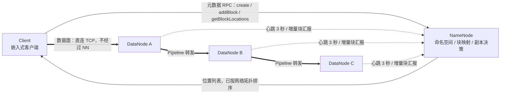
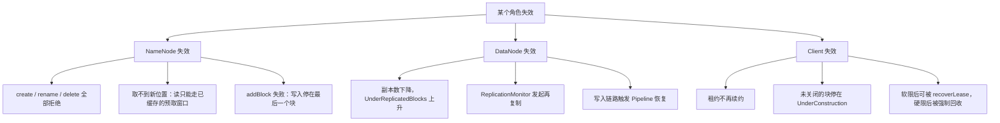
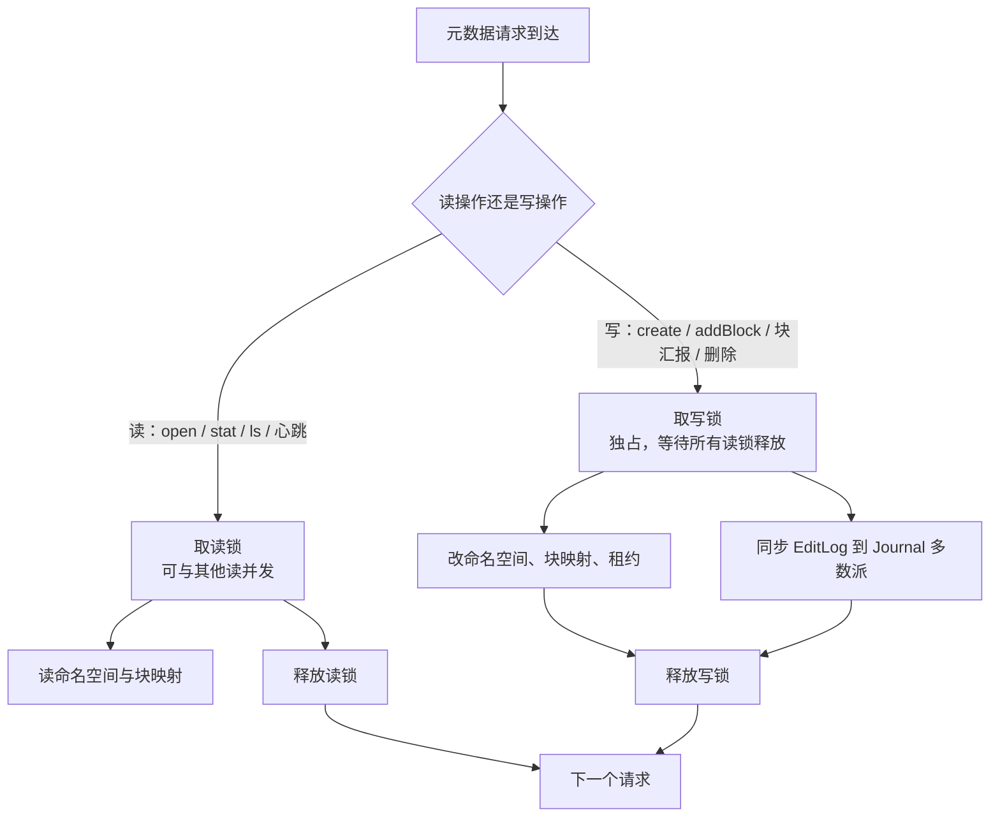
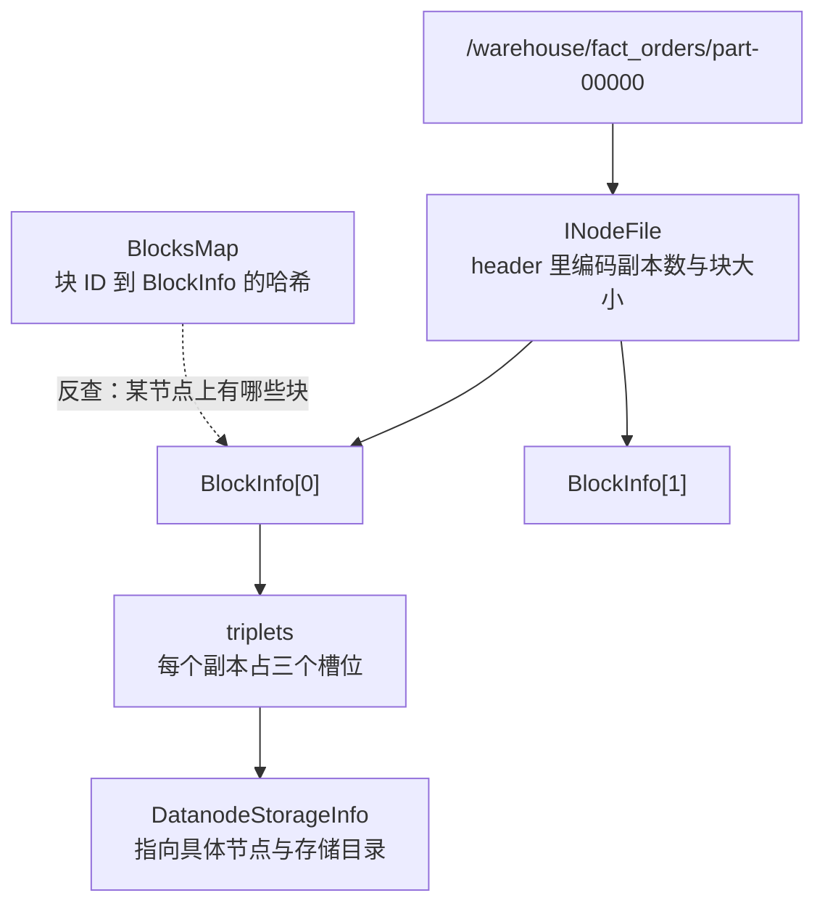
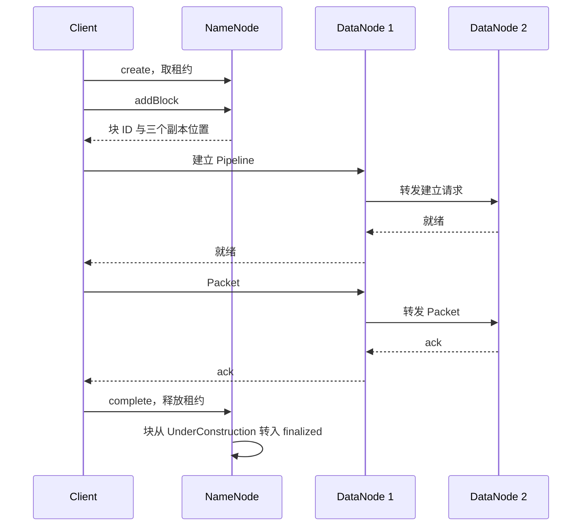

# HDFS 整体架构全景——NameNode、DataNode 与 Client 三角关系

**摘要：**

HDFS 把分布式文件系统的工作切成三份：NameNode 握着命名空间、块映射与副本决策，DataNode 握着物理块与心跳汇报，Client 握着真正的数据读写。三者之中最容易被误解的一点是数据流的位置——用户数据从不流过 NameNode，元数据走控制面，数据走直连的数据面，这正是 HDFS 能扩到数千节点的原因，也是"NameNode 挂掉后已建立的读还能不能继续"这类问题的答案所在。本文沿"一个大脑如何决定全集群瓶颈"这条主线展开：先给出三角的职责边界与各自的失效形态，再把 NameNode 的全局读写锁 `fsLock` 拆开，说明读锁与写锁各覆盖哪些操作、为什么命名空间写操作至今仍是串行的、社区推进多年的细粒度锁走到哪一步，并给出锁竞争与 Journal 同步的判据；随后讲透心跳、增量块汇报与全量块汇报三条时间尺度，推导出 dead 节点判定那 10.5 分钟的算式；再收束到三层寻址、读写的路径分工，以及一组可以直接抄进值班手册的观测点与六个故障形态。全篇落在一个判断上：数据面可以线性扩，控制面不能，HDFS 的所有扩容方案本质上都在给这个唯一的大脑减负。

---

## 第 1 章 一个不碰数据字节的大脑

设想一个刚接手 HDFS 集群的工程师，第一次看到 NameNode 的流量图，多半会生出两个疑问：为什么一台承载了几百 TB 数据读写的集群，主节点网卡上的流量只有每秒几兆？为什么这台节点的 CPU 常年不到两成，却时不时出现客户端大面积超时？这两个疑问指向同一件事——NameNode 不参与数据搬运，它只负责回答"数据在哪"，而所有关于快慢的问题，都要回到"它一次只能回答一个问题"这个约束上。

### 1.1 三条流：控制面、数据面、管理流

HDFS 的架构图在各种文档里被画过很多遍，但多数画法把注意力放在"有哪几个角色"上，忽略了三条性质完全不同的流。把这三条流分开看，整个系统的行为才好解释。



控制面是 Client 与 NameNode 之间的 RPC，请求体小、延迟敏感、频率与文件数相关；数据面是 Client 与 DataNode 之间、DataNode 与 DataNode 之间的长连接流式传输，请求体大、吞吐敏感、体积与数据量相关；管理流是 DataNode 到 NameNode 的心跳与块汇报，以及 NameNode 借心跳响应带回的指令，它的频率与节点数相关。三条流的量级**差着几个数量级**，混在一起谈"HDFS 的性能"，几乎注定会把问题归错地方。

| 流 | 参与方 | 协议 | 量级（示例推算，非实测） | 谁会是瓶颈 |
|---|---|---|---|---|
| 控制面 | Client ↔ NameNode | Hadoop RPC（ClientProtocol） | 每秒数百到数千次调用，单次请求几 KB | NameNode 的 handler 与 `fsLock` |
| 数据面 | Client ↔ DataNode、DataNode ↔ DataNode | DataTransferProtocol（TCP） | 单流数十到上百 MB/s | 磁盘、网卡、pipeline 最慢一环 |
| 管理流 | DataNode → NameNode | Hadoop RPC（DatanodeProtocol） | 千节点集群约每秒数百次心跳 | NameNode 读锁与 RPC 队列 |

### 1.2 为什么"不碰数据"是一个架构决定

把元数据集中在一台机器上、把数据摊在几千台机器上，看起来是最自然的做法，但在 2003 年 GFS 论文之前，没有人把它做成一套可运行的系统。原因不在想法，而在代价：集中元数据意味着主节点必须足够快，快到可以承受全集群所有元数据请求；也意味着它必须足够可靠，因为一旦它不可用，全集群的数据虽然完好却无法寻址。

HDFS 用两个手段把这个代价压到了可接受的范围：一是把元数据全部放在内存里，让一次"文件在哪"的查询退化成**一次哈希查找**；二是让数据面彻底绕开主节点，使主节点的负载只与文件数量、节点数量相关，而与数据总量无关。前者决定了 NameNode 的内存是一份稀缺资源，后者决定了 HDFS 的带宽可以随 DataNode 数量线性增长。这两条设计上的"分岔"，一头长出 FsImage 与 EditLog 的持久化问题（[[03 NameNode 的核心数据结构——FsImage 与 EditLog 的设计奥秘]]），一头长出本文要讲的锁问题。

不过，"主节点足够快"这个前提在真实集群里经常不成立。元数据操作本身很快，麻烦在于它们必须排队——因为 NameNode 用一个全局读写锁保护整个命名空间。理解 HDFS 的瓶颈，最终要理解这把锁。

---

## 第 2 章 三角的职责边界与失败形态

### 2.1 NameNode：三张表与一个状态机

NameNode 的内存里并不只有"目录树"这一件事。按职责拆，它至少维护着三张表和一组状态：命名空间表把路径映射到 INode（目录、文件、符号链接），并记录每个文件的副本数、块大小、权限、配额；块映射表把块 ID 映射到 BlockInfo，再由 BlockInfo 的副本槽位指向具体的 DataNode 与存储目录；节点表把每个 DataNode 登记成一份描述符，里面装着它的机架位置、存储容量、最后一次心跳时间、待下发的指令队列。名字听起来分散，实际都挂在 `FSNamesystem` 与 `FSDirectory` 名下，共享同一把锁。

在那三张表之上还有状态：安全模式（Safe Mode）的进入与退出、每个文件写入时的租约、副本不足与副本过多的待办队列、正在退役的节点名单。状态机与表之间的耦合，正是 NameNode 难以做细粒度锁的根本原因——表的每一项都可能被某个状态迁移顺手改掉。

NameNode 做的决策并不多，但每一个都很重：一个新块应该放在哪三个节点上（副本放置策略，见 [[05 HDFS 副本放置策略——机架感知与数据可靠性的工程权衡]]）、哪些块缺少副本需要补、哪些副本多余需要删、哪些块已经彻底丢失。这些决策都是异步的，NameNode 并不等待结果，它只是把指令挂在对应 DataNode 的描述符上，等下一次心跳时捎带回去。

### 2.2 DataNode：块存储、心跳与 Pipeline 的中间转发

DataNode 在 HDFS 里常被描述成"简单"，这个描述只在"它不用管全局"这个意义上成立。单看一台 DataNode，它要应付的事情并不少：把收到的字节写到本地磁盘上的数据文件与校验文件、为每个读写连接开一个处理线程（DataXceiver）、定期扫描磁盘发现坏块（VolumeScanner）、响应客户端与下游节点的数据请求、把本地块状态的变化尽快汇报给 NameNode。

写入路径上，DataNode 还承担着一个容易被忽略的角色——Pipeline 的中间转发者。一个三副本的写入链路是 Client → DN1 → DN2 → DN3，中间的 DN2 要同时做四件事：接收上游的 Packet、写本地磁盘、向下游 DN3 转发、把下游的 ack 逆向传回上游。这四件事在同一个线程里串行推进，于是 DN2 的一次磁盘抖动会同时拖慢它的上游与下游：上游等 ack 超时，下游拿不到数据。这就是为什么一条 pipeline 的吞吐由最慢的一环决定，也是为什么 `Slow BlockReceiver` 这个日志关键字值得警惕。

### 2.3 Client：自己直连 DataNode 读写

Client 是一个嵌入在应用进程里的 Java 库，不是独立代理。它面向 NameNode 只做元数据操作：创建、追加、改名、删除、列目录、取块位置。一旦拿到块位置，它就自己建 TCP 连接去读、去写，NameNode 全程不知情，也不参与。

这个设计带来一个常被低估的能力：客户端是聪明的。它会在 NameNode 返回的副本列表里选拓扑最近的节点，会在读失败时自动换副本，会在写 pipeline 断裂时重建 pipeline，会在同机部署时走短路读绕过 DataNode 进程直接读本地文件。NameNode 只提供"候选名单"，选择权在客户端——这一分工让 NameNode 的返回结果可以保持简单（一份有序列表），而把复杂决策推到了数量众多的客户端上，避免了主节点成为所有决策的必经之路。

### 2.4 数据流不过 NameNode：扩展性的来源与一个直接推论

数据流不过 NameNode，是 HDFS 能扩展的原因，这句话值得拆成两句来说。第一句是带宽：集群的数据面总带宽是 DataNode 数量乘以单机带宽，与 NameNode 无关，所以加机器就能加带宽。第二句是负载：NameNode 处理的请求数正比于文件数量与客户端数量，而正比于数据总量的部分（一个 1TB 文件被切成 8192 个块之后的数据传输）完全不落在它身上。

由此得到一个直接推论，也是运维现场最常被问到的问题：NameNode 挂掉，已经建立起来的读还能不能继续？

答案是能，但**只到预取窗口的尽头**。Client 在 `open` 时向 NameNode 取回的不只是一个块的位置，而是一段连续的块位置——默认按 10 个块计算（`dfs.client.read.prefetch.size` 未显式配置时，取 10 倍块大小）。这段位置被缓存在 `DFSInputStream` 里，读数据本身不需要再问 NameNode。所以 NameNode 挂掉之后，一个已经打开的读会继续顺畅地读完当前窗口内的块；等到窗口耗尽、需要取下一段位置时，`getBlockLocations` 失败，读才真正断掉。这也意味着"NameNode 挂了不影响正在跑的任务"这种说法只对了一半——任务的读会在几分钟内陆续撞墙，具体取决于读取速度和块大小。

写就没这么幸运。写入过程中每个新块都要向 NameNode 申请（`addBlock`），pipeline 断裂后的恢复也要 NameNode 参与（`commitBlockSynchronization`），所以 NameNode 一旦不可用，写入会停在上一个已完成的块边界上，客户端反复重试直到超时。

### 2.5 每个角色挂了的后果

把三个角色的失效形态摆在一起，可以看清 HDFS 的容错边界划在哪。



| 角色 | 立即表现 | 后续影响 | 恢复动作 |
|---|---|---|---|
| NameNode（非 HA） | 新建、改名、删除、追加全部失败；读取只能消费已缓存的块位置 | DataNode 心跳持续失败，超过判定阈值后被标记为 dead；恢复后需重放 EditLog 并等块汇报重建块映射，期间处于安全模式 | 重启进程，等待安全模式退出；HA 部署下由 Standby 接管，见 [[06 NameNode 高可用——QJM 协议与 Active-Standby 切换机制]] |
| DataNode | 该节点上的副本不可读；写入 pipeline 若含此节点则断裂 | 副本不足的块进入待复制队列，按优先级排队重建；节点被判 dead 约需 10.5 分钟 | 修复进程或磁盘后重启，重新注册并做块汇报 |
| Client | 未关闭的文件停留在 UnderConstruction 状态 | 租约不再续约，其他客户端无法写同一文件；块在 NameNode 眼中只有已确认长度可见 | 软限到期后可发起租约恢复，硬限到期后 NameNode 强制回收 |

这张表里最容易被误判的是 Client 失效。一个进程被 kill 掉之后，它在 NameNode 里留下的不是一个"死连接"，而是一份租约和一个未关闭的文件。这个文件对其他所有人都是可见但不可写的，读取方拿到的长度只到最后一个被确认的 Packet 边界；如果写入方恰好在最后一个块写到一半时崩溃，那个块的内容就是"半截"的，而 NameNode 并不知道该截到哪里，只能等租约恢复流程来裁决。

租约的时间参数在版本演进中改过，值得按当前版本对齐：软限是一个常量（`LEASE_SOFTLIMIT_PERIOD`，60 秒），超过它之后其他客户端可以发起 `recoverLease` 把文件抢过来；硬限由 `dfs.namenode.lease-hard-limit-sec` 控制，Hadoop 3.3 的默认值是 1200 秒，也就是 20 分钟（早期版本是 1 小时，后来下调）；租约的巡检间隔则由 `dfs.namenode.lease-recheck-interval-ms` 控制（3.3 默认 2000 毫秒）。这三个数字决定了"一个挂掉的写进程要多久才会被系统彻底清理"，也决定了 `LeaseExpiredException` 出现的时机。

> [!warning] 生产避坑：租约未回收导致整条写入链路卡死
> 写入端因为长时间 GC 或网络分区没能续约，租约被回收后它再发数据就会被拒绝；反过来，如果写入端彻底失联又没有触发恢复，文件会长时间停留在 UnderConstruction，下游的 Hive 或 Spark 任务读到的是一份不完整的数据。排查时先看 `NumFilesUnderConstruction` 与 `NumActiveClients` 两个指标是否异常升高，再对照 NameNode 日志里的租约恢复记录，最后回到写入端的 GC 日志。

### 2.6 三角关系的代价

三个角色分工清晰，但分工也带来了两处结构性代价。一是控制面的串行化：所有命名空间写操作排在同一把锁后面，集群再大，写吞吐也有上限。二是管理流的规模效应：节点越多，心跳与块汇报的总量越大，而这些消息全都要挤进同一台 NameNode 的 RPC 队列。前者是本文第 3 章的主题，后者是第 4 章的主题。

---

## 第 3 章 NameNode 的锁：一把全局读写锁决定写吞吐

### 3.1 fsLock 的结构

`FSNamesystem` 里保护命名空间的那把锁，实现上是一个 `FSNamesystemLock` 对象，内部包着 `java.util.concurrent.locks.ReentrantReadWriteLock`。读操作取共享的读锁，写操作取独占的写锁；读锁之间可以并发，读与写、写与写互斥。这把锁**默认是公平锁**（`dfs.namenode.fslock.fair`，默认 true），也就是说锁的分配大致按请求到达顺序进行，一个排队的写请求不会被源源不断的新读请求饿死。

公平与非公平的选择本身就是一个权衡：非公平锁允许后来的线程插队，吞吐更高，但写请求在写少读多的负载下可能长时间拿不到锁；公平锁把顺序摆平，代价是每次加锁释放都要维护等待队列，锁的绝对开销上升。HDFS 选择了公平，理由很直接——元数据写操作一旦长时间被饿死，表现出来就是 create 卡住、任务超时，比整体吞吐下降几个百分点严重得多。



### 3.2 读锁与写锁各覆盖哪些操作

把操作按锁模式分类，是理解 NameNode 行为的起点。分类错了，后面所有关于"为什么慢"的判断都会跟着错。

| 操作 | 锁模式 | 说明 |
|---|---|---|
| `getBlockLocations`（open） | 读锁 | 取块位置，返回前按客户端网络位置排序 |
| `getFileInfo`、`getListing`（stat、ls） | 读锁 | 只读命名空间 |
| `getDatanodeReport`、`getDatanodeStorageReport` | 读锁 | 短暂持锁，快照 DataNode 列表与存储信息 |
| DataNode 心跳 | 读锁 | 处理心跳、生成指令、发放块汇报租约 |
| `fsck` 的遍历 | 读锁（整段持有） | 大集群上会长时间占住读锁 |
| `create`、`mkdirs`、`rename`、`delete` | 写锁 | 修改命名空间 |
| `addBlock`、`complete`、`append` | 写锁 | 修改块列表与租约 |
| 全量块汇报处理 | 写锁 | 把上报的块与块映射逐条对账 |
| 增量块汇报处理 | 写锁 | 块状态变化的实时同步 |
| Pipeline 恢复、租约恢复 | 写锁 | 修改块长度、副本列表与租约 |

从这张表能读出两件事。第一，NameNode 上最频繁的两类外部流量——心跳与块汇报——走了两种不同的锁：心跳是读锁，块汇报是写锁。第二，所有改变块状态的路径都要写锁，而块状态的变更在写入型集群里非常频繁，等于说"写越猛，写锁越挤"。

### 3.3 写锁为什么必须是全局的

一个自然的疑问是：两个客户端在完全不相干的两个目录里各建一个文件，为什么也要排队？按直觉，它们没有冲突。

问题出在"不冲突"这件事很难被证明。一次 rename 可能把整棵子树搬到另一个父目录下，一次 delete 可能连带删掉百万个块，配额计数与快照引用是全局的，而块与文件之间的映射并不按目录切分：同一个 DataNode 上的块通过 BlockInfo 里的双向链表串在一起，删掉一个文件就要从这些链表上摘下若干节点，触及的可能是别的文件所在的存储单元。要让这些操作并发，就得对每一项共享结构给出精确的锁协议，并在所有路径上维持一致的加锁顺序——任何一个漏洞的代价都不是性能下降，而是**元数据损坏**，后者无法通过重启修复。

这也是为什么社区在细粒度锁上摸索了很多年，主线版本至今仍然保留全局锁。把"正确性优先"这个取向说成保守并不公平：NameNode 的元数据损坏意味着整个命名空间的信任基础被破坏，而 HDFS 又没有第二份元数据可以拿来对账。

### 3.4 细粒度锁的漫长尝试

关于 NameNode 锁，流传最广的一处事实错误是把细粒度锁改造记在一张编号为 HDFS-8286 的工单上。翻一下那张工单就知道，它 2015 年由 Haohui Mai 提出，标题是 "Scaling out the namespace using KV store"，主张把命名空间搬到 KV 存储上以突破内存上限，讨论的是元数据存储介质，与锁无关，而且至今仍是 Open 状态。把两件事混在一起，会让读者误以为"Hadoop 2.7 之后 NameNode 写操作已经并发"，进而把线上的写锁排队误判成网络或磁盘问题。

真正的细粒度锁工作是一条独立且漫长的分支。早期有 HDFS-14703（NameNode Fine-Grained Locking via Metadata Partitioning），思路是按命名空间分区加锁，但跨全分区的操作仍会退化成全局锁，收益因此不稳定。2024 年之后这条线以 Phase I 的形式重新推进：HDFS-17384 提出先把一把全局锁拆成两把——一把保护目录树（全局 FS 锁），一把保护块与节点（全局 BM 锁），并为同时涉及两者的操作规定锁顺序（先 FS 锁、后 BM 锁）；HDFS-17385 进一步提出用基于目录树的细粒度锁替换全局写锁，同时保留全局读锁与全局 BM 锁；HDFS-16130 则落在具体路径上，把 Create File 改成能在已持有父目录锁的前提下只锁必要节点。

这些工作里最有技术含量的是死锁与竞态的处理。设计文档给出的做法相当克制：涉及多条路径的操作，按预定义的顺序（譬如字典序）依次取全路径锁，避免环等待；只涉及单个 inode 的操作，先按路径取锁，再校验路径末端的 inode ID 是否仍与参数一致——因为取锁期间文件可能被改名或拼接，校验失败就重试，重试次数用尽则抛 `RetryException` 让客户端退避。这套**先锁后验、验不过就重试**的协议，本质上是用乐观并发换吞吐，代价是把一部分复杂度推给了客户端。

不过这些都是分支上的工作。落在主线发布版本上，`FSNamesystem` 的 `fsLock` 仍是唯一保护命名空间的锁；`FSDirectory` 里那个曾经存在的 `dirLock` 在 3.4 及之后的源码中已被移除，注释写得很直白——它提供的锁是冗余的，统一改用 `namesystem.fsLock`。读源码时如果还按老文章的说法去找"目录级锁"，会白费不少时间。

### 3.5 判据：怎么证明"慢在锁上"

说 NameNode 慢，几乎总有三类原因在竞争解释权：锁竞争、RPC 排队、EditLog 同步。三者可以通过指标区分开，不需要猜。

第一组指标是锁本身。`FSNamesystem` 的 JMX 属性里有 `LockQueueLength`（当前等待锁的线程数）、`ReadLockLongHoldCount` 与 `WriteLockLongHoldCount`（持锁时间超过阈值的事件计数）。`LockQueueLength` 持续大于零，说明有线程在排队；两个 LongHoldCount 增长，说明有操作长时间占着锁。阈值由 `dfs.namenode.write-lock-reporting-threshold-ms` 与 `dfs.namenode.read-lock-reporting-threshold-ms` 控制，默认都是 5000 毫秒；超过阈值时 NameNode 会在日志里打印一段形如 `Longest write-lock held at ... for ...ms via <堆栈>` 的记录，**长持锁堆栈**直接指出是哪段代码占着锁，这是定位"谁在拖慢集群"最直接的证据。

如果想看得更细，打开 `dfs.namenode.lock.detailed-metrics.enabled`（默认关闭），NameNode 会按操作维度输出 `FSNReadLockNanos<操作名>` 与 `FSNWriteLockNanos<操作名>` 这类指标，单位是纳秒，这样就能看出 create 与 addBlock 各自平均持锁多久、哪个操作贡献了最长的持锁时间。开启它的代价是每次加解锁多一次指标记录，高负载集群上这笔开销不可忽略，通常只在排查期打开。

第二组指标是 Journal 同步。写操作在返回客户端之前要把 EditLog 同步到 JournalNode 的多数派，这段往返会计入写请求的端到端延迟。`NameNodeActivity` 指标源里的 `SyncsAvgTime`（每次同步的平均耗时）、`TransactionsAvgTime`（每批事务的平均耗时）、`TransactionsBatchedInSync`（被批处理的事务数）能看出同步是否变慢；`dfs.qjournal.write-txns.timeout.ms`（默认 20000 毫秒）一旦超时，写操作会抛异常，系统进入降级或切换，HA 场景下的表现见 [[SRE/故障排查与复盘/NameNode长GC事故深度分析：JVM内存管理与Linux Swap的致命交互|长 GC 事故复盘]]，以及 [[06 NameNode 高可用——QJM 协议与 Active-Standby 切换机制|QJM 与主备切换]]。

第三组才是 RPC 队列，留到第 6 章展开。三组指标的判读顺序建议是：先看 `LockQueueLength`，再看 `SyncsAvgTime`，最后看 `CallQueueLength`——因为前两者会自然地推高后者，反过来则不成立。

### 3.6 dfsadmin -report 与 fsck 在拿什么锁

两个常被随手执行的命令，锁行为差别很大，值得单独说。

`hdfs dfsadmin -report` 走的是 `getDatanodeReport` / `getDatanodeStorageReport`，在 `FSNamesystem` 里短暂持有读锁，把 DataNode 列表与容量信息快照下来就释放。它的持锁时间很短，代价主要在响应体：几千台 DataNode、每台多个存储目录，返回的 JSON 或文本可以到几十兆，序列化与网络传输才是压力来源。所以它偶尔跑一次问题不大，批量脚本里循环调用才是问题。

`hdfs fsck` 完全不同。NameNode 侧的 `NamenodeFsck` 在执行入口处就对 `FSNamesystem` 加读锁，并且这层读锁**整段持有**，覆盖整个遍历过程——它要逐个文件取块位置、逐个块核对副本分布、统计缺失与损坏，中间还会对每个文件再各自取一次读锁。大集群上，一次全量 `fsck` 是分钟级的操作，这段时间里读锁一直被占着，而读锁与写锁互斥：所有 create、addBlock、delete 都要排队，公平锁还会让后来的读请求排在等待中的写请求后面。高峰期跑一次全量 `fsck`，效果相当于给集群做了一次**计划外的写暂停**。

理解了这一点，处置方式就清楚了：把 `fsck` 限定到具体路径而不是整个命名空间，用 `-list-corruptfileblocks` 只做缺失块扫描，需要全量核对时从 Checkpoint 出来的 FsImage 离线分析，或者干脆挪到业务低峰。这些做法都不改变 `fsck` 的语义，只是把它占锁的时间从"分钟级全局"压到"可控范围"。

---

## 第 4 章 心跳与块汇报：NameNode 如何知道 DataNode 还活着

### 4.1 三条时间尺度

DataNode 与 NameNode 之间不是一条连接，而是三种节奏不同的消息，混用会得出错误结论。

| 消息 | 周期（默认） | 锁模式 | 携带内容 |
|---|---|---|---|
| 心跳 | 3 秒（`dfs.heartbeat.interval`） | 读锁 | 容量、活跃传输数、卷失败、慢盘与慢节点报告、块汇报请求 |
| 增量块汇报 | 变更即报（`dfs.blockreport.incremental.intervalMsec` 默认 0） | 写锁 | 刚收到、刚完成、刚删除的块 |
| 全量块汇报 | 6 小时（`dfs.blockreport.intervalMsec`） | 写锁 | 本地全部块的 ID 与长度 |
| Lifeline 消息 | 心跳受阻时的兜底 | 读锁 | 仅用于保活，不派发指令 |

心跳是 NameNode 判断"节点还在"的唯一依据，块汇报是 NameNode 判断"块在哪"的唯一依据。前者回答存活，后者回答位置，两者不能互相替代：一个 DataNode 可以心跳正常但块汇报积压，此时 NameNode 认为它活着，却对它的块分布一无所知或所知已过时。

Lifeline 消息是一条容易被忽略的兜底路径。它的语义比心跳更轻——只更新节点的联系时间与统计信息，不返回任何指令，也不申请全量块汇报租约。源码注释特意强调它必须比心跳处理更轻，原因是它出现在"心跳送不出去"的场景里：如果连兜底消息都做重活，网络抖动时 NameNode 会被二次压垮。

### 4.2 dead 判定的推导：那 10.5 分钟是怎么来的

DataNode 被判死的时间不是心跳间隔的整数倍，而是两个参数拼出来的。`DatanodeManager` 在构造时把过期间隔算成：

```text
heartbeatExpireInterval = 2 × heartbeatRecheckInterval + 10 × heartbeatInterval
                        = 2 × 300000 ms + 10 × 3000 ms
                        = 600000 + 30000
                        = 630000 ms = 10.5 分钟
```

这个式子里的每一项都有来历。`heartbeatRecheckInterval` 来自 `dfs.namenode.heartbeat.recheck-interval`，默认 300000 毫秒，它是心跳巡检线程扫描一遍所有节点的周期——NameNode 并不是每收到一次心跳就更新一次存活判断，而是每隔 5 分钟扫一遍，把"超过阈值没更新"的节点挑出来。之所以乘 2，是因为一次扫描的结果可能受扫描时刻影响：节点在两次扫描之间的任意时刻失联，只有**连续两次扫描**都没看到新心跳，才能确认不是刚好卡在扫描边界上。`10 × heartbeatInterval` 是给抖动留的容差，10 个心跳周期意味着要连续丢掉 10 次心跳才可能凑满这个余量，足以覆盖一次长 GC 或一次短暂网络分区。


由此得到两个推论。调大 `dfs.heartbeat.interval` 不只是"少发几个心跳"，它会直接拉长判死时间：间隔从 3 秒调到 30 秒，判死时间就从 10.5 分钟变成 15 分钟，多出来的 4.5 分钟全部来自容差项（10 × 30 秒）。调小 `dfs.namenode.heartbeat.recheck-interval` 会让判死更快，代价是长 GC 的节点更容易被误判为死，而一次误判的代价是整台机器上百万个块的副本重建——这也是为什么社区普遍建议保留默认值，把误判风险交给 stale 机制而不是 dead 机制去处理。

### 4.3 stale 与 avoid.read/write.stale：判死之前的那 30 秒

dead 是一个很重的判断，它意味着一整台机器的副本被放弃。在那之前，HDFS 还有一个更轻的状态：stale。一个节点只要超过 `dfs.namenode.stale.datanode.interval`（默认 30000 毫秒，即 30 秒）没有心跳，就被标记为 stale，可以从 `StaleDataNodes` 指标上看到数量。

stale 状态本身不改变任何行为，除非打开两个开关：`dfs.namenode.avoid.read.stale.datanode` 与 `dfs.namenode.avoid.write.stale.datanode`（默认都为 false）。打开之后，NameNode 在排序块位置时会把 stale 节点排到后面，客户端读时优先选健康副本，写时优先把 pipeline 建在健康节点上。设计意图很明确：一个正在长 GC 的节点，TCP 连接可能还在，但响应会极慢，读它等于给自己制造超时。

这里藏着一个很少被提及的副作用。`HeartbeatManager` 在初始化时有一段逻辑：如果开启了写操作避开 stale 节点，并且 stale 间隔（30 秒）小于巡检间隔（300 秒），它会把巡检间隔直接降到 stale 间隔。于是过期间隔的算式变成：

```text
heartbeatExpireInterval = 2 × 30000 ms + 10 × 3000 ms
                        = 60000 + 30000
                        = 90000 ms = 90 秒
```

判死时间从 10.5 分钟骤降到 **90 秒**。对于开启了写避开 stale 的集群，这意味着一次 90 秒的停顿就足以让节点被判死并触发全量副本重建。这个行为在代码里是显式的（会打印一条 "Setting heartbeat recheck interval to ..." 的 INFO 日志），但在配置文档里不容易被注意到。把 `avoid.write.stale.datanode` 当成提高写入成功率的开关直接打开，很容易换来相反的结果：小规模网络抖动触发成片副本重建，集群写入长期跑不满。

### 4.4 块汇报为什么昂贵

全量块汇报的默认周期是 6 小时，这个数字常被误读成"块汇报很轻"。真实情况是：它的频率确实低，但单次的成本很高。

一个存储了 100 万块的 DataNode，一次全量汇报就是 100 万条记录，每条包含块 ID、长度、代际戳与状态。发送端要遍历本地块列表并编码，接收端要逐条与块映射对账：这个块 NameNode 是否认识、记录的副本位置是否包含该节点、长度是否一致、是否符合预期副本数。整个过程在全局写锁下进行，因为对账会修改块映射与副本状态。

NameNode 为这类"重报告"设计了一层**背压**：全量块汇报需要先申请租约，`dfs.namenode.max.full.block.report.leases` 限制同时处理的数量（默认 6），租约有效期由 `dfs.namenode.full.block.report.lease.length.ms` 控制（默认 300000 毫秒）。超过并发上限的 DataNode 只能等下一轮心跳再申请——文档里说得很清楚，这个上限的作用就是防止全量汇报把 RPC handler 全部占满。另一层保护是拆分：当单节点的块数超过 `dfs.blockreport.split.threshold`（默认 1000000）时，DataNode 会按存储目录把报告拆成多条消息发送，避免一次消息体过大。

再看量级。一个 1000 节点的集群，6 小时的周期意味着平均每 21.6 秒就有一次全量报告到达（1000 ÷ 21600 秒）。如果每次对账占用写锁 1 秒，写锁就有约 4.6% 的时间被块汇报占据；而租约上限是 6，最坏情况下 6 个报告同时在对账，占用会成倍放大。这个推算只是示例，真实数字取决于块数、磁盘数与对账耗时，但它解释了一个现象：大集群上"没有明显业务高峰"的时段，NameNode 的写锁也并非空闲。

增量块汇报是另一头。它的设计初衷是减少全量汇报的压力，代价是把成本摊到了写路径上：每写入一个块、完成一个块、删除一个块，都会产生一条增量记录，而这些记录同样在写锁下处理。一个每秒写入 1000 个块的集群，等于每秒向 NameNode 的写锁投递上千条待处理记录；单条处理耗时不长，但频率高，叠加起来就是持续的写锁占用。这也是为什么"小文件多、块多、写入频繁"的集群，NameNode 的锁压力会明显高于同规模但以读为主的集群。

### 4.5 心跳与汇报的总量

把心跳也算一遍，量级关系会更直观。以下数字是示例推算，用来比较量级，不是实测值。1000 个 DataNode、心跳间隔 3 秒，NameNode 每秒要处理约 333 次心跳；单次心跳的处理耗时按 3 毫秒估算（含指令生成与块汇报租约判断），稳态下相当于 1 个 handler 被心跳长期占用。默认 handler 数是 10，占比约一成。这个比例不算高，但它是持续的基线，会与业务请求争抢同一个 RPC 队列与同一把读锁。

节点数继续增长时，这个基线会线性抬高：3000 节点、每 3 秒一次心跳，就是每秒 1000 次。此时要么增加 handler，要么接受心跳与业务请求互相排队。把心跳间隔从 3 秒调到 6 秒可以把基线减半，代价是判死时间从 10.5 分钟变成 11 分钟（10 × 6 秒的容差项变大），以及节点状态变化的感知变慢——这笔账需要按集群规模自己算，没有普适的最优值。

### 4.6 调大与调小的代价

心跳与块汇报相关的参数，几乎每一个都是"两头都不讨好"的类型：往一个方向调，换来的收益与付出的代价往往不在同一个维度上，所以不能只看收益那一面。

| 参数 | 默认值 | 往调大 / 开启方向 | 往调小 / 关闭方向 |
|---|---|---|---|
| `dfs.heartbeat.interval` | 3 秒 | 判死算式里的 10 倍容差项同步变大，节点状态感知变慢 | 心跳总量线性上升，RPC 队列与读锁压力增加 |
| `dfs.namenode.heartbeat.recheck-interval` | 300000 毫秒 | 判死更晚，副本重建的启动随之推迟 | 长 GC 的节点更容易被误判 dead，触发成片重建 |
| `dfs.namenode.stale.datanode.interval` | 30000 毫秒 | 慢节点更久才被标记，读请求仍会打到它 | 轻微抖动即被标 stale；开启写避开后还会连带拉短判死时间 |
| `dfs.namenode.avoid.read.stale.datanode` | false | 读避开慢节点，代价是可选副本变少、热点更集中 | 读仍可能落到 stale 节点上，表现为偶发超时 |
| `dfs.blockreport.intervalMsec` | 6 小时 | 块位置纠偏变慢，主机重启后的对账更滞后 | 全量报告更频繁，写锁被周期性占用 |
| `dfs.namenode.max.full.block.report.leases` | 6 | 更多全量报告并发对账，写锁排队上升 | 报告排队更久，块状态收敛变慢 |
| `dfs.namenode.handler.count` | 10 | 线程与 GC 开销上升，锁竞争被放大 | RPC 排队，`CallQueueLength` 上升 |
| `dfs.replication` | 3 | 存储成本与写链路长度一起涨，pipeline 更脆 | 耐久性下降，副本重建的容错窗口变窄 |
| `dfs.namenode.fslock.fair` | true | 顺序公平，写请求不会被饿死，锁开销更高 | 吞吐略升，但写少读多的负载下写请求可能长时间拿不到锁 |

这张表没有给"建议值"，因为离开集群规模谈建议值没有意义。一次调参之前先确认瓶颈落在哪一组指标上：`CallQueueLength` 独涨就去动 handler，`LockQueueLength` 涨就去查长持锁操作，`UnderReplicatedBlocks` 不回落就去核对复制流与节点状态。把参数当成症状的解药，多半会把问题挪到另一个指标上。

---

## 第 5 章 Client 的读写路径与三层寻址

### 5.1 三层寻址：inode、INodeFile、BlockInfo

理解 HDFS 的元数据结构，关键是记住它是**三层**，而且每层的查询方向不同。



第一层是路径到 INode 的映射，由 `INodeMap` 维护，路径解析的结果是 `INodesInPath`——它不是一个节点，而是一串从根到目标的节点。第二层是文件节点 `INodeFile`，它的 `header` 是一个 64 位长整型，高 16 位存副本数、低 48 位存块大小，后面跟着一个 `BlockInfo[]` 数组，按文件内的顺序排列。把副本数与块大小压进一个 long，是为了给每个文件省下几字节——几亿个文件乘起来就是几 GB 的堆内存，这种抠内存的写法在 HDFS 源码里到处都是。

第三层是 `BlockInfo`，它用一个 `Object[]` 数组（长度为副本数乘 3）记录每个副本的两个信息：副本所在的 `DatanodeStorageInfo`，以及该副本在其所在存储单元双向链表中的前驱与后继。一个对象同时支持两个方向的遍历——从文件能走到每个副本的位置，从某个副本能顺着链表走遍该存储单元上的所有块。`BlocksMap` 则是块 ID 到 `BlockInfo` 的哈希表，底层用 `LightWeightGSet` 实现，初始容量按 JVM 可用内存比例预分配且不再扩容，目的是规避 rehash 在大堆上引发的停顿。

三层结构决定了 NameNode 的两种典型操作代价：按路径查文件是哈希加路径解析，与文件数无关；按块查位置是哈希查找，与副本数无关；而"扫描某台机器上的全部块"必须顺着链表走，代价与该机器的块数成正比——这也是为什么 DataNode 上的块数会影响某些管理操作的耗时。

### 5.2 dfs.replication 是文件级的软约束

关于副本数，最常见的误解是把 `dfs.replication` 当成一个全局开关。它实际上只是一个默认值：客户端创建文件时如果没有显式指定副本数，就用这个配置写进文件的 header。header 里那个 16 位字段是文件自己的属性，此后与配置无关。

这条性质带来两个直接后果。第一，改配置不会改变任何已有文件。生产集群把副本数从 3 调到 2，老文件仍然是 3 副本，直到有人显式执行 `-setrep`。第二，副本数是**期望值而非瞬时事实**：NameNode 里记录的期望副本数由 header 决定，实际副本数由块映射里登记的副本条数决定，两者不等时进入待复制或待删除队列，由 ReplicationMonitor 慢慢抹平。所以"副本数已经改了"与"副本数已经生效"之间，隔着一次扫描、一次复制、一次删除。

ReplicationMonitor 的节奏也值得记住：它默认每 3 秒巡检一轮（`dfs.namenode.redundancy.interval.seconds`，默认 3，新版有等价的毫秒级配置），每轮能处理的复制任务量由两个参数限制——`dfs.namenode.replication.work.multiplier.per.iteration`（默认 2，每台存活 DataNode 贡献 2 个块的工作量）与 `dfs.namenode.replication.max-streams`（默认 2，同时进行的复制流上限）。这两个默认值合在一起说明一件事：副本重建是慢工。一台存了 100 万块的 DataNode 挂掉，即使有 1000 台存活节点贡献工作量，真正并发的复制流也只有 2 条，`UnderReplicatedBlocks` 需要较长时间才能回落——这不是故障，是设计上给正常读写让出的带宽。

### 5.3 读路径：NameNode 给有序列表，Client 自己挑

读的流程比写简单，但有两个细节决定了故障时的表现。

第一个细节是**排序发生在服务端**。`getBlockLocations` 在返回前会调用 `DatanodeManager.sortLocatedBlocks`，用 `NetworkTopology` 按客户端的网络位置计算距离，把最近的副本排在前面。客户端拿到列表后通常直接取第一个，所以在同一个机架内读、在同机部署时短路读，都是这个排序的结果，而不是客户端自己算的。

第二个细节是失败切换不需要 NameNode。客户端读某个副本失败时，会换到列表里的下一个副本继续读，并把坏副本通过 `reportBadBlocks` 上报——上报需要 NameNode，但切换本身不需要。于是 NameNode 不可用时，读操作仍然可以在本地完成副本切换，只是坏副本的报告会被推迟，等 NameNode 恢复后由 VolumeScanner 扫描或下一次读取时补报。

### 5.4 写路径概览：Pipeline、Packet 与租约

写的流程长一些，因为要同时解决三个问题：块的分配、副本的同步、失败后的恢复。



**租约先行**：`create` 时客户端就拿到了这个文件的写权限，在 `close` 之前别人写不进来。块按需分配：不是创建时就分配全部块，而是每写满一个块（默认 128MB）才申请下一个，避免预分配造成浪费。Pipeline 并行：数据不是客户端分别发三份，而是纵向前传，每个节点收包、写盘、转发同时进行，把三份写入的耗时压到约等于一份。Packet 粒度确认：每个 Packet（`dfs.client.write.packet.size`，默认 65536 字节）都要等末端节点的 ack 逆流回来才算成功，这保证了"客户端认为写成功"等价于"三份副本都落了盘"。

Pipeline 断了一个节点怎么办，这套机制的完整细节（Packet 队列、ack 队列、替换节点的策略、`dfs.client.block.write.retries` 的作用）在 [[04 HDFS 数据读写流程——Pipeline 写入与机架感知读取的底层路径]] 里有展开。本篇只需要记住一条：写入过程中任何一次节点失效，都会让客户端向 NameNode 申请一次块状态同步（`commitBlockSynchronization`），这是写锁上的一次额外负担，也是"集群不稳时 NameNode 反而更忙"的原因之一。

### 5.5 读与写的分工对照

把两条路径放在一张表里对照，能看到 NameNode 在两种场景下扮演的角色完全不同。

| 维度 | 读路径 | 写路径 |
|---|---|---|
| NameNode 角色 | 一次性给出块位置列表 | 分配块、选副本、维护租约、确认完成 |
| NameNode 调用次数 | 每个预取窗口一次 `getBlockLocations` | 每个块一次 `addBlock`，每文件一次 `create` 与 `complete` |
| 数据面参与方 | Client 与选中的副本直连 | Client 与整条 pipeline 直连 |
| NameNode 挂掉的后果 | 预取窗口内可继续，窗口耗尽即失败 | 立即无法新增块，写停在已完成的块边界 |
| 副本不足时 | 客户端换副本，无感 | NameNode 补副本，写入不受影响 |
| 对锁的压力 | 读锁，可并发 | 写锁，完全串行 |

---

## 第 6 章 观测点清单

### 6.1 NameNode 的四个页面

NameNode 自带一组 Web 页面，其中四个在排查时真正有用。端口在 Hadoop 3 默认是 9870，2.x 是 50070，下面以 3.x 为例。

- `/dfshealth.html` 是总览页，给出容量、DataNode 数量、安全模式状态、最近启动时间。快速判断"集群是不是还在安全模式""节点是不是少了一批"，看这一页最快。
- `/nn_browsedfscontent.jsp` 是浏览器访问文件系统的入口，HA 部署下会把请求导向当前 Active 节点。它的价值在于确认"我访问的到底是哪一台"，避免在一个已经切走的旧节点上查指标。
- `/startupProgress.jsp` 展示启动进度，把加载 FsImage、加载 EditLog、保存 Checkpoint、等待安全模式退出这几个阶段分开显示。NameNode 重启后卡在某一步时，这个页面比日志直观得多。
- `/jmx?qry=Hadoop:service=NameNode,name=FSNamesystem` 直接吐出某个指标源的原始数据，是自建监控抓不到细项时的兜底手段，也是确认指标名的最可靠方式。

### 6.2 关键 JMX 指标

指标不需要全看，但下面这一组要能背下来，它们覆盖了容量、副本健康、锁竞争与客户端活跃度四个维度。

| 指标（`Hadoop:service=NameNode,name=FSNamesystem`） | 含义 | 异常判据 |
|---|---|---|
| `CapacityTotal` / `CapacityUsed` / `CapacityRemaining` | 集群容量与使用量 | 剩余容量低于阈值时写入会失败，需提前扩容或清理 |
| `MissingBlocks` | 完全没有可用副本的块数 | 大于 0 即数据丢失风险，必须立刻查副本为何同时失效 |
| `UnderReplicatedBlocks` | 副本数不足的块数 | 长期不回落说明复制能力被限制或节点持续不可用 |
| `PendingDeletionReplicatedBlocks` | 等待删除的多余副本数（旧文档里也写作 `PendingDeletionBlocks`，纠删码场景另有 `PendingDeletionECBlocks`） | 持续增长说明 DataNode 删除积压，可能是磁盘慢或节点不可达 |
| `CorruptBlocks` | 校验失败的副本数 | 增长通常伴随磁盘故障，需对照 DataNode 的卷扫描结果 |
| `LockQueueLength` | 等待 `fsLock` 的线程数 | 持续大于零且伴随 `CallQueueLength` 上升，说明锁是瓶颈 |
| `ReadLockLongHoldCount` / `WriteLockLongHoldCount` | 长持锁事件计数 | 增长说明有操作长时间占锁，需查 NameNode 日志里的长持锁堆栈 |
| `NumFilesUnderConstruction` / `NumActiveClients` | 处于写入中的文件数与持有租约的客户端数 | 两者同时飙升但写入量不高，往往是租约未回收 |
| `NumLiveDataNodes` / `NumDeadDataNodes` / `StaleDataNodes` | 三种节点状态的数量 | stale 与 dead 同时异常升高时，先查网络与 GC |

RPC 侧的指标在另一个指标源里，`Hadoop:service=NameNode,name=RpcActivityForPort9870`（端口随配置变化），关键三项是 `CallQueueLength`（排队中的 RPC 数）、`RpcQueueTimeAvgTime`（排队耗时）、`RpcProcessingTimeAvgTime`（处理耗时）。这三项的组合是区分"handler 不够"与"单请求变慢"的关键：

| 组合 | 判读 | 处置方向 |
|---|---|---|
| `CallQueueLength` 涨，QueueTime 涨，ProcessingTime 平稳 | 请求进来的速度超过处理速度，handler 不够或流量突增 | 提高 `dfs.namenode.handler.count`，或削减元数据请求 |
| `CallQueueLength` 涨，ProcessingTime 也涨，`LockQueueLength` 涨 | 单请求变慢，卡在锁上 | 查长持锁操作：全量块汇报、大目录删除、`fsck` |
| `CallQueueLength` 涨，ProcessingTime 涨，`LockQueueLength` 不高 | 卡在 Journal 同步或 GC | 看 `SyncsAvgTime` 与 JVM 的 GC 指标 |
| `CallQueueLength` 不涨，客户端仍报超时 | 问题不在 NameNode 排队，查网络、DNS 或客户端侧 | 分段抓包与客户端日志 |

### 6.3 handler 数与 RPC 吞吐的定量关系

`dfs.namenode.handler.count` 默认是 10，这个默认值在小集群上够用，在千节点集群上通常是第一个被调大的参数。调多少合适，可以用排队论里最基本的那条关系反推：稳态下系统内的并发请求数等于到达速率乘以单请求处理时间。若 NameNode 每秒要处理 2000 次请求、单次处理 5 毫秒（示例推算），则平均并发为 10，恰好等于默认 handler 数——任何一点突发都会开始排队。要把排队概率压下去，handler 就要留出余量。

反过来，handler 也不是越大越好：每个 handler 是一个线程，占用栈空间与调度时间，在高并发下会放大锁竞争（更多线程同时抢同一把锁），还会让 GC 的线程扫描成本上升。经验做法是先按"目标 QPS 乘以单请求耗时再留一倍余量"估一个值，再观察 `CallQueueLength` 是否长时间贴零、`RpcQueueTimeAvgTime` 是否稳定在毫秒级。若调大 handler 后队列不降反升，说明瓶颈已经转移到锁或 Journal，继续加线程只会让 `LockQueueLength` 更难看。

### 6.4 让一个慢请求自己说话

指标能告诉你"慢"，但不能告诉你"谁慢"。这时需要打开 NameNode 的慢请求日志：`ipc.server.log.slow.rpc` 打开后，处理时间超过阈值的 RPC 会连同调用信息一起落日志；`dfs.namenode.lock.detailed-metrics.enabled` 打开后，长持锁的堆栈会直接指向占用锁的代码路径。两者配合，通常几小时内就能定位到具体操作，比对着指标猜快得多。

> [!info] 观测顺序的建议
> 容量类指标先看（`CapacityRemaining`、`MissingBlocks`），它们决定问题是不是"数据层面"的；再看副本类（`UnderReplicatedBlocks`、`PendingDeletionReplicatedBlocks`），判断系统是否在做后台补偿；然后是锁与 RPC 两组，用来区分瓶颈位置；最后才落到具体操作日志。按这个顺序走，可以避免一上来就盯着 `CallQueueLength`，把排队当成根因。

---

## 第 7 章 六个故障形态与判据

下面六个形态覆盖了 HDFS 架构层面最常遇到的故障。每个形态给出典型日志、判据与处置，判据部分尽量给"能排除其他解释"的条件，而不只是描述现象。

### 7.1 NameNode is in safe mode

安全模式是 NameNode 启动后的保护状态：命名空间已经从 FsImage 恢复，但块映射还是空的，要等 DataNode 汇报才能重建；只有达到阈值（`dfs.namenode.safemode.threshold-pct`，默认 0.999，即 99.9% 的块至少有一个副本可用）并经过一段稳定期（`dfs.namenode.safemode.extension`，默认 30000 毫秒）才退出。

```text
org.apache.hadoop.hdfs.server.namenode.SafeModeException: Cannot create file/warehouse/fact_orders/_temporary/xxx. Name node is in safe mode.
The reported blocks 812345 needs additional 12345 blocks to reach the threshold 0.9990 of total blocks 825600.
```

判据是异常文本里那行阈值报告：它直接给出已汇报块数与总块数，两者差距就是还在等多少 DataNode 上线。如果差距迟迟不缩小，问题在 DataNode 侧（进程没起来、网络不通、块汇报被租约限制），不在 NameNode 侧。处置上最忌讳的是急着 `-safemode leave`：强行退出会让 NameNode 在块映射不完整的情况下对外服务，客户端拿到的位置列表可能缺副本，读到缺失块的概率被放大。

### 7.2 Could not obtain block

这是客户端侧最典型的读失败，含义是"这个块的所有副本都试过了，都不行"。

```text
java.io.IOException: Could not obtain block: BP-1234567890-10.0.0.1-1690000000000:blk_1073741825_1001 file=/warehouse/fact_orders/part-00000
```

客户端在放弃之前会重试，重试次数由 `dfs.client.max.block.acquire.failures` 控制（默认 3 次，每次之间退避）。判据要分三层：先用 `fsck -blocks -files` 看这个块在 NameNode 眼里是否还有位置（没有位置就是 `MissingBlocks` 的成员）；再看这些位置对应的 DataNode 当前状态（是否 dead、是否 stale）；最后看 DataNode 日志里有没有卷扫描报出的坏块。三层都对上了，才能确定是"真的丢了"还是"客户端到某些节点不通"。

### 7.3 Slow BlockReceiver

这个词出现在 DataNode 日志里，说明某个接收端处理 Packet 的时间超过阈值（`dfs.datanode.slow.io.warning.threshold.ms`，默认 300 毫秒）。

```text
WARN org.apache.hadoop.hdfs.server.datanode.BlockReceiver: Slow BlockReceiver write packet to mirror took 4123ms (threshold=300ms)
```

判据的关键是分清"写下游"与"写本地盘"。日志里写 mirror 表示向 pipeline 下一个节点转发慢，问题在下游网络或下游节点；写 data to disk 表示本地盘慢，问题在磁盘或文件系统。前者要继续往下游追，后者要查 `iostat` 的 `await`、盘的 SMART 状态与 RAID 卡缓存策略。这条日志的连带影响是整条 pipeline 的吞吐下降到最慢一环，所以它经常与客户端侧的 `DataStreamer Exception` 成对出现。

### 7.4 DataStreamer Exception

客户端在写 pipeline 上遇到的异常，统一从 DataStreamer 线程抛出，日志前缀就是这四个字，后面跟着根因。

```text
WARN org.apache.hadoop.hdfs.DFSClient: DataStreamer Exception
java.io.IOException: Bad connect ack with firstBadLink as 10.0.0.12:9866
```

判据在 `firstBadLink`：它直接点名 pipeline 里第一个出问题的节点。若该节点反复出现在不同客户端的报错里，基本可以判定节点侧有问题（磁盘满、进程异常、网络丢包）；若每次都指向不同节点，则更像网络抖动或集群整体过载。处置上，pipeline 恢复是自动的，客户端会剔除坏节点重建链路，`dfs.client.block.write.retries`（默认 3）用尽才会整体失败；真正需要人工介入的是"同一节点反复被剔除"这种情况。

### 7.5 Too many open files

文件句柄耗尽，通常出现在 DataNode 或客户端进程上。

```text
java.io.IOException: Too many open files
```

判据是三重对照：进程的 `ulimit -n`、`/proc/<pid>/limits` 里的实际限制、以及 `lsof -p <pid> | wc -l` 的实时占用。DataNode 上一个读写连接会占用一个 `DataXceiver` 线程与若干句柄，而 `dfs.datanode.max.transfer.threads`（默认 4096）限的是线程数，句柄上限必须与之匹配（通常要远大于线程数，因为每个线程同时持有数据文件与校验文件）。客户端侧则常见于短连接模式：每次读都新建 `FileSystem` 实例而不复用，句柄只增不减。

### 7.6 CallQueueLength 持续增长

严格说这不是一个故障，而是一个症状，但它最容易被错误处置。`CallQueueLength` 持续增长只说明"请求进来的速度大于处理速度"，至于为什么处理不过来，要按第 6.2 节的组合去分辨。

最常见的误判是直接调大 `dfs.namenode.handler.count`。如果瓶颈在锁，调大 handler 会让更多线程堆在锁上，`LockQueueLength` 上升，`CallQueueLength` 反而更难看；如果瓶颈在 Journal 同步，调大 handler 会让更多线程同时等待同步，效果类似。正确的顺序是先用 `LockQueueLength` 与 `SyncsAvgTime` 排除锁与同步，再决定是否加 handler。

| 故障形态 | 日志关键字 | 根因定位 | 判据要点 |
|---|---|---|---|
| 安全模式 | `SafeModeException` | NameNode 启动中或块汇报不足 | 异常文本里的已汇报块数与阈值差 |
| 块不可得 | `Could not obtain block` | 副本全失效或客户端不可达 | fsck 位置、节点状态、卷扫描三者对照 |
| 接收端慢 | `Slow BlockReceiver` | 下游网络或本地磁盘 | 区分 mirror 与 disk 两个方向 |
| 写入链路异常 | `DataStreamer Exception` | pipeline 中某个节点失效 | `firstBadLink` 是否固定指向同一节点 |
| 句柄耗尽 | `Too many open files` | 并发连接与句柄上限不匹配 | `ulimit`、`/proc/<pid>/limits`、`lsof` 计数 |
| RPC 排队 | `CallQueueLength` 上升 | handler 不足、锁竞争或同步慢 | 与 `LockQueueLength`、`SyncsAvgTime` 组合判读 |

---

## 第 8 章 反例与边界

### 8.1 以为数据流经 NameNode

这是最普遍的一个误解，后果是整条排查与容量规划都跑偏。把 NameNode 的网卡当作数据带宽瓶颈之后，会得出"NameNode 带宽打满所以写入慢"的结论，于是去换万兆网卡，问题依旧。真实的写入瓶颈几乎总在 DataNode 的磁盘、pipeline 的最慢一环、或者 NameNode 的写锁排队上，唯独不在 NameNode 的网卡带宽上。

顺着这个误解还会长出另一个错误推论：把 NameNode 与 DataNode 混部当成"会互相抢带宽"。在数据面，两者确实共用物理网卡，但 NameNode 侧只有元数据流量，量级差着两个数量级；混部真正的风险在内存与 CPU 的争抢（NameNode 大堆与 DataNode 的页缓存），不在带宽。

### 8.2 在高峰期跑 fsck

`fsck` 的读锁持有范围是整段遍历，这一点在第 3.6 节已经拆过。把它当成"只读操作、随便跑"是运维里代价很高的误判：读锁与写锁互斥，一次全量 `fsck` 等于给写入按了暂停键，而写入方看到的是 create 超时、任务卡在 `_temporary` 目录，很少会联想到几十分钟前有人跑过一条巡检命令。

替代方案不复杂：按路径分批、用 `-list-corruptfileblocks` 只做缺失块扫描、或者从 Checkpoint 出来的镜像离线核对。需要强调的是，这些方案并不降低检查的严格程度，只是把"占锁时间"从分钟级全局降到可控范围。

### 8.3 改了 dfs.replication 就以为历史文件变了

副本数是写在文件 header 里的属性，配置文件只提供创建时的默认值。把集群级配置从 3 改成 2 之后，老文件依然是 3 副本，直到执行 `-setrep`；而 `-setrep` 本身也只改期望值，实际副本数的收敛要靠 ReplicationMonitor 慢慢做，期间 `UnderReplicatedBlocks` 或待删除副本数会波动。

反过来的坑同样存在：看到 `UnderReplicatedBlocks` 不为零就以为副本数配错了，实际上它反映的是"实际副本少于期望副本"的块数，原因可能是节点刚重启、可能是复制流被限流、也可能是磁盘写满导致复制失败。先确认 `dfs.replication` 与文件 header 的期望值，再看复制任务是否有积压。

### 8.4 以为加 DataNode 能治 NameNode 慢

数据面扩容与元数据面扩容是**两条不同的路径**。加 DataNode 能提高总带宽、提高副本重建速度、缓解磁盘热点，但对 NameNode 的锁竞争与 RPC 排队没有任何帮助——反而会因为节点数增加而抬高心跳与块汇报的总量，让 NameNode 更忙。

当瓶颈确实在 NameNode 上时，可用的手段是按代价从低到高排的：减少不必要的元数据操作（小文件合并、避免高频 `listStatus`）、把只读分析类负载接到 Observer 节点或从 Standby 读（Hadoop 3 的能力）、提高 handler 与调整锁参数、最后才是 Federation 这类改造命名空间分片的方案。这条路径的取舍在于复杂度：每往前一步，能换来的吞吐提升越来越小，运维复杂度越来越大。

### 8.5 把心跳间隔调大当作减压手段

心跳间隔调大确实能线性降低 NameNode 的心跳处理量，但 dead 判定的算式里有 `10 × heartbeatInterval` 这一项，间隔从 3 秒调到 30 秒，判死时间从 10.5 分钟变成 15 分钟——变化比直觉更大，但更重要的影响在状态感知：节点重启、磁盘故障、卷下线这些事件的感知都变慢，副本重建的启动随之延后。

真正的减压手段在别处：块汇报的租约上限（避免全量汇报占满 handler）、增量汇报的合并（减少写锁上高频小请求）、以及减少小文件数量（降低元数据总量）。这些都不改变容错语义。

### 8.6 边界：这套三角关系什么时候不够用

三角关系在中小集群上足够好：一台 NameNode 能撑住数亿块的元数据，读写路径清晰，故障形态可枚举。它的边界出现在两个地方。一是命名空间规模逼近单机内存上限，此时唯一的出路是把命名空间切开（Federation），或者把元数据搬到外部存储，而后者在主线版本上仍未落地。二是写并发被单锁锁死，此时需要细粒度锁这类改动，而它目前仍是分支工作，尚未成为可以依赖的生产特性。

认清这两条边界，比记住任何一组调优参数都重要：它们决定了 HDFS 的扩容到底是"加机器"还是"改架构"，也决定了在什么规模上应该认真考虑 HDFS 之外的方案。

---

## 第 9 章 结语：唯一大脑的代价

HDFS 的整个架构可以压缩成一句话：**数据面分布，控制面集中**。分布的这半边走的是"加机器就能加带宽"的线性路径，集中的那半边走的却是"所有请求排一把锁、一个 RPC 队列"的串行路径。DataNode 挂掉只是少了一份副本，NameNode 变慢却是全集群一起变慢，原因就在这里——副本可以重建，大脑不能复制。

由此回看本篇拆过的几个机制，它们其实是同一个约束的不同侧面。全局读写锁决定了写吞吐的上限，心跳与块汇报决定了 NameNode 在节点规模上的负载曲线，预取窗口决定了 NameNode 短暂不可用时读能撑多久，副本数写在文件 header 里则决定了"期望状态"与"实际状态"永远存在时差。理解了这一点，再看那些看似零散的故障形态，就会发现它们大多可以翻译成同一句话：有请求在等同一个资源。

HDFS 给出的应对也不是没有代价的。HA 解决了单点，Federation 解决了内存天花板，Observer 缓解了只读负载，细粒度锁仍在推进——每一步都在给这个唯一的大脑减负，每一步也都把系统复杂度往上抬一层。至于这些改造最终能不能让单集群的写并发摆脱那把全局锁的约束，目前仍然言之尚早。

---

## 参考资料

1. Apache Hadoop 官方文档：[HDFS Architecture](https://hadoop.apache.org/docs/stable/hadoop-project-dist/hadoop-hdfs/HdfsDesign.html)
2. Apache Hadoop 官方文档：[hdfs-default.xml](https://hadoop.apache.org/docs/stable/hadoop-project-dist/hadoop-hdfs/hdfs-default.xml)（本文引用默认值均以此为准）
3. Apache Hadoop 源码（branch-3.3）：[FSNamesystemLock.java](https://github.com/apache/hadoop/blob/branch-3.3/hadoop-hdfs-project/hadoop-hdfs/src/main/java/org/apache/hadoop/hdfs/server/namenode/FSNamesystemLock.java)、[FSNamesystem.java](https://github.com/apache/hadoop/blob/branch-3.3/hadoop-hdfs-project/hadoop-hdfs/src/main/java/org/apache/hadoop/hdfs/server/namenode/FSNamesystem.java)、[BlockManager.java](https://github.com/apache/hadoop/blob/branch-3.3/hadoop-hdfs-project/hadoop-hdfs/src/main/java/org/apache/hadoop/hdfs/server/blockmanagement/BlockManager.java)、[DatanodeManager.java](https://github.com/apache/hadoop/blob/branch-3.3/hadoop-hdfs-project/hadoop-hdfs/src/main/java/org/apache/hadoop/hdfs/server/blockmanagement/DatanodeManager.java)、[HeartbeatManager.java](https://github.com/apache/hadoop/blob/branch-3.3/hadoop-hdfs-project/hadoop-hdfs/src/main/java/org/apache/hadoop/hdfs/server/blockmanagement/HeartbeatManager.java)、[NamenodeFsck.java](https://github.com/apache/hadoop/blob/branch-3.3/hadoop-hdfs-project/hadoop-hdfs/src/main/java/org/apache/hadoop/hdfs/server/namenode/NamenodeFsck.java)
4. [HDFS-17384: HDFS NameNode Fine-Grained Locking Phase I](https://issues.apache.org/jira/browse/HDFS-17384)
5. [HDFS-17385: Replace the global FS write locking with directory tree-based fine-grained locking](https://issues.apache.org/jira/browse/HDFS-17385)
6. [HDFS-14703: NameNode Fine-Grained Locking via Metadata Partitioning](https://issues.apache.org/jira/browse/HDFS-14703)
7. [HDFS-8286: Scaling out the namespace using KV store](https://issues.apache.org/jira/browse/HDFS-8286)（本文用于澄清"细粒度锁"的常见误记）
8. Shvachko, K., Kuang, H., Radia, S., Chansler, R. (2010). *The Hadoop Distributed File System*. IEEE MSST 2010.

---

> [!note] 思考题
> 1. 一个已经打开的读在 NameNode 挂掉后还能继续多久，取决于预取窗口而非文件大小。如果把这个窗口调大，对 NameNode 的 RPC 压力、客户端内存占用与故障时的可读时长分别有什么影响？
> 2. 心跳走读锁、块汇报走写锁，而公平锁下写请求要等所有读锁释放。据此推断：在一个心跳量很大但写入很少的集群里，写请求的延迟主要由什么决定？
> 3. 开启 `dfs.namenode.avoid.write.stale.datanode` 会让判死时间从 10.5 分钟缩到 90 秒。这个副作用能否通过同时调大 stale 间隔来抵消？抵消之后又失去了什么？
> 4. `UnderReplicatedBlocks` 长期不为零，可能是节点故障、可能是复制流被限流、也可能是磁盘写满。设计一个排查顺序，要求每一步都能排除掉其他解释。
> 5. 如果由你来设计 NameNode 的细粒度锁，路径锁的获取顺序、inode 改名带来的竞态、以及跨目录操作（rename、快照）分别会怎么处理？哪些操作你会坚持保留全局锁？