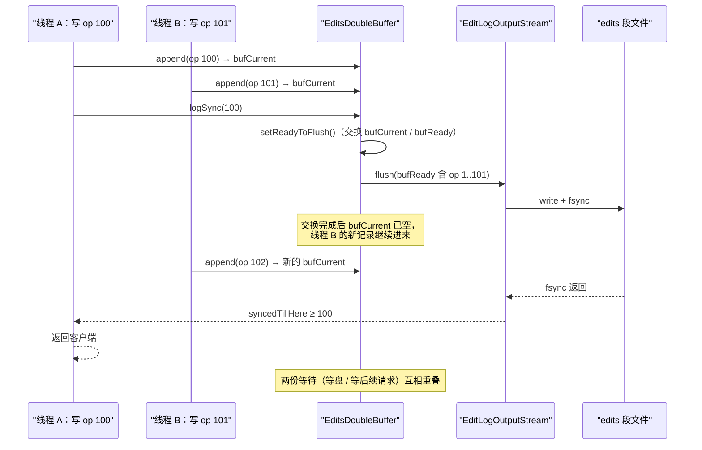
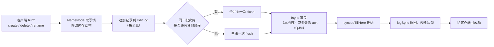
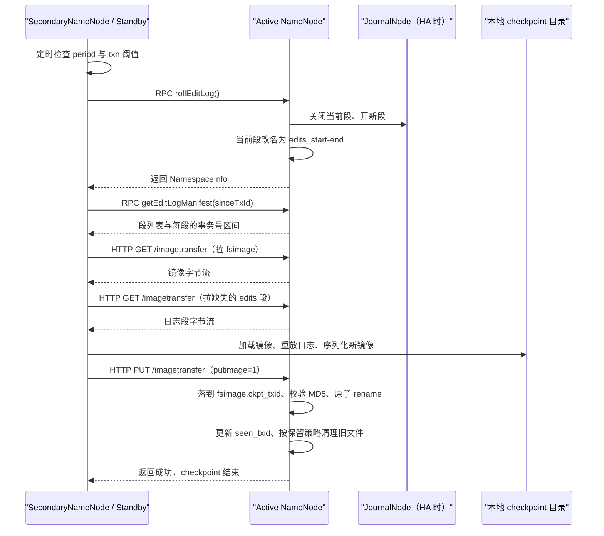
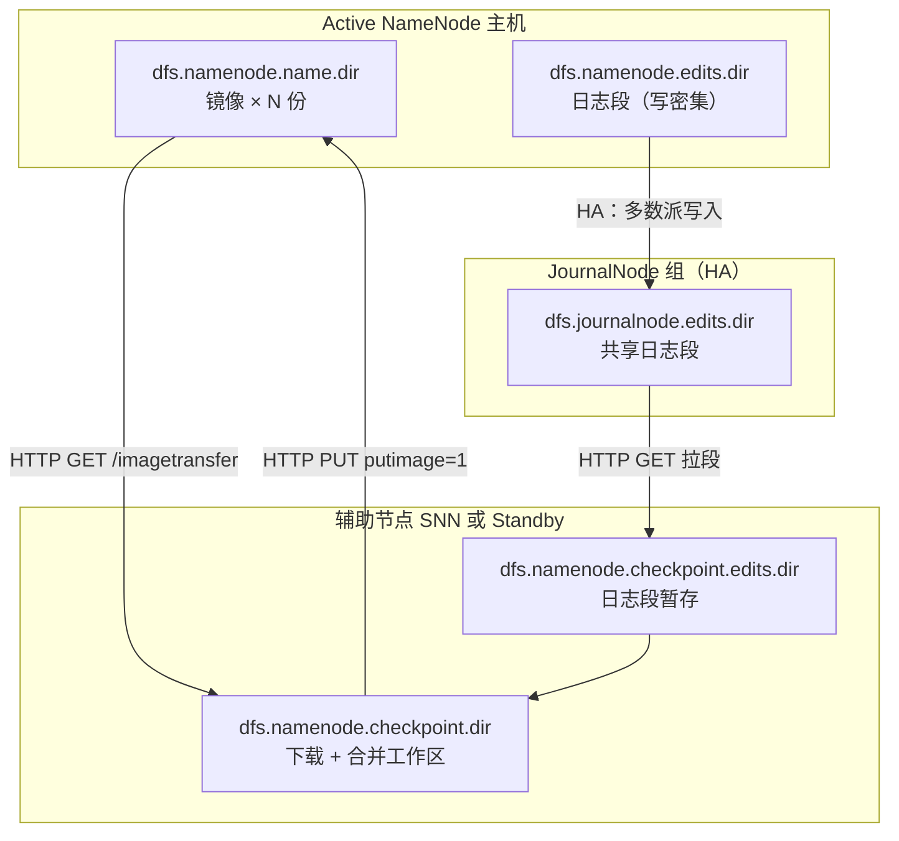
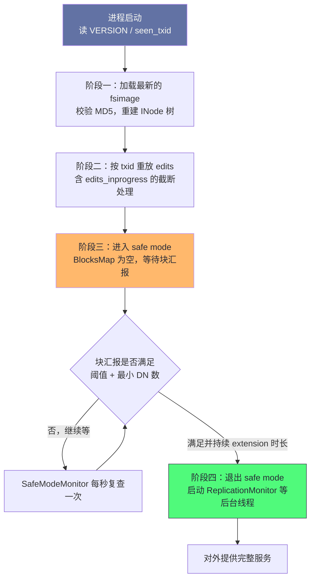

# NameNode 的核心数据结构——FsImage 与 EditLog 的设计奥秘

**摘要：**

NameNode 把整个命名空间放进内存，但它必须让这份内存状态活过断电；HDFS 交出的答案是最朴素的组合——某一刻的全量快照 FsImage，加上快照之后的每一笔增量操作 EditLog，启动时把两者拼回去。这套"快照 + 日志"的套路本身不算稀奇，任何写过预写日志的人都能画出草图，真正值得掰开看的是它在 HDFS 里长出的三个反直觉形态：checkpoint 由另一个进程承担，而不是 NameNode 自己做；EditLog 的写入是双缓冲加预写，等待落盘的间隙仍在攒新记录；每一笔元数据操作都要等一次 fsync 返回，这条延迟下限是所有"NameNode 写慢"抱怨的共同根。本文先讲清 FsImage 的 PB 分段格式与 EditLog 的记录形态，以及 OIV 与 OEV 这两把离线解剖刀能做什么，再逐条拆解三个反直觉背后的取舍，然后把 checkpoint 的完整链路、启动的四个阶段与安全模式的退出条件走一遍，最后落到真正可操作的那一层：`/jmx` 里该盯哪几个数、六类故障各自的判据、以及 `dfs.namenode.name.dir` 与 `dfs.namenode.edits.dir` 为什么分开放。

---

## 第 1 章 两个文件决定的重启时长

2003 年的 GFS 论文里，元数据持久化被压缩成一句话：master 把命名空间的变更追加到操作日志（operation log），并周期性地把内存状态写成检查点文件（checkpoint）。二十多年过去，HDFS 的 FsImage 与 EditLog 仍然是这两个东西，连名字的暗示都没变——一个镜像，一本流水账。工业界几乎所有的持久化系统都收敛到了这个形状：MySQL 的 redo log 加页快照、etcd 的 WAL 加内存索引快照、RocksDB 的 WAL 加 SSTable，差别只在合并策略与刷盘时机。

形状相同，并不意味着细节可以略过。设想一个场景：某天凌晨机房一路市电跳闸，一台管理着两亿文件、三十亿块的 NameNode 被重新拉起，客户端那边看到的是四十分钟的 RPC 超时，以及随后一连串 `NameNode is in safe mode`。这四十分钟里，NameNode 到底在做什么，能不能缩短，缩短的代价落在谁头上——这些问题的答案全在 FsImage 与 EditLog 这两个文件里，而不在"元数据放内存"这句概述里。

### 1.1 三组绕不开的矛盾

持久化的难处从来不是"把数据写下去"，而是下面三组互相拉扯的诉求无法同时满足。

第一组是写放大与恢复时长。NameNode 每秒可能要处理数千笔元数据变更，如果每笔变更都要把整棵 INode 树序列化一遍，磁盘带宽会被瞬间吃干；反过来，如果只记日志、从不做全量快照，那么一台跑了五年的集群重启时就得从第一条日志开始重放，恢复时长会随运行时间线性增长。快照把"历史"折叠成一个点，日志则负责"点之后"。

第二组是操作的原子性与磁盘的非原子性。创建文件在逻辑上是一步，落盘却可能是好几步：写日志头、写记录、刷盘、更新校验。进程在任意一步崩溃都合法，恢复方必须能从这种"半个操作"里判断出哪些已生效、哪些该丢弃。

第三组是服务进程与维护任务的资源争抢。合并快照要遍历整棵树、分配大量临时对象、把几十 GB 的数据写一遍，这些都是 CPU 密集加内存密集的活；如果放在服务进程里做，在线请求会看到明显的延迟抖动，堆内存的瞬时压力还可能把 GC 推到 Full GC。维护任务越重，越应该挪出服务进程——这条判断直接催生了 Secondary NameNode 这个角色，也直接造成了本系列里最常见的一处误解。

### 1.2 本篇的路线与边界

本篇讲的是"元数据怎么活过重启"，以及由此衍生的一整套运维判断，不重复 HDFS 是什么、能干什么。后续章节按这条线展开：FsImage 的格式与边界（第 2 章）→ EditLog 的记录形态与多目录（第 3 章）→ 三个反直觉的地方（第 4 章，本篇的重心）→ 一次 checkpoint 的完整链路（第 5 章）→ 启动的四个阶段与安全模式（第 6 章）→ 观测面（第 7 章）→ 目录规划（第 8 章）→ 六类故障的判据（第 9 章）。

为了让后面的量化有具体对象，先约定一个示例集群：三百台 DataNode、两亿个文件与目录、约三十亿个块，NameNode 堆内存 96 GB，FsImage 落在 30 GB 上下，每天产生约三千万笔元数据事务。这组数字是按常见规模做的示例推算，不是任何一套真实集群的实测值；比例关系比绝对值更重要，读的时候把量级带走即可。

---

## 第 2 章 FsImage：某一刻的全量快照

### 2.1 快照的边界在哪里

FsImage 是 NameNode 在某个事务号上对整个命名空间做的完整序列化。它装下了所有目录与文件的 INode——名字、类型、权限、属主、时间戳、副本数、块大小、以及该文件引用的块列表；它也装下了目录树本身的结构、快照关系、加密 token 的元信息、集中式缓存的策略。用一句话概括：凡是"由用户操作决定、且重启后必须原样恢复"的东西，都在里面。

它明确不装的是块到 DataNode 的物理位置。三十亿个块的副本分布一天要变几十万次，把这份映射写进快照，等于把一份注定过期的数据当成事实固化下来；更麻烦的是，快照里写的副本位置如果在重启后失效，NameNode 会拿着过期视图去判断"块还在"，从而错误地阻止副本补足。HDFS 的选择是把这份责任交给 DataNode：每次启动，DataNode 主动汇报自己手上有什么块，NameNode 据此把 BlocksMap 重新拼起来（职责边界见 [[02 HDFS 整体架构全景——NameNode、DataNode 与 Client 三角关系]]）。这是典型的**易变状态留在易变的地方**、把稳定状态写进快照的分层。

还有一处容易被忽略的边界：正在写入的文件会被写进快照。`FilesUnderConstructionSection` 记录了那些处于 Under Construction 状态的文件路径与客户端名称，重启后 NameNode 据此重建租约，让这些写入要么被客户端续上，要么在租约超时后被回收并触发块恢复。快照在这里承担的不只是"记住文件存在"，还承担了"记住有笔写入悬在半空"。

### 2.2 名字目录里的那些文件

`dfs.namenode.name.dir` 指向的目录下有一个 `current` 子目录，里面躺着 NameNode 的全部家当。一个典型的清单如下：

```
/data/dfs/nn/current/
├── VERSION                                    # 存储版本：namespaceID、clusterID、blockpoolID、layoutVersion
├── seen_txid                                  # 已经见到的最大事务号（单调递增，只前进）
├── fsimage_0000000000000000000                # 格式化时生成的第一份空镜像
├── fsimage_0000000000000000000.md5            # 对应镜像的 MD5
├── fsimage_0000000000001234567                # 最近一次 checkpoint 产出的镜像
├── fsimage_0000000000001234567.md5
├── edits_0000000000001234568-0000000000001245000   # 已滚动的历史日志段
├── edits_0000000000001245001-0000000000001250210
└── edits_inprogress_0000000000001250211        # 正在追加的活跃段
```

名字里的数字是事务号（txid），它把两个文件绑在同一条时间轴上：`fsimage_<txid>` 表示这份镜像覆盖到 txid 为止的全部状态，`edits_<start>-<end>` 表示这一段日志里的事务号区间。启动时 NameNode 拿镜像的 txid 去比对日志段的区间，凡是 `end` 不大于镜像 txid 的段都已经是历史，可以直接跳过；只有起点大于镜像 txid 的段才需要重放。这套约定的好处是幂等——同一批文件被反复扫描、被多个目录副本各存一份、被离线工具搬运，只要文件名是诚实的，加载器就知道该从哪里接上。

`seen_txid` 是一个只有一行的文件，记录 NameNode 见过的最大的事务号。它在升级与回滚场景里是道保险：如果一份镜像的 txid 比日志段还新，说明目录里的文件来自不同时期、被人工拼接过，加载器据此拒绝启动，而不是带着不一致的状态硬撑。`VERSION` 里的 `layoutVersion` 则管格式：磁盘格式与当前程序不兼容时，NameNode 宁可起不来，也不会尝试猜测老格式。

### 2.3 PB 分段格式：一个文件，十个抽屉

Hadoop 2.4 之后，FsImage 从自定义二进制换成了 Protocol Buffers 序列化，文件以固定魔数开头，随后是按 Section 顺序排布的若干个"抽屉"。每个 Section 只负责一类元数据，并自带偏移与长度，加载器可以按需定位、跳过甚至并发读取。

| Section 枚举 | 对应的 proto 消息 | 装了什么 |
|---|---|---|
| `NS_INFO` | `NameSystemSection` | 命名空间级参数：generation stamp、lastAllocatedBlockId、lastInodeId、镜像的 txid |
| `INODE` | `INodeSection` | 每个 INode 的属性与块列表，是体积最大的一块 |
| `INODE_DIR` | `INodeDirectorySection` | 父目录到子节点的映射，即目录树的骨架 |
| `FILES_UNDERCONSTRUCTION` | `FilesUnderConstructionSection` | 未写完的文件及其客户端名，用于重建租约 |
| `SNAPSHOT` / `SNAPSHOT_DIFF` | 快照相关消息 | 快照根、快照之间的差异 |
| `SECRET_MANAGER` | `SecretManagerSection` | 安全模式下的 token 密钥与已发放 token |
| `CACHE_MANAGER` | `CacheManagerSection` | 集中式缓存（cache pool 与 directive） |

枚举名在不同大版本之间存在增删，`STRING_TABLE`（字符串驻留表，压掉重复的路径前缀）、`INODE_REFERENCE`（快照与重命名引入的引用计数）、以及纠删码相关的段都是 3.x 之后才出现的。读代码时以对应版本的 `FSImageFormatProtobuf.SectionName` 为准，不要去背一张固定的表。

分段的直接收益是并行加载。`dfs.image.parallel.load`（默认开启）会把 `INODE` 这类大段按阈值切成多块，交给多个线程解析，`dfs.image.parallel.target.sections` 控制切成几份，`dfs.image.parallel.inode.threshold` 是启用并行所需的最小 INode 数——文件数太少的集群开并行只会多付线程开销。在亿级文件的规模上，这段优化的量级是"从几十分钟降到几分钟"，属于那种不改任何语义、纯靠并行就吃到的红利。

分段还有一个隐性收益：离线工具不必把整份镜像读进内存。`hdfs oiv` 的 `Delimited` 处理器只关心 `INODE` 与 `INODE_DIR`，`FileDistribution` 只关心每个文件的大小，它们都能顺着 Section 的偏移直接跳到需要的位置。

### 2.4 OIV 与 OEV：把镜像和日志当数据库查

NameNode 停机时，FsImage 是一堆二进制；但用 `hdfs oiv` 打开，它立刻变成一个可以查询的表。这是排查元数据问题最朴素也最有效的手段：

```bash
# 把镜像导成 XML，看清楚每个 INode 的字段
hdfs oiv -p XML -i fsimage_0000000000001234567 -o /tmp/fsimage.xml

# 导成制表符分隔的文本，每行一个文件，方便 awk 统计
hdfs oiv -p Delimited -delimiter '\t' -i fsimage_0000000000001234567 -o /tmp/fsimage.tsv

# 看文件大小分布，小文件治理前先量一下底数
hdfs oiv -p FileDistribution -maxSize 128 -step 8 -i fsimage_0000000000001234567

# 日志侧：把一段 EditLog 导成 XML，核对 opCode、txid 与参数
hdfs oev -p XML -i edits_0000000000001234568-0000000000001245000 -o /tmp/edits.xml

# 活跃段被异常截断时，先尝试修复再解析
hdfs oev -r -i edits_inprogress_0000000000001250211 -o /tmp/edits_recovered.xml
```

`Delimited` 的输出每行一个 INode，带上路径、副本数、修改时间、权限、属主、块数与文件大小，用 `awk` 一行的功夫就能算出"小于 1 MB 的文件有多少、占了总块数的多少比例"——这是小文件治理绕不过去的第一步，也是判断"FsImage 为什么这么大"的最快方式；小文件对 NameNode 堆内存的压迫与治理路径，属于 [[10 HDFS 性能调优与生产实践——小文件治理与存算分离的未来]] 的范围。`XML` 处理器胜在字段完整，适合核对单个文件的权限、副本数、块列表是否与预期一致，也适合在两套集群之间对账。

`hdfs oev` 的价值在于把"日志里到底记了什么"变成可读的事实。同一个目录下压着几百个 edits 段时，想知道上周三下午到底发生了什么，最直接的办法就是找到覆盖那个时间段的段文件，导成 XML，按 txid 排序读下来。`-r` 修复模式用于活跃段被截断的现场：它会把能解析的记录搬到新文件里，丢掉尾部不完整的部分——这正是 NameNode 重启时对 `edits_inprogress` 做的事，只不过工具让你可以先看一眼再决定。

### 2.5 为什么不用数据库

这个问题几乎每场面试都会被问：既然 MySQL 天然支持事务、崩溃恢复、持久化，为什么不直接拿它存元数据。

先看查询模式。NameNode 的元数据访问高度固定：按路径找 INode 是树形遍历，按块 ID 找 BlockInfo 是哈希查找，按 DataNode 找块是链表遍历。这些操作在内存里的自定义结构上是纳秒到微秒级；走数据库则要多付 SQL 解析、查询计划、B-Tree 遍历、页缓存命中判断，每一层都在往延迟上加东西。而且这些查询大多发生在持有全局读锁的路径里，延迟被锁的持有时长放大，不是单次快慢的问题。

再看容量假设。数据库的设计前提是"数据远大于内存"，缓冲池只装热数据，剩下的靠磁盘兜底，因此总有一部分请求会碰盘。NameNode 的前提恰好相反：全部元数据必须常驻内存，集群规模的上限由堆大小划出来。两种假设推导出的数据结构完全不同，前者优化命中率，后者优化结构与布局——把后者塞进前者，等于用 B-Tree 去装一棵本来就在内存里的树。

最后是故障面。引入一个外部数据库，就多了一个必须高可用的组件、多了一套认证与备份体系、多了一条从 NameNode 到数据库的网络路径；而它换来的能力（通用事务、多表 join、复杂的二级索引）NameNode 一样都用不上。HDFS 团队选择自己实现持久化逻辑，换来的是部署自包含、故障链短、格式可控——代价是需要自己处理日志滚段、快照合并、损坏检测，也就是本篇后面全部的内容。

> [!info] 一个可以带走的判断
> 通用系统为通用场景做优化，在访问模式极度规整、数据能全量驻留内存、延迟要求又很紧的场景里，量身定制的内存结构加一条顺序日志，往往比通用数据库更划算。Redis、Kafka 的索引层、HDFS 的命名空间，都走在同一条路上。

### 2.6 快照生成必须是原子的

FsImage 的写入从不在原文件上覆盖。NameNode 先写到 `fsimage.ckpt_<txid>`，边写边算 MD5，写完后 `fsync` 关闭，再把这个临时文件原子地 `rename` 成 `fsimage_<txid>`，最后把 MD5 落成 `.md5` 文件。任何一步崩溃，磁盘上要么是完整的旧镜像，要么是完整的临时文件，绝不会出现"半个镜像顶替了正式文件"。

这个顺序还有一处细节值得注意：`.md5` 是后写的。如果镜像写完了、MD5 还没落盘就断电，下次启动会看到一份没有校验文件的镜像——加载器会跳过它，回退到上一份带校验的镜像，宁可丢掉一段 txid 也不冒读到坏数据的风险。可靠性设计里，"能证明自己完整"比"看起来完整"更重要。

---

## 第 3 章 EditLog：快照之后的每一笔

### 3.1 快照与日志之间的那条缝

镜像做完的瞬间，它就成了历史。之后的每一次创建、删除、重命名、修改副本数、追加块，都只是内存里的变化，磁盘上没有任何对应。如果此刻断电，内存里的变化全部作废——更糟的是，客户端可能已经收到了"创建成功"的响应。

EditLog 补的就是这条缝。规则只有一句：任何会改变命名空间的操作，必须先把记录追加进 EditLog 并落盘，然后才允许改内存、才允许给客户端回成功。用数据库的词汇说这是预写日志（Write-Ahead Logging），用大白话说就是**先记账，再动钱**。这条顺序把崩溃切成两类：崩溃发生在记录落盘之前，操作视为没发生，客户端收到的是失败；崩溃发生在落盘之后、内存修改之前，重放日志就能把内存补回去。两种情况都不产生"客户端以为成功、磁盘上没有"的第三种状态。

### 3.2 一个日志段里长什么样

EditLog 在磁盘上是一串段文件。正在写的叫 `edits_inprogress_<start_txid>`，滚过之后改名为 `edits_<start_txid>-<end_txid>`。段的头部先写当前程序的 `layoutVersion`（负整数，随格式演进而变小），加载器读到的第一个数与自己的版本对不上，就直接抛版本异常拒绝重放——宁可起不来，也不要用新代码去解释老格式的字节。

段体是一串记录。每条记录由三部分构成：事务号、操作码（opCode）、以及该操作的参数。操作码是一张不断变长的清单，早期的 HDFS 只有几十个，3.x 里早已过百，涵盖新增文件、删除、建目录、重命名、设置副本、设置权限与属主、追加块、完成块、开启与结束快照、设置存储策略、纠删码相关操作等。参数部分沿用自定义二进制序列化——路径按长度前缀写出，数字按定长写出，事务号单调递增。每条记录带长度与校验字段，长度让加载器能跳过损坏的记录，校验让截断能被识别；这也是 `hdfs oev -r` 能"修到最后一个完整记录"的基础。

读取这一侧被抽象成 `EditLogInputStream`：处理本地文件时是 `EditLogFileInputStream`，处理 QJM 时是从 JournalNode 拉回来的段。对上层重放逻辑（`FSEditLogLoader`）而言，两者的接口一致，都是"给我下一条记录"，于是 HA 与非 HA 两种部署可以共用同一套重放代码。这个抽象看着平淡，实际上是 HDFS 能从"本地日志"平滑演进到"共享日志"的关键——换掉的是日志的来源，不是消费日志的语义。

### 3.3 重放：把日志重新变成树

启动时，`FSEditLogLoader` 按 txid 顺序读出每条记录，按 opCode 分派到对应的内存操作上：`OP_ADD` 在父目录下挂一个 INodeFile，`OP_MKDIR` 挂一个 INodeDirectory，`OP_DELETE` 从父目录摘掉节点并回收块，`OP_RENAME` 移动节点（重命名在内部被拆成两次子操作，日志里能看到成对的记录），`OP_SET_REPLICATION` 修改 INodeFile 的副本数，`OP_CLOSE` 标记文件写完并把块提交进 BlocksMap。

重放不是"重复执行一遍用户操作"，而是"按日志把内存结构改到日志描述的样子"。这个区别决定了很多实现细节：重放时不做权限检查、不做配额检查、不做租约有效性判断，因为日志里记的是已经通过检查的结果；重放也不发块分配请求，因为块 ID 早已在日志里定死。把这些校验跳过，重放速度才能到每秒数万条的量级；把它们加回来，重启时长会翻几倍。

一处必须处理的边界是活跃段。`edits_inprogress_<txid>` 的尾部可能是半条记录——写了一半就断电了。加载器读到长度字段对不上、或者校验不通过时，会停在这里，把日志在最后一个完整记录处截断，然后继续启动。丢掉的是那笔没落完盘的操作，客户端当初收到的是失败，语义自洽。

### 3.4 多目录：同步写多份，最慢的那块盘决定延迟

`dfs.namenode.edits.dir` 可以配多个目录，NameNode 会把每条记录同时写进所有目录，只有全部成功才算这条记录持久化。这个设计和 `dfs.namenode.name.dir` 的冗余逻辑不一样：镜像目录是"写一份到每块盘，读的时候挑最新的那份"，日志目录是"每块盘都必须写成功"，因为日志只要缺一段，整条时间轴就断了，没有任何一份副本能单独顶替。

代价也很直接：写入延迟**由最慢的那块盘决定**。配了两个目录，一个在本地 NVMe 上 fsync 用 0.2 ms，另一个挂在网络存储上要 3 ms，那么每笔元数据写入都得等 3 ms。把慢盘留在配置里，等于给整个 NameNode 的写路径加了一个持续生效的延迟下限；把它摘掉，又会在那块盘恢复时发现日志出现了空洞。这就是 `dfs.namenode.edits.dir.required` 存在的理由：把一部分目录标记为非必需，磁盘故障时自动从日志集合里摘除并继续服务，代价是那段时间里日志只剩单副本。

> [!warning] 一个真实的运维陷阱
> 日志目录的可用性与可靠性在这里是直接对立的。要求全部目录必须可用，一块盘坏了 NameNode 就停服；允许摘除，坏盘期间就没有冗余。选哪边取决于你能容忍多长的停服，而不是取决于哪个"更正确"。默认配置要求全部目录可用，这是把可靠性放在可用性前面；如果集群的元数据盘做了 RAID 或另有实时备份，把副本目录标为非必需是合理的。

### 3.5 为什么必须滚段

如果所有日志都写在一个文件里，txid 越积越多，单文件会涨到几十 GB，而 checkpoint 需要的"从镜像 txid 到当前"的区间会横跨这个巨大文件，读取和截断都变得笨重。滚段解决这个问题：当前段写到一个阈值，NameNode 关闭它、命名成带区间的新文件、再开一个新段。于是"日志"变成一串边界清晰的小段，checkpoint 只需要搬运镜像之后的那些段，删旧段也只是删文件。

滚段的触发有三条路径。第一条来自外部：Secondary NameNode 或 Standby 发起 checkpoint 前，先请求 Active 滚动日志，这样它拿到的是一个封闭的、不会再增长的区间。第二条来自 NameNode 自己：`dfs.namenode.edit.log.autoroll.multiplier.threshold`（默认 2.0）乘以 `dfs.namenode.checkpoint.txns`（默认 100 万）得到阈值，事务数超过阈值就主动滚，每 `dfs.namenode.edit.log.autoroll.check.interval.ms`（默认 300000 毫秒，即 5 分钟）检查一次。第三条来自运维：`hdfs dfsadmin -rollEdits` 手工滚一次。

第二条路径值得单独说。它的存在意义不是"优化"，而是保险——当 Standby 或 Secondary NameNode 因为内存不足、网络不通、进程挂掉而停止 checkpoint 时，如果 NameNode 自己不滚，日志会无限增长，最终撑满磁盘、拖长重启、并且在恢复时把重放时间推到小时级。HDFS 选择让 NameNode 自己也能滚，等于承认"辅助节点可能不可靠"，并给它留了一条自救路径。指标上表现为日志段比平时多，但重启时长可控。

---

## 第 4 章 三个反直觉的地方

到这里，FsImage 与 EditLog 的分工已经清楚了：一个负责"折叠历史"，一个负责"接住增量"，启动时两者拼合。这套结构本身谈不上反直觉，任何写过 WAL 的人都能画出草图。HDFS 真正让人意外的是它在实现这套结构时做出的三个选择，每一个都和"教科书上的标准做法"有偏差，每一个也都在生产里制造过误解。

### 4.1 反直觉之一：checkpoint 不是 NameNode 自己做的

按最自然的想法，既然是 NameNode 自己的快照，就该由 NameNode 自己做——省一次传输，也不用协调。但 HDFS 从一开始就把这件事推了出去，交给 Secondary NameNode（早期）或 Standby NameNode（HA 模式）。原因在第 1 章已经埋下：合并快照要遍历整棵树、把几十 GB 写一遍、还要重放一段日志，这几件事和在线服务抢的是同一份 CPU、同一份堆内存、同一块磁盘带宽。在亿级文件的集群上做一次合并，NameNode 的请求延迟会出现肉眼可见的抖动，堆内存的临时对象增长还可能触发长 GC。

推出去之后，NameNode 只剩两件事：收到"开始 checkpoint"的请求时滚一次日志（毫秒级），以及在新镜像上传回来时改名并清理旧文件（也是毫秒级）。真正的重活——加载镜像、重放日志、序列化新镜像——发生在另一个进程里，用的是另一台机器的资源。这是把"维护任务的成本"和"在线服务的成本"彻底解耦。

从这里引出本篇最需要澄清的一处误解。Secondary NameNode 的名字里有 NameNode，工作内容又和 NameNode 的元数据密切相关，于是无数人把它当成了"备份节点"。**它不是**。

| 维度 | Secondary NameNode | Standby NameNode |
|---|---|---|
| 是否持有实时元数据 | 否，只在 checkpoint 时拉一份镜像与日志 | 是，持续追平 Active 的 edits，内存状态随时可用 |
| 是否写 EditLog | 否 | 是（经 JournalNode，由 Active 主导） |
| 能否接管服务 | 不能，没有切换协议、没有 fencing、没有共享存储 | 能，配合 ZKFC 与 JournalNode 完成切换 |
| 故障切换时的代价 | 无角色 | 秒级，内存里已是最新状态 |
| 在 HA 集群里还有用吗 | 没有，应当停掉 | 就是 HA 的核心组件 |
| 主要职责 | 定期合并 FsImage 与 EditLog | 热备 + 承担 checkpoint |

Secondary NameNode 做不了 HA，缺的是三样东西：一是没有共享的日志通道，它只能周期性拉取，中间永远有一段延迟，切换时必然丢数据；二是没有成员管理与 fencing，两个 NameNode 同时认为自己活着时会直接脑裂（防脑裂的完整机制见 [[06 NameNode 高可用——QJM 协议与 Active-Standby 切换机制]]）；三是它的镜像不是"当前状态"，而是"上一次 checkpoint 时的状态"，拿它接管意味着要重放一段未知长度的日志。

更糟的一种现场是 HA 集群里 Secondary NameNode 还在跑。它以为自己能 checkpoint，于是照样请求 Active 滚日志、照样拉镜像、照样算出一份新镜像上传；但这个镜像会游离在 NameNode 的镜像链之外，而多出来的滚动与传输还额外占用 JournalNode 的带宽与 Active 的日志写入路径。HA 模式下应当把它停掉，让 Standby 的 `StandbyCheckpointer` 独占 checkpoint 职责——`dfs.ha.standby.checkpoints`（默认 true）就是控制这件事的开关。

NameNode 并非完全丧失了本地生成镜像的能力。`hdfs dfsadmin -saveNamespace` 就是让 Active 在自己进程里做一次全量落盘，代价是必须先进入安全模式——执行期间对外写入被挡住，重活和在线服务重新挤到同一个进程里。所以它只适合停机维护窗口或者事故处置，不能当作常态 checkpoint 手段；常态化的那条路径，仍然是把合并推给辅助节点。

> [!warning] 判据：怎么确认你踩的是这个坑
> HA 集群里如果看到 `jps` 同时列出 `SecondaryNameNode` 和两个 `NameNode`，先别急着庆祝"多了一层保护"；检查 Standby 的日志里是否有 `Checkpoint` 相关记录，以及 NameNode 的日志里滚动日志的频率是否明显高于 `dfs.namenode.checkpoint.period` 的预期。二者都对不上，说明 checkpoint 的节奏被那个不该存在的进程带偏了。

### 4.2 反直觉之二：双缓冲——等盘的时候还在攒

第二处反直觉藏在 EditLog 的写入路径里。既然规则是"先落盘再改内存"，直觉会以为 NameNode 的写路径是一笔一笔串行的：写记录、刷盘、返回、下一笔。真那么做，吞吐会被 fsync 的延迟按在地上摩擦。

HDFS 的实现是双缓冲，类名 `EditsDoubleBuffer`，它挂在 `EditLogOutputStream` 上——每个 edits 目录、每个 journal 各有一条输出流，各自带一份双缓冲，`FSEditLog` 只负责把这些流组织成一个 journal 集合，`logSync()` 等的是所有流都刷到自己的 txid。缓冲本身的结构极其朴素：两块缓冲区，`bufCurrent` 接新记录，`bufReady` 待刷盘。当某个线程决定"该刷了"，它就调用 `setReadyToFlush()`，两块缓冲区交换角色——原来的 `bufCurrent` 变成待刷的那个，原来的 `bufReady` 腾空后立刻接手新记录；然后 `flush()` 把待刷的那块真正写到磁盘。关键在于交换之后：负责刷盘的线程在等磁盘的这几毫秒里，其他线程仍在往新的 `bufCurrent` 里追加记录，一点都不耽误。



这里的语义必须说清，否则很容易把它和"延迟提交"混为一谈。HDFS 没有引入一个固定长度的等待窗口：某个线程调用 `logSync()` 时，它要的是"我这条记录所在的那批已经落盘"，而不是"等一会儿再一起落盘"。批量是并发的副产品——在这几毫秒里同时到达的其他线程的记录，被顺势打进同一批，它们各自也就不用再等下一次 fsync。所以这是一个**零额外等待**的合并，而不是"用延迟换吞吐"的组提交。

Hadoop 3.1 之后又多了一层：`dfs.namenode.edits.asynclogging`（默认 true）把刷盘动作交给专门的编辑日志线程，写请求线程不再自己去做 `flush()`，`logSync()` 的等待语义保持不变。这么改的收益是缩短持锁时间——刷盘那几毫秒里不占着 NameNode 的锁，其他读请求可以继续跑；代价是多了一次线程切换与一套更复杂的同步状态。

再叠上第 3 章说的自动滚段，你会发现 NameNode 在日志管理上有两层"不完全依赖外部"的设计：外部辅助节点负责 checkpoint 的主体，但滚段这件事 NameNode 自己也会做；外部辅助节点负责把日志吞掉变成镜像，但日志的写入节奏 NameNode 自己控制。这种"主路径依赖外部、兜底路径留给自己"的分工，在分布式系统里很常见——它承认了辅助组件可能长期不可用，也承认了主组件的可恢复性比优雅更重要。

### 4.3 反直觉之三：每一笔操作都要等一次 fsync

第三处反直觉最容易被低估：一笔元数据操作要返回成功，必须等到它的记录真正落到磁盘，而"真正落到磁盘"只能靠 `fsync`（或 `fdatasync`）来保证。操作系统的 `write()` 只是把数据交给页缓存，进程返回不代表数据在盘上；机器断电，页缓存里的内容就没了。NameNode 如果只调 `write()` 就返回成功，崩溃后会丢掉一批"客户端以为成功了"的操作——对文件系统来说这是不可接受的语义破坏。

于是写延迟的下限被**钉在了 fsync 上**。本地 NVMe 上一次 fsync 的耗时在几十微秒到几百微秒，机械盘上一次 fsync 在几毫秒，跨网络的存储更差。这个数字不随并发增大而下降：并发放开之后吞吐能上去，因为一批操作共用一次 fsync；但被合并的那批里最后一位，仍然要等满这一次 fsync。用示例推算说明量级：假设单次 fsync 的 p99 是 0.3 ms，一批里合并了 200 笔操作，那么每笔平均摊销 1.5 微秒，可最慢的那笔依旧是 0.3 ms；如果并发只有 1，那每笔都是 0.3 ms，一秒钟最多三千多笔。



HA 模式下这条下限换了名字但没消失。Active 把一批记录发给一组 JournalNode，只有多数派（三节点里的两个、五节点里的三个）都写进各自的日志段、返回确认，这批才算持久化。等待因此变成"网络往返加对端落盘"：两端在同一机房时，多数派确认的量级可以做到毫秒以内；跨机房部署时，这个数字直接由 RTT 决定。`dfs.qjournal.write-txns.timeout.ms` 控制这批写入的等待上限，超时意味着这条日志写失败，NameNode 会转入保护状态而不是带着不确定的持久性继续服务。

由此可以解释一条被反复讨论的运维现象：NameNode 写延迟高，调 `dfs.namenode.handler.count` 往往没用。这个参数增大的是 RPC 处理线程数，能让更多请求同时进入内存修改阶段，吞吐可能确实上去了；但每个请求返回之前仍要等那一次 fsync，延迟的下限一分不动。真正影响延迟的是三件事：日志盘的 fsync 性能、批量的合并程度（并发够不够高）、以及 QJM 下的网络往返。把日志挪到更快的盘上、把日志目录从慢速网络存储上摘掉、把 JournalNode 放到同一个低延迟网段，这些才是治本的动作。

> [!note] 一个常被问到的"能不能关掉"
> 老版本的 `hdfs-default.xml` 里有一个 `dfs.namenode.edits.noeditlogchannelflush`（默认 false），它跳过文件通道的 `force()` 调用，等于放弃落盘承诺。这个开关的存在本身说明 HDFS 内部清楚 fsync 是延迟的大头；但它不该出现在任何生产配置里，因为关掉之后，NameNode 崩溃时会丢掉一批已被确认的操作，而这类数据丢失在文件系统上没有补救手段。延迟问题的正解是换更快的盘与更高的批量，不是把承诺撤掉。

---

## 第 5 章 checkpoint 的完整链路

### 5.1 什么时候触发

checkpoint 的触发条件有两条，满足其一即可：距上一次 checkpoint 超过 `dfs.namenode.checkpoint.period`（默认 3600 秒），或者 EditLog 里积累的事务数超过 `dfs.namenode.checkpoint.txns`（默认 100 万）。检查频率由 `dfs.namenode.checkpoint.check.period`（默认 60 秒）控制——也就是说，事务数条件最多会有 60 秒的滞后，这个滞后是刻意的，避免辅助节点频繁向 NameNode 发 RPC 询问事务数。

| 配置项 | 默认值 | 作用 | 调大的代价 | 调小的代价 |
|---|---|---|---|---|
| `dfs.namenode.checkpoint.period` | 3600 秒 | 两次 checkpoint 的最大时间间隔 | 单段日志变大，重启重放时间变长，日志目录占用上涨 | checkpoint 更频繁，镜像传输与合并的带宽/CPU 占用上升 |
| `dfs.namenode.checkpoint.txns` | 1000000 | 触发 checkpoint 的事务数阈值 | 高写入集群的日志段变大，重启时间拉长 | 低写入集群也会被频繁合并，浪费 IO |
| `dfs.namenode.checkpoint.check.period` | 60 秒 | 辅助节点查询事务数的间隔 | 事务数阈值的响应变慢 | RPC 空转增多，收益甚微 |
| `dfs.namenode.checkpoint.max-retries` | 3 | 合并失败后的重试次数 | 失败后占用更久的资源 | 一次抖动就放弃，日志继续积累 |

对示例集群（日增三千万笔）来说，一小时的事务数约 125 万，刚好压过 100 万阈值，于是实际触发点更可能是 txn 条件而不是时间条件——这也是为什么很多高写入集群的 checkpoint 看起来"比配置的周期更频繁"。反过来，如果集群写入很轻，比如每天只有几十万笔，那么 period 会成为唯一的触发者，此时把 period 从 1 小时调到 6 小时不会有任何风险，还把带宽省了下来；只有当日均事务数上到千万级，才需要认真考虑"重启时长"与"持续 IO"之间的对赌。

把周期和日志体积的关系算出来，决策就不再靠感觉。按每笔元数据操作在日志里平均占 120 字节（路径、权限、副本数、块大小，加上长度与校验字段）做示例推算：日增三千万笔对应每天约 3.6 GB，一小时约 150 MB，单段日志的大小也就这个量级；周期拉长到 24 小时，单段涨到 3.6 GB，重启时要重放三千万笔，按每秒三万条的重放速度估算约 1000 秒，再叠加几十 GB 镜像的加载时间，停机就进了二十分钟以上的量级。周期该定多少，本质上是把"每小时的日志搬运算力"与"一次重启要等多久"放在同一张表里比。

### 5.2 六步链路



第一步，辅助节点的 `Checkpointer` 按 5.1 的条件判断该不该做，然后通过 `NamenodeProtocol.rollEditLog` 请求 Active 滚段。滚段是整条链路的同步点：从这一刻起，新的操作进入新段，旧段冻结成一个封闭区间，后续传输与合并都在这个冻结区间上进行。这一步只能由 Active 完成，辅助节点无权改 NameNode 的磁盘。

第二步，`getEditLogManifest` 拿到所有段的清单与区间。辅助节点据此判断自己本地还缺什么：如果本地镜像的 txid 与 NameNode 上传中提到的镜像 txid 一致，它只需要补拉增量日志；否则要拉整份镜像。这个**能只拉增量**的设计是 checkpoint 可以做到一小时一次的前提——否则每次都要搬几十 GB 的镜像，带宽根本撑不住。

第三步，通过 HTTP 拉取数据。传输走的是 NameNode 的 `ImageServlet`（路径 `/imagetransfer`），支持 `getimage` 与 `putimage` 两种语义，落在 `GetImageServlet` 这一层处理。用 HTTP 而不是 RPC 的理由很实际：镜像与日志都是几十 GB 的字节流，走 RPC 会把请求队列堵住、把 protobuf 的序列化开销乘上几十倍；HTTP 侧还能顺手做限速（`dfs.image.transfer.bandwidthPerSec`，默认 0 表示不限）与超时控制（`dfs.image.transfer.timeout`）。

第四步，合并。辅助节点在自己的进程里加载镜像、重建内存树、按 txid 顺序重放日志，然后把内存状态序列化成新镜像。这一步是整条链路里唯一的重活，也是 Secondary NameNode 必须配置与 NameNode 相当内存的根本原因：它要把整棵 INode 树装进自己的堆里，内存小一半就意味着 `OutOfMemoryError`，就意味着 checkpoint 永远做不完，就意味着日志无限增长。

第五步，上传。新镜像通过 HTTP PUT 回到 Active，`putimage=1` 是它的标记。Active 收到后不会直覆盖正式文件，而是先写成 `fsimage.ckpt_<txid>`，校验 MD5，再原子 `rename`——和第 2.6 节说的一致，靠文件系统的原子重命名保证**要么旧、要么新**。

第六步，清理。Active 更新 `seen_txid`，按 `dfs.namenode.num.checkpoints.retained`（默认 2）保留最近几份镜像，按 `dfs.namenode.num.extra.edits.retained`（默认 100 万笔事务对应的日志）多留一段日志，其余的删掉。这两个数字一个是磁盘空间，一个是**回滚余地**，见 5.4。

### 5.3 `fs.checkpoint.dir` 与 `dfs.namenode.checkpoint.dir`

这两个名字经常被混着用，实际关系是"旧键名与新键名"。Hadoop 1.x 时代用的是 `fs.checkpoint.dir`、`fs.checkpoint.period`、`fs.checkpoint.size` 这一组；2.0 之后统一迁到 `dfs.namenode.checkpoint.*` 命名空间下，`fs.checkpoint.dir` 作为兼容别名仍然被读取，但语义与 `dfs.namenode.checkpoint.dir` 完全一致：指向 Secondary NameNode 或 Standby 自己的镜像存储目录，也就是它下载与合并时的工作区。默认值落在 `${hadoop.tmp.dir}/dfs/namesecondary` 这样的临时目录下——这个默认值在生产里几乎必然要改，因为临时目录所在的盘通常既小又和其他东西混用。

同样容易被混的还有第三个目录：`dfs.namenode.checkpoint.edits.dir`，它规定辅助节点把下载来的日志段暂存在哪里，默认跟随 checkpoint 目录。把两者分开的收益在合并阶段才显现：加载镜像与写出新镜像都是大块顺序 IO，而日志段是小块随机读写，混在一块盘上会互相拖慢。



这张图是本文后面所有目录规划建议的骨架：三类目录（Active 的镜像与日志、辅助节点的工作区、JournalNode 的共享日志）各有各的 IO 特征，混在一起就会互相拖累。

### 5.4 保留几份 checkpoint 才够

`dfs.namenode.num.checkpoints.retained`（默认 2）决定磁盘上留几份镜像。留两份的意义不只是"占点空间"：一旦最新镜像损坏（传输中断、磁盘坏块、误删），上一份就是唯一的救命稻草；如果把保留数改成 1，损坏就意味着必须回到更老的备份，重放时间立刻翻倍。代价同样直接：镜像大小乘以保留份数就是磁盘占用，在 30 GB 一份的集群上，保留两份是 60 GB，保留五份就是 150 GB。

`dfs.namenode.num.extra.edits.retained`（默认 100 万笔）是另一个维度：即使某个日志段已经被合并进镜像，也额外保留一段。它的用途是给"落后的辅助节点"留追赶窗口——如果 Secondary NameNode 停机两天后重启，它本地镜像的 txid 落后，需要补拉的日志如果已被删干净，就只能重拉整份镜像；多留一段日志能让它走增量路径。这个参数调大只花磁盘，调小省磁盘但会把落后的辅助节点推向"全量重拉"。

### 5.5 checkpoint 卡住的判据

checkpoint 失败很少直接报错给用户，它的表现形式是"没什么变化，然后某天重启变得极慢"。判据要组合着看。

先看事务号差距。`/jmx` 的 `JournalTransactionInfo` 里有两个数：`MostRecentCheckpointTxId`（最近一次 checkpoint 覆盖到的 txid）与 `MostRecentVisibleTxId`（当前可见的最新 txid）。两者之差就是"还没被折叠进镜像的增量"，正常应该在一个 checkpoint 周期的量级内波动；如果这个差值**持续单向增长**、几天都不回落，说明 checkpoint 已经停止工作。

再看文件时间戳。`fsimage_<txid>` 的 mtime 就是上一次成功 checkpoint 的时间，`df -h` 看日志目录的增长速度能估出"每天积累多少"。这两个观察不依赖任何版本、不依赖 JMX 字段名，是值班时最快的一眼。

最后看日志。辅助节点的日志里出现 `Exception in doCheckpoint` 就是合并失败的明确信号，往下翻通常能看到 `OutOfMemoryError`、`No space left on device`、`Connection refused` 之类的原因；Active 侧的日志则会出现高频的滚动（`Starting log segment at` 反复出现），那是自动滚段在替不工作的辅助节点兜底。

---

## 第 6 章 启动的四个阶段与安全模式

### 6.1 四个阶段



阶段一与阶段二解决"名字空间是什么"，阶段三与阶段四解决"块在哪里"。前两个阶段只依赖磁盘上的两个文件，后两个阶段必须等集群里其他角色配合，所以重启时长的方差几乎全部来自后两个阶段。

阶段一先在所有 `dfs.namenode.name.dir` 目录里找 txid 最大、且 MD5 校验通过的那份镜像。多个目录之间是"任取一份完整的"，不要求一致——哪块盘坏了，只要还有一份完整的镜像就能起。加载时如果启用并行（`dfs.image.parallel.load`），`INODE` 段会被切块并发解析，亿级文件的集群在这里能省下十几分钟。

阶段二按 txid 递增重放所有 `end` 大于镜像 txid 的日志段，包括活跃段。活跃段的尾部如果被截断，就停在最后一个完整记录处；如果日志里出现无法解析的记录，行为取决于损坏策略配置（`dfs.namenode.edits.toleration.length` 一类开关能把容错窗口放宽，把损坏段跳过），默认策略是保守拒载——因为跳过一段日志意味着命名空间少了一部分变更，而 NameNode 无法判断缺的那部分是否影响正在被引用的块。

阶段三才进入安全模式。此时 NameNode 知道所有文件叫什么、由哪些块组成，但不知道这些块现在躺在哪些 DataNode 上——BlocksMap 是空的。DataNode 启动后会向 NameNode 发送全量块汇报（block report），汇报自己磁盘上所有块的列表；块数多的 DataNode 会把这批汇报切成多条消息发，NameNode 收到后逐块把 BlocksMap 填起来。

### 6.2 为什么一定要卡在安全模式

如果不卡会怎样，这个问题值得认真想想。假设 NameNode 加载完镜像就直接对外服务，此时 BlocksMap 是空的：客户端发起读请求，NameNode 查不到任何副本位置，只能回"块不存在"；更危险的是后台的 `ReplicationMonitor` 会看到三十亿个"零副本"的块，立刻开始大规模复制——它会向所有还活着的 DataNode 请求复制这三十亿块，把整个集群的网络与磁盘 IO 打满，等块汇报陆续到达时，那些"复制任务"又变成"多余的副本"等着被删。一场由重启引发的**自我攻击**。

安全模式就是拦住这条路径的闸门。它挡住的不是读请求（读请求在安全模式下会被拒绝，这是它的副作用），而是"在信息不全的情况下做决策"这件事。只有等块汇报把 BlocksMap 填到足够完整，NameNode 才有资格判断哪些块真的缺副本、哪些块真的丢了。

### 6.3 三个退出条件

| 配置项 | 默认值 | 含义 | 调大的代价 | 调小的代价 |
|---|---|---|---|---|
| `dfs.namenode.safemode.threshold-pct` | 0.999 | 需要达到"可用副本数"的块占总块数的比例 | 重启后等待更久，极端情况下永远出不来 | 信息不全就放行，可能触发过度的副本复制 |
| `dfs.namenode.safemode.extension` | 30000 毫秒 | 达到阈值后再多等一段时间，防止刚达标就回退 | 每次重启多等这段时间 | 阈值刚过就退出，后续块汇报可能把状态拉回不安全 |
| `dfs.namenode.safemode.min.datanodes` | 0 | 至少要有多少个活跃 DataNode 才允许退出 | 小集群重启时容易卡住 | 少数 DN 活着就放行，副本恢复压力集中 |
| `dfs.namenode.safemode.replication.min` | 取 `dfs.namenode.replication.min`（1） | 一个块算"可用"所需的最少副本数 | 大集群上更难达标 | 副本只剩一份也算可用，风险敞口变大 |

阈值语义里有一处细节值得记住：判断"可用"时看的不是"三副本齐全"，而是"至少有一份副本被汇报上来"。`threshold-pct` 取 0.999 的意思是三十亿个块里允许三百万个块暂时没有任何副本汇报；对于确实只剩零副本的块（物理损坏、之前就被标记为丢失），它们永远无法被算进分子，所以阈值**不能设成 1.0**——设成 1.0 而集群里恰好有几个永久丢失的块，NameNode 就永远出不了安全模式，这是"重启后卡在 safemode"最经典的一种成因。

### 6.4 卡在安全模式的完整判据

现象是客户端报 `NameNode is in safe mode`，或者 `dfsadmin -safemode get` 一直返回 `Safe mode is ON`。按下面的顺序排查，基本能在一两分钟内定位。

第一，多少 DataNode 活着。`/jmx` 里 `FSNamesystemState` 的 `NumLiveDataNodes` 与预期值一对比就知道是不是 DN 没起来。如果活跃 DN 数远低于预期，问题在 DN 侧（进程挂了、磁盘故障、网络隔离），和 safemode 参数无关。

第二，块汇报到了多少。NameNode 日志里会有 `Safe mode is ON. The reported blocks ... has reached the threshold ...` 这类行，把"已汇报块数 / 总块数"读出来；如果数字在缓慢上涨，说明只是慢，不是卡住——大集群上块数上亿、DN 逐个启动时，收齐块汇报花二十分钟是正常的。

第三，阈值是不是设得太高。`threshold-pct` 被改成 1.0、或者 `min.datanodes` 被设成接近 DN 总数，都会让退出条件无法满足。这一条最容易被忽略，因为改配置的人通常是在"提高安全性"的名义下改的。

第四，`extension` 的等待。达标之后还要再等 30 秒，这 30 秒里如果又有块汇报把比例压回阈值以下，计时会重来。这不是故障，是设计——它防的正是"刚达标就退出、然后立刻发现信息又变了"。

真的需要立刻恢复服务时，`hdfs dfsadmin -safemode leave` 是强制放行，`-safemode forceExit` 更进一步（即使阈值为负也退出）。这两个命令的代价写在它们的语义里：让 NameNode 在信息不全的状态下开始做决策。放行之后要盯紧副本不足的块数，避免复制风暴。

---

## 第 7 章 观测面：`/jmx` 里该看哪几个数

NameNode 的 `/jmx` 端点（默认 9870 端口）把内部状态以 JSON 暴露出来，值班时不必翻日志就能看到大部分关键量。下面几个 bean 是元数据持久化相关的最短清单。

| Bean 与属性 | 读法 | 异常形态 |
|---|---|---|
| `NameNodeInfo` → `JournalTransactionInfo` | 一个 JSON 串，含 `MostRecentCheckpointTxId`、`MostRecentVisibleTxId`、`LastAppliedTxId` | 前两者差距持续扩大 = checkpoint 停了；`MostRecentVisibleTxId` 长时间不前进 = 写路径卡住 |
| `FSNamesystemState` → `Safemode` | `true`/`false` | 启动后长时间为 true，对照第 6.4 节排查 |
| `FSNamesystemState` → `NumLiveDataNodes` | 整数 | 低于预期说明问题在 DataNode 而不是 NameNode |
| `NameNodeActivity` → `SyncTimeAvgTime` / `SyncTimeNumOps` | 平均耗时（毫秒）与次数 | 平均耗时抬升 = 日志盘的 fsync 变慢或 QJM 网络变差 |
| `NameNodeInfo` → `NNStartedTimeInMillis` | 毫秒时间戳 | 与当前时间相减得到已运行时长，判断是否刚重启过 |

属性名在不同大版本之间会漂移，`LastCheckpointTime`、`EditLogSize`、`CheckpointStatus` 这类字段在部分版本里存在、在另一些版本里改了名字或者干脆没有暴露。与其死记字段名，不如掌握两条**不依赖版本**的替代手段：一是直接看磁盘上 `fsimage_<txid>` 的 mtime 和 `edits_inprogress_<txid>` 的大小，这两项在任何版本上都有；二是用 `hdfs dfsadmin -fetchImage` 或者辅助节点的 checkpoint 目录反查镜像的 txid，与 `MostRecentVisibleTxId` 一比，落后多少一目了然。

```bash
# 事务号差距：checkpoint 是否在推进
curl -s 'http://nn-host:9870/jmx?qry=Hadoop:service=NameNode,name=NameNodeInfo' \
  | python3 -c 'import json,sys; d=json.load(sys.stdin)["beans"][0]; print(d.get("JournalTransactionInfo"))'

# 是否在安全模式、活跃 DN 数
curl -s 'http://nn-host:9870/jmx?qry=Hadoop:service=NameNode,name=FSNamesystemState' \
  | python3 -c 'import json,sys; d=json.load(sys.stdin)["beans"][0]; print(d["Safemode"], d["NumLiveDataNodes"], d["BlocksTotal"])'

# 不依赖版本的文件级判据
ls -l /data/dfs/nn/current/fsimage_* | tail -3
du -sh /data/dfs/nn/current/edits_* | tail -5
```

日志里的关键词同样值得整理成一张小抄。NameNode 侧关心 `Starting log segment at`（滚段频率）、`Safe mode is ON`、`Leaving safe mode`、`Rolling edit logs`、以及 `Sync` 相关的超时。辅助节点侧关心 `Exception in doCheckpoint`、`Checkpoint failed`、`Cannot roll edit log`。日志浏览器的检索能力比人眼强，把这几条做成固定查询，比每次现场回忆参数快得多。

---

## 第 8 章 元数据目录的规划

### 8.1 三类目录各管什么

| 目录 | 配置项 | IO 特征 | 介质建议 | 冗余方式 | 增删的代价 |
|---|---|---|---|---|---|
| 镜像目录 | `dfs.namenode.name.dir` | 大块顺序写，低频（每次 checkpoint 一次） | 本地 NVMe/SSD | 每块盘配一个目录，各存一份完整镜像 | 加目录 = 每份镜像多写一遍；减目录 = 少一层盘级冗余 |
| 日志目录 | `dfs.namenode.edits.dir` | 小块追加 + 高频 fsync | 独立本地 NVMe，不要与其他目录同盘 | 多个目录，全部写成功才算持久化 | 加目录 = 延迟由最慢的那块盘决定；减目录 = 失去同步副本 |
| 辅助节点工作区 | `dfs.namenode.checkpoint.dir` | 大块读写，周期性突发 | 大容量独立盘，需容纳两份镜像 | 单份即可，坏了重拉一次 | 加盘 = 更快的合并；与日志目录同盘 = 合并时把在线写路径拖慢 |
| 日志段暂存 | `dfs.namenode.checkpoint.edits.dir` | 小块随机读写 | 与工作区分开的盘 | 可重建，不要求持久 | 同上 |
| 共享日志 | `dfs.journalnode.edits.dir` | 小块追加 + fsync，跨机复制 | 独立盘，与 DataNode 数据盘分开 | 3 或 5 个 JournalNode 节点各一份 | 加节点 = 更耐故障但多数派等待变长；减节点 = 容错能力下降 |

这张表里最容易被忽视的是"日志目录的写入延迟由最慢的那块盘决定"这一条。很多人配了两个日志目录，以为是双保险，结果一个放在本地盘、一个放在网络存储上，从此每笔元数据写入都要等网络存储的 fsync。冗余的收益是灾难时刻的，延迟的代价是每一毫秒都在付的——这两笔账要分开算。

### 8.2 RAID 与写缓存：fsync 的承诺是不是真的

元数据盘该不该做 RAID，这个问题没有统一答案，但有一个必须核对的前提：RAID 卡的写缓存是否带掉电保护（电容或电池）。带保护的写缓存可以让 `fsync` 快速返回而数据不丢，这是正经的加速；不带保护的写缓存（write-back 且无电容）会在断电时把缓存里"已经 fsync 过"的数据一起丢掉，此时 fsync 就是**一句空话**，NameNode 的持久化契约从根上破了。

镜像目录和日志目录在这一点上的诉求还不一样。镜像是低频大块写，做 RAID 0 能提速、做 RAID 1 能防盘坏；日志是高频小块写加 fsync，RAID 1 的两次写会让延迟翻倍，而它本来就要靠"多目录各存一份"来实现冗余，再叠一层 RAID 1 是重复投资。比较常见的做法是：日志目录用两块独立盘各配一个目录（由 NameNode 自己保证两份），不做 RAID；镜像目录可以走 RAID 1 或者干脆也交给多目录冗余。`dfs.namenode.name.dir.restore` 打开后，NameNode 在下次 checkpoint 时能把失效目录对应的镜像重建出来，这给"某块盘暂时掉了"留了一条自愈路径。

### 8.3 三个反例

第一个反例是把 Secondary NameNode 当热备。这在 4.1 节已经拆开讲过，放在这里是因为它的破坏力最大：以为有备份，于是不部署 HA；出事时才发现要手工把 SNN 的镜像搬到一台新机器上、加载、重放剩余日志，停机时间以小时计，而且中间那段日志如果不在共享存储上，直接丢。名字带来的误解，代价是可用性。

第二个反例是 `dfs.namenode.edits.dir` 与 `dfs.namenode.name.dir` 配在同一块盘上。默认配置就是这么干的（`edits.dir` 未配时回落到 name.dir），小集群上无所谓，但写入量一大就会出现互相拖累：一边是每秒上千次的小块追加加 fsync，一边是周期性几十 GB 的镜像重写，两者抢同一条 IO 队列，表现是"写入延迟平时还行，一做 checkpoint 就抖动"。分开之后，checkpoint 的重写不再影响日志的 fsync 延迟，这是**最便宜**的一次性能改进。

第三个反例是 `dfs.namenode.checkpoint.period` 从不调整。默认一小时对多数集群够用，但有两种情况必须动：写入极轻的集群可以把周期拉长到几小时，省下带宽与合并开销；写入极重的集群（每天上千万笔以上）要把周期压到 20 到 30 分钟，否则单段日志涨得太快，一次重启要重放几千万条记录，停机时间直接按小时算。判断依据不是拍脑袋，而是算一下"日增事务数 ÷ 24 × 周期"这个区间对应的重放时间，再和你的可接受停机时长对比。

---

## 第 9 章 六类故障形态与判据

| 故障形态 | 第一判据 | 第二判据 | 处置方向 |
|---|---|---|---|
| 卡在安全模式 | `dfsadmin -safemode get` 返回 ON | `NumLiveDataNodes` 偏低，或日志里"已汇报块数"停滞 | 先查 DN 是否起来；再查 `threshold-pct` 是否被改成 1.0 |
| Journal Sync 变慢 | `SyncTimeAvgTime` 抬升 | 日志盘 IO 队列深度、JN 网络 RTT | 换盘、把 JN 挪到低延迟网段、检查 RAID 写缓存 |
| checkpoint 落后、日志暴涨 | `JournalTransactionInfo` 两值差距扩大 | `fsimage` mtime 很久没变，日志目录日增数 GB | 查辅助节点日志 `Exception in doCheckpoint`，多半是内存不足 |
| FsImage 损坏 | `hdfs oiv` 读取报错 | `.md5` 校验不符，或该镜像没有 md5 文件 | 回退到上一份保留的镜像，用 `-fetchImage` 从辅助节点取 |
| `InconsistentFSStateException` | 启动日志里异常类名 | `VERSION` 文件与目录内容不匹配 | 检查是否混入其他集群的目录、是否有人手工搬过文件 |
| 磁盘满导致 NameNode 异常 | 日志里 `No space left on device` | 日志目录占用曲线陡增 | 清旧段前先确认有可用镜像；调 checkpoint 周期与保留数 |

第一种形态在前面的 6.4 节已经展开，这里补一个容易被误判的细节：安全模式的日志行里给出的"已汇报块数"是分母意义上的真实值，但它会随着块汇报持续变化，一小时内从 30% 涨到 95% 是正常的重启过程，不是"卡住"。判断"卡住"要看趋势而不是看瞬时值，至少观察十分钟。

第二种形态的麻烦在于它不是错误，只是慢。QJM 下一批日志要等多数派确认，任何一个 JournalNode 的网络抖动、磁盘排队、GC 停顿都会推高整批的等待；而 NameNode 的写路径是同步等这批的，于是所有元数据操作一起变慢。判据要落到"哪个 JN 慢"上：分别查三个 JN 所在机器的磁盘延迟与网络质量，通常能找出一个明显落后的。这个故障在 HA 集群里格外常见，因为 JN 常常被塞在已经有其他负载的机器上——第 5 章那张图里的 `dfs.journalnode.edits.dir` 之所以建议独立盘，就是为了避免这种互相拖累。

第三种形态的起点几乎总是内存。辅助节点要做的事和 NameNode 一样重：把整棵 INode 树装进堆里。给它配一半内存，它就会在加载镜像的中途 OOM，然后重试三次、放弃，等下个周期再试——日志在这期间持续增长，磁盘跟着涨，重启时长跟着涨。判据是"辅助节点的堆使用率"与"日志目录增长率"同时异常。

第四种形态的排查要用离线工具。`hdfs oiv` 打不开一份镜像，或者 `Delimited` 处理器读到一半报错，基本可以判定镜像坏了。此时先别删任何东西：检查同目录下的 `.md5`，如果校验文件本身缺失（写镜像后没来得及写 md5 就崩了），这份镜像应当被跳过；如果 md5 与内容不符，说明文件在写完之后被改过（坏块、半截传输）。恢复路径是从另一个 name.dir 目录、或者从辅助节点的 checkpoint 目录里取一份完整的镜像，必要时用 `hdfs dfsadmin -fetchImage` 从辅助节点拉回。

第五种形态说的是 `InconsistentFSStateException`，典型的报错是"目录处于不一致状态"。成因通常是人为操作：把另一个集群的 `current` 目录拷了过来、`VERSION` 里的 namespaceID 对不上、或者在某次格式化之后旧目录没被清掉。它的好消息是"fail fast"——NameNode 宁可拒绝启动，也不带着混杂状态硬撑；坏消息是现场往往需要人工判断哪一份目录是对的，而这一步没有任何工具能替你做。

第六种形态是磁盘写满。日志目录写满比镜像目录写满更致命，因为镜像写不进去只是 checkpoint 失败（还有旧镜像可用），日志写不进去则意味着所有元数据操作都无法持久化，NameNode 会直接进入不可服务状态。处置时的顺序要小心：先确认有一份可用镜像，再动日志目录里的文件；直接删 `edits_inprogress` 会让正在运行的 NameNode 写出错乱。安全做法是走一次正常 checkpoint，让 NameNode 自己清理历史段，然后再看空间是否释放。

---

## 第 10 章 结语：把成本挪走，但挪不走承诺

三个反直觉的地方，追到底其实是同一件事的三个侧面：HDFS 把"持久化的成本"从请求路径上尽可能地挪走了，但保留了它不能挪的那一点。

挪走的是计算与带宽。合并整棵树的重活被推给辅助节点，NameNode 只承受一次滚段和一次改名；镜像的传输走 HTTP，还顺手做了限速；并发的写入被双缓冲合并成一次 flush，让吞吐随并发上升。这些都是"把成本转移到别处"的工程动作，代价是引入一个新的组件、新的故障面、以及一段必须被监控的滞后。

**挪不走的是承诺**。一笔元数据操作要返回成功，它的记录就必须在盘上——本地盘上要等到 fsync 返回，QJM 下要等到多数派确认。这条下限不随并发改善，也不随调参消失；它决定了 NameNode 写延迟的地板，也决定了"NameNode 写慢"这类问题的排查方向必须落在日志盘与日志通道上，而不是 RPC 线程数上。

剩下的选择都成了对赌。checkpoint 周期长一点，省带宽、少干扰，赌的是重启时长可控；短一点，重启快，赌的是持续 IO 与合并开销扛得住。保留两份镜像，赌的是磁盘够用；只留一份，赌的是镜像永不损坏且回滚需求为零。把日志目录全标为必需，赌的是磁盘不坏；标为非必需，赌的是坏盘期间的可用性比冗余更值钱。没有哪一组默认值能同时赢下所有赌局，能做的只是把每个赌注的代价算清楚，然后在自己的场景里挑一组。

---

## 参考资料

- Apache Hadoop 官方文档：[HDFS Architecture Guide](https://hadoop.apache.org/docs/current/hadoop-project-dist/hadoop-hdfs/HdfsDesign.html)
- Apache Hadoop 官方文档：[HDFS Commands Guide（dfsadmin / oiv / oev）](https://hadoop.apache.org/docs/current/hadoop-project-dist/hadoop-hdfs/HDFSCommands.html)
- Apache Hadoop 官方文档：[hdfs-default.xml 全部配置项与默认值](https://hadoop.apache.org/docs/current/hadoop-project-dist/hadoop-hdfs/hdfs-default.xml)
- Apache Hadoop 官方文档：[HDFS High Availability Using the Quorum Journal Manager](https://hadoop.apache.org/docs/current/hadoop-project-dist/hadoop-hdfs/HDFSHighAvailabilityWithQJM.html)
- Apache Hadoop 官方文档：[HDFS User Guide（含 Checkpointing 一节）](https://hadoop.apache.org/docs/current/hadoop-project-dist/hadoop-hdfs/HdfsUserGuide.html)
- Apache HDFS 设计文档：[QJM: A Quorum-based Journal Manager for HDFS](https://issues.apache.org/jira/secure/attachment/12547258/qjournal-design.pdf)
- Shvachko, K. *HDFS Scalability: The Limits to Growth*. USENIX ;login:, 2010.
- Apache Hadoop 源码：`org.apache.hadoop.hdfs.server.namenode.FSImage`、`FSEditLog`、`FSEditLogLoader`、`FSImageFormatProtobuf`、`EditsDoubleBuffer`、`Checkpointer`、`SafeModeInfo`

---

> [!note] 思考题
> 1. NameNode 的写延迟下限由 fsync 决定，而双缓冲只能在并发足够高时把多笔合并成一次刷盘。如果集群的元数据写入是低频、突发的（例如每小时一批 Hive 建表），这个下限会带来什么现象，能靠调参数解决吗？
> 2. HDFS 的双缓冲没有引入固定的延迟提交窗口，批量是并发的副产品。如果改成像数据库那样"等 2 毫秒再一起刷"，吞吐与延迟会怎么变，为什么 HDFS 没有这么选？
> 3. Secondary NameNode 的镜像永远比 Active 落后一个 checkpoint 周期，而 Standby 的内存状态是实时的。这个差别在故障切换时具体表现为丢多少数据，`dfs.namenode.num.extra.edits.retained` 又能补回多少？
> 4. `dfs.namenode.safemode.threshold-pct` 设成 1.0 在什么情况下会让集群永远出不了安全模式，`-safemode forceExit` 放行之后的第一小时应该盯哪些指标？
> 5. 如果一台 NameNode 的日志盘写满了，而同一时刻辅助节点也宕了，你会按什么顺序恢复现场，先救日志空间还是先救辅助节点？