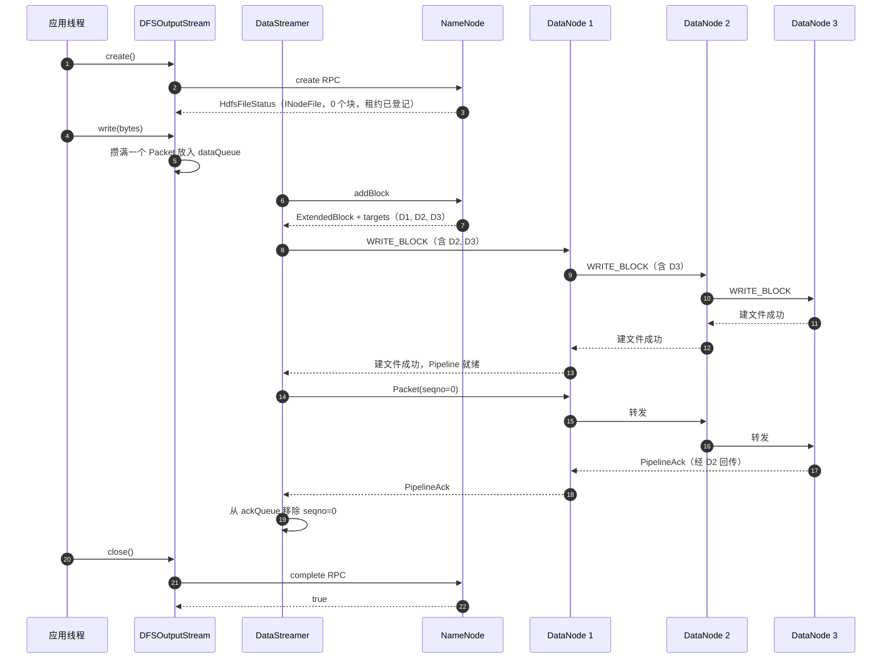
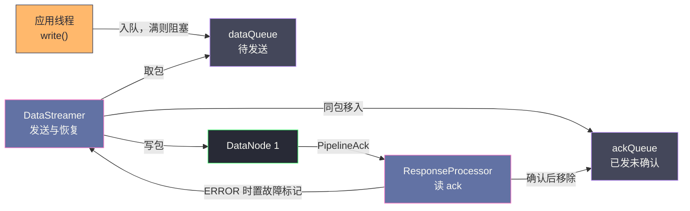
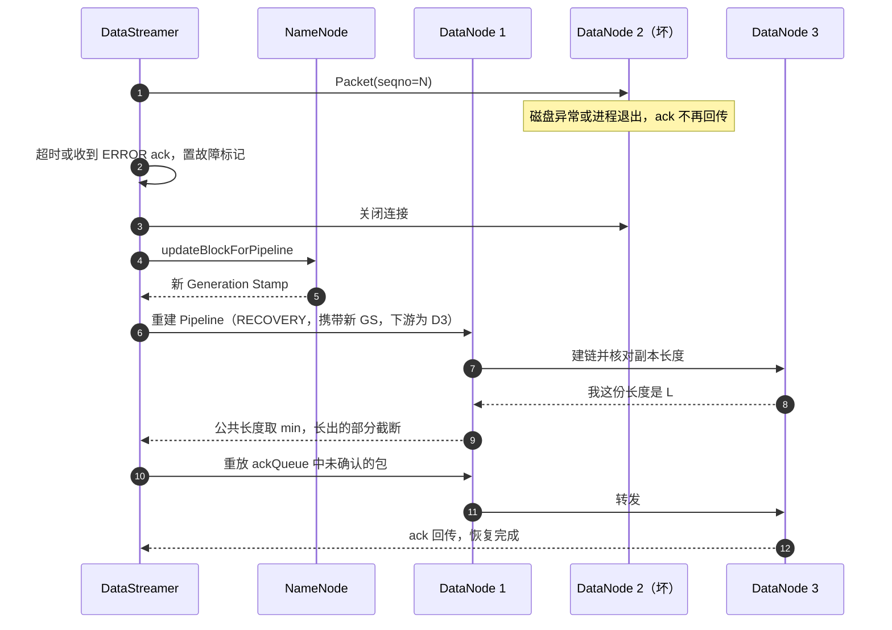
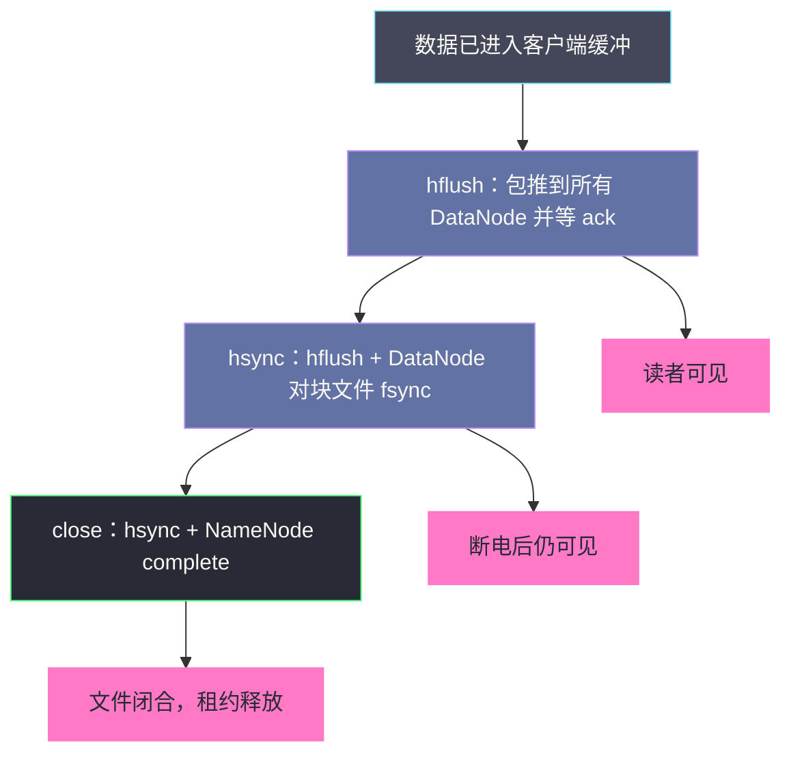
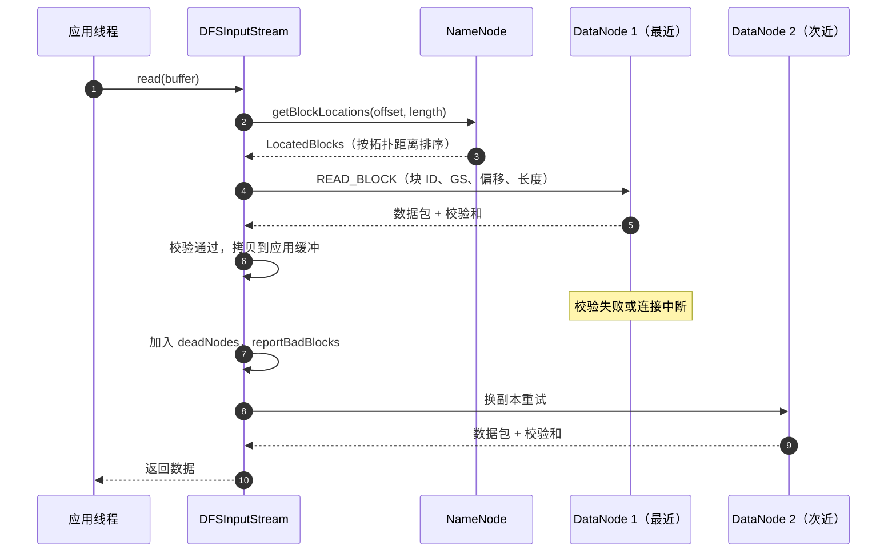
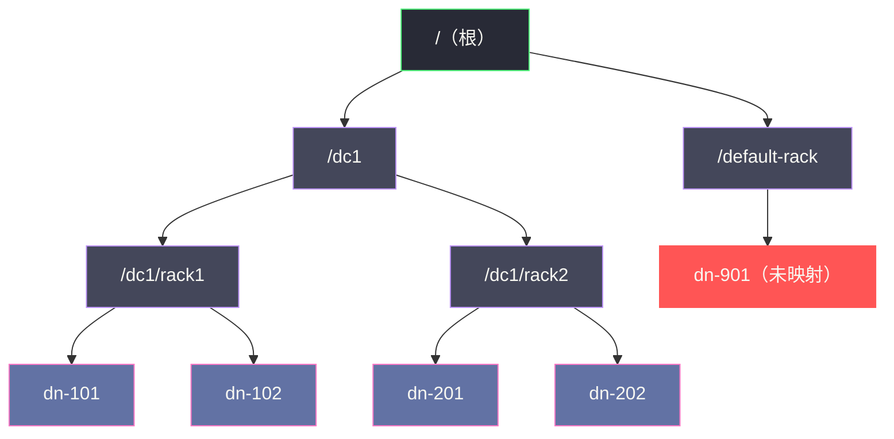

# HDFS 数据读写流程——Pipeline 写入与机架感知读取的底层路径

**摘要：**

HDFS 的数据面是两条方向相反、复杂度极不对等的路径。写入侧要为一个字节流在多个节点上维持同一条链的一致视图，于是有了 Packet、双队列、ack 反向回传与 Pipeline 恢复；读取侧只是挑一个最近的副本直连，失败再换下一个，复杂度被压到"选择"与"重试"两件事上。本文沿着一次真实写入走完全程：`create` 只建元数据、第一个 Packet 才触发 `addBlock`、NameNode 返回目标列表、三段握手串成 Pipeline、Packet 沿链下发、ack 沿链回传，直到 `close` 触发 `complete`。中段把 Pipeline 恢复拆到每一步——坏节点怎么被发现、Generation Stamp 怎么挡住幽灵副本、`replaceDatanodeOnFailure` 在补节点与副本不一致之间怎么取舍，以及 `hflush` 与 `hsync` 之间那条常被误读的界线：前者只承诺对读者可见，后者才承诺落到磁盘。读取侧讲清 `getBlockLocations` 的拓扑排序、副本切换与短路读的三个前提。收尾给出六个可对照日志直接定位的故障形态，以及"没配机架拓扑却期望机架感知"这类反例的真实代价。文中的参数默认值按 Hadoop 3.3.x 的口径给出，凡与具体发行版本相关的地方都标注了核对方式，避免把某个版本的默认值当成跨版本事实。

---

## 第 1 章 写入的完整路径：从 create 到 complete

先把问题限定在一个具体动作上。一个 Spark 作业的最后一个 Stage 要把结果写成一个 2.4GB 的 part 文件，副本数 3，块大小 128MB，那么这个文件会被切成 19 个块，每块三个副本，合计 57 个副本分布在集群里。应用程序看到的只是 `write()` 和 `close()` 两个方法，但在这两个调用之间，客户端与 NameNode、客户端与三个 DataNode 之间会往复几十轮协议交互，任何一轮都可能失败，而失败的处理方式又各不相同。

这一章按时间顺序把这条链路走一遍，重点不在"有哪些步骤"，而在每一步为什么必须是这个样子。

### 1.1 create 只建元数据，不建块

应用程序调用 `FileSystem.create()` 时，`DistributedFileSystem` 把它转成 `DFSClient.create()`，再发成一次 `ClientProtocol.create` RPC。请求里带的参数包括路径、权限、覆盖标志、副本数、块大小和客户端名字（形如 `DFSClient_<UUID>`），其中客户端名字不是装饰，它是后续所有写操作校验租约持有者的凭据。

NameNode 收到 `create` 之后做的事情，比大多数人以为的要少。它检查父目录是否存在、调用者是否有写权限、目标是否已存在且允许覆盖，然后在 Namespace 的 INode 树里建一个 `INodeFile` 节点——关键在于，这个节点的**块列表是空的**。接着 NameNode 在 `LeaseManager` 里登记一条 `(clientName → 文件)` 的租约，把 `OP_ADD` 写进 EditLog，返回一个 `HdfsFileStatus`。到这一步为止，文件在逻辑上已经存在，物理上零字节、零个块。

> [!info] Under Construction 的准确含义
> 处于 `UnderConstruction` 状态的文件表示"有一个租约持有者正在往里写"，不是"文件不可读"。其他客户端仍然可以 `open` 它，读到的内容是从文件头开始、已被 NameNode 记录为有效的那部分长度；正在被写入的最后一个块，读者只能读到该块已被记录的长度。`hdfs fsck /path -openforwrite` 就是用来把这批文件列出来的。

不在 `create` 时就把块分配好，理由不止一条。文件最终有多大，客户端在 `create` 的那一刻并不知道；块位置由副本放置策略实时决定，而放置要考虑当时的节点负载、磁盘剩余、机架分布，提前几分钟预订位置毫无意义；空文件如果不占块，NameNode 的块表就不必为大量"建了没写"的文件付代价。代价是写路径上多了一次 `addBlock` RPC，以及一个与文件大小无关的固定延迟。这个固定延迟对小文件极其不友好：一个 10KB 的文件同样要走完 `create`、`addBlock`、三段 Pipeline 握手、`complete`，其中三次 RPC 的往返时间可能比 10KB 数据的传输时间高两个数量级。小文件伤的不只是 NameNode 的内存，还有写入延迟的常数项。

### 1.2 addBlock：位置申请与目标列表

`DFSOutputStream` 的 `write()` 并不会立刻发包。数据先进客户端缓冲，攒够一个 Packet 才入 `dataQueue`，`DataStreamer` 发现队列非空后，才去申请第一个块。这个**懒申请**的顺序决定了 `create` 返回之后文件会保持零块状态，直到第一包数据就绪。

申请块走的是 `addBlock` RPC，参数里除了源路径和客户端名字，还有上一个块（`previous`）、被排除的节点列表（`excludedNodes`）、文件 ID、偏好节点（`favoredNodes`）和一组标志位。NameNode 侧先校验租约，然后调 `BlockManager` 的选目标逻辑，按副本放置策略挑出三个 DataNode，把新块追加进 `INodeFile` 的块数组，写 `OP_ADD_BLOCK` 进 EditLog，最后返回一个 `LocatedBlock`——里面有块 ID、Generation Stamp、目标节点列表和每个目标对应的存储类型。至于这三个节点是按什么规则挑出来的，是 [[05 HDFS 副本放置策略——机架感知与数据可靠性的工程权衡]] 要解决的问题，本篇只关心它返回的顺序。

这里有一个容易误解的细节：写路径上，NameNode 并不知道客户端跑在哪台机器上，`addBlock` 请求里没有客户端位置信息，所以返回的目标列表顺序是副本放置策略自己排定的顺序，不是"按客户端距离排序"。读路径恰好相反，`getBlockLocations` 会拿客户端主机名去做拓扑排序。把两条路径的**排序依据**混为一谈，会得出"写入的第一个节点总是离客户端最近"这种错误结论，进而误判跨机架写入的流量走向。

`excludedNodes` 是客户端维护的一份近期失败节点缓存，有效期由 `dfs.client.write.exclude.nodes.cache.expiry.interval.millis` 控制，默认十分钟。申请新块时把它们带给 NameNode，请求避开这些节点。这是一个典型的用"信息新鲜度"换"成功率"的设计：缓存太短，坏节点会被反复选中，每次都要走一轮恢复；缓存太长，节点已经恢复却仍被排除，集群的有效容量被无声地扣掉一块。十分钟是 HDFS 给出的折中值，不是普适最优值。

### 1.3 Pipeline 的建立：WRITE_BLOCK 的握手链

拿到目标列表之后，`DataStreamer` 向第一个节点发起 `OP_WRITE_BLOCK` 请求，协议里带着构造阶段（`PIPELINE_SETUP_CREATE`）、下游节点列表和存储类型。第一个 DataNode 在本地 `rbw` 目录下创建块文件与元数据文件，然后向第二个节点发同样的请求，但下游列表缩短一位；第二个节点再向第三个节点发，下游列表为空。第三个节点建好文件后回一个成功响应，这个响应沿原路反向回到客户端，Pipeline 才算就绪。

**握手必须串行**，理由不复杂：每个节点都要先确认自己的下游可用，否则它会把数据包转发给一个根本连不上的下游，而错误只能等到超时才能被发现——那意味着每个包都要付一次超时的代价。串行握手的成本是 `3 × (建连 + 往返)`，这个常数在 128MB 块上可以忽略，但在成千上万个 KB 级小文件上就是主要延迟来源。

`rbw` 目录（`rbw` 是 "being written" 的缩写）的存在，说明 HDFS 从文件系统层面就承认"块有一个未完成的中间态"。写入中的块不进入 `finalized`，也不出现在块报告里供其他客户端读取它的完整长度；DataNode 重启时，`rbw` 里的半成品不会自动变成完整块，而要走一遍恢复流程重新确定长度与 Generation Stamp。这条恢复路径与 [[09 HDFS 容错与恢复机制——自愈修复的工程实现]] 里讲的块恢复是同一套机制，而 `rbw` 与 `finalized` 的目录组织、卷选择策略，归 [[08 DataNode 存储引擎——FsDataset 与磁盘 IO 管理机制]] 管。

### 1.4 Packet：写路径的最小单位

Pipeline 就绪之后，数据以 Packet 为单位流动。一个 Packet 由三部分组成：25 字节的**固定头**、可选的协议头（块标识与访问令牌，通常只在每块的第一个包携带）、校验和数据与真正的数据。

| 字段 | 长度 | 语义 |
|---|---|---|
| `pktLen` | 4 字节 | 整个 Packet 的线上长度，收端据此切帧 |
| `offsetInBlock` | 8 字节 | 本包数据在块内的起始偏移，写端据此定位，恢复时据此重放 |
| `seqno` | 8 字节 | 包序号，从 0 单调递增，ack 靠它配对 |
| `lastPacketInBlock` | 1 字节 | 是否为本块最后一包，置位后触发块收尾 |
| `dataLen` | 4 字节 | 数据区长度，最后一包通常不足整包 |

校验以 chunk 为单位计算，默认每 512 字节数据配 4 字节 CRC32C（3.x 的默认校验类型）。按默认包大小 64KB 估算，扣掉头与校验之后数据区约 63.5KB，对应 127 个 chunk，校验区 508 字节，加上 25 字节的头，额外开销合计约 533 字节，占比不到 1%。这个比例不算高，但它是纯开销，且随包变小而按比例上升——这是包不能无限调小的原因之一。

包大小由 `dfs.client-write-packet-size` 控制，默认 65536。为什么是 64KB 而不是 1MB，答案在三个约束的交点上：客户端**在途数据的上界**等于"在途包数 × 包大小"，在途包数上限默认 80，64KB 对应约 5MB 的缓冲，这个量级对每个输出流都可接受；Pipeline 恢复时要重放未确认的包，包越大，单次重放的代价越高；DataNode 转发时要在内存里持有整包，包越大，单节点内存压力越集中。调大包大小的收益是减少 ack 数量与头开销，代价是在途内存上界线性上升、恢复重放更粗；调小的收益是重放粒度细、内存占用低，代价是 ack 风暴与头开销占比上升。

小包的问题另有一套机制兜底。应用如果频繁写几十字节，`DFSOutputStream` 会先攒够一个整包再发，不会一写一发；`dfs.client.write.byte-array.size` 则用于调节 `ByteArrayManager` 复用字节数组的粒度，避免每个包都新分配一块缓冲——高频小写入场景下，包缓冲的反复分配与回收本身就是可观的 GC 压力。这个参数的具体语义在各版本间有过调整，配置前以对应版本的 `hdfs-default.xml` 描述为准。

### 1.5 两个线程：DataStreamer 与 ResponseProcessor

`DFSOutputStream` 内部跑着两个线程，分工极其明确。

`DataStreamer` 负责往外推：从 `dataQueue` 取包、写给第一个 DataNode、把包同时挪到 `ackQueue`、在块边界处发收尾包并申请下一个块、以及在任何异常发生时主导 Pipeline 重建。

`ResponseProcessor` 负责往回读：从 socket 上读 `PipelineAck`、校验 `seqno` 的连续性、把已确认的包从 `ackQueue` 移除、发现 `ERROR` 状态或坏节点标识时把故障标记交给 `DataStreamer`。

两个线程而不是一个，解决的是**队头阻塞**。单线程收发意味着"发完一个包就等它的 ack"，吞吐被链路往返时间锁死：包再大，一个往返只能推进一包。拆开之后，发送端可以持续填充网络，ack 的延迟只体现为 `ackQueue` 变长；直到在途包数触到上限，`DataStreamer` 才停下来等确认，把背压反向传给调用 `write()` 的应用线程。这个上限就是 `dfs.client.write.max-packets-in-flight`，默认 80。

上限的两面性值得单独说。它保证了单个输出流的内存占用有确定上界，集群不会因为某个客户端写得快而被打爆；但 `ackQueue` 同时也是恢复时的重放窗口，上限越大，坏一个 DataNode 之后需要重发的数据越多。80 这个默认值意味着最坏情况下要重放约 5MB，这个代价在千兆网络上是几十毫秒，在跨机房高延迟链路上就是数百毫秒。

### 1.6 close 与 complete：元数据闭合

`close()` 不是简单地把缓冲区刷出去。它的完整动作是：先把剩余数据打包发完，发一个 `lastPacketInBlock` 置位的收尾包，等 `ackQueue` 清空，然后向 NameNode 发 `complete` RPC。

DataNode 收到收尾包之后，把块从 `rbw` 移到 `finalized`，把块文件与元数据文件按 Generation Stamp 命名保存，并向 NameNode 发增量块汇报（`blockReceived`），告知"这个块在我这里已经完整"。

NameNode 处理 `complete` 时并不只是改一个状态位。它检查文件的最后一个块是否达到最小副本数（`dfs.namenode.replication.min`，默认 1），如果不足，`complete` 返回 `false`，客户端等待一小段时间后重试，直到副本补齐或者放弃。这正是"写完立刻读同一个文件，有时读到的长度比实际写入的短"的来源——写入端以为 `close()` 返回就完事了，实际上 NameNode 那边的文件状态可能还差一次重试才能闭合。

还有一个容易被忽略的边角：如果最后一个块长度为 0（写入量恰好是块大小的整数倍，收尾时多出一个空块），`complete` 会把这个空块从块列表里删掉，除非文件是以追加方式打开的。这个处理看着琐碎，但它保证了块列表里不会有零长度块，读路径的偏移计算因此可以少一个特例。

---

## 第 2 章 Pipeline 的故障恢复

Pipeline 的比喻可以借用接力赛：棒从客户端交给第一个人，再传给第二个人、第三个人。区别在于，接力赛掉棒了裁判看得见，而 Pipeline 里某一棒掉了，客户端看到的只是一段时间没有 ack 回来。全部复杂性就压在这段时间里：怎么判定是谁掉了棒、掉了之后剩下的人怎么继续、已经跑过的路要不要重跑、重跑会不会把旧数据写脏。

本章是全篇的核心。HDFS 写入的每一个设计，往回追几乎都能追到某个故障形态；反过来说，读懂恢复流程，也就读懂了 Packet、Generation Stamp 与 ack 队列为什么长成现在这样。

### 2.1 坏 DataNode 的三种发现途径

客户端不会主动探测 DataNode 的健康状况，它只依赖三条被动信号。

第一条是 ack 超时。`ResponseProcessor` 在 socket 上等 `PipelineAck`，读超时由 `dfs.client.socket-timeout` 控制，默认 60 秒。这个值不是随手定的：它必须明显大于正常的 ack 往返（同机房通常是个位数毫秒），又要小到让故障在可接受的时间内暴露。DataNode 之间的转发与等待也有各自的超时，往下游写数据的超时由 `dfs.datanode.socket.write.timeout` 控制，默认 8 分钟——比客户端侧宽松得多，因为 DataNode 可能正在等待一块慢盘。

第二条是 `PipelineAck` 里的错误状态。每个 DataNode 收到下游的 ack 后，会把自己的写入结果与下游结果合并再往上游传；只要下游有任何一个节点报错，或者下游的 ack 里已经带了坏节点标识（`firstBadLink`），这个节点就会把自己的状态也置为 `ERROR`，并原样把 `firstBadLink` 往上传。客户端拿到带 `firstBadLink` 的 ack，不需要猜是谁坏了，协议已经把答案写在包里。

第三条是建链阶段的失败。`createBlockOutputStream` 向某个节点发 `WRITE_BLOCK` 后，如果对方回的是失败响应，客户端会看到 `Bad connect ack with firstBadLink` 这类信息；如果是连接层直接断掉，则表现为 `Connection reset by peer`、`Broken pipe` 一类的 `IOException`。

| 信号 | 出现位置 | 典型日志 | 判据 |
|---|---|---|---|
| ack 超时 | 客户端 `ResponseProcessor` | `SocketTimeoutException`，`Slow waitForAckedSeqno` | 超时时间接近 `dfs.client.socket-timeout` |
| 错误 ack | 客户端 `ResponseProcessor` | `PipelineAck` 中带 `firstBadLink` | 能定位到具体节点与端口 |
| 建链失败 | 客户端 `DataStreamer` | `Bad connect ack with firstBadLink`、`Exception in createBlockOutputStream` | 通常发生在申请新块之后 |
| 下游转发失败 | DataNode `PacketResponder` | `Slow BlockReceiver write packet to mirror`、转发异常 | 上游节点日志先于客户端报错 |

### 2.2 恢复动作：从关连接到重放

检测到故障之后，`DataStreamer` 主导的恢复流程大致是下面这几步，顺序不能乱。我们逐步拆开看。

第一步，停止使用当前 Pipeline，关闭到坏节点的连接，但保持与其余节点的连接。这一点很关键：**恢复不重建整条链**，而是尽量复用还活着的节点上的副本，否则已经写入的数据就白写了。

第二步，向 NameNode 发 `updateBlockForPipeline`，为这个块申请一个新的 Generation Stamp。新 GS 的作用是给"恢复之后的数据"打一个版本戳：还活着的节点被通知升级到新 GS，坏掉的那个节点上留着的旧副本仍带旧 GS，日后即便它恢复上线，NameNode 也能凭 GS 判断出这份副本是过期的，不会当成有效副本使用。这个机制常被称作"防止幽灵数据"，措辞准确——没有 GS，一个刚恢复的节点完全可能用短一截的旧副本冒充完整副本。

第三步，用还活着的节点重建 Pipeline，构造阶段改为恢复（`PIPELINE_SETUP_RECOVERY`），并把新 GS 传下去。每个参与的 DataNode 在这时会报出自己这份副本的实际长度，取最短的那个作为公共长度，长的截断。截断是必须的：同一块在不同节点上的长度如果不一致，那么"块长度"这个元数据就没有唯一答案。

第四步，把 `ackQueue` 里所有未被确认的包按 `seqno` 顺序放回 `dataQueue` 头部，用新 Pipeline 重放。这里要纠正一个流传很广的说法：恢复重发的是"最后一个未确认的 Packet 及其之后的全部包"，不是"最后一个块"。块边界与恢复边界没有关系——恢复发生在**包粒度**上，一个块可能被恢复多次，每次重放的都是当时 `ackQueue` 里的那批包。

第五步，如果剩余节点数少于目标副本数，由 `replaceDatanodeOnFailure` 决定是否补一个新节点（下一节展开）。

第六步，块写完后，NameNode 侧发现这个块的副本数不足，由副本复制机制异步补齐。这一步不阻塞写入，也不在客户端的失败路径上。

注意这里有一个隐含的取舍：恢复过程中写入是暂停的。`DataStreamer` 在重建 Pipeline 期间不发送新包，应用的 `write()` 很快就会因为 `dataQueue` 积压而阻塞。所以一次 Pipeline 恢复的代价不只是重放那几 MB 数据，还包括这几百毫秒到数秒的写入停顿。延迟敏感的场景（譬如写 HBase 的 WAL）之所以对 DataNode 磁盘抖动极其敏感，原因就在这里：一次慢盘触发的不是一次重试，而是一次全链暂停加一次重放。

### 2.3 replaceDatanodeOnFailure：补不补一个新节点

坏一个节点之后，Pipeline 从三个变成两个。两个节点的链能不能继续写，取决于三件事：集群里还有没有可用节点、补节点的代价是否可接受、以及补上之后数据是否真的一致。

这套判断由三个参数控制。`dfs.client.block.write.replace-datanode-on-failure.enable` 是总开关，默认开启；`dfs.client.block.write.replace-datanode-on-failure.policy` 决定何时请求补节点，取值为 `DEFAULT`、`NEVER`、`ALWAYS`，默认 `DEFAULT`；`dfs.client.block.write.replace-datanode-on-failure.best-effort` 决定补不上时是继续写还是直接失败，默认是失败。

`DEFAULT` 策略的判断逻辑是：当 Pipeline 里剩余的节点数小于文件的目标副本数时，请求补一个节点。之所以需要这个判断而不是无条件补，是因为 HDFS 允许 Pipeline 长度小于副本数——追加写（append）场景下本来就可能只有一条短链，此时贸然补节点会打乱副本布局。`NEVER` 相当于关掉补节点，`ALWAYS` 则不管当前长度够不够都补，后者只在极少数需要维持固定链长的场景下才有意义。

**补节点不是免费的**。客户端要向 NameNode 发 `getAdditionalDatanode`，NameNode 再跑一次放置决策选出一个新节点，然后新节点要接入现有链——它接收的是从"重放的第一个未确认包"开始往后的数据，前面的字节它并没有。于是会出现一个看似矛盾的中间态：这条 Pipeline 在继续正常写入，但链上各副本的长度并不一致，需要等块提交之后由副本恢复流程把缺的部分补上。这个中间态是"继续写"换来的，代价是暂时的不一致副本；`best-effort` 与最小副本数这类开关，本质上都是在给"允许多不一致"划一条线。

> [!warning] 关掉补节点的代价不是"少一次 RPC"
> 把 policy 设为 `NEVER` 之后，坏一个节点，Pipeline 就从三个变两个。这个块在整条写入剩余过程中只有两份副本，直到块提交后副本复制机制介入；如果在这段时间里再坏一个节点，链就只剩一个节点，客户端将无法继续，整条写入失败，已经写过的所有块都得重来。省下的那一次 `getAdditionalDatanode` 往返，赌的是"不会再坏第二个"。

### 2.4 hflush、hsync、close：三级语义

笔者审过的写入代码里，`hflush` 与 `hsync` 的混用是最常见的一类错误，而两者的差别恰恰是 HDFS 写入语义里最需要讲清楚的部分。

| 调用 | 客户端动作 | DataNode 动作 | 读者可见 | 断电后可见 | NameNode 元数据 |
|---|---|---|---|---|---|
| `hflush()` | 把缓冲的包发出，等全部 ack | 收包并写入本地，不强制落盘 | 是 | 不保证 | 不更新 |
| `hsync()` | `hflush` 的语义，外加同步标志 | 收到同步标志后对本块文件做 `fsync` | 是 | 是 | 默认同步更新块长度 |
| `close()` | `hflush` 加 `complete` | 块收尾并落到 `finalized` | 是 | 是 | 文件闭合，租约释放 |

`hflush` 的承诺只有一句：返回时，到目前为止写入的数据已经被 Pipeline 上所有 DataNode 接收，任何一个新读者都能读到这部分内容。它的实现是把客户端缓冲打包成一个带同步标志的包发下去，然后等这个序号被确认。注意"接收"与"落盘"的差别：DataNode 收下数据、写进本地的块文件，这个写入通常只到达操作系统的页缓存，`fsync` 并没有发生。所以 `hflush` 返回之后如果整机断电，这部分数据可能丢失。

这份"可见"来自 DataNode 侧对副本可见长度的更新，NameNode 并不掌握这段长度；所以读端一旦重新向 NameNode 取地址、或者 NameNode 重启过，能看到的内容通常就退回元数据里记录的那个长度，直到租约恢复把真实长度补回来。换句话说，`hflush` 的可读性依赖 DataNode 与 NameNode 两侧状态恰好对上，而不是一份已经提交的元数据。

`hsync` 在 `hflush` 之上多要一件事：要求 DataNode 把数据真正刷到磁盘。客户端发出的包带着同步标志，DataNode 收到后执行一次 `fsync`，完成之后才回 ack。这才是 POSIX 意义上 `fsync(3)` 的语义。代价是**一次真实的磁盘同步**：机械盘上单次 `fsync` 是毫秒级，且延迟会随"自上次同步以来积了多少脏页"而波动；SSD 上亚毫秒级，但同样受写放大与掉电保护电容的影响。对每秒要写几千次的小记录来说，`hsync` 的吞吐上限就是磁盘的 `fsync` 能力，与网络带宽无关。

`close` 在语义上包含 `hsync`，再加上元数据的闭合。只有 `complete` 落地之后，文件才从 `UnderConstruction` 变成正常文件，租约才释放，其他客户端才能以写方式打开它。

三者是包含关系，不是并列关系：`close` 蕴含 `hsync`，`hsync` 蕴含 `hflush`，反过来都不成立。

### 2.5 hflush 返回后 NameNode 挂掉，数据还在吗

这个问题值得逐层拆开，因为"在"可以指**三个不同的位置**：DataNode 的内存里、DataNode 的磁盘上、NameNode 的元数据里。`hflush` 只保证了第一个，`hsync` 保证前两个，`close` 才触及第三个。

先给结论：`hflush` 返回之后 NameNode 挂掉，数据字节通常还在 DataNode 上，但文件仍然是 `UnderConstruction`，元数据侧的 `complete` 没有发生；如果此时所有持有副本的 DataNode 也一起挂掉，数据就没了，元数据还在也没用。

把各种组合摊开看更清楚：

| 失效点 | DataNode 上的字节 | NameNode 元数据 | 结果 |
|---|---|---|---|
| `hflush` 后客户端进程挂 | 在，可能未 `fsync` | 文件处于 `UnderConstruction`，租约未释放 | 租约到期后由恢复流程闭合到能恢复的长度，未 `fsync` 的部分可能丢 |
| `hflush` 后 NameNode 进程挂 | 在 | `addBlock` 事务已进 EditLog，`complete` 未发生 | 重启回放 edits 后文件仍在，末块长度靠租约恢复从 DataNode 取回 |
| `hflush` 后所有 DataNode 挂 | 全部丢失 | 元数据仍指向这些块 | 文件不可恢复，`fsck` 报缺失块 |
| `hsync` 后断电 | 在，且已落盘 | 仍 `UnderConstruction` | DataNode 重启后数据可恢复，文件仍需闭合 |
| `close` 返回后 NameNode 挂 | 在 | 文件已闭合，`OP_CLOSE` 已进 EditLog | 文件正常，重启后元数据一致 |

> [!note] 一句话记住这条界线
> `hflush` 的承诺是"可见"，`hsync` 的承诺是"可恢复"，`close` 的承诺是"合法"，**可见与可恢复是两件事**。把 `hflush` 当 `hsync` 用，等于用"看起来写成功了"换"断电时丢最后一段"，而这个交换在多数故障演练里是看不出来的，只有真断电才会暴露。

还有一个层面常被忽略：NameNode 侧的 `addBlock` 事务是否已经持久化，取决于集群的元数据配置。在 QJM 部署下，一次 EditLog 事务要多数 JournalNode 确认才算提交，此时元数据比单机 `name.dir` 可靠得多；如果集群还是单 NameNode 且没有可靠共享存储，NameNode 元数据目录一旦丢失，`hflush` 之后写进去的字节会变成孤儿——DataNode 上有数据，但没有元数据指向它，块报告上来之后只能当作无效副本删除。这也解释了为什么"数据面已经确认"永远不等价于"系统已经确认"。

### 2.6 UnderConstruction 与租约：客户端崩溃后的判据

客户端崩溃之后，文件会一直停在 `UnderConstruction`，除非租约被回收。租约机制有两个时间刻度。

软限制默认 60 秒。超过软限制，NameNode 允许别的客户端来"恢复"这个文件的租约（`recoverLease`），恢复的前提是它能联系上原写入者或者确认原写入者已死。手工触发的方式是 `hdfs debug recoverLease -path /path -retries 3`。

硬限制在早期版本里是一小时的常量，HDFS-14758 之后改成了可配置项 `dfs.namenode.lease-hard-limit-sec`，默认值也相应缩短到 20 分钟。硬限制一到，NameNode 直接判定写入者失联，主动触发租约恢复：为最后一个块申请新 Generation Stamp，联系持有副本的 DataNode 确认长度，然后把这个文件闭合。具体默认值在不同发行版与版本上可能不同，排查时以集群实际生效的 `hdfs-default.xml` 为准。

| 现象 | 判据 | 处置 |
|---|---|---|
| 文件一直不可写 | `hdfs fsck /path -openforwrite` 列出该文件 | 等硬限制到期，或手工 `recoverLease` |
| 另一个客户端 `create` 报错 | `AlreadyBeingCreatedException`，提示文件正在被某个 `DFSClient_xxx` 创建 | 确认原写入者是否还活着，再决定是否恢复租约 |
| 写入卡住不结束 | NameNode 日志中该文件的租约反复续期 | 检查客户端是否在长时间不写也不 close |
| 文件长度比预期短 | 恢复后的末块长度小于实际写入量 | 属正常：恢复只能保留能被副本确认的长度 |

租约是 NameNode 内存结构中的一层，与 [[02 HDFS 整体架构全景——NameNode、DataNode 与 Client 三角关系]] 里讲的 Namespace、BlockManager 并列。它的价值在于给"正在写"这件事一个**唯一责任人**。没有租约，两个客户端可以同时对同一文件追加数据，块列表与长度都会打架；租约的代价是客户端一旦非正常退出，文件就要占着这个状态直到超时。所以写 HDFS 的规范做法永远是 `try-with-resources` 或者 `finally` 里 `close`，不是为了代码整洁，而是因为漏掉的那个 `close` 会让文件在最长一个硬限制周期内处于半成品状态。

---

## 第 3 章 读取的完整路径：选一个副本，直连

读路径的复杂度比写路径低一个数量级，原因很朴素：读取没有"多处写入要保持一致"的问题。NameNode 只需要回答"块在哪几个节点上"，客户端挑一个最近的连上去读，读坏了换下一个。所有复杂性集中在两处——排序与重试。

### 3.1 open 与 getBlockLocations

`FileSystem.open()` 转成 `DFSClient.open()`，向 NameNode 发 `getBlockLocations`，只带路径与要读的区间。NameNode 返回 `LocatedBlocks`，包含文件总长度、按顺序排列的块列表，以及每个块对应的副本位置列表。

预取是这里唯一需要理解的参数。`dfs.client.read.prefetch.size` 决定一次 `getBlockLocations` 最多索取多少字节对应的块位置，默认是 10 个块大小。对 2.4GB、128MB 块的文件来说，一次 RPC 只能拿到前十个块的位置，读到第十个块附近时客户端会再发一次请求取下一批。这个设计把"打开一个大文件"从一次可能很大的 RPC 摊成了若干次小 RPC，避免大文件在打开瞬间就把 NameNode 的块位置查询压成瓶颈。

### 3.2 选择最近的副本

顺序读取时，客户端会为每个块挑一个副本。挑的依据是 NameNode 返回列表的顺序，而列表的顺序是 NameNode 用客户端主机名在 `NetworkTopology` 上算出来的距离排序。

**距离不是物理距离**，是拓扑树上的路径长度：客户端与副本在同一台机器上记 0，同一机架不同机器记 2，跨机架记 4。这个数字只用于比较远近，不表示任何绝对时间。

`dfs.client.use.datanode.hostname` 影响的是客户端拿到地址之后怎么连。默认 `false`，客户端使用 DataNode 上报的 IP 地址建连；设为 `true` 则改用主机名，由客户端所在机器的 DNS 解析。这个开关的存在有很实际的原因：在多网卡、容器网络、或者 DataNode 上报的地址不可路由的环境里，客户端必须能用另一套地址访问到同一个节点；把解析权交给客户端，等于把"怎么到达这个节点"的判断从 NameNode 转移到了真正发起连接的一方。代价是每次建连都多一次 DNS 解析，解析不可靠的环境下会引入额外延迟。

副本列表里还有一组隐含信息：如果前几次读取已经把某个节点标记为失败，客户端在本次读取中会把它放进 `deadNodes` 集合，后续块不再尝试它。这个集合是流级别的，不是永久黑名单。

### 3.3 一次读取的时序

我们把读取的交互画出来，会看到它比写入短得多：一次寻址，一次建连，然后是持续的流式传输。

跨块读取时，`DFSInputStream` 会关闭当前 DataNode 的连接，为下一个块重新选节点、重新建连。对应用来说这是一条连续字节流，中间的重连是不可见的；但如果两个块恰好落在不同节点上，就会看到一次连接建立的延迟。这也是为什么顺序读大文件时，块边界处的延迟会有轻微起伏。

### 3.4 校验失败与换副本

读取时客户端对每个数据包做校验，校验不过就抛 `ChecksumException`。此时的处置有两层：本次读取立刻换副本，同时向 NameNode 发 `reportBadBlocks`，把这个副本标记为损坏，由副本复制机制从健康副本重新复制一份。

换副本的重试次数由 `dfs.client.max.block.acquire.failures` 控制，默认 3。三次都失败，客户端抛出"无法获取块"一类的异常，也就是常见的 `Could not obtain block`。这个数字体现的取舍很直接：调大，客户端在集群局部故障时更耐扛，但会把真实的损坏掩盖更久；调小，故障暴露快，但一次短暂的网络抖动就可能让整个作业失败。

| 参数 | 默认值 | 作用 | 调大的代价 | 调小的代价 |
|---|---|---|---|---|
| `dfs.client.max.block.acquire.failures` | 3 | 单个块换副本的最大次数 | 故障定位被延后，读延迟长尾变重 | 网络抖动易被放大成作业失败 |
| `dfs.client.socket-timeout` | 60000 毫秒 | 连 DataNode 的读超时 | 坏节点占用连接更久，切换变慢 | 慢节点被误判为坏节点，触发无谓换副本 |
| `dfs.client.read.prefetch.size` | 10 个块大小 | 一次预取的块位置范围 | 大文件打开时单次 RPC 变重，NameNode 压力集中 | RPC 次数增多，顺序读出现取址停顿 |
| `dfs.client.use.datanode.hostname` | false | 是否用主机名而非 IP 建连 | 增加 DNS 依赖与解析延迟 | 多网卡/容器环境下可能连不上正确地址 |

### 3.5 短路读：绕过 DataNode 进程

如果客户端与目标 DataNode 在同一台机器上，走 TCP 就绕远了：数据要从磁盘读进 DataNode 的用户态，再进内核的 TCP 栈，再到客户端的用户态，中间有多次拷贝，还多了一次协议往返。短路读（Short-Circuit Read）把这几步省掉：客户端直接拿到块文件的文件描述符，自己从本地磁盘读。

机制是这样的：客户端先通过 Unix Domain Socket 联系本机 DataNode，请求访问某个块；DataNode 做权限校验，通过后把块文件与元数据文件的文件描述符通过这个 socket 传过去；客户端拿到描述符之后用普通的 `read()` 直接读，完全不经过 DataNode 的数据传输路径。

这条路径要成立，得同时满足**三个前提**。第一，`dfs.client.read.shortcircuit` 置为 `true`，默认是关的。第二，`dfs.domain.socket.path` 指向一个 DataNode 与客户端都能访问的 socket 路径，通常写成 `/var/run/hadoop-hdfs/dn._PORT` 这类带端口占位的形式，由 DataNode 在启动时创建。第三，客户端进程所在的机器上要有可用的 `libhadoop.so` 本地库，文件描述符的传递与校验逻辑在 native 层实现，纯 Java 环境拿不到这个能力。

任何一个前提不满足，短路读会**静默回退**到 TCP 读取——日志里通常能看到短路读被禁用的原因，而不是一个显式异常。这一点在排查"为什么本地读没有变快"时很重要：配置项写了 `true` 不等于短路读真的生效。

`dfs.client.read.shortcircuit.skip.checksum` 是另一个开关，默认 `false`。它让客户端在读本地块时跳过校验，用于那些"数据已经由上层保证完整、校验是纯开销"的场景。代价是把校验的责任从系统转移给了使用者：一旦块文件在磁盘上被静默损坏，跳过校验就等于直接读到脏数据，而且不会有 `ChecksumException` 提醒你。

短路读在容器化环境里经常失效，原因也不神秘：Unix Domain Socket 是宿主机文件系统上的一个路径，如果容器没有把该目录挂进来，或者容器内的 `dfs.domain.socket.path` 与宿主机不一致，客户端就找不到这个 socket，于是回退到 TCP。存算一体的优势有一半来自短路读，把计算挪进容器、却没把 socket 路径对齐，等于主动放弃了这部分收益。

---

## 第 4 章 机架感知的真实机制

前面反复出现"拓扑距离"，但距离从哪来，是一个比大多数人以为的更土的问题：来自一份可能由运维脚本手写的映射。

### 4.1 NetworkTopology 是一棵树

NameNode 内存里的 `NetworkTopology` 是一棵多层树，叶子是 DataNode，中间节点是交换机与机架，根通常是数据中心。节点的位置用路径字符串表示，譬如 `/dc1/rack2/dn-103`，树的层级由路径中的斜杠数量决定。

距离就是两个叶子在这棵树上的路径长度：同一节点 0，同机架 2，跨机架 4，跨数据中心 6。副本放置策略用这个距离判断"第二个副本该不该放到另一个机架上"，读路径用这个距离排序副本列表。

`/default-rack` 是**兜底路径**。任何没有被映射规则识别出机架的节点都会被塞进这个虚拟机架，这也是"没配拓扑"的集群里所有节点无一例外的归宿。

### 4.2 拓扑从哪来：映射脚本与缓存

NameNode 不知道机器的物理位置，它依赖一个可插拔的映射接口 `DNSToSwitchMapping`，把"节点地址"映射成"机架路径"。最常见的实现是脚本映射：配置 `net.topology.script.file.name` 指向一个可执行脚本，NameNode 把待解析的地址按行喂给脚本，脚本输出对应的机架路径。脚本可以是任何语言写的，返回 `/dc1/rack2` 这样的字符串即可，返回空则落到 `/default-rack`。

这套机制的设计意图是"把环境相关的部分留给运维"。机房布局、交换机接线、机柜编号这些东西，Hadoop 无法从机器本身推断出来，只能由人来告诉它；用一个外部脚本而不是配置文件，是因为几百上千个节点的映射关系用脚本表达（按 IP 段、按主机名前缀）远比逐个列举可维护。

脚本之外还有两个层次需要注意。`CachedDNSToSwitchMapping` 会在内存里缓存映射结果，避免每次块分配都去执行脚本；这与 `dfs.client.write.exclude.nodes.cache.expiry.interval.millis` 之类缓存是同一个思路——用陈旧的缓存换调用开销，代价是拓扑变更要等缓存过期才生效。另外，NameNode 与 DataNode 各自都会构建自己的拓扑实例：NameNode 的拓扑用于放置与排序，DataNode 的拓扑用于判断下游节点的远近以决定是否转发。两边读的是同一份脚本，但如果某台机器的脚本不可执行，两边的视图就可能不一致。

部分 3.x 版本还引入了把端口纳入拓扑键的扩展接口（`TopologyWithPortsProvider` 一类），用于同一台机器上跑多个 DataNode 实例的场景。这类扩展是否可用、生不生效，取决于具体版本与实现类，配置前应按对应版本文档核对，不要照抄网上的片段。

| 配置 | 作用 | 配错或缺失的后果 |
|---|---|---|
| `net.topology.script.file.name` | 指定机架映射脚本 | 全部节点落到 `/default-rack` |
| `net.topology.script.number.args` | 每次调用脚本传入的最大地址数量 | 值过小导致脚本被频繁调用 |
| `net.topology.impl` | 指定拓扑实现类 | 用错实现类时距离计算与放置行为都会变 |
| `dfs.datanode.use.datanode.hostname` | DataNode 之间是否用主机名建连 | 与客户端配置不一致时可能出现连不通 |

需要说明的是，HDFS 侧有时会用 `dfs.network.script` 这样的名字来指代机架映射脚本，实际生效的入口在 common 层的 `net.topology.script.file.name`，两者不是并列的两套机制。配置前先确认集群里到底哪个键被读到，比记住键名更重要。

### 4.3 没配拓扑却期望机架感知

这是 HDFS 部署里最常见的一类配置缺失，后果也不是"性能差一点"，而是三重退化同时发生。

第一重是副本放置退化。默认的三副本策略要在"第二个副本放到另一个机架"这一步上做判断，如果所有节点都在 `/default-rack`，这个判断失去意义，策略退化成在同一个虚拟机架里挑节点。三个副本有可能落在同一个机架、甚至同一台交换机下，此时机架交换机一挂，这个块的可用副本数从 3 变成 0。副本数还是 3，可靠性却不是三副本的可靠性——这就是**副本数不等于容灾**的准确含义。

第二重是读取本地性退化。客户端距离计算失效之后，同一机架的节点与跨机架的节点在距离上无法区分，NameNode 返回的副本顺序接近任意顺序。计算任务碰巧与某个副本同机时仍然能本地读，但"尽量在同机架读"这一层优化消失了，跨机架流量随任务调度随机波动。

第三重是写入流量的不可控。写三副本时，Pipeline 上两段链路的数据流如果都跨机架，核心交换机的带宽消耗是本地写入的两倍以上；拓扑正确时，放置策略会有意识地让第三份副本跨机架、前两份留在同机架，把跨机架流量压到一份。拓扑缺失之后，这个压缩不再发生，机架间链路的占用可能在业务量没变的情况下翻倍——这类问题在监控上表现为"核心交换机流量无缘无故涨了"，而应用侧毫无感知。

判断自己集群有没有配拓扑，有一条很短的命令：`hdfs dfsadmin -printTopology`。如果输出里所有节点都挂在 `/default-rack` 下，那就等于没有拓扑。另一个信号在 NameNode 日志里：放置策略无法满足机架要求时会打印类似"无法放置足够副本"的告警，看到这类告警而副本数显示正常，基本可以断定拓扑数据是坏的。

---

## 第 5 章 六个故障形态与判据

HDFS 写入的故障，最终都会收敛到少数几条日志上。这一章把最值得记住的六条列出来，每条给出日志形态、机理和判据。日志里的数值被省略成占位符，因为真正需要对照的是消息文本与阈值，而不是某一次的具体耗时。

| 故障形态 | 出现位置 | 关键日志 | 后续动作 |
|---|---|---|---|
| `Slow BlockReceiver` | DataNode | `Slow BlockReceiver write packet to mirror` | 转发链路或下游磁盘慢，暂不切换 |
| `Slow flushOrSync` | DataNode | `Slow flushOrSync took ...` | `fsync` 慢，直接影响 `hsync` 延迟 |
| `DataStreamer Exception` | 客户端 | `DataStreamer Exception`、`Exception in createBlockOutputStream` | 触发 Pipeline 恢复 |
| `PipelineAck` 超时 | 客户端 | `Slow waitForAckedSeqno`、`SocketTimeoutException` | 触发恢复并重放未确认包 |
| `ChecksumException` | 客户端读 | `Found checksum error for ...` | 换副本并上报坏块 |
| `All datanodes are bad` | 客户端写 | `All datanodes ... are bad. Aborting` | 放弃当前块，整条写入失败 |

### 5.1 Slow BlockReceiver

这条日志来自 DataNode 的收包线程，含义是"把收到的包转发给下游花的时间超过了阈值"。阈值由 `dfs.datanode.slow.io.warning.threshold.ms` 控制，默认 300 毫秒。

它之所以值得单独记，是因为它是"下游慢"的**唯一早期信号**。客户端看到的只是 ack 变慢，而 DataNode 这条日志能告诉你是哪一段链路、哪一台下游节点在拖。处置上不要急着换节点：如果只是偶发，通常是下游磁盘抖动或网络瞬时拥塞；如果持续出现并且集中在某一台下游节点，才说明该节点有问题。

### 5.2 Slow flushOrSync

同样来自 DataNode，出现在收到带同步标志的包、执行 `fsync` 的时候。它衡量的是磁盘同步的真实耗时，与 `hsync` 的端到端延迟直接相关。

看到这条日志，第一反应应该是查磁盘而不是查网络：`iostat` 的 `await`、写队列深度、是否有其他进程在抢 IO。第二反应是查写入模式：如果业务在频繁 `hsync` 小记录，`fsync` 次数本身就是瓶颈，此时把 `dfs.datanode.synconclose` 之类的开关打开只会更糟。这条日志的处置方向永远是"减少同步次数"或"换更快的介质"，而不是调大超时。

### 5.3 DataStreamer Exception

客户端侧的兜底日志，出现在 `DataStreamer` 线程捕获到异常的时候。它本身信息量不大，价值在于它后面跟的异常栈：栈里会指出是建连失败、写失败还是 ack 读失败，从而区分"新 Pipeline 建不起来"和"已有 Pipeline 断了"。

判据上有个简单办法：如果异常出现在申请新块之后的建链阶段，多半是目标节点不可达或拒绝服务；如果出现在数据流中间，则是已有链路断了，恢复流程会接管。无论哪种情况，只要客户端还在重试，应用侧的 `write()` 表现为卡顿而不是报错。

### 5.4 PipelineAck 超时

`ResponseProcessor` 等不到 ack，`waitForAckedSeqno` 的耗时会超过预期，客户端日志里出现 `Slow waitForAckedSeqno` 或者直接的 `SocketTimeoutException`。

这条与 `Slow BlockReceiver` 是一对：后者是 DataNode 视角的慢，前者是客户端视角的慢。两者同时出现，说明瓶颈在链路中间某一段；只有客户端超时而 DataNode 侧没有慢日志，则更可能是 ack 回传路径上丢了包，或者某个节点的 ack 线程卡住。超时时间由 `dfs.client.socket-timeout` 决定，把它调大会让故障暴露变慢，调小会让慢节点被误判——这条参数没有"最优值"，只有与集群网络质量匹配的值。

### 5.5 ChecksumException

读路径的故障。客户端读到数据后发现校验和不匹配，日志里会出现 `Found checksum error for ...` 并带出块 ID 与来源节点，随后向 NameNode 上报坏块。

处置的关键是分清"数据坏了"还是"读到一半断了"。校验和不匹配意味着数据字节与记录的校验值不一致，属于副本损坏；如果只是连接中断，抛的是 `IOException` 而不是校验异常。前者要换副本并上报，后者重连即可。持续出现同一个块的 `ChecksumException`，说明该副本所在的磁盘可能已经出问题，应尽快让副本复制机制换掉它。

### 5.6 All datanodes are bad

写入侧最坏的结果。客户端尝试过的节点全部失败，或者 Pipeline 缩短到无法继续，客户端放弃当前块并抛出这个异常，整条写入失败。

这条异常之前通常有一串 `Abandoning block`、`Excluding datanode` 的日志，记录了每次放弃的节点。判据很直接：如果被排除的节点数量与副本数相当，说明这不是单点故障，而是整个写入路径（网络分区、机架掉电、交换机故障）出了问题。此时重试大概率还是失败，应该先确认集群状态，再决定是否重跑作业。

---

## 第 6 章 反例与量化

机制讲完之后，剩下的问题是这些设计在实际使用中怎么被误用，以及它们的代价能不能估算出来。

### 6.1 反例一：把 hflush 当 hsync 用

最常见的写法是这样的：写一批数据，`hflush()`，然后认为"已经落盘了"，继续做后续的不可逆操作。这个假设在正常运行时不产生任何可见问题，只有在断电、宿主机崩溃、或者内核 panic 的时候才会暴露，而那时暴露的形态是"最后一段数据静默丢失"，日志里什么都没有。

正确的判断方式不是看代码里写了什么，而是看下游依赖什么。如果下游是"另一个进程马上要读"，`hflush` 足够；如果下游是"重启之后必须还在"，必须 `hsync`；如果下游是"这个文件要交给别人读"，那要的是 `close`。这三种需求对应的开销差一个数量级，选错了要么丢数据，要么白付同步代价。

### 6.2 反例二：关掉 replaceDatanodeOnFailure

出于"减少 RPC、避免写入被打断"的考虑，有人会把 `replaceDatanodeOnFailure` 的策略设为 `NEVER`。短期看确实少了一次 `getAdditionalDatanode`，长期看是把可用性换掉了。

这个配置的失效形态很有欺骗性：集群健康时完全看不出问题，坏一台机器之后才会暴露——某个块在写入过程中的副本数从 3 降到 2，如果这期间再坏一台，就只剩 1 个节点，链无法继续，客户端抛错，整个文件从头重写。更麻烦的是，这类失败只在写入路径上出现，读路径一切正常，所以故障排查时容易误判成"客户端代码问题"。

笔者判断这类开关的标准很直接：补节点的代价是一次 RPC 加一个暂时的长度不一致副本，不补的代价是一次可能的整文件重写。除非集群规模极小、节点数少到补不出新节点，否则没有理由关掉它。

### 6.3 反例三：没配拓扑却期望机架感知

这一类不是配置项写错，而是根本没配。表现是集群跑得很好，副本数看起来也对，直到某个机架交换机重启，一批块同时不可用，才发现这些块的三个副本原来都在同一个机架里。

这个反例的教训不在"要配脚本"，而在"默认值不等于合理值"。`/default-rack` 这个兜底设计让集群在拓扑缺失时仍然能跑，这个"能跑"掩盖了可靠性缺口。任何对副本可靠性有要求的部署，`dfsadmin -printTopology` 都该是验收清单上的一项。

### 6.4 量化：Pipeline 的吞吐与延迟

把写入的吞吐拆成可估算的项，比记住"大概多少 MB/s"有用。下面的公式与数值都是示例推算，用于说明各项之间的关系，不是任何具体集群的实测值。

| 量 | 关系式 | 示例取值 | 说明 |
|---|---|---|---|
| 链路带宽上限 | 单段带宽 | 1 GbE 约 125 MB/s | Pipeline 每段链路各自跑满，互不叠加 |
| 包级流水线吞吐 | 包大小 × 在途包数 ÷ 往返时间 | 64KB × 80 ÷ 1ms ≈ 5.1 GB/s | 只在 ack 受限时才是瓶颈，通常远高于链路上限 |
| 单块写入时间 | 块大小 ÷ 有效带宽 + 建链开销 | 128MB ÷ 125MB/s ≈ 1.02s | 建链开销是三个往返，同城可忽略 |
| 在途数据上界 | 包大小 × 在途包数 | 64KB × 80 ≈ 5MB | 每个输出流的内存与重放窗口 |
| 校验开销 | 每 512 字节 4 字节 | 约 0.78% | 与包大小无关，随包变小占比不变 |

表里最值得琢磨的是第二行。很多关于"HDFS 写入慢"的猜测都指向"要等 ack"，但按默认参数算，ack 往返只要能维持在 1 毫秒量级，包级流水线能跑到每秒数 GB，远高于单段链路的上限。也就是说，常态下写入吞吐受限于网络带宽与磁盘顺序写，而不是协议往返。真正让写入变慢的，是往返时间被拉到几十毫秒（跨机房）、或者在途包数被压小（内存受限）、或者某个 DataNode 的磁盘抖动把 ack 拉长——这三种情况的共同点是，它们都会让 Pipeline 从"带宽受限"退化成"**延迟受限**"。

`hflush` 与 `hsync` 的耗时差也能量级估算。`hflush` 的成本是一次往返加上各节点把数据写进页缓存，同城环境下通常是毫秒级；`hsync` 在此之上多一次 `fsync`，机械盘上是毫秒到十几毫秒，SSD 上是亚毫秒到几毫秒，且随脏页积压量波动。按每秒一次 `hsync` 估算，两者差异不大；按每秒一千次估算，`hsync` 的瓶颈就完全落在磁盘的同步能力上，此时吞吐与网络无关，只与盘数和 `fsync` 延迟有关。这个数量级差异，是"日志类写入要不要 `hsync`"这类决策的全部依据。

### 6.5 边界：Pipeline 不是唯一的写路径

三副本 Pipeline 是 HDFS 最典型的写路径，但不是唯一。开启纠删码之后，写入走的是条带化路径：一个条带被拆成若干数据块与校验块，分散写到一组 DataNode 上，客户端维护的不是一条链而是一组并行流。语义上 `hflush` 与 `hsync` 仍然成立，但恢复逻辑完全不同——坏一个节点时不需要重放整条链，而是重新计算缺失的块。

追加写是另一个边界。`append` 打开的文件，最后一块可能已经被部分写入，客户端接上去继续写时需要先把这个块恢复成可写的状态，Pipeline 的长度也可能小于目标副本数。这也是 `replaceDatanodeOnFailure` 的默认策略要区分"是不是追加"的原因。

---

## 第 7 章 结语：复杂性的等价交换

回头看这条链路，HDFS 写入的每一个设计都能对应到一个故障形态：双队列对应"故障后要知道重发什么"；Generation Stamp 对应"恢复后要知道谁的数据是旧的"；在途包数上限对应"客户端不能把集群内存写爆"；`replaceDatanodeOnFailure` 对应"坏一个节点之后要不要继续"；`hflush` 与 `hsync` 的分级对应"可见与可恢复是两件事"。设计不是凭空想出来的，是一条条故障逼出来的。

读取侧之所以简单，是因为它没有"多份数据要保持一致"的负担。挑最近的副本、校验不过就换、换够次数就报错，这套逻辑的复杂度上限被锁在很低的水平。写读两侧的复杂度差异不是偶然，它精确反映了"一致性"这件事的成本落在哪一侧。

这些机制都有代价，而且代价往往是同一个东西的两面：在途包数上限保护了内存，却放大了恢复重放窗口；补节点维持了链长，却制造了暂时的长度不一致副本；`hsync` 提供了可恢复性，代价是一次磁盘同步；机架感知降低了跨机架流量，前提是那份拓扑映射必须是准的。没有一项是纯粹的优化，每一项都是拿某个维度的代价去换另一个维度的收益。

所以判断一个 HDFS 集群配得好不好，标准不是"参数有没有调优"，而是"故障形态有没有被对应上"：知道写入卡住该看哪条日志，知道丢数据该查哪一级语义，知道可靠性缺口该看哪份拓扑。指标只能告诉你现在快不快，只有把每条路径的失效方式想清楚，才知道它在坏的时候会坏成什么样。

---

## 参考资料

1. Apache Hadoop 官方文档：[HDFS Architecture](https://hadoop.apache.org/docs/stable/hadoop-project-dist/hadoop-hdfs/HdfsDesign.html)
2. Apache Hadoop 官方文档：[Short-Circuit Local Reads](https://hadoop.apache.org/docs/stable/hadoop-project-dist/hadoop-hdfs/ShortCircuitLocalReads.html)
3. Apache Hadoop 官方文档：[Rack Awareness](https://hadoop.apache.org/docs/stable/hadoop-project-dist/hadoop-common/RackAwareness.html)
4. Apache Hadoop 官方配置参考：[hdfs-default.xml](https://hadoop.apache.org/docs/stable/hadoop-project-dist/hadoop-hdfs/hdfs-default.xml)
5. Apache Hadoop 官方文档：[HDFS High Availability Using the Quorum Journal Manager](https://hadoop.apache.org/docs/stable/hadoop-project-dist/hadoop-hdfs/HDFSHighAvailabilityWithQJM.html)
6. Apache Hadoop 源码：`org.apache.hadoop.hdfs.DFSOutputStream`、`DataStreamer`、`ResponseProcessor`、`DFSInputStream`、`org.apache.hadoop.net.NetworkTopology`

---

> [!note] 思考题
> 1. 如果 `dfs.client.write.max-packets-in-flight` 从 80 调到 8，写入吞吐与故障恢复分别会受什么影响？试着用第 6 章的公式估算两种配置下的在途数据量与重放窗口。
> 2. `hflush` 返回之后 NameNode 立刻失联，随后只有一台 DataNode 重启成功，这个文件最终会被恢复成什么状态？lease 恢复在这里扮演什么角色？
> 3. 集群有三个机架，但机架映射脚本在升级时被误删，`dfsadmin -printTopology` 显示所有节点都在 `/default-rack`。此时新写入的块与旧块的副本分布各有什么差异，哪一类更危险？
> 4. 短路读的三个前提里，哪一个是容器化环境中最容易漏掉的？漏掉之后系统会给什么信号，还是完全静默？
> 5. 一个作业在写入阶段偶发 `All datanodes are bad`，但集群监控显示所有 DataNode 都健康。除了节点故障之外，还有哪些原因会造成这种形态？