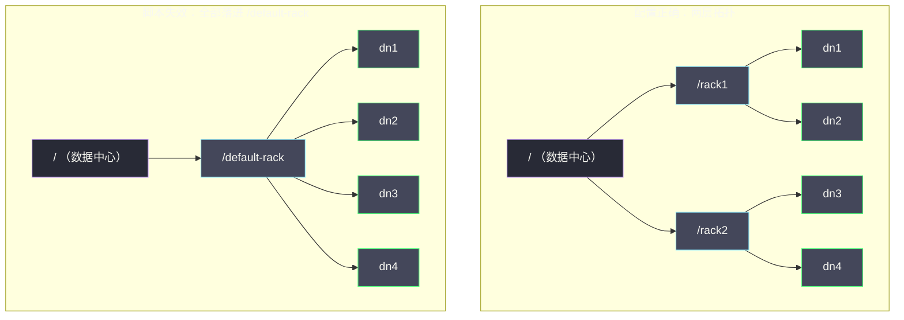
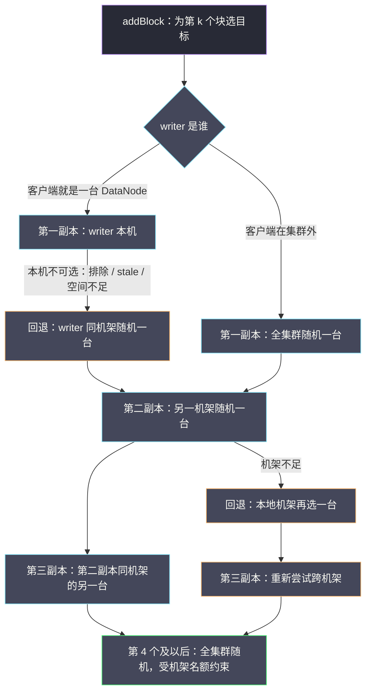
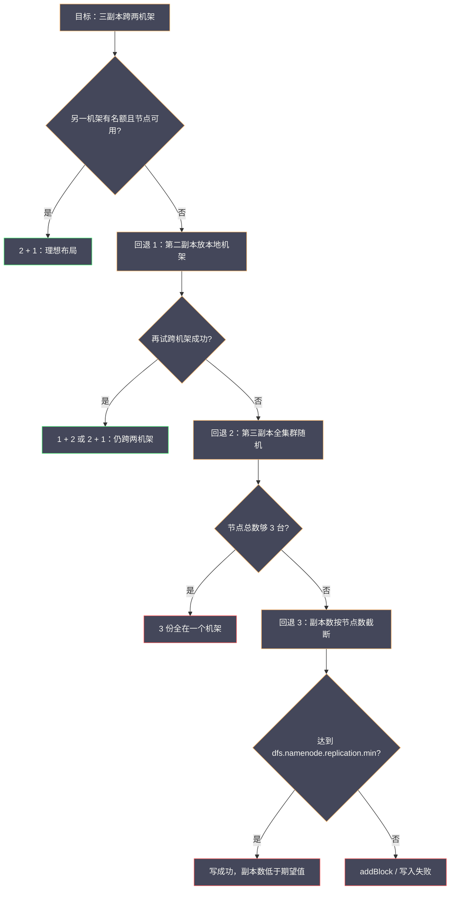
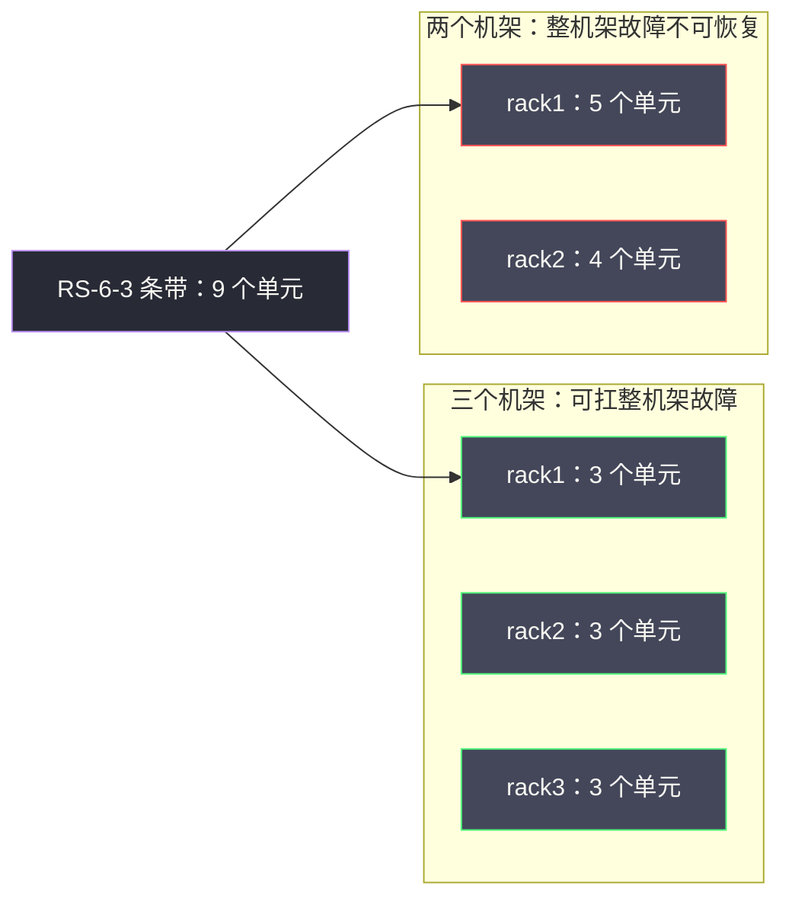
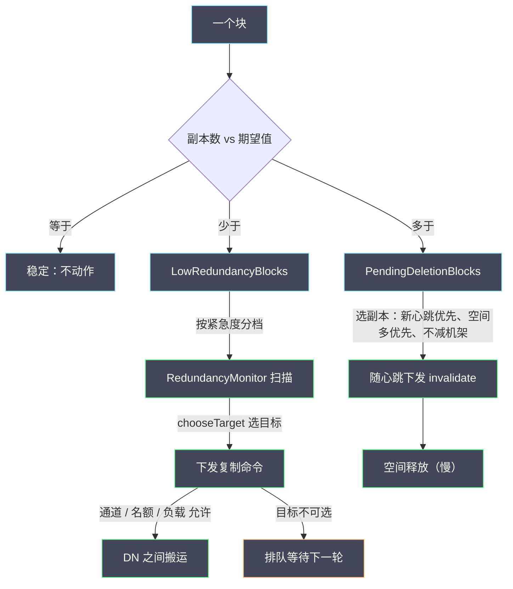

# HDFS 副本放置策略——机架感知与数据可靠性的工程权衡

**摘要：**

"三副本"这个词容易让人产生一种错觉：只要副本数是三，数据就被三份保护着。可 HDFS 的可靠性从来不取决于副本的数量，而取决于这三个副本在拓扑里各站在哪里：同一个机架里的三份，机架交换机一次重启就一起消失；跨了机架却全压在写入者所在的那一跳上，写入带宽就会被核心交换机卡住。本文把 `BlockPlacementPolicyDefault` 的选择过程还原成一条有优先级的决策链——第一副本落在写入者所在节点，第二副本跨到另一个机架，第三副本回到第二副本所在机架的另一台机器——并逐段解释这个顺序为什么成立、每一步失败后会退到哪里。随后拆开两个最容易被误解的对象：`dfs.replication` 只是文件级的期望值，不是物理副本数；`hdfs dfs -setrep -w` 等的是副本真的搬完。中间用一整章讲五个会悄悄改写放置结果的现实因素，包括 stale 节点回避、同一节点内的多盘选择、维护窗口、节点组与纠删码。最后给出机架感知失效的排查路径、副本不足与过多的两类队列、Balancer 的能力边界，以及六个能直接对着日志和命令定位的故障形态。

---

## 第 1 章 三个副本不等于三份保障

如果一个块的三份副本分别躺在三台机器上，它是不是就安全了？答案取决于这三台机器在拓扑里的位置，而不取决于它们的数量。把三份合同锁进同一个抽屉，抽屉丢了，三份一起没；副本数只回答"有几份"，机架回答"分布在几个故障域里"，两个问题混为一谈，是后面所有误判的起点。

这个判断在 HDFS 诞生之初就被写进了设计。2003 年的 GFS 论文讨论副本放置时给出了一个与直觉相反的取舍：既然机架级故障（交换机、供电、机柜）比单机故障少见得多，就不必把三个副本铺到三个机架上，铺两个机架、把多出来的那份留在第二个机架里，既保住了机架级隔离，又省下一次跨机架传输。HDFS 继承了这个取舍，并把它固化成一个可替换的类：`BlockPlacementPolicyDefault`。

问题在于，这条策略不是一条配置项，而是一条**决策链**：带分支、带回退、带筛选条件。它每次为新块挑节点时，要同时满足四个约束——写入者的位置、每个机架的名额、节点的健康度、存储介质的要求；其中任何一个条件不满足，算法不会报错，而是沿着一条预设的退路继续往下走。退路走完之后，块依然会写成三副本，`fsck` 也依然报告三副本，只是这三份可能落在同一个机架、甚至同一批即将进入维护窗口的机器上。可靠性就是这样下降的：不是配置写错，而是回退发生得太安静。

本文的路线是这样：先把"机架"这个前提讲清楚（第 2 章），因为拓扑是一份外部输入，不是 HDFS 自己算出来的；然后把默认策略的三步决策链与 `chooseTarget` 的四段流程完整走一遍（第 3 章）；接着专门讲降级路径，因为它是"副本数没变、可靠性变了"的唯一机制（第 4 章）；再纠正两个最常被误读的对象——`dfs.replication` 与 `-setrep`（第 5 章），以及五个会改写放置结果的现实因素（第 6 章）；最后落到可操作的判据上：机架感知是否生效（第 7 章）、副本不足与过多（第 8 章）、Balancer 的能力边界（第 9 章）、六个故障形态（第 10 章），以及三个反例与一份示例推算（第 11 章）。文中的默认值按 Hadoop 3.3.x 的口径给出，凡与具体发行版本有关的结论都标注了核对方式。

---

## 第 2 章 机架是一份外部输入

### 2.1 一棵树与两种距离

NameNode 眼里没有"机柜"这个物理概念，只有一棵树：根节点代表整个数据中心，内部节点是机架（或在启用节点组时是"机架—节点组"两层），叶子是 DataNode。每个 DataNode 在注册时被挂到树的某个位置上，这个位置字符串就是它的网络位置（network location），形如 `/rack1`、`/rack1/nodegroup2`。副本放置的所有判断，最终都归结为在这棵树上做"距离比较"和"名额计数"。

距离的口径很朴素：同一个节点距离为 0，同一机架为 2，跨机架为 4。数字本身不重要，重要的是它的序关系——只要能区分"同节点、同机架、跨机架"三档，算法就能表达"本地优先、跨机架保底、同机架省带宽"这三个意图。这棵树还有一个隐含的默认值：任何解析不出位置的地址，都会被放进 `/default-rack`。这是一条**兜底规则**，也是一条把"没配置"伪装成"配置好了"的规则。

下面这张对照图展示的就是这件事：左边是配置正确时的两层拓扑，右边是脚本失效后所有节点被压进 `/default-rack` 的形态——节点数量没变，树的形状变了，放置算法的决策空间也跟着塌缩成一层。



### 2.2 拓扑从哪里来：脚本、Java 类、或者什么都没有

NameNode 自己并不知道哪台机器在哪个机架上，这份映射必须由管理员提供。Hadoop 给了三种方式，差别不在功能，而在调用开销与失效形态。

第一种是外部脚本。在 `core-site.xml` 里配置 `net.topology.script.file.name` 指向一个可执行文件，NameNode 在解析地址时 fork 这个进程，把待解析的地址作为命令行参数传进去，脚本为每个地址输出一行交换机路径。这里有两个容易忽略的细节：一是参数不是一次一个，而是一批，批大小由 `net.topology.script.number.args` 控制，默认 100，也就是说脚本一次可能收到 100 个地址，必须逐个处理、输出同样行数的结果；二是输出的是"交换机路径"而不是"主机路径"，`/rack1` 这样的结果由 HDFS 自己补上节点名，返回多一层 `/rack1/nodegroup1` 就表示启用了节点组。

第二种是 Java 类，通过 `net.topology.node.switch.mapping.impl` 指定一个实现了地址到交换机映射的类。它比脚本快，因为它不需要 fork 进程，NameNode 在节点注册的高峰期不会被几百次进程创建拖慢；代价是改动要走编译与重启，运维上不如脚本灵活。

第三种是什么都不配。这时所有地址都返回 `/default-rack`，集群在拓扑上退化成一台"逻辑上的单机架机器"。

| 方式 | 配置项 | 输出格式 | 调用开销 | 典型失效形态 |
|---|---|---|---|---|
| 外部脚本 | `net.topology.script.file.name` | 每个输入地址一行 `/rack` 或 `/rack/nodegroup` | 每次解析 fork 一个进程，按 `net.topology.script.number.args` 批量摊销 | 脚本只处理 `$1`、解释器路径错、日志混进 stdout，导致部分或全部地址落到 `/default-rack` |
| Java 类 | `net.topology.node.switch.mapping.impl` | 同上，由类内部返回 | 进程内调用，无 fork 成本 | 类没打进 classpath、逻辑与现网布线不一致，改动需重启 |
| 不配置 | 无 | 固定返回 `/default-rack` | 无 | 机架感知整体失效，所有副本看起来都在"一个机架" |

> [!warning] 生产避坑：只处理 `$1` 的脚本等于没配
> 网上大量示例脚本写成 `case $1 in ...`，在"一次传一个 IP"的假设下成立；但 3.3.x 的默认批大小是 100，`$1` 只覆盖了第一个地址，其余地址没有对应的输出行，NameNode 只能把它们当作解析失败，落回 `/default-rack`。表现是机架树里一部分节点正确、一部分在默认机架，比"全错"更难发现。

### 2.3 拓扑错的第一个后果不是变慢，而是变脆

拓扑失效的可怕之处在于它不影响功能。写入照样成功，读取照样命中，`dfsadmin -report` 里 DataNode 一台不少，只有两处会露出破绽：`hdfs dfsadmin -printTopology` 打出来的树只剩一行 `Rack: /default-rack`，以及某次机架交换机重启之后，一批块的三个副本同时不可访问。

这两处破绽之所以不常被看见，是因为单机架的退化并不会立刻让副本数变化：三个副本仍然在三台不同的机器上，只是 NN 认为它们"同属一个故障域"。于是它不再有跨机架的动机，`maxNodesPerRack` 的名额计算也退化为一句话——只有一个非空机架时，机架名额直接放行为总副本数。副本数没变，冗余度已经从"能扛机架故障"降成"扛不住机架故障"。

---

## 第 3 章 决策链：三个副本的优先级

### 3.1 一句话规则与它的出处

Hadoop 3.3.6 的 `BlockPlacementPolicyDefault` 类注释把规则写得很直白：写入者在 DataNode 上时，第一副本默认放在本地机器（客户端可以用 `NO_LOCAL_WRITE` 标志要求不放本地，其余副本仍按默认策略走）；写入者不在 DataNode 上时，第一副本放在随机节点；第二副本放在不同机架；第三副本放在第二副本所在机架的另一台机器上。

这句话拆开看是三段判断，合起来是一条单向的优先级链：**本地优先** → **跨机架隔离** → **同机架省带宽**。下面这张图把三个决策点和写入者的分支画在一起，后面三节分别解释每一段的动机。



### 3.2 第一步：第一副本为什么优先本地

写入链路是一条链：客户端把数据发给第一台 DataNode，第一台转发给第二台，第二台转发给第三台。这条链上最有价值的一跳是"客户端到第一台"，因为它紧挨着数据的生产现场——如果客户端本身就跑在 DataNode 上（MapReduce 的 reduce 任务、Spark 的 executor、Flink 的 sink 都属于这一类），这一跳可以**不出网卡**。

省下这一跳的收益不止于带宽。第一副本落在本地，意味着这份数据在写入完成的那一刻就已经在计算节点旁边，后续的本地读、短路读（short-circuit read）都不必跨网络；对于"写完立刻被同一个作业读一遍"的中间结果，这个差别直接体现在作业时长上。本地优先不是优化，而是把写入路径里最贵的一段网络传输提前省掉。

当客户端不在 DataNode 上时，事情就回到随机：`chooseLocalStorage` 拿到的是一个空的 writer，`chooseLocalOrFavoredStorage` 里那句"没有本地机器就随机选一台"决定了第一副本的位置。这里有一处文档与源码的细微差别值得留意：架构文档写的是"否则放在与写入者同机架的随机节点"，而 3.3.x 的实现里，NameNode 只有在客户端主机本身也是一台注册过的 DataNode 时，才拿得到有意义的 writer；普通客户端提交 `addBlock` 时 writer 是空的，于是直接走全集群随机。换句话说，"同机架就近"是给集群内写入者的优待，集群外的客户端没有这份优待。

还有一个常被忽略的开关：`dfs.namenode.block-placement-policy.default.prefer-local-node`，默认 `true`。把它关掉之后，即使写入者就在 DataNode 上，第一副本也不再本地优先——这看起来像是自废武功，但在"单节点写入热点"的场景里是合理的：某个计算节点持续写大量数据，本地盘很快被写满，副本恢复反而更频繁。

### 3.3 第二步：跨机架的那一跳买的是什么

第二副本的选法是"从 writer 所在机架之外的机架里随机挑一台"，代码里那个 `~` 前缀就是"排除这个机架"的意思（`chooseRemoteRack` 传入 `"~" + localMachine.getNetworkLocation()`）。这一步买到的是机架级故障隔离：机架交换机重启、机柜掉电、上联链路中断，这些故障的共同点是"一个机架内的所有节点同时不可达"，只有跨机架的那一份能活下来。

代价是明确的：一次跨机架传输。一个块从客户端写入时，数据要流经三段链路，其中恰好有一段会穿过核心交换机。默认策略把跨机架次数压到一次，这已经是"既要隔离、又要省核心带宽"的最小代价——三机架策略要两次，两副本策略干脆没有跨机架副本，也就没有机架级容错。

这里需要区分两个容易混淆的量：**跨机架传输次数**和**跨机架带宽总量**。前者描述一条写入链上有几次数据穿过核心，后者描述这次写入对核心交换机的总压力。默认策略下两者都是"一份块数据"，三机架策略是"两份块数据"，而"每个机架各放一个副本"的朴素策略在写入侧的代价是默认策略的两倍。

### 3.4 第三步：为什么第三副本不放到第三个机架

第三副本回到第二副本所在的机架，是这条链上最容易被质疑的一步。既然机架故障是真实威胁，为什么不干脆三个机架各放一份，把"两机架同时故障"也防住？

答案藏在故障概率的量级差里。单节点故障是常态，机架级故障是偶发，两个机架同时故障则要求两次独立的偶发事件在同一个修复窗口内叠加——这个概率低到不足以支撑"再多付一次跨机架传输"的成本。而多付的那一次传输，代价落在每一次写入上，是持续的；省下的防护，防的是一个几乎不会发生的组合。工程判断在这里不是"哪个更安全"，而是"用多大的持续成本，买下多小概率的额外安全"。

代码层面的实现比一句话规则更细。`chooseTargetInOrder` 在处理第三副本时会先判断前两个副本是不是落在同一个机架：如果同机架（说明第二步的跨机架尝试已经失败过一次），它会再试一次跨机架；如果不同机架且当前是"新块"，就在第二副本所在机架里用 `chooseLocalRack(dn1)` 选第三台；如果是追加、恢复这类"非新块"场景，则改为在 writer 所在机架选。最后这个分支容易被忽略，但它合理：恢复时 writer 是数据源所在节点，把新副本放在源附近，可以少一次跨机架读取。

### 3.5 四步之外：先算名额，再排顺序

把上面三节合起来，`chooseTarget` 的完整流程可以还原成四步。第一步不是选节点，而是算名额：`getMaxNodesPerRack` 先按集群节点总数截断副本数（集群只有两台机器时，三副本会被截成两台），再按机架数算出"每个机架最多能放几个"。第二步选第一副本（本地 → 本地机架 → 全集群随机，三级回退）；第三步选第二副本（跨机架 → 本地机架，两级回退）；第四步处理第三副本与剩余副本（第二副本机架 / writer 机架 / 全集群随机）。

```java
// 3.3.x BlockPlacementPolicyDefault.chooseTargetInOrder 的骨架，注释解释的是"为什么"
if (numOfResults == 0) {
  // 第一副本：本机优先；选不到就退到本机架；writer 为空时退到全集群随机
  storageInfo = chooseLocalStorage(writer, ..., true);
  if (--numOfReplicas == 0) return writer;
}
final DatanodeDescriptor dn0 = results.get(0).getDatanodeDescriptor();
if (numOfResults <= 1) {
  // 第二副本：排除 dn0 所在机架后随机，失败则由 chooseRemoteRack 内部回退到本机架
  chooseRemoteRack(1, dn0, ...);
  if (--numOfReplicas == 0) return writer;
}
if (numOfResults <= 2) {
  final DatanodeDescriptor dn1 = results.get(1).getDatanodeDescriptor();
  if (clusterMap.isOnSameRack(dn0, dn1)) {
    // 前两份挤在同一机架，说明跨机架失败过，再试一次
    chooseRemoteRack(1, dn0, ...);
  } else if (newBlock) {
    // 新块：第三副本落在第二副本机架，省一次跨机架
    chooseLocalRack(dn1, ...);
  } else {
    // 恢复/追加：writer 是数据源，就近放
    chooseLocalRack(writer, ...);
  }
}
// 第 4 份及以后：全集群随机，名额由 maxNodesPerRack 兜住
chooseRandom(numOfReplicas, NodeBase.ROOT, ...);
```

名额公式本身值得单独看一眼。设机架数为 R、总副本数为 N，则每个机架的副本上限是 `(N - 1) / R + 2`，并且如果算出来的上限正好等于 N，就减一——后一条是为了强制"副本不能全挤在一个机架"。把三副本代入，不同机架数会得到很不一样的结果：

| 机架数 R | 每机架上限 | 实际可能的分布 | 含义 |
|---|---|---|---|
| 1 | 3（不计算，直接放开） | 3 份全在一个机架 | 跨机架隔离不存在 |
| 2 | 2 | 2 + 1 | 只能扛一个机架故障，扛过之后只剩一份 |
| 3 | 2 | 1 + 2 + 0 | 默认策略仍只铺两个机架，第三份落在第二副本机架 |
| 10 | 2 | 2 + 1 | 上限是 2，但算法只铺两个机架 |
| 40 | 2 | 2 + 1 | 与机架数量无关，仍是"两机架 + 一份同机架" |

这张表顺带解释了一个常见疑惑：为什么一个 40 机架的集群里，某个块的三个副本只出现在两个机架上？因为默认策略的目标不是"铺得越散越好"，而是"在满足机架隔离的前提下少付跨机架带宽"，`maxNodesPerRack` 只是防止某个机架被塞爆的护栏，不是鼓励铺开的动力。

### 3.6 顺序与 Pipeline 不是一回事

还有一个细节会影响排查时对输出的解读：选出来的三个节点不会按"选中顺序"直接组成写入链。`getPipeline` 会以 writer 为起点，按网络距离对结果做一次贪心排序（本质是一个小规模的旅行商问题），让数据流尽量沿着"近 → 近"的顺序走。这意味着两件事：写入链上第一台机器未必是"第一副本"那个决策的产物；`fsck` 或 `hdfs fsck -locations` 打出来的顺序也不保证与写入顺序一致。讨论"第一副本"时看的是决策顺序，讨论"写入卡在哪一跳"时看的是 pipeline 顺序，两者混用会得出错误的因果。

### 3.7 筛掉谁：五道闸门与 considerLoad

名额算完之后，真正决定"这台机器能不能被选中"的是 `isGoodDatanode` 的五道闸门：节点必须处于 in service 状态（decommissioning、entering maintenance 的节点会被排除）；在开启 stale 回避时，心跳超时的节点被排除；在开启负载筛选时，过载节点被排除；所在机架的名额必须没满；在开启慢节点过滤时，被 peer 统计标记为慢的节点被排除。

其中负载筛选是唯一一个"默认开启"的闸门。`dfs.namenode.redundancy.considerLoad` 默认为 `true`（2.x 里这个开关叫 `dfs.namenode.replication.considerLoad`，改名之后语义没变），配合 `dfs.namenode.redundancy.considerLoad.factor`（默认 2.0）使用：当一台节点的 xceiver 数超过集群平均值 2 倍时，它不会成为新副本的目标。这条规则的动机是防止热点叠加——一台已经很忙的机器如果继续接收写入，它的写入队列会把整个 pipeline 的 ack 拖慢，而 HDFS 的写入是链式的，最后一跳慢，前面所有跳都得等。

它的副作用也很直接：集群写入压力集中时，"最闲的节点"往往集中在少数几台上，负载筛选把候选集缩小，跨机架名额更难凑齐，降级概率上升。这里的取舍没有标准答案，只能按集群形态调：写入突发性强、节点性能均匀的集群，可以适当放宽 `considerLoad` 或调高 factor；写入平稳、节点性能差异大的集群，收紧一点更划算。第 7 章会把这条规则与机架感知的排查放在一起看。

| 闸门 | 关键配置 | 默认 | 调大/放宽的代价 | 调小/收紧的代价 |
|---|---|---|---|---|
| 节点状态 | `dfs.hosts` / `dfs.hosts.exclude` | 空 | — | 排除过多会让可用节点与机架同时减少 |
| stale 回避 | `dfs.namenode.avoid.write.stale.datanode` | `false` | 打开后，批量重启期间写入候选变少，降级概率上升 | 关着时，可能把数据写到刚恢复的节点上，pipeline 易抖动 |
| 负载筛选 | `dfs.namenode.redundancy.considerLoad` / `.factor` | `true` / 2.0 | factor 调大：热点节点仍会被选中，写入延迟变长 | factor 调小：候选集缩小，跨机架名额凑不齐 |
| 机架名额 | 由副本数与机架数推算 | 见 3.5 | 无直接开关，只能改副本数或换策略 | 同上 |
| 慢节点过滤 | `dfs.namenode.block-placement-policy.exclude-slow-nodes.enabled` | `false` | 打开后依赖 peer 统计的准确性，误判会减少候选 | 关着时，慢节点仍可能进 pipeline，拖慢整条链 |

### 3.8 节点组：比机架更细的一层

默认的两层拓扑在物理机场景下够用，但在虚拟化或容器化环境里会漏掉一个故障域：同一台物理机上跑着的多个 DataNode 实例。它们分属不同的"机器"，却共享同一块主板、同一路电源、同一块网卡。机架级隔离管不到这个层次，因为它们在拓扑上本来就同机架。

`BlockPlacementPolicyWithNodeGroup` 就是为这一层准备的。它把拓扑从"机架—节点"扩展成"机架—节点组—节点"：机架脚本返回 `/rack1/nodegroup1`，`net.topology.impl` 配成 `org.apache.hadoop.net.NetworkTopologyWithNodeGroup`，`net.topology.nodegroup.aware` 设为 `true`，再把 `dfs.block.replicator.classname` 指向这个策略类。生效之后，一个节点组里最多只放一个副本——`addToExcludedNodes` 会把整个节点组的所有叶子一起排除，第三副本不会再回到"同一台物理机上的另一个 VM"。

这层抽象的价值在于：它把"故障域"从物理布线解耦成了可配置的层次。机架是网络侧的故障域，节点组是硬件侧的故障域，两者不必重合；对于一个机架内混布了多台高密度虚拟化宿主机的集群，节点组才是真正该对齐的那一层。

---

## 第 4 章 降级：机架不够时，可靠性悄悄下降

### 4.1 回退路径长什么样

前三步中的每一步都有失败分支，而且失败之后不是报错，而是换一个更差的范围重试。把这些分支连起来看，就是一条从"理想布局"到"能写就行"的降级阶梯。

第二副本的降级最能说明问题。`chooseRemoteRack` 先尝试"排除本地机架后的全集群随机"，如果这个范围里凑不出合格节点（机架数不够、目标机架名额已满、节点都不可用），它会捕获异常并在本地机架里再选一台。这次回退的结果是：第一、第二副本落在同一个机架，第三副本随后被 `chooseTargetInOrder` 用"前两份同机架"的分支再试一次跨机架——如果仍然失败，就退到全集群随机。极端情况下，三份副本可能全部落在同一个机架。

第三副本的降级路径更长：`chooseLocalRack` 先在目标机架里找，找不到就换到 results 里另一个副本所在的机架，再找不到就全集群随机。每一步都在放弃一点"布局质量"，换取"这次写入能完成"。这套设计被官方文档称为**尽力而为**（best effort），它的合理之处在于可用性优先，危险之处在于失败信号极弱。



### 4.2 为什么这种降级几乎看不见

因为它发生的层次在日志里是 DEBUG。`chooseRemoteRack` 的回退会打一行"失败跨机架、回退到本地机架"的 DEBUG 日志，`chooseRandom` 失败时会打一行 INFO 的 `Not enough replicas was chosen. Reason: {...}`，里面按原因聚合计数——`NODE_STALE`、`NODE_TOO_BUSY`、`TOO_MANY_NODES_ON_RACK`、`NOT_ENOUGH_STORAGE_SPACE`、`NO_REQUIRED_STORAGE_TYPE`、`NOT_IN_SERVICE`。这些原因字符串是排查降级最直接的线索，但默认日志级别下看不到，于是运维视角里只有"写入成功"。

真正的暴露点只有两个：一是 `fsck` 的 `-racks` 输出，把每个块的副本位置连机架打出来，三个副本的 rack 只出现一个就是降级；二是 `verifyBlockPlacement` 的判断逻辑，它把"副本落在几个不同机架"与"至少需要几个机架"（三副本时是 2）做比较，不达标的块会被计入"分布不佳"这一类。第 8 章讲的 LowRedundancy 队列里，就有一个优先级专门留给这种"副本数够但分布不对"的块。

### 4.3 三个具体的降级场景

第一个是两机架集群。前面算过，两机架时每机架上限是 2，理想分布是 2 + 1。这个分布能扛住一个机架故障，扛过之后只剩一份——此时任何一次单节点故障都会让这个块变成 missing。很多"两机房双活"的集群恰好是这种形态：两个机房各算一个机架，副本数还是 3，于是每个块只有一份在机房 A、两份在机房 B；机房 A 整体不可用时，数据还在，但没有冗余了。

第二个是单机架集群或拓扑失效的集群。所有节点都在 `/default-rack`，`getMaxNodesPerRack` 走进"只有一个非空机架"的分支，直接把上限放行为总副本数，跨机架步骤注定失败，三份副本随机落在三台机器上。功能完全正常，可靠性退化为"三台机器同时坏才丢数据"，与"机架故障"这个真实威胁彻底脱钩。

第三个是节点不足。`getMaxNodesPerRack` 的第一步会把副本数按集群节点总数截断：集群只有两台 DataNode 时，三副本会被截成两份。这个截断与 `dfs.namenode.replication.min` 是**两件事**，前者决定"最多能放几份"，后者决定"至少几份就可以宣布写成功"。把两者混为一谈是常见的理解错误——`replication.min` 不会让副本数自动降，它只是写入成功的最低门槛；真正的截断来自集群规模。

> [!note] 设计哲学：可用性优先，但代价被静默转移
> HDFS 的放置算法从不因为"凑不齐理想布局"而拒绝写入，它选择降级完成。这个选择在可用性上是对的：业务不会因为少一个机架就写不进数据。但它把"可靠性下降"这件事从错误路径转移到了日志路径，而日志默认是关掉的。于是系统给了一个"写成功"的正面反馈，同时在后台悄悄降低了下一次机架故障时的存活概率。可用性优先的代价，是必须有人主动去读那些没人看的日志。

---
## 第 5 章 `dfs.replication` 的语义边界

### 5.1 三个层次：默认值、文件属性、物理副本

关于副本数，最容易混淆的是把三个不同层次的对象当成同一个东西。第一个层次是配置项 `dfs.replication`，它只在"创建文件时没有显式指定副本数"的情况下起作用，默认 3；第二个层次是文件属性，文件创建时副本数被写进 INode，此后这个文件的每个块都以它为期望值，改配置项不会追溯修改已经存在的文件；第三个层次是物理副本，它在集群里真实存在几份，取决于第 3、4 章讲的那条决策链，以及第 6 章讲的那些干扰因素。

于是就有了那条最常被踩的规则：改 `dfs.replication` **只影响之后创建的文件**，想让已有文件变副本数，必须对文件本身动手。命令是 `hdfs dfs -setrep [-R] [-w] <rep> <path>`，对目录加 `-R` 递归。`-setrep` 改的也只是期望值，它把文件属性改掉，然后由 NameNode 的冗余监控线程把"少了副本的块"排进待复制队列、"多了副本的块"排进待删除队列，真正搬运是后续的事。

| 对象 | 谁在改 | 生效时机 | 对存量数据的影响 | 代价 |
|---|---|---|---|---|
| `dfs.replication` | 改配置文件、重启或滚动重载 | 之后创建的文件 | 无 | 一次配置管理与重启 |
| `hdfs dfs -setrep` | 客户端 RPC | 立即改元数据，副本搬运异步 | 有，但只是改期望值 | 搬运占用网络与磁盘 IO，时间取决于数据量与集群负载 |
| 存储策略 / EC 策略 | `storagepolicies`、`ec -setPolicy` | 只影响之后创建的文件；存量要 `mover` 或重写 | 无（除非运行 Mover） | Mover 是一次全量扫描，代价与数据量成正比 |

顺带说清一个边界：纠删码文件没有"副本因子"这个概念，按官方文档的说法，EC 文件的副本因子恒为 1，`setReplication` 对它是一个空操作。把 EC 目录当成"副本数可以调"的对象去运维，命令会成功返回，行为却不会改变，这是第 6 章会展开的"语义错位"的一种。

### 5.2 `-w` 在等什么，等多久

`-w` 的含义是"等到副本数真的达标再返回"。它的实现是客户端反复向 NameNode 查询目标路径的状态，直到所有块都达到目标副本数——注意是**所有块**，所以等待时间由最慢的那个块决定，而不是平均值。一个 10 万块的文件里，只要有几十个块因为目标节点繁忙而排队，`-w` 就会一直挂着。

这个等待有几个现实代价。第一，它占着一个客户端会话与一个终端，运维窗口里很容易被误判为"卡死"；第二，Shell 与 SSH 会话的超时、CI 任务的超时都会先于它触发，于是操作看起来失败了，实际后台还在搬；第三，它不改变 NameNode 的复制优先级，只是被动观察，因此在高负载集群上等上几小时是正常的。合理的用法是：对少量关键文件用 `-w` 确认，对大规模目录不带 `-w`，改为周期性看 `hdfs dfsadmin -report` 里的 Under replicated 计数与 `fsck` 的输出，把"等待"变成"观测"。

### 5.3 实际副本数低于期望值的六个原因

即便期望值写的是 3，`fsck` 里仍然可能看到平均副本数 2.6。原因不是"HDFS 偷懒"，而是决策链上的名额与筛选条件在起作用。下面这六条基本覆盖了现网遇到的情况，每一条都给了可以直接对照的判据。

| 原因 | 机制 | 判据 | 处置方向 |
|---|---|---|---|
| 节点总数不足 | `getMaxNodesPerRack` 按集群节点数截断副本数，三副本在只剩两台机器时只能是 2 | `dfsadmin -report` 的 live 节点数；`fsck` 的 Under-replicated 计数 | 先恢复节点，不调参数 |
| 机架名额不足 | 每机架上限 `(N-1)/R + 2`，单机架时放行但节点不能重复 | `printTopology` 的机架数；`fsck -racks` 的分布 | 增加机架或改用节点组感知 |
| 节点被排除 | `dfs.hosts.exclude`、decommission、maintenance 状态都不参与新副本 | `dfsadmin -report -decommissioning`；`fsck` 的副本位置 | 确认维护窗口，不要在下线期间追副本数 |
| 空间不足 | 目标节点的可用空间小于块大小，`chooseStorage4Block` 返回空 | NN 日志的 `NOT_ENOUGH_STORAGE_SPACE`；`-report` 的 DFS Remaining | 扩容或清临时数据 |
| 介质类型不满足 | 存储策略要求 SSD / ARCHIVE，节点没有对应类型，回退依赖策略配置 | `storagepolicies -getStoragePolicy`；NN 日志的 `NO_REQUIRED_STORAGE_TYPE` | 补介质或调整策略 |
| 节点被判忙或 stale | `considerLoad`、stale 回避把候选排除 | NN 日志的 `NODE_TOO_BUSY` / `NODE_STALE` 计数 | 看负载与心跳，别先怀疑放置算法 |

这张表还有一个用法：把它当成"排除法"。当 Under-replicated 持续不为零时，按行从上往下排除，通常在前三行就能定位；如果前三行都正常，问题多半在 NameNode 的调度节奏上，那就进第 8 章。

---

## 第 6 章 五个会改写放置结果的现实因素

决策链假设了一组干净的前提：拓扑准确、节点健康、盘都一样、没有人在做维护、副本是唯一的冗余手段。现实里这**五个前提**经常有一个不成立。它们不是"配置技巧"，而是会直接改变"三副本落在哪"的因素，所以单独用一章拆开。

### 6.1 因素一：stale 判定让"刚恢复的节点"被避开

DataNode 的心跳默认 3 秒一次。NameNode 判定一个节点"死"的阈值很长：`dfs.namenode.heartbeat.recheck-interval` 5 分钟乘 2，再加上 10 次心跳，约 10.5 分钟。这个设计是为了避免状态抖动引发复制风暴，代价是"死"这个信号来得很晚。为了补上这段空白，Hadoop 引入了中间状态：心跳超过 `dfs.namenode.stale.datanode.interval`（默认 30 秒，且不能低于 3 倍心跳间隔）没来，就标记为 stale。

**stale 不是 dead**。节点还活着，还能读写，只是 NameNode 认为它"可能有问题"。两个开关决定这种怀疑会不会变成实际的排除动作：

- `dfs.namenode.avoid.read.stale.datanode`（默认 `false`）：开启后，stale 节点不会被排除，只是被排到返回给客户端的位置列表末尾，由 `DatanodeManager.sortLocatedBlocks` 里的比较器处理；客户端仍可能在所有更优副本都失败后读到它。
- `dfs.namenode.avoid.write.stale.datanode`（默认 `false`）：开启后，stale 节点在 `isGoodDatanode` 里直接被拒，不再成为新副本的目标；但有一个熔断：当 stale 节点占比超过 `dfs.namenode.write.stale.datanode.ratio`（默认 0.5）时，回避被全局关闭，否则集群会无处可写。

这两个开关的默认值是"不回避"，这是一个保守的选择：默认情况下 HDFS 宁可承担"写到一台刚恢复的机器上"的风险，也不愿在批量重启时把候选集缩得太小。但对于把写入延迟看得很重的集群，打开 write 回避是值得的——刚恢复的节点往往还在做块扫描、还在追副本，写入它上面容易触发 pipeline 恢复。

| 状态 | 判定阈值 | 是否还能读写 | 相关开关 | 打开后的直接后果 |
|---|---|---|---|---|
| 正常 | 心跳在 30 秒内 | 是 | — | — |
| stale | 超过 `stale.datanode.interval`，但未到 dead 阈值 | 是（优先级降低或被排除） | `avoid.read.*` / `avoid.write.*` | 读写候选集变小，批量重启期间降级概率上升 |
| dead | 约 10.5 分钟无心跳 | 否 | — | 副本进入 Under-replicated，触发复制 |

还有一处不受开关控制：租约恢复与块恢复（lease recovery、block recovery）永远回避 stale 节点。这条规则的理由很直白——恢复操作本身就是在处理"某个节点可能已经不可靠"的场景，不能再把恢复流程架在一台可疑节点上。

### 6.2 因素二：stale 排序的"刷新周期"与一个查不到的键

围绕 stale 机制，二手资料里流传着一个配置项 `dfs.namenode.avoid.read.stale.datanode.rotation-interval`，描述是"周期性打散 stale 节点的排序，避免某个 stale 节点长期排末尾"。这个说法听起来很合理，但笔者在 Hadoop 3.3.6 的 `hdfs-default.xml` 与 `DFSConfigKeys` 里都没有找到这个键，`DatanodeManager` 里也没有与之对应的轮转逻辑：stale 的排序是在每次返回块位置时用 `StaleAndSlowComparator` 现算的，谁 stale、stale 多久，都直接取自当前心跳状态，不存在"列表定期轮转"的机制。

所以这条流传的配置在 3.3.x 上不产生行为变化。这并不意味着可以忽略它，恰恰相反——它说明排查时必须区分"文档里写的""代码里读的"与"某个发行版自己加的"。真正能影响 stale 行为的是三个键：判定窗口 `dfs.namenode.stale.datanode.interval`、读侧开关 `dfs.namenode.avoid.read.stale.datanode`、写侧开关与熔断比例。把这三个键看住，比记住一个不存在的轮转参数有用得多。

顺带说清"慢节点"这一族：`dfs.namenode.avoid.read.slow.datanode`（默认 `false`）配合 `dfs.datanode.peer.stats.enabled`（默认 `false`）才会启用基于 peer 统计的慢节点排序，而写侧的慢节点过滤要单独打开 `dfs.namenode.block-placement-policy.exclude-slow-nodes.enabled`（默认 `false`）。这三个开关都默认关闭，意味着"慢节点被自动避开"在默认配置下并不成立，读性能问题不能默认归因于它。

### 6.3 因素三：同一节点内的盘，NameNode 只能选到一半

副本放置讨论的粒度通常是"节点"，但一次写入最终落到某一块物理盘上。多盘的入口是 `dfs.datanode.data.dir`，一个目录一项、可带介质标签（`[SSD]`、`[ARCHIVE]`）。这一层有两个选择点：NameNode 在为块挑目标时，会在候选节点的各个 storage 里挑一个有足够空间的；DataNode 在新建副本、跨卷恢复等场景下，还会用 `dfs.datanode.fsdataset.volume.choosing.policy`（默认 `AvailableSpaceVolumeChoosingPolicy`）再选一次卷。

默认策略的规则很朴素：如果所有卷的空闲空间相差不超过 10GB（`dfs.datanode.available-space-volume-choosing-policy.balanced-space-threshold`），就按轮询分配，谁也不偏袒；如果差异超过这个阈值，则以 0.75 的概率（`balanced-space-preference-fraction`）优先选空闲多的卷。这个设计的目标是"让盘之间的使用率别拉太开"，但它只管新写入，不管历史分布。

于是会出现一种很典型的错觉：从机架分布看，这个块的三副本分在两个机架、三台机器上，完全符合策略；从节点内部看，某台机器的一块盘已经用了 95%，另一块才 30%。原因不是放置策略失效，而是这一层的选择发生在 DataNode 内部，NameNode 根本不参与。要修这种**盘间倾斜**，正确的工具是 DiskBalancer（`dfs.disk.balancer.enabled` 默认 `true`，用 `hdfs diskbalancer -plan` 生成计划再执行），而不是去调副本放置策略。

| 策略类 | 选择规则 | 适用场景 | 调大阈值的代价 | 调小阈值的代价 |
|---|---|---|---|---|
| `AvailableSpaceVolumeChoosingPolicy`（默认） | 空闲差在阈值内轮询；超出则按比例偏好空闲卷 | 盘容量一致、写入均匀 | 阈值过大，等于长期轮询，盘间倾斜会积累 | 阈值过小，频繁按空闲度选择，写入热点会向新盘集中 |
| `RoundRobinVolumeChoosingPolicy` | 严格轮询 | 盘容量、性能完全一致，追求可预测性 | — | 一块盘偏慢时没有规避手段 |

### 6.4 因素四：维护窗口把可用节点变少

`dfs.hosts` 是白名单，`dfs.hosts.exclude` 是黑名单，两者都通过 `hdfs dfsadmin -refreshNodes` 生效。把一台机器写进 exclude 之后，NameNode 不会立刻把它踢掉，而是让它进入 decommissioning 状态，把上面的副本主动搬到别的节点，搬完之后才真正下线。这个设计很负责，但它对放置策略的影响是双重的：一方面，下线期间副本在集群里流动，Under-replicated 计数会上升；另一方面，可用节点与可用机架同时减少，新写入更容易凑不齐跨机架名额。

最危险的操作是"整机架一起下线"。从运维视角看，这是一个机柜的维护窗口；从放置算法视角看，这是一次**计划内的机架故障**——如果集群本来就只有两个机架，把其中一个整体排除，剩下的机架在拓扑上就成了单机架，`maxNodesPerRack` 直接放行，三副本全部落进一个机架。等维护结束、机器回来，这些块的分布也不会自动恢复成跨机架，除非它们恰好被判定为"分布不佳"而进入修复队列。

合理的做法是按机架分批，每批控制在一台机器或几台机器，并且把批次安排在与写入高峰错开的时间窗。判断当前是否有下线在途，用 `hdfs dfsadmin -report -decommissioning` 看列表长度，比看日志更直接。

### 6.5 因素五：纠删码换了一套坐标系

前面所有讨论都建立在"冗余 = 多份完整副本"这个前提上。纠删码（Erasure Coding，EC）把前提换掉了：它把数据切成若干数据单元，再算出若干校验单元，一个条带（stripe）由这些单元组成，任意丢失不超过校验单元数的单元都能解码恢复。Hadoop 3.x 默认启用的策略是 `RS-6-3-1024k`，也就是 6 个数据单元加 3 个校验单元，存储开销是 1.5 倍，而三副本是 3 倍。

EC 的放置不归默认策略管，它用的是 `BlockPlacementPolicyRackFaultTolerant`。这个策略把"每个机架最多几个"从默认策略的 `(N-1)/R + 2` 改成 `ceil(单元数 / 机架数)`，目标是把 9 个单元尽量均匀地铺到所有机架上。它不追求"两个机架 + 一份同机架"的形态，因为对 EC 来说，"副本"这个概念已经不存在了，只有**故障域**里分布了多少个单元。

机架数在这里有一个硬性下限。官方文档给的公式是 `(数据单元 + 校验单元) / 校验单元` 向上取整，RS-6-3 算出来是 3 个机架。这个公式的含义不是"少于 3 个机架不能开机"，而是"少于 3 个机架时，最坏情况下某个机架承载的单元数会超过可容忍的丢失数"：9 个单元铺在两个机架上，最坏是 5 + 4，整机架丢失就丢 5 个单元，超过 3 个校验单元的解码能力，数据不可恢复；铺在三个机架上则是 3 + 3 + 3，丢一个机架恰好等于解码上限，仍能恢复。



除了放置之外，EC 还有几处语义边界必须在运维前想清楚：`setReplication` 对 EC 文件是空操作；`hflush` 与 `hsync` 在 EC 输出流上是 no-op，写了也不保证数据可见或落盘；`append`、`truncate`、`concat` 在 EC 文件上会报错或受限。这些限制意味着"把一批目录改成 EC"不是一次无痛操作，尤其是那些依赖 `hflush` 做检查点的流式作业；排查“写入成功但数据不见了”这类事件时，EC 目录必须先排除这一层语义差异。

还有一个容易忽略的联动：Balancer 在启动时会检查当前配置的 contiguous 放置策略是不是 `BlockPlacementPolicyDefault`。如果为了让三副本铺满三个机架，把 `dfs.block.replicator.classname` 改成了 `RackFaultTolerant`，Balancer 会直接拒绝启动，退出信息是"Balancer without BlockPlacementPolicyDefault"。也就是说，"提高跨机架容错"和"保留 Balancer 能力"这两件事在默认工具链里是有冲突的，选之前得想清楚哪一件更重要。

---

## 第 7 章 判据：机架感知到底生效没有

前六章讲的是"应该怎样"，这一章讲"实际怎样"。判断机架感知是否生效，不需要读源码，**五条命令**足够。

### 7.1 第一眼看树：`printTopology`

```
$ hdfs dfsadmin -printTopology
Rack: /rack1
   10.20.1.11:9866 (dn-01)
   10.20.1.12:9866 (dn-02)
Rack: /rack2
   10.20.2.11:9866 (dn-03)
   10.20.2.12:9866 (dn-04)
```

正常的输出应该有多行 `Rack:`，每行下面挂着属于它的 DataNode（上面的 IP 是示例）。如果整棵树只有一行 `Rack: /default-rack`，说明拓扑解析整体失效，所有节点都被压进了同一个默认机架——这就是第 2 章那张对照图右边的形态。

### 7.2 第二眼看节点归属：`-report` 的 Rack 字段

`hdfs dfsadmin -report` 会为每台 DataNode 打一段详表，其中有一行 `Rack:`。它的用途不是看整体，而是定位"部分失效"：如果 `printTopology` 里有两个机架，但 `-report` 里某几台机器的 Rack 是 `/default-rack`，说明脚本对这些地址没有给出正确结果，问题多半出在输入格式或脚本的地址白名单上，而不是脚本根本没跑起来。

### 7.3 第三步：绕过 HDFS，手工跑脚本

脚本的问题在 NameNode 里看不出来，最快的办法是手工执行一遍，按 NameNode 的方式传参。

```bash
# NameNode 会一次传多个地址，脚本必须逐个处理、逐行输出
# 只处理 $1 的写法会让后面的地址全部落回 /default-rack
#!/usr/bin/env bash
while read -r ip; do
  case "$ip" in
    10.20.1.*) echo "/rack1" ;;
    10.20.2.*) echo "/rack2" ;;
    *)         echo "/default-rack" ;;
  esac
done < <(printf '%s\n' "$@")
```

手工验证时要盯四件事：可执行权限（NameNode 以 hdfs 用户 fork，路径与权限都得对）、解释器路径（`/usr/bin/env bash` 是否在 NameNode 的 PATH 里）、输出行数（必须与输入地址数一致）、stdout 干净（任何调试信息打到 stdout 都会被当成拓扑路径）。`net.topology.script.number.args` 默认 100，意味着一次最多传 100 个地址；把它调小会显著增加 fork 次数，调大则单次参数变多，脚本的参数处理必须扛得住。

### 7.4 第四步：解析链路上的主机名

拓扑查的是"地址对应的交换机"，而 NameNode 手里拿到的是 DataNode 注册时上报的地址。在容器、多网卡、NAT 环境里，这一步最容易断：DataNode 上报的 IP 反解不出主机名，脚本按主机名匹配就落空。相关的两个开关值得知道：`dfs.namenode.datanode.registration.ip-hostname-check`（默认 `true`）会在注册时做正反向解析检查；`dfs.namenode.reject-unresolved-dn-topology-mapping`（默认 `false`）决定"解析不到拓扑时是否拒绝注册"。

后一个开关是把静默变响的典型手段：设为 `true` 之后，脚本一坏，受影响的 DataNode 直接注册不上，问题立刻暴露；代价是脚本故障会变成一次集群级启动事故。是否打开，取决于团队对"早失败"与"可用性"的偏好，没有普适答案。

### 7.5 第五步：看块的真实分布

```
$ hdfs fsck /warehouse/orders -files -blocks -locations -racks
```

`-racks` 会把每个块的副本位置连同机架一起打出来，这是唯一能直接回答"这个块到底跨没跨机架"的命令。如果三副本的 rack 只出现一个，或者分布是 `rack2, rack2, rack2`，说明放置在这块数据上没有达到设计目标。`fsck` 汇总里的 `Average block replication` 是实际平均值，`Under-replicated blocks` 是低于期望值的块数，两者结合能区分"副本少"与"分布差"。

### 7.6 两处非拓扑因素也会让放置"看起来不对"

排查到这一步，如果拓扑是对的、块分布仍然不理想，就要回头看两个非拓扑因素。一个是负载筛选：NN 日志里 `NODE_TOO_BUSY` 的计数如果很高，说明候选节点在被判定过载后大量出局，跨机架名额自然难凑；另一个是 stale：`NODE_STALE` 计数高企意味着心跳质量有问题，可能是网络抖动、GC 停顿或磁盘卡顿，而不是放置策略本身。把这两个原因计数当成"放置质量的体检指标"，比在参数表里反复试值有效。

| 检查项 | 命令 | 正常信号 | 异常含义 |
|---|---|---|---|
| 拓扑树 | `dfsadmin -printTopology` | 多个 `Rack:` 且节点归属正确 | 只剩 `/default-rack`：脚本或映射类整体失效 |
| 节点归属 | `dfsadmin -report` | 每台机器的 `Rack:` 与布线一致 | 个别机器在默认机架：脚本对某些地址返回空 |
| 脚本行为 | 手工按批传参执行 | 行数一致、每行是 `/rack` | 只输出一行、夹带日志：脚本写法错误 |
| 注册解析 | NN 日志、`getent hosts` | 注册无解析告警 | 反解失败、容器网络、多网卡未绑定 |
| 块分布 | `fsck -racks` | 三副本分布在两个机架 | 单机架：降级已发生，查理由日志 |
| 负载与心跳 | NN 日志的 reasonMap | `NODE_TOO_BUSY` / `NODE_STALE` 占比低 | 候选集被非拓扑因素压缩 |

---

## 第 8 章 副本不足与副本过多

### 8.1 两类队列，两种动作

NameNode 的块管理里有几个持续维护的队列，运维只需要记住两个方向：副本不足的块进"待复制"，副本过多的块进"待删除"。3.x 里前者叫 `LowRedundancyBlocks`（从 2.x 的 `UnderReplicatedBlocks` 演化而来），内部按紧急程度分档——missing 与 corrupt 最高，其次是副本数低于目标一半的，再其次是低于目标数的，最后是副本数够但分布不佳的；后者是 `PendingDeletionBlocks`，处理 `setrep` 降副本、节点重新上线后多余副本等场景。

这两个队列都由周期性扫描驱动，扫描节奏是 `dfs.namenode.redundancy.interval.seconds`（默认 3 秒）。扫描到任务后，NameNode 不是亲自搬数据，而是通过 DataNode 的心跳下发复制或删除命令，DataNode 之间再走数据传输通道完成搬运。因此"队列有积压"与"数据在搬"是两件事，`dfsadmin -report` 里看到的数字是队列深度，不是吞吐。

### 8.2 复制任务不执行的五个原因

副本不足的块排进队列之后，可能长时间不动。下面五条是现网里最常见的原因，其中第一条尤其容易被误判，因为很多人会去调 Balancer 的带宽参数。

| 原因 | 机制与配置 | 判据 | 调大/放宽的代价 | 调小/收紧的代价 |
|---|---|---|---|---|
| 传输通道受限 | 复制走 DataTransfer 通道，受 `dfs.datanode.data.transfer.bandwidthPerSec`（默认 0，不限）与磁盘、网络实际能力约束；`dfs.datanode.balance.bandwidthPerSec` 只约束 Balancer，不约束副本恢复 | DN 网卡与磁盘 util、复制吞吐曲线 | 放大带宽限制：挤占业务读写 | 收紧：恢复变慢，故障窗口拉长 |
| 单节点在途名额 | `dfs.namenode.replication.max-streams`（默认 2，硬上限 `-hard-limit` 默认 4）减去该 DN 当前在途 xmits 后才是可下发量；EC 重建按权重折算（`dfs.datanode.ec.reconstruction.xmits.weight`，默认 0.5） | DN 上的 xceiver 与复制线程数 | 调大：单 DN 并发高，磁盘与网络争抢加剧 | 调小：恢复排队变长，大故障后追不上 |
| 调度节奏 | `dfs.namenode.redundancy.interval.seconds`（3 秒）决定扫描周期，`dfs.namenode.replication.work.multiplier.per.iteration`（默认 2）× 在线节点数决定每轮下发的任务量 | 队列深度与每轮任务量 | 调大：一轮下发过多，DN 侧排队 | 调小：大批块同时不足时恢复极慢 |
| 目标节点不可选 | 负载筛选（factor 2.0）、stale、exclude、机架名额已满、空间不足，都会让 `chooseTarget` 找不到目标 | NN 日志 reasonMap、`-report` 的节点状态 | factor 调大：可恢复但可能压垮热点 | factor 调小：目标难找，队列停滞 |
| 源副本本身有问题 | 块被标记 corrupt、源 DN 不可达、只有一个机架能出数据 | `fsck -list-corruptfileblocks`、`fsck -openforwrite` | — | — |

五个原因里最值得强调第一条：Balancer 带宽与副本恢复带宽是**两条独立通道**，把 `dfs.datanode.balance.bandwidthPerSec` 调大不会让 Under-replicated 下降得更快，只会在你同时跑 Balancer 时让两者互相争抢。这个混淆在事故复盘里出现频率很高。

### 8.3 多余副本的删除是一次"慢动作"

降副本比升副本更慢，因为它依赖 DataNode 的心跳来执行删除。NameNode 为每个超出期望值的块选出要删的副本，倾向保留"心跳较新的"和"剩余空间较多的"节点，并把"不会减少机架数"作为约束——删掉一个副本如果会让这个块从两机架退成一机架，它就不会被选。删除命令随心跳下发，单次心跳删除的比例由 `dfs.namenode.invalidate.work.pct.per.iteration`（默认 0.32）控制，所以 `setrep 2` 之后容量不会立刻释放，磁盘使用率的下降是一条缓慢的曲线。

### 8.4 队列与动作的全景

下面这张图画的是一个块在生命周期里可能进入的几个状态，以及它们各自触发谁去干活。它也是排查时的路径图：先确定块在哪个状态，再决定看哪条链路。



---

## 第 9 章 Balancer：只对齐使用率

### 9.1 它均衡的是什么

Balancer 的目标只有一个：让每台 DataNode 的磁盘使用率接近集群平均值。它的判断标准是 `-threshold` 参数（默认 10%），一台机器的使用率与平均值之差在阈值内就算"均衡"；超出阈值的机器，使用率高的当源、低的当目标，配对搬运。

这个目标和副本放置是两件事。放置策略决定"新块的三个副本落在哪"，Balancer 决定"已有的块要不要从 A 挪到 B"。它不重新追求"跨机架 + 同机架"的最优形态，也不会把两个挤在同一机架的副本拆开——它只关心使用率。搬块之前它会用放置策略的 `isMovable` 做一次检查，避免把某个块的机架数或节点组数搬少，但这是**不恶化**的约束，不是"优化"的目标。把 Balancer 当成"修复副本分布的万能工具"，是运维里最常见的期待错位。

### 9.2 一次迭代的边界

Balancer 按迭代推进，每个迭代做四件事：从 NameNode 拉一遍所有 DataNode 的存储报告、按使用率分类（过载、低于平均、欠载）、为源和目标配对并确定搬运量、执行搬运。每次迭代有两个硬边界：单个节点本次搬运的字节数不超过"带宽 × 窗口"与 `dfs.balancer.max-size-to-move`（默认 10GB）中的较小者；单次迭代不超过 20 分钟（`dfs.balancer.max-iteration-time`）。迭代结束后重新拉报告，避免拿过期视图反复决策。

| 参数 | 3.3.x 默认 | 作用 | 调大的代价 | 调小的代价 |
|---|---|---|---|---|
| `-threshold` | 10（%） | 判定"是否需要均衡"的容差 | 阈值大：均衡粗糙，迁就现状 | 阈值小：目标难达成，长时间占带宽 |
| `dfs.datanode.balance.bandwidthPerSec` | 100 MB/s | 每台 DN 用于均衡的带宽上限 | 与业务和副本恢复争抢带宽 | 均衡变慢，扩容后长时间处于不均衡 |
| `dfs.balancer.max-size-to-move` | 10 GB | 单次迭代单存储组的搬运上限 | 单节点一次搬更多，峰值窗口更久 | 超大批量作业推进慢，迭代次数增加 |
| `dfs.datanode.balance.max.concurrent.moves` | 100 | 单 DN 并发搬运任务数 | 磁盘与网络争抢，影响读写 | 搬运串行化，收敛慢 |
| `-idleiterations` | 5 | 连续多少个空转迭代后退出 | 空跑时间变长 | 提前退出，留残余不均衡 |

### 9.3 什么时候该跑，什么时候不该跑

该跑的场景有三个：集群扩容之后（新节点几乎没有数据，使用率显著低于平均）、批量下线之后（数据被搬走导致分布变化）、以及某个业务目录长期写热点导致节点倾斜。这里要注意区分"节点间倾斜"与"单节点内盘倾斜"：前者是 Balancer 的活，后者是 DiskBalancer 的活，两者不能互相替代。

不该跑的场景同样明确：业务高峰（搬运占用带宽与磁盘 IO，会放大延迟）、HDFS 升级尚未 finalize（此时搬块不会在源端删除，等于白搬）、以及阈值设得极小而集群又在持续写入的场景（永远追不上，只会长期占用带宽）。Balancer 的退出信息本身也是判据：`The cluster is balanced` 是正常收敛，`No block can be moved` 与 `No block has been moved for specified iterations` 说明它在当前约束下已经无能为力，继续挂着没有意义。

---

## 第 10 章 六个故障形态与判据

前面各章是拆机制，这一章把它们收成六个可以直接对着日志与命令定位的形态。排查顺序建议从"数据还在不在"开始，再到"副本够不够"，最后到"分布对不对"——因为缺失块与副本不足的处理方向相反，先确认前者能避免在错误的方向上浪费窗口。

| 故障形态 | 典型信号 | 根因方向 | 处置 |
|---|---|---|---|
| Under-replicated 持续增长 | `dfsadmin -report` 的 Under replicated 计数上升；`fsck` 报大量 Under-replicated blocks | 节点下线、维护窗口、磁盘满、复制通道被限 | 先查 exclude 与 decommission 列表，再看 DN 带宽与名额 |
| Missing blocks | `fsck` 报 Missing blocks；客户端 `Could not obtain block` | 所有副本所在节点同时不可用，或副本已被删除而复制未完成 | 立即 `fsck` 定位路径，找上游重算或备份恢复，HDFS 不会自行复活 |
| All datanodes are bad | 客户端写异常里出现该消息 | pipeline 三节点全失败，或客户端拿到的目标列表不可达 | 查 NN 返回的节点、客户端到集群的网络、机架断电 |
| Not enough replicas | NN 日志 `Failed to place enough replicas`；reasonMap 大量 `NODE_TOO_BUSY` / `NOT_ENOUGH_STORAGE_SPACE` | 候选集被名额、负载、空间压缩 | 按 reasonMap 逐项排除，别先调副本数 |
| Balancer 跑不动 | `Another balancer is running`、`No block can be moved`、`Balancer without BlockPlacementPolicyDefault` | 已有实例、无搬迁空间、放置策略非默认类 | 清锁、检查阈值与策略类 |
| 机架感知失效 | `printTopology` 只有 `/default-rack`；`fsck -racks` 单机架 | 脚本缺失、脚本写法错、解析失败 | 按第 7 章五步排查，必要时用 `reject-unresolved` 把问题暴露出来 |

其中前两个的分界线值得单独强调：Under-replicated 是**还能救**，Missing 是**已经丢**。前者要做的是恢复节点、放开通道、等队列消化；后者要做的是定位数据、确认丢失范围、从上游或备份补数据。把 Missing blocks 当成"副本不足"去调参数，是最常见的方向性错误——参数调得再好，也不会让不存在的副本回来。

第三个形态"All datanodes are bad"经常被误读成集群故障，实际上它常常是客户端侧的问题：客户端在 VPC 或容器网络里，NameNode 返回的 DataNode 地址是内网 IP，客户端连不上，于是三个目标全失败。判据很简单：在同一网络位置的另一台客户端上重试，如果正常，问题就在客户端到集群的路径上。

第四个形态的关键是读 reasonMap 而不是猜。NameNode 在 `chooseRandom` 失败时会打一行 `Not enough replicas was chosen. Reason: {...}`，把每个节点被拒的原因聚合成计数。看到 `NODE_TOO_BUSY` 就查负载，看到 `NOT_ENOUGH_STORAGE_SPACE` 就查空间，看到 `TOO_MANY_NODES_ON_RACK` 就说明机架名额满了——最后这一条在副本数调高之后尤其常见。

---

## 第 11 章 三个反例与一份示例推算

### 11.1 反例一：改配置，以为存量数据变了

把 `dfs.replication` 从 3 改成 2，然后观察了一周，发现磁盘使用率没降。原因在第 5 章已经讲过：配置项只影响之后创建的文件，存量文件的副本数写在各自的 INode 上。这类误解的代价往往不是"没省下空间"，而是"以为已经省下了"——容量规划按 2 副本算，实际还是 3 副本，下一次扩容的时机会被算错。

### 11.2 反例二：两个机架，三副本，以为能扛两个机架

两个机房各算一个机架，副本数 3，运维以为"任何一个机房挂掉都不丢数据"。前半句对，后半句错在"丢了之后还剩多少"：分布是 2 + 1，挂掉有 2 份的那个机房，数据还能读，但只剩 1 份；此时任何一台机器故障都会让块变成 missing。更危险的是"以为两机房双活等于两机架容错"这种心理预期，它会让团队在真正出事时才发现冗余早已用尽。要真正扛两机架同时故障，需要三个以上故障域，而那是另一种成本结构。

### 11.3 反例三：高峰期跑 Balancer

Balancer 的默认带宽是每台 DN 100 MB/s（3.3.x），这在空闲时段不算什么，但在晚高峰与副本恢复叠加时，它会和业务写入抢同一块网卡与同一批磁盘。表现不是"Balancer 失败"，而是"业务延迟上升、pipeline ack 变慢、部分写入进入恢复"。Balancer 本身没有"感知业务压力"的能力，它只认自己的带宽上限，所以时段选择必须由人来定。

### 11.4 一份示例推算

下面这组数字是为了说明量级关系而做的**示例推算**，不是任何集群的实测值，前提写在表头里：逻辑数据 1 TB，块大小 128 MB，副本数 3，客户端在集群内且第一副本可本地，跨机架链路的有效带宽按 10 Gbps 估算。

| 项目 | 两机架默认策略 | 三机架策略 | 说明 |
|---|---|---|---|
| 存储开销 | 3 TB | 3 TB | 与机架布局无关，只与副本数有关 |
| EC（RS-6-3）对比 | 1.5 TB | 1.5 TB | 省一半空间，换热数据与恢复带宽 |
| 写入跨机架流量 | 约 1 TB | 约 2 TB | 每多一次跨机架传输，就多一份数据过核心 |
| 写入架内流量 | 约 1 TB | 约 0 TB | 默认策略的第三副本走架内 |
| 单机架故障后可读性 | 可读，剩余 1 份 | 可读，剩余 2 份 | 前者已无冗余，后者仍可再坏一台 |
| 单机架故障后需重建的数据 | 约 2/3（约 2 TB） | 约 1/3（约 1 TB） | 默认布局每块有 2 份落在故障机架，三机架布局每块只有 1 份 |
| 重建时间（单 DN 100 MB/s，串行） | 约 5.6 小时 | 约 2.8 小时 | 实际按并发任务数摊薄，仍受源节点带宽与通道上限约束 |

这张表想说明的是一件事：三副本与两机架布局的组合，把"存储成本"固定成 3 倍，把"写入成本"压到 1 份跨机架，代价是"单机架故障后没有二次冗余"。三机架策略多花一份跨机架写入，换来的是"故障后仍能再坏一台"的缓冲。选择哪一个，取决于集群里"机架故障之后到数据重建完成"这段时间有多长——如果重建要几小时，那这几小时内的二次故障概率就不能忽略；如果集群规模小、重建只要几分钟，两机架布局的性价比就更高。

---

## 第 12 章 结语：可靠性不在副本数里

把这一篇的内容收成一句话：副本数是意图，**副本位置才是事实**。

HDFS 给了三个数字层面的保证——文件属性里的副本数、`fsck` 报告的平均副本数、以及物理上真实存在且分布合理的副本数。三者可以同时"看起来正常"而实际不一致：属性是 3，平均值是 2.6，分布全在一个机架。默认策略的每一段都有回退，回退是为了可用性，代价是把"可靠性下降"从错误路径搬到了日志路径；`dfs.replication` 与 `-setrep` 的分工，决定了"改期望值"与"改事实"是两次不同的操作；Balancer 只对齐使用率，不修复分布，这个边界划清了，很多"为什么均衡了还是不可靠"的疑问就自然消失了。

真要让这套机制可靠，需要做的不是把参数调到某个"最佳值"，而是把三件事变成例行工作：确认拓扑映射与真实布线一致（第 7 章的五步）、把副本不足与缺失块当成两个不同级别的事件对待（第 10 章）、在扩容与下线这类会改变分布的动作之后主动看一次块分布，而不是等下一次机架故障来验证。机制设计得再精巧，也需要有人定期确认它还在按设计工作——这是分布式存储里最朴素、也最容易被跳过的一环。

这条链路的上下游在别处：一次写入如何沿 pipeline 落地，见 [[大数据/Hadoop/HDFS/04 HDFS 数据读写流程——Pipeline 写入与机架感知读取的底层路径|Pipeline 写入]]；副本不足之后的自愈流程，见 [[大数据/Hadoop/HDFS/09 HDFS 容错与恢复机制——自愈修复的工程实现|容错与恢复]]；NameNode 侧的可用性保障，见 [[大数据/Hadoop/HDFS/06 NameNode 高可用——QJM 协议与 Active-Standby 切换机制|NameNode 高可用]]；把这些机制放进容量与性能的整体账本里看，见 [[大数据/Hadoop/HDFS/10 HDFS 性能调优与生产实践——小文件治理与存算分离的未来|性能调优与生产实践]]。

---

## 参考资料

1. Apache Hadoop 官方文档：[HDFS Architecture（Replica Placement 一节）](https://hadoop.apache.org/docs/r3.3.6/hadoop-project-dist/hadoop-hdfs/HdfsDesign.html)
2. Apache Hadoop 官方文档：[Rack Awareness（脚本输入输出与 `net.topology.script.number.args`）](https://hadoop.apache.org/docs/r3.3.6/hadoop-project-dist/hadoop-common/RackAwareness.html)
3. Apache Hadoop 官方文档：[Block Placement Policies（可插拔策略与 NodeGroup 配置）](https://hadoop.apache.org/docs/r3.3.6/hadoop-project-dist/hadoop-hdfs/HdfsBlockPlacementPolicies.html)
4. Apache Hadoop 官方文档：[HDFS Erasure Coding（RS-6-3、机架数下限与 API 限制）](https://hadoop.apache.org/docs/r3.3.6/hadoop-project-dist/hadoop-hdfs/HDFSErasureCoding.html)
5. Apache Hadoop 官方文档：[HDFS Commands Reference（`dfsadmin`、`fsck`、`balancer` 的用法）](https://hadoop.apache.org/docs/r3.3.6/hadoop-project-dist/hadoop-hdfs/HDFSCommands.html)
6. Apache Hadoop 配置参考：[hdfs-default.xml（3.3.x 各配置项默认值）](https://hadoop.apache.org/docs/r3.3.6/hadoop-project-dist/hadoop-hdfs/hdfs-default.xml)
7. Apache Hadoop 源码：`org.apache.hadoop.hdfs.server.blockmanagement.BlockPlacementPolicyDefault`、`BlockPlacementPolicyRackFaultTolerant`、`BlockPlacementPolicyWithNodeGroup`、`DatanodeManager`、`org.apache.hadoop.hdfs.server.balancer.Balancer`
8. Apache Hadoop 源码：`org.apache.hadoop.hdfs.DFSConfigKeys`、`org.apache.hadoop.hdfs.client.HdfsClientConfigKeys`（配置键与默认值的权威来源）

---

> [!note] 思考题
> 1. 一个集群只有两个机架，副本数 3，`fsck` 显示平均副本数 3.0 且没有 Under-replicated 块。此时它的容错能力到底是什么？如果要求"挂掉一个机架后仍能再坏一台机器"，需要改的是副本数、机架数，还是放置策略类？
> 2. 把 `dfs.namenode.avoid.write.stale.datanode` 打开之后，一次全集群滚动重启会经历哪几个阶段，每个阶段的写入目标集合怎么变化？0.5 这个熔断比例在什么规模的集群上会先触发？
> 3. `hdfs dfs -setrep -R -w 2 /warehouse` 在一个 200 TB 的目录上执行，前 30 分钟会发生什么，NameNode 的两个队列各有什么变化？为什么不该在 CI 部署脚本里用 `-w`？
> 4. 一个 EC 目录里混着存量三副本文件，运维把目录策略改成 EC 后立刻用 `fsck` 检查，会看到什么？为什么 `setReplication` 对这些文件是空操作，而 `hflush` 的语义变化会影响流式作业？
> 5. 某天 `Balancer` 退出并打印 `Balancer without BlockPlacementPolicyDefault`，集群此前刚为"三副本铺满三机架"改过 `dfs.block.replicator.classname`。此时你会选择回退策略类、换均衡工具，还是接受"不平衡"这个状态？判断依据是什么？
