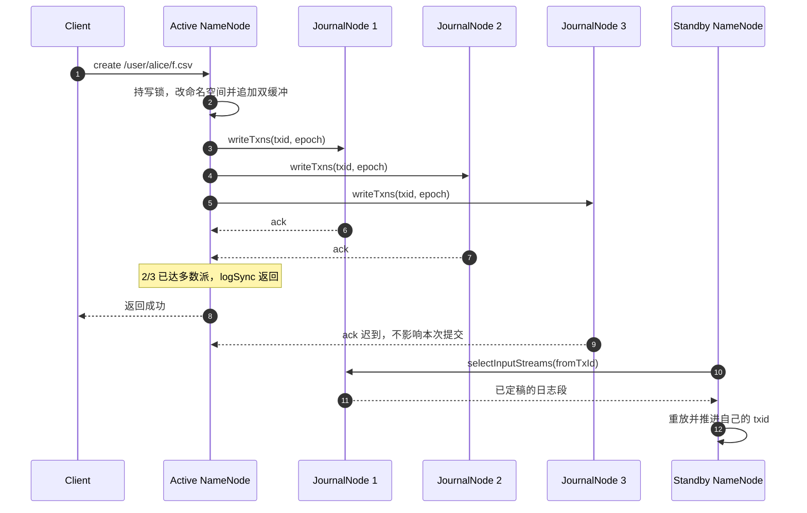
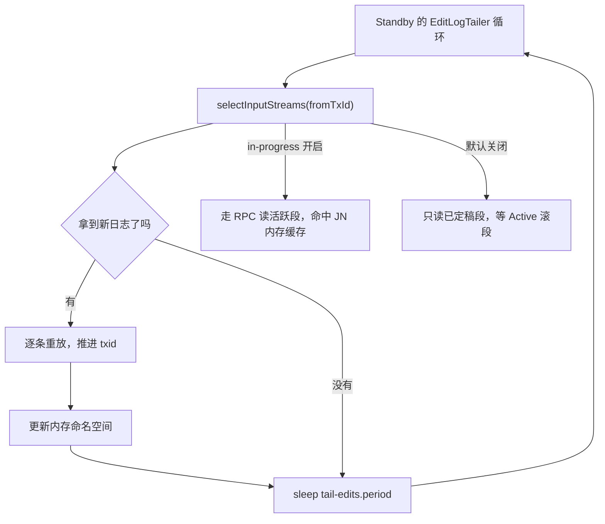
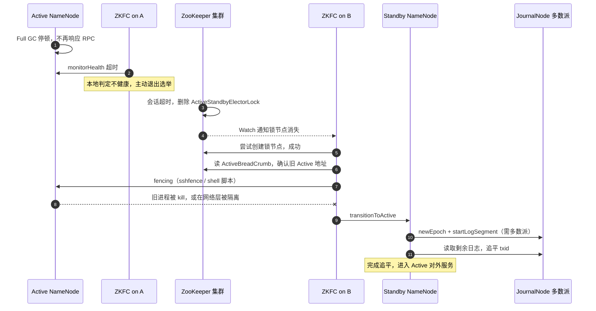
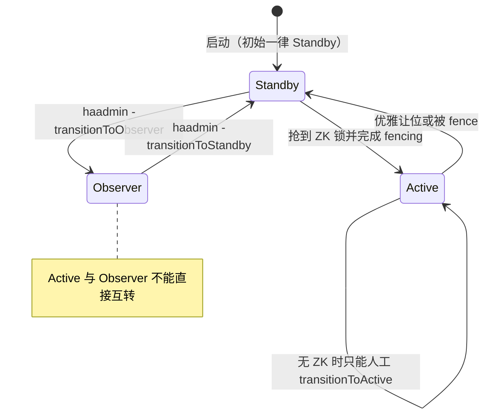
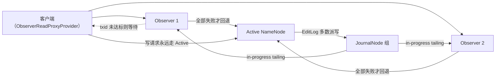

# NameNode 高可用——QJM 协议与 Active-Standby 切换机制

**摘要：**

单 NameNode 的恢复时间等于一段无人服务的窗口，HA 要消灭的正是这段窗口。这件事在 HDFS 里被拆成三份：Standby 通过一组 JournalNode 持续读日志重放，因此保持"热"；ZKFC 借 ZooKeeper 的临时节点在故障时选出一个新 Active；fencing 在交接之前把旧 Active 按死。三件里最像"加一台机器"的是第一件，真正决定方案成色的是后两件，也是故障时最先失效的两件。本文按五个骨架展开：QJM 的三方与一次写操作的完整路径，包括 `dfs.namenode.shared.edits.dir` 三段构成、journal id 与 nameservice 的关系、多数派的算术与三个 20 秒超时的后果；Standby 的 tailing 循环、checkpoint 职责与它为什么能在秒级接管；ZKFC 的三段职责、一次自动切换的时序与耗时分解；启动时"谁先拿到锁谁是 Active"的选择逻辑与 Safe Mode 的牵连；以及 Observer 用事务号与 `msync` 把读从 Active 上分走的条件。随后给出六个故障形态的判据与一份可直接执行的切换验证清单。落点是一句权衡：QJM 用"多数派写日志"替换了共享存储，代价是引入 JournalNode 这个新的故障面，HA 的可用性上限因此从"一块盘是否可靠"变成了"同时坏掉多少台机器"。

---

> [!info] 本列定位
> 本篇只回答"接得上、接得对"：状态怎么同步、谁来决定切换、怎么保证不双写、切换后怎么验证。EditLog 的双缓冲与 checkpoint 的文件格式见 [[大数据/Hadoop/HDFS/03 NameNode 的核心数据结构——FsImage 与 EditLog 的设计奥秘|EditLog 的设计]]，NameNode 的全局读锁与请求面见 [[大数据/Hadoop/HDFS/02 HDFS 整体架构全景——NameNode、DataNode 与 Client 三角关系|整体架构]]，切换之后副本怎么补齐见 [[大数据/Hadoop/HDFS/09 HDFS 容错与恢复机制——自愈修复的工程实现|容错与恢复]]，容量天花板见 [[大数据/Hadoop/HDFS/07 HDFS Federation——打破单 NameNode 的内存天花板|Federation]]，列内顺序见 [[大数据/Hadoop/HDFS/00 专栏导览|HDFS 专栏导览]]。

---

## 第 1 章 一个进程的命门

2003 年 10 月，Google 在 SOSP 上交出的 GFS 报告把一个简化写进了设计：整个命名空间由一台 master 维护，客户端读写文件之前先问它。报告没有回避这个单点，它给出的理由是简化，并且相信 master 挂掉之后可以由运维在分钟级重新拉起。那个年代数据中心里的机器是按周坏的，服务是按季度重启的，单点是一种"人还能兜住"的故障模式。

HDFS 原样继承了这个结构，也继承了这条假设。到 2010 年前后，情况变了：一个中等规模的集群一天有上千个作业在读同一棵目录树，NameNode 的一次重启意味着 Hive、Spark、写入 HBase 的通道同时卡住；而重启并不轻——要把 FsImage 读进堆里，把 EditLog 一条条重放，再等 DataNode 把块报告发齐、退出 Safe Mode。这一段在高负载集群上是分钟到小时级的，具体时长取决于命名空间对象数、日志量与 DataNode 规模。

所以问题被重新表述了：不是"NameNode 能不能重启"，而是"能不能在重启完成之前就把服务接过去"。可恢复与高可用之间隔着的，是一段无人服务的窗口。

要消灭这段窗口，得同时解开三个扣子。**状态同步**：接手的那个进程凭什么认为自己知道 Active 知道的一切，包括一分钟前刚提交的那次 `rename`。**故障检测**：由谁判定 Active 已经不行了，判定得太慢会拖长窗口，判定得太急会在网络抖动时误切换，而误切换本身也是一次故障。**脑裂防护**：切换过程里最难看的一刻是两台机器都认为自己该对外服务，各自维护一份命名空间，客户端一半写到这里一半写到那里。

HDFS 的答案是三个部件拼起来：QJM 负责状态同步，ZKFC 负责故障检测与选举，fencing 负责在交接之前把旧的按死。这三个部件的关系常被画成一张架构图，图上看起来是"两个 NameNode 加几个 JournalNode"，实际用起来才会发现它们的失效方式彼此耦合：JN 掉多数派，Active 会自己退出；ZK 掉了，谁都不会自动切换但集群照常跑；ZKFC 掉了，Active 照旧服务但没人负责接班。这三条是后文反复要回到的判据。

先给结论式的判断：QJM 不是把共享存储做得更可靠，而是把"共享存储"这个前提换掉了。它不再要求两台 NameNode 看见同一块盘，只要求它们看见同一组日志，并且写日志时要**多数派签字**。代价很直白——多了一组进程、多了一条写路径、多了一个必须够多数派才能推进的约束。

---

## 第 2 章 共享存储的第一版：NFS 与它的死结

HDFS 的第一版 HA 走的是最直觉的路：把 EditLog 放到一块两台 NameNode 都能访问的共享存储上，通常是一个 NFS 挂载点。Active 往上写，Standby 从上面读，读到的就是 Active 刚写完的东西。这条路今天仍然存在，官方文档里与 QJM 并列还有一份 NFS 版的部署指引，说明它不是被废弃的错误方案，而是一种有明确适用边界的方案。

这个方案的死结不在软件，在拓扑。NFS 服务器一旦成为唯一的写入口，它就变成了新的单点：它可以配 RAID、配双机热备、配企业级 NAS，但每一层加固都是钱和复杂度，而且加固之后仍然只有一份"当前日志"在对外服务。集群的可用性上限被这块存储的可用性钉死了，这与 HDFS 当年"用软件换掉硬件可靠性"的整体姿态是相反的。

更要紧的是脑裂。NFS 上没有任何机制能阻止一个"还活着但已被剥夺身份"的旧 Active 继续往挂载点写日志——文件系统不认识 epoch，也不认识谁有权写。于是 NFS 方案的 fencing 必须是硬的：要么把进程杀掉，要么把机器断电，要么把网线拔掉，总之要让"写"这个动作在物理上不可能发生。这也是为什么早期 Hadoop HA 的部署文档里，STONITH 一类的电源管理手段被当成标配。

QJM 换掉的就是这一层。它保留"日志只追加"的语义，但把"一份日志放在一块共享盘上"改成"同一份日志在三个（或五个）JournalNode 上各存一份，写入必须拿到多数派确认"。这样共享的前提从"共享一块盘"变成"共享一组多数派"：单台 JN 挂掉不影响写，单块磁盘挂掉不影响写，NFS 服务器那种"唯一入口"消失了。

代价同时出现。原来只有一个写入点需要保护，现在有三个进程需要保护；原来 fencing 失败只影响一块盘，现在 fencing 失败外加 journal 配置错位，会让两台 NameNode 各自写各自的日志。也可以说，QJM 把"存储硬件的可靠性"问题转换成了"进程组的多数派与配置一致性"问题，前者可以用钱买，后者只能靠纪律。

| 维度 | NFS 共享 EditLog | QJM |
|---|---|---|
| 共享对象 | 一个挂载点上的日志文件 | 一组 JN 上的日志段，多数派签字 |
| 单点在哪里 | NFS 服务器本身 | 无单点，但要求多数派在线 |
| 容错能力 | 取决于存储自身冗余 | N 个 JN 容忍 (N-1)/2 个故障 |
| fencing 必要性 | 硬性必需，否则旧 Active 可继续写 | 仍然必需，但只影响读的新鲜度 |
| 新增运维面 | NFS 服务、挂载、权限 | JN 进程、磁盘、epoch 与段文件 |
| 典型失效 | 挂载点不可写，全部元数据操作失败 | JN 少于多数派，Active 自行退出 |

行文至此可以给出 QJM 的定位：它不是一个共识协议，它只解决"单写者的日志如何被多数派持久化"，选主这件事它不碰。这一点常被误解，很多人拿 Raft 去类比 QJM，然后追问"QJM 的 leader 选举在哪"。答案是没有，选举交给了 ZooKeeper，QJM 只认 epoch 与多数派。

---

## 第 3 章 QJM 的三方与写路径

### 3.1 三个角色，一条单向路径

QJM 的系统里有三个角色。Active NameNode 是唯一的写者，它的每一次命名空间修改都要落成一条或多条日志记录。JournalNode 是一组只追加的日志副本，默认三个，可以五个，每个进程都很轻——不缓存命名空间、不做计算，只把收到的日志段追加到本地磁盘，并提供读取接口。Standby NameNode 是读者，它不停地从 JN 上取新日志，重放进自己的内存命名空间。

写路径是一条单向的路：Active 改内存、写日志，多数派 JN 落盘，Active 向客户端返回成功；Standby 在另一条并行的时间线上追这条日志。下面这张时序图把一次 `create` 拉平来看。



注意图里两个容易看漏的细节。其一是内存与日志的顺序：命名空间的修改与日志的追加在同一把写锁里完成，真正把日志推到 JN 的动作发生在 `logSync`，只有 `logSync` 拿到多数派才向客户端返回；这解释了为什么 JN 的磁盘抖动表现出来是客户端 RPC 变慢，而不是直接报错。其二是那条迟到的 ack：多数派一旦凑齐，本次提交就成立了，第三个 JN 的回包只影响它自己的进度，不影响客户端。

关于双缓冲与 `logSync` 的内部结构，[[大数据/Hadoop/HDFS/03 NameNode 的核心数据结构——FsImage 与 EditLog 的设计奥秘|EditLog 的设计]] 里拆过，这里只关心它对 HA 的连带影响：日志刷盘是同步阻塞在客户端 RPC 路径上的，所以 QJM 的写超时不是"后台慢了"，而是"用户请求变慢直到失败"。

### 3.2 shared.edits.dir 的三个字段

三个 JN 的地址写在 `dfs.namenode.shared.edits.dir` 里，形如：

```xml
<!-- 三段结构：scheme://JN 列表/journalId；journalId 惯例复用 nameserviceId -->
<property>
  <name>dfs.namenode.shared.edits.dir</name>
  <value>qjournal://jn1.example.com:8485;jn2.example.com:8485;jn3.example.com:8485/mycluster</value>
</property>
```

第一段是 scheme，只能是 `qjournal://`。第二段是用分号隔开的 JN 地址列表，端口默认 8485（`dfs.journalnode.rpc-address` 的默认值是 `0.0.0.0:8485`，HTTP 端口 8480、HTTPS 8481 是另一套服务）。第三段是 journal id，它是**JN 上的目录名**，官方文档说它用来让同一组 JN 为多个联邦 namesystem 提供存储，并且建议直接复用 nameserviceId。

第三段是全文最容易被手工改错的一处，原因在于它长得像"路径"而不像"身份"。它在实现里就是 JN 磁盘上的子目录名（`new File(editsDir, jid)`），格式上只禁止包含斜杠和以点开头。同一组 JN 会按 journal id 分目录，`/mycluster` 与 `/mycluster2` 在两台 NameNode 眼里就是两个互不相干的日志流。于是有两类错法：

一类是两台 NN 的这行配置不一致。最常见的成因是复制配置时改了 `dfs.nameservices` 却漏改这一行（或者反过来），结果 Active 往 `/mycluster` 写，Standby 从 `/mycluster2` 读。表现极其温和：两台 NN 都健康，`haadmin -getServiceState` 一 active 一 standby，NameNode 日志里没有异常，只有 Standby 的 `LastWrittenTransactionId` 永不前进，checkpoint 一直失败，等到真的要 failover 时卡在追日志上。这种错不制造报警，只制造一次失败的切换。

另一类是 journal id 与 `dfs.nameservices` 不一致，但两台 NN 彼此一致。这种情况集群能正常工作，因为 journal 只需要两端一致；它带来的麻烦在排查时——你按 nameservice 去 JN 目录里找日志会找不到，`dfs.journalnode.edits.dir` 下多出一个陌生的目录名，容易误判成"JN 上丢了数据"。官方只建议复用 nameserviceId，并不强制校验，这行配置的语义正确性完全由部署纪律保证。

还有一条硬约束容易被忽略：这个键只能配一个 URI，不能写成逗号分隔的多个值。多个 JN 地址是写在一个 URI 的分号列表里的，写两行或多值不会被解释成"两个 journal"，只会让配置解析出错或后一个覆盖前一个。

### 3.3 一次写操作在 JN 上落成什么

JN 的本地目录由 `dfs.journalnode.edits.dir` 指定，且只允许一个路径——冗余由多个 JN 提供，不由多目录提供。目录里的内容与 NameNode 本地的 edits 目录高度相似：`edits_<start>-<end>` 这样的已定稿段、`edits_inprogress_<start>` 这样的活跃段，此外还有两个小文件决定了谁能写：`last-promised-epoch` 与 `last-writer-epoch`。

`last-promised-epoch` 是 JN 对"不再接受更低 epoch 的写入"这句承诺的持久化记录。它落在磁盘上，所以 JN 重启之后承诺依然有效——这一点很关键，如果它只存在内存里，一次 JN 重启就能让旧 Active 的写入重新被接受，epoch 这道软隔离就形同虚设。

新 Active 上任时要做的第一件事就是拿 epoch。它向多数派 JN 询问各自承诺过的 epoch，取其中的最大值加一作为自己的新 epoch，再把这个新 epoch 推给多数派。这段逻辑可以概括成一句话：epoch 不是分配出来的，是**从多数派的承诺里推出来**的。它带来一个不太直观的推论——当 JN 不足多数派时，连"成为 Active"这一步都走不完，因为问不到多数派的承诺值。此时 Standby 不会带病上岗，它会停在原地报错。

拿到 epoch 之后，新 Active 还要在 JN 上开一个新的日志段（`startLogSegment`），并对上一个写者可能留下的半截段做恢复（recovery）。恢复也要求多数派：先向多数派询问各段的状态，选一个最大的、且可信的段边界，再推给多数派接受。这一整套动作的超时是分开配置的，`newEpoch`、`getJournalState`、`acceptRecovery`、`finalizeSegment` 各自对应一个 120 秒的默认值，而日常写入、开段与读日志对应的是另外三个 20 秒的默认值。

### 3.4 多数派的算术与三个 20 秒

多数派的算法是 `floor(n/2)+1`：3 个 JN 要 2 个，5 个要 3 个，4 个要 3 个。所以官方在硬件要求里写"至少要 3 个 JN"，并建议只配奇数——因为 4 个 JN 的多数派是 3，容忍的故障数仍然是 1，多出来的那台机器买不到任何额外容错，只增加一次写入要等的回包数。N 个 JN 能容忍的故障数是 `(N-1)/2`。

写入侧有三个默认 20 秒的超时，它们在 Hadoop 3.3.x 的 `hdfs-default.xml` 里取值相同，但含义不同：

| 配置项 | 3.3.x 默认 | 卡住的是什么动作 | 调大的代价 | 调小的代价 |
|---|---|---|---|---|
| `dfs.qjournal.write-txns.timeout.ms` | 20000 | 一次 `writeTxns` 等多数派回包 | 慢 JN 更容易拖过坎，客户端 RPC 尾延迟随之抬高 | 抖动即上抛，一次磁盘毛刺就能让 Active 退出 |
| `dfs.qjournal.start-segment.timeout.ms` | 20000 | 新 Active 开段、切段 | 启动更宽容，故障恢复窗口更长 | 启动更脆，JN 稍慢就起不来 |
| `dfs.qjournal.select-input-streams.timeout.ms` | 20000 | Standby 选择输入流（读日志） | Standby 对慢 JN 更宽容，追日志更稳 | 读日志更易失败，Standby 反复重试 |
| `dfs.ha.log-roll.period` | 120（秒） | Active 侧滚日志段的周期 | 段更长，JN 上的文件更少，恢复更粗 | 段更短，Standby 在定稿段模式下能追得更紧 |
| `dfs.ha.tail-edits.period` | 60（秒） | Standby 拉日志的轮询间隔 | 轮询更懒，JN 压力更小，落后更多 | 追得更紧，JN 与网络压力上升 |
| `dfs.journalnode.edit-cache-size.bytes` | 1048576 | JN 内存缓存，供快路径读 | 缓存更多事务，命中率更高，吃 JN 堆 | 缓存少，读回落到磁盘，延迟变高 |

超时的后果与其他超时不同。普通的 RPC 超时，客户端重试一次就过去了；写日志超时的意思是"我这条元数据修改没有被多数派持久化"，Active 此时无法继续假装自己是权威——**它会退出而不是降级**。于是现象不是"NameNode 变成只读"，而是"NameNode 进程消失，客户端连接全部失败，随后它被重新拉起、进入 Safe Mode 等待块报告"。把"变只读"这个体感追溯到根上，落在的是 Safe Mode，而不是某个"降级模式"。JN 侧日志里能看到形如 `Waited 20000 ms (timeout=20000 ms) for a response` 的 `QuorumException`，以及 NameNode 侧"无法提交事务"的堆栈；这条判据在第 9 章会用到。

顺带说清一个常被张冠李戴的配置。`dfs.ha.log-roll.period`（默认 120 秒）控制的是 Active 多久滚一次日志段，它与 ZKFC 的健康检查没有关系；ZKFC 的健康检查间隔是 `dfs.ha.health-check.interval.ms`。把两者混为一谈的后果是排障时盯错了对象——日志段滚动变慢不会导致切换，健康检查失败才会。

### 3.5 落盘的顺序与 JN 之间的补课

QJM 的写入在 JN 上是先写本地、再回 ack，也就是所谓的"多数派持久化"：只要多数派把日志落到自己的磁盘，这次修改就算提交，哪怕剩下那台随后整机报废，日志也不会丢。这是"多数派 = 安全提交"的全部含义，它不需要所有 JN 都在线，也不需要任何全局时钟。

落单的那台 JN 事后怎么补课？Hadoop 给了一条不依赖 Active 的路：`dfs.journalnode.enable.sync` 默认开启，JN 之间会按 `dfs.journalnode.sync.interval`（默认 120000 毫秒）互相 gossip，比较各自的日志清单，发现对方有自己没有的段就直接下载。这条机制把"补齐孤岛 JN"从"必须从 Active 重新灌一遍"降级成"JN 自己拉"，代价是 JN 之间多了一条后台流量。它也是判断 JN 是否健康的补充依据：一台长时间落后的 JN，gossip 之后仍追不上，说明它自己有问题，而不是网络抖动。

---

## 第 4 章 Standby 为什么是"热"的

### 4.1 追日志的循环

Standby 的核心是一个循环：从 JN 上选出比自己 txid 更大的输入流，读出来，交给 `FSEditLog` 重放，重放完推进自己的 txid，然后睡一会儿再下一轮。睡眠的间隔就是 `dfs.ha.tail-edits.period`，默认 60 秒。

默认配置下，这个循环只能读已经定稿的日志段。段的定稿时机由 Active 的滚动周期决定（`dfs.ha.log-roll.period`，默认 120 秒），所以 Standby 的落后量有一个结构性的下限：最坏情况下要等到当前活跃段被滚成定稿段，再加上一个轮询周期。把这两个默认值加起来看，会得到一个反直觉的结论——**落后是结构性的**：在默认配置下，Standby 落后 Active 几十秒是完全正常的，这几十秒正是切换时"catch-up"那一段的时间来源。

想让 Standby 更紧，可以打开进行中段的 tailing：`dfs.ha.tail-edits.in-progress`（默认 `false`）。打开之后有三件事同时发生。Standby 会去读活跃段而不是等定稿；读的方式从 HTTP 换成 RPC；JN 会开一块内存缓存（`dfs.journalnode.edit-cache-size.bytes`，默认 1MB，官方给的量级是每条事务约 200 字节，1MB 大约能放五千条）。官方文档说这三件事合起来能把"Active 提交到 Standby 应用"的间隔压到毫秒量级。缓存的代价是 JN 的堆与一个命中率问题——命中不了的请求会回落到磁盘，反而更慢，所以官方建议盯 JN 的两个指标：缓存未命中次数与"还差多少事务就能命中"的均值。



### 4.2 checkpoint 的职责转移

HA 模式下不再需要 Secondary NameNode，这一点官方文档写得很直白：Standby 顺便把 checkpoint 也做了，再额外跑一个 Secondary NameNode 或 CheckpointNode 是错误配置。开关是 `dfs.ha.standby.checkpoints`，默认 `true`。

机制上，Standby 定期把 FsImage 与已合并的日志合成一份新镜像，然后把新镜像传回 Active，Active 换上新镜像、清掉已经被合并的旧日志段。这条设计与"Standby 是热备"是同一件事的两面：为了让切换快，Standby 必须有一个能立刻加载的、较新的镜像；为了让镜像新，它必须自己做合并，而不是像 Secondary 那样只是抄一份。

多 Standby 的部署里，这个职责需要分配。`dfs.ha.standby.checkpoints` 就是那个开关，把其中一台的 checkpoint 关掉，让它只做日志同步，可以避免几台 Standby 同时合镜像、同时往 Active 传大文件。这个取舍在小集群上无关紧要，在命名空间上亿对象、镜像几十 GB 的集群上，checkpoint 的 CPU 与网络开销会影响 tailing 的及时性。

### 4.3 双报：BlocksMap 也是"热"的一部分

只同步 EditLog 还不够。切换之后新 Active 要回答"这个块在哪几个 DataNode 上"，如果它手里没有 BlocksMap，就得等所有 DataNode 重新发全量块报告，这段时间集群处在 Safe Mode 里，依旧不可用。

所以 HA 部署里 DataNode 被配置成向所有 NameNode 汇报：心跳、增量块报告、全量块报告都发多份。结果是 Standby 的 BlocksMap 与 Active 基本一致，切换完成的瞬间就能回答块位置查询。代价是 RPC 量与 Active/Standby 的数量成正比，三台 NameNode 的集群里，每个 DataNode 的心跳都要发三份。这个代价换来的东西很具体：切换后不需要"再等一轮块报告"。

### 4.4 "热"的边界

把上面几层叠起来，Standby 的"热"可以精确表述为：内存命名空间只差一段日志，块映射基本是全的，FsImage 是较新的。三段都有边界。

日志那一段，靠 tailing 追，追不上就是切换时的等待；块映射那一段，靠双报维持，DataNode 掉线、网络分区、Standby 长时间不健康都会让它落后，落后之后切换能成，但副本管理会在一段时间里基于旧信息做决策；镜像那一段，靠 checkpoint 维持，镜像太旧意味着 Standby 重启后要先加载旧镜像再重放大量日志，启动慢。

还有一个更硬的前提：Standby 要成为 Active，必须能联系上 JN 多数派。这意味着"JN 挂了但 NameNode 都活着"这种局面下，HA 是没有任何切换能力的——两台 NN 都升不上去，这看起来很难接受，但它是"日志必须写在多数派上"这条设计的必然结果。

最后一条边界最容易被忽略：Standby 不对外服务。客户端把读请求发到 Standby 上，会收到一个明确的拒绝——`StandbyException`，文案形如 `Operation category READ is not supported in state standby`。这不是故障，这是设计。客户端之所以"感觉不到"，是因为 `ConfiguredFailoverProxyProvider` 收到这个异常之后会自动去问另一台。第 8 章的 Observer 改的正是这条约束。

---

## 第 5 章 控制面：ZKFC 与它的三段职责

### 5.1 为什么不是一个线程

ZKFC 是每个 NameNode 机器上独立启动的一个 JVM 进程，不在 NameNode 的进程里面。这个选择与"健康监控"要解决的问题直接相关：如果用 NameNode 内部的一个线程去宣告"我健康"，那么 NameNode 一旦陷入长时间的 GC 停顿或死锁，这个线程也一起停住，对外的表现就是"没人说话"，而不是"我在生病"。独立的进程则可以在 NameNode 不说话的时候替它说话——或者替它认输。

ZKFC 与它守护的 NameNode 之间只有一层薄薄的 RPC：健康检查、切换状态、查询状态。它自己也开一个 RPC 端口（`dfs.ha.zkfc.port`，默认 8019），供 `haadmin` 之类的工具在自动切换模式下走协调路径。

### 5.2 HealthMonitor：区分"活着"与"可用"

ZKFC 里的健康监控周期性地向本地 NameNode 发健康检查 RPC，拿到 `HEALTHY` 或 `UNHEALTHY`。判定不是简单的"进程在不在"，NameNode 会自检一些内部服务状态再回答。这层自检带来一个很实用的配置项：`dfs.ha.nn.not-become-active-in-safemode`，默认 `false`。默认值意味着一个还在 Safe Mode 里的 NameNode 也可以被推上 Active——切换确实成功了，但集群读到的是一个还没退出 Safe Mode 的命名空间，表现为一段短暂的只读。把它设成 `true`，处于 Safe Mode 的 NameNode 会上报不健康，从而不参与接管，切换会更保守，代价是在"Standby 重启后正在加载镜像"这种场景下，可切换的目标会暂时为空。

健康监控发现不健康时，ZKFC 的动作是主动放弃自己的选举资格，而不是试图修复 NameNode。这是一个重要的边界：ZKFC 不重启 NameNode，不管进程，它只做"要不要继续参选"这一个决定。

### 5.3 ActiveStandbyElector：一把锁与一块面包屑

选举用 ZooKeeper 的临时节点实现。父节点由 `ha.zookeeper.parent-znode` 决定，默认 `/hadoop-ha`，下面会拼上 nameserviceId。锁节点叫 `ActiveStandbyElectorLock`，谁创建成功谁就是 Active 候选人；由于是临时节点，创建者的 ZooKeeper 会话一旦过期，节点自动消失，其他人立刻得到通知。

锁之外还有一个节点值得知道：面包屑（breadcrumb）。它记录"上一个 Active 是谁、地址是什么"。新当选的一方在接管之前会去读它，从而知道要不要对某个具体的主机做 fencing。这个设计把"是否需要隔离"从猜测变成了查证。

会话超时由 `ha.zookeeper.session-timeout.ms` 控制。`core-default.xml` 里这个键的默认值是 10000 毫秒，而 HA 文档正文写的是"默认 5 秒"，两处不一致属于文档滞后，以对应版本的实际默认配置文件为准。这个值直接决定"故障发生到别人知道你出事"的延迟：调小，故障发现更快、切换更快，但网络抖动更容易被误判为死亡，进而触发一次不必要的切换；调大，误切换变少，接管窗口变长。它是 HA 里少数几个"改一个数字直接改变可用性曲线"的旋钮之一。

### 5.4 一次自动切换的完整时序

把前面几块拼起来，自动切换的链条是这样走的，下图按时间顺序展开。



耗时不是一步，而是几段的加总。下面的分解是示例推算，取值来自默认配置与常见的部署形态，用于说明"时间花在哪"，不是基准测试结果。

| 阶段 | 示例量级 | 由什么决定 |
|---|---|---|
| 会话超时 | 约 10 秒 | `ha.zookeeper.session-timeout.ms`，默认 10000 |
| 锁释放到 Watch 通知 | 毫秒级 | ZooKeeper 集群的响应与网络 |
| fencing | 1 到 5 秒 | sshfence 的 SSH 建连与 `fuser` 执行；脚本型取决于脚本自身 |
| newEpoch 与开段 | 亚秒到数秒 | JN 多数派的磁盘与 RPC；受 20 秒超时约束 |
| 追平剩余日志 | 视落后量，可从近零到数十秒 | tailing 的落后量与 JN 读取速度 |
| 客户端重试切到新 NN | 0.5 到 2 秒 | `dfs.client.failover.sleep.base.millis` 等重试参数 |

把这些段加起来，默认配置下一次自动切换落在十几秒到几十秒之间，与"进程重启 + 加载几十 GB 镜像"完全不在一个量级。但也要看清这张表的脆弱处：真正的方差不在前四段，最后两段才是。落后量大、客户端重试参数保守，切换就会拖长；反过来，把会话超时压到几秒、把重试间隔压到几百毫秒，切换看起来更快，误切换与无效重试的概率同时上升。

### 5.5 ZKFC 挂了、ZooKeeper 挂了

这两个问题经常被一起问，答案不一样。

ZKFC 挂掉，集群不会自动切换，因为**它就是那个做决定的人**。当前的 Active 会继续正常工作，客户端读写不受影响；风险在于此刻如果 Active 真的挂了，没有任何人会把 Standby 推上去。官方 FAQ 因此明确建议把 ZKFC 进程纳入监控——它的死亡是一种**沉默的故障**，监控面板上 NameNode 是健康的，HA 的能力却已经消失了。同理，如果挂掉的是 Standby 那一侧的 ZKFC，Standby 就失去了被选中的资格。

ZooKeeper 挂掉，同样不会触发任何自动切换，HDFS 继续正常运行；ZK 恢复后 ZKFC 会自动重连，不需要重启进程。这条行为常被误解为"ZK 挂了就完蛋"，实际影响是"HA 变成了没有控制面的 HA"：现有 Active 继续服务，但失去了自动接班的可能。文档还提到另一层风险：某些 ZooKeeper 故障形态下，ZKFC 进程本身可能意外退出，所以除了监控 ZK，还要监控 ZKFC 是否还在。

---

## 第 6 章 Fencing：把旧的按死

### 6.1 一次 GC 停顿的连环

设想 Active 的 JVM 发生了一次持续三十秒的 Full GC，这在高堆、大命名空间的集群上并不罕见。三十秒里它对外什么都不响应。ZKFC 的健康检查超时，会话过期，锁节点被删；Standby 的 ZKFC 收到通知、抢到锁、执行 fencing，然后把自己的 NameNode 推成 Active。第三十秒，GC 结束，旧进程醒来，它手里没有"我已经被免职"的任何证据——它只知道自己是 Active。

接下来会发生什么，取决于两件事。它尝试写 JN 时，会被多数派以 epoch 过期拒绝，因为新 Active 已经拿到了更大的 epoch；但在此之前，它可以继续响应客户端的读请求，返回一份已经过期的命名空间视图。这就是 fencing 存在的具体理由：把一个"可能持续很久的过期读窗口"压缩到"几秒之内"。

### 6.2 三种手段

`dfs.ha.fencing.methods` 是一个按行分隔的列表，按顺序尝试，第一个返回成功的即停止。Hadoop 自带两种实现，此外允许通过类名接入自定义实现。

第一种是 `sshfence`。它 SSH 到目标主机，用 `fuser` 杀掉监听服务端口的进程——按端口找进程，而不是按进程名，这样即使进程名被改过也能杀准；`fuser -k` 发出的是 SIGKILL，效果与手动 `kill -9` 一致。它要求免密登录，所以要配 `dfs.ha.fencing.ssh.private-key-files`；可以指定用户名与端口（`sshfence([[username][:port]])`），也可以用 `dfs.ha.fencing.ssh.connect-timeout`（示例值 30000 毫秒）约束 SSH 建连的时间。它的失效场景很明确：目标主机 SSH 不可达时它只能失败，而失败意味着切换流程卡住。

第二种是 `shell(...)`。括号里是一段直接交给 bash 的命令，环境里带着一组以目标主机为对象的变量：`$target_host`、`$target_port`、`$target_address`、`$target_nameserviceid`、`$target_namenodeid`，同时也能读到当前的 Hadoop 配置变量（点号换成下划线）。退出码 0 代表 fencing 成功，非 0 则尝试列表里的下一个方法。官方特意提示：这个方法本身不实现超时，需要超时就在脚本里自己 fork 一个子 shell 去杀父进程。常见用法是把"IPMI 强制下电"或"交换机端口 shutdown"封成脚本，从而实现真正的物理隔离。

第三种是自定义实现：`dfs.ha.fencing.methods` 除了内置方法名，也允许直接写类名，Hadoop 通过反射加载。官方指路到 `org.apache.hadoop.ha.NodeFencer`。这条路适合已经有电源管理平台或带外管理 API 的环境，把"隔离"落成一个返回 0 或非 0 的调用。

关于 `jstack` 有一个流传很广的误会，需要拆掉。Hadoop 内置的 fencing 只有 `shell` 与 `sshfence` 两种，没有"jstack 型 fencing"。`jstack` 是排障工具：怀疑旧 Active 卡在 STW 还是死锁时，`jstack` 抓一份线程栈能定性。但它不是隔离手段，抓完栈进程还在，还在对外服务。把 `jstack` 写进 fencing 脚本（抓栈成功就 `exit 0`）是危险的反例：fencing 报告成功，旧 Active 一根汗毛没少。

| 方式 | 形态 | 依赖 | 超时控制 | 失败含义 |
|---|---|---|---|---|
| `sshfence` | SSH 到目标机 `fuser -k <port>/tcp` | 免密 SSH、私钥路径正确 | `dfs.ha.fencing.ssh.connect-timeout` | SSH 不通则 fence 失败，切换卡住 |
| `shell(...)` | 自定义脚本，可用 `$target_*` 变量 | 脚本、带外管理通道或交换机权限 | 无内置超时，脚本自管 | 退出码非 0 则试下一个方法 |
| 自定义类 | 反射加载 fencing 实现 | 自研 Java 类 | 由实现自定 | 抛出即视为失败 |
| `shell(/bin/true)` | 什么都不做，永远成功 | 无 | 无 | 相当于没有隔离，但流程能过 |

最后一行是很多集群的真实状态。`hdfs-default.xml` 里 `dfs.ha.fencing.methods` 的默认值是空；把它留空、或者为了让流程能走完而在列表末尾垫一个 `shell(/bin/true)`，效果都是"没有隔离"。垫一个必然成功的方法能换来"切换不会因为 fence 失败而卡死"，代价是"隔离可能没发生"。这两种取向没有绝对的对错，取决于你更怕"长时间不可用"还是更怕"双 Active"，但必须是有意识的选择。

### 6.3 不配 fencing 到底会怎样

这里要把一句被讲滥的话校正一下。官方文档的说法是：使用 QJM 时，永远只允许一个 NameNode 向 JN 写入，因此**不存在脑裂导致元数据损坏**；但故障切换期间，旧 Active 仍可能对客户端提供过期的读，直到它尝试写 JN 时才退出。所以 fencing 的价值不在"防止元数据被写坏"，而在"缩短过期读的窗口"。

那么"两个 NN 同时写导致数据损坏"这个说法错在哪里？它在 NFS 方案里是对的，因为共享文件系统不认识 epoch，旧 Active 的写不会被拒绝。它在 QJM 方案里是错的，因为 JN 会以 `IPC's epoch ... is less than the last promised epoch` 这类错误拒绝旧写者。剩下真正危险的形态另有一个：两台 NN 的 journal id 不一致，各写各的 journal——这时两边都是各自日志流里的唯一写者，epoch 机制完全不起作用，于是元数据**真的**分叉了，而且因为两边都很"健康"，这种分叉可以持续几天不被发现。第 9 章会把它作为故障形态之一展开。

这也解释了为什么 QJM 方案里 fencing 从"必须"降级为"应当"：它是可用性优化，不是正确性前提。但把这句话当免票是另一种误读——不配 fencing 意味着一次 GC 停顿可以让旧 Active 继续对外提供几分钟的过期元数据，客户端看到的世界会随时间倒流，这在依赖 `list` 结果做增量处理的作业里能直接产出错误结果。

### 6.4 手动切换与自动切换的关系

自动切换与手动切换不是两套机制，而是同一个机制的两个触发源。`hdfs haadmin -failover nn1 nn2` 做的事情与 ZKFC 做的事情在关键步骤上一致：先尝试让旧的优雅降级，失败则按 `dfs.ha.fencing.methods` 依次 fence，最后把目标推成 Active。开了自动切换之后这条命令依然可用，官方称之为协调式切换（coordinated failover），它走的是 ZKFC 的路径。

与之相对，`-transitionToActive` 与 `-transitionToStandby` 是两个裸的状态转换：它们不做任何 fencing。官方文档的原话是"这些命令不尝试执行任何 fencing，因此应当很少使用"。它们有用的场合几乎只有一种：自动切换没开、ZK 没有部署的纯手工 HA，此时两台 NameNode 启动后都处于 Standby，必须由人指定谁上；而这个"指定"动作没有任何隔离保护，按下回车之前要自己确认旧的已经停了。把 `-transitionToActive` 当成日常切换手段，是双 Active 事故最常见的来源。

---

## 第 7 章 启动时的角色选择

### 7.1 第一次起集群

新集群的初始化有三条命令，各管一段。`hdfs namenode -format` 只在其中一台 NN 上执行，产出本地镜像与一个空的 edits。另一台不 format，改用 `hdfs namenode -bootstrapStandby`，它会从 Active（或从 JN）把元数据抄过来，同时保证 JN 上有足够的日志段能让两台都起来。如果是从非 HA 集群改造成 HA，历史日志还在本地 edits 目录里，要先用 `hdfs namenode -initializeSharedEdits` 把本地日志灌进 JN，否则新的 Standby 看到的是一段空白历史。

这三条命令有一个共同前提：JN 必须先全部起来。升级、回滚、定稿这几类操作尤其严格，官方文档专门强调 JN 必须全在运行，少一台就可能失败。这与日常写入"多数派即可"的宽松形成对比，容易被忽略。

### 7.2 谁先拿到锁谁是 Active

配置了自动切换之后，角色不由人指定，由 ZooKeeper 上的锁决定。两台 NN 的 ZKFC 都盯着同一个节点，谁先创建成功谁就是 Active。官方 FAQ 把这个行为写得很直接：无法指定哪一台是"首选"，先启动的那一台会成为 Active；如果想要某个顺序，就按顺序启动。

这条机制有一个容易被忽略的后果：集群重启之后的 Active 可能不是重启前的那一台。运维脚本里如果写死了"nn1 是主"，重启之后会失效。正确做法永远是查状态，而不是假设。

没有 ZooKeeper 的时候（`dfs.ha.automatic-failover.enabled` 为 `false`），两台 NN 启动后都停在 Standby——官方文档明确写着"任何 HA NameNode 启动时初始状态都是 Standby"——然后由人执行 `hdfs haadmin -transitionToActive nn1` 指定。这就是"没有 ZK 时由 `haadmin` 手工指定"的全部含义，它不是一个可选的优雅路径，而是一个把正确性完全交给人的路径。

### 7.3 状态机

把角色与转换关系画成状态机，边界会清楚很多。



图里最值得记住的是那条注释：Active 与 Observer 之间没有直接边。这意味着想让一台 Active 退居 Observer，必须经过 Standby 中转；而官方对 Observer 的说明里还补了一句，自动切换开启时要用 `-forcemanual` 才能转，因为 Observer 与自动切换的集成并不完整。

---

## 第 8 章 Observer：把读从 Active 上分走

### 8.1 读锁是瓶颈

NameNode 的命名空间由一把全局读写锁保护，[[大数据/Hadoop/HDFS/02 HDFS 整体架构全景——NameNode、DataNode 与 Client 三角关系|整体架构]] 里拆过这把锁的结构。写操作要拿写锁，读操作要拿读锁，读读之间可以并行，但读写之间互斥。典型的大数据集群里，读请求占绝对多数：作业启动阶段成百上千个客户端同时 `getBlockLocations`、`listStatus`、`getFileInfo`，这些请求都在抢同一把读锁。加 DataNode、加磁盘、加客户端并发，都**不会让这把锁变宽**。

Observer 的思路很朴素：既然读是多数，就让多一台进程分担读。它与 Standby 一样从 JN 追日志，因此内存状态与 Active 相差无几；区别是它被允许回答读请求。Hadoop 3.0 把它作为第三种角色引入，官方文档的说法是"读请求在典型环境里占多数，因此这有助于对 NameNode 流量做负载均衡并提高整体吞吐"。

代价先说清楚：每多一台 Observer，就多一份堆内存、多一份从 JN 读取的流量、多一份 DataNode 的心跳与块报告。它买的是读的横向扩展能力，不是写的，也不是故障接管能力——官方明确写了 Observer 参与故障切换的功能尚未实现，`transitionToObserver` 只能用 `haadmin` 手工拉起。

### 8.2 一致性怎么保证

让一台"稍微落后"的进程回答读，立刻会碰上一个问题：客户端刚在 Active 上建了一个文件，转头问 Observer 存不存在，如果 Observer 还没追上，就会得到一个错误的"不存在"。

Hadoop 的解法是给 RPC 加一个状态号。开启 `dfs.namenode.state.context.enabled` 之后，NameNode 会维护并更新一个以事务 ID 表示的状态号，并随 RPC 响应回传给客户端。客户端每次与 Active 交互后更新自己的状态号；下次向 Observer 发读请求时把这个号带上，Observer 检查自己的 txid 是否已经达到，没达到就先等，达到了才回答。这就是"读到自己刚写的东西"（read-your-writes）在单客户端内的实现。

跨客户端的情况要另一件工具。A 客户端写完，通过 HDFS 之外的通道（一条消息、一个数据库标记）告诉 B "文件好了"，B 去 Observer 上读，可能读不到——因为 B 手里的状态号是旧的。为此 HDFS 加了 `msync()`：客户端调用它，会拿 Active 的最新状态号更新自己，之后的读就保证能看到 msync 之前的写入。官方还提供了一个自动模式 `dfs.client.failover.observer.auto-msync-period.<nameservice>`，可以按时间间隔自动 msync，代价是周期性访问 Active；默认值是负数，即不做自动 msync。

客户端要真正用上 Observer，还得换代理实现：`dfs.client.failover.proxy.provider.<nameservice>` 从 `ConfiguredFailoverProxyProvider` 换成 `ObserverReadProxyProvider`。新的代理会先尝试所有 Observer，全部失败才回退到 Active。没有换这个配置的客户端行为不变——它还是只认 Active。



### 8.3 什么时候该上 Observer

判断的核心不是"读请求多不多"，而是"读请求是不是已经撞到 NameNode 的读锁与 RPC 队列上"。下面这张表给的是判据，不是阈值。

| 观察点 | 指向 Observer 的信号 | 指向别处的信号 |
|---|---|---|
| NameNode RPC 队列等待时间 | 队列等待占比高，handler 长期饱和 | 磁盘或 GC 是瓶颈，先修 Active |
| 读请求类型分布 | 大量 `getBlockLocations`、`listStatus` | 以写为主，Observer 无用 |
| 客户端数量 | 上千客户端打同一个 NN | 客户端很少，加机器收益薄 |
| 命名空间规模 | 大到单台 NN 堆已接近上限 | 规模小，Standby 闲时可兼读 |
| 自动切换是否开启 | 关闭，或能接受 `-forcemanual` | 强依赖自动切换，需先评估集成限制 |
| `dfs.namenode.accesstime.precision` | 必须为 0 | 非 0 时 `getBlockLocations` 变写请求，Observer 全部失败回退 Active |

最后一行是官方专门提示的坑，值得单独说。开启访问时间精度之后，打开文件的 `getBlockLocations` 需要拿写锁去更新访问时间，于是这个请求在所有 Observer 上都会失败，然后全部回退到 Active——结果 Observer 不但没分担流量，还额外制造了一轮失败与重试。上 Observer 之前把这一项确认掉，比调任何参数都重要。

---

## 第 9 章 六个故障形态与判据

这一章把前面几章的知识收成可执行的判据。六种形态的共性在于：它们的表面症状都是"客户端慢或报错"，而分界线在几个很具体的查询上。下面先给总表，再逐条展开。

| 形态 | 一眼可见的症状 | 最快的一条判据 |
|---|---|---|
| JN 不足多数派 | 所有写失败，NN 反复重启后进 Safe Mode | `jps` 看 JN 进程数与 `haadmin -getServiceState` |
| 两个 Active | 两台都报 active，客户端时好时坏 | `haadmin -getAllServiceState` 与两台 `/jmx` 的 `HAState` |
| ZKFC 挂了不切换 | Active 正常运行，故障时无人接管 | `jps` 看 `ZKFailoverController` 是否存活 |
| `shared.edits.dir` 配错 | 一切正常，但 Standby 的 txid 不涨 | JN 目录下是否出现两个 journal 目录名 |
| 切换后 `StandbyException` | 客户端读报 standby 不支持 | 客户端是否用 nameservice 而非具体 NN 地址 |
| Observer 读一致性 | 偶尔读到旧目录列表 | state context 与 in-progress tailing 是否开启 |

### 9.1 JournalNode 不足多数派

症状是集群整体写不进去：`create`、`mkdir`、`rename`、`delete` 全部变慢，客户端在超时之后报错，已经建立的读连接还能撑一会儿，但任何需要写元数据的操作都会失败。Active 的日志里出现 QJM 的 `QuorumException`，形如等待超时之后"只收到若干回包"；随后 NameNode 进程退出，重启后卡在 Safe Mode。

判据有几条现成的。`hdfs haadmin -getServiceState nn1` 返回 `active` 但集群写不动，说明问题不在 NN 状态而在它能联系上的 JN；`jps` 或 `ss -lntp | grep 8485` 数一下在跑的 JN 个数，与 `dfs.namenode.shared.edits.dir` 里配的对比；`df -h` 看 `dfs.journalnode.edits.dir` 所在盘是否满了——JN 磁盘写满是最常见的触发原因，而它不会在 NameNode 上直接报"磁盘满"。

处置顺序要讲究。先把 JN 恢复到多数派以上，再考虑 NN；如果 JN 只回来一台、仍然不足多数派，NN 起来还是会退出，反复重启只会拉长不可用时间。同时要记住一个界面上看不见的事实：提交的前提是多数派落盘，所以坏掉一台 JN 不会丢任何已提交的事务；但如果坏掉的是持有该事务的那两台，剩下的孤岛未必包含最新几条——补齐它靠的是 JN 之间的 sync，而不是来回重启 NameNode。换句话说，这个故障主要影响可用性，持久性只有在"多数派同时报废"时才会真正受损。

### 9.2 两个 Active

症状在不同客户端上表现不一：一部分客户端读写正常，另一部分读到的是旧数据或者写入失败。两台 NameNode 的网页上，HA 状态都显示 active。

判据是 `hdfs haadmin -getAllServiceState`（或对每台执行 `-getServiceState`），以及两台 `/jmx` 里 `FSNamesystem` 的 `HAState` 属性。两个来源都要看：`haadmin` 走 RPC，`/jmx` 走 HTTP，恰好能覆盖"某个进程的 RPC 卡住但 HTTP 还活着"这类情况。

确认双 Active 之后，第一件事不是急着让其中一台下去，而是查清楚为什么会同时 active，因为两类成因的处理方式完全不同。第一类是隔离失效：fencing 没配、配了但失败、或者列表末尾垫了 `shell(/bin/true)` 让流程强行通过。第二类是 journal 分裂：两台 NN 的 journal id 不同，各自是独立日志流的唯一写者，epoch 机制根本不介入。第二类的发作方式更温和也更阴险——两台 NN 都表现得完全健康，只有在比对两台机器的 `dfs.namenode.shared.edits.dir` 时才会露馅，而 JN 磁盘上出现两个 journal 目录名是一条铁证。

### 9.3 ZKFC 挂了不切换

症状最难察觉：集群一切正常，直到 Active 真的挂了，才发现没有接管。监控上 NameNode 是健康的，ZKFC 不是 NameNode 的一部分，很多监控模板里没有它的位次。

判据是 `jps` 里有没有 `ZKFailoverController`，或者 `ss -lntp | grep 8019`；也可以用 `zookeeper-client` 去看 `/hadoop-ha/<nameservice>/ActiveStandbyElectorLock` 这个节点是否存在、内容是什么。ZKFC 的日志里能看到它在做选举相关的动作，形如 `Checking for any old active which needs to be fenced...`，长时间没有这类记录说明它已经停了。

处置是重启 ZKFC 进程，不需要重启 NameNode——官方 FAQ 明确写了 ZKFC 与 NameNode 的启动顺序无关。真正的修复是把 ZKFC 的存活纳入监控，并且给它配一个和 NameNode 同级的告警级别：它死了不会立刻出事，但它死掉的那一刻，HA 就已经降级成单机了。

### 9.4 shared.edits.dir 配错

症状是"什么都没坏，但切换一定失败"。平时集群读写正常，Standby 也不报错，只是它的 `LastWrittenTransactionId` 一直不动，checkpoint 反复失败；等到执行 `hdfs haadmin -failover`，流程卡在追日志那一步，最后超时。

判据按顺序三步。比对两台机器 `hdfs-site.xml` 里这一行的文本（包括 journal id 的大小写与拼写）；看两台 NN 的 `getServiceState` 是否正常（正常说明不是进程问题）；列一下 `dfs.journalnode.edits.dir` 下的目录名，出现**两个目录名即坐实**。第三步行之有效，是因为 JN 按 journal id 建目录，错配必然留下两个目录。

处置是停掉 Standby，修正配置，重新 `hdfs namenode -bootstrapStandby`。不要试图让 Standby 用错误配置继续追——它追的那个 journal 是空的，追到天亮也不会前进。

### 9.5 切换后客户端报 StandbyException

症状是切换"成功"了，但部分客户端持续报错，异常文本里带着 `StandbyException` 与 `Operation category READ is not supported in state standby`。

判据两种。一种是看客户端连的地址：如果 Hive、Spark、Flume 的配置里写的是 `hdfs://namenode1:8020` 而不是 `hdfs://mycluster`，那它绕过 nameservice 直连了一台具体的 NN，切换之后自然连到 Standby 上。用 `hdfs getconf -confKey fs.defaultFS` 能确认客户端的默认文件系统是什么。另一种是看 failover 代理是否配置：`dfs.client.failover.proxy.provider.<nameservice>` 缺失时，部分旧客户端不会自动重试另一台。

处置是统一入口：所有客户端一律用 nameservice URI，配置文件里不出现具体 NN 主机名；同时把重试参数确认一遍，它们在切换窗口里决定用户看到的是"短暂卡顿"还是"报错"。

### 9.6 Observer 的读一致性

症状是偶发的、难以复现的"读不到刚写的东西"：目录列表少了一个文件、`exists` 返回 false、下游作业处理到一半发现输入少了。切换到 Observer 之前不会有这个问题，所以很容易被归因成"新加的机器有问题"。

判据要按配置逐项确认。`dfs.namenode.state.context.enabled` 是否开启——不开就没有状态号，read-your-writes 无从谈起，而且官方文档说这个开关默认关闭；`dfs.ha.tail-edits.in-progress` 是否开启——不开的话 Observer 只能读定稿段，落后量以几十秒计；`dfs.namenode.accesstime.precision` 是否为 0——不为 0 时读请求会退化成写请求并全部回退 Active；客户端是否真的换成了 `ObserverReadProxyProvider`。跨客户端场景还要看应用有没有在关键节点调用 `msync()`，或者有没有开自动 msync。

```mermaid
%%{init: {'theme': 'dracula'}}%%
flowchart TD
    A["客户端表现异常"] --> B{"写不进去还是读不对"}
    B -->|写不进去| C{"haadmin 状态是否 active"}
    C -->|不是| D["先看 NN 进程与 Safe Mode"]
    C -->|是，仍写不动| E["数 JN 进程，查 JN 磁盘"]
    E -->|不足多数派| F["恢复 JN，不要反复重启 NN"]
    B -->|读不对| G{"两台 NN 是否都 active"}
    G -->|是| H["查 fencing 配置与 journal id"]
    G -->|否| I{"报 StandbyException 吗"}
    I -->|是| J["客户端是否用 nameservice 直连"]
    I -->|否| K["查 Observer 的 state context 与 tailing"]
```



---

## 第 10 章 切换的验证清单

演练与真实切换之后，验证要按固定顺序走，否则容易在看错的指标上得出"切换成功"的结论。

| 步骤 | 命令或端点 | 期望 | 不符时的含义 |
|---|---|---|---|
| 1 | `hdfs haadmin -getAllServiceState` | 恰好一台 active，其余 standby/observer | 两台 active 见 9.2；全 standby 见 9.3 |
| 2 | `hdfs dfsadmin -report` | 与切换前的 DataNode 数一致，容量不变 | DN 数骤降说明块报告还在路上或 NN 未退 Safe Mode |
| 3 | `/jmx?qry=Hadoop:service=NameNode,name=FSNamesystem` | `HAState` 为 active/standby/observer | 与步骤 1 不一致时优先信 HTTP 的读数 |
| 4 | 旧 Active 与其 ZKFC 的日志 `grep -i fenc` | 出现 `Expecting to be fenced by the next active` 一类记录 | 无记录说明 fencing 未真正执行 |
| 5 | 旧 Active 日志 `grep -i "last promised epoch"` | 出现 epoch 过期被拒的记录 | 无记录则旧进程未尝试写，需确认它是否还活着 |
| 6 | 新 Active 日志 `grep -i "new epoch"` | 出现新 epoch 与开段成功 | 失败说明 JN 多数派不足 |
| 7 | JN 目录 `ls dfs.journalnode.edits.dir` | 只有一个 journal 目录，段文件在增长 | 两个目录即 journal id 错配 |
| 8 | 客户端侧冒烟：`hdfs dfs -ls /`、写一个小文件 | 全部成功 | 报 `StandbyException` 见 9.5 |

第 4 步的日志文案随版本有差异，不要只认一条字符串。Hadoop 3.x 里 ZKFC 侧会打出 `Checking for any old active which needs to be fenced...`，被取代那一侧的选举器会记录 `Expecting to be fenced by the next active` 一类提示；真正能定性的是第 5 步那条 epoch 拒绝记录，它证明旧进程确实尝试写过、并且被 JN 挡了回来。

客户端能感知到的"切换中断时长"，除了服务端耗时，还取决于四个重试参数。它们的默认值在 `hdfs-default.xml` 里可以直接查到：

| 参数 | 默认 | 作用 | 调小的影响 |
|---|---|---|---|
| `dfs.client.failover.max.attempts` | 15 | 尝试的 NameNode 次数上限 | 更快放弃，切换窗口内的失败率上升 |
| `dfs.client.failover.sleep.base.millis` | 500 | 重试退避基数 | 重试更密集，对正在启动的 NN 压力更大 |
| `dfs.client.failover.sleep.max.millis` | 15000 | 退避上限 | 长故障下重试过密，可能形成重试风暴 |
| `ipc.client.connect.max.retries.on.timeouts` | 45 | 连接超时的重试次数 | 更早报连接失败，用户可见错误变多 |

把这两张表放在一起看，可以得到一个实用结论：切换的服务端耗时主要由会话超时与 fencing 决定，而用户感知到的错误率主要由客户端重试参数决定。做切换演练时只测前者、不看后者，容易得出"切换很快"的结论，而用户那边看到的是成片的超时。

---

## 第 11 章 反例与量化

### 11.1 三个反例

第一个反例是只配 HA 不配 fencing。表现是切换流程走得很顺，`haadmin -failover` 一执行就成功，演练记录上写着"切换耗时 X 秒"。问题在于如果旧 Active 只是停顿而没有死，这个"成功"意味着两台进程都在对外服务，旧的那台还在返回过期元数据。检验方法很朴素：演练时不要只用 `kill -9`，要模拟一次 STW（或者用 `kill -STOP` 冻结进程再 `kill -CONT` 恢复），然后看旧进程恢复后是否真的被隔离。这个测试比正常切换更能暴露 fencing 是否形同虚设。

第二个反例是 JournalNode 与 NameNode 同机。官方允许同机部署，因为 JN 很轻；但把三个 JN 全放到两台 NameNode 机器上，等于把故障域叠在了一起：一台机器挂掉，同时带走一台 NN 和一两个 JN，多数派瞬间告急。合理的做法是把 JN 分散到至少三台机器上，且这些机器的故障域（机架、电源、网络）与 NameNode 不完全重叠。判断标准不是"配了几个 JN"，而是"任意一台机器挂掉之后，还能剩下几个 JN"。

第三个反例是 `shared.edits.dir` 的 journal id 写错。它的可怕之处在于没有任何告警：两台 NN 各自健康、各写各的 journal，直到一次切换才暴雷，而那次暴雷的形态是"Standby 追不上"或者"切换后元数据回退"。这个错误的成因通常是复制配置——把一套集群的 `hdfs-site.xml` 抄到另一套，改了 `dfs.nameservices` 却没改这一行。防御手段也简单：把这一行纳入配置基线检查，并且把 JN 目录下"只有一个 journal 子目录"作为巡检项。

### 11.2 两个量化结论

QJM 写入最少需要几个 JournalNode。回答是三个，且必须是奇数取向：3 个的多数派是 2，容忍 1 个故障；5 个的多数派是 3，容忍 2 个；4 个的多数派是 3，容忍仍然是 1——多一台机器换不来容错，只让每次写入多等一个回包。所以"最少 3 个"不是配置建议，是多数派算术的下界；"只用奇数"也**不是迷信**，是同样的算术在偶数上的直接结论。

切换耗时怎么分解。会话超时是最大的一块固定成本，默认 10000 毫秒；fencing 是第二块，纯 SSH 方式下通常是秒级，脚本方式取决于脚本；newEpoch 与开段在 JN 健康时是亚秒级；追平日志与客户端重试是两块可变成本，前者随落后量线性增长，后者由重试参数决定。这四块没有重叠，可以相加。按默认配置与常规部署估算，一次自动切换落在十几秒到几十秒之间；想把它压到十秒以内，主要动作是调小会话超时，而那要拿误切换率去换。以上是示例推算，具体数值随集群规模、JN 磁盘与网络状况变化，不要当成基准数据引用。

---

## 第 12 章 结语：被转移的复杂性

把 HDFS 的 HA 拆完，能看到一条清晰的转移路径。共享存储方案把可靠性寄存在一块盘上，于是可用性上限由存储硬件决定；QJM 把它换成多数派写日志，可用性上限改由"同时坏掉多少台机器"决定，代价是多了一个必须维持多数派的故障面。这条转移没有消灭复杂性，只是把复杂性从硬件采购挪到了进程与配置的一致性上——JN 的磁盘、epoch 的持久化、journal id 的拼写、fencing 脚本的退出码，都是这条转移的账单。

第二个容易被误读的地方是 fencing 的地位。在 QJM 下它不是正确性的守门人，而是过期读窗口的长度控制器：JN 的 epoch 保证了只有一个写者，fencing 保证旧进程尽快闭嘴。理解这个分工，就不会在"我配了 QJM 所以不用 fencing"和"不配 fencing 一定数据损坏"这两个极端之间摇摆。

第三个是 Observer 的边界。它扩的是读，不是写，也不是接管能力；它的价值只有在读请求已经撞到 NameNode 读锁与 RPC 队列时才成立，而它的正确使用依赖三个默认关闭或默认不利的配置项一起改对。

由此回到一个判断方法：一套 HDFS HA 是否真的可用，不看配置文件里写了多少 property，而看两件事——最近一次演练的时间线是否完整，以及 JN、ZKFC、journal id 这三处是否有日常巡检。配置能表达意图，只有演练能证明意图成立。

---

## 参考资料

1. Apache Hadoop 3.3.6 官方文档：[HDFS High Availability Using the Quorum Journal Manager](https://hadoop.apache.org/docs/r3.3.6/hadoop-project-dist/hadoop-hdfs/HDFSHighAvailabilityWithQJM.html)
2. Apache Hadoop 3.3.6 官方文档：[Consistent Reads from HDFS Observer NameNode](https://hadoop.apache.org/docs/r3.3.6/hadoop-project-dist/hadoop-hdfs/ObserverNameNode.html)
3. Apache Hadoop 3.3.6 配置默认值：[hdfs-default.xml](https://hadoop.apache.org/docs/r3.3.6/hadoop-project-dist/hadoop-hdfs/hdfs-default.xml) 与 [core-default.xml](https://hadoop.apache.org/docs/r3.3.6/hadoop-project-dist/hadoop-common/core-default.xml)
4. Apache Hadoop 源码（release-3.3.6）：`QuorumJournalManager.java`、`QuorumCall.java`、`Journal.java`、`ActiveStandbyElector.java`、`ZKFailoverController.java`
5. Hexiaoqiao：[HDFS HA Using QJM 原理解析](https://hexiaoqiao.github.io/blog/2018/03/30/the-analysis-of-basic-principle-of-hdfs-ha-using-qjm/)

---

> [!note] 思考题
> 1. 默认配置下 Standby 只读已定稿的日志段，加上 `dfs.ha.tail-edits.period` 的 60 秒轮询，落后几十秒是正常的。如果业务要求"切换后新 Active 立刻能回答最新一次的 `rename`"，应该动哪几个配置，各自的代价落在谁身上。
> 2. 一个还在 Safe Mode 里的 NameNode 被推成 Active 之后，集群对外表现出来是"可用但只读"。`dfs.ha.nn.not-become-active-in-safemode` 默认是 `false`，这个默认值更像是在偏袒哪一边的需求。
> 3. 官方文档说 QJM 下"不存在脑裂导致元数据损坏的可能"，那 fencing 失败是否就只是一次无害的重复切换。请用"过期读窗口"这个说法把答案说完整，并举一个会被过期读坑到的作业形态。
> 4. 三个 JN 与五个 JN 之间怎么选。除了容错数，还要考虑写入路径上"等多数派"这件事如何随 JN 数量变化，以及 JN 磁盘选型的下限。
> 5. Observer 能扩读但不能接管，官方也明说它参与故障切换的功能尚未实现。那么在设计一个"读极重、写很轻"的集群时，Observer 与"多一套 Federation nameservice"这两条路的分界线在哪里。