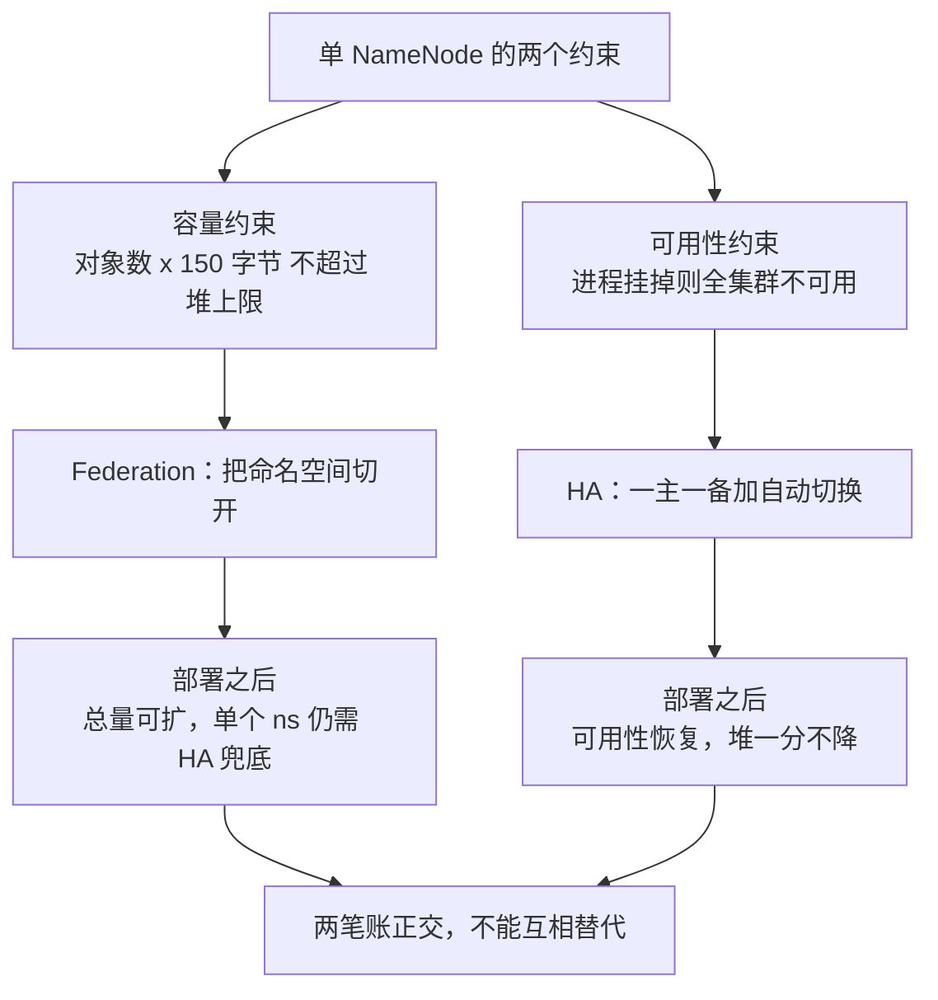
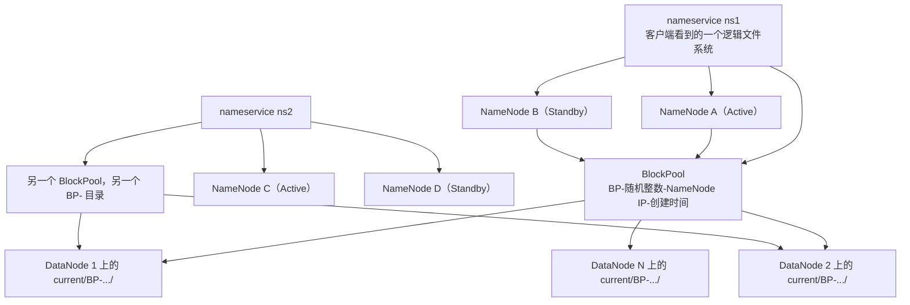
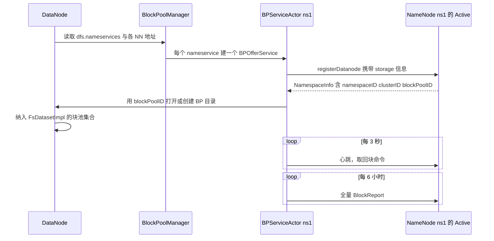
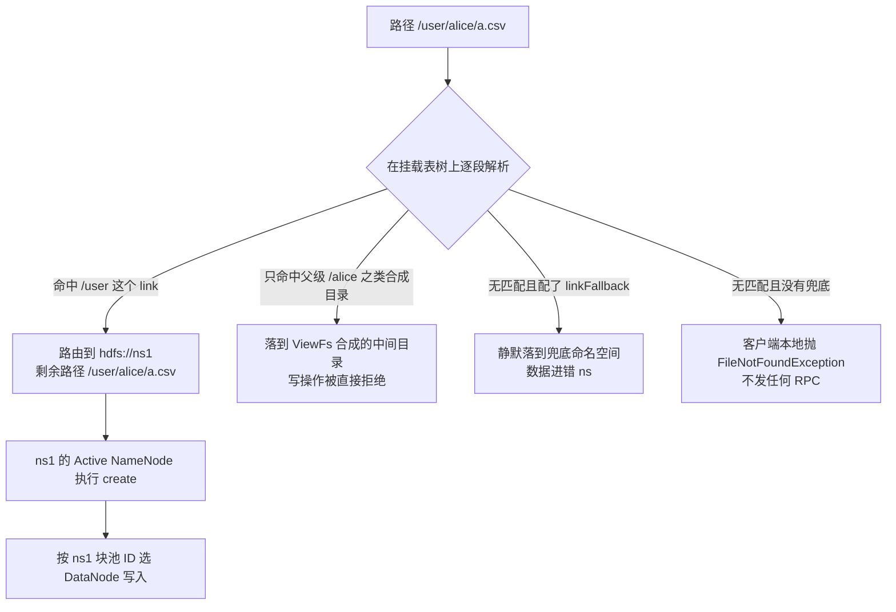
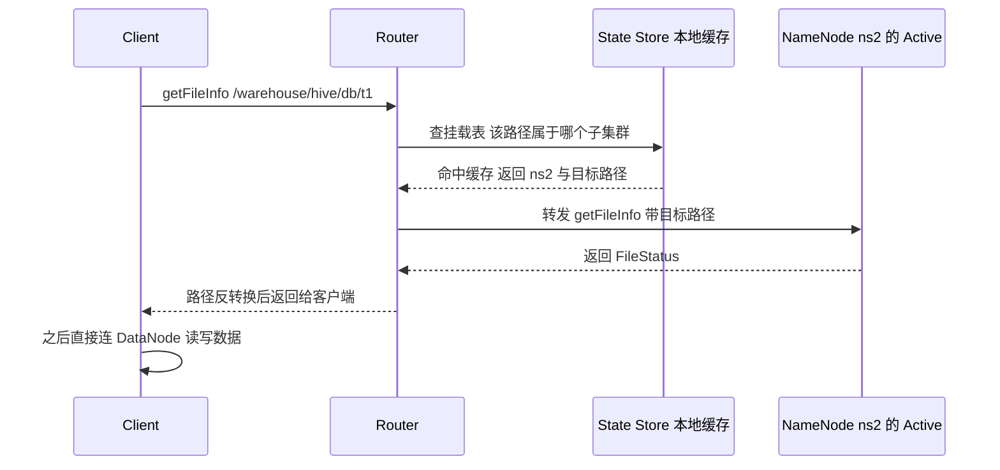
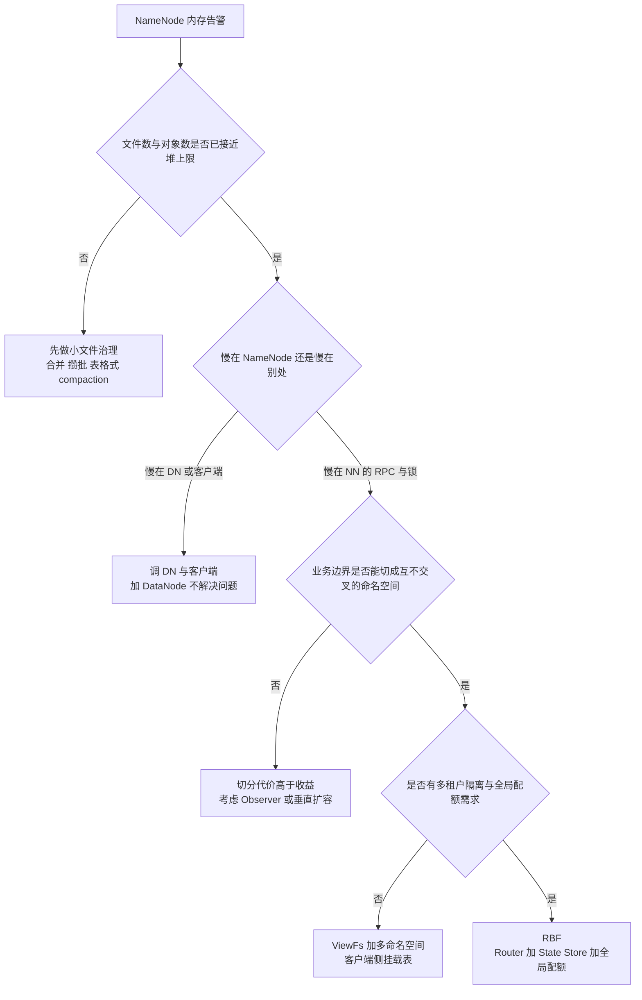

# HDFS Federation——打破单 NameNode 的内存天花板

**摘要：**

Federation 常被写成"HA 之后的下一个 NameNode 高可用方案"，这个说法把两件事混成了一件。HA 修进程死掉，两个 NameNode 备份同一本账，堆里那份元数据一分没少；Federation 修账太厚，把一棵目录树切成几个命名空间，每个配一组 HA NameNode，共用同一批 DataNode 的磁盘。本文先把四个抽象摆清楚——nameservice 是逻辑文件系统，一个 nameservice 下是一组 HA 的 NameNode，块池的粒度是 nameservice 而不是 NameNode，DataNode 为每个块池各存一份数据；再拆块池 ID 如何由注册学来、新增 nameservice 后靠 `-refreshNamenodes` 认领。随后算两笔账：内存天花板按对象数乘 150 字节估，1 亿对象对应 15GB 到 30GB 堆；可用性则是每个命名空间各留一个点，5 个命名空间按 99.9% 推算的联合可用性只剩 99.5% 上下。ViewFs 给出客户端侧的统一挂载视图，RBF 把挂载表搬到服务端的 Router 与 State Store，两者都解决"客户端不用知道有几个命名空间"，都不解决跨命名空间的原子 rename。最后给判据表、故障形态与反例，落点是容量与可用性是两笔账，算清哪笔不够再动拓扑。

> [!info] 本列定位
> HDFS 这一列按"一次读/写会碰到什么"组织：机制层在 02 至 10 篇，判据层在 01 篇。本篇只处理 Federation 一条线：命名空间怎么切、切完之后块池怎么摊、客户端怎么把多个命名空间看成一棵树、以及切分之后运维形态变了什么。单机的 NameNode 结构见 [[大数据/Hadoop/HDFS/03 NameNode 的核心数据结构——FsImage 与 EditLog 的设计奥秘|FsImage 与 EditLog]]，命名空间内的 HA 见 [[大数据/Hadoop/HDFS/06 NameNode 高可用——QJM 协议与 Active-Standby 切换机制|NameNode 高可用]]，小文件与堆的关系见 [[大数据/Hadoop/HDFS/10 HDFS 性能调优与生产实践——小文件治理与存算分离的未来|小文件治理]]，名称空间为何成为写路径的瓶颈见 [[大数据/Hadoop/HDFS/02 HDFS 整体架构全景——NameNode、DataNode 与 Client 三角关系|整体架构]]。

---

## 第 1 章 两个被混为一谈的问题

2010 年，Konstantin Shvachko 在 USENIX 的 ;login: 杂志上写了一篇标题很老实的文章：《HDFS Scalability: The limits to growth》。文章把 HDFS 的扩展性上限拆成两条：一条是命名空间里的对象数受 NameNode 堆内存限制，文件、目录、块每多一个，堆里就多一份常驻记录；另一条是块的数量受 NameNode 处理块报告与维护块映射的能力限制。两条上限压在同一个进程上，于是"集群能长多大"这个问题，答案不在磁盘容量，而在那台跑 NameNode 的机器能插多少内存、以及 JVM 在那么大的堆上还能不能把停顿压住。

十多年过去，HDFS 针对这两条上限给出的主要答案就是 Federation（联邦）。但它在二手材料里经常被简化成一句话——"Federation 解决了 NameNode 单点问题"。这句话一半对一半错。对的那一半是：Federation 之后，一个命名空间的 NameNode 挂掉，其他命名空间照常服务，故障影响面被切成 1/N。错的那一半是：它解决的不是"点"，而是"量"。单点问题在 Federation 之后并没有消失，只是从"一个全局单点"变成"每个命名空间各有一个单点"，而每个单点内部仍然要靠主备切换来兜底。

把这两笔账分开，是理解 Federation 一切取舍的前提。

### 1.1 只有 HA 会怎样

假设一个集群装了 HA，两个 NameNode 一主一备，共享 QJM 里的 EditLog，ZKFC 负责切换。这套配置能解决"Active 那个进程死了"的问题：几十秒到几分钟内备节点接管，客户端重连，业务几乎无感。

但它对内存天花板毫无帮助。主备两个 NameNode 备份的是同一本账，备节点加载的 FsImage 与主节点一模一样，堆里的 INode 树也一模一样，两个进程占两块内存却只能装一份元数据。当对象数涨到 3 亿、堆涨到 200GB 量级，每次 Full GC 都会让 RPC 一起停顿，客户端超时重试又把队列压得更满，这时再加第三个 Standby，除了多一份同样大的堆之外什么也改善不了。

这就是"HA 修可用性、**不修容量**"的具体含义。它不是设计缺陷，而是目标不同：HA 的输入是"进程会死"，Federation 的输入是"活着的进程装不下"。

### 1.2 只有 Federation 会怎样

反过来，假设一个集群只上了 Federation，切出三个命名空间，每个命名空间只配一个 NameNode，没有主备。它能装下三倍的对象数，也能把元数据 RPC 分散到三个进程上，但任何一台 NameNode 死掉，对应那三分之一业务就彻底黑屏：没有备节点可以接管，只能等人把进程拉起来，再等它把 FsImage 读进内存、把 EditLog 重放完，这段时间里那三分之一命名空间的读写全部失败。

更麻烦的是，这种失败不以"集群不可用"的形式呈现，而是以"某个路径打不开"的形式呈现，值班的人很容易先怀疑网络、再怀疑权限，最后才想到是某一台 NameNode 挂了。

HA 与 Federation 是两个正交的轴，一个管"进程活不活"，一个管"账本厚不厚"。



### 1.3 一个仓库的比喻

把 HDFS 想成一座仓库：货架是 DataNode 的磁盘，账本是 NameNode 里的元数据，管理员负责在账本上登记"哪件货放在哪个货架的第几层"。

HA 的做法是再雇一个管理员，让他拿着同一份账本的副本，原管理员病倒时他立刻接手。这解决了"管理员会病"，但账本还是那么厚，两个人看同一本厚账，谁都得把它整本记在脑子里。

Federation 的做法是把仓库隔成几间库房，每间库房各记各的账，货架仍然是同一批——一间库房的货可以放在任何一排货架上，只是那间库房的账本里只登记自己那部分。隔间解决"账本太厚"，代价是每间库房都得有自己的管理员，管理员之间还不互相通报，一件货从一间库房搬到另一间必须先出库再入库，不可能在两个账本之间"改一笔"就完成。

---

## 第 2 章 四个抽象：Nameservice、NameNode、BlockPool、DataNode

Federation 的概念不多，但四个名词的关系很容易被画错。错的画法通常长这样：一个 NameNode 对应一个 block pool，一组 DataNode 分给各个 NameNode。这个画法在"每个命名空间只有一个 NameNode"的早期形态下碰巧能跑，一旦加上 HA 就全错——同一个 nameservice 里的两个 NameNode 共用同一个块池，DataNode 上也不会为每个 NameNode 各存一份数据。

正确的层次是四层：nameservice 是逻辑文件系统，一个 nameservice 之下的 NameNode 构成一组（通常是一主一备），这一组共享同一个块池，所有 DataNode 共同为所有块池存数据。

### 2.1 nameservice 是客户端认的名字

nameservice 是 Federation 引入的核心抽象，官方文档的说法是：一个 NameNode 与它对应的 Secondary NameNode、BackupNode、Checkpointer 同属一个 NameServiceID。换句话说，nameservice 标识的不是一台机器，而是一个逻辑文件系统；客户端连的是这个名字，不是某个 IP。

从客户端视角看，一个 nameservice 就是一个 `hdfs://<ns>/` 的 URI。`hdfs://ns1/user/alice/a.csv` 与 `hdfs://ns2/user/alice/a.csv` 是两个完全不同的文件，即使路径长得一模一样。这一点在多租户环境里经常被忽视：两个命名空间里都允许存在 `/user/alice`，它们互不相干，权限、配额、快照也互不相干。

### 2.2 命名空间卷：官方给的管理单元

官方文档里有一个比 nameservice 更实用的概念，叫**命名空间卷**（Namespace Volume）：一个命名空间加上它的块池，构成一个自包含的管理单元。它把三件事绑在了一起。

其一是升级的粒度。集群升级时，每个命名空间卷作为一个整体升级，不存在"元数据升了、块池没升"这种中间状态。

其二是删除的边界。删掉一个 NameNode，DataNode 上对应的块池会一起被删掉。这里要留意它描述的是设计意图，不等于"把配置里的 nameservice 去掉，盘上空间就自动回收"：如果只改了 `dfs.nameservices` 而没走清理流程，那个 `BP-` 目录会安静地留在盘上，成为孤儿块池，第 3 章会讲它的成因。

其三是故障的边界。一个 NameNode 失效不会阻止 DataNode 继续为其他 NameNode 服务，这句话是官方原文，也是 Federation 故障域切分的根据。

### 2.3 块池的粒度是 nameservice，不是 NameNode

这是本篇最需要纠正的一处常见误读。很多材料写"每个 NameNode 管理自己独立的 Block Pool"，在 HA 普及之后这句话就不成立了。

块池的所有者是一个命名空间卷。同一个 nameservice 的 Active 与 Standby 两个 NameNode，加载的是同一个命名空间的 FsImage，它们必然共享同一个块池 ID——否则备节点接管时，它眼里的块集合与 DataNode 汇报的块集合对不上，切换就等于把数据弄丢了。DataNode 上因此是"每个 nameservice 一个 `BP-` 目录"，而不是"每个 NameNode 一个"。

源码里这条关系有明确的校验。DataNode 为每个 nameservice 建一个 `BPOfferService`，为该 nameservice 下的每个 NameNode 建一个 `BPServiceActor`；当第二个 actor 也注册成功时，`BPOfferService.registrationSucceeded` 会把新拿到的 NamespaceInfo 与已有的比对，比较的是 namespaceID 与 clusterID 两项，不一致直接抛异常。这条校验防的正是"把两个不同命名空间的 NameNode 配进同一个 nameservice"这种配置事故——一旦配错，两个 NN 会各自认为自己是这个 nameservice 的主人，而 DataNode 夹在中间收到互相矛盾的块命令。

下面这张图把四层关系画清楚，注意块池那一层是"一组 NameNode 共享一个"，不是"一个 NameNode 独占一个"。



图中 DN1 与 DN2 同时挂着两个块池目录，这就是"所有 nameservice 共享 DataNode、每个数据节点为每个块池各存一份数据"的具体形态。

### 2.4 配置结构：一个文件，按 ns 后缀展开

Federation 的配置设计有一个很务实的目标：集群里所有节点用同一份配置文件，不需要按节点类型分发不同版本。实现方式是把与 NameNode 相关的参数都加上 nameservice 后缀，谁是谁一目了然。

官方给出的最小改动是两步：先加 `dfs.nameservices`，用逗号分隔列出所有 NameServiceID，这个参数会被 DataNode 用来确定集群里有哪些 NameNode；再为每个 NameNode 与 Secondary/Backup/Checkpointer 加上带后缀的参数。下面是一份双命名空间、且每个命名空间都配了 HA 的配置骨架。

```xml
<!-- 所有节点共用：先声明有哪些逻辑文件系统 -->
<property>
  <name>dfs.nameservices</name>
  <value>ns1,ns2</value>
</property>

<!-- ns1 的主备两个 NameNode -->
<property>
  <name>dfs.ha.namenodes.ns1</name>
  <value>nn1a,nn1b</value>
</property>
<property>
  <name>dfs.namenode.rpc-address.ns1.nn1a</name>
  <value>nn1a.example.com:8020</value>
</property>
<property>
  <name>dfs.namenode.rpc-address.ns1.nn1b</name>
  <value>nn1b.example.com:8020</value>
</property>
<property>
  <name>dfs.client.failover.proxy.provider.ns1</name>
  <value>org.apache.hadoop.hdfs.server.namenode.ha.ConfiguredFailoverProxyProvider</value>
</property>

<!-- ns2 的主备两个 NameNode -->
<property>
  <name>dfs.ha.namenodes.ns2</name>
  <value>nn2a,nn2b</value>
</property>
<property>
  <name>dfs.namenode.rpc-address.ns2.nn2a</name>
  <value>nn2a.example.com:8020</value>
</property>
<property>
  <name>dfs.namenode.rpc-address.ns2.nn2b</name>
  <value>nn2b.example.com:8020</value>
</property>
<property>
  <name>dfs.client.failover.proxy.provider.ns2</name>
  <value>org.apache.hadoop.hdfs.server.namenode.ha.ConfiguredFailoverProxyProvider</value>
</property>
```

每个命名空间还要各自配一套 `dfs.namenode.shared.edits.dir`，指向自己的 QJM journal；同一组 JournalNode 机器可以被多个命名空间复用，journal 数据在 `dfs.journalnode.edits.dir` 之下按 nameservice 分目录存放。这一点的实际意义是：Federation 增加的机器数主要落在 NameNode 上，JournalNode 可以共享，不必按命名空间线性堆。

配置里最容易出事的几项，列成表更直观。

| 配置项 | 作用 | 漏配或写错的后果 |
|---|---|---|
| `dfs.nameservices` | 声明集群有哪些逻辑文件系统，DataNode 据此决定向谁注册 | 漏一个 ns：该 ns 在全部 DataNode 上都没有活节点，NameNode 甚至难以退出安全模式 |
| `dfs.ha.namenodes.<ns>` | 该命名空间下的 NameNode 短名列表 | 写错：客户端与 Router 找不到备节点，切换失败，`-getServiceState` 连不上 |
| `dfs.namenode.rpc-address.<ns>.<nn>` | 每个 NameNode 的 RPC 地址 | 写错端口：客户端连不上，但进程本身是好的，最容易被误判成 NameNode 挂了 |
| `dfs.client.failover.proxy.provider.<ns>` | 该命名空间客户端侧的切换实现 | 漏配：HA 摆在那里但客户端不会切换，报 `StandbyException` |
| `dfs.namenode.shared.edits.dir.<ns>` | 该命名空间的 QJM journal 地址 | 两个 ns 写成同一组路径：edit 混流，两份元数据互相污染 |
| `dfs.namenode.name.dir`（按 ns 后缀） | 每个命名空间的 fsimage 与 edits 落盘目录 | 多个 ns 共用一个目录：格式化时 VERSION 互相覆盖，clusterID 对不上 |

写这张表有一个前提要先说明：`dfs.nameservices` 的**漏配比写错更危险**。写错通常表现为启动报错或连接失败，漏配则表现为"那个命名空间的块全都丢了"——DataNode 没注册，NameNode 眼中的集群是空的，客户端读文件时报 `Could not obtain block`，而磁盘上的数据其实完好无损。

### 2.5 扩展的是总量，不是单点

官方把 Federation 的收益列成三条：命名空间的横向扩展、吞吐量不再受单个 NameNode 限制、多用户环境下的隔离。前两条说的是**总量**，第三条才是隔离，而"线性扩展"这个说法要打个折扣：线性的是整个联邦的总量，单个命名空间能装多少仍由它那台机器的堆决定；吞吐同理，切分之后各 NameNode 不再互相排队，但单个命名空间内部的写路径依然被那把全局锁串行化（见 [[大数据/Hadoop/HDFS/02 HDFS 整体架构全景——NameNode、DataNode 与 Client 三角关系|02 篇]]），Federation 一点没改善。指望靠切命名空间提升"单个目录的并发写能力"，是把容量方案当成了并发展方案。

---

## 第 3 章 块池与 DataNode：成员关系是注册学来的

DataNode 在 Federation 里的角色最容易被误解：它看起来像"被多个 NameNode 共同管理的存储节点"，但实际机制是"一个 DataNode 为每个块池维护一份独立的数据集，并且对每个 NameNode 单独注册、单独汇报"。这个差别决定了运维时的很多细节，譬如为什么新增一个命名空间不需要重启 DataNode、为什么删掉一个命名空间之后磁盘空间不会自动回来。

### 3.1 磁盘上的块池目录

DataNode 的数据目录由 `dfs.datanode.data.dir` 指定，块池在它下面以自己的 ID 命名。

```text
/data/hdfs/dn1/current/
├── BP-1079595417-10.20.1.11-1412613236271/
│   ├── current/
│   │   ├── VERSION
│   │   ├── finalized/
│   │   │   └── subdir0/subdir12/
│   │   │       ├── blk_1073741825
│   │   │       └── blk_1073741825_1001.meta
│   │   └── rbw/
│   └── tmp/
└── BP-2033418821-10.20.1.12-1467123456789/
    └── current/
        └── finalized/
```

目录名的格式是 `BP-<随机整数>-<NameNode 的 IP>-<创建时间戳>`。它不是 UUID，也不是任何配置项，而是 NameNode 格式化时生成并写进自己 VERSION 文件的一个标识。三个字段里，随机整数负责避免碰撞，IP 与时间戳负责让人一眼看出这个块池是在哪台机器、什么时候创建的——排查"两个集群的元数据是不是被混到一起"时，这比一串纯随机字符有用得多。

每个块池目录下还有自己的 VERSION 文件，记录 namespaceID、clusterID、blockpoolID 等，`dfsadmin -report` 里的块池信息就来自它。

### 3.2 成员关系不是配置告诉它的

一个常见误解是：既然配置里有 `dfs.nameservices`，DataNode 应该就是按这个列表去盘上找对应的 `BP-` 目录，找到了就算加入。实际顺序反过来了。

DataNode 启动时，`BlockPoolManager` 从配置里算出"有哪些 nameservice、每个 nameservice 下有哪些 NameNode 地址"，然后为每个 nameservice 建一个 `BPOfferService`（每个 BPOfferService 里再按 NameNode 数建 `BPServiceActor`），actor 主动连 NameNode 发起注册。NameNode 在注册响应里带回 `NamespaceInfo`，其中包含 namespaceID、clusterID 与 blockPoolID；DataNode 拿到 blockPoolID 之后，才在每块数据盘上打开（或新建）对应的 `BP-` 目录，并把它注册进 `FsDatasetImpl` 的块池集合。

也就是说，块池的成员身份是**从注册学来的**；磁盘上的目录只是"这个块池的数据落在这里"的物证。物证与身份必须对得上：身份对上了，目录里的块会被加载、扫描、汇报；身份对不上（目录是上一个集群留下的，或者对应的 nameservice 已经从配置里删掉），目录照旧占着磁盘，但不会有任何进程去读它。

下面这张时序图把启动过程铺开，注意 blockPoolID 是注册的返回值，不是输入。



### 3.3 没有 dfs.datanode.block-pool.id 这个配置

顺着"成员关系是学来的"这条线，就能解释一件常被问起的事：想给某个 DataNode 指定它服务哪个块池，该改哪个参数？

答案是没得改。翻遍 Hadoop 3.3.x 的 `hdfs-default.xml`，找不到 `dfs.datanode.block-pool.id` 这一项，也找不到任何以 block pool 为粒度的 DataNode 侧配置。块池 ID 由 NameNode 在格式化时生成，DataNode 只能接受，不能指定。真正能在 DataNode 侧配置的只有两样：数据盘列表（`dfs.datanode.data.dir`）和卷级预留空间（`dfs.datanode.du.reserved`），前者决定块池目录落在哪些盘上，后者是整块盘的预留，与块池无关。

这条"没有配置"的事实有一个现实后果：想调整"哪个命名空间的数据放哪些盘"，不能靠 DataNode 配置做到，只能靠 NameNode 侧的存储策略（storage policy）与副本放置，或者干脆按机器分组、把不同命名空间的数据引导到不同机架上。第 7 章会讲这个限制在容量规划上的表现。

### 3.4 新增 nameservice 之后，DataNode 怎么知道

这是本篇第二个必须写透的机制，因为它是 Federation 唯一需要触碰全部 DataNode 的运维动作。

官方流程很清楚：先把 `dfs.nameservices` 加上新名字、把新 NameNode 的地址后缀配好，把配置分发到所有节点，然后对每个 DataNode 执行一条命令。

```bash
# 让运行中的 DataNode 重新读取 nameservice 与 NN 列表
hdfs dfsadmin -refreshNamenodes dn-host-01.example.com:9867
```

这条命令的效果是：DataNode 重新计算 nameservice 列表，为新增的 nameservice 建一个 `BPOfferService` 并启动 actor，actor 连上新 NameNode 注册，拿到新的 blockPoolID，在每块盘上创建对应的 `BP-` 目录，然后开始心跳与块报告。整个过程**不需要重启** DataNode，旧块池的数据一行不动。

反过来的方向有坑。把某个 nameservice 从 `dfs.nameservices` 里删掉、再执行一次 `-refreshNamenodes`，DataNode 会停掉对应的 BPOfferService——但盘上的 `BP-` 目录不会消失。NameNode 那边的元数据已经没了，DataNode 这边几百 GB 到几 TB 的块文件还在，没有任何进程认领它们。这就是**孤儿块池**：占着 `df -h` 的容量，不出现在任何 `dfsadmin -report` 里，只能靠人工核对目录名与当前 `dfs.nameservices` 的差异来发现和清理。

漏掉 `-refreshNamenodes` 是另一个方向的坑，且更难发现：新命名空间上线后，客户端能连上新的 NameNode，写请求也能成功，但文件的所有块都被写到极少数甚至零个 DataNode 上（只有执行过命令的那些节点知道新块池），表现为副本长期不足、写入极慢、`fsck` 报大量 under-replicated。巡检脚本如果只看 NameNode 侧指标，完全看不到"有一半 DataNode 根本不知道这个命名空间存在"。

### 3.5 代价：线程、心跳与块报告都乘以 N

DataNode 为每个 Namespace 建一个 BPOfferService，为每个 NameNode 建一个 actor。这意味着一个 DataNode 的注册线程数是"所有命名空间下 NameNode 的总数"：三个命名空间、每个一主一备，就是六个 actor 线程，每个线程独立维护与对应 NameNode 的连接、心跳、块报告与命令处理。

心跳与块报告的开销同样乘以这个数字。默认配置下，心跳间隔 3 秒，全量块报告周期 6 小时，增量块报告的限流间隔默认为 0（不限流，块变化就发）。三个命名空间就是一秒钟一轮心跳变成三份，六小时一次的全量块报告也变成三份。在千节点规模上，这份开销不至于压垮网络，但它确实改变了 DataNode 的线程与连接资源画像：非联邦时代调好的 `dfs.datanode.max.transfer.threads`、RPC 队列、文件句柄上限，在联邦之后需要按"每个节点要同时服务 N 个 NameNode"重新算一遍。

| 参数 | 默认值 | 作用 | 调大的代价 | 调小的代价 |
|---|---|---|---|---|
| `dfs.heartbeat.interval` | 3（秒） | DataNode 向每个 NameNode 报活 | 故障发现变慢，判死与副本重建整体推迟 | 心跳包数量按命名空间数放大，NameNode 处理线程被占 |
| `dfs.blockreport.intervalMsec` | 21600000（6 小时） | 全量块报告的周期 | 块位置信息陈旧，恢复与均衡决策滞后 | 每个 NameNode 周期性吃到块报告洪峰，且洪峰数等于命名空间数 |
| `dfs.blockreport.incremental.intervalMsec` | 0 | 增量块报告的限流间隔 | 增量报告变稀，NameNode 侧块状态滞后 | 高频小报文占满 NameNode 处理线程 |
| `dfs.namenode.handler.count` | 10 | 每个 NameNode 的 RPC 处理线程数 | 线程上下文切换与锁竞争加剧，长尾未必改善 | 并发 RPC 排队，切分后各 NameNode 的峰值反而更低 |

表格最后一行值得单独说。切分之后每个 NameNode 承担的块数与客户端数大致变成 1/N，按集群总量估 handler 会明显高估单点需求；反过来，若某个命名空间承担了绝大部分小文件，它那台 NameNode 的 handler 需求可能比切分前更高。按命名空间分别估算，是 Federation 之后调参的基本纪律。

---

## 第 4 章 ViewFs：把 N 个命名空间拼成一棵树

Federation 只解决了服务端怎么切，没有解决客户端怎么用。如果每个应用都要自己判断"这个路径该去哪个命名空间"，改造量会大到没人愿意动。ViewFs（View File System）就是为此存在的：它在客户端实现了一个虚拟文件系统，把多个命名空间的路径前缀映射到不同的 NameNode 上，对应用层表现为一棵统一的目录树。

### 4.1 挂载表与它的配置

ViewFs 的配置模型借自 Unix 的挂载表：`viewfs://<mountTableName>/path` 里的 authority 是挂载表的名字，挂载表本身定义在 Hadoop 配置里，键名以 `fs.viewfs.mounttable.` 开头。

```xml
<!-- 默认文件系统指向挂载表，而不是某个 NameNode -->
<property>
  <name>fs.defaultFS</name>
  <value>viewfs://ClusterX</value>
</property>

<!-- 三个路径前缀各挂到一个命名空间 -->
<property>
  <name>fs.viewfs.mounttable.ClusterX.link./user</name>
  <value>hdfs://ns1/user</value>
</property>
<property>
  <name>fs.viewfs.mounttable.ClusterX.link./warehouse</name>
  <value>hdfs://ns2/warehouse</value>
</property>
<property>
  <name>fs.viewfs.mounttable.ClusterX.link./tmp</name>
  <value>hdfs://ns3/tmp</value>
</property>

<!-- 没匹配到任何挂载点的路径，兜底到一个命名空间 -->
<property>
  <name>fs.viewfs.mounttable.ClusterX.linkFallback</name>
  <value>hdfs://ns1/home</value>
</property>
```

挂载表可以留在 `core-site.xml` 里，也可以拆成独立的 `mount-table.xml`，再用 XInclude 引入。官方推荐后一种，原因是同一张表要出现在所有客户端机器上，拆开之后可以集中托管，改一处、分发一处。

`linkFallback` 这行配置要不要写，是个需要想清楚的决定。不写，没匹配到挂载点的路径会在客户端本地直接抛 `FileNotFoundException`，错误信息是"File/Directory does not exist"，连 RPC 都不会发出——排查时容易误以为是 NameNode 的问题。写了，没匹配的路径会静默落到兜底命名空间，写入能成功，但数据跑到了不该去的命名空间，容量、备份策略、权限边界全部错位。后者比前者危险得多。

### 4.2 一次 put 的路径解析

`hdfs dfs -put` 是最好用的观察入口，因为它同时在读与写两侧触发路径解析。假设把本地文件放进 `/user/alice/`：

1. 客户端把路径交给 ViewFs，ViewFs 在内存里的挂载表树上逐段解析，命中 `/user` 这个 link；
2. 解析结果是"目标文件系统 `hdfs://ns1`，剩余路径 `/user/alice/a.csv`"，ViewFs 把它包成一个 `ChRootedFileSystem`，之后再调用的 `create` 都作用在这个根被剪掉的文件系统上；
3. 写入请求发给 ns1 的 Active NameNode，`create` 成功后返回的块位置指向 ns1 块池的 DataNode；
4. DataNode 侧按块池 ID 找到 `BP-` 目录写入，这个过程与客户端是不是经 ViewFs 进来毫无关系。

把这四步画成一张图，四个分支在解析阶段就已经分开了。



图中后两个分支（无匹配的两种走向）根本到不了 NameNode，第一条是正常路径，第 8 章会把挂载点配错的几种表象分别对上这几个分支。

### 4.3 合成的中间目录

ViewFs 最容易被忽略的细节，是它会在内存里为挂载点的父级造出目录节点。

假设只配了 `fs.viewfs.mounttable.ClusterX.link./user/joe` 和 `.link./user/jane` 两个挂载点，那么 `/user` 这个目录并不存在于任何 NameNode 上，它是 ViewFs 造出来的中间节点。对 `/user` 做 `getFileStatus`，返回的 `FileStatus` 是合成的：权限位固定为 555，属主是当前进程的登录用户，属组是当前用户的主组，创建与修改时间都是这个 ViewFs 实例被创建的时刻。

这个细节会引出几类真实问题。审计脚本按属主与权限做合规检查，会在这些合成目录上得到"权限过宽、属主是服务账号"的结论，实际上是假的；备份工具按修改时间做增量判断，合成目录的时间戳每次客户端启动都在变，于是每次都触发全量扫描；对这些目录做 `create`、`delete`、`rename`，ViewFs 直接抛错拒绝，不会转发给任何 NameNode。

### 4.4 三个坑

第一个坑：跨挂载点的 `rename` 与 `copy`。ViewFs 的 `rename` 在解析出源与目标之后会做一次策略校验，默认策略是 `SAME_MOUNTPOINT`，只要源与目标落在不同挂载点，就抛 `Renames across Mount points not supported`。这一点在源码里写得很直白，三个策略取值分别是 `SAME_MOUNTPOINT`（默认，只允许同一挂载点内）、`SAME_TARGET_URI_ACROSS_MOUNTPOINT`（允许指向同一目标 URI 的别名挂载点之间）与 `SAME_FILESYSTEM_ACROSS_MOUNTPOINT`（允许同一底层文件系统的不同挂载点之间，比较的是 scheme 与 authority）。把策略配成第三个取值，也只能在同一个 NameNode 管辖的路径之间放宽，跨命名空间永远不行——因为那已经不是一个文件系统内部的操作，而是两个独立元数据服务之间的操作。

`hdfs dfs -cp` 的行为又不一样：它会退化成由客户端读源、写目标的数据搬运，能成功，但性质变了。一次 O(1) 的元数据改名，变成了一次 O(数据量) 的全量拷贝，占客户端带宽、占两边的磁盘 IO，还得自己负责删源。真正的跨命名空间迁移要用 `distcp`，并且要在业务低峰期做。

第二个坑：路径解析在哪里发生、要几次 RPC。这个问题的标准答案常被说成"getFileStatus 要多次 RPC"，实际要分三种情况看。路径落在单个挂载点上，解析全在客户端内存里完成，只有一次到目标 NameNode 的 RPC；路径落在合成的中间目录上，一次 RPC 都没有，返回的是编造出来的属性；挂载点配置成多目标（合并挂载）时，一次 `listStatus` 要并发问遍每个目标再把目录项合并起来，RPC 次数等于目标数。所以正确的理解不是"ViewFs 会让 RPC 变多"，而是"ViewFs 让 RPC 的次数取决于挂载表的形状，而挂载表的形状可以随运维调整"——把一千个用户目录挂成一千个挂载点，与挂成一个带正则的规则，客户端行为差别很大。

第三个坑：权限校验发生在目标命名空间，**不在 ViewFs 层**。ViewFs 只是一个路由器，它没有自己的 ACL、没有挂载点的权限模型（RBF 的挂载表有 0755 这样的 mode，ViewFs 没有）。你在 HDFS 上给 `/warehouse` 设的 ACL、在 Ranger 里给某个路径配的策略，判断时用的都是目标命名空间里的真实路径，而不是 ViewFs 里的虚拟路径。这条的实践含义是：策略要以"目标命名空间 + 真实路径"为口径写，任何以 viewfs 路径为依据的授权配置都要重新对照一遍。

| 挂载形式 | 语义 | 代价与注意点 |
|---|---|---|
| `link.<path>` | 一个路径前缀挂到一个目标路径 | 最常用；跨挂载点 rename 失败，路径解析只在客户端内存中完成 |
| `linkFallback` | 未匹配路径兜底到一个文件系统 | 兜底会掩盖挂载表配错，数据静默写进错误的命名空间 |
| `linkMerge` / 多目标 | 多个目标的同名目录合并成一个视图 | 一次 list 要逐目标 RPC 并聚合，目录项跨命名空间的原子性无从保证 |
| `linkMergeSlash` | 把挂载表根直接与一个文件系统根合并 | 视图最简单，但根目录的语义完全依赖被合并的那一侧 |

> [!warning] 生产避坑：挂载表必须全客户端一致
> ViewFs 的挂载表配置在每台客户端机器的 `core-site.xml`（或它所 XInclude 的文件）里，而且是在作业提交时读取、XInclude 在提交时展开。两件事由此而来：改挂载表之后，已经在跑的作业看不见新表，需要重新提交；如果集群里有一批机器的配置没同步到，同一个路径在不同节点上会路由到不同命名空间，写入错位、读取错乱，而两边都不会报错。巡检时把各节点挂载表配置的校验和对比一遍，比事后查数据错位便宜得多。

---

## 第 5 章 RBF：把挂载表搬到服务端

ViewFs 的根本约束不在功能，而在位置：挂载表在客户端手里。客户端一多，配置一致性和变更时效就成了运维问题。RBF（Router-based Federation）的思路是把这层路由搬到服务端，让客户端连一个地址就把整个联邦当成一个命名空间来用。

### 5.1 Router 是什么

Router 是一个独立进程，对外暴露与 NameNode 相同的 `ClientProtocol` 接口。客户端连上 Router，发的还是那些 `getFileInfo`、`create`、`rename` 调用，Router 负责解析路径、找到对应的子集群、把请求转发给该子集群的 Active NameNode，再把结果转回来。

Router 是无状态的：它不在本地保存挂载表，而是从 State Store 读；同一个联邦可以部署多个 Router，放在负载均衡器后面，客户端配多个端点，用 HDFS 客户端的 HA 机制在它们之间切换。官方给出的探活端点是 `/isActive`，负载均衡器按这个端点判断某个 Router 该不该收流量。

Router 有两个角色。一个是联邦接口，即上面说的代理转发；另一个是 NameNode 心跳，定期检查某个 NameNode 的 HA 状态、负载与容量并汇报给 State Store，供其他 Router 与客户端看到全局视图。第二个角色可选，Router 可以独立于任何子集群部署。

### 5.2 State Store：挂载表加成员状态

State Store 是逻辑上集中、物理上分布的一个存储，默认实现是基于 ZooKeeper 的驱动，可以换成文件或自定义实现。它存两类东西：一类是挂载表，即虚拟路径到子集群路径的映射；另一类是成员状态，即各子集群的 NameNode 处于什么 HA 状态、容量多少、负载如何。

读写路径都带缓存：Router 把挂载表与成员状态缓存在本地，按 TTL 刷新，转发请求只查本地缓存。这条设计决定了 RBF 的延迟画像（多一跳 RPC，但挂载表查询不是瓶颈），也决定了它的失败模式：State Store 不可达时 Router 无法确认视图是否还有效，于是进入安全模式（Safe Mode）拒绝服务，客户端把它当成 Standby NameNode，换下一个 Router 试。

### 5.3 客户端的视角：多了一个"命名空间"

RBF 有一个很容易被忽略的设计：它没有发明新协议，而是把 Router 集群包装成一个普通的 nameservice。客户端配置里多出一个叫 `ns-fed` 的命名空间，它的"NameNode"就是两个 Router。

```xml
<!-- 客户端眼里，联邦就是一个普通的 HA 命名空间 -->
<property>
  <name>dfs.nameservices</name>
  <value>ns1,ns2,ns3,ns-fed</value>
</property>
<property>
  <name>dfs.ha.namenodes.ns-fed</name>
  <value>r1,r2</value>
</property>
<property>
  <name>dfs.namenode.rpc-address.ns-fed.r1</name>
  <value>router1.example.com:8888</value>
</property>
<property>
  <name>dfs.namenode.rpc-address.ns-fed.r2</name>
  <value>router2.example.com:8888</value>
</property>
<property>
  <name>dfs.client.failover.proxy.provider.ns-fed</name>
  <value>org.apache.hadoop.hdfs.server.namenode.ha.ConfiguredFailoverProxyProvider</value>
</property>
<property>
  <name>dfs.client.failover.random.order</name>
  <value>true</value>
</property>
```

这份配置读完，RBF 与 ViewFs 的分野就清楚了：客户端不再需要知道联邦里有几个命名空间、哪个路径归谁管。`dfs.client.failover.random.order` 设成 true 则把请求随机分到两个 Router 上。

### 5.4 一次转发的过程

把一次 `getFileInfo` 的转发路径画出来，注意最后一步已经不在 Router 上了。



最后一步是关键：Router 只代理元数据，数据面是客户端直连 DataNode，所以 RBF 增加的延迟只在元数据路径上，大文件顺序读写的吞吐不受影响。官方因此在 NameNode 侧要求配 `dfs.namenode.ip-proxy-users`，允许 Router 通过 caller context 传客户端真实 IP；不配的话 NameNode 见到的请求都来自 Router，块位置分配拿不到客户端位置，数据本地性就退化了。

### 5.5 ViewFs 与 RBF 的差别

两者的差别不是"新旧"，而是"路由发生在哪一侧"，这个位置差异会渗透到配置、延迟、可用性、权限等每一个方面。

| 维度 | ViewFs | RBF |
|---|---|---|
| 挂载表位置 | 每台客户端本地配置 | 服务端 State Store，集中管理 |
| 变更生效方式 | 改所有客户端配置，作业重新提交 | 改 State Store，Router 按缓存 TTL 生效 |
| 客户端改动 | `fs.defaultFS` 改成 `viewfs://`，每个客户端的挂载表要保持一致 | 当普通 HA 命名空间连，不感知子集群数量 |
| 元数据延迟 | 无额外跳数，直连 NameNode | 多一跳转发，转发本身是连接池里的一次调用 |
| 权限模型 | 无自己的权限模型，全部落到目标命名空间 | 挂载表自身有 owner/group/mode，可按挂载点限制写入 |
| 跨命名空间 rename | 不支持，报 Renames across Mount points not supported | 同样不支持，Router 对跨 nameservice 的 rename/copy 直接抛异常 |
| 跨命名空间配额 | 不支持，各命名空间各管各的 | 支持挂载表级全局配额，按路径统计并拦截 |
| 全局容量视图 | 无，要逐命名空间查 | State Store 汇总成员状态，Router 的 Web UI 与 JMX 提供全局视图 |
| 新的依赖 | 无新增服务 | 多一组 Router 与一个 State Store，两者都要 HA |
| 适用规模 | 命名空间少、切分稳定、客户端数量可控 | 命名空间多、需要动态调整、客户端规模大 |

中间那行"跨命名空间 rename"是这张表里最容易被误读的，下一节单独说。

### 5.6 RBF 不解决跨命名空间的 rename

网上不少材料声称 RBF 能把跨命名空间的 rename 拆成"复制加删除"来自动完成，这是错的。官方文档在 Router 的接口说明里明确列出三类不支持的操作，第一类就是"在两个不同 nameservice 之间 rename 文件或目录"，第二类是跨 nameservice 的 copy，第三类是向正在做 rebalance 的文件写入；这些操作 Router 会直接抛异常，而不是模拟完成。

道理与 ViewFs 一致：跨命名空间的 rename 本质上是两个独立元数据服务之间的事务，没有共享的日志、没有两阶段提交、没有统一的锁，要让它在服务端原子完成，等于在 Federation 之上再实现一套分布式事务。RBF 的定位只到"客户端不用知道有几个命名空间"，它没有、也不打算越过这条线。

所以在 RBF 之下，跨命名空间搬迁依然是 `distcp` 复制、校验、切流、删源，四个步骤各自可重试、整体不可原子。设计目录结构时，把"经常互相 rename 的目录"放进同一个命名空间，这个原则在 RBF 时代依然是第一条。

### 5.7 Router 的单点与新的耦合

RBF 把客户端的复杂度换成了服务端的一层新服务，这一层带着自己的可用性问题。

Router 本身无状态，多做几个实例、客户端配多个端点、负载均衡器按 `/isActive` 探活，就能扛住单个 Router 挂掉。真正脆弱的是它与 State Store 的**耦合**：State Store 读不到，Router 就进安全模式，全部 Router 一起进安全模式时，即使所有 NameNode 都健康、所有 DataNode 都在线，客户端也访问不了整个联邦。

这不是说 RBF 不该用，而是说它的运维要求比 ViewFs 高一档：State Store 的 ZooKeeper 集群要按核心依赖建设，Router 实例数、端点配置、探活策略都要按"这一层挂了等于全集群挂"的标准设计。只摆一主一备两个 Router 而不做容量与故障演练，等于用一个更大的耦合换掉了 ViewFs 的风险。

### 5.8 挂载表管理与全局配额

RBF 的挂载表用 `dfsrouteradmin` 管理，形态与 Unix 的 mount 很像：`-add /data/app1 ns2 /data/app1` 建挂载点，`-add /data ns1,ns2 /data -order SPACE` 让一个挂载点跨两个子集群并按剩余空间选落点（落点策略另有 `HASH`、`HASH_ALL`、`LOCAL`、`RANDOM` 几种，语义差别不小），`-setQuota` 设挂载点级配额，`-nameservice disable ns3` 在子集群抖动或下线时把它临时摘掉。

挂载点级**全局配额**是 RBF 相对 ViewFs 的实质增强：配额设在挂载表上，跨子集群统计，Router 在每个写 RPC 上核对，且会覆盖子集群自身的配额，开了之后不宜再在子集群上单独设。挂载表条目本身还有 owner、group 与 mode（默认 0755），它管的是"谁能改挂载表"，不是"谁能在该路径下写数据"。

---

## 第 6 章 解决什么，不解决什么

前面几章把机制铺完了，这一章只做一件事：把 Federation 的能力边界按"解决"与"不解决"两栏写清楚，并给出一张能直接拿去开评审会的判据表。

### 6.1 解决：单个 NameNode 的内存天花板

先看量级。业界常用口径是每个对象约 150 字节堆开销，对象指文件、目录与块各算一个；这个数字最早来自 Shvachko 那篇文章，是长期实践中反复使用的经验值。按这个口径，一亿个对象对应 15GB 堆；若一个文件只有一个块、文件与块各算一个对象，则一亿个文件对应 30GB 堆。下表按这两种口径分别给出。

| 对象规模（文件数） | 口径一：每文件 1 对象，150 字节 | 口径二：文件与块各 1 对象 | 加预留后的堆需求（示例推算） |
|---|---|---|---|
| 1 亿 | 约 15GB | 约 30GB | 40GB 到 60GB |
| 2 亿 | 约 30GB | 约 60GB | 80GB 到 120GB |
| 5 亿 | 约 75GB | 约 150GB | 200GB 到 300GB |
| 10 亿 | 约 150GB | 约 300GB | 400GB 到 600GB |

表中的"预留"包含三部分：堆里除 INode 之外的其他常驻结构（RPC 队列、块映射、快照保留）、GC 需要的额外空间，以及快照与回收站带来的放大。这是一份示例推算，不是任何厂商的实测数据；真实集群差异很大，小文件占比高、层级深、快照多的集群会明显偏向高位。

天花板出现在哪里，取决于机器能插多少内存、以及 JVM 在那么大的堆上能不能把停顿压住。后一条常被忽略：堆越大，Full GC 的停顿与调优难度越不成比例地上升，而 NameNode 的停顿是全局停顿，停顿期间所有 RPC 一起排队，客户端超时重试又把队列压得更长。"再加内存"这条路在某个点之后**必然走不动**，这才是 Federation 存在的真正理由；至于把元数据搬到堆外或外部存储，主线版本一直没有落地产出，见 02 篇的讨论。

### 6.2 解决：跨命名空间的总吞吐与多租户隔离

总吞吐与隔离这两条收益，在"多业务混跑"的集群上比单一业务集群更明显：一个实验性质的作业疯狂 `listStatus` 把小文件目录扫一遍，在单 NameNode 时代会把生产作业的元数据延迟一起拖垮，切分之后最多拖垮自己那个命名空间。官方把隔离单独列为一条收益，理由写得很直接——单个 NameNode 在多用户环境下没有隔离性。

### 6.3 不解决：单个命名空间内部的单点

Federation 没有消灭单点，它只是把单点从一个变成 N 个，同时把每个单点的影响面缩小到 1/N。

每个命名空间内部的 NameNode 仍然要靠 HA 一主一备加自动切换，靠 QJM 保证 EditLog 不丢，靠 fencing 防止脑裂——这一整套在 [[大数据/Hadoop/HDFS/06 NameNode 高可用——QJM 协议与 Active-Standby 切换机制|06 篇]] 里拆过，Federation 一样都不能省。实际部署里"每个 ns 配一组 HA"是标配，只配单 NameNode 的联邦集群等于把风险复制了 N 份。

这里有一个反直觉的算术。假设每个命名空间的可用性都是 99.9%（一年不可用约 8.8 小时），并且各命名空间的故障相互独立，那么"所有命名空间同时可用"的概率是 0.999 的 N 次方。N 等于 3 时约 99.7%，N 等于 5 时约 99.5%，对应到"至少有一个命名空间不可用"的期望时间，5 个命名空间时一年约 44 小时、平均每月约 3.6 小时。

这个数字的解释要谨慎：它不是说联邦比单集群差，因为单集群时代那 8.8 小时是"全集群不可用"，而联邦时代那 44 小时分散在 5 个命名空间上，每次只影响 1/5 的业务，总故障时长相同而爆炸半径小得多。但如果业务横跨多个命名空间（一个作业要读 ns1 写 ns2），它看到的就是那个乘积——横跨越多越脆弱，这是"跨命名空间操作"代价的另一种表现。

### 6.4 不解决：跨命名空间的原子操作

`rename` 在单个命名空间内是原子的：NameNode 在自己的 INode 树上改一个指针，一次编辑日志写入，要么成功要么失败。跨命名空间时，源与目标分属两个 NameNode、两套 EditLog、两个块池，没有任何机制能让这两次修改一起成功或一起失败。

后果不只是"不原子"，还包括语义上的退化：跨命名空间的"移动"实际是"复制加删除"，中间态可能两个位置都有、也可能都没有，失败后需要人工判断与清理；数据量大时耗时从毫秒级变成分钟到小时级。

这条限制没有绕过的办法，任何声称"用 RBF 就能跨 ns rename"的说法都不成立（见 5.6 节）。能做的是在设计阶段避免它：把会互相 rename 的目录放进同一个命名空间，把"跨命名空间"当成一次数据迁移而不是一次改名。

### 6.5 不解决：单个块池的容量隔离

一条在容量规划时非常关键、却很少被写进文档的事实：DataNode 的磁盘容量是所有块池之和，没有任何机制能把某块盘的一部分容量单独划给某个命名空间。

HDFS 的配额是命名空间级的账：`nsQuota` 限制对象数，`spaceQuota` 限制该命名空间下文件的总字节数，两者都由 NameNode 记账并在写路径上校验。但它们是账本，**不是物理隔断**——账本说"这个命名空间最多用 100TB"，不代表 DataNode 的盘上为它留了 100TB；反过来，某个命名空间超量写入把盘写满时，其他命名空间在同一块盘上的写入也会收到 `No space left on device`。

DataNode 侧真正能配的只有一个 `dfs.datanode.du.reserved`，语义是"每块卷为非 HDFS 用途预留多少字节"，整卷生效，与块池无关。这个参数能防的是"HDFS 把系统盘写满导致机器失联"，防不了"某个命名空间吃光集群"。

### 6.6 判据：该不该上 Federation

把上面的边界收敛成一张表。用法是先看前两行——如果问题不是对象数与元数据吞吐，Federation 就不该出现在方案里。

| 判据 | 落在这一侧，先别上 Federation | 落在这一侧，可以进入评估 |
|---|---|---|
| 对象数 | 远低于单 NN 堆能装下的量，或小文件问题还没治理 | 对象数已接近堆上限，且小文件治理已做过一轮 |
| 元数据延迟 | 慢在 DN 的 IO、慢在客户端、慢在 GC 参数 | P99 慢在 NameNode 的 RPC 队列与锁竞争，加机器无效 |
| 隔离需求 | 单一业务，或业务间互不影响 | 多租户混跑，实验负载会打爆生产 |
| 跨 ns 操作 | 大量目录需要互相 rename、提交依赖原子改名 | 业务边界天然清晰，跨边界只有批量搬迁 |
| 运维能力 | 没有余力维护 N 套 NameNode 配置与巡检 | 有多套 NameNode 的运维经验，有自动化巡检 |
| 客户端规模 | 几千台机器，配置一致性难保证 | 规模可控，或已具备 RBF 的部署能力 |
| 容量规划 | 只是磁盘不够，加 DataNode 就能解决 | 磁盘够但元数据装不下，加 DataNode 无效 |

下面这张决策树把顺序排出来，从最常见、成本最低的否决项开始问。



> [!warning] 生产避坑：先看小文件治理，再谈 Federation
> 本篇最想拦住的一类决策，是"NameNode 内存不够了，上 Federation"。对象数是被写出来的，不是天生的：写入端攒批到百兆级、对小时级小文件做 compaction、把只写不常读的原始日志放对象存储，这些手段在 [[大数据/Hadoop/HDFS/10 HDFS 性能调优与生产实践——小文件治理与存算分离的未来|10 篇]] 里逐条拆过，成本通常只有联邦改造的零头。只有当对象数在治理之后依然压不住，切分才是一笔划算的账。

---

## 第 7 章 运维形态变了什么

Federation 之后，很多熟悉的命令与指标不再是"看一次就够"。它们的共同点是：全部以命名空间为作用域，没有任何命令天然覆盖整个联邦——除了少数几个专门做的汇总页面。

### 7.1 fsck 与 dfsadmin 要逐 ns 执行

`hdfs fsck` 是命名空间级工具，检查的是一个 NameNode 的 INode 树与块映射。联邦集群里它一次只能看一个命名空间，执行时要把命名空间写全。

```bash
# 逐命名空间巡检，脚本要循环 dfs.nameservices
for ns in ns1 ns2 ns3; do
  hdfs fsck "hdfs://$ns/" -files -blocks -locations \
    | tee "/var/log/hdfs-fsck-$ns.log"
done
```

直接写 `hdfs fsck /` 在联邦集群里是典型错误：`fs.defaultFS` 指向 ViewFs 时，`/` 是合成的根目录，fsck 拿到的是非 HDFS 的 `FileSystem`，直接失败；指向某个具体命名空间时，它只检查那一个命名空间，却看起来像检查了全部。前者报错看得见，后者漏检看不见——脚本里加一条"实际检查的命名空间数等于 `dfs.nameservices` 数量"，比任何告警都直接。

`dfsadmin -report` 同理：它统计某个 NameNode 眼中的 DataNode 与容量，要逐命名空间跑再自己汇总。第 3 章提过，同一批 DataNode 在每个命名空间里都会出现一次，把 N 份报告里的容量相加会得到 N 倍磁盘，正确做法是按 DataNode 去重统计物理容量。

### 7.2 Balancer 的两种策略

Balancer 在 Federation 下有两个策略。

`-policy datanode` 是默认策略，与单 NameNode 时代一致：在 DataNode 之间搬运块，让各节点的磁盘使用率趋于平均。它看的是节点级的使用率，不管这些数据属于哪个块池。

`-policy blockpool` 则细化到块池级：在 DataNode 之间搬数据的同时，尽量让每个 DataNode 上各个块池的占比也更均匀。它的用处在于应对"某个命名空间刚切出去、它的块集中落在少数节点上"这种不均衡——节点级看可能是平的，块池级看则严重倾斜，后续这个命名空间的写入会持续压在那几个节点上。

官方的提醒是：Balancer 只均衡数据，**不均衡命名空间**。对象数在命名空间之间的分布它一点办法都没有，某个命名空间对象数涨得太快只能靠迁目录（数据复制加配置变更）解决，这也是"切分方案定下来就难改"的具体表现。

### 7.3 共享磁盘带来的容量事实

第 6.5 节讲过原理，运维上要把它变成一条检查纪律：看容量时，`df -h` 看到的是物理盘，`dfsadmin -report` 看到的是命名空间视角的逻辑使用量，两者不是一回事。

一个命名空间的 `spaceQuota` 用满，写请求在 NameNode 侧被拒，客户端看到配额相关错误，DataNode 的盘可能还很空；反过来，物理盘写满时所有命名空间一起失败，客户端看到副本写不下去（`could only be replicated to 0 nodes`），这时去查任何命名空间的配额都是空转。区分这两种失败，看的是"同一次故障里其他命名空间是否也写不进去"。

### 7.4 下线、升级与配置分发

下线一个 DataNode，在联邦集群里的流程被放大了 N 倍。官方流程是：把待下线节点加进 exclude 文件，把 exclude 文件分发到所有 NameNode（`distribute-exclude.sh`），刷新所有 NameNode 让它读到新文件（`refresh-namenodes.sh`）；每个 NameNode 各自下线属于自己块池的那部分数据，只有当所有 NameNode 都完成，这个 DataNode 才算下线完成。少刷新一个 NameNode，那个命名空间的副本会一直留在待下线节点上，下线流程永远不完成。

升级的粒度是命名空间卷，这是一个必须提前纳入计划的事实：联邦集群的升级不是"升一个集群"，而是"逐个升级 N 个命名空间卷"，每个卷的内部（NameNode 加它的块池）作为一个整体升级。这也解释了为什么 Federation 的切分方案一旦落地就很难调整——卷是最小管理单元，跨卷搬数据意味着两个卷同时参与。

配置分发则是一个持续的成本。每个命名空间都要有一套带后缀的 NameNode 参数，新增一个命名空间意味着所有节点的配置文件都要改、都要分发，再对全部 DataNode 执行 `-refreshNamenodes`。配置漂移在单 NameNode 集群里是"某台机器配置旧了"，在联邦集群里是"某台机器只认识三个命名空间中的两个"，后者导致的副本长期不足比前者隐蔽得多。

把这份成本按三个命名空间估一遍（示例推算，非实测）：NameNode 机器六台、JournalNode 三台可复用；日常巡检从一条命令变成三条，容量汇总要三份报告按 DataNode 去重；升级从一批变成三批，每批都要走完整的卷内验证；故障域从一处变成三处，监控与值班交接的清单也按三份展开。

### 7.5 全局视图与命令对照

官方提供了一个 Cluster Web Console（任意 NameNode 的 `/dfsclusterhealth.jsp`），汇总整个联邦的文件数、块数、容量、各 NameNode 的缺失块数与 DataNode 下线状态，这是少数几个天然跨命名空间的视图；其余跨命名空间视图要么来自 RBF 的 State Store 与 Router，要么得自己汇总。

| 操作 | 单命名空间形态 | 联邦集群里要怎么做 |
|---|---|---|
| 健康巡检 | `hdfs fsck /` | 循环 `dfs.nameservices`，逐个 `hdfs fsck hdfs://ns/` |
| 容量统计 | `hdfs dfsadmin -report` | 逐 ns 执行后按 DataNode 去重，逻辑用量按 ns 分别记 |
| 数据均衡 | `hdfs balancer` | 视倾斜形态选择 `-policy datanode` 或 `-policy blockpool` |
| 节点下线 | 改 exclude 文件，刷新一个 NN | 分发 exclude 到全部 NN，逐个刷新，全部完成才算下线 |
| 升级 | 升一个集群 | 以命名空间卷为单位逐个升级 |
| 新增命名空间 | 不适用 | 改配置、全节点分发、逐 DataNode `-refreshNamenodes` |
| 全局容量 | 一个页面即可 | `/dfsclusterhealth.jsp`，或 RBF 的 State Store 与 Router 指标 |

---

## 第 8 章 六个故障形态与判据

六种形态里，前四种在只有 Federation 的集群里就能出现，后两种是 ViewFs 与 RBF 引入的。每一种给"现象、判据、处置"三段，重点是判据——现象相似而根因不同的情况太多，能快速分流才是关键。

### 8.1 某个命名空间的 NameNode 挂了

现象是局部的：只有该命名空间下的路径失败，其他命名空间的 `ls`、`cat` 正常。客户端报 `ConnectException` 或反复 `Retrying connect to server`，走 ViewFs 的应用只有落在那个挂载点上的操作报错，其他挂载点无感。

判据有三条。一是范围：失败路径是否全部落在同一个挂载点或同一个 `hdfs://ns` 前缀下，这几乎可以立刻把范围缩到一个命名空间。二是 NameNode 自身的状态：`hdfs haadmin -getServiceState <nn>` 看该 ns 的两个节点谁在 Active，`-getAllServiceState` 一次看全。三是 DataNode 侧：某一个 actor 的日志里会出现连不上该 NameNode 的记录，而其他 actor 正常——同一个 DN 上多个 BPOfferService 各自维护连接状态，这个特征很好用。

处置分两种：有 HA 的集群先看 ZKFC 是否已经切换（正常几十秒内完成，客户端只是短暂重试）；没切换成功则查 ZKFC 日志、journal 是否可写、fencing 是否失败。没有 HA 的集群只能重启进程并等它加载完 FsImage，这段耗时与对象数成正比。

### 8.2 ViewFs 挂载点配错

这类故障有两种截然不同的表象，对应 4.2 节图里的后两个分支。

没有配 `linkFallback` 时，客户端在本地就抛 `FileNotFoundException`，信息是 `File/Directory does not exist: /xxx`，NameNode 侧没有任何日志。判据是"错误路径的父级段落在挂载表里是否存在"：错在第二段，说明挂载点没覆盖那个前缀；错在第一段，通常是客户端配置根本没生效（改了 `fs.defaultFS` 却没同步挂载表，或 XInclude 的文件没分发到）。

配了 `linkFallback` 时故障完全静默：读写都成功，但数据落到兜底命名空间。判据只能靠对比：`hdfs dfs -ls viewfs://<mt>/` 的挂载点列表是否与预期一致，以及目标文件实际所在的命名空间。巡检层面最有效的办法是把各客户端节点挂载表配置的校验和收集起来比对，一有差异就报警。

### 8.3 跨命名空间的 rename 失败

报错很明确：ViewFs 上抛 `Renames across Mount points not supported`；RBF 上抛的是 Router 侧的不支持异常。判据只有一条：源与目标是否在同一个命名空间。用挂载表的解析结果或者 `dfsrouteradmin -getDestination` 分别查一次，两个结果里的子集群不同，就是这个问题。

处置不是"找个参数放开"，而是改设计：要么把两个目录规划进同一个命名空间，要么把这次移动当成数据迁移来做（`distcp`、校验、切流、删源）。第三种常见做法是让应用改成"写新路径、读旧路径"的双写过渡，把 rename 换成一次语义上的重定向。

### 8.4 DataNode 上某个块池空间不足

现象是写入失败，但错误信息指向副本：`could only be replicated to 0 nodes instead of minReplication`，或者 DataNode 日志里 `No space left on device`、`DiskOutOfSpaceException`。这类错误最容易被误判成"某个命名空间配额用完了"。

判据是横向对比：同一次故障里，其他命名空间是否也写不进去。如果都写不进去，是物理盘满了（或是 `dfs.datanode.du.reserved` 设得过大把可用空间挤没了），与配额无关；如果只有某一个命名空间写不进去，而其他命名空间正常，才去看它的 `spaceQuota`。另一个判据是看 `df` 与 `dfsadmin -report` 的差异：盘满但报告里各命名空间用量都不高，说明是共享盘被某个块池或非 HDFS 数据占满了。

处置上有一条结构性的认识：这件事没有"按命名空间限容"的解法。能做的只有扩容、清理孤儿块池、给热点命名空间单独规划一批机器（代价是失去共享存储的利用率），以及在应用层做写入配额。

### 8.5 RBF 的 Router 挂了

客户端报的是连 Router 失败（`Retrying connect to server: router-host:8888`），在配了多端点的情况下通常几秒内切到另一个 Router，上层几乎无感；如果所有 Router 都不可用，客户端报的是所有端点都失败，此时**整个联邦都访问不了**，哪怕所有 NameNode 都健康。

判据要分两层。先看 Router 进程与端点：`/isActive` 探活是否返回正常，客户端配置里列了几个端点。再看 State Store：Router 日志里出现进入安全模式的记录、`dfsrouteradmin -safemode get` 返回非 OFF，说明问题在 State Store 而不在 Router 本身。这个区分很重要，因为两条路径的处置完全不同——Router 挂了重启即可，State Store 挂了要查 ZooKeeper 集群。

### 8.6 fsck 漏了某个命名空间

这是最安静的一种故障：巡检报告一切正常，而坏块、缺失副本、下线卡住的问题在某个命名空间里积累了几个月，只以"某天要读那批数据时读不出来"的形式爆出来。

判据很朴素：巡检脚本覆盖的命名空间数是否等于 `dfs.nameservices` 的数量，以及 `/dfsclusterhealth.jsp` 里的 NameNode 列表是否与配置一致。把这两条做成**覆盖数校验**——"配置里有几个 ns，报告里就必须有几个 ns"——是成本最低的防线。

| 故障形态 | 关键表象 | 判据 | 处置方向 |
|---|---|---|---|
| 某 ns 的 NameNode 挂 | 只有该 ns 路径失败，其他 ns 正常 | 失败路径是否同一 ns 前缀；`haadmin -getServiceState` | 查 HA 是否切换成功、journal 与 fencing 状态 |
| ViewFs 挂载点配错 | 本地 FileNotFoundException，或数据静默进兜底 ns | 挂载表覆盖范围；各客户端配置校验和 | 修挂载表并全客户端分发，重新提交作业 |
| 跨 ns 的 rename 失败 | Renames across Mount points not supported | 源与目标的解析结果是否同一子集群 | 改目录规划，或改用 distcp 做迁移 |
| 某块池空间不足 | 副本写不下去，其他 ns 也写不进 | 横向对比其他 ns；`df` 与 report 的差异 | 扩容、清孤儿块池、热点 ns 独立机器 |
| Router 挂 | 连 router 端口失败，failover 后恢复 | `/isActive`；`dfsrouteradmin -safemode get` | 重启 Router；查 State Store 与 ZooKeeper |
| fsck 漏 ns | 报告干净但某 ns 有坏块 | 覆盖的 ns 数是否等于 dfs.nameservices 数量 | 修巡检脚本，加覆盖数校验 |

---

## 第 9 章 三个反例

判据表是正向的，反例是反向的。三个反例都来自 Federation 落地时反复出现的形态。

### 9.1 以为 Federation 解决单点

形态是这样的：团队遇到过一次 NameNode 宕机导致的全局不可用，于是决定上 Federation，理由是"多几个 NameNode 就没有单点了"。切完三个命名空间，每个配一个 NameNode、不配 HA；半年后其中一个 NameNode 的物理机内存故障，那个命名空间停摆四小时——比当初更糟，因为当初至少还有备节点可切。

这个反例的根因是把"故障影响面"当成了"故障概率"。Federation 降低的是**爆炸半径**，不是故障率，每个命名空间内部的可用性仍然要靠 HA 那一套；正确做法是两者叠加，一组命名空间配一组 HA，缺一不可。成本也要提前算进去：三个命名空间各配一主一备，就是六台 NameNode 机器加上共享的一组 JournalNode。

### 9.2 在 ViewFs 上做跨挂载点的 rename

形态是：应用在单命名空间时代养成"写临时目录再 rename 成正式目录"的提交模式，代码跑了好几年。集群联邦化之后，临时目录在 `/tmp` 命名空间，正式目录在 `/warehouse` 命名空间，两个挂载点，上线后所有作业在提交阶段失败，报 `Renames across Mount points not supported`。

这个反例的教训不在 rename 本身，而在"提交模式的隐式前提"：临时写再改名这套模式依赖"同一文件系统内 rename 原子"，联邦化把这个前提悄悄改掉，而应用代码一行没改。改造有两条路，把临时目录与正式目录规划进同一个命名空间（规划阶段就该做），或者把提交模式改成"写目标路径加一个完成标记文件"。

反过来的坑也见过：有人把 `fs.viewfs.rename.strategy` 改成 `SAME_FILESYSTEM_ACROSS_MOUNTPOINT`，以为能跨命名空间，实际只放宽到同一底层文件系统的两个挂载点之间，跨 ns 照样失败。

### 9.3 只想扩内存就上 Federation

形态最常见：NameNode 堆使用率长期在 85% 以上，Full GC 一天几次，`ls` 越来越慢，`-count /` 显示对象数已经几亿。运维的第一反应是"内存不够，上 Federation 扩一下"。真的切了三个命名空间之后，堆使用率确实降到了 30% 多，但半年后又回到了 80%——因为对象数还在涨，小文件还在源源不断地写进来。

这个反例的根因是把症状当成了病因。对象数是被写出来的，切命名空间只是把同样多的对象摊到几个堆里，每个堆的增长速度一点没减。治理对象数的手段在 10 篇里逐条拆过：写入端攒批与合并、对小时级小文件做 compaction、把只写不常读的原始数据放对象存储、把流式场景的 checkpoint 挪走。这些手段的成本通常只有联邦化的零头，收益却是让增速真正降下来。

判据很简单：先压住对象数增速，再看堆的增长曲线。曲线平了就不用切；曲线还在往上走，切分只是买时间——买来的时间还得靠治理去还。

---

## 第 10 章 小结：两笔账要分开算

Federation 的机制可以压缩成四句话。nameservice 是逻辑文件系统，客户端认的是这个名字；一个 nameservice 之下是一组 HA 的 NameNode，它们共享同一个块池，块池的粒度是命名空间卷而不是单个 NameNode；所有 DataNode 为所有块池各存一份数据，成员关系通过注册从 NameNode 学来，新增命名空间靠 `-refreshNamenodes` 让运行中的 DataNode 认领；客户端侧的统一视图，早期靠 ViewFs 的客户端挂载表，后来有 RBF 把挂载表搬到服务端的 Router 与 State Store。

能力边界同样是四句话。它解决内存天花板与跨命名空间的总吞吐，也带来多租户隔离；它不解决单个命名空间内部的单点，每个 ns 仍然要自己的 HA；它不解决跨命名空间的原子操作，rename 跨 ns 只能退化成复制加删除；它不解决块池级的容量隔离，DataNode 的盘是所有块池之和，配额只是 NameNode 侧的账本。

ViewFs 与 RBF 的差别只在路由发生在哪一侧：客户端配置与服务端配置，前者变更要动全部客户端，后者变更在服务端完成；两者都不解决跨命名空间 rename，因为那已经超出"路由"的问题范畴，是分布式事务的问题。

至于该不该上 Federation，判据不在"有没有单点"，而在"对象数是不是真的压不住"。压不住之前的所有手段——小文件治理、攒批、compaction、冷数据外迁——都比切命名空间便宜；压不住之后，切分买来的是时间，而买来的时间还得靠治理去还。

容量与可用性是两笔账，先算清哪一笔不够，再决定要不要动拓扑。

---

## 参考资料

1. Apache Hadoop 官方文档：[HDFS Federation](https://hadoop.apache.org/docs/stable/hadoop-project-dist/hadoop-hdfs/Federation.html)
2. Apache Hadoop 官方文档：[HDFS Router-based Federation](https://hadoop.apache.org/docs/stable/hadoop-project-dist/hadoop-hdfs-rbf/HDFSRouterFederation.html)
3. Apache Hadoop 官方文档：[ViewFs Guide](https://hadoop.apache.org/docs/stable/hadoop-project-dist/hadoop-hdfs/ViewFs.html)
4. Apache Hadoop 官方文档：[HDFS High Availability Using the Quorum Journal Manager](https://hadoop.apache.org/docs/stable/hadoop-project-dist/hadoop-hdfs/HDFSHighAvailabilityWithQJM.html)
5. Apache Hadoop 官方文档：[hdfs-default.xml](https://hadoop.apache.org/docs/stable/hadoop-project-dist/hadoop-hdfs/hdfs-default.xml)
6. Apache Hadoop 官方文档：[hdfs-rbf-default.xml](https://hadoop.apache.org/docs/stable/hadoop-project-dist/hadoop-hdfs-rbf/hdfs-rbf-default.xml)
7. Shvachko K. *HDFS Scalability: The limits to growth*. USENIX ;login:, 2010.
8. Apache JIRA：[HADOOP-14455 ViewFileSystem#rename should be supported within same nameservice with different mountpoints](https://issues.apache.org/jira/browse/HADOOP-14455)

---

> [!note] 思考题
> 1. 一个联邦集群有 4 个命名空间，每个命名空间一主一备。某个 DataNode 上应该有几个 `BP-` 目录、几个与 NameNode 通信的 actor 线程？如果某天有人把一个命名空间的备节点配成了另一个命名空间的主节点，DataNode 侧最先暴露的信号是什么？
> 2. 1 亿个文件、每个文件平均 1 个块、平均大小 64KB，按 150 字节每对象估算需要多少堆？如果把这些文件合并成每个 512MB 的大文件，堆需求降到多少？把这两个数字放在一起，Federation 与合并小文件哪一个先做？
> 3. ViewFs 的 `linkFallback` 在什么情况下是救命配置，什么情况下是事故放大器？如果你接手一个已经配了 fallback 的集群，用什么办法确认"没有数据正落在兜底命名空间里"？
> 4. RBF 的 State Store 挂掉时，所有 Router 会进入安全模式。此时 NameNode 与 DataNode 都是健康的，但客户端访问不了任何路径。这个设计相比 ViewFs 的失败模式，是变好还是变坏？在什么规模下这个交换是划算的？
> 5. 一个业务要每周把 2TB 的中间结果从 `/tmp`（ns3）挪到 `/warehouse`（ns2）。跨命名空间 rename 不可用，`distcp` 加删源是最直接的方案。你会怎么设计这个流程让它在失败时可恢复，又怎么说服业务方把这批数据从一开始就写在正确的命名空间里？