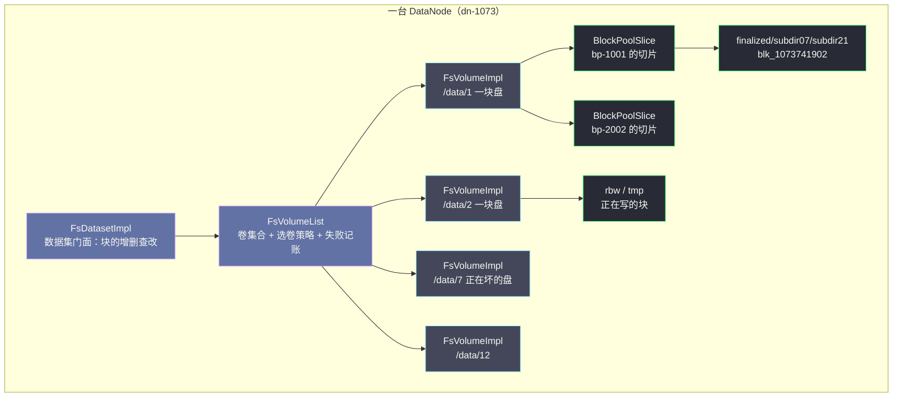
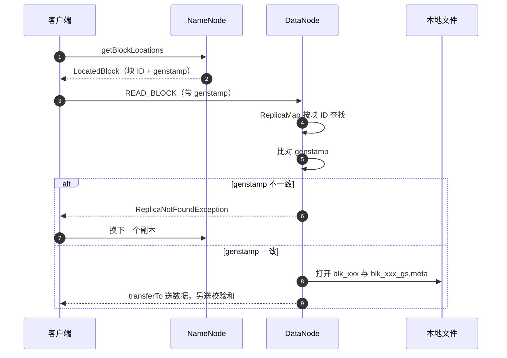
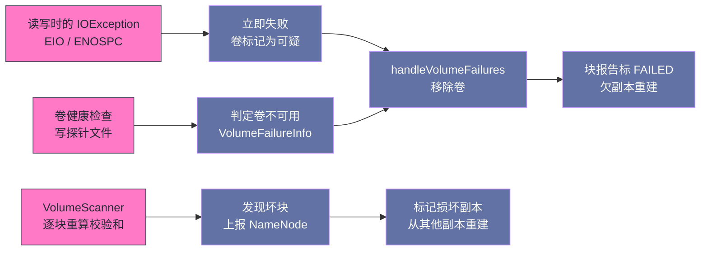
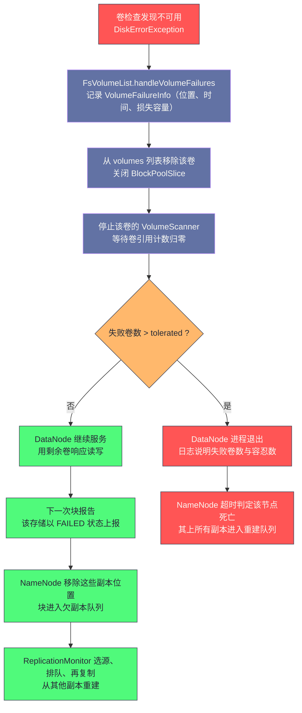
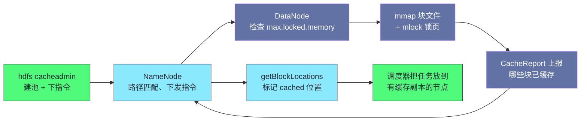

# DataNode 存储引擎——FsDataset 与磁盘 IO 管理机制

**摘要：**

一台 DataNode 的复杂度，几乎全部集中在「盘会坏」这一件事上。本文沿着一次真实的读写与一次真实的坏盘，拆开 HDFS 的本地存储引擎：`FsDatasetImpl` 到 `FsVolumeImpl` 再到 `BlockPoolSlice` 的三层结构，`<data.dir>/current/<bpId>/current/finalized` 这类目录为什么长成那样，块的三个文件（数据、`.meta`、以及藏在文件名里的 genstamp）各自承担什么，`VolumeChoosingPolicy` 的两种实现在同规格盘与异规格盘上如何选边。中段处理卷的失效：`DiskChecker` 与 `VolumeChecker` 怎么判断一块盘已经不可用，`VolumeScanner` 怎么用 1MB/s 的限速在 504 小时的周期里扫块，卷被判失败之后 DataNode 与 NameNode 之间那串动作的先后顺序，以及 `dfs.datanode.failed.volumes.tolerated` 取 0 或取 1 各自意味着什么样的失效模式。随后进入内存与 IO 路径：为什么不把块缓存在堆里、`transferTo` 的零拷贝省掉哪一次拷贝、mmap 与页缓存的分工、短路读为什么依赖 `dfs.domain.socket.path`、集中式缓存真正占的内存上限在哪里、xceiver 与 RPC handler 两套线程池的瓶颈形状，以及异步化改造的两条边界。收尾给出六个可以直接对着日志定位的故障形态，以及三个在生产里反复出现的反例。文中参数默认值按 Hadoop 3.3.x 的口径，关键源码行为标注了对应的类。

---

## 第 1 章 一台机器，十二块盘

先把镜头推近到一台机器上。一台典型的 DataNode 挂着十二块 4TB 的 HDD，块大小 128MB，按三副本算，这台机器上躺着几十万个块文件。它同时服务几十个客户端，有的读、有的写、有的追加，Pipeline 的下游节点还在等它转发，NameNode 的块报告与心跳每隔几秒就来一次，后台还有一个扫描线程慢悠悠地读块做校验和。这些动作全部落在同一批磁盘上，而磁盘是这类系统里最容易坏、坏得最不体面的部件——它不会像进程那样干净退出，更多时候是写超时、读错位、容量突然报成零、或者干脆从内核的块设备列表里消失。

HDFS 的设计者没有把磁盘当作可靠资源。他们在 DataNode 内部写了一个专用的存储引擎（Dataset），把「多块盘、几十万个块、随时可能坏」这三个约束同时装进一个抽象里。这个抽象要做的事情，用一句话概括：让上层协议（块读写、块报告、块恢复）看见的是一份连续的块集合，而把底下磁盘的拓扑、故障与容量差异全部吃掉。

为什么不能在普通文件系统之上直接 `open()` 一个文件就完事？把问题拆成五个，答案就清楚了。

- **多盘并发**：十二块盘意味着十二份独立的带宽，新块该落到哪一块，才能让聚合吞吐最高、又不会把某块盘写爆。
- **失效隔离**：一块盘坏掉时，如何只把这块盘从可用集合里摘出去，而让剩下十一块继续服务。
- **崩溃恢复**：DataNode 重启后，怎么区分一个「写完了的块」和一个「写到一半的块」，前者要能立刻服务，后者要走恢复流程。
- **静默损坏**：磁盘悄悄改了数据却没有任何报错，靠什么发现。
- **IO 路径效率**：读的时候能不能不把数据搬进用户态，写的时候能不能不每次都同步落盘。

为了让讨论有一个贯穿的落点，笔者用一台虚构但形态典型的 DataNode 做例子，编号 `dn-1073`，十二块盘挂在 `/data/1` 到 `/data/12`，某天凌晨它的第 7 块盘开始报错。后面每讲一个机制，都会回到这台机器上问一句：这件事在这一刻对它意味着什么。



---

## 第 2 章 三层结构：为什么不是一个对象管到底

### 2.1 三层的职责边界

`FsDatasetImpl` 是 `FsDatasetSpi` 接口的实现，DataNode 的 `DataXceiver`、`BlockReceiver`、`BlockSender` 都只跟这个接口打交道。它对外提供的是「给我一个块的位置」「把这个块写成 RBW」「把这个块 finalize」「这些块的校验结果如何」这类操作，对内则把请求分发给卷。

第二层是 `FsVolumeList`，它持有若干 `FsVolumeImpl`，记住当前有哪些卷可用、哪些卷被判失败过、失败时损失了多少容量，并且在写新块时执行选卷策略。`FsVolumeImpl` 对应 `dfs.datanode.data.dir` 里的一个条目，也就是一块盘的一个挂载点，它拥有这个卷的 `StorageID`、存储类型（`DISK`/`SSD`/`ARCHIVE` 之类）、容量与已用快照、块池切片的映射表，以及一个引用计数——这个引用计数很关键，它保证卷在被移除时不会立刻把正在被读的文件抽走。

第三层是 `BlockPoolSlice`，一个卷上每个 block pool 一个切片。之所以要有这一层，是因为 HDFS Federation 之后一台 DataNode 会同时服务多个 NameNode，各自的块池 ID 不同、块 ID 空间也不同，但物理上共用同一块盘。切片把「块池」这个命名空间维度叠到「卷」这个物理维度上，目录也由此分叉成 `<data.dir>/current/<bpId>/current/...`。一台只跑单 NameNode 的集群里这层看起来是多余的，等到集群演进到 Federation，它的价值才显出来：新增一个 NameNode 时，老的 DataNode 不需要重建目录结构，只要在每个卷上多出一个切片目录。

### 2.2 磁盘布局：目录名就是状态

一个卷的目录结构如下（省略了中间的块池 ID 具体值）：

```text
/data/7/                                   <- dfs.datanode.data.dir 的一个条目
  in_use.lock                              <- 进程级锁，防止两个 DataNode 共用一份数据
  current/
    VERSION                                <- 该卷的存储版本与 clusterID
    BP-1001-10.18.2.31-1699999999999/
      current/
        VERSION                            <- 该块池的版本信息
        finalized/
          subdir07/subdir21/
            blk_1073741902                 <- 数据文件
            blk_1073741902_1021.meta       <- 元数据文件（校验和、版本、类型）
        rbw/                               <- 正在写入（replica being written）
        tmp/                               <- 尚未分配块 ID 的临时文件
        scanner.cursor                     <- VolumeScanner 的扫描游标
        dncp_block_verification.log.curr   <- 校验记录（供运维与审计）
```

`current` 与 `finalized` 这种层层递进的名字不是随意取的，它把「块处于哪个生命周期阶段」编码进了路径：`tmp` 里的文件还没有稳定的块 ID，`rbw` 里的文件有 ID 但长度未定，`finalized` 里的文件才是可信的。这个编码的好处是崩溃恢复不需要额外日志——重启时扫描目录，看到文件在哪个目录里就知道它处于什么状态；Pipeline 如何把块写进 `rbw`、又如何在收尾时推进 `finalized`，属于 [[04 HDFS 数据读写流程——Pipeline 写入与机架感知读取的底层路径]] 的范围。

`finalized` 下面为什么还要两级 `subdir`？因为单个目录里的文件数量是文件系统的硬约束。ext4 在一个目录里放几十万文件时，目录项查找会退化，`ls` 慢到不可用，一些文件系统还会在目录膨胀后出现分配抖动。HDFS 用块 ID 的位段做散列，取两段 5 位作为两级子目录名（源码里是 `DatanodeUtil.idToBlockDir`，掩码为 `0x1F`），于是每级 32 个目录、合计 1024 个叶子目录。这个数字有意留了余量：一台 12 盘、48TB、128MB 块的 DataNode 每盘约两三万个块，摊到 1024 个目录里每个目录几十个文件，正好落在文件系统的最优区间；块总量一旦因为小文件而暴涨，这个摊薄关系就会失效，治理手段属于 [[10 HDFS 性能调优与生产实践——小文件治理与存算分离的未来]] 的范围。

### 2.3 卷上的其他文件

块文件和 meta 文件之外，一个卷上还有几类东西，它们在排障时几乎一定会被看到，值得单独认一遍。

| 路径 | 内容 | 由谁写 | 出问题时怎么判 |
|---|---|---|---|
| `current/VERSION` | 卷的存储版本、clusterID、storageType、layoutVersion | DataNode 格式化时 | clusterID 不匹配直接拒绝启动，日志里有 `Incompatible clusterIDs` |
| `current/<bpId>/current/VERSION` | 块池版本与块池 ID | 加入块池时 | 块池 ID 与 NameNode 不符时整个切片不可用 |
| `in_use.lock` | 文件锁 | DataNode 启动时 | 残留锁会让新进程报 `Cannot lock storage` |
| `rbw/` | 写到一半的块 | `BlockReceiver` | 重启后这些块变 RWR，等待恢复 |
| `tmp/` | 未分配 ID 的临时副本 | Pipeline 建链阶段 | 重启后按目录约定整体清理 |
| `scanner.cursor` | 扫描游标（块池、块 ID、时间戳） | `VolumeScanner` | 丢失或损坏时从块池起点重扫 |
| `dncp_block_verification.log.curr` | 校验历史 | 校验流程 | 只用于审计，删掉不影响服务 |

`in_use.lock` 是容易被忽略的运维细节：进程被 `kill -9` 后锁文件还在，但操作系统已释放文件锁，新进程可以接管；真正会卡住的是 NFS 这类共享文件系统，锁语义不可靠，启动时直接报错。

### 2.4 内存里的索引与锁

`finalized` 目录是块的「真身」，但读请求不会去扫目录。`FsDatasetImpl` 在内存里维护一份 `ReplicaMap`，键是块 ID，值是 `ReplicaInfo`（记录块长度、genstamp、所属卷、两个文件路径与当前状态），一次读请求到达时 `BlockSender` 哈希查找一次就拿到文件路径，复杂度 O(1)。

这份 Map 是启动时建起来的：`FsVolumeList.getAllVolumesMap` 为每个卷起一个线程，各自扫描本卷的 `finalized` 与 `rbw` 目录，把块信息塞进同一个 Map。并发扫描是为了缩短启动时间——十二块盘的串行扫描会让一个重启的 DataNode 在几分钟内不可服务——日志里能看到每个卷的耗时：

```text
INFO FsDatasetImpl: Adding replicas to map for block pool BP-1001-... on volume /data/7...
INFO FsDatasetImpl: Time to add replicas to map for block pool BP-1001-... on volume /data/7: 4213ms
INFO FsDatasetImpl: Total time to add all replicas to map for block pool BP-1001-...: 6810ms
```

启动扫描的耗时与块数近似线性，这也解释了一个常见现象：块数特别多的 DataNode 重启后，RPC 端口通了、网页也打得开，但读请求会被拒——Map 还没建完，NameNode 侧看到的是机器已注册而块报告迟迟不来。

锁结构决定了并发上限。`FsDatasetImpl` 确实有一把数据集级锁，但它保护的是结构性变更——增删卷、增删块池、块的状态迁移——热路径上的块查找与元数据更新下沉到卷级对象里。如果所有读都要抢同一把全局锁，一台十二块盘的机器在并发读上会被串行化成单盘的表现，多盘带宽等于白买；按卷拆开之后，落在不同盘上的请求互不阻塞，落在同一块盘上的请求本来就要抢磁头，串行化反而是物理事实的忠实反映。

---

## 第 3 章 块的三个文件与 genstamp

### 3.1 数据文件与元数据文件

一个 `finalized` 块对应两个文件，数据文件叫 `blk_<blockId>`，元数据文件叫 `blk_<blockId>_<genstamp>.meta`。数据文件里就是裸的块内容，没有任何自解释的结构；`.meta` 里放的是校验和、以及读懂这些校验和所必需的参数。

两个文件分开的设计，牺牲了一次额外的 `open`（读块要同时打开两个文件），换来数据文件零开销：如果校验和嵌在数据流里，读写都要解包重排，零拷贝路径就没法用——`sendfile` 只能原样搬字节。

`.meta` 的头部是 7 个字节，之后才是校验和数组：

| 字段 | 长度 | 含义 | 读写方 |
|---|---|---|---|
| `version` | 2 字节 | meta 格式版本，当前为 1 | `BlockMetadataHeader` |
| `checksumType` | 1 字节 | 校验算法，0 为 NULL、1 为 CRC32、2 为 CRC32C，其余取值用于默认与兼容场景 | `DataChecksum` |
| `bytesPerChecksum` | 4 字节 | 每个校验和覆盖的数据字节数，默认 512 | `DataChecksum` |
| 校验和数组 | 每 chunk 4 字节 | 按 chunk 顺序排列的 CRC 值 | 读写双方 |

头部只有 7 个字节，但每次读块都要读它，于是有了 `dfs.datanode.metadata.cache.*` 这组参数：把解析过的 `BlockMetadataHeader` 放进一个带过期时间的 LRU，避免重复 `open + read` 那 7 个字节。这组参数的默认值在小版本之间有过调整，配置前以对应版本 `hdfs-default.xml` 的注释为准；能确定的是它的语义——条目数上限管内存，过期时间管一致性（meta 文件被重写后，缓存必须能失效）。

一个 128MB、`bytesPerChecksum=512` 的块，校验和数组是 262144 个 4 字节，约 1MB，`.meta` 大约是数据文件的 1/128。算容量时要记得这笔额外开销，更要记得 meta 与数据是两份文件：读一个块，磁头要跑两个文件。

### 3.2 genstamp：文件名里的版本号

`genstamp`（Generation Stamp，生成戳）是 NameNode 为块维护的一个单调递增的版本号，每次块被修改（续写、截断、恢复）都会分配一个新的、更大的值。它出现在 `.meta` 的文件名里，而不是数据文件名里，这个不对称是有讲究的。

数据文件按块 ID 命名，是稳定的：同一个块在本地永远是一个 `blk_1073741902`，无论版本怎么变。meta 文件名带上 genstamp，同一个块 ID 的多个历史版本可以共存而不互相覆盖——恢复流程里旧 meta 还在、新 meta 正在生成，两者都能落地，最后由恢复结论决定哪一方存活。这种「数据按身份命名、元数据按版本命名」的约定，让块恢复有了无需额外日志的实现路径。

genstamp 在故障判据里的位置很实在。客户端读块时带的是 NameNode 给的 `ExtendedBlock`，里面有块 ID 也有 genstamp；DataNode 在 `ReplicaMap` 里按块 ID 找到 `ReplicaInfo` 后，会比对 genstamp。不一致时，本地这份副本对这次请求就是不可用的，表现为 `ReplicaNotFoundException` 一类的错误。日志里看到这类异常，先别怀疑磁盘，多半是块正在恢复、genstamp 已经被 NameNode 提升，而本地还没跟上——重试或者等恢复完成通常就好，如果持续出现同一个块，才需要查副本是不是真的丢了。

块恢复的完整流程属于 [[09 HDFS 容错与恢复机制——自愈修复的工程实现]] 的范围，这里只需要记住一个结论：genstamp 是把「同一个块的多份副本」和「同一个副本的多个历史版本」这两件事区分开的唯一凭据。没有它，恢复流程无法判断哪一份副本该被丢弃。

读一个块时，genstamp 参与校验的位置如下图：客户端拿到的位置信息里带着它，DataNode 在查表之后必须比对一次。



### 3.3 零拷贝与「DataNode 看不见数据」

`dfs.datanode.transferTo.allowed` 默认为 `true`，允许 `BlockSender` 用 `FileChannel.transferTo` 把块数据直接从文件送到 socket。这条路径上，数据在内核的页缓存与网卡之间流动，DataNode 的 JVM 从头到尾没有拿到过这段字节的引用。

省下来的是一次用户态拷贝与一次上下文切换，代价是**DataNode 自己失去了校验的机会**。零拷贝路径上无法边搬边算 CRC，所以服务端的完整性职责被切成了两半：一半交给客户端（读到的数据由客户端校验），一半交给后台的 `VolumeScanner`（周期性全量扫）。这也是为什么 `dfs.client.read.shortcircuit.skip.checksum` 这个参数危险——它把客户端那一半也关掉了，剩下的只有后台扫描这一道防线，而扫描周期是 504 小时。

把 `dfs.datanode.transferTo.allowed` 设成 `false` 会走传统的 `read + write` 路径，CPU 开销上升，但 DataNode 能在搬运过程中保持对数据的观察（比如配合某些需要在服务端做处理的场景）。除非有明确的诊断或兼容需求，不建议关闭它。

---

## 第 4 章 多盘怎么配：卷列表与选卷策略

### 4.1 `data.dir` 是卷列表，不是目录列表

`dfs.datanode.data.dir` 的每一项都被当作一个独立的卷、一个独立的失效单元。这决定了多盘配置的第一条原则：一个条目对应一块物理盘的一个挂载点，而不是同一块盘上的多个目录。把两个目录配在同一块盘上，DataNode 会认为它有两个卷，选卷在这两个「卷」之间轮询，而它们共享同一份磁头与带宽——多盘收益一分没拿到，失效的账却记了两笔：一块盘坏了两个卷同时失败，`dfs.datanode.failed.volumes.tolerated` 的计数直接翻倍。

每个条目后面可以带存储类型标注，形如 `/data/1,[SSD]`，同一台机器上混布 SSD 与 HDD 才成为可能。标注不只是记账：选卷策略按存储类型分组，`getNextVolume` 只在目标类型的卷集合里挑，副本放置与存储策略再决定一个文件要哪种介质，这部分属于 [[05 HDFS 副本放置策略——机架感知与数据可靠性的工程权衡]] 的范围。

还有两个与卷相关的参数容易被忽略。`dfs.datanode.data.dir.perm` 控制数据目录的权限，默认 755，多用户环境下 DataNode 进程用户与运维用户的权限边界就靠它；`dfs.datanode.du.reserved` 给每个卷预留一段不分配给 HDFS 的空间，默认 0，这个默认值在生产里通常是错的，理由在第 11 章的容量故障里讲。

### 4.2 `RoundRobinVolumeChoosingPolicy`：轮询，但有门槛

默认策略是 `RoundRobinVolumeChoosingPolicy`。它的实现比名字复杂：按存储类型分别维护轮询游标与细粒度锁，选卷时从游标位置往后找，跳过可用空间不足的卷，找到第一个可用空间大于本次块大小的卷就返回，并把游标推进到下一个。

```java
// 摘自 3.3.x RoundRobinVolumeChoosingPolicy.chooseVolume（有删节）
long availableVolumeSize = volume.getAvailable();
if (availableVolumeSize > blockSize) {
  curVolumes[curVolumeIndex] = curVolume;
  return volume;
}
// 全部卷都不够时
throw new DiskOutOfSpaceException("Out of space: "
    + "The volume with the most available space (=" + maxAvailable
    + " B) is less than the block size (=" + blockSize + " B).");
```

这里有三个细节值得记住。其一，门槛是严格大于块大小：块大小 128MB 而卷上只剩 100MB 时，这块盘对这个块就是不可用的。其二，判断用的是内存里的用量快照，周期性刷新而不是每次 `statfs`，这个为性能做的取舍会引出一类经典故障（第 11 章展开）。其三，跳过时打 `WARN` 日志，内容是「卷 X 的可用空间小于块大小」，这是排查「某个盘再也写不进去」的第一手证据。

轮询的优点是盘间分布均匀，缺点是对速度差异毫无感知。十二块盘里有一块老化的 HDD，顺序写只有别人的三分之一，轮询依然按同样比例往它身上分块，整机写入吞吐被最慢那块拖住——不是平均值被拉低，而是 Pipeline 每一环都要等最慢的那个确认。

### 4.3 `AvailableSpaceVolumeChoosingPolicy`：为异规格盘准备

第二种实现是 `AvailableSpaceVolumeChoosingPolicy`，它先算一遍所有候选卷的可用空间，把卷分成「空间富裕」和「空间紧张」两组，再按比例分配选择概率，由 `dfs.datanode.available-space-volume-choosing-policy.balanced-space-threshold`（默认 10GB）定义什么叫富裕，由 `dfs.datanode.available-space-volume-choosing-policy.balanced-space-preference-fraction`（默认 0.75）定义把多少比例的写入分给富裕组。

这个策略解决的是「盘容量不一样」的问题：新加了一块 8TB 的盘，而老盘都是 4TB，轮询会让 8TB 的盘与 4TB 的盘同样速度被填满，结果 4TB 的盘先满，之后所有写入都压到 8TB 那块上，集群的容量增长被单盘带宽卡住。可用空间策略让大盘先被填，延缓这种失衡。

不过它并不能解决「盘速不一样」的问题：输入只有容量，没有延迟，一块又大又慢的盘反而会被优先填满。3.x 的 `FsVolumeList` 在选卷前会先剔除被 `DataNodeDiskMetrics` 标记为慢盘的卷，慢盘判定来自 `dfs.datanode.slow.io.warning.threshold.ms`（默认 300ms）统计出的慢操作比例。容量与速度是两个维度，任何单一维度的选卷策略都只能优化一半。

| 维度 | RoundRobin | AvailableSpace |
|---|---|---|
| 适用场景 | 同型号同容量盘，追求均匀分布 | 盘容量不一致，需要延缓小盘先满 |
| 输入信号 | 轮询游标 + 可用空间门槛 | 可用空间分布 + 两档阈值 |
| 对慢盘的态度 | 无感知，按比例分摊 | 也无感知，且更偏向填大盘 |
| 主要风险 | 慢盘拖累整机吞吐 | 大盘若是慢盘，放大影响 |
| 调参空间 | 无 | 阈值与偏好比例两个旋钮 |

### 4.4 多盘配置的判据

把上面的机制折成一张可操作的判断表，配置形态基本落在四类里。

| 场景 | 推荐配置 | 理由 |
|---|---|---|
| 十二块同型号 HDD，纯容量型集群 | 每盘一个挂载点，默认轮询，`du.reserved` 给每盘留 10% 上下 | 均匀分布最省心，预留空间防写满 |
| 新老盘混插，容量 4TB 与 8TB 并存 | 可用空间策略，阈值按盘容量差调整 | 延缓小盘先满，避免容量被单盘带宽卡住 |
| SSD 与 HDD 混布 | 每个条目标注存储类型，配合存储策略 | 介质差异必须让上层可见，否则热数据会被写到 HDD |
| 盘速差异明显（老盘、故障盘） | 依赖慢盘剔除，必要时人工下线 | 选卷策略没有延迟信号，只能靠运行时统计兜底 |

判断多盘配置是否合理，有个直接办法：看十二块盘的 `df` 使用率是否长期接近。某块的长期使用率明显偏低，说明它一直被跳过；明显偏高，说明选卷在向它倾斜。这两种形态都会在容量告警里先露头，早于任何功能性故障。

---

## 第 5 章 卷的故障检测：三条互不依赖的路径

一块盘出问题时，表现形式千差万别：可能是 `write()` 返回 `EIO`，可能是 `fsync` 卡住三十秒，可能是挂载点还在但 `ls` 不动，也可能是数据能读出来但内容已经不对。HDFS 用三条互不依赖的路径去覆盖这些形态，每条路径的触发条件、检测能力与误报率都不同。

三条路径各自覆盖不同的失效形态，下图把它们与最终的处置动作连起来。



| 路径 | 触发方式 | 能发现什么 | 不能发现什么 |
|---|---|---|---|
| 写入异常 | 每次读写时捕获 `IOException` | 立即失败（EIO、ENOSPC、设备消失） | 慢、只读、静默损坏 |
| 卷健康检查 | 周期性主动探测 | 挂载丢失、只读、无法创建文件 | 数据内容错误 |
| 后台块扫描 | `VolumeScanner` 逐块读校验和 | 静默损坏、坏扇区 | 容量与权限问题 |

### 5.1 `DiskChecker`：最小可用的健康判据

`DiskChecker` 是 Hadoop 里一个很朴素的工具类，动作是「在目录下创建子目录、写一个探针文件、读回来、删掉」，任何一步失败就抛 `DiskErrorException`。这个动作覆盖了绝大多数「盘不可用」的现实形态：挂载点掉了（目录不存在或不可写）、文件系统被内核 remount 成只读（写失败）、设备已经不在（创建文件即失败）。

它朴素到容易被低估，但恰好是「能写」这个语义的最小验证：读一次 `df` 只看容量，发现不了 remount 成只读；读 SMART 信息，发现不了挂载点掉线；`ls` 一下目录更说明不了什么。写一个探针文件是唯一不依赖额外工具、又直接命中「DataNode 要用这块盘做写」这个语义的检查。

### 5.2 `VolumeChecker`：把检查做成异步

早期实现里，卷检查与业务线程纠缠在一起：某个 `DataXceiver` 在写失败时顺手触发检查，检查可能阻塞几百毫秒到几秒，这段时间它什么也干不了。3.x 用 `VolumeChecker` 把这件事拆成独立的异步检查器，并用三个约束防止检查本身变成负担：同一卷两次检查的最小间隔、单次检查的超时、同时并发检查的卷数上限。

异步化的收益在两处：慢盘不再拖住业务线程，检查也可以做得更彻底——把「参考卷」与「被检卷」对照着看，从而区分「这块盘坏了」与「这台机器的 IO 被别的东西占满了」。

这里要提一个与运维直觉相关的点：卷检查失败并不总是等于硬件损坏。一次长时间的 IO 抖动、一个把盘占满的临时文件、一次 `mount` 参数错误，都会让探针写入失败。检测器只负责给出「不可用」的判断，是否要把它当作永久失败，取决于容忍数与人的判断——这也是 `dfs.datanode.failed.volumes.tolerated` 存在的意义。

### 5.3 `VolumeScanner`：后台慢扫的经济学

第三条路径是 `VolumeScanner`，每个卷一个线程，由 `BlockScanner` 统一管理。它的工作是从 `scanner.cursor` 记录的游标开始，按块迭代器顺序把 `finalized` 里的块逐个读一遍，重新计算校验和与 meta 里的值比对，不一致就把它当作坏块处理。

它的参数只有几个，但每一个都在拿「覆盖速度」换「IO 打扰」：

- `dfs.datanode.scan.period.hours`：默认 504 小时，也就是三周。源码里有一个兼容细节：配置为 0 时按默认值（三周）处理，配置为负数时扫描器整个禁用。
- `dfs.block.scanner.volume.bytes.per.second`：默认约 1MB/s，是每个卷的扫描带宽上限。
- `dfs.block.scanner.skip.recent.accessed`：是否跳过最近访问过的块，减少对热点数据的打扰。
- `scanner.cursor` 的保存间隔属于内部参数，一般不需要动。

这里有一个只有算过一遍才会发现的结论。按 1MB/s 的限速与 504 小时的周期，一个周期内每个卷能扫过的数据量是：

```text
504 小时 × 3600 秒 × 1MB/s ≈ 1.8 TB
```

而一台十二块盘、每盘 4TB 的 DataNode，每块盘上的数据量在 2.5TB 到 3.5TB 之间（扣掉副本以外的其他数据与预留）。也就是说，一块盘在一个扫描周期内根本扫不完一遍。504 小时不是「保证每三周扫全量」的承诺，而是「扫完一遍后至少等这么久再从头开始」的下限。真正的全量覆盖周期是数据量除以限速：3TB 除以 1MB/s，约 35 天。

这个结论有两层含义。对可靠性而言，一个块从损坏到被后台发现，最坏要等一个完整覆盖周期；对性能而言，扫描代价不是带宽（1MB/s 不到单盘顺序带宽的百分之一），而是 IOPS 与寻道——块迭代器按块 ID 顺序读，块文件在盘上并不连续，这些寻道与业务 IO 抢同一份磁头调度队列，调小扫描周期付出的是尾延迟。

扫描器的限速是按长期平均算的：它维护最近一小时每分钟扫描字节数的滑动窗口，准备扫块前先用有效速率与目标速率比较，超过目标就等三十秒再试，所以刚启动时的突发会被允许，之后被拉平。

### 5.4 慢盘：第三种病

盘不一定坏，也可能只是慢。慢盘不触发任何失败判据，只是把每一次写确认往后拖，Pipeline 吞吐随之下滑，客户端超时重试又增加负载。3.x 用 `dfs.datanode.slow.io.warning.threshold.ms`（默认 300 毫秒）作为单次 IO 的慢操作阈值记录慢日志，再由 `DataNodeDiskMetrics` 汇总出慢操作比例异常的卷，选卷时剔除。

---

## 第 6 章 判失败之后：从移除卷到 NameNode 重建

### 6.1 一条链上的七步

现在回到 `dn-1073`。凌晨三点，第 7 块盘上的探针写入超时，卷检查给出失败判定。接下来发生的事情有明确的先后顺序，每一步都能在日志或指标里找到对应的痕迹。



第一步，`FsVolumeList.handleVolumeFailures` 接手失败卷集合：为每个卷记一条 `VolumeFailureInfo`，内容是失败存储的位置、失败时间与损失容量；这条记录会在 DataNode 重新注册时随 `volumeFailureSummary` 上报给 NameNode，让 NameNode 知道这台机器的容量为什么掉了，而不是误以为有人在删数据。

第二步与第三步是移除与关停：卷从 `volumes` 列表里被摘掉，此后新写请求不会再选中它；该卷的 `VolumeScanner` 被停掉，`BlockPoolSlice` 被关闭，卷对象进入待关闭状态。这里有一个容易忽略的等待——卷上可能还有正在进行的读，引用计数不为零时对象不能销毁，移除流程要等引用归零才算完成。

第四步，判断失败卷数与容忍数。这一步决定了 `dn-1073` 是带着十一块盘继续活，还是整机退出。

第五步之后是 NameNode 侧的动作：DataNode 在下一次块报告里把失败存储标为 `FAILED`，NameNode 把该存储上的副本从有效位置集合中摘掉，这些块随即变成欠副本；`ReplicationMonitor` 按优先级从其他副本重建。要确认的只是顺序：NameNode 先感知「这些位置不再可信」，再从别的副本复制。

### 6.2 为什么不是立刻删掉盘上的数据

卷被判失败之后，DataNode 并没有去删失败卷上的块文件，磁盘上那些 `blk_*` 与 `.meta` 原封不动地留着。这个选择背后是一条重要的工程判断：**卷失败不等于数据销毁**。现实里「卷不可用」的原因按频率排，彻底损坏并不占多数，更多是盘被内核判成只读、挂载点因网络存储超时掉线、SATA 线接触不良、控制器抖动、盘写满到无法创建探针文件。这些情况里块文件都还在，失败即删就等于把可恢复的故障变成不可恢复。

保留数据还有一个收益：卷恢复后重新加入时，扫描该卷即可把这些块重新纳入数据集，NameNode 收到块报告后把它们重新计入有效位置，欠副本状态自然收敛，不需要重传一个字节。代价是失败卷上的空间在修复前不可回收——一块 4TB 的盘判失败后，这 4TB 既不能被 HDFS 使用，也不能自动清掉，这是「尽快换盘」这条运维要求的经济依据。

### 6.3 `dfs.datanode.failed.volumes.tolerated`：快速失败还是带病运行

这个参数的语义很直白：允许有几块卷处于失败状态而 DataNode 继续运行。默认值是 0，含义是「一块盘失败就让这台 DataNode 退出」。

默认值选 0 的理由是快速失败：一台带着坏盘继续跑的 DataNode，会让集群对它的容量与可靠性产生错误认知；更麻烦的是坏盘往往不是孤立事件——同批次盘寿命相近，同一背板或控制器的故障会连续吃掉多块盘。如果容忍 2 块失败，实际发生的是「等到第三块盘坏时，这台机器上已没有可用副本」，而中间那段时间运维没有收到任何强信号。

代价也很明确：一块盘的故障被放大成整机下线。十二块盘里坏一块，剩下十一块盘上的副本全部进入重建队列；如果这台机器的副本数较多，一次重启会触发集群级别的复制流量。这正是默认值在生产里引发争议的原因——它把一个局部的、可控的故障，换成了一个全局的、有成本的故障，换来的是确定性。

| 取值 | 失效模式 | 收益 | 代价 |
|---|---|---|---|
| 0（默认） | 任意一块盘失败即退出 | 故障信号强，不掩盖硬件批次问题 | 单盘故障放大为整机下线，触发一轮重建 |
| 1 | 允许一块盘失败 | 单盘故障不打断服务，给换盘留出窗口 | 第二块盘失败时同样退出，中间期容量与可靠性被高估 |
| ≥2 | 多盘失败仍服务 | 适合盘多、批次混杂的机器 | 带病运行窗口拉长，副本损失在一台机器上叠加 |

调大这个参数不是不能用，前提是配套监控要跟上：失败卷数量、单机可用容量、该机器的副本覆盖，三者都要有告警，否则「带病运行」会变成「带病沉默」。另外要清楚，失败卷不会自动恢复，盘修好之后需要显式让它重新加入，否则 DataNode 会带着更少的卷一直跑下去。

### 6.4 盘坏了集群会怎样

把视角从一台机器拉到集群，一次坏盘的影响可以按时间分三段。

第一段是检测窗口。卷检查是周期性的，最坏要等一个检查间隔；如果这块盘只是读慢、写还正常，窗口更长，直到慢日志积累到被 `DataNodeDiskMetrics` 标记。这段窗口里客户端读变慢甚至超时，重试打到其他副本上，表现为某路径读延迟上升而错误率不高——这种形态最难归因。

第二段是重建窗口。欠副本块的数量取决于这台机器上有多少块、其中多少是唯一副本；三副本集群里一块盘失败通常只让每个块少一个副本，重建压力均匀分布在集群里，但如果机架感知没配对，跨机架流量会明显上升。这一段的旋钮在 NameNode 侧：`dfs.namenode.replication.max-streams`（默认 2）与 `dfs.namenode.replication.work.multiplier.per.iteration`（默认 2）控制每轮选多少块、每台 DataNode 同时跑多少复制流；DN 侧的 `dfs.datanode.data.transfer.bandwidthPerSec` 可对单机数据传输限速。这里要纠正一个流传很广的说法：`dfs.datanode.balance.bandwidthPerSec` 管的是 Balancer 搬块带宽，对副本重建没有约束力。

第三段是收敛窗口。欠副本补齐后集群回到目标副本数，但账没算完：这块盘上的副本没了，集群总容量少了 4TB，不换盘就一直缺这一块。运维侧在这一段要完成两件事——确认 `fsck` 没有 MISSING 块，以及把这台机器标记为待换盘。

### 6.5 让卷回来

盘修好之后，让 DataNode 重新使用它有两条路：重启 DataNode 简单粗暴，代价是一次块报告风暴与短暂不可服务；动态加载适合不能停机的场景，3.x 支持通过 `dfsadmin -reconfig` 让部分配置生效，`dfs.datanode.data.dir` 在可动态调整的范围内，修改配置后即触发重新加载。

```bash
# 先看这台 DataNode 支持动态调整哪些项
hdfs dfsadmin -reconfig datanode dn-1073:9867 status
# 让新的卷列表生效（具体命令与参数以对应版本文档为准）
hdfs dfsadmin -reconfig datanode dn-1073:9867 start
```

新卷加入后要经历一次目录扫描，扫描期间该卷上的块不可服务，块报告结束后 NameNode 才会把这些副本计入有效位置；看到容量恢复了但欠副本数没降，属于正常现象。

---

## 第 7 章 内存、mmap 与页缓存

### 7.1 为什么不把块缓存在堆里

DataNode 不维护应用层的块缓存，读的时候总是从文件系统读，读到的是操作系统页缓存（Page Cache）里的内容，没有额外的一层。这个选择有三个理由，第三个最容易被忽略。

第一，堆内存装不下。一台机器的空闲内存可以有几十到上百 GB，而 DataNode 的堆通常配在 4GB 到 8GB（主要放元数据对象），用堆做缓存等于把缓存容量缩小一个数量级，还要额外承担对象头与 GC 开销。

第二，GC 停顿与吞吐互斥。块是 128MB 量级的大对象，放进堆里直接进老年代，一次 Full GC 的停顿在秒级，而 DataNode 的读取是长连接流式的，停顿期间客户端看到的是超时；用堆外内存可以避开 GC，但仍要自己管理生命周期。

第三，页缓存是共享的。DataNode 读一个块，数据进页缓存；紧接着这个块的另一个读请求（比如同一台机器上的计算任务通过短路读、或者 Pipeline 的另一个下游）可以直接命中同一份页缓存。如果 DataNode 自己做缓存，这份共享要么丢失，要么需要在进程内再做一次去重。

不做应用层缓存，代价是把缓存策略交给内核，而内核的页回收算法并不知道哪个块更重要。HDFS 对此的补偿是 `posix_fadvise` 的两个开关——`dfs.datanode.drop.cache.behind.reads` 与 `dfs.datanode.drop.cache.behind.writes`，打开后 DataNode 读完（或写完）主动告诉内核「这段数据不用留」，避免一次全表扫描把整机缓存洗一遍。这两个开关依赖 native 库，只对顺序读的冷数据有益，对热点数据是负优化。

### 7.2 `transferTo` 省掉的到底是哪一次拷贝

读路径上，DataNode 要把块数据从磁盘送到客户端的 socket。传统写法是 `read()` 到用户态缓冲，再 `write()` 到 socket，数据在内核缓冲区、用户缓冲区、socket 缓冲区之间走三趟，其中一次是 CPU 参与的拷贝。`FileChannel.transferTo` 走的是 `sendfile`，数据从页缓存直接进 socket 缓冲区，CPU 不碰数据本身。

| 路径 | 数据拷贝 | CPU 参与 | DataNode 能看到数据 |
|---|---|---|---|
| `read + write` | 页缓存 → 用户态 → socket | 一次 | 能 |
| `transferTo`（sendfile） | 页缓存 → socket | 无（DMA） | 不能 |

第三列就是第 3.3 节说的那个取舍：省掉 CPU 拷贝的代价是服务端失去了顺带校验的机会。工程上这笔账是划算的——一台十二块盘的 DataNode 出口带宽通常在 10GbE 量级，1GB/s 的流量若每字节都过一遍 CPU，需要占掉好几个核；而校验的责任本来就可以分布在客户端与后台扫描上。

### 7.3 mmap 用在哪，为什么普通读不用

mmap 把文件映射进进程的地址空间，访问映射区域时由缺页中断把文件页装进页缓存——注意它和普通 `read` 用的是同一份页缓存，mmap 并不复制数据，它只是换了一种访问方式：不需要 `read` 系统调用，不需要用户缓冲区。

既然方便，为什么普通读路径不用 mmap？其一，mmap 的优势在随机小访问，而块读是 128MB 的顺序流，`transferTo` 已是最优路径，mmap 反而多一层页表与缺页开销。其二，mmap 与文件生命周期绑得太紧：文件被截断或删除后继续访问映射区域，进程收到 `SIGBUS`，在 JVM 里是致命崩溃而不是可捕获的 `IOException`，而块文件会被删除、重命名、被恢复流程重写。其三，校验和计算需要把数据搬进用户态做 CRC，mmap 之后一个字节也省不掉。

mmap 在本篇里的真正用武之地是集中式缓存：`FsDatasetCache` 把块文件 mmap 进地址空间，再用 `mlock` 把映射锁在物理内存里，于是这块数据既不会被换出，也不会被页回收挑走——这是「我知道这块数据重要，请内核不要动它」的显式声明。

### 7.4 短路读：把 DataNode 从数据路径上摘掉

客户端与某个副本在同一台机器上时，读这块数据最浪费的做法是让数据绕一圈：磁盘 → 页缓存 → DataNode 用户态 → socket → 客户端用户态。短路读（Short-Circuit Read）把中间几跳省掉，客户端直接打开块文件读。

省掉 DataNode 不等于绕过安全与一致性。实现方式是：客户端通过一个 UNIX domain socket（路径由 `dfs.domain.socket.path` 指定，DataNode 与客户端两侧必须一致）向 DataNode 请求这个块，DataNode 校验身份与块的存在性之后，把这个块文件的文件描述符通过 socket 传给客户端，客户端拿到 fd 后自己做本地读。控制面仍然经过 DataNode，数据面直连文件。

| 环节 | 普通读 | 短路读 |
|---|---|---|
| 控制面 | 块位置查询 + TCP 连接 | 块位置查询 + UDS 请求 |
| 数据面 | DataNode 经 socket 转发 | 客户端直接读本地文件 |
| 数据拷贝 | 页缓存 → socket（零拷贝） | 页缓存 → 客户端缓冲 |
| 前提 | 无 | 同机有副本 + UDS 可用 + 客户端开启 |
| 典型故障 | 网络、DN 过载 | socket 路径不存在、路径过长、权限不足 |

短路读的坑都出在配置而不是代码：`dfs.client.read.shortcircuit` 必须在客户端开启，DataNode 侧要配同一个 socket 路径；路径长度受 `sun_path` 限制（Linux 上约 108 字节），太长时 DataNode 启动就失败；socket 文件权限要允许客户端用户访问。客户端侧的 `dfs.client.read.shortcircuit.streams.cache.size`（默认 256）与 `...expiry.ms`（默认 300000）控制句柄复用，缓存太小会让每次读都重建 UDS 连接。

短路读与 `dfs.datanode.transferTo.allowed` 是两条并行的优化，互不影响：前者优化「同机」，后者优化「跨机」。两者都不要碰校验和开关——`dfs.client.read.shortcircuit.skip.checksum` 默认是 `false`，保持默认。

---

## 第 8 章 集中式缓存：`FsDatasetCache`

### 8.1 三件套：池、指令、锁内存

集中式缓存（Centralized Cache Management）解决的是页缓存的两个不确定性：内核不知道哪块数据重要，也可能在任何时候把它淘汰。HDFS 的做法是让管理员显式声明「这些路径的块要留在内存里」，DataNode 用 mmap 加 `mlock` 把它们钉住，同时把「我缓存了哪些块」报告给 NameNode，让 NameNode 在返回块位置时带上缓存标记，调度器据此把计算任务放到有缓存副本的节点上。

这套机制由三样东西组成：池、指令、锁内存。它们串起来的完整回路如下图，控制面在 NameNode，内存与锁页在 DataNode，收益体现在调度器拿到缓存标记之后。



- **缓存池（cache pool）**：一个带配额与 TTL 上限的逻辑容器，由 `hdfs cacheadmin -addPool` 创建，可设 owner、group、权限、容量上限与最大存活时间。
- **缓存指令（cache directive）**：把某个路径的块加入某个池，可指定副本数（即有几百个副本要被缓存）与 TTL。
- **`dfs.datanode.max.locked.memory`**：每个 DataNode 允许用 `mlock` 锁住的字节数，默认 0，即不启用。

```bash
# 建池：容量上限与 TTL 上限是两个必须想清楚的数字
hdfs cacheadmin -addPool hotPool -owner hive -group hive -limit 500g -maxTtl 7d
# 下指令：把热点路径的 1 份副本钉在内存里
hdfs cacheadmin -addDirective -path /warehouse/hot/dim_user -pool hotPool -replication 1
# 看效果：bytesNeeded 与 bytesCached 的差额就是还没被满足的部分
hdfs cacheadmin -listDirectives -stats
```

池的元数据里带一个类型字段，3.x 的实现只支持 `memory` 这一种介质。接口为将来的分层介质留了位置，但除内存之外的取值没有对应的 DataNode 写路径，配了不会生效。把这里的「类型」与存储策略里的 `SSD`/`ARCHIVE` 混为一谈是常见误解：后者决定副本落在哪种介质上，前者决定用内存做缓存。

### 8.2 内存账：`max.locked.memory` 才是真上限

缓存池的 `-limit` 是逻辑配额，真正决定一台 DataNode 能锁住多少内存的是 `dfs.datanode.max.locked.memory`。两个数字的关系是：池的 limit 决定「这个池最多申请多少」，DataNode 的 locked memory 决定「这台机器上所有池加起来最多锁多少」。前者超了不会崩，只是排队；后者超了，超出的部分根本不会缓存。

`mlock` 的内存不可换出，也不参与页回收。这意味着它占的是「净损失」：机器原本可以用这些内存做页缓存、给其他进程用，现在被钉死。于是有两个约束必须一起满足，否则缓存会静默退化：

- 进程的 `RLIMIT_MEMLOCK`（`ulimit -l`）必须不小于 `max.locked.memory`，否则 `mlock` 调用失败，缓存加不进去。
- `max.locked.memory` 的总量要与机器的内存留出余量，不能把内存吃满，否则 DataNode 自己的堆、其他进程、页缓存都会被挤压。

把账算一遍就清楚了（以下为示例推算，非实测）：

| 项 | 假设 | 推算 | 说明 |
|---|---|---|---|
| 单 DN 锁内存预算 | `max.locked.memory = 8g` | 8GB | 上限，非实际使用 |
| 单块缓存占用 | 块大小 128MB，副本数 1 | 128MB/块 | 缓存是按块整块钉住的 |
| 单 DN 可缓存块数 | 8GB ÷ 128MB | 64 块 | 实际略少（有开销） |
| 集群缓存容量 | 100 台 DN × 8GB | 800GB | 池 limit 之和不应超过它 |
| 一个 20GB 的热点表 | 128MB 块 × 160 块 × 1 副本 | 20GB | 需要 4 台 DN 的预算才放得下 |

这张表最重要的读法是最后一行：一个热点表要完整缓存，需要的不是「一台机器 8GB」，而是「按块摊到多台机器、每台都有预算」。若池 limit 是 500GB 而 100 台 DN 只有 80 台配了 `max.locked.memory`，那 20 台上的副本永远不会被缓存。

### 8.3 什么时候值得用

集中式缓存的收益来自「避免重复读盘」，所以判据要围绕读放大的倍数来算，而不是围绕数据总量。

| 判据 | 该用 | 不该用 |
|---|---|---|
| 访问模式 | 热点维度表、join 的小表，反复全量读 | 一次全表扫描，读完就不再读 |
| 读放大 | 同一块被多个任务重复读，读放大数倍 | 每块只读一次 |
| 延迟敏感度 | 尾延迟敏感，读盘抖动会直接超时 | 批处理，能容忍 IO 抖动 |
| 数据规模 | 能装进集群的 locked memory 总量 | 远超缓存容量，指令永远在排队 |
| 介质 | 内存充足、盘是 HDD | 全闪存且盘本身够快 |

还有一条容易被忽略：集中式缓存与页缓存不是互补关系，而是竞争关系。被 `mlock` 钉住的内存原本可以给页缓存用，缓存命中的收益要减去「页缓存少了这么多、其他读的命中率下降」的成本；在全闪存集群里，读盘本来就快，这份竞争的代价往往超过收益。

---

## 第 9 章 线程模型与它的瓶颈

### 9.1 两套完全不同的线程池

DataNode 上有两套线程池，服务两类完全不同的流量，混在一起看会得出错误结论。

第一套是数据传输线程（DataXceiver）。每个客户端或上游 DataNode 的连接对应一个线程，请求类型是读块、写块、复制块，并发上限由 `dfs.datanode.max.transfer.threads` 控制，默认 4096。这个数字的历史名字是 `dfs.datanode.max.xcievers`，1.x 时代的资料里全是旧名，2.x 之后改成现在这个名字——照着旧文档改配置，等于没改。上限检查发生在连接被接受之后、线程被创建之前，超限时抛出的异常原文是：

```text
IOException: Xceiver count 4097 exceeds the limit of concurrent xcievers: 4096
```

抛完之后 DataNode 会关闭这个 socket，客户端看到的是连接被重置，日志里是 `DataXceiver error processing READ_BLOCK` 之类的错误。这一条错误的归因很容易走偏：客户端侧的现象像网络问题，实际上是 DataNode 在自我限流。

第二套是 RPC 线程（IPC handler），服务 `ClientDatanodeProtocol` 与 `InterDatanodeProtocol` 这类控制面调用：取块本地路径、取副本可见长度、块恢复时的数据同步。并发上限由 `dfs.datanode.handler.count` 控制，默认 10，比传输线程小两个数量级——控制面调用本来就少而短；但短路读普及后 `getBlockLocalPathInfo` 的调用频率显著上升，handler 不够时表现为 RPC 排队、短路读建连变慢。

| 线程池 | 参数 | 默认值 | 每个单位干什么 | 打满后的现象 |
|---|---|---|---|---|
| 数据传输 | `dfs.datanode.max.transfer.threads` | 4096 | 一个连接，读或写一个块 | `Xceiver count ... exceeds the limit`，连接被关 |
| RPC 控制面 | `dfs.datanode.handler.count` | 10 | 一次短 RPC 调用 | RPC 排队，短路读建连慢，块恢复慢 |
| 卷扫描 | 每卷一个线程 | 卷数 | 逐块读校验和 | 扫描停滞，`/blockScannerReport` 的扫描计数不增长 |
| 缓存加载 | `dfs.datanode.fsdatasetcache.max.threads.per.volume` | 4 | 每卷加载缓存块 | `bytesNeeded` 长期不下降 |

### 9.2 一个连接一个线程的代价

4096 这个数字不是随便定的，也不该被当成常态目标。每个 DataXceiver 线程有自己的栈，JVM 默认线程栈在 512KB 到 1MB 之间（示例推算：4096 × 512KB ≈ 2GB 虚拟地址空间，实际驻留取决于栈使用深度），此外每个连接还占一个文件描述符，每次读块还要再打开数据文件与 meta 两个描述符。

于是「连接打满」的典型形态有两个，症状不同：

- `Xceiver count ... exceeds the limit`：连接数触顶，DataNode 主动拒绝新连接。
- `java.io.IOException: Too many open files`：文件描述符先耗尽，可能发生在连接数还没触顶的时候。

第二个更隐蔽，判断方法很直接：看进程的 fd 数与 `RLIMIT_NOFILE`，看活跃 xceiver 数。`lsof -p <pid> | wc -l` 给出总 fd 数，`/proc/<pid>/limits` 给出上限，`/proc/<pid>/fd` 的分布能看出是 socket 多还是块文件多：两者各占一半，瓶颈在并发连接数；块文件远多于 socket，说明大量连接在长期持有块，通常是下游消费慢导致的反压。

### 9.3 判据：DN 连接打满时先看什么

发现连接类错误时，先分辨是哪套线程池，再看是不是有慢盘把线程拖住了。传输线程被打满，可能是并发确实高，也可能是某些线程卡在写盘上不释放——后者调大上限只会让更多线程卡在同一块坏盘上，问题从「拒绝连接」变成「内存与上下文切换飙升」。分辨方法是看同一时间点的慢日志与磁盘指标：慢日志集中在某一卷，就是慢盘；分布均匀，才是真的并发高。

真需要调大 `dfs.datanode.max.transfer.threads` 时，配套动作是同时确认 `RLIMIT_NOFILE` 足够（建议留出 2 倍余量）、以及单机网络带宽能吃下这么多并发流的峰值。盲目调到 8192 而上限没跟上，前一个错误会变成后一个错误。

---

## 第 10 章 异步化的两条边界

### 10.1 写路径：把 `fsync` 摊平

写块过程中数据先落进页缓存，靠内核回写线程慢慢刷盘；到块收尾时，`BlockReceiver` 要确保数据真的落盘才走 finalize。这个收尾的 `fsync` 是写路径上最不可控的一段：一个 128MB 的块如果整块都还是脏页，`fsync` 要等 128MB 写完，HDD 上就是几百毫秒到一秒，日志里表现为 `Slow flushOrSync`。

`dfs.datanode.sync.behind.writes` 默认 `false`，打开后 DataNode 在收包过程中就把已写入的部分分批刷下去，把收尾时的一次大同步摊成一路上的小同步。它的收益是写尾延迟变稳，代价是稳态的磁盘 IO 略高、以及日志里慢 IO 的记录会前移到写的过程中。`dfs.datanode.sync.behind.writes.in.background` 默认也是 `false`，打开后这件刷盘的事被挪到后台线程，`BlockReceiver` 线程不等待。

判断是否开启，看「尾延迟与稳态吞吐谁更值钱」：HDD 集群、大块、高并发写，摊平收益明显；SSD 上单次 `fsync` 本来就快，摊平空间有限。`.in.background` 还要多一层考虑：进程崩溃时后台未刷完的脏页会丢，但对 HDFS 无害——未 finalize 的块本来就不对外服务，恢复流程会重新确定它的长度与 genstamp。

### 10.2 卷检查与块删除：从业务线程里搬出去

异步化在 DataNode 里还有两处：卷检查搬到 `VolumeChecker` 之后，慢盘上的探针写入不再占用 `DataXceiver` 线程；块的删除与移动由 `AsyncDiskService` 按卷分配线程池去做，业务线程只发出动作，于是大规模清理时成千上万个块进删除队列，读请求不会被挤住。

| 异步项 | 默认 | 搬走了什么等待 | 何时该开 |
|---|---|---|---|
| `dfs.datanode.sync.behind.writes` | false | 块收尾时的一次大 `fsync` | HDD、大块、写尾延迟敏感 |
| `dfs.datanode.sync.behind.writes.in.background` | false | `BlockReceiver` 线程的刷盘时间 | 上面那条已开，且接收线程仍是瓶颈 |
| `dfs.datanode.drop.cache.behind.reads` | false | 页缓存被冷数据污染 | 顺序读冷数据、缓存敏感型负载并存 |
| 异步卷检查 | 默认开启 | 探针写入的阻塞 | 不建议关 |

所以判断顺序应该是：先确认真的是这一类等待在拖慢尾延迟（看慢日志与线程栈），再确认业务能接受异步化带来的语义变化，最后才动参数。反过来，看到尾延迟高就去翻异步开关，多半是把一个慢盘问题、容量问题或并发问题，包装成了一个更难查的问题。

### 10.3 参数代价表

把这些旋钮放在一起，调大与调小各自买到什么、付出什么，才不至于按下葫芦浮起瓢。

| 参数 | 默认值 | 调大（或开启）的代价 | 调小（或关闭）的代价 |
|---|---|---|---|
| `dfs.datanode.max.transfer.threads` | 4096 | 线程栈与 fd 占用上升，慢盘会把更多线程一起拖住 | 并发高峰被拒绝，`Xceiver count ... exceeds` |
| `dfs.datanode.handler.count` | 10 | RPC 线程吃内存，收益边际递减 | 控制面排队，短路读建连与块恢复变慢 |
| `dfs.datanode.scan.period.hours` | 504 | 坏块被发现的时间拉长 | 后台扫描的 IO 打扰变密，尾延迟变差 |
| `dfs.block.scanner.volume.bytes.per.second` | 约 1MB/s | 扫描抢占业务 IO 的份额变大 | 单卷覆盖周期进一步拉长 |
| `dfs.datanode.du.reserved` | 0 | 每卷可用容量减少，集群有效容量缩水 | 写满风险上升，探针失败可能被判定为卷失败 |
| `dfs.datanode.failed.volumes.tolerated` | 0 | 带病运行，容量与副本损失被静默掩盖 | 单盘故障放大为整机下线（0 已是最小值） |
| `dfs.datanode.max.locked.memory` | 0 | 内存被钉死，页缓存与其他进程被挤压 | 缓存容量不足，缓存指令长期排队 |
| `dfs.datanode.sync.behind.writes` | false | 稳态磁盘 IO 略升，慢 IO 日志前移 | 块收尾的 `fsync` 尖峰更明显 |
| `dfs.datanode.metadata.cache.max.size` | 以版本为准 | 堆内存占用上升 | 重复读 meta 头部，读路径开销变大 |

---

## 第 11 章 六个故障形态与判据

把前面的机制折成排障视角，存储层故障基本落在六个形态里，每个都给日志关键字、它指向的机制与处置的第一步。

| # | 日志关键字 | 指向的机制 | 处置第一步 |
|---|---|---|---|
| 1 | `Slow BlockReceiver write data to disk cost:` | 单次写盘超过慢 IO 阈值 | 看是否集中在一个卷，区分慢盘与系统 IO 争用 |
| 2 | `Slow flushOrSync` | 块收尾 `fsync` 慢，脏页堆积 | 看写模式与是否开启 sync behind writes |
| 3 | `Volume failed` 或 `DiskErrorException` | 卷检查失败，卷被移除 | 看失败卷数是否超过容忍数，确认 DN 是否已退出 |
| 4 | `ChecksumException` | 后台扫描或读取发现数据损坏 | 到 NameNode 侧确认坏块副本数，走坏块重建 |
| 5 | `Xceiver count N exceeds the limit of concurrent xcievers: M` | 传输线程触顶，DN 自我限流 | 判断是真并发高还是有线程被慢盘拖住 |
| 6 | `No space left on device` | 某卷写满，写入失败 | 确认是单卷满还是全机满，检查预留空间与选卷 |

### 11.1 `Slow BlockReceiver`

这条日志来自 `BlockReceiver` 写盘的那一段，超过 `dfs.datanode.slow.io.warning.threshold.ms`（默认 300ms）就记一条，往往带着块 ID 与耗时。它的含义很窄：这一次写盘动作慢了，不涉及网络。判断时先看分布：只有第 7 块盘上密集出现，指向这块盘；全机所有卷同时出现，多半是机器上还有别的重 IO 负载，或者页回写被别的进程占满。

### 11.2 `Slow flushOrSync`

这条来自块收尾时的 `fsync`。一次收尾同步要处理这段时间积累的所有脏页，脏页多则慢。它与前一条的区别在「一次写」与「一次收尾」：前者是稳态表现，后者是尖峰表现。只在数据量突增的时段密集出现、平时没有，属于正常负载特征；全天持续，说明盘的写吞吐已接近上限，或者文件系统层面出了问题。

### 11.3 `Volume failed` 与 `DiskErrorException`

这一对是卷级判据。看到它们之后要立刻确认三件事：失败了几块卷、`dfs.datanode.failed.volumes.tolerated` 是多少、DataNode 进程还在不在。容忍数为 0（默认）时进程已经退出，接下来是 NameNode 侧的重建；容忍数大于 0 时进程还在跑，此时要评估剩余卷上的副本是否够，尽快安排换盘，而不是等第二块盘坏。

### 11.4 `ChecksumException`

这条可能来自两个地方：读请求时的实时校验，以及 `VolumeScanner` 的后台扫描。两者的处置不同。实时校验失败会立刻触发客户端的副本切换，同时 DataNode 向 NameNode 报坏块；后台扫描发现的坏块由扫描器的结果处理逻辑上报，日志里是 `Reporting bad block` 一类信息，随后 NameNode 把这个副本标记为损坏，从其他副本重建。后台扫描的价值在于覆盖那些从来没被读过的冷数据——没有它，冷数据的损坏只能等到某天被读到时才暴露。

判断严重程度看 NameNode 侧的 `fsck` 与坏块计数：同一个块只有一份副本损坏属于常态；多份副本都损坏才是真正的数据丢失风险，此时要立刻停掉可能还在写这块的上层任务。

### 11.5 `Xceiver count ... exceeds the limit`

前面已经讲过机制，这里补一条判据：这条日志出现时，同时看 DataNode 的活跃连接数与慢日志。活跃连接数接近上限而慢日志稀少，是真并发高；活跃连接数不高但慢日志密集，是有线程被卡住。后者调大上限没有意义，先处理慢盘或下游反压。

### 11.6 `No space left on device`：单盘满而其他盘还有空间

这是最经典也最容易误判的一个现场：一台十二块盘的 DataNode，第 3 块盘 100% 满，其余盘还有好几 TB，写入却报 `java.io.IOException: No space left on device`，而运维看着 `df` 一脸困惑——机器明明还有空间。

这条报错有两种来源，先分清是哪一种。

第一种来自 DataNode 的选卷策略，抛的是 `DiskOutOfSpaceException`，消息是「可用空间最大的卷（=B）也不够块大小（=B）」。它的含义是「所有同类型的卷都放不下这个块」，属于 DataNode 主动拒绝。第二种来自操作系统，是真正的 `ENOSPC`，含义是「这一次写真的写不进去了」，属于 DataNode 被动失败。第一种意味着集群该扩容或该调整块大小；第二种意味着某块盘被写穿了，原因通常是下面这些。

- **容量快照滞后**：选卷用的是周期性刷新的用量快照，不是实时 `statfs`，检查时够用的卷可能已被并发写入吃掉；轮询游标还会让多个并发流在短时间内选中同一块盘。
- **预留为 0**：`dfs.datanode.du.reserved` 默认为 0，HDFS 会一路写到盘满，把操作系统与同盘其他进程的空间一起吃掉。
- **同盘混部**：HDFS 之外还有日志、临时文件、容器镜像在写同一块盘。这些空间在 HDFS 的容量账上不存在，但磁盘在用。
- **块大小与剩余空间的错配**：剩 100MB 而块要 128MB，选卷策略会跳过这块盘，但如果所有盘都只剩这么点，就会变成 `DiskOutOfSpaceException`。

真正危险的是这条报错的次生效应。一块盘被写到连探针文件都创建不出来时，卷检查会把它判为不可用——于是「某个盘满了」升级成「卷失败」，再升级成「容忍数为 0 时 DataNode 退出」。一条容量问题就这样变成了可用性问题。

处置顺序是：先确认是单卷满还是全机满（看各卷 `df` 与 DataNode 容量指标），单卷满则检查预留与同盘混部，清出空间或换盘；全机满则是扩容问题，调任何 DataNode 参数都没用。

---

## 第 12 章 三个反例

### 12.1 `data.dir` 只配一块盘

这是把 HDFS 的可靠性假设整体让渡出去的做法：单盘配置下，一块盘的故障等于整个 DataNode 的数据全丢，这台机器也只有一份磁盘带宽。更隐蔽的后果在副本重建：单盘 DataNode 一旦失效，其上的副本同时消失，同一个块的两份副本可能都落在这类机器上。多盘不是性能优化，它是把「机器级失效」细分成「卷级失效」的前提。

### 12.2 把 `failed.volumes.tolerated` 调大来掩盖问题

调大它的动机通常是「不想因为一块盘让整个节点下线」。可以理解，但这把「明确的整机故障」换成了「静默的容量损失」：盘坏一块，节点继续跑，容量少一块，副本少一部分，没有配套告警就没人知道；等到第二、第三块盘坏掉，节点上可能已没有可用副本。要用这个参数，就把它当成一个带监控前提的运维决定。

### 12.3 同一块物理盘配多个 `data.dir`

把两个目录挂在同一块盘上，DataNode 会认为它有两个卷。后果有三层：选卷在这两个「卷」之间轮询，写入并发翻倍压在同一份磁头上；一块盘坏了两个卷同时报失败，容忍数被消耗两次；容量告警显示两个卷同时变满，误导判断。判断方法很简单：看 `df` 的 Filesystem 列，相同就是同一块盘——HDFS 不校验这件事，它只看配置。

这个反例之所以常见，是因为它在小规模测试里「能跑」，而且看起来像是把目录规划得更整齐了。判断方法很简单：看挂载点，`df` 的 `Filesystem` 列相同就是同一块盘。HDFS 不校验这件事，它只看配置。

---

## 第 13 章 结语：把「盘会坏」写进结构里

回到 `dn-1073`。第 7 块盘被判失败之后的那个凌晨，这台机器要么带着十一块盘继续服务，要么整机退出等运维；无论哪条路，集群都会在一个可预期的时间内把丢掉的副本补齐，而那块盘上的文件一个字节都没有被销毁。这套行为不是某个参数调出来的，而是三层结构、目录里的状态编码、genstamp 的版本语义、以及卷失败处理的先后顺序共同保证的。

把这一整套机制摊开看，会发现每一处设计都在同一个方向上做取舍：把「磁盘不可靠」这个事实往前推，推到能被显式表达的位置。`finalized` 与 `rbw` 的目录划分是把状态写进路径，genstamp 是把版本写进文件名，`VolumeFailureInfo` 是把容量损失记成账，`failed.volumes.tolerated` 是把「快速失败还是带病运行」变成一个必须选的开关。默认值在这里不是最优解，而是 HDFS 替所有人先选了一次边：宁可死，不要带病。

配置一台 DataNode 的磁盘，本质上是回答几个不能被回避的问题：这台机器有几块独立的失效单元，每块盘留多少余量给操作系统，盘坏了是让它退出还是继续跑，坏块靠客户端校验还是靠后台扫描发现，热点数据要不要花内存去钉住。这些问题的答案取决于集群规模、业务形态与运维能力，没有任何一组参数能同时满足所有情况。但有一件事是确定的：把「盘会坏」当成常态来配置的系统，和把它当成意外来配置的系统，在第一次坏盘的那天就会分出高下。

---

## 参考资料

1. Apache Hadoop 3.3.6 文档：[HDFS Architecture](https://hadoop.apache.org/docs/r3.3.6/hadoop-project-dist/hadoop-hdfs/HdfsDesign.html)
2. Apache Hadoop 3.3.6 文档：[Centralized Cache Management in HDFS](https://hadoop.apache.org/docs/r3.3.6/hadoop-project-dist/hadoop-hdfs/CentralizedCacheManagement.html)
3. Apache Hadoop 3.3.6 文档：[HDFS Commands Guide](https://hadoop.apache.org/docs/r3.3.6/hadoop-project-dist/hadoop-hdfs/HDFSCommands.html)（`cacheadmin`、`dfsadmin -reconfig`）
4. Apache Hadoop 3.3.6 文档：[hdfs-default.xml](https://hadoop.apache.org/docs/r3.3.6/hadoop-project-dist/hadoop-hdfs/hdfs-default.xml)（所有默认值以该文件为准）
5. Hadoop 源码 `DatanodeUtil.idToBlockDir`：[GitHub](https://github.com/apache/hadoop/blob/rel/release-3.3.6/hadoop-hdfs-project/hadoop-hdfs/src/main/java/org/apache/hadoop/hdfs/server/datanode/DatanodeUtil.java)
6. Hadoop 源码 `RoundRobinVolumeChoosingPolicy`：[GitHub](https://github.com/apache/hadoop/blob/rel/release-3.3.6/hadoop-hdfs-project/hadoop-hdfs/src/main/java/org/apache/hadoop/hdfs/server/datanode/fsdataset/RoundRobinVolumeChoosingPolicy.java)
7. Hadoop 源码 `VolumeScanner` 与 `BlockScanner`：[GitHub](https://github.com/apache/hadoop/blob/rel/release-3.3.6/hadoop-hdfs-project/hadoop-hdfs/src/main/java/org/apache/hadoop/hdfs/server/datanode/VolumeScanner.java)
8. Hadoop 源码 `BlockMetadataHeader`（meta 头部结构）：[GitHub](https://github.com/apache/hadoop/blob/rel/release-3.3.6/hadoop-hdfs-project/hadoop-hdfs-client/src/main/java/org/apache/hadoop/hdfs/server/datanode/BlockMetadataHeader.java)
9. Hadoop 源码 `FsVolumeList`（卷失败处理）：[GitHub](https://github.com/apache/hadoop/blob/rel/release-3.3.6/hadoop-hdfs-project/hadoop-hdfs/src/main/java/org/apache/hadoop/hdfs/server/datanode/fsdataset/impl/FsVolumeList.java)
10. Hadoop 源码 `DataXceiverServer`（xceiver 上限）：[GitHub](https://github.com/apache/hadoop/blob/rel/release-3.3.6/hadoop-hdfs-project/hadoop-hdfs/src/main/java/org/apache/hadoop/hdfs/server/datanode/DataXceiverServer.java)

---

> [!note] 思考题
> 1. 一台 DataNode 有十二块盘，其中一块的写入延迟是其他的三倍，但没有出现任何错误。`RoundRobinVolumeChoosingPolicy` 会把写入均匀地分给它，为什么它感知不到速度差异？如果把策略换成 `AvailableSpaceVolumeChoosingPolicy`，问题会变好还是变坏？
> 2. `VolumeScanner` 默认以约 1MB/s 的速度扫描，一个周期 504 小时。按你所在集群的盘容量算一算，一块盘扫完一遍需要多久？如果把这个周期调到 168 小时（一周），真正被改变的是覆盖率还是扫描速率？
> 3. 卷被判失败之后，DataNode 并不删除该卷上的块文件，NameNode 靠块报告把这些副本从有效位置里摘掉。这个顺序如果反过来（先删文件再上报），会遇到什么问题？
> 4. `dfs.datanode.failed.volumes.tolerated` 默认 0，意味着单盘故障导致整机下线。在什么规模的集群、什么样的业务形态下，把它调成 1 是划算的？需要哪些监控指标作为前提？
> 5. 集中式缓存用 `mlock` 把块钉在内存里，这部分内存同时也是页缓存的一部分。在内存紧张的机器上，开启集中式缓存对「非缓存数据的读命中率」有什么影响，这个影响该不该算进缓存收益的账里？
> 6. 某台 DataNode 报 `No space left on device`，但 `df` 显示机器还有几 TB 空闲。列出三种可能的成因，并说明每种成因下应该先看哪个指标。