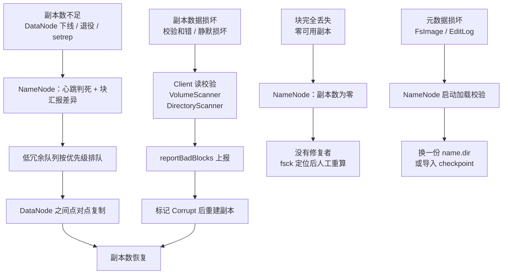
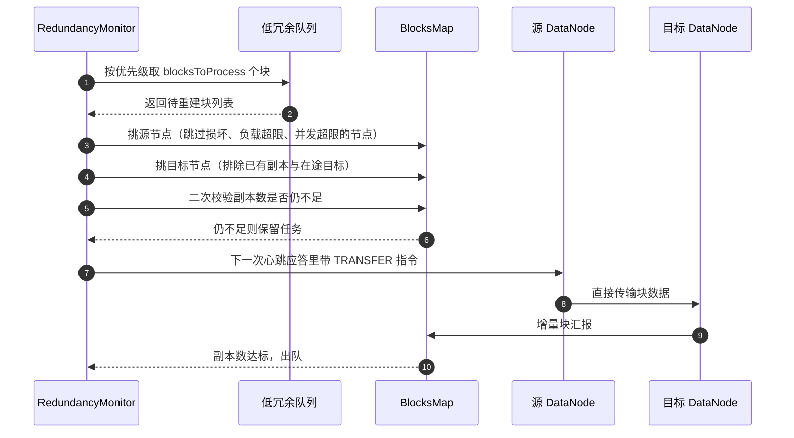
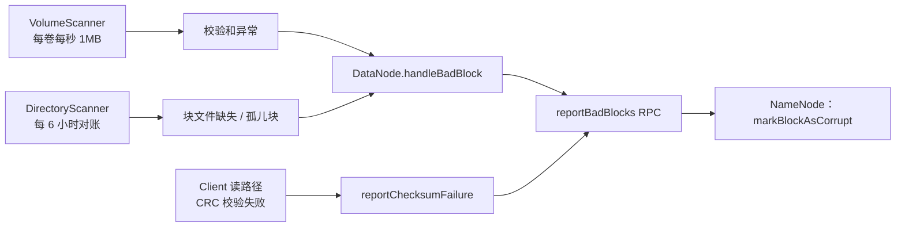
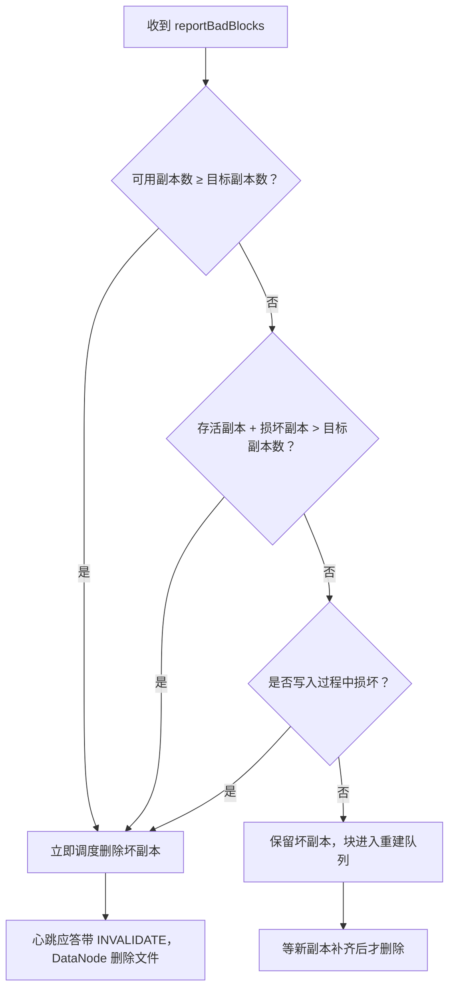
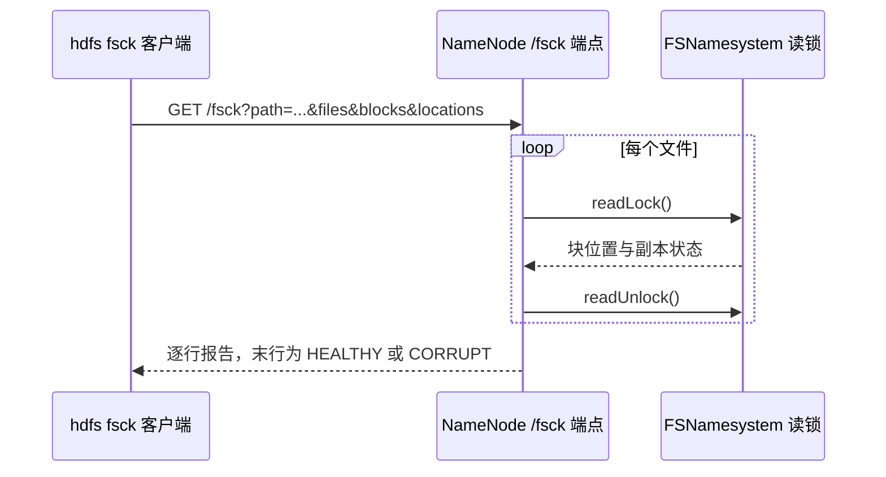

# HDFS 容错与恢复机制——自愈修复的工程实现

**摘要：**

HDFS 的可靠性不来自硬件不出错，而来自一条分工明确的修复链：谁发现损坏、谁判定、谁真正搬数据、谁兜住修不了的那部分，这四件事分别落在 Client、DataNode、NameNode 与管理员身上。本文先把四种损坏与四个修复者对齐成一张表，再逐段进入机制。NameNode 侧讲清 Hadoop 3.x 里那个被改名成 `RedundancyMonitor` 的线程：三秒一轮、五级优先级队列、每轮预算等于在线节点数乘以二，为什么"只剩一个副本"排最高而"全部损坏"排最低；`dfs.namenode.replication.max-streams` 的出厂值是 2 而不是流传甚广的 50；`considerLoad` 用集群平均 xceiver 数的两倍作门槛，把忙节点挡在复制目标之外。DataNode 侧拆开 `VolumeScanner` 的速率模型：每卷每秒 1MB 的上限、五百零四小时的周期、以及"单卷容量超过 1.73TiB 就永远扫不完"这道算术。坏副本上报之后，NameNode 在副本充足时立刻发删除指令、在副本不足时反而把它留着当最后一份，两个分支的判据都能在源码里逐行对上。围绕 `fsck`，给出参数矩阵与一条常被忽略的判据：健康状态只看缺失块与损坏块，`Under-replicated` 再高也照样报 `HEALTHY`。缺失块的应急先证伪再动手，元数据损坏退回到多余的 `name.dir` 与 checkpoint。收尾是六个可对照日志的故障形态、三个代价明确的反例，以及"自愈跟不上损坏速度"这条比任何参数都重要的主线。

---

## 第 1 章 四个修复者，四种损坏

### 1.1 一份报告里的三层含义

假设某个凌晨，值班同学看到业务目录的 `fsck` 结果从 `HEALTHY` 变成了 `CORRUPT`。报告里有三行数字：`Under-replicated blocks` 一万二千，`Missing blocks` 三个，`Corrupt blocks` 七个。三个数字摆在一起，最省事的读法是"集群出问题了，等它自己修"。但这三行对应三种完全不同的处境：一万二千个块只是冗余不足，数据每一份都还读得到，NameNode 的复制线程会在接下来的数小时里逐个补齐；三个缺失块已经是零可用副本，任何自动机制都救不回来；七个损坏块还要再看它们是否还有健康副本，有就自动修，没有就归入前一类。

把这三层摊开，会看到一个容易被忽略的事实：HDFS 的自愈不是"一个机制"，而是若干角色在不同时间尺度上各干一段。NameNode 掌握全局视图但从不碰数据，DataNode 碰得到数据却只看得到自己那一份，Client 在读取路径上跑得最快但报完就走，管理员手里有唯一一张"整个集群丢了什么"的清单——`fsck` 之所以不可替代，原因就在这里。

### 1.2 谁发现，谁修复

把损坏分成四类，四类各自的发现者与修复者几乎没有重叠，这张对应关系是理解整条自愈链的骨架。

| 损坏类型 | 谁发现 | 谁修复 | 能否自动 | 典型时延（默认参数） |
| :--- | :--- | :--- | :--- | :--- |
| 副本数不足（DataNode 下线、退役、调高副本数） | NameNode：心跳超时判死后副本数下降，块汇报差异 | NameNode 的低冗余调度线程发起复制，DataNode 之间直接搬块 | 能 | 判死 630 秒，修复按队列排队，分钟到小时 |
| 副本数据损坏（校验和错、静默损坏） | Client 读时校验、DataNode 的 `VolumeScanner`、启动时目录扫描 | DataNode 上报 `reportBadBlocks`，NameNode 标记损坏后从健康副本重建 | 能，前提是还有健康副本 | 读时立即；扫描最慢一个扫描周期 |
| 块完全丢失（所有副本都坏或都消失） | NameNode：副本数为零；`fsck` 的 `Missing blocks` 计数 | 没有自动修复者，只能 `fsck` 定位后从备份或上游重算 | 不能 | 小时到天，取决于重算 |
| 元数据损坏（FsImage、EditLog） | NameNode 启动加载时、checkpoint 时校验 | 从 `dfs.namenode.name.dir` 的另一份目录或 Secondary NameNode、JournalNode 的镜像恢复 | 半自动，换一份能起 | 重启级，分钟到小时 |

四个角色里，只有 DataNode 对"数据本身"有物理接触权，也只有 NameNode 对"全集群副本分布"有完整视图。这两件事被刻意分开：如果让 DataNode 自己决定去别的节点补副本，每台机器都只知道自己那一份，补出来的副本会往同一批节点上堆，机架分布立刻失控；如果让 NameNode 亲自搬数据，几 PB 的集群流量会全部挤过一台机器。分工的结果是 NameNode 只发指令，DataNode 之间点对点搬——这条设计从 GFS 一直延续到今天。本篇盯的是副本的"损"与"修"这两件事；写入过程中 Pipeline 断裂怎么恢复、崩溃客户端的租约怎么回收，属于写路径上的容错，见 [[04 HDFS 数据读写流程——Pipeline 写入与机架感知读取的底层路径]]。

> [!info] 一个常被忽略的角色
> `fsck` 不是"检查工具"这么简单，它是这条链上唯一的**审计者**。NameNode 知道自己有多少块副本不足，却不会主动告诉你"哪些数据已经彻底没了"，因为对它而言缺失块只是队列里一个无法调度的条目；DataNode 更不知道自己手里少的那个块属于哪个文件。只有遍历整个命名空间、把文件与块、副本与节点对上，才能得出"损失面"。这也是 `fsck` 在大集群上格外重的原因，后文会专门算这笔账。

### 1.3 四个时间常数

自愈链上的每个环节都有自己的节拍，节拍之间的差距达到四个数量级。

| 环节 | 参数 | 默认值 | 含义 |
| :--- | :--- | :--- | :--- |
| DataNode 心跳 | `dfs.heartbeat.interval` | 3 秒 | 存活证明的发送频率 |
| 判死阈值 | `2 × dfs.namenode.heartbeat.recheck-interval + 10 × 心跳` | 630 秒 | 连续这么久没心跳才认定下线 |
| 进入 stale 状态 | `dfs.namenode.stale.datanode.interval` | 30 秒 | 副本仍算存活，但标记为"可能不新鲜" |
| 低冗余队列扫描 | `dfs.namenode.redundancy.interval.seconds` | 3 秒 | 决定"这一轮修哪些块" |
| 全量块汇报 | `dfs.blockreport.intervalMsec` | 6 小时 | 每台 DataNode 上报全量块清单 |
| 目录扫描 | `dfs.datanode.directoryscan.interval` | 6 小时 | 磁盘目录与内存块表的对账 |
| 块内容扫描 | `dfs.datanode.scan.period.hours` | 504 小时 | 每个块最多三周才被校验一次 |
| 人工处置 | 无 | 小时级 | 从告警到有人动手 |

判死阈值这一格值得多说一句。常见的错误算法是"5 分钟检查间隔 + 10 个心跳 = 5 分 30 秒"，漏掉了检查间隔本身要乘 2：源码里写的是 `heartbeatExpireInterval = 2 * heartbeatRecheckInterval + 10 * 1000 * heartbeatIntervalSeconds`，按出厂值算下来是 600 秒加 30 秒，也就是**10 分 30 秒**。这个数字决定了"一台机器挂掉之后，集群要过多久才开始为它补副本"，把它记错会导致对故障窗口的估计差一倍。

四个数量级放在一起，一条推论立刻成立：自愈的速度上限，由最慢的那一环决定。判死要十分钟，扫描要三周，这两件事都不是调一个参数能改变的，因为把判死时间压到一分钟，网络抖动就会引发全集群误判；把扫描周期压到一天，磁盘带宽会被自检吃掉一大块。运维能动的只是中间那一段——队列消费的速度，而这恰恰是最容易出问题的一段。把四种损坏与各自的发现者、修复者画成一张图，关系就很清楚：



### 1.4 真正要盯的比率

运维上最容易被问错的问题是"集群健康吗"，更该问的是"修复速度还赶得上损坏速度吗"。这个区别在平稳期看不出来，只有连续故障时才暴露，譬如一台机器挂掉之后还没补齐，另一台又掉了。

把两条速率写出来就清楚了。损坏侧的单位是"每天新增多少需要重建的块"，它由在线节点数、磁盘故障率、退役节奏共同决定；修复侧的上限是三个约束里最紧的那个：每轮能调度的块数（在线节点数乘以二，再除以三秒）、每台源节点允许的并发复制流（默认 2 条）、以及跨机架可用带宽。前两个是 NameNode 侧的软约束，第三个是物理约束。

一个具体场景能说明这条主线的分量。假如一个机架三十台 DataNode 因交换机故障整体下线，每台存六十万个块，需要补的副本就是一千八百万个块。按每块 128MB、需要补一份算，约 2.3PB 的跨机架流量；按跨机架链路能稳定跑到 2GB/s 估算（示例推算，真实值取决于交换机与网卡配置），光搬数据就要十几天。在这十几天里，任何再丢一份副本的块都会直接掉进缺失块——自愈没有失败，它只是不够快。

---

## 第 2 章 副本数不足：低冗余队列的优先级与限流

### 2.1 谁会往队列里放东西

副本不足这件事，NameNode 有六个入口能感知到。

最直接的是心跳判死。`HeartbeatManager` 定期扫描每台 DataNode 的 `lastUpdate`，超过 630 秒的阈值就标记为 Dead，它名下所有块的可用副本数同时减一。这种减少不是渐进的，是一次性发生的，所以一个机架掉电会在几秒内把几百万个块同时推进"副本不足"状态，这也是自愈风暴的起点。

第二个入口是退役。管理员把节点写进 `dfs.hosts.exclude` 再执行 `refreshNodes` 之后，节点进入 `DECOMMISSIONING`，它上面的副本被单独计数，不再算作可用冗余；退役完成才真正移出。这里有个容易被忽略的细节：退役中的副本单独计数，不算可用冗余，而 `fsck` 报出 `Under replicated` 的那一行里会把 decommissioning 副本数一并列出来，所以退役期间看到大量块显示副本不足是预期行为，不代表出了故障。

第三个是副本损坏上报，第四个是管理员用 `setrep` 调高副本数，第五个是块汇报差异——DataNode 的全量汇报里少了某个块，NameNode 把这台节点从块的位置列表里摘掉。第五个入口的代价最大：全量汇报六小时一次，意味着一次"磁盘静默丢数据"最多要六小时才被 NameNode 发现。

第六个入口比较特殊：副本数够了但放置不达标。三个副本全在同一机架、或者全在同一台机器上，数量上满足要求，容错能力却不合格，这种块进的是另一个队列。它说明"副本不足"这个词在实现里包含两层意思——数量不足，以及分布不合格。至于放置是否达标按什么规则判定，机架拓扑怎么建、三副本怎么摊，见 [[05 HDFS 副本放置策略——机架感知与数据可靠性的工程权衡]]。

### 2.2 名字变了，机制没变

Hadoop 2.x 里这个线程叫 `ReplicationMonitor`，队列类叫 `UnderReplicatedBlocks`，那套名字在网上流传极广。到了 Hadoop 3.x，线程被并进 `BlockManager` 成了内部类 `RedundancyMonitor`，队列类换成了 `LowRedundancyBlocks`，配置键也从 `dfs.namenode.replication.interval` 改成了 `dfs.namenode.redundancy.interval.seconds`（默认 3 秒）。改名的动机是把"复制"这个动作与"冗余度"这个判据分开——EC 块组的重建走的也是同一个队列，但它做的不是复制，而是重算。

线程的骨架很短：只要 NameNode 在运行、且已经退出安全模式，就每三秒跑一轮"计算低冗余工作"，然后睡到下一个周期。两个细节值得记住。安全模式期间它什么都不做，因为此时块汇报还没收全，队列里的"不足"多半是假象；而 NameNode 从待机切到激活之后，也要等块汇报补齐、队列重新填充，才会开始真正调度。这解释了为什么主备切换后的头几分钟里，`Under-replicated` 会先飙高再回落。

### 2.3 五级队列与判据

队列一共五级，编号从 0 到 4，数字越小越优先。判据不在"缺多少"这个直觉上，而在"还剩多少可用副本"以及"这条路径上还有没有健康的源"。

| 队列 | 判据（副本型块） | 典型场景 | 优先级含义 |
| :--- | :--- | :--- | :--- |
| 0 最高 | 可用副本数为 1；或可用副本为 0 但仍有退役中、只读的副本 | 两个副本所在机器先后故障，只剩最后一份 | 再丢一份就永久丢失，必须最先修 |
| 1 很低冗余 | 当前副本数乘以 3 仍小于目标副本数 | 副本因子被设成 10，只剩 2 份 | 冗余严重不足，但尚不至于立刻致命 |
| 2 低冗余 | 副本数不足，但已不低于目标的三分之一 | 目标三副本，剩两个 | 常规补齐 |
| 3 分布不合格 | 副本数够，但机架或放置策略不满足 | 三个副本全挤在一个机架 | 数量没问题，抗故障能力不合格 |
| 4 有损坏块 | 可用副本为 0，只剩被标记损坏的副本 | 三个副本的校验和全错 | **最低**，因为已经没有健康的源 |

第 1 级在默认副本因子下几乎用不到：目标三副本时，副本数只要低于 3 就至少是 2，而剩 1 份已经进了第 0 级，`1 × 3 < 3` 这个条件永远不成立。它真正生效的场合是副本因子被调高之后：副本数要先过掉"剩 1 份"这一档，剩下的 2 份及以上才轮到按比例判断，所以目标副本数至少得在 7 以上才会出现这一级，譬如某个目录设成 10 副本而只剩 2 份。

第五行是最反直觉的一条，也是最该记住的一条。直觉上"全部损坏"应该最紧急，实现里却排在最后。原因很直接：复制任务要先挑一个源节点，而源节点选择那一步明确跳过了状态为 `CORRUPT` 的副本（源码注释是"do not select the replica if it is corrupt or excess"）。没有源，就没有任务；没有任务，块就只能待在队列里。所以这一级的语义不是"优先修复"，而是"保住别继续减少"。每轮它都会被取出来、每轮都找不到源、每轮都把 NameNode 上的 `NumTimesReReplicationNotScheduled` 指标加一，这个计数器才是"自愈真的卡住了"最直接的证据。

EC 块组是例外。条带化块的"损坏"往往只坏掉一个内部块，其余内部块还健康，重建路径是从其他内部块重算缺失的那一份，所以这一类确实能自愈；真正无解的是可用内部块数少于数据块数。

### 2.4 一轮循环的完整顺序

一轮循环的时序如下：



每轮的工作预算在两个地方被卡住。总量是"在线节点数 × `dfs.namenode.replication.work.multiplier.per.iteration`"，默认倍数是 2，也就是说五百个在线节点每轮处理一千个块。取块时严格按优先级从 0 往 4 取，预算耗尽就停，这意味着高优先级队列可以吃掉全部预算，低优先级队列在一轮里一条都轮不上。设计者并不认为这是缺陷：在副本只剩一份的时候，让分布不合格的块多等一会儿是应该的。

真正的公平性靠另两个机关维持。队列迭代器带书签，下一轮从上轮停下的位置继续；而当队列持续被追加、迭代器永远走不到尽头时，`dfs.namenode.redundancy.queue.restart.iterations`（默认 2400 轮）会把所有书签重置到队头，按三秒一轮折算大约两小时一次。如果没有这个重置，一个长期积压的队列会让队尾的块永远等不到，而它可能正好是某个关键表的最新分区。

任务下发之后还有两道保险。目标节点选出来时，先放进 `pendingReconstruction` 标记"在途"，避免同一条块被重复派给多个目标；如果源节点迟迟不完成，`processPendingReconstructions` 会把超时的任务收回队列重排。第二道保险是下发前的二次校验：选目标时释放过全局锁，期间块可能已经被别的路径补齐，校验时发现副本够了就把任务撤掉。这两步解释了一个常见现象——`fsck` 里 `Blocks queued for replication` 一直有值，而日志里却看不到新的大批量传输。

### 2.5 限流旋钮与代价

| 参数 | 出厂值 | 作用点 | 调大的代价 | 调小的代价 |
| :--- | :--- | :--- | :--- | :--- |
| `dfs.namenode.replication.max-streams` | 2 | 单台 DataNode 作为源并发进行的**非最高优先**复制流上限 | 源节点 IO 与网络被复制吃掉，业务读延迟上升 | 队列消化变慢，低冗余块暴露窗口拉长 |
| `dfs.namenode.replication.max-streams-hard-limit` | 4 | 所有复制流的硬上限，最高优先级也不越过 | 同上，且更难回退 | 极端故障下的最后冲刺能力被削 |
| `dfs.namenode.replication.work.multiplier.per.iteration` | 2 | 每轮处理的块数 = 在线节点数 × 该值 | 每轮 NN 持锁时间变长，RPC 延迟抖动 | 队列消化能力成比例下降 |
| `dfs.block.invalidate.limit` | 1000 | 单次心跳应答里下发的删除指令条数 | 单次心跳报文变大，DN 删除压力集中 | 删除变慢，磁盘空间回收滞后 |
| `dfs.namenode.invalidate.work.pct.per.iteration` | 0.32 | 每轮参与删除的节点比例 | 删除更快，但会与复制抢带宽 | 坏副本长期占空间 |
| `dfs.datanode.balance.bandwidthPerSec` | 100m | **只约束 Balancer**，不约束副本复制 | 均衡更快，压业务带宽 | 均衡变慢，磁盘水位失衡 |

这张表里有三个常见的误读，都值得单独纠正。

第一个是 `max-streams` 的默认值。不少材料把它写成 50，把硬上限写成 100；按 Hadoop 3.3.6 的 `hdfs-default.xml`，这两个键的出厂值是 **2 和 4**，官方描述分别是"非最高优先级复制流的硬限"和"所有复制流的硬限"。100 这个数字更可能来自 `dfs.datanode.balance.max.concurrent.moves`，那是均衡器每台节点允许的并发块移动数，和副本复制是两套东西。很多发行版会把这两个值调高，所以在生产集群上看到 8 或 16 也不必惊讶，但那不是出厂值。

第二个是限流施加在哪一端。它卡的是**源节点**：一台 DataNode 同时向多个目标供数时，超过上限就不再被选为源。卡源而不是卡目标，是因为瓶颈通常在读出侧——一块盘要同时喂几条复制流，随机读会被打散；而写入侧的目标节点写的是顺序大块，压力小得多。

第三个是 `considerLoad` 的位置。它其实不在限流体系里，而是目标选择时的过滤器，但因为它是"复制慢"最常见的原因，放在这里一起讲。

### 2.6 considerLoad：为什么复制会挑不到目标

目标节点的选择复用了写入路径的 `BlockPlacementPolicy`，也就是副本放置那一套规则。选择过程中有三道过滤：不能是退役中的节点、不能是 stale 节点、不能是负载过高的节点。第三道的判据藏在 `excludeNodeByLoad` 里：

```
节点当前 xceiver 数 > considerLoadFactor × 集群平均 xceiver 数
```

`dfs.namenode.redundancy.considerLoad` 默认开启，`dfs.namenode.redundancy.considerLoad.factor` 默认 2.0。换句话说，一个节点的并发传输连接数超过集群平均值的两倍，它就不会被选为复制目标，也不会被选为新写入的目标。

这个设计在正常情况下非常合理：把复制流量引到闲节点上，整体更快。但在故障场景里它有反作用。大面积故障时全集群都在复制，所有节点的 xceiver 数一起抬高，平均值被自己抬上去，过滤反而几乎不生效，复制流量摊到所有节点，谁都快不了；反过来，小集群或局部热点时，几台忙节点被排除，剩下的空闲节点又受机架分布约束，`chooseTarget` 可能返回空，任务被撤销、块回到队列、下一轮重复同样的过程。日志里表现为反复出现"无法重建"的 debug 记录，而集群看起来并不缺容量。

于是就有了那个看起来合理的错误动作：把 `considerLoad` 关掉，让复制想放哪放哪。短期看复制确实开始动了，长期看目标节点被复制流与业务读同时压住，单流速率下降、`Slow BlockReceiver` 增多、部分复制超时重试，有效吞吐反而更低；更麻烦的是这种伤害发生在业务节点上，用户先感知到的是查询变慢。正确做法是保留开关，必要时调 factor（譬如从 2.0 调到 3.0），并配合 `max-streams` 小幅提升，一次只动一个变量。

### 2.7 为什么有些块要等很久

把上面几节合起来，可以给"某个块排队两小时还没修"一个完整解释，而且这个解释有五个层次，逐层排查就能定位。

第一层是优先级。它可能落在编号 4 那一级，也就是全坏块，那它永远不会被修，等多久都没用。第二层是预算。每轮只处理"在线节点数乘二"个块，大规模故障时队列增长速度远高于消费速度，一个块排在几百万个任务后面，等几小时是算术结果。第三层是源端限流。即便轮到它，提供数据的源节点可能已经有两条复制流在跑，只能等下一轮。第四层是目标选择失败。负载过滤加机架约束让 `chooseTarget` 返回空，任务被撤销重排。第五层是迭代器重置。队列持续追加时书签两小时才回队头一次，排在前面的块会被反复跳过。

这五层也对应五种不同的处置：第一层去查为什么没有健康副本，第二层扩容或降低损坏速度，第三层调 `max-streams`，第四层看 `considerLoad` 与机架分布，第五层什么都不用做，等重置即可。

---

## 第 3 章 坏块的发现：扫描器与读路径

### 3.1 三条发现路径

副本损坏的发现者有三个，各自的时间尺度差得很远。

最快的在读路径上。Client 读块时 DataNode 会重算校验和，客户端自己也会独立校验一遍；一旦对不上，这次读立即失败，链条当场触发。

最慢的是 `VolumeScanner`。它按块扫描卷上所有已完成副本，用校验和判断内容是否被改写，一个块三周才轮到一次。

介于两者之间的是 `DirectoryScanner`。它不校验内容，只对账：把磁盘目录里实际存在的块文件与内存里的块表逐一比对。对账能发现两类问题——磁盘上有、内存里没有的孤儿块（通常是写入竞态留下的，直接删），以及内存里有、磁盘上没有的丢失块（上报 NameNode，触发副本重建）。它跑得比 `VolumeScanner` 勤，每六小时一轮，但只能发现"文件不见了"，发现不了"文件还在、内容坏了"。

还有一条不常被提起的路径：DataNode 启动时对整个数据集做一次扫描，把每个块文件的实际长度与元数据里的长度、以及 `.meta` 校验文件是否存在核对一遍。这解释了为什么"重启一台 DataNode 之后突然多出几个坏块"——不是重启弄坏了数据，而是重启才做了一次全量核对。另有一类损坏不归这三个发现者管：整块盘掉线、卷被卸载、读整块卷直接报错。那属于卷级故障，由 `FsDataset` 把该卷标记失败、把它上面的副本从块表里摘掉，走的是另一条路径，细节见 [[08 DataNode 存储引擎——FsDataset 与磁盘 IO 管理机制]]。三条发现路径最后都汇到同一个上报入口：



### 3.2 VolumeScanner 的速率模型

`VolumeScanner` 的实现比它的名字精细。每块卷一个扫描线程，互不干扰；扫描时不是简单读文件，而是构造一个 `BlockSender`，把数据发往一个空输出流——这条路径与正常读请求走的是同一套校验逻辑，所以扫描发现的坏块与客户端读出的坏块是同一类问题，不存在"自检通过、读的时候才报错"的错位。

限速很保守。`dfs.block.scanner.volume.bytes.per.second` 默认 1048576，也就是**每块卷每秒 1MB**，是整个卷共享的额度，不是每个块。扫描线程每分钟统计一次实际扫描字节数，如果最近一小时的速率已经到达目标，就睡三十秒再试——目标速率是上限，不是保证值。

另外一个细节是缓存策略。扫描用的是 `DropBehind`，读过的页不留在 page cache 里。这一条至关重要：如果没有它，一次全盘扫描会把业务热点从 cache 里挤出去，表现为"扫描一开、查询变慢"，而没人会把这件事故意关联到自检上。

周期由 `dfs.datanode.scan.period.hours` 控制，默认 504 小时。这个参数的行为需要精确记住：正数表示每个块在该周期内最多扫一次；`0` 表示使用默认的 504 小时；**负数才表示关闭扫描**。早期文档曾写成"设为零即关闭"，这个说法是错的，照它配置会得到完全相反的结果。

扫描进度靠一个持久化游标维持。每块卷上有一个记录扫描位置的迭代器文件，`dfs.block.scanner.cursor.save.interval.ms` 控制保存频率，默认 10 分钟。这个键在 3.3.6 里被标记为内部键，只在允许单元测试配置时才生效，也就是说生产上无法通过常规配置调整它——对运维而言它的意义只是解释"为什么重启后扫描是从中间继续的，而不是从头开始"。游标保存的代价也要算进去：每十分钟写一次小文件，对磁盘寿命的影响可以忽略，但它保证了一次扫描不必因为重启而重来。

### 3.3 为什么三个星期的周期常常是空话

这里有一道很朴素的算术，很多集群没有算过。

每卷每秒 1MB，五百零四小时能扫完的数据量是 1MB × 504 × 3600 秒，约等于 **1.73TiB**。也就是说，在默认参数下，单块卷容量超过 1.73TiB 的机器，`VolumeScanner` 在一个扫描周期内根本跑不完一轮；跑不完的后果不是报错，而是下一轮开始时游标还停在上一轮的中途，所谓"三周校验全盘"就变成了"永远在扫、永远扫不完"。

| 单卷容量（示例） | 1MB/s 扫完所需时间 | 三周内扫完所需速率 |
| :--- | :--- | :--- |
| 1TiB | 约 12 天 | 0.6MB/s |
| 2TiB | 约 24 天 | 1.2MB/s |
| 4TiB | 约 49 天 | 2.3MB/s |
| 8TiB | 约 97 天 | 4.6MB/s |

数据中心的现实是单盘 4TB 起步、8TB 到 16TB 常见，而一台 DataNode 往往挂十几块盘。按默认速率，每块盘都是超期服役。这带来两个可推论的后果：一是静默损坏的发现时延实际上是"几个月"而不是"三周"，对冷数据影响小，对热数据里的静默位翻转就不够快；二是扫描线程长期在线，虽然被限速，但一年的累计读取量相当可观，对机械盘的寻道占用是持续的背景噪声。

想把周期真正拉到三周以内，只有两条路：按容量反推一个合适的 `dfs.block.scanner.volume.bytes.per.second`，接受更高的 IO 占用；或者承认扫描周期随容量线性变长，改用更勤的目录对账加快照校验来补。两条路都不免费，这也是这一章最值得强调的判断：默认值是为十年前的盘容量设计的。

### 3.4 发现之后的连锁反应

扫描线程判定一个块有问题时，动作比想象中克制。它先看这个块是否还在数据集里——不在了就不算错误；再看异常是不是 `FileNotFoundException`，如果是因为写入竞态导致旧路径失效，只记一条 info 日志，不当作坏块。这两道过滤避免了一次重启或一次写入把大量健康块误报成坏块。确认之后才调用 `DataNode.handleBadBlock`，向 NameNode 发 `reportBadBlocks`，同时把这个块放进"可疑队列"优先重扫一次——重扫是为了区分真损坏与偶发读错，代价很小，收益是避免误报。

NameNode 侧收到上报后进 `findAndMarkBlockAsCorrupt`：先按块 ID 在块表里找，找不到就忽略（可能是块汇报还没到）；找到之后把这块节点上的副本加入损坏副本表，带上原因码，然后进入下一章要讲的分支判断。

### 3.5 读时的坏块重试

客户端读到一个坏副本时的行为，是一套比多数人预期更耐心的重试。换副本与重新取块位置的完整时序在 [[04 HDFS 数据读写流程——Pipeline 写入与机架感知读取的底层路径]] 里已经拆到每一步，这里只补坏块上报的那一段。

第一次校验失败，客户端把该节点加入本地"坏节点"集合，换下一个副本继续读；如果所有副本都失败，它会重新向 NameNode 要一次块位置——注意这一步才是关键，它不是简单地再试一遍，而是相信 NameNode 可能已经知道新的副本或者新的健康节点。这个"重新取位置"的次数被 `dfs.client.max.block.acquire.failures` 限制，默认 3 次。

每次重取之前要等一会儿，等待时长按 `timeWindow × failures + timeWindow × (failures + 1) × 随机数` 计算，`timeWindow` 来自 `dfs.client.retry.window.base`，默认 3000 毫秒。折算下来第一次等 3 到 6 秒，第二次 6 到 9 秒，第三次 9 到 12 秒，累计十几到二十几秒。这个等待是故意加的：集群正在故障时，立刻重试只会把 NameNode 和 DataNode 一起打垮，退避让集群有机会恢复。

三次都失败之后，客户端抛出 `BlockMissingException`，日志里是 `Could not obtain block`。这句日志在排障中的含义要分清楚：它意味着"这个块在客户端看来没有可用副本"，但**不等于**这个块真的丢了——可能只是恰好所有副本所在节点都不可达，也可能只是 NameNode 给的列表还没更新。

读路径上还有一个容易被忽略的上报细节。客户端会把本次读过程中遇到的所有坏副本攒在一个集合里，读结束后统一上报，而不是遇到一个报一个。上报时还有一个条件：只有当"报错的副本数少于该块的副本总数"时才上报，也就是说如果所有副本都校验失败，客户端反而不上报——它无法判断到底是哪一份坏了，贸然上报可能把好副本也标成坏的。这种"全坏时沉默"的设计，把最终判定权留给了 NameNode 的扫描与块汇报差异。

---

## 第 4 章 坏副本的善后：删还是留

### 4.1 两个分支

坏副本上报到 NameNode 之后，命运取决于一个很具体的问题：**除了它，还够不够用**。分支只有三层：



源码里的三个条件分支就是这么写的：副本够用、或者"存活加损坏"的总数超过目标、或者损坏发生在写入过程中（此时坏副本的 Generation Stamp 与正常副本不同，留着也没用），三种情况都立刻删；否则保留。保留的语义是"这是这个块最后的物理载体，删了就一点痕迹都没有了"，哪怕内容有问题，至少还能拿来做取证或部分恢复。

这里要纠正一个流传很广的说法：坏副本并不是"永远占着空间不动，要等 `fsck -delete` 或 Balancer 来清"。真相分两种情形。副本充足时，NameNode 会在下一次心跳应答里下发删除指令，DataNode 删掉文件，空间就回来了，`fsck -delete` 完全用不上——它删的是整个文件，不是单个副本。真正长期占空间的是"副本不足"那一支：坏副本被有意保留，直到新副本补齐。所以看到"坏块占空间"时，正确的诊断方向是查复制为什么没完成，而不是去找删除命令。笔者更愿意把坏副本当成一张欠条：它在那里，说明某笔修复账还没结。

还有一个时间维度的坑。删除指令的调度受 `dfs.block.invalidate.limit`（每次心跳最多 1000 条）和 `dfs.namenode.invalidate.work.pct.per.iteration`（每轮 32% 的节点参与）双重限制，大规模损坏时删除本身也要排队。源码里有一句注释值得记住：如果损坏不是由扫描或客户端校验主动上报，而是靠块汇报差异暴露出来的，那么在默认六小时的汇报周期下，一个坏副本从"已经坏了"到"被清理"可以拖到半天以上。

### 4.2 报坏块与删坏块的时间线

把两条路径并排看，差异就很清楚。

副本充足时：扫描或读校验发现异常（秒级），DataNode 上报 `reportBadBlocks`（立即），NameNode 标记并调度删除（毫秒），下一次心跳应答下发 `INVALIDATE`（最多 3 秒），DataNode 异步删文件并更新块表（秒级）。全程以秒计。

副本不足时：发现与上报同上，NameNode 保留坏副本、把块加入重建队列，等复制任务完成（分钟到小时），新副本的增量汇报到达之后，坏副本才被删除。如果复制一直排不上队，这个坏副本就会一直留着，`fsck` 每次都会把它算进 `Corrupt`。这就是"坏块长期存在"的真实机理，它是自愈欠账的症状，不是需要单独清理的垃圾。

### 4.3 删坏块的标准流程

真正需要人工动手的场景只有一个：某个文件的块已经无法修复，必须在地层上做取舍。标准流程是五步。

第一步，拿清单。`hdfs fsck /path -list-corruptfileblocks` 输出的是"哪些文件里有损坏或缺失的块"，并且带一个 cookie 用于分页续查，大集群上这是唯一能承受的扫描方式——它不做逐块的完整校验，只列清单。

第二步，确认范围。清单里的每个文件都要找到负责人，判断它是可重算的（数仓分区、可重跑的批作业输出）还是唯一的（日志归档、外部导入的原始数据）。这一步决定了后面是删还是搬。

第三步，抢救。`hdfs fsck /path -move` 会把坏文件里**仍然可读的块**拷贝到 `/lost+found` 目录下，文件名是块 ID，然后删除原文件。注意这做的是抢救而不是修复：搬出来的是一堆按块命名的碎片，能不能拼回可用数据取决于业务方自己。对不需要抢救的文件，`-delete` 直接删，更干净。

第四步，记录并通知。`-move` 与 `-delete` 都会让原路径消失，且不可逆。生产上必须先有变更单和下游通知，否则上游作业会在下一次调度时报"输入路径不存在"，把一次数据事故变成两次。

> [!warning] 先备份再动手
> `-move` 搬出来的东西是按块 ID 命名的碎片，不是能直接读的文件；`-delete` 之后再想取证，就只能去翻 NameNode 的编辑日志了。动手之前把 `-list-corruptfileblocks` 的完整输出、涉及的块 ID、以及操作时间点存成一份单独的记录，事后归因时它比任何监控曲线都好用。

第五步，回头查原因。文件级损坏背后总有一个机制性原因：副本数被改过、机架感知没配、某批磁盘在三个月内集中坏、退役节奏太急。只清理不归因，同样的事会在下个季度重演。

### 4.4 三个误解

第一个误解是"Balancer 会清理坏块"。Balancer 的职责是让各节点磁盘使用率趋于均衡，它的工作单元是块移动，移动的是健康副本；遇到坏副本它既没有权限也没有语义去处理。指望均衡器顺手清理坏块，结果只会是均衡一直跑不完。

第二个误解是"坏块会自动修复"。只有"还存在健康副本"的块能自动修复。零可用副本的块，无论等多久都不会自己好，因为找不到源——这一条在第 2 章第 3 节编号为 4 的那一级队列里已经写清楚了。

第三个误解是"`fsck -delete` 能删单个坏副本"。它删的是整个文件所对应的命名空间条目以及全部块，粒度是文件，不是副本。想减轻单机磁盘压力应该走 DataNode 的块失效路径，而不是动用 `fsck`。

---

## 第 5 章 fsck 的正确用法

### 5.1 它在 NameNode 上到底做了什么

`hdfs fsck` 是一个 HTTP 客户端。它不通过 RPC 协议，而是拼一个 URL 请求 NameNode 的 `/fsck` 端点，把返回的文本逐行打印出来，最后靠**最后一行**是否以 `HEALTHY` 或 `CORRUPT` 结尾来决定自己的退出码。这也解释了为什么这个命令的输出格式多年来异常稳定：客户端要靠字符串匹配来判定结果，改动输出就会破坏所有依赖它的脚本。

不过真正干活的是 NameNode 里的 `NamenodeFsck`。它从给定路径开始遍历命名空间，每遇到一个文件就调用一次取块位置的逻辑，而这一次调用要拿 `FSNamesystem` 的读锁。一次 fsck 的加锁节奏如下：



读锁本身不互斥，多个读可以并发；但它与写锁互斥，而 NameNode 的写锁是全局的。这意味着 `fsck` 每处理一个文件，就在全局锁上做一次"读占位"，而 `create`、`addBlock`、`complete`、`rename` 这些写操作都要排队等它让出。文件数越多，占位次数越多，写操作的平均等待越长。一个百万文件级的命名空间，`fsck` 会取一百万次读锁。

输出量是第二重代价。`-blocks` 让每个块打一行，`-locations` 再补上所有副本所在节点；一个百万块的集群，输出轻松上百 MB，NameNode 要格式化、网络要传、客户端要解析。很多人感受到的"fsck 把集群拖慢"，一半来自锁，一半来自这堆字符串。

### 5.2 参数矩阵

| 参数 | 作用 | 代价 |
| :--- | :--- | :--- |
| 无参数 | 只输出汇总，遍历全部文件 | 锁占位与文件数成正比 |
| `-files` | 逐文件打印大小、副本策略、块数 | 输出量陡增，大目录不可用 |
| `-blocks` | 逐块打印状态 | 输出量再翻一倍 |
| `-locations` | 配合 `-blocks`，打印每块副本所在节点 | 输出量再翻数倍，最重 |
| `-racks` | 打印副本的机架路径 | 同 `-locations`，用于验证机架分布 |
| `-replicaDetails` | 打印每个副本的状态标记（存活、损坏、多余、stale） | 定位单副本问题时最有用 |
| `-openforwrite` | 把正在写入的文件也列出并检查 | 会把写中途的块算进统计，易误判 |
| `-list-corruptfileblocks` | 只列有损坏或缺失块的文件，带分页 cookie | 最轻的可用形态 |
| `-move` | 把坏文件残余可读块搬到 `/lost+found` 后删原文件 | 不可逆 |
| `-delete` | 直接删坏文件 | 不可逆 |
| `-blockId <id>` | 反查某个块属于哪个文件、分布如何 | 单块排查，几乎无代价 |
| `-replicate` | 对放置不达标的块主动触发复制 | 会产生真实的数据搬移 |
| `-maintenance` | 输出维护状态节点副本明细 | 只影响输出 |

需要注意 `-files`、`-blocks`、`-locations` 是递进关系，不是并列关系；只写 `-locations` 而不带 `-blocks` 不会得到逐位置的输出。另外一个限制是同一个命令只能对一个路径生效，想做全集群分片检查只能靠外部循环。

### 5.3 健康判据只有两个条件

这一点值得单独成节，因为它决定了 `fsck` 的结论能信到什么程度。

源码里的健康判定只有一行逻辑：缺失块列表为空，并且损坏块计数为零。`Under-replicated`、`Mis-replicated`、`Missing replicas` 这些数字再大，也不会让最终状态变成 `CORRUPT`。

所以"`fsck` 报 `HEALTHY`"这句话的准确含义是"没有彻底丢失的数据"，而不是"集群冗余充足"。一个所有块都只剩一份副本的集群，`fsck` 照样报 `HEALTHY`。把这个结论当成可以放心离开的依据，是运维上最常见的一次误读。

反过来，`fsck` 报 `CORRUPT` 的含义倒是很硬：至少有一个文件存在缺失块，或者存在被标记为损坏的块。此时退出码是 1；如果路径落在退役中或维护中的节点上，退出码会是 2 到 5 之间的值，脚本里要区分对待，否则会把正常退役误判成数据损坏。

### 5.4 三档冗余的区别

`fsck` 的汇总里其实有三档"不够"的说法，含义完全不同。

| 档位 | 判据 | 数据可读性 | 能否自愈 | 处置 |
| :--- | :--- | :--- | :--- | :--- |
| `UNDER MIN REPL'D` | 可用副本数低于最小副本数 | 不可读 | 不能（无源） | 按缺失块应急处理 |
| `Under-replicated` | 可用副本数低于目标副本数，但不低于最小值 | 可读 | 能，只要源还在 | 观察队列消化速度 |
| `Mis-replicated` | 副本数达标，但机架或放置策略不满足 | 可读 | 能，进入编号 3 的那一级队列 | 检查机架感知配置 |

`Missing blocks` 与 `Under-replicated` 的区别可以一句话概括：前者是"零份可用副本"，后者是"少于期望但不为零"。前者对应数据丢失，后者对应冗余下降。把它们混为一谈，会导致两种相反的错误——把可自愈的欠冗余当成数据丢失而惊慌，或者把真正的丢失当成欠冗余而干等。另外还有一处细节：一个块如果零可用副本但曾被标记为损坏，`fsck` 会把它计入 `Corrupt` 而不是 `Missing`，因为"所有现存副本都损坏"与"副本彻底消失"在语义上不同，实现里也保留了这份区别。

### 5.5 什么时候能跑，怎么限速

判断能不能跑，看两个信号就够了：NameNode 的 RPC 队列延迟，以及写操作的平均耗时。前者在监控上通常叫 `RpcQueueTimeAvgTime`，后者能从 `FsLockWaitTimeAvgTime` 一类指标间接看出；这两条曲线在 `fsck` 启动后明显抬头，就该停。笔者习惯再加一条兜底判据：最近半小时内有过主备切换或进程重启的，直接不跑。

具体的时间窗判据有四条，命中任何一条都不要跑全量：

- 写入高峰。批作业提交前后、数仓 ETL 的整点窗口，写锁争用本来就高，再叠一层读锁占位会把延迟推上去。
- NameNode 刚重启或刚完成主备切换。十几分钟内块汇报还没收齐，此时跑出来的 `Missing` 大部分是假象。
- 安全模式中。块位置信息不完整，统计没有意义。
- NameNode 出现长 GC 停顿。`fsck` 会额外放大堆内存压力，因为逐文件的块位置对象要生成。

能跑的时候，限速手段按有效性排序：优先用 `-list-corruptfileblocks`（不逐块输出，代价最小）、其次把路径拆到具体业务目录而不是从根开始、再次只在夜间窗口跑、最后才考虑 `-blocks` 加 `-locations` 这种全量形态，而且必须在有人盯监控的前提下跑。`-list-corruptfileblocks` 的分页 cookie 特别值得用：大集群上一次列不完很正常，拿 cookie 续查比反复从头扫省得多。

---

## 第 6 章 Missing blocks 的应急

### 6.1 先证伪，再动手

看到 `Missing blocks` 大于零，第一反应不应该是恢复，而应该是证伪。经验上至少五种情形会让这个数字虚高。

第一种是重启或主备切换后的窗口期。新激活的 NameNode 手里没有块位置信息，全靠 DataNode 陆续汇报填充；在汇报齐之前，大量块看起来"零副本"。这个窗口通常几分钟，取决于集群规模与块汇报的并发度。

第二种是节点在 stale 与 dead 之间。心跳延迟超过 30 秒的节点被标为 stale，超过 630 秒才判死。在 stale 期间，副本还算存活，但容错评估已经把它打折；如果一批节点同时进入 stale，副本计数会短暂偏低。

第三种是文件还在写。默认 `fsck` 跳过 `Under Construction` 的文件，不检查它们的块；加上 `-openforwrite` 才会列出来。此时最后一块本来就没有完整副本，把它算成缺失是统计口径问题，不是数据问题。

第四种是"零副本但被标记损坏"。如上一章所说，这类块计入 `Corrupt` 而不计入 `Missing`，两条数字要一起看。

第五种是退役与维护。`DECOMMISSIONING`、`ENTERING_MAINTENANCE` 状态下的副本被单独计数，不计入可用副本，退役窗口里 `Under-replicated` 飙升是设计行为。

证伪的方法很朴素：隔十分钟再跑一次同样的检查，看数字是缩小还是稳定。重启窗口造成的虚高会自行收敛；真实丢失则会随着块汇报收齐而稳定在某个值上。同时用 `dfsadmin -report` 看 dead 与 stale 节点数、用 `dfsadmin -safemode get` 确认安全模式状态，三份信息对上了再谈恢复。

### 6.2 真丢失的处置顺序

确认是真丢失之后，处置顺序是有讲究的，因为它决定了恢复成本。笔者把这条顺序记成"先定位、再判可恢复、然后重算、最后清理"，顺序颠倒会把可恢复变成不可恢复。

第一步定位。`-list-corruptfileblocks` 给出文件与块 ID 的对应关系；如果只有一个块丢了，用 `-blockId` 反查它属于哪个文件，比遍历目录快得多。

第二步判断可恢复性。开了 EC 的目录，只要存活的内部块数不少于数据块数，重算是可行的：NameNode 会为条带化块组生成重建任务，从其他内部块算出缺失的那一份。三副本的块没有这个退路，零可用副本就是零。

第三步从上游重算。这是绝大多数生产场景的真实答案：数仓分区重跑、离线任务重放、从对象存储或异地备份回灌。选择哪条路取决于数据血缘是否清楚，这也解释了为什么数据治理做得好的团队在缺失块事故里恢复得快——他们知道这块数据从哪来。

第四步清理。重算完成后，用 `-move` 或 `-delete` 把坏文件清掉，否则它会永远挂在 `fsck` 的 `CORRUPT` 列表里，掩盖下一次真正的事故。

第五步归因。缺失块从来不是孤立事件，背后通常是机架感知缺失、副本因子被临时调低、退役过快、磁盘批量老化中的一项。把这一项找出来，比恢复单个文件有价值得多。

### 6.3 不要做的三件事

第一件是重启 NameNode。它不会让数据回来，只会让所有写操作停摆一轮，还会把块汇报重新清空一次，让 `Missing` 在更长的时间里虚高。

第二件是 `dfsadmin -safemode leave` 强行退出安全模式。安全模式的意义正是在信息不全时不做决策；在有缺失块的情况下强行退出，写操作会立刻开始，而缺失的数据没有任何补偿。

第三件是直接 `-delete`。删除让问题从"可恢复的损坏"变成"不可恢复的删除"，在没做完抢救与重算之前，这个动作没有回头路。

---

## 第 7 章 元数据损坏：退路在哪

### 7.1 冗余的 name.dir

`dfs.namenode.name.dir` 支持逗号分隔的多个目录，官方描述就是"如果配成列表，命名空间会在所有目录里各存一份，用于冗余"。NameNode 启动时会逐个读取，取事务 ID 最大、校验通过的那一份加载。某个目录在启动时读不出来，NameNode 记一条告警继续用其他目录，集群照常起来。

不过这里有一个关键前提：冗余必须落在不同的物理设备上。把三个目录配在同一个 LVM 卷组的三块盘上，或者同一块盘的三个路径上，等于没有冗余——一次卷故障三份一起失效，此时唯一能用的就只剩 checkpoint。生产上这个错误比想象中常见，因为"多配几个目录"看起来已经足够安全。

`dfs.namenode.name.dir.restore` 默认关闭。打开之后，NameNode 在下次 checkpoint 时会尝试把之前失效的目录重建回来，从仍然健康的目录复制镜像。它解决的是"某块盘换掉之后怎么让冗余恢复"的问题，不是"当前怎么把集群救起来"的问题，两件事不要混。

### 7.2 EditLog 尾部损坏

比镜像损坏更常见的是 EditLog 尾部的半条记录。典型成因是机器掉电：最后一批事务写了一半，文件长度对，数据不完整。镜像与编辑日志的分工、编辑日志为什么要分段滚动，见 [[03 NameNode 的核心数据结构——FsImage 与 EditLog 的设计奥秘]]，这里只关心损坏之后的退路。NameNode 启动加载到这个位置会抛异常，日志里能看到读取失败、校验和不匹配或意外的文件结尾。

处理手段是 `hdfs namenode -recover`。它会带着一个元数据恢复上下文去加载，遇到损坏的编辑日志段就扫描到最后一个完整事务并在那里截断，然后保存一份新的镜像。命令支持 `-force` 跳过确认提示。官方对这种模式的说明非常直白：它意图用于从损坏文件系统里抢救元数据，而且**经常永久删除数据**，动手之前要备份整个 `name.dir` 与编辑日志。

这条命令的适用面比很多人以为的窄。单机部署、非 HA、有完整备份，这是它的主场。HA 集群里编辑日志走 JournalNode，日志一致性由多数派保证，此时不该用 `-recover` 去动本地副本，正确做法是让正常的那台把状态同步给异常的那台（`-bootstrapStandby`），或者直接重建。多数派如何保证日志一致、切换时状态怎么对齐，见 [[06 NameNode 高可用——QJM 协议与 Active-Standby 切换机制]]。

### 7.3 checkpoint 的两条退路

当本地所有 `name.dir` 都不可用时，退路是 checkpoint。

第一条是 `-importCheckpoint`。它从 `dfs.namenode.checkpoint.dir` 指定的目录读入 Secondary NameNode 或 CheckpointNode 生成的镜像，写进当前 `name.dir`。前提是目标目录为空——为空才说明这是一次干净的导入，否则会拒绝执行，避免把两个不同来源的命名空间混在一起。导入之后要立刻做一次 checkpoint 并把副本补齐，因为导入的镜像已经落后于真实时间点。

第二条是 HA 环境下的 `-bootstrapStandby`。新起的备机从主机拉取最新的镜像与编辑日志，走的是标准的 HA 同步路径，比导入 checkpoint 更安全。两条退路的选择判据很简单：还有活着的 NameNode，就用 bootstrap；一个都没了，才用 import。

恢复能退到多远，取决于 checkpoint 的配置。`dfs.namenode.checkpoint.period` 默认 3600 秒，`dfs.namenode.checkpoint.txns` 默认一百万次事务，`dfs.namenode.num.checkpoints.retained` 默认保留两份。这组参数的组合含义是：最好情况下损失的是最近一小时的元数据变更，最坏情况下损失的是"最后一个 checkpoint 之后的所有编辑"。把周期调大省不了多少 IO，却会成倍放大事故的 RPO，这笔账在规划阶段就该算。

### 7.4 先取证，再恢复

不过恢复之前有一件几乎总被跳过的事：取证。Hadoop 自带两个离线工具，`hdfs oiv` 读镜像、`hdfs oev` 读编辑日志，都能把二进制格式转成可读文本。它们能在不动生产文件的前提下回答三个问题：损坏发生在哪个事务区间、坏之前最后修改的是哪些路径、镜像与编辑日志是否属于同一个时间线。这三个答案直接决定恢复方案能不能用——如果镜像本身也损坏了，`-recover` 只会在坏镜像上再截一刀。

取证的成本是几分钟和一份离线拷贝，收益是避免在错误的方向上做不可逆操作。这个投入产出比在任何事故里都是最划算的。

---

## 第 8 章 六个故障形态与判据

前面几章讲的是机制，这一章把它们压成一张六行的对照表。每一行给出可观测的现象、日志或指标关键字、以及第一步该做什么。

| 形态 | 典型现象 | 日志与指标关键字 | 第一步 |
| :--- | :--- | :--- | :--- |
| 欠冗余块持续增长 | `Under-replicated` 曲线单调上升，`Blocks queued for replication` 同步抬高 | NameNode 日志里大量重建调度；`NumTimesReReplicationNotScheduled` 缓慢上升 | 查 dead 节点数与退役进度，判断是损坏速度快还是修复速度慢 |
| 缺失块出现 | `fsck` 报 `CORRUPT`，`Missing blocks` 非零 | `BLOCK*` 相关日志，`Could not obtain block` | 隔 10 分钟复跑 fsck 证伪，再查 dead/stale 与安全模式 |
| 损坏块增长 | `Corrupt blocks` 递增，`VolumeScanner` 的失败计数上升 | `Reporting bad block`、`verification failed` | 定位是否集中在少数几台机器或几块盘，优先查磁盘健康 |
| 复制任务不执行 | 队列有量，但 DataNode 上没有传输流量 | `Block cannot be reconstructed from any node`、`chooseTarget` 返回空 | 看 `considerLoad` 与机架分布，再看源端并发上限 |
| VolumeScanner 跑不完 | 扫描进度长期停在同一百分比，下一轮从中间开始 | 扫描线程统计里的已扫描块数、每卷游标 | 按容量反推速率，确认是不是被默认 1MB/s 卡住 |
| fsck 把 NameNode 拖慢 | 执行 fsck 期间 RPC 队列延迟抬升、写操作变慢 | `RpcQueueTime`、`FsLockWaitTime`、GC 日志 | 立即降级为 `-list-corruptfileblocks` 并拆路径 |

这张表背后有一层共同的判据逻辑：先分清是"发现得慢"还是"修得慢"。欠冗余块增长、损坏块增长、扫描跑不完，这三类都是发现或评估的问题，瓶颈在扫描与上报；复制任务不执行、缺失块出现，这两类是修复的问题，瓶颈在调度与源；`fsck` 拖慢 NameNode 则是观测行为本身成了故障源。三类问题的处置路径完全不同，混在一起排障会来回打转。

每一个形态还可以再往下追一层。以"复制任务不执行"为例，日志里 `Block cannot be reconstructed from any node` 有两种成因：一种是块真的没有健康副本（那它其实归入缺失块），一种是所有健康副本所在的节点都因为并发上限被跳过（那是限流，不是损坏）。前者的处置是恢复数据，后者只需要等，或者临时调高 `max-streams`。分不清这两者就调参数，可能把一次等待变成一次不可逆的误判。

---

## 第 9 章 反例与量化

### 9.1 坏块不清理，等到磁盘满

这个反例的起点是一个看起来很谨慎的决定：发现坏块之后先不动，等确认清楚再说。问题在于坏副本的命运不由管理员决定，而由副本数决定。副本不足时它被保留，于是磁盘空间一直被占；`fsck` 永远报 `CORRUPT`，于是所有依赖这个信号做判断的自动化流程全部失效；`Corrupt` 计数变成一个恒定的背景值，真正的新损坏反而看不出来。

正确做法不是去删坏副本，而是查复制为什么没完成。坏副本是新副本补齐之后自动消失的，它消失不了，说明队列消费有问题——可能卡在优先级、可能卡在源端限流、可能卡在目标选择。

### 9.2 高峰期全量 fsck

第二个反例是把 `fsck /` 当成日常巡检的一部分，每天早上跑一次。它的代价不在集群 CPU，而在锁。每个文件一次读锁占位，百万文件级命名空间就是在全局锁上做一百万次占位；批作业提交时间段的写操作本来就密集，被读锁插进来之后写锁等待变长，客户端看到的是 RPC 超时与任务重试，而 NameNode 的 CPU 曲线可能还很漂亮。

正确做法是分两层：日常用 `-list-corruptfileblocks`，只看清单不看细节；需要明细时限定到具体目录，并且放在夜间窗口。这不是"少用 fsck"，而是"用对粒度的 fsck"。

### 9.3 关掉 considerLoad 期望复制变快

第三个反例最有代表性，因为它符合直觉却反向生效。关掉负载过滤之后，复制任务立刻能选到目标，队列开始消化，看起来问题解决了。但选中的目标往往是正在服务读请求的节点：复制流与业务读抢同一块盘的 IO，单条复制流速率下降，`Slow BlockReceiver` 增多，部分任务超时后被收回重排，有效吞吐比之前更低；同时业务侧的查询延迟上升，故障范围从"复制慢"扩大到"业务慢"。

正确的调法是把 factor 从 2.0 往上调一档，同时小步提升 `max-streams`，每次只动一个参数并观察两天。这两个参数的关系是：前者决定"能不能选到目标"，后者决定"选到之后能开几条流"。前者调错会让任务无处可去，后者调错会让源节点过载。

### 9.4 量化：一台节点下线要搬多少数据

假设一台 DataNode 存了六十万个块，块大小 128MB，副本因子 3。它下线之后需要补回的副本量是 60 万 × 128MB，约 76.8TB。这是单向的一份拷贝，不含任何重传。

按跨机架链路 2.5GB/s 的稳定有效带宽估算（示例推算），76.8TB 需要约 8.5 小时。如果把节点数放大到三十台（一个机架整体掉电），总量变成 2.3PB，时间变成约 10.7 天。这个数量级的差别正是"自愈跟不上损坏速度"最直白的体现：在十天的修复窗口里，任何一个已经只剩两份副本的块再丢一份，就直接进入缺失块，而这段时间的磁盘故障率并不会因为你正在修复而下降。

反过来说，这个算例也解释了为什么退役必须慢。一台节点退役要 8.5 小时的数据搬移，一次退十台就是 85 小时；把退役窗口压到一个晚上，结果只能是队列积压、副本不足块飙升，然后有人去关 `considerLoad`，于是又踩进上一个反例。

### 9.5 量化：扫描的 IO 与容量

扫描的 IO 开销常被高估也常被低估。高估的说法是"扫描把盘读满了"，实际每卷限速 1MB/s，一块 200MB/s 顺序带宽的盘只用掉 0.5%；十二块盘的机器合计 12MB/s，接近百兆网络的量级。低估的地方在于它长期在线：一年三百六十五天不停，累计读取量等于卷容量乘以"一年能扫几轮"，机械盘的寻道占用是持续存在的背景负载。

比 IO 更该盯的是覆盖率。按第 3 章的算术，1MB/s 在 504 小时内只能覆盖 1.73TiB；要让 8TiB 的盘真正实现"三周扫一遍"，速率得提到 4.6MB/s。多出来的这部分 IO 意味着什么，取决于盘的余量和业务的 IO 画像，没有普适答案；扫描速率、复制并发、小文件策略怎么一起调，见 [[10 HDFS 性能调优与生产实践——小文件治理与存算分离的未来]]。能做的是把这笔账算清楚再决定，而不是假设默认值就是三周。

---

## 第 10 章 结语

把四个角色、四种损坏、五级队列、三条扫描路径放到一起看，HDFS 的自愈其实只做了一件事：把"数据在哪里"这份信息的每一处偏差，转化成一个可以调度、可以限速、可以观测的复制任务。偏差的来源不同，处置就不同——副本少了去搬，内容坏了先标记再搬，全坏了只能保住现场，元数据坏了换一份重来。四件事被拆给四个角色，是因为它们的节拍相差四个数量级：心跳以秒计，复制以分钟计，扫描以周计，人工以小时计。

这条链真正的脆弱点不在机制设计，而在速率匹配。机制保证"每一个已知的损坏最终都会被处理"，但它从不承诺"在你需要的时间内处理完"。一个机架掉电之后的十几天里，自愈一直在工作，队列一直在消化，可只要损坏速度超过了复制带宽，缺失块就一定会出现。所以运维上最有价值的问题不是"参数调得对不对"，而是"队列的消化速度是多少、损坏的产生速度是多少、两者之间还有多少余量"。

三个最常见的误判也都围绕这个速率：把坏副本当成垃圾去清，而它其实是修复欠账的凭证；把 `fsck` 当成巡检工具频繁全量跑，让观测行为本身成为负载来源；把 `considerLoad` 关掉想抄近路，结果把复制压力转移到业务节点上。这三件事的共同点是都在处理症状，而没有触及"为什么补不上"。

想判断一个 HDFS 集群的容错能力，看三个数字就够了：欠冗余块队列的日增减趋势、`fsck` 的 `Blocks queued for replication` 与 `Missing blocks`、以及 `VolumeScanner` 的实际覆盖率。前两个回答"还修得过来吗"，最后一个回答"看得见损坏吗"。指标只能告诉你现在快不快，只有把每个损坏类型的发现者与修复者都想清楚，才知道它在坏的时候会坏成什么样。

---

## 参考资料

1. Apache Hadoop 官方文档：[HDFS Architecture](https://hadoop.apache.org/docs/stable/hadoop-project-dist/hadoop-hdfs/HdfsDesign.html)
2. Apache Hadoop 官方文档：[HDFS Commands Guide](https://hadoop.apache.org/docs/stable/hadoop-project-dist/hadoop-hdfs/HDFSCommands.html)
3. Apache Hadoop 官方配置参考：[hdfs-default.xml](https://hadoop.apache.org/docs/stable/hadoop-project-dist/hadoop-hdfs/hdfs-default.xml)
4. Apache Hadoop 官方文档：[HDFS Erasure Coding](https://hadoop.apache.org/docs/stable/hadoop-project-dist/hadoop-hdfs/HDFSErasureCoding.html)
5. Apache Hadoop 官方文档：[HDFS High Availability Using the Quorum Journal Manager](https://hadoop.apache.org/docs/stable/hadoop-project-dist/hadoop-hdfs/HDFSHighAvailabilityWithQJM.html)
6. Apache Hadoop 源码（rel/release-3.3.6）：`org.apache.hadoop.hdfs.server.blockmanagement.BlockManager`、`LowRedundancyBlocks`、`BlockPlacementPolicyDefault`、`DatanodeManager`
7. Apache Hadoop 源码（rel/release-3.3.6）：`org.apache.hadoop.hdfs.server.datanode.VolumeScanner`、`BlockScanner`、`org.apache.hadoop.hdfs.server.namenode.NamenodeFsck`、`org.apache.hadoop.hdfs.tools.DFSck`

---

> [!note] 思考题
> 1. 你的集群单卷容量是 8TiB，`dfs.datanode.scan.period.hours` 保持默认 504。请算出实际的全盘覆盖周期，并说明把它压到三周以内需要付出什么代价。
> 2. 编号为 4 的那一级队列里的块，为什么每轮都会被取出又放回？对三副本块与 EC 块组，同一个现象的含义有什么不同？
> 3. 如果把 `dfs.namenode.replication.max-streams` 从 2 调到 8，队列消化速度、源节点读延迟、业务查询 P99 三个指标分别会往哪个方向走？为什么不能只看第一个？
> 4. `fsck` 报 `HEALTHY` 但 `Under-replicated` 有二十万，这个集群处于什么状态？如果此时再掉一个机架，会发生什么？
> 5. 主备切换后十分钟内跑 `fsck` 得到 `Missing blocks` 一百二十个，正确的下一步是什么？为什么此刻重启 NameNode 是最差的选择？