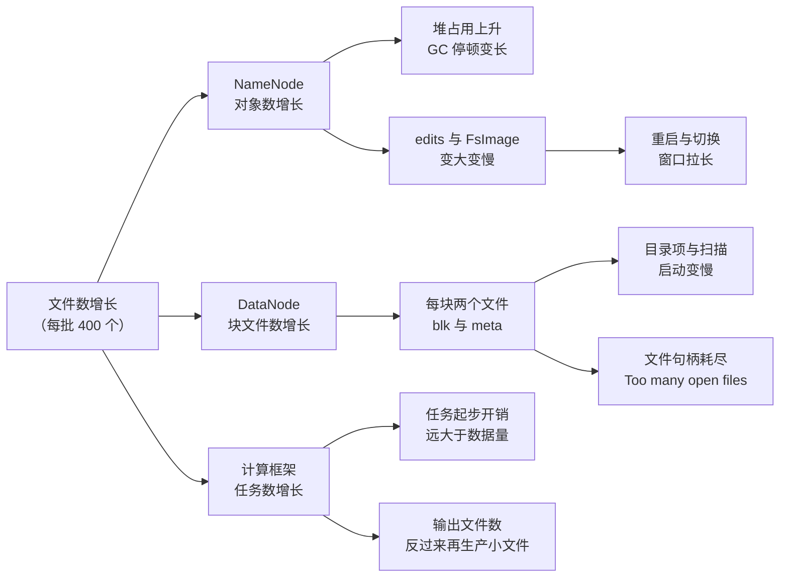
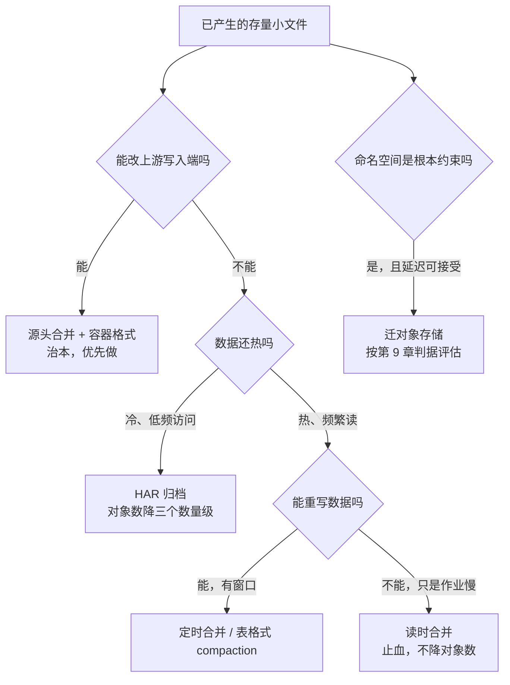
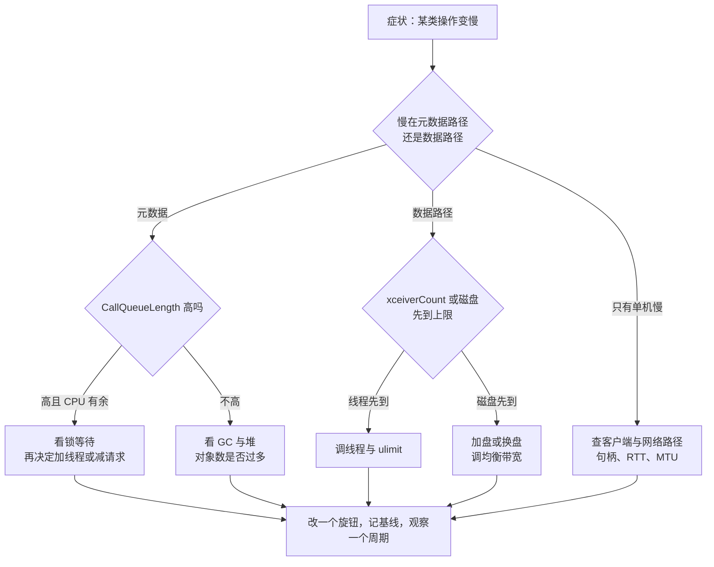
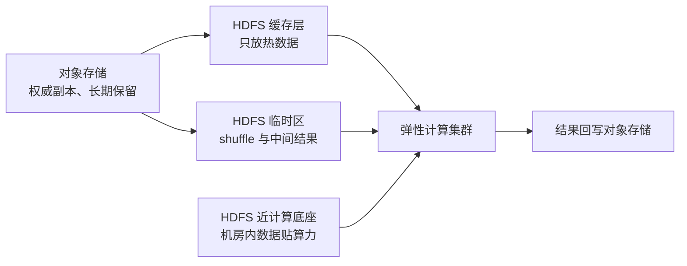

# HDFS 性能调优与生产实践——小文件治理与存算分离的未来

## 摘要

**摘要：**

小文件与存算分离是 HDFS 落地环节最容易被讲成口号的两件事。前者常被简化成"文件多了 NameNode 内存不够"，后者常被简化成"对象存储更弹性"，两个简化都跳过了真正要做决策的地方。这篇文字把两者拆成可复算的东西：先算三笔账，NameNode 侧按对象数而不是字节数记的元数据账、DataNode 侧每块两个文件与文件句柄的账、计算侧每个任务都有起步价的账，三笔账共用同一个乘数（文件数），却在不同时间点以不同症状先后发作；再给五种治理手段各自解决哪一笔账、代价落谁身上、什么条件下该选它；然后排一个调优的下手顺序，先说清"先定位哪一层、再动哪个旋钮、怎么验证有效"，因为参数调错的代价往往是把资源加到错误的位置上；最后给存算分离的判据表，把 HDFS 在新架构里的三种角色、对象存储四个绕不开的语义坑，与"什么情况下反而不该迁"放在一起对照。文中数字除标注来源者外，均为按给定假设的示例推算，用于展示量级与推导方式，不代表任何实际集群的实测值。

---

## 第 1 章 一个 20TB 的集群为什么先耗尽内存

一个典型的现场：集群的数据盘只用了 20TB，机房里还空着几百 TB 的位，NameNode 的 JVM 堆却长期停在 85% 以上，Full GC 一天几次，`ls` 一个稍大的目录就要几百毫秒，运维的处置本能是"加内存"。加完 64GB 变 128GB，撑了三个月，又回到同一条曲线上——加内存买到的只是时间，对象数一个没动。磁盘没满、内存先满，这件事如果只看容量报表是无法解释的，因为 HDFS 的成本结构里有两套完全不同的计量单位，容量按字节算，元数据按对象算，而小文件正好让两者脱钩。

把时间拨回 2003 年，GFS 论文描述的工作负载是这样的：网页抓取与倒排索引生成，文件以百 MB 计，由少数几个写入者顺序追加，读多写少，一次写入之后长期不动。这套假设决定了 HDFS 几乎所有的设计取舍，包括"单 NameNode 把命名空间全放进内存"。二十年过去，同一套系统承载的负载换了一副面孔：文件以 KB 计，由成百上千个微批任务自动生成，写入者不是人而是调度器，一次作业跑完就留下几万个再也不会被修改的小文件。设计假设没变，负载变了，冲突就集中爆发在元数据上。

### 1.1 三笔账的分工

小文件的代价不是一笔，而是三笔，而且三笔账的"账本"各不相同：NameNode 记的是对象数，DataNode 记的是块文件数与文件句柄，计算框架记的是任务数与每次任务的起步开销。三笔账**共用同一个乘数**，也就是文件数，所以它们总是同时变坏，但发作的时间点不一样——元数据账最先在 GC 上露头，句柄账要等到某个 DataNode 重启或者写入高峰才爆，计算账则表现为"作业明明只有 1TB 数据却跑了八个小时"。

下面这张图把三者的传导关系画清楚，后文的每一章都对应其中一条支路。



### 1.2 一条贯穿全篇的示例线

为了让三笔账可以逐项复算，这里假设一条日志落盘链路，后文反复用它：上游微批每 5 分钟触发一次，每批写出 400 个文件，单文件平均 8KB，全部落在同一个月分区目录下。按每天 288 批算，一天 11.5 万个文件，一年约 4,200 万个文件，数据总量约 336GB。也就是说，一个 336GB 的目录，会在 NameNode 里留下 4,200 万条文件记录，每 GB 数据对应的元数据条目是 12.5 万条。这个比例是理解后面所有算术的起点：数据量只增长了一个数量级，对象数增长了四个数量级。

需要提前说明的是，文中出现的所有数字，除明确标注来源者外，都是按上述假设推出来的示例值，用来展示量级、乘数与推导路径；把它当成任何具体集群的实测数据都会失真，因为对象大小、副本数、堆的实际可用比例、版本实现细节都会让结果在数倍范围内浮动。算术的价值不在于那个绝对值，而在于它给出了"改哪个变量、能改多少"的定量感觉。

### 1.3 本篇的路线与边界

接下来的路线是三段加一个收束。第一段算账，把三笔账分别算到"能扛多少"的刻度上，并给出"多小算小、多少算多"的判据；第二段治理，把五种手段按"解决哪一笔账"排队，每一种都配一张代价清单，因为治理从来不是免费的；第三段调优，先讲怎么定位瓶颈在哪一层，再讲每一层那几个真正有效的旋钮、调大调小各自的代价、以及怎么验证改动确实生效，最后用一张判据表把存算分离的选择标准固定下来。

这里不做的事情同样要说清楚：不列参数手册，不写巡检脚本，不铺安装步骤。参数在文档里查得到，值得写下来的是"什么时候该动它、动了会付出什么、怎么知道动对了"。故障形态集中放在后半部分，按"形态、信号、判据、首查"四栏组织，因为生产里真正难的从来不是知道有这个问题，而是在十几个可能原因里判断出是哪一个。

---

## 第 2 章 第一笔账：NameNode 侧的对象算术

NameNode 的内存账有一个容易记混的地方：它**记的是对象**，不是字节。一笔 1KB 的写入和一笔 128MB 的写入，只要都小于一个块，在命名空间里产生的记录就完全相同：各是 1 个 INode 加 1 个 BlockInfo。文件内容的大小只影响 BlockInfo 的条数，不影响 INode 的条数，而 INode 才是那笔固定成本。用图书馆打比方会更直观：卡片目录里一张卡片对应一本书，书厚书薄都只占一张卡片，馆藏暴涨而书架还有空位的时候，先撑爆的往往是卡片柜。

### 2.1 150 字节是三项的合计

社区与运维文档长期沿用的经验值是"每个文件约 150 字节"，这个数字不是单一对象的体积，而是三项的合计：`INodeFile`（文件名、权限、属主、时间戳、块列表的头部）、父目录里指向它的那条目录项引用（名字到 inode id 的映射）、以及记录块信息的 `BlockInfo`（块 ID、生成戳、副本所在 DataNode 的数组）。按单块小文件计，三项加起来落在 150 字节这个量级，随版本、是否开启快照、是否有配额与存储策略、JVM 对象头与对齐方式而浮动。

这里必须把口径差异讲明白，否则复算时会各算各的。如果按"完整 Java 对象"的实测口径来量，把字符串对象、对象头、对齐填充全算进去，单个 INode 的记录能到四五百字节，这是社区早期测试文章里常见的数字；而 150 字节是一个综合口径，把三类结构摊到每个文件上取的经验值。两者并不矛盾，只是"含不含对象头与冗余字段"的区别。做容量规划时的稳妥做法是从 150 字节起算，再按 1.5 到 2 倍留余量，因为快照、加密、配额、存储策略这些特性每一个都会往对象里塞字段，而它们在大集群里几乎总会开启其中几项。

[[01 HDFS 的诞生——大规模分布式存储的工程哲学]] 里已经把这笔乘法算过一遍，结论是"按对象算、不按字节算"；这里要往前推一步，把 150 字节换算成"能扛多少文件"，因为运维真正要回答的问题是后者。

### 2.2 1 亿文件约 15GB 堆，然后呢

按 150 字节计，1 亿个小文件对应约 15GB 堆占用。这个数字本身不算吓人，吓人的是它只是"元数据"这一项，而**堆不能全给元数据**，它的上限又同时受物理内存与 GC 停顿约束，突破它只能靠切分命名空间，[[07 HDFS Federation——打破单 NameNode 的内存天花板]] 讲的正是这条路。edits 的双缓冲、正在处理的 RPC 请求对象、BlockReport 解析时的临时结构、快照的引用计数、JVM 自身的类元数据与 GC 预留，都要在同一块堆里分地盘。实践中的经验区间是留给元数据的安全额度不到堆的一半，按一半算，1 亿小文件需要 30GB 以上的堆才能平稳运行，按六成算则要 25GB，看上去差不多，但一旦叠上快照或者一次全量 BlockReport，峰值就会顶到天花板。

把这张表算出来，比记任何一个具体数字都有用。表中所有值都按"每文件 150 字节、堆的一半可用于元数据、单文件单块"的假设推算，属于示例值。

| NameNode 堆 | 可用于元数据 | 可承载文件数（示例推算） | 典型现象 |
|---|---|---|---|
| 32GB | 16GB | 约 1.07 亿 | 1 亿文件即到顶，GC 频繁 |
| 64GB | 32GB | 约 2.14 亿 | 2 亿文件后长 GC 出现 |
| 128GB | 64GB | 约 4.28 亿 | 需配合 G1 与合适的区域大小 |
| 200GB | 100GB | 约 6.7 亿 | 加载 FsImage 与重启窗口成为新瓶颈 |

### 2.3 三个放大器：edits、FsImage 与重启

第一笔账还有三个放大器，它们让"15GB 堆"这个静态结论变成一条加速恶化的曲线。

其一是 edits 的产生速率。每一次 `create`、`addBlock`、`complete`、`rename` 都会写一条 edit log，而这四条正好是小文件写入的固定动作。同样写 1TB 数据，如果写成 8 个 128MB 的大文件，edit 数是几十条；写成 400 万个 256KB 的小文件，edit 数就是上千万条。编辑日志的增长速率直接决定 checkpoint 的频率，而 checkpoint 的频率又决定了 Standby NameNode 有多少时间在做 FsImage 合并而不是待命。[[03 NameNode 的核心数据结构——FsImage 与 EditLog 的设计奥秘]] 里讲过 checkpoint 的六步链路，那里关心的是链路本身；这里关心的是它的输入——小文件把 checkpoint 的输入量放大了三到四个数量级。

其二是 FsImage 的体积。FsImage 是对象树的序列化，磁盘占用与对象数近似成正比，压缩后大约是每对象十几到几十字节。4,200 万个文件的命名空间，FsImage 在几百 MB 到 GB 级，看着不大，但 checkpoint 时要把它整个读进来、整棵重建、再整个写出去，这段操作在堆里会产生与对象数同阶的临时对象，恰好撞在最敏感的 GC 区间上。

其三是重启与故障切换。主备切换本身只要几十秒，但切换之后客户端会感受到一段"迟滞"：新的 Active 要等 DataNode 的块汇报攒到阈值才退出安全模式，而汇报处理量与块数成正比，这条保护链在 [[09 HDFS 容错与恢复机制——自愈修复的工程实现]] 里有完整推导。小文件集群的块数是文件数的三倍，几亿块的首轮汇报足以让新 Active 在一段时间里只顾处理汇报、顾不上服务正常请求，于是出现"切换没失败，但切换后半小时业务抖动明显"。

### 2.4 判据：多小算小、多少算多

小文件没有绝对定义，但有两条可操作判据。

第一条按块大小比：把平均文件大小与 `dfs.blocksize` 比。文件大小达到块大小的一半以上时，一个文件至少能被切成一个接近满的块，元数据成本摊到数据上还算合理；落到块大小的十分之一以下，也就是默认 128MB 块下小于 12.8MB，元数据成本开始显著高于数据本身；再往下到 KB 级，比例就彻底失衡了。这条判据的好处是不依赖任何集群规模，换一个块大小重新算一遍即可。

第二条按对象总数与增速：文件总数超过 5,000 万，或者单个目录的文件数超过 10 万，就该启动治理；文件总数的年增速超过 50%，即使当前没到阈值也要提前动手，因为按复利长下去，留给治理的窗口只有一两个季度。

| 档位 | 平均文件大小 | 文件总数 | 单目录文件数 | 建议动作 |
|---|---|---|---|---|
| 健康 | 大于块大小的 1/2 | 小于 2,000 万 | 小于 1 万 | 保持写入端约束 |
| 关注 | 块大小的 1/10 到 1/2 | 2,000 万到 5,000 万 | 1 万到 10 万 | 加写入端合并，规划治理 |
| 告警 | 小于块大小的 1/10 | 大于 5,000 万 | 大于 10 万 | 立即治理，评估扩容与迁移 |

不把阈值写得更细，是因为这些数字的作用是触发动作，而不是做精密判定；真正要盯的是趋势线的斜率，一个 3,000 万文件且年增 80% 的集群，比一个 6,000 万文件但年增 5% 的集群危险得多。前者半年后就会撞墙，后者还有从容治理的余地。

---

## 第 3 章 第二笔账：DataNode 的 inode 与句柄

如果说 NameNode 的账是"按对象记"，DataNode 的账就是"按块的文件记"，两者的乘数只差一个副本数，但后果的表现形式完全不同：NameNode 是内存不够，DataNode 是目录项太多、句柄不够、启动太久。这一章要把这三件事的机制分开讲，因为它们对应三种完全不同的处置，混在一起谈就容易得出"小文件只是 NameNode 的问题"这种半对半错的结论。

### 3.1 每个块在磁盘上是两个文件

DataNode 的存储布局里，一个块不是一个文件，而是两个：`blk_<blockid>` 存数据，`blk_<blockid>_<generationstamp>.meta` 存校验和与头部信息。校验和按 512 字节一个 chunk 计算，每个 chunk 4 字节，所以 meta 文件的大小约为数据大小的 1/128，加上几十字节的头部。这个设计本身没有错，它让数据与校验信息可以分开校验、分开替换，也让 DataNode 可以在不读数据的情况下验证一个块是否完整。

但这条布局乘以小文件的数量，账就变了。4,200 万个文件、三副本，就是 1.26 亿个块，落到整个集群是 2.52 亿个文件；如果集群有 100 台 DataNode，单台平均 252 万个文件，分布在若干块盘上，单盘几十万个文件。这些文件不是散在根目录下的，HDFS 会用子目录按块 ID 散列来摊平目录项，但摊平的只是"每个目录里有多少项"，总量没有变，而总量决定了三件事的成本：目录遍历、启动扫描、以及 `ls` 与 `du` 这类元数据操作的响应时间。

`dfs.datanode.numblocks` 常常在这个语境里被提起，它控制的是每个块目录放多少块这条刻度，取 0 表示按内置默认。老版本里这个旋钮的意义更重，因为它直接决定子目录的创建节奏；现代实现把子目录数量固定下来、按块 ID 散列，这个参数更多是一个刻度上的参照值。把它当成"每目录块数上限"来理解是可以的，但要清楚真正的风险不是某个目录"超限报错"，而是目录项数量级上升到十万级之后，`ls`、`fsck`、`VolumeScanner` 的每一轮扫描都要逐项 stat，成本随对象数线性上升。这一点和 NameNode 的处境同源：都是"条目太多"，只是一个在内存里，一个在磁盘上。

### 3.2 Too many open files 的真实成因

`Too many open files` 是小文件集群最典型的 DataNode 故障，但它的成因常常被归错。这个报错很少是"文件太多把磁盘 inode 用完了"，绝大多数情况是进程的文件描述符配额被耗尽，而配额的消耗者主要不是块文件本身，而是块传输线程。

DataNode 用 `dfs.datanode.max.transfer.threads` 控制同时进行的块传输数，默认 4096。每个传输线程在处理一个块时要同时打开数据文件与 meta 文件，也就是两个句柄，4096 个线程的理论峰值接近 8,192 个句柄，再加上监听端口、日志文件、卷扫描、JMX 连接等开销，实际需求会到 8,500 以上。如果进程的 `ulimit -n` 还停在 4096 这类默认值上，那么不需要任何"小文件异常"，只要并发上来就会撞线。日志里的形态通常是 `java.io.IOException: Too many open files`，或者更早一步的 `xceiverCount ... exceeds the limit of concurrent xcievers`——后者说明线程数先到了配置上限，前者说明句柄先到了系统上限。

这条机制解释了一个反直觉的现象：小文件多的集群，`Too many open files` 往往不是"文件多"直接导致的，而是文件多导致读请求多、读请求多导致传输线程多、线程多导致句柄多。处置顺序因此是先看句柄与线程的比值，再看是否有真的句柄泄漏，最后才回到治理——治理治本，止损靠配比。

### 3.3 启动扫描与冷缓存

DataNode 重启时要做一件事：扫描所有卷目录，把每个块的 meta 读出来，构建内存里的 `ReplicaMap`。这个过程与块数成正比，而且第一次扫描时页缓存是冷的，每个块的 meta 都要落一次真实的磁盘读。单块成本取决于盘的类型与队列深度，机械盘上单次随机读在毫秒量级，SSD 上在几十到上百微秒。按 2,000 万个块、单块 0.5 毫秒粗算，一轮全量扫描接近三个小时，还没算并发度不足带来的排队。数字只是示例，结论是稳的：块数上到千万级以后，"重启"从分钟级动作变成小时级动作，滚动升级的窗口必须按这个量级排。

[[08 DataNode 存储引擎——FsDataset 与磁盘 IO 管理机制]] 里讲的是"怎么把一个卷管好"，这里的视角是"卷里的对象数怎么反过来决定运维窗口"；同一个机制，在容量规划与故障处置两个阶段读出来的结论并不一样。

### 3.4 这笔账的记账口径

块数等于文件数乘副本数，磁盘文件数等于块数乘二，句柄峰值约等于传输线程数乘二再加常数；三个乘法对应三种资源，治理降低的是基数，调优调整的是基数之上的系数。

---

## 第 4 章 第三笔账：计算侧的起步价

第三笔账记在计算框架上，它的计量单位跟前两笔都不同：不是对象数，而是任务数，以及每个任务的起步开销。这笔账最容易被低估，因为它不出现在任何容量报表里，只出现在作业运行时长里；而"作业慢"是所有大数据团队最习以为常的现象，习以为常就不会去算它到底慢在哪一步。

### 4.1 一个文件至少一次打开

Hadoop 的输入分片规则很简单：一个文件可以被切成若干 split，每个 split 不超过一个块；反过来，小于一个块的文件无法再切，只能整体作为一个 split。这条规则决定了小文件的第一个必然结果——文件数小于块数时，split 数就等于文件数。4,200 万个 8KB 的文件，就是 4,200 万个 split，也就是 4,200 万个 map 任务。

这条规则有两个补丁。第一个是 MR 的 CombineFileInputFormat，它把多个小文件打包进一个 split，让一个任务读多个文件；第二个是 Spark 的文件扫描策略，`spark.sql.files.maxPartitionBytes` 控制单个 partition 的目标字节数，`spark.sql.files.openCostInBytes` 把"打开一个文件"折算成若干字节计入成本，两者一起决定一个小文件是单独成 partition 还是跟邻居拼在一起。补丁的存在说明框架作者早就知道这个坑，但它们只是把账从"任务数"挪到了"每任务的打开次数"上，账本身没有消掉。

### 4.2 起步价：为什么 8KB 的数据要花 1 秒

把每个任务想成一次打车：无论乘客坐多远，**起步价**都得付。MR 任务的起步价包括 JVM 启动或容器初始化、任务配置与分片的反序列化、输入格式初始化、输出 committer 的准备，以及调度器排队与心跳开销。这些动作里没有一项跟数据量有关，它们只跟"存在一个任务"这个事实有关；JVM 复用能把其中一部分摊薄，但摊不干净。

按每次任务启动约 1 秒（含调度与初始化，示例值）粗算，4,200 万个任务就是 4,200 万秒，除以 3,600 得 11,667 小时，也就是一年零四个月——这个量级说明的不是"作业跑得慢"，而是"这条链在单队列上根本跑不完"。即使把集群并行度拉到 1,000 个容器满负荷，纯起步开销也要 11.7 小时。而同样 336GB 的数据，如果合并成 128MB 一个文件，只需要约 2,600 个任务，起步开销 43 分钟，与数据本身要跑的时间处在同一个量级。

| 组织方式 | 任务数（示例） | 起步开销（1 秒/任务） | 每次任务的有效数据量 |
|---|---|---|---|
| 8KB 小文件，不合并 | 4,200 万 | 约 11,667 小时 | 8KB |
| 合并到 128MB | 2,600 | 约 43 分钟 | 128MB |
| 合并到 256MB | 1,300 | 约 22 分钟 | 256MB |

表里第三行提醒了一件事：合并不是越大越好。任务数降下去，单任务的运行时长与失败重跑成本就升上来，任务数太少还会让集群并行度吃不满。合并没有唯一最优解，只有与集群规模、格式可切分性、失败重跑容忍度匹配的区间，通常落在"单任务处理 128MB 到 512MB"这一段。

### 4.3 合并之后的那笔小账

即便用 CombineFileInputFormat 或 Spark 的文件合并策略把 partition 数降下来，账也没有消失，只是换了个科目：每个 partition 内部仍然要逐个打开文件，而一次打开意味着向 NameNode 要块位置、向 DataNode 建连接、在文件里 seek，这些固定成本是毫秒级往返，远高于读 8KB 数据本身。Spark 给 `openCostInBytes` 的默认值（4MB）就是这个成本的折算，它相当于在说"打开一个文件抵得上读 4MB"；文件平均 8KB 时，打开成本被放大 500 倍，合并阈值划不划算，由这个比值决定。

### 4.4 输出侧的正反馈

前面几条讲的是读，而小文件问题真正的麻烦在写：一个任务产出一个文件，任务数越多，输出文件越多，下一轮读取时面对的又是同样多的小文件。这条正反馈让"读的时候合并"变成治标——今天用 CombineFileInputFormat 把 4,200 万 split 合成 2,600 个任务，作业跑完输出 2,600 个文件，看上去是改善了，但只要下游还有一个按分区写出的作业，文件数很快又会回去。

真正能打断这条反馈的只有写端：要么让写端一次写大（攒批），要么让写出格式自带容器（ORC、Parquet、SequenceFile、Avro），要么在写完之后的短期窗口里做一次固化合并。三条路正好对应下一章的第一种与第四种手段，也解释了为什么治理手段的排序里"源头"永远排第一位——它切断的是正反馈，其余手段只是在末端清理存量。

### 4.5 三笔账的合账

把三笔账并在一起看，能看清"谁先崩"的顺序，这个顺序决定了处置的优先级。

| 账本 | 记账单位 | 耗尽后的表现 | 发作速度 | 治理归属 |
|---|---|---|---|---|
| NameNode | 文件对象数 | 堆满、长 GC、RPC 变慢 | 最快，最先报警 | 减少对象数 |
| DataNode | 块文件数、句柄数 | 扫描慢、句柄耗尽、重启久 | 次之，常在重启时爆 | 减少对象数 + 调句柄 |
| 计算框架 | 任务数 | 作业时长被起步价吃掉 | 一直在，被当成"正常慢" | 合并 + 写端约束 |

---

## 第 5 章 五种治理手段与代价

### 5.1 判据先行：目标是减少对象数

治理小文件，先要接受一句反直觉的话：目标不是"让文件变大"，而是"减少 NameNode 与 DataNode 需要记的条目数"。两者的区别在两种场景里会显出来——把 1 万个 1KB 文件打包成一个 10MB 的 HAR，目录视角是 1 个文件，对象数确实降了；把这 1 万个文件重写成 10 个 1MB 的 Parquet 文件，对象数降到 10，可如果每个 Parquet 文件内部只有几百行，行组又开得很碎，读性能并不会跟着变好。所以判断一种手段是否合格，要问两个问题：它减少了**哪一侧的条目数**，以及它为此付出了什么。

五种手段按"作用点"排序而非流行程度：第一种作用在产生端，第二、四、五种作用在存量，第三种只在读路径上。

### 5.2 源头合并：最有效，但改的是上游

源头合并有两种形态，一种是攒批，一种是容器格式。

攒批的意思是在写端缓冲到一定体量再落盘，把"每 5 分钟 400 个文件"变成"每 30 分钟 4 个文件"。它几乎零成本地减少了对象数，但代价全在时延与失败语义上：端到端可见性从秒级退到分钟级，一次失败要重跑一整批，缓冲占用的内存与磁盘要额外规划。如果下游依赖"文件出现即数据完整"这个约定，攒批之后就必须改成配套的清单文件或 `_SUCCESS` 标记，否则读者会读到写了一半的批次。

容器格式是从根上换计量方式：ORC、Parquet 这类格式按行组与列块组织，文件数由"写任务数乘以每个任务声明的文件数"决定，跟记录数几乎无关。一条每分钟产生 10 万条记录的数据流，若按批次或按记录切文件，一天能切出上万到上亿个小文件；写成按小时滚动的 Parquet，一天只有 24 个文件。代价是写入侧的 CPU（编码、压缩、统计信息）与内存（行组缓冲），以及"小批写入会产出很多小 Parquet 文件"这个新问题——容器格式消掉的是"一行一文件"，消不掉"一批一文件"。

Hive 生态里还有一层在作业末尾生效的合并，适合存量作业的快速止血。

```sql
-- 作业末尾的合并：只对本次输出生效，不影响已有数据
SET hive.merge.mapfiles=true;                 -- 纯 map 作业也合并
SET hive.merge.tezfiles=true;                 -- Tez 引擎下的对应开关
SET hive.merge.size.per.task=268435456;       -- 合并目标 256MB
SET hive.merge.smallfiles.avgsize=134217728;  -- 平均小于 128MB 才触发
```

这四个参数放在一起才成立：最后一个决定"要不要合并"，第三个决定"合并成多大"，前两个决定"在哪种执行计划下合并"。代价是作业末尾多一轮读写，作业时长上升；对小作业反而净亏，所以阈值不能设得太低，否则每个小作业都被强制多读一遍。

### 5.3 HAR：把条目收进索引，代价是只读

HAR（Hadoop Archive）是 HDFS 自带的小文件归档格式，思路很直接：把一批小文件拼进若干个大的 `part-*` 文件，另建 `_masterindex` 与 `_index` 两级索引记录每个文件在 part 里的偏移，NameNode 从此只看见 part 文件与索引文件，看不见那批小文件。

```bash
# 把一个月的历史日志打成一个归档；打包本身是一个 MR 作业
hadoop archive -archiveName logs-2024-01.har -p /warehouse/logs/2024/01 /archive

# 访问归档内的文件必须走 har:// 协议，索引查找由文件系统层完成
hdfs dfs -ls  har:///archive/logs-2024-01.har/
hdfs dfs -cat har:///archive/logs-2024-01.har/2024/01/01/part-0001
```

它的收益是明确的：一个包含 10 万个小文件的归档，在 NameNode 里只占几十个对象，元数据账一下子降了三个数量级。它的代价同样明确，而且每一条都影响可用性：**只读**，归档之后不能 append、不能改、不能单独删某个成员；访问要过 `har://` 协议，多一次索引查找，随机读一个小文件变成"读索引、定位、读 part"三步；打包过程本身是一个 MR 作业，要占与原数据等量的临时空间与算力；原文件不会自动消失，不手动删就等于对象数翻倍；对上层引擎的透明性有限，Hive 能读但分区发现会变慢，很多自研工具干脆不认识这个协议。

所以 HAR 的适用面很窄：冷数据、低频访问、有合规留存要求、访问方式可以改。把它当"万能降账手段"用在热数据上，会换来一堆"读一个小文件要先过两级索引"的投诉。

### 5.4 读时合并：只解决计算侧

CombineFileInputFormat 是纯读路径上的补丁。它在生成 split 时把同一节点上的多个小文件打成一个 split，让一个 map 任务读多个文件，从而把任务数降下来。它的收益**只在计算侧**，NameNode 的**对象数一个没少**，DataNode 的块文件数一个没少，`Too many open files` 也不会因此缓解。

这一点值得反复强调，因为它是"治理了但没用"的高发区。从作业监控上看，任务数从 4,200 万降到 2,600，作业时长从十几小时降到一小时，看板上是一片绿色，于是团队认为问题解决了；同一个星期里 NameNode 的堆继续往上爬，因为对象数根本没动。读时合并的正确定位是"争取时间的止血带"，它买到的是几个月的窗口，窗口里必须把存量治理与写入端改造做完。

`FileCrush` 这类工具常被和 CombineFileInputFormat 并列提起，但作用点其实不同：它读一批小文件、重写成少量大文件，属于会真正减少对象数的重写型合并，更接近下一小节的定时合并。把它归到"读时"会误判收益，因为它的代价与定时合并一样——要重写数据、要双份空间、要处理切换。

### 5.5 定时合并：把存量清掉，代价在最难的地方

定时合并是唯一能清存量的通用手段：周期性地扫出小文件、读进来、写成一个或几个大文件、替换掉原文件。逻辑三句话就能说完，工程上难的全在"替换"这一步。

第一难是空间。合并期间新旧两份数据同时存在，峰值占用是原数据的两倍；对按容量水位运行的集群，这个峰值本身就可能触发磁盘告警。

第二难是一致性。合并窗口里如果还有作业在读旧文件，删掉旧文件会让读作业失败；如果读作业恰好读到新文件但只读了一半，会读到不完整的数据。稳妥的做法是写新目录、校验通过后原子 `rename` 覆盖，旧目录进回收站保留一段时间；对 Hive 表则走分区目录的版本替换，对 Iceberg、Delta、Hudi 这类表格式则用它们原生的 compaction，由快照机制保证读侧永远看到一个完整版本。

第三难是幂等与断点。合并任务本身会失败，重跑时不能把已经合并过的再合一遍，也不能留下半成品目录；这要求合并任务带"输入清单 + 输出指纹"的标记，失败后从清单续跑，而不是从目录重新推导。

第四难是回收站的延迟。删掉的文件在回收站里还占着 NameNode 的对象数，`fs.trash.interval` 没到之前，账并没有真正降下来。这一点常被忽略：治理动作做完了，看板上对象数纹丝不动，原因是它们正躺在 `/user/<name>/.Trash` 里。

### 5.6 迁到对象存储：换掉的不是介质，是约束

第五种手段是把数据搬到对象存储，从根上换掉 NameNode 的单点内存约束。收益与代价都不在"存储"这一层，而在"语义"这一层：对象存储没有目录、`rename` 是复制加删除、`LIST` 按前缀分页、请求按次计费。小文件于是从"压垮 NameNode 的内存"变成"压垮请求预算与延迟预算"，瓶颈换了个名字，但没有消失。

迁到对象存储不该被当成小文件治理手段，而该被当成一次架构选择来评估；如果迁移的唯一动机是"小文件太多"，那么先做源头合并的收益通常更大、成本更低。它的四个语义坑与适用判据留到第 9 章。

### 5.7 判据表与决策图

把五种手段摊成一张表，判据就清楚了。注意"不解决"那一列，它比"解决"那一列更能防止误判。

| 手段 | 解决哪笔账 | 不解决哪笔 | 主要代价 | 适用判据 |
|---|---|---|---|---|
| 源头合并、容器格式 | NameNode + DataNode + 计算 | 无（治本） | 时延上升、重跑粒度变大、写入 CPU 增加 | 能改上游写入逻辑 |
| HAR 归档 | NameNode + DataNode | 计算侧（访问更慢） | 只读、`har://` 协议、打包占双份空间 | 冷数据、低频、可改访问方式 |
| 读时合并 | 仅计算侧 | NameNode、DataNode | 并行度下降、本地性变差 | 存量治理未完成前的止血 |
| 定时合并 | NameNode + DataNode | 计算侧（需配套改造） | 双份空间、窗口一致性、幂等设计 | 有可控窗口、能接受重写 |
| 迁对象存储 | 换掉 NameNode 约束 | 延迟与请求成本 | rename、目录、一致性、计费 | 见第 9 章判据表 |

选哪一条，取决于三个前提：能不能改写入端、数据是冷是热、以及有没有可控的维护窗口。这三个前提恰好构成一棵很浅的决策树。



树里没有"全部都要做"这个选项，因为手段之间会互相干扰：已经用 HAR 归档的数据不该再做定时合并，正在迁往对象存储的数据不该再投入 HDFS 侧的合并作业。治理的资源永远是有限的，选一条主线做到位，比五条并行做一半更有效。

---

## 第 6 章 调优的下手顺序：先定位，再动手

小文件治理是"减法"，调优是"加法"，两者的风险不对称：治理做错了顶多白干一轮，调优改错了会把压力推到另一层，而且改动的痕迹会污染基线，让下一次定位更难。所以调优的第一原则不是"改什么"，而是"先证明瓶颈在哪一层"。这一层判断错了，后面所有动作都是在给错误的位置加资源。

### 6.1 为什么顺序比参数重要

因为参数是现成的，顺序不是。集群出问题时，能搜到的答案往往是"把 `dfs.namenode.handler.count` 调到 200"这类结论，而结论脱离前提就没有意义。三个常见的错位可以说明问题：NameNode 的 RPC 队列长，看起来是 handler 不够，实际可能是锁被长时间持有，加线程只会让更多线程排队等同一把锁；DataNode 写入慢，看起来是传输线程不够，实际可能是磁盘队列已经饱和，加线程只会把队列压得更深；客户端读慢，看起来是包太小，实际可能是 NameNode 拿块位置的那一次 RPC 就慢，调包大小一点用也没有。

顺序的价值还在于保护证据：没记基线，改动之后就无法回答"是这次改动起效，还是负载自己降下来了"。

### 6.2 第一层：判断是 NameNode、DataNode 还是 Client

判断依据是"慢在哪条路径上"，而不是"哪个指标红了"。

NameNode 侧的信号分三层：最外层是 RPC 队列，`CallQueueLength` 持续大于零且 `RpcQueueTimeAvgTime` 同步上升，说明请求进来排不上队；往内是锁，一次 jstack 采样就能看到 handler 线程阻塞在 `FSNamesystem` 的读写锁上，这时队列长不是线程不够，而是每个请求在锁里待得太久；再往内是 GC，堆使用率高会让每次元数据操作都被拉长。三层对应三种处置：加线程、改访问模式、加内存或减对象。

DataNode 侧的信号更像硬件指标：`Slow BlockReceiver` 成片出现、`xceiverCount` 逼近 `dfs.datanode.max.transfer.threads`、磁盘 await 打满、网卡出口跑满。判据是"慢在数据路径上"——读大文件慢而 NameNode 指标平稳，就可以锁定这一层。Client 侧最容易误判，可用的判据是"换一台机器能否复现"：另一台客户端上正常，问题就在客户端或其网络路径，譬如 MTU 不一致、DNS 解析慢、本机句柄耗尽，这类问题在集群指标上完全看不出来。

| 层 | 典型症状 | 首查指标 | 常见误判 |
|---|---|---|---|
| NameNode | 元数据操作慢，`ls`、`stat`、提交作业变慢 | `CallQueueLength`、`RpcQueueTimeAvgTime`、GC 停顿、jstack 锁等待 | 一律当成 handler 不够 |
| DataNode | 大文件读写慢，pipeline 报错 | `Slow BlockReceiver`、`xceiverCount`、磁盘 await、网卡吞吐 | 一律当成线程不够 |
| Client | 单机复现、并发一高就慢 | 本机句柄数、连接数、GC、网络 RTT | 一律当成集群问题 |

### 6.3 第二层：判断是哪一类请求

确定层之后，还要确定哪类请求在打这一层。元数据密集与数据密集的处置方向相反：前者要减少请求数，后者要提高单请求效率。三个便宜的办法可以区分：按目录统计文件数与字节数看对象密度；看 NameNode 审计日志里 `getBlockLocations` 与 `create`、`complete` 的比例；看小文件在总请求里的占比。

如果 `getBlockLocations` 的多数调用都指向小于一个块的文件，那么无论怎么调 handler 收益都有限，因为请求数由对象数决定。这一步定下来，改动才有可验证的目标，譬如"把 `CallQueueLength` 的 P99 从常亮压到偶发"，而不是笼统的"让它变快"。

### 6.4 第三层：一次只改一个旋钮

这一条是纪律，不是建议。改动前记基线（至少覆盖一个业务高峰），**每次只改一个参数**，改完观察足够长的时间（NameNode 的改动常要等一个 GC 周期才显效，DataNode 的改动要等高并发时段才显效），记录"改前、改后、结论"。三个动作看起来慢，实际比"一把全调，出问题再回滚"快得多，因为后者永远说不清是哪一项在起作用。



---

## 第 7 章 旋钮：NameNode、DataNode、Client 与网络

定位完成之后，才轮到旋钮。这一章按层组织，每一个参数都配三样东西：方向、代价、验证方式。缺了任何一样，调参就退化成试错。需要说明的是，下表中的默认值取自 Hadoop 3.x 的默认配置，不同版本与不同发行版可能有差异，动手前应按对应版本文档核对。

### 7.1 NameNode 的两个主旋钮

`dfs.namenode.handler.count` 最常被调，默认值只有 10。社区流传的经验公式是 `20 × log(集群节点数)`（自然对数），按它算（示例推算），1,000 个节点对应 60 个 handler，5,000 个节点 74 个，10,000 个节点 80 个。公式是经验值不是定理，算出来的数只该当起点，定值要看队列指标。

调大它的收益有上限，因为 NameNode 的元数据操作大多要拿同一把全局读写锁，线程数超过锁的并行能力之后，多出来的线程只是在锁外面排队，还带来上下文切换与线程栈内存（每线程约 1MB 量级）。代价还有一层不太直观：并发变多会让锁争抢更激烈，单个请求的锁等待时间反而变长，平均延迟与 P99 一起恶化。验证方式很明确——调大之后看 `CallQueueLength` 是否回落、`RpcQueueTimeAvgTime` 是否下降；若队列没降而 CPU 占用上升、jstack 里锁等待的线程更多，瓶颈就不在线程数。

`dfs.namenode.edits.dir` 与 `dfs.namenode.checkpoint.period` 属于"容易被忽略但影响很大"的一类。edits 目录承受持续的追加写与 fsync，放到独立的 SSD 或 NVMe 上能减少与 FsImage 读写、系统日志之间的 IO 争抢；代价是多一块盘的采购与故障域，以及 QJM 部署下要分清"本地 edits 目录"与"共享 JournalNode"的分工。checkpoint 默认周期 3,600 秒，另有按事务数触发的阈值（默认 100 万笔），小文件集群往往先撞事务数阈值，于是 checkpoint 频率被动升高、Standby 频繁做全量合并。周期调小让 Standby 更忙、切换就绪度下降；调大则让重启回放更久。验证看三个数：edits 段数、checkpoint 时长、回放时长。

### 7.2 DataNode 的三个主旋钮

`dfs.datanode.max.transfer.threads` 默认 4096，它决定同时进行的块传输数。调大之前必须先看 `ulimit -n`：每个传输线程要开数据与 meta 两个文件，线程数乘二再加常数就是句柄需求，线程 8192 而句柄上限 4096 是典型的自相矛盾配置。调大的代价是内存与磁盘队列深度，在小盘慢盘上线程越多排队越深、尾延迟反而变差；调小的代价是直接报错，日志里出现 `xceiverCount ... exceeds the limit of concurrent xcievers`，客户端表现为读失败重试。验证看 `xceiverCount` 水位与 `Slow BlockReceiver` 频率是否一起下降。

`dfs.datanode.data.dir` 是"多盘"这件事的入口。每块盘配一个目录，让 DataNode 按卷调度，而不是在操作系统层做 RAID 5 把多块盘的带宽与故障域绑成一个；`dfs.datanode.failed.volumes.tolerated` 决定容忍几块盘坏掉而不整体下线。加目录等于加带宽与 IOPS，代价是采购与运维；做成单一大 RAID 则会让一块盘的故障影响整卷，这一点在容量规划阶段就该定。

`dfs.datanode.balance.bandwidthPerSec` 是 Balancer 与副本再复制的带宽上限，Hadoop 3.x 的默认值是 10MB/s，早期版本更低。它直接决定"一轮均衡要跑多久"，而这个时间又决定了运维窗口够不够——一个 500TB 的集群，10MB/s 跑一轮搬运理论上要几个月，实际会被人为中断，于是均衡永远做不完。调大它会让均衡与正常读写争同一块网卡，代价是业务高峰期的读写延迟；正确做法是按业务曲线排期，低峰临时抬高，跑完降回去。

### 7.3 Client 侧的三个参数

`dfs.client-write-packet-size` 默认 64KB，控制单个数据包的大小。调大能减少包数、提高流水线效率，代价是每次重传的粒度变大、缓冲区占用上升；对跨机房这类高延迟链路收益明显，同机房链路收益有限。

`dfs.client.write.max-packets-in-flight` 控制流水线里同时在途的包数，默认 80。调大相当于加深流水线，能在高带宽高延迟链路上提高吞吐，代价是内存与失败时重发的数据量。两个参数要一起看：包大小乘在途包数，就是单连接的内存占用与 BDP 上限。

`dfs.client.read.shortcircuit` 打开短路读，让客户端绕过 DataNode 进程直接读本地块文件。收益只在"计算与存储同机"时存在，而前置条件比多数人以为的严格：native 库（`libhadoop.so`）加载成功、domain socket 路径可写、客户端用户属于允许的组。三项缺任何一项，短路读会静默退化成普通读，日志里只留一行 `Failed to create DomainSocket` 或 `Unable to load native-hadoop library`，客户端指标上什么也看不出来——这是下一章要专门讲的"配了没用"。

### 7.4 网络与机架拓扑

机架拓扑由 `net.topology.script.file.name` 指定，它影响三件事：副本放置（三副本默认两个落同一机架、一个跨机架）、读取时的就近选择、以及 Balancer 与再复制的路径选择。拓扑配错不会报错，只会让跨机架流量长期偏高，这种"不报错的错误"最难查，因为所有功能都正常，只是账单和延迟慢慢变差。

Balancer 的时机同样属于网络问题，而不是参数问题。均衡本质上是把数据从满盘搬到空盘，与业务读写共享同一批网卡与磁盘；放在白天跑，等于给高峰叠一层无关流量。排到凌晨、给一个与业务量匹配的带宽上限、跑完自动降回，比"把带宽调大"更稳。

| 参数 | 默认值 | 方向与代价 | 验证指标 |
|---|---|---|---|
| `dfs.namenode.handler.count` | 10 | 调大：上下文切换与锁竞争加剧；调小：队列积压 | `CallQueueLength`、`RpcQueueTimeAvgTime` |
| `dfs.namenode.edits.dir` | 与 FsImage 同盘 | 独立盘：加设备，减 IO 争抢 | edits 写入延迟、`SyncQueue` 长度 |
| `dfs.namenode.checkpoint.period` | 3,600 秒 | 调小：Standby 更忙；调大：回放更久 | checkpoint 时长、重启回放时长 |
| `dfs.namenode.checkpoint.txns` | 100 万 | 同上，小文件集群常先撞它 | edits 段数、事务增速 |
| `dfs.datanode.max.transfer.threads` | 4,096 | 调大：内存与队列变深；调小：传输报错 | `xceiverCount`、`Slow BlockReceiver` |
| `dfs.datanode.data.dir` | 单目录 | 多盘：加带宽与 IOPS，加采购 | 单盘利用率、卷失败数 |
| `dfs.datanode.balance.bandwidthPerSec` | 10MB/s | 调大：与业务争带宽；调小：均衡跑不完 | 均衡进度、业务读写延迟 |
| `dfs.client-write-packet-size` | 64KB | 调大：吞吐升、重传粒度变大 | 写吞吐、重传次数 |
| `dfs.client.write.max-packets-in-flight` | 80 | 调大：流水线深、内存与重发量升 | 单连接吞吐、客户端内存 |
| `dfs.client.read.shortcircuit` | false | 开：省网络，但依赖 native 库与权限 | 短路读命中次数、客户端日志 |

---

## 第 8 章 五个"调了没用"的现场

调优里最浪费时间的不是改错，而是改完以为对了。下面五个动作在生产里并不罕见：参数改了、集群重启了、看板没变化，然后团队开始怀疑"是不是负载又涨了"。五个现场的共同点，是把一个看起来相关的量当成了原因。

### 8.1 调大块大小，想让小文件变大

动作：把 `dfs.blocksize` 从 128MB 调到 256MB，期望文件数下降、NameNode 压力缓解。一周后对象数纹丝不动。

原因有两层。第一层，块大小只决定"一个大文件被切成几块"，对小于块的文件完全没有作用——一个 8KB 文件在 256MB 块下仍然是 1 个 INode 加 1 个 BlockInfo，对象数一个没少。第二层，**块大小只改新文件**，已有文件的分块在写入时就定了，改配置不会回溯。

正确的验证方式是改前改后各取两个计数：文件总数与块总数。如果两个数都没动，说明改的维度从头就错了；如果块数下降而文件数不变，说明大文件被合并了块，但小文件问题依旧。块调大还有三个副作用要一并接受：每个文件末尾的块内浪费变大、EC 组变大导致恢复时读的数据更多、单个块的恢复时间变长。

### 8.2 调副本数，想省空间

动作：把 `dfs.replication` 从 3 调到 2，期望磁盘占用下降三分之一。空间没降。

原因同样是**只对新文件生效**，已有文件要用 `hdfs dfs -setrep -R -w` 逐个改，而且改完之后 NameNode 只是把多余副本标记为待删除，DataNode 在后续心跳里才真正删掉。这段时间里 `fsck` 显示副本数已变而磁盘占用没变，容易被误读成设置没生效。

更值得提醒的是方向：副本数改的是可靠性边界，不是性能旋钮。为省空间顺手降副本，等于把"同时坏两块盘"从安全事件变成数据丢失事件；这个决定该由数据分级来做，而不是由磁盘水位来做。

### 8.3 Balancer 跑不动

动作：执行 `hdfs balancer -threshold 5`，跑了一天没进展，日志里反复出现"No block can be moved"。

原因通常是三个叠加。带宽上限（默认 10MB/s）决定每小时能搬多少数据，一个几百 TB 的集群按这个速度要跑几个月；阈值设得太小（5%）会让"达标"永远差一点，Balancer 在几个节点之间来回微调；DataNode 的传输线程被正常业务占满时，Balancer 拿不到线程，只能空转。还有一类更隐蔽的情况：正在被写入、处于租约中的块不能移动，如果集群里长期存在大量"写完没关闭"的文件，可移动的块就少得可怜。

验证方式很直接：把日志里的已移动字节数与"带宽乘运行时长"对一遍。两者接近说明瓶颈在带宽，两者差很远说明瓶颈在线程或可移动块的数量。

### 8.4 handler 调大，但锁是瓶颈

动作：`dfs.namenode.handler.count` 从 10 调到 200，期望 RPC 队列清空。结果队列没降、CPU 上涨、客户端 P99 更差。

原因是 NameNode 的元数据操作大多要拿同一把全局读写锁。线程变多之后，同时挤在锁外排队的线程也变多，上下文切换的成本上升，而真正持锁干活的时间没变。用 jstack 连续采样几次就能看出来：如果两百个 handler 里有一百八十个处于等锁状态，加线程是负收益。

正确的方向是减请求数与减锁持有时间：客户端侧合并小请求、少做无谓的 `stat` 与 `ls`、把目录遍历改成批量接口；服务端侧升级到对元数据锁有细粒度改造的版本；架构侧用 Observer 分摊读、用 Federation 切开命名空间。这三条都比"加线程"慢，但它们改的是根因。

### 8.5 短路读配了，但 native 库没装

动作：在 `core-site.xml` 里打开 `dfs.client.read.shortcircuit`，期望本地读不再走网络。读性能没变，客户端日志里躺着一行 `Unable to load native-hadoop library` 或 `Failed to create DomainSocket`。

原因是短路读依赖三个前置条件同时成立：native 库 `libhadoop.so` 能加载、domain socket 路径可写、客户端用户属于允许的组。缺一项就静默退化成普通读，客户端指标上只表现为"和以前一样"，不会报错。这类"配了没生效"的改动最危险，因为它会让人误以为"短路读没用"，从此放弃一个本来有效的优化。

验证方式是看客户端日志与读计数器里短路上读的命中次数，两者都该在开启后明显上升；如果命中次数为零，先去查 native 库，而不是继续调参数。

| 动作 | 期望 | 落空的真实原因 | 正确验证 |
|---|---|---|---|
| 调大 `dfs.blocksize` | 文件数下降 | 块大小只影响分块，不影响对象数；只对新文件生效 | 对比文件数与块数两个计数 |
| 调小 `dfs.replication` | 磁盘下降 | 只对新文件生效；多余副本异步删除 | `fsck` 副本分布 + 待删除计数 |
| 调 Balancer 阈值与带宽 | 均衡完成 | 带宽决定轮次时长，阈值过小导致来回微调 | 移动字节数对比带宽乘时长 |
| 调大 `handler.count` | 队列清空 | 全局锁是瓶颈，加线程只加剧争抢 | jstack 采样看等锁线程占比 |
| 开启 `shortcircuit` | 读不再走网络 | native 库或 domain socket 或权限缺失 | 短路读命中次数 + 客户端日志 |

---

## 第 9 章 存算分离的判据：角色变化与四个坑

### 9.1 HDFS 的角色从"唯一存储"变成三种之一

存算分离的讨论常省略一步：分离之后 HDFS 还剩下什么角色。省略它，讨论就退化成"要不要上对象存储"的二元选择；真实架构里 HDFS 往往还在，只是不再承担全部职责，通常落在**三种角色之一**。

第一种是缓存层：对象存储是权威副本，HDFS 或 Alluxio 一类系统只放热数据，命中就快、未命中就回源。这个角色的成立条件是"热数据比例足够高且可以重建"——缓存丢了不心疼，才能用缓存换性能。

第二种是临时区：长期数据放在对象存储，HDFS 只承载作业运行期的 shuffle、spill、中间结果。这个角色的成立条件是"任务可重跑、数据不落在永久路径上"，因此 HDFS 的可靠性要求可以降低，副本数与磁盘规格都可以按临时数据来配。

第三种是近计算底座：计算与存储仍在同一机房，数据贴着算力放，本地读的收益大于弹性带来的收益。它的成立条件最苛刻：负载对本地性敏感、对弹性不敏感。



角色不是选出来的，是被数据生命周期与 SLA 逼出来的：数据一旦变成"长期保留但偶尔读"，HDFS 就从底座退成缓存；作业一旦要求秒级扩缩，计算就必须离开 HDFS 所在的机房。判断上做错，通常不是选型错了，而是把三种角色混成了一种，结果既想要本地性又想要弹性。

### 9.2 对象存储的四个坑

第一个坑是 `rename`。对象存储没有目录级的原子改名，所谓 rename 是复制加删除，代价与对象数成正比，且不保证原子。而 MR 与 Spark 的提交协议恰恰建立在"写临时目录、成功后原子 rename 到最终目录"上：任务先写 `_temporary`，全部成功后由 job commit 一次性改名。搬到对象存储上，这次改名变成几万个对象的逐个复制，commit 从秒级变成分钟级；更麻烦的是原子性没了——复制到一半失败，最终目录里留下半份数据，而作业状态可能还是成功。Hadoop 的 S3A committer（directory、staging、magic 三种）就是为绕开它设计的，代价是改路径约定、加配置、接受另一套提交语义。

第二个坑是目录语义。对象存储用扁平键空间加前缀模拟目录，`list` 实质是一次前缀扫描，按页返回（每页一千个键是常见实现）。列一个十万对象的"目录"要发上百次请求；而 Hive 与 Spark 的分区发现正是靠 `list` 完成，"读一张表"的前置开销与表的文件数成正比——小文件在这里第二次收费，第一次在 HDFS 内存里，第二次在对象存储的请求里。`_SUCCESS`、`_temporary`、点开头的隐藏文件这些约定，也要靠前缀过滤来维持。

第三个坑是一致性。AWS S3 自 2020 年 12 月起对新建对象的读后写与 `LIST` 提供强一致，缓解了最经典的"写完列不出来"；但"兼容 S3 的私有对象存储"未必有同等保证，带缓存的网关、跨区复制链路都可能重新引入最终一致。一旦 `LIST` 最终一致，"写完就能列出"就不成立，下游按 list 发现输入会漏分区且不报错——产出的是一份 **少数据的正确结果**，最难被发现。

第四个坑是原子提交。`_SUCCESS` 从来不是事务，它只是一个空标记文件，与数据之间没有原子关系。任务重试会留下重复文件或半份文件；标记与数据谁先写，决定了失败时下游看到的是"空目录"还是"半份数据"；提交失败残留的 `_temporary` 目录会长期占着存储与请求配额。要在对象存储上重建提交语义，需要三件事同时做到：任务写入任务级唯一目录以保证幂等、提交时只发生一次标记写或清单写、下游以清单或标记为准而不是以"目录存在"为准。

### 9.3 什么时候该上存算分离

把四个坑与三种角色合起来，判据落在一张表上：不问"哪种技术更先进"，只问"你的负载属于哪一侧"。

| 判据 | 倾向留在 HDFS | 可以迁到对象存储 |
|---|---|---|
| 数据规模与增长 | PB 级、增速平稳、机房内已有机架 | 快速增长、有明显冷热分层 |
| 计算弹性需求 | 计算长期满载、扩缩容按季度 | 按天或按小时启停、峰值差异大 |
| 延迟敏感度 | 元数据操作要求毫秒级 | 分钟级到小时级批处理 |
| 是否依赖 rename 与原子提交 | 老作业无法改造提交协议 | 可改用 committer、可接受清单约定 |
| 成本结构 | 硬件已沉没、带宽与人力便宜 | 按量计费更省、免运维价值高 |
| 一致性要求 | 强依赖"写完即可列出" | 能接受显式标记与清单校验 |

表里最容易忽略的是"是否依赖 rename"：它不是性能问题而是正确性问题，老作业迁过去可能偶发缺数据，而排查会先被引向数据量与代码。

### 9.4 反面：什么情况下不该迁

第一类不该迁的是"计算与存储本来就在同一机房"。这时候迁移省下的运维成本，远小于把毫秒级本地读换成几十毫秒网络读的代价，除非计算侧的弹性收益足够大。

第二类不该迁的是对数据本地性敏感的负载。迭代式机器学习、图计算、需要反复扫描同一份数据集的训练任务，其性能高度依赖"数据就在这台机器上"；缓存层能救回一部分，但缓存本身要内存与 SSD，成本会吃掉弹性带来的收益。

第三类不该迁的是有严格 SLA 的元数据密集负载。在线服务查元数据、高频的分区发现、需要亚秒级响应的调度系统，在对象存储的 `list` 与请求计费面前都会很难受。第四类是没改造预算的老作业——提交协议、目录遍历、标记文件的每一处假设都要改，改不完就迁等于把偶发故障埋进生产。

---

## 第 10 章 六个生产故障形态与判据

前面几章给的是机制与账本，这一章把它们收成六种现场形态。每一种给三样东西：关键信号、判据、首查位置，处置方向在表后讨论。判据一栏是重点——同一类症状往往有三四个原因，判断出是哪一个，比知道怎么修更要紧。

| 形态 | 关键信号 | 判据 | 首查 |
|---|---|---|---|
| NameNode RPC 队列持续增长 | `CallQueueLength` 常亮、客户端超时重试 | CPU 打满说明处理能力到顶；CPU 有余说明锁或请求构成有问题 | jstack 的线程状态 |
| `Too many open files` | DataNode 抛 IOException、传输失败重试 | 句柄上限小于传输线程数的两倍 | `ulimit -n` 与线程配置 |
| `Slow BlockReceiver` | 写入反压、ack 超时、pipeline 重建 | 磁盘 await 高是盘慢，网卡满网络，线程满并发 | iostat、网卡、`xceiverCount` |
| Balancer 卡住 | 日志反复"No block can be moved" | 已移动量约等于带宽乘时长是带宽问题；远小于则是线程或可移动块不足 | 均衡日志与租约中的文件数 |
| 小文件导致重启慢 | 重启后长时间停在安全模式 | 加载慢是对象数，回放慢是事务积压，等汇报是块数 | 加载、回放、汇报三段耗时 |
| 存算分离后 job 变慢 | commit 阶段变长、请求数激增、偶发缺数据 | commit 慢是 rename 语义，请求多是目录语义，缺数据是一致性 | 作业各阶段耗时与对象存储请求指标 |

六种形态里，有两类的判据最容易混。第一类是"队列长"：NameNode 的 RPC 队列长，可能是处理能力到顶，也可能是锁被长时间持有，前者加线程有效，后者加线程只会加重争抢，区分办法是采样看线程状态，而不是看队列长度本身。第二类是"重启慢"：加载 FsImage 慢说明对象数太多，回放 edits 慢说明事务积压，等块汇报退出安全模式慢说明块数太多，三者都表现为"重启很久"，但一个要治对象数、一个要看 checkpoint 频率、一个要调汇报与安全模式参数。

其余四种形态里，`Too many open files` 与 `Slow BlockReceiver` 常被笼统归成"小文件问题"，实际前者是**句柄配比**、后者是磁盘或网络饱和；治理小文件能降低概率，止血靠的是配比与容量。Balancer 卡住与存算分离后变慢属于结构问题，前者是带宽、阈值、可移动块三者不匹配，后者是提交协议与目录语义不匹配，加资源解决不了。

---

## 第 11 章 结语：三笔账、一个顺序、一张判据表

把全文收成三件东西。

一句记账口径：HDFS 的成本按对象计、不按字节计，三笔账只是同一个乘数在三个账本上的投影。判断一个集群的健康，看文件数、块数、平均文件大小对块大小的比值，比看容量水位更早发现问题。

一个顺序：先定位层，再定请求类型，然后一次只改一个旋钮并留下基线。错层的调优不只是慢，它会把证据弄丢，让下一次定位从零开始。

一张判据表：治理手段按"能不能改写入端、数据是冷是热、有没有维护窗口"选，存算分离按"数据规模、弹性需求、延迟敏感度、rename 依赖"选。两张表都不给答案，只把判断依据摆出来，因为同样的数字在不同团队手里会得出不同结论——硬件是否沉没、人力是否富裕、SLA 是纸面还是真罚钱，都会改变结论。

HDFS 能流行二十年，不是因为它每一步都最优，而是因为它的取舍在很长一段时间里最合算。当负载的假设变了——文件从百 MB 变成 KB、写入者从人变成调度器、数据从机房内变成对象存储里——这笔合算就要重算。算清楚了再动手，比先动手再补账，代价小得多。

---

## 参考资料

1. Apache Hadoop 官方文档：[HDFS Architecture](https://hadoop.apache.org/docs/current/hadoop-project-dist/hadoop-hdfs/HdfsDesign.html)
2. Apache Hadoop 官方文档：[hdfs-default.xml（3.3.6）](https://hadoop.apache.org/docs/r3.3.6/hadoop-project-dist/hadoop-hdfs/hdfs-default.xml)
3. Apache Hadoop 官方文档：[Hadoop Archives Guide](https://hadoop.apache.org/docs/current/hadoop-project-dist/hadoop-hdfs/HadoopArchives.html)
4. Apache Hadoop 官方文档：[Short-Circuit Local Reads](https://hadoop.apache.org/docs/current/hadoop-project-dist/hadoop-hdfs/ShortCircuitLocalReads.html)
5. Apache Hadoop 官方文档：[HDFS Commands Guide](https://hadoop.apache.org/docs/current/hadoop-project-dist/hadoop-hdfs/HDFSCommands.html)
6. Apache Hadoop 官方文档：[S3A Committers](https://hadoop.apache.org/docs/current/hadoop-aws/tools/hadoop-aws/committers.html)
7. Apache Hadoop 官方文档：[S3A Performance](https://hadoop.apache.org/docs/current/hadoop-aws/tools/hadoop-aws/performance.html)
8. Amazon S3：[Strong Consistency](https://aws.amazon.com/s3/consistency/)
9. 美团技术团队：[HDFS NameNode 内存全景](https://tech.meituan.com/2016/08/26/namenode.html)

---

> [!note] 思考题
> 1. 一个集群有 2 亿文件、平均 40KB，NameNode 堆 128GB。在加堆、源头合并、定时合并、迁对象存储四个动作里，你会怎么排序？排序的依据是哪笔账先到顶？
> 2. 三笔账里最难在监控上看出来的是哪一笔？它为什么长期被当成"作业本来就慢"而没有被立项治理？
> 3. `handler.count` 调大后队列没降、CPU 上升，你会用哪几个信号判断"瓶颈是锁而不是请求数"？如果确认是锁，还有哪些不靠改参数的解法？
> 4. 作业迁到对象存储后，"commit 阶段变慢"与"输出偶发不完整"是不是同一个原因？两者的修法差在哪里？
