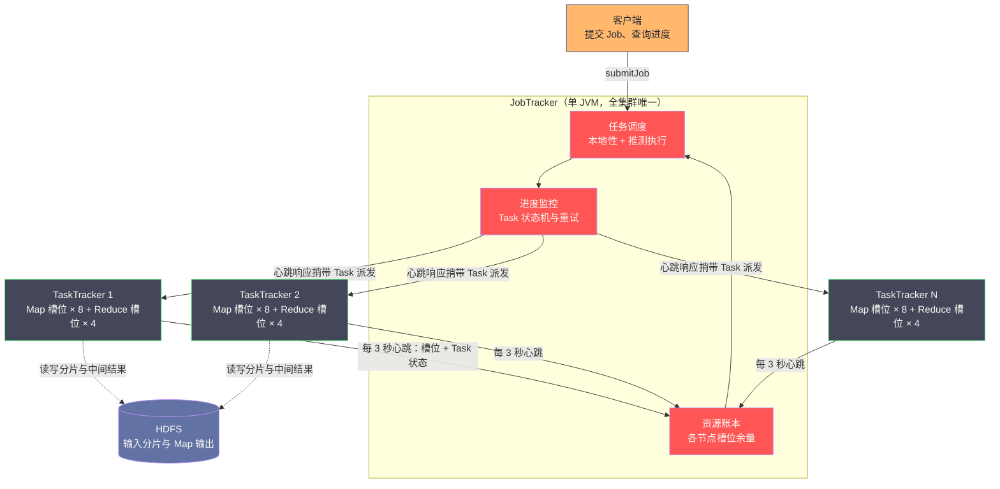
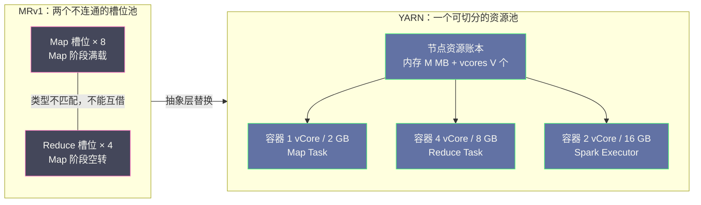
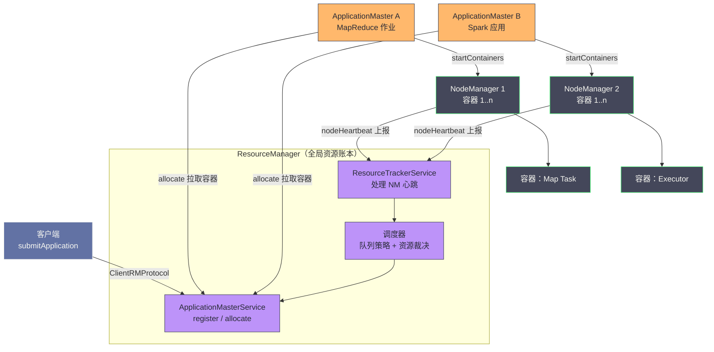
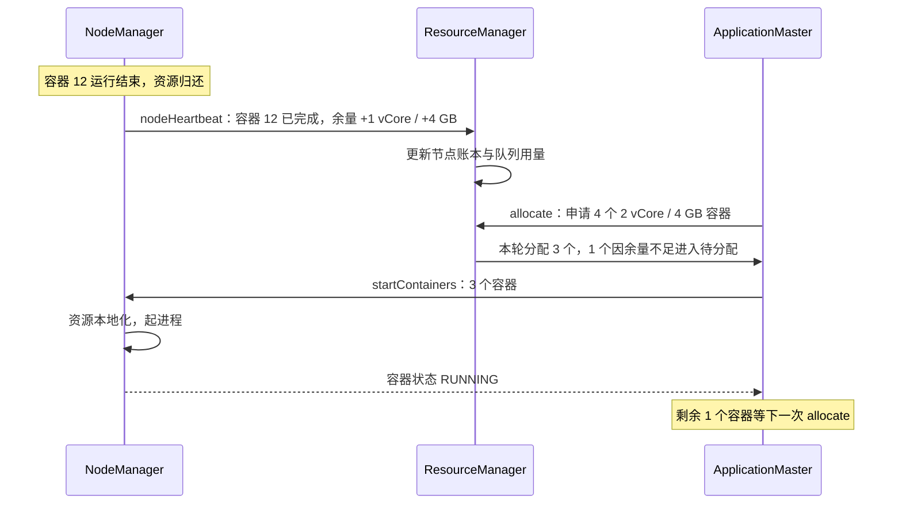
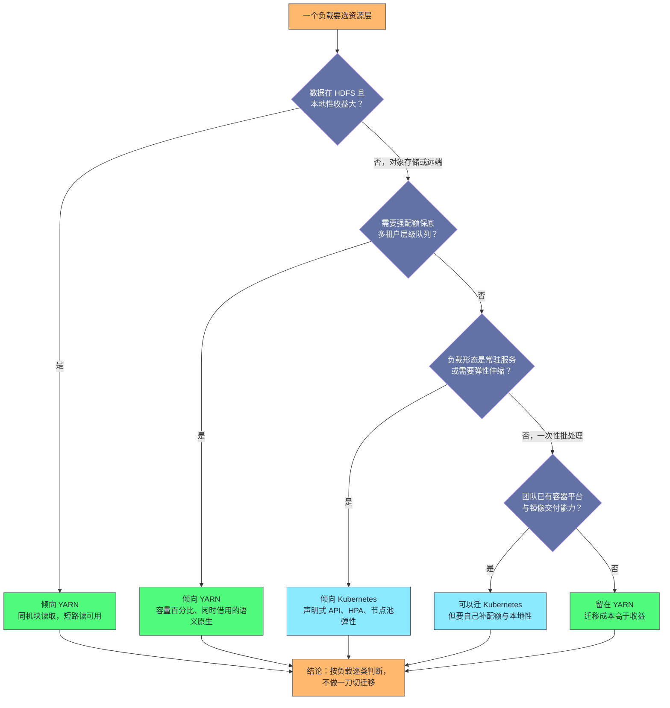

# YARN 的诞生——从 MRv1 到资源管理与计算分离

**摘要：**

2004 年那篇 OSDI 论文只讲了怎么写并行计算，Hadoop 1.x 却把"怎么写"和"怎么跑"压进了同一个进程。本文不介绍 YARN 有哪些组件，只追问三件事：MRv1 的 `JobTracker` 一肩挑资源管理、任务调度与进度监控，究竟在哪一步上撞到四千节点那道墙；YARN 把资源管理从计算框架里剥出去之后，换回了什么，又付出了什么；`Container` 取代 slot 之后，为什么内存与 CPU 的配比反而成了运维必须手工填的一道算术题。文章沿着单点瓶颈、框架绑定、槽位刚性三个结构性问题展开，逐项对照 YARN 的解法与解法成立的前提，给出两本账：分离的收益与代价、slot 与 Container 的利用率差。最后收束到三条从 MRv1 时代带出来的思维惯性——按 slot 数规划容量、以为 vcores 等于 CPU 隔离、以为 ApplicationMaster 是免费的，以及一条同源幻觉：单集群可以无限扩；同时给出"什么负载该留在 YARN、什么负载该走"的判据。全文的落点是同一个判断：分离买到的是可替换性，付出的是一层进程与一道配比算术，两者必须一起看。

---

## 第 1 章 一个进程，四千台机器

### 1.1 从一篇论文到一个开源项目

2004 年的 OSDI 会议上，Google 的两位工程师 Jeffrey Dean 与 Sanjay Ghemawat 提交了一篇 MapReduce 论文，用一个极简模型回答了"如何用上千台普通机器做完一次大规模批处理"：把计算拆成 Map 与 Reduce 两段，Map 段彼此独立、Reduce 段按 key 聚合，框架负责搬运中间数据。这套模型的价值不在于算法精巧，而在于它把并行、容错、数据分发全部收进了框架，让写作业的人只填两个函数。

两年之后的 2006 年，这套思路从 Nutch 项目里分叉出来，成了独立的 Hadoop 项目；2008 年 1 月成为 Apache 顶级项目。此后几年，各家公司把集群从几百台推到几千台，到 2010 年前后，Yahoo 最大的那个集群在四千台上下，这个数字后来反复出现在架构讨论里——它是 MRv1 那道墙的位置。

这里有一个容易被跳过的区分：论文定义的是编程模型（Programming Model），Hadoop 1.x 实现的是执行框架（Execution Framework）。前者回答写什么代码，后者回答这些代码在哪个节点上、用多少资源、跑多久、失败了怎么办。本文的三个结构性问题全部长在后者身上——这也是后来 Spark、Flink 能保留各自模型、共用同一套资源层的前提。

### 1.2 两个进程：JobTracker 与 TaskTracker

Hadoop 1.x 的执行框架，也就是通常所说的 MRv1，是一个 Master-Worker 结构，核心只有两个守护进程。

Master 节点上跑 `JobTracker`，全集群唯一。它接收客户端提交的作业，把作业切成 Map Task 与 Reduce Task，决定每个 Task 派给哪台机器，并盯着所有 Task 的进度直到作业结束。Worker 节点上跑 `TaskTracker`，与 `DataNode` 同机部署——这不是巧合，而是数据本地性（Data Locality）的物理前提：Task 在本机读 HDFS 块，可以走短路读，省掉一次跨机架的网络传输（HDFS 侧的结构见 [[大数据/Hadoop/HDFS/02 HDFS 整体架构全景——NameNode、DataNode 与 Client 三角关系|HDFS 整体架构]]）。

TaskTracker 向上汇报的粒度是槽位（Slot）。每台机器在启动时就确定了自己能同时跑几个 Map Task、几个 Reduce Task，对应的配置项在 `mapred-site.xml` 里，改一次要重启：

```xml
<!-- MRv1：槽位数量在节点启动时写死，运行期不可变 -->
<property>
  <name>mapred.tasktracker.map.tasks.maximum</name>
  <value>8</value>   <!-- 本机最多 8 个 Map 槽位 -->
</property>
<property>
  <name>mapred.tasktracker.reduce.tasks.maximum</name>
  <value>4</value>   <!-- 本机最多 4 个 Reduce 槽位 -->
</property>
<property>
  <name>mapred.child.java.opts</name>
  <value>-Xmx1024m</value>  <!-- 每个 Task 的 JVM 堆，注意它并不等于槽位的资源量 -->
</property>
```

这两行配置描述的不是"这台机器有多少资源"，而是"最多能同时容纳几个 Task"。槽位是一个计数单位，不是资源单位：一个槽位背后对应多少内存、多少 CPU，配置里没有写，框架也不强制。真正决定单任务吃多少资源的是 `mapred.child.java.opts`，它属于另一个维度——这就埋下了后文要展开的规格错配。

### 1.3 三顶帽子：JobTracker 到底在做什么

把 JobTracker 的职责列出来，会得到一个很长的清单。按性质归并，可以分成三类，而这三类恰好对应一个资源管理系统必须处理的三种问题：集群有多少资源、这批活该派给谁、活干到哪一步了。

| 职责类别 | 具体内容 | 依赖的状态 |
|---|---|---|
| 资源账本 | 收集 TaskTracker 心跳，维护每台机器上 Map/Reduce 槽位的占用与余量 | 全集群所有节点与槽位的实时视图 |
| 任务调度 | 按数据本地性、槽位余量把 Task 派给某个 TaskTracker，处理推测执行（Speculative Execution） | 待分配队列、每个 Task 的输入分片位置、每个节点在地理与机架上的位置 |
| 进度监控 | 跟踪每个 Task 的状态机（RUNNING/SUCCEEDED/FAILED）、处理失败重试、汇总作业进度、决定作业能否收尾 | 所有作业、所有 Task 的运行态与计数器 |

三类职责本身并不稀奇，任何调度系统都要做这三件事。MRv1 的问题不在职责多，而在这三类职责共享同一个进程、同一个堆、同一把锁——资源账本更新阻塞调度决策，调度决策耗时拖慢心跳响应，心跳慢了会让 TaskTracker 被判死，判死触发重算并加重账本负担。这是一个闭环的放大结构，不是三个独立模块。

> [!info] 核心概念：耦合的不是职责，是状态
> 常见的说法是"JobTracker 违反了单一职责原则"，这个说法对，但没能指出要害。真正要命的是三类职责读写的是同一份状态：调度器要读槽位余量，进度监控要改 Task 状态，而 Task 状态的变化又会让槽位退还。要让它们解耦，光把类拆开没用，得让"资源"这个状态从"作业"的状态里独立出去——这正是 YARN 干的事，也是本篇后面所有讨论的伏笔。

### 1.4 状态都在同一个堆里

JobTracker 把整个集群的运行态放在 JVM 堆里，没有任何持久化。一份作业是 `JobInProgress` 对象，作业里的每个 Task 是 `TaskInProgress` 对象，它在哪个节点上跑、跑到百分之几、Map 输出落在哪台机器的哪个目录，都要记。Reduce 阶段按 Map 输出位置取数（Shuffle），所以还要维护一份"每个 Map 输出完成了哪些、位置在哪"的事件清单。

于是 JobTracker 的堆占用大致是 **O(作业数 + 任务数 + Map 输出条目数)**。任务数这一项最难控制：一个中等规模的 Hive 查询动辄几千个 Map Task，一个几千节点的集群同时跑上百个作业，堆里就是十万量级的 Task 对象。按每个 Task 状态对象连同其进度快照、计数器、输出位置清单共计数 KB 估算，十万任务就是几百 MB 起步的常驻堆；这还不算调度器为数据本地性维护的候选队列。

堆一涨，GC 就成了全集群共享的停顿。JobTracker 是一个 JVM，它的 Full GC 停多久，全集群的心跳响应就卡多久。MRv1 时代典型的运维手法是给 JobTracker 配几十 GB 堆，再用 `mapred.jobtracker.completeuserjobs.maximum`（默认 100）限制保留多少个已结束作业的元数据，用 `mapred.jobtracker.jobhistory.lru.cache.size` 限制作业历史缓存条目。这些参数的意义都是给一个不该无限增长的堆做减法。

MRv1 的整体形状可以用一张图收拢。图中把 JobTracker 内部拆成三块，是为了说明它们共享同一个进程边界——图上的边界，就是后来 YARN 要切开的位置。



图里那条"心跳响应捎带 Task 派发"的箭头，是理解 MRv1 性能特征的关键：调度不是一个独立运行的循环，而是被心跳驱动的应答动作。每来一个心跳，JobTracker 都要顺手判断一次"要不要给这台机器派活"。集群有多大，这个动作每秒就要做多少次。

---

## 第 2 章 第一个结构性问题：单点瓶颈

### 2.1 心跳算术：每秒要回答多少次打卡

TaskTracker 向 JobTracker 汇报的周期约为 3 秒，内容是本机槽位占用与所有正在运行的 Task 的进度。把心跳看成打卡机，JobTracker 就是那个既要收卡、又要当场决定下一班活派给谁的工头——打卡的人一多，工头就来不及看卡。

按 3 秒心跳算，一个 N 节点的集群每秒送来 `N/3` 次心跳 RPC，N 取 4000 就是每秒约 1333 次。每次心跳的处理路径上，JobTracker 要做的不只是"更新节点状态"：刷新该节点的槽位余量，扫描待分配队列尝试匹配，按数据本地性给候选节点排序，再把 Task 描述序列化进响应体。一次心跳的成本，与等待调度的 Task 数量、节点所在的机架层级都有关。

更要紧的是心跳之外还有任务状态更新。每个在跑的 Task 都通过 TaskTracker 上报进度与计数器，一个 4000 节点的集群按每节点 12 个槽位、七成占用估算，同时在跑的 Task 接近三万个；这些进度要汇总进状态机、更新进度、判断是否需要推测执行。心跳只是入口，真正吃掉 CPU 的是这次汇总。

这里没有任何靠加机器解决的空间：JobTracker 只有一个进程，加节点只会让它工作量线性上升，处理能力被单机 CPU 与单堆 GC 钉死。规模每翻一倍，心跳响应就恶化一截；恶化到某个程度，`mapred.tasktracker.expiry.interval`（默认 600000 毫秒，10 分钟没心跳判死）这类超时逻辑开始误判。Yahoo 公开材料里把生产集群的实用规模描述在四千节点上下——不是硬阈值，而是"再往上加，收益被调度开销吃掉"的经验拐点。

### 2.2 调度循环是串行的

JobTracker 的 RPC 处理是多线程的，若干 handler 线程接心跳与客户端请求；但真正决定"哪个 Task 派给哪个节点"的逻辑，收敛在一个调度器线程里串行执行。这个设计在几百节点规模上合理：调度决策需要一致的全局视图，串行换来的简单与正确。代价是调度吞吐的上限等于单线程速度。

串行调度还会放大 **尾延迟**。假设某个作业一次提交了两万个 Map Task，调度器要为每个 Task 做一次本地性匹配，匹配时可能还要跨机架回退。这批决策做完之前，排在后面的心跳拿不到 Task，只能等下一轮。作业越多、Task 越多，单轮调度耗时越长，心跳的有效响应率越低——调度器忙于决定，反而拖慢了它获取决策依据的速度。

MRv1 后期做过一些局部优化，譬如把作业初始化（生成 Task 对象）从调度线程里挪到独立线程、把心跳处理拆成多级队列、对已完成作业做更积极的回收，但这些都是在一个共享堆、共享锁的骨架上做减负，没有改变"调度能力等于单进程能力"这个前提。

### 2.3 为什么不能多起几个 JobTracker

最自然的扩展思路是横向复制：既然一个 JobTracker 撑不住四千节点，那就两个 JobTracker 各管两千节点。这个方案在 MRv1 的代码结构里走不通，原因不在进程模型，而在 **状态耦合**。

调度决策需要三样东西同时可见：全集群的槽位余量、每个 Task 的输入分片在哪、每个 Map 输出落在哪台机器。把集群切成两半，跨半区的作业立刻失去全局视图——Reduce Task 在 A 半区，它要拉的 Map 输出可能在 B 半区，B 半区的 JobTracker 不知道 A 半区有个 Reduce 在等。要让两个 JobTracker 协作，得先把"资源"从"作业"里拆出来做成共享账本，再让作业调度变成账本的消费者。这个拆法有一个名字，叫 YARN。

> [!info] 核心概念：拆职责之前先拆状态
> 判断一个单点能不能横向扩展，看它维护的状态是不是可切分。无状态的服务加机器就能扩；有状态但状态可按 key 切分的服务（比如按用户 ID 分片）也能扩；MRv1 的 JobTracker 属于第三种——状态高度关联、切不开，只能重新设计边界。用"多起几个"去解决这类瓶颈，通常的结果是把一致性问题从单机搬到网络上。

### 2.4 同一枚硬币：不可用的单点

单点瓶颈的反面是单点故障，两者是同一个结构的两种表现。MRv1 没有 JobTracker 的高可用机制：JobTracker 进程一挂，集群立刻停止接受新作业，正在跑的作业全部失败，因为它们的运行态只存在于那个已经消失的堆里。

Hadoop 1.x 提供了 `mapred.jobtracker.restart.recover` 这个开关，让 JobTracker 重启后能从 HDFS 上的作业历史文件里把作业"捡回来"，把作业状态从失败改回运行。这属于 **重启恢复，不是主备切换**：恢复期间集群不可用，正在运行的 Task 要重新认领，恢复的完整性取决于历史文件的刷新时机。真正的主备切换需要状态存储、选举与客户端重定向三件套，这一套在 YARN 的 ResourceManager 上才配齐。

到这里，第一个结构性问题可以收束成一句话：MRv1 把集群的三种状态压进一个进程，于是扩展性、可用性、调度吞吐三个指标被绑在同一根绳子上，任何一个吃紧，另外两个跟着吃紧。

---

## 第 3 章 第二个结构性问题：集群只认得 MapReduce

### 3.1 调度器"懂" MapReduce 意味着什么

MRv1 的第二个问题常被表述成"只支持 MapReduce"，听起来像是一个功能缺失，实际上它是一个结构特征：JobTracker 里的调度逻辑，有一大半不是通用的资源管理逻辑，而是 MapReduce 自己的业务逻辑。

展开看，JobTracker 承担的任务里至少四件事是 MR 特有的：把作业切成 Map 与 Reduce 两类 Task，类型直接决定能用哪一类槽位；任务状态机内置"Map 先行、Reduce 取数"的阶段假设；推测执行的判定依据 MR 的进度模型（Map 按分片读了多少、Reduce 按 Shuffle/排序/归并三段走到哪一步）；派发给 TaskTracker 的指令只有"起一个 MapTask"或"起一个 ReduceTask"，进程启动、JVM 参数、输出提交协议也都按这两种形态写死。

换句话说，MRv1 不是"一个资源管理器恰好用于 MapReduce"，而是"一个 MapReduce 作业管理器顺手管了资源"。这两种说法在功能上看不出区别，但在扩展性上天差地别：前者的资源层可以被替换负载，后者的资源层与负载焊死。

> [!note] 设计回望：耦合在当时是合理的
> 2006 年前后，Hadoop 的客户就是搜索引擎的索引构建，负载单一、形态固定，把资源管理与 MR 调度放进一个进程，省掉了一层 RPC、一套状态同步、一批配置项，工程上非常划算。问题不是当年的设计错了，而是负载谱系在四年里扩张得比架构演进快。架构的寿命通常不取决于它当初多优雅，而取决于它的边界假设能被撑多久。

### 3.2 2010 年前后的负载分化

2010 年前后，大数据处理的负载开始分叉，分叉的方向恰好都是 MapReduce 模型不擅长的地方。

迭代计算是第一个分叉。PageRank、K-Means 这类算法要求同一份数据被反复扫描几十轮，每轮只改动少量数值。MapReduce 的形状是"读 HDFS、算、写 HDFS"，每一轮迭代都要把中间结果整体落盘再读回，磁盘与网络开销贴着数据量线性增长。把数据留在内存里跨轮复用的思路，后来长成了 Spark 的弹性分布式数据集（RDD），而在 MRv1 集群上，这类负载只能硬跑，跑得极慢。

图计算是第二个分叉。社交关系、网页链接这类数据的计算需要节点间频繁交换消息，BSP 模型用一个"超步"（Superstep）概念把计算切成同步轮次，每个超步内做消息传递。MapReduce 的两段式结构里没有"多轮同步"这个位置，勉强映射过去，每一轮都要经过一次全量 Shuffle。

交互式查询与流处理是另外两个分叉。分析师在 BI 工具里点一下，期望几秒出结果，而 MapReduce 作业的启动开销本身就在数十秒量级；告警、风控、实时指标则要求常驻的拓扑持续消费数据，与"提交—运行—结束"的一次性模型正相反。Impala、Presto 这类 MPP 引擎干脆绕开 MapReduce，自己管执行计划与数据分片。

四个分叉的共同点在于，冲突不在快慢，而在数据流的形状：MapReduce 的形状是一段固定的两阶段流水线加一次全量落盘，其它负载的形状是多段、迭代、常驻、低延迟。形状不匹配的负载，靠调参数是调不出来的。

### 3.3 不分离的代价：资源孤岛

负载分叉之后，最直接的应对是给每种框架配一套集群。MapReduce 一套、Spark 一套、Impala 一套，共享同一个 HDFS，计算资源各自为政。这套做法在组织上容易通过，在成本上很难看。

孤岛的成本来自"按峰值采购、按均值使用"。举个量级上的例子：报表批处理集群峰值 100 台、白天忙夜里闲；模型训练集群峰值 80 台、夜里跑白天闲；交互查询 40 台、工作时间忙。三套加起来装机 220 台，若峰谷确实错开，一个 140 到 160 台的共享池就够覆盖同样的工作量。差额不是靠更聪明的调度省出来的，而是靠把不同形状的负载放进同一个池子。这是示例推算，真实比例取决于峰谷错开程度与负载弹性，但方向确定：资源池的粒度越粗，错峰复用的可能性越小。

孤岛还有两个隐形成本。一是数据本地性被割裂：计算集群的节点若没部署 DataNode，Task 读数据只能走网络，本地性从"同机"降到"同机架"。二是运维面成倍扩张：三套集群意味着三套部署、三套监控、三套配额流程，以及三套"这个队列为什么卡住"的排障经验。

### 3.4 反事实：如果一直不分离

设想 Hadoop 停在 MRv1 不往前走，接下来会发生什么。每出现一种新的计算框架，组织就要新增一套资源池与一套运维体系，框架之间的资源永远不能互借；配额只能做在集群这一级，无法做到"给 A 部门的 Spark 作业预留 30% 资源、给 B 部门的 MapReduce 作业保底 20%"这种应用级语义；资源利用率的提升空间被锁死在"每套集群内部调优"这一层。

这正是 2010 年前后几家大厂的处境。解法有两条：每个框架自己实现一套资源管理（重复造轮子，还无法共享硬件），或者把资源管理抽出来做成独立一层。YARN 选第二条，换来的是更细的粒度：资源池的单位从"集群"降到"容器"。

---

## 第 4 章 第三个结构性问题：slot 是一把固定量杯

### 4.1 槽位到底是什么

槽位这个名字很容易让人以为它是"一份资源"，实际上它是一个 **并发许可**。一台机器配 8 个 Map 槽位与 4 个 Reduce 槽位，意思是"最多同时跑 8 个 Map Task 与 4 个 Reduce Task"，这 12 个 Task 各自吃多少内存、多少 CPU，槽位配置里一个字都没写。

真正的资源约束藏在另外两个地方。内存侧靠 `mapred.child.java.opts` 给每个 Task 的 JVM 设堆上限，CPU 侧则完全没有约束——一个节点上跑 12 个 Task，就有 12 份 JVM 抢同一批核。MRv1 提供过 `LinuxTaskController` 这类可选的强隔离手段，但它不是默认路径，大多数集群依赖的是"作业作者自己估好内存、别写太离谱"这种软约束。

于是槽位模型有两个隐含前提：每个 Task 的资源需求大致相同，且 Map 与 Reduce 的数量比例长期稳定。这两个前提在集群规模小、负载单一时成立，一旦负载多样化就同时失效。

### 4.2 类型不借：两个不连通的水池

槽位在类型上被切成两个互不连通的水池。Map 槽位只能跑 Map Task，Reduce 槽位只能跑 Reduce Task，这个约束写死在调度器里，不是配置项。

作业的时间结构决定了两个水池的占用曲线错开。Map 阶段所有 Map Task 并行推进，Reduce 槽位空着；Map 收尾后进入 Shuffle 与 Reduce，Map 槽位陆续空出，Reduce 槽位被填满。MRv1 用 `mapred.job.reduce.slowstart.completedmaps`（默认 0.05）让 Reduce 在 5% 的 Map 完成时提前启动，试图抹平阶段边界。但这只是把"Reduce 槽位闲置"改成"被占着等 Shuffle"：Reduce Task 已启动、已在拉取 Map 输出，真正做聚合要等数据齐。从账本看是占用了，从有效计算看仍是空转。

作业尾部还有一次反向的错配。最后几个 Map（往往是数据倾斜导致的慢任务）迟迟不结束，Reduce 已经全部在跑，Map 槽位却只剩个位数在用。推测执行为此启动副本，但副本也要占 Map 槽位，而 Reduce 侧已经满载，只能等。

这些空转不是排队策略造成的，是资源池的形状造成的。两个池子各自有水，互相之间没有阀门。



### 4.3 规格错配：一个槽位装不下两种任务

第二个失效点是规格。一个处理 512MB 小文件的 Map Task 与一个做维度关联、要吃 4GB 的 Map Task，在槽位模型里是平等的：各占一个 Map 槽位。

于是运维被迫做一道不存在的算术题。为了让大任务别 OOM，只能把 `mapred.child.java.opts` 往大调；调大之后，小任务也按大规格占位，节点上能并发的槽位数量却没有变，结果是每个槽位都预留了它用不上的内存，节点的物理内存被虚拟地"抬高"了成本。反过来把单任务内存调小，大任务立刻 OOM 或被操作系统杀掉。

槽位数固定还意味着并发上限固定。小任务无法申请更小的槽位来提高并发密度，大任务也无法合并两个槽位换取更大内存。槽位模型里没有"按需分配"，只有一个可调总量：槽位个数。

### 4.4 算一笔账：8 + 4 的利用率

把上面的定性讨论换算成数字，会更清楚这道题的结构。仍以每节点 8 个 Map 槽位、4 个 Reduce 槽位为例，这是 MRv1 时代很常见的配置（默认值其实是 2 与 1，生产上通常按核数往上调）。

| 时段 | 在用的槽位 | 槽位利用率 | 空转的原因 |
|---|---|---|---|
| 纯 Map 阶段 | 8 个 Map | 8 / 12 ≈ 66.7% | 4 个 Reduce 槽位类型不匹配 |
| Shuffle 与 Reduce 阶段 | 4 个 Reduce（Map 陆续退出） | 4 / 12 ≈ 33.3% | 8 个 Map 槽位无 Task 可跑 |
| 尾部长尾 | 1 到 2 个 Map（推测执行） | 约 15% | Reduce 已满，Map 只剩零星 Task |

假设一个作业的时间构成是 Map 阶段占 60%、Reduce 阶段占 40%，两个阶段的槽位占用加权平均约为 `66.7% × 0.6 + 33.3% × 0.4 ≈ 53.3%`。这组数字是**示例推算**，用来说明结构，不代表任何真实集群的测点；但关系是稳的：只要槽位比例与负载的实际比例不一致，就有一部分槽位在大部分时间里无活可干，而负载比例会变。

极端情形更容易看清。如果集群上全是 map-only 的 ETL 作业（只清洗、不聚合），Reduce 槽位全程闲置，利用率上限就是 66.7%；如果全是聚合重的作业，Map 槽位在 Reduce 阶段成片空转。运维能做的只有按当前负载画像调一次比例，而负载画像一变，配置就变成负债。

### 4.5 调大槽位不是解法

遇到利用率低，最直觉的动作是加槽位：8 个 Map 槽位不够就调成 16 个。这道算术很快撞墙——槽位个数乘以单任务内存不能超过物理内存，乘以单任务 CPU 需求不能超过核数。想把槽位翻倍，就得把单任务内存或 CPU 砍半，砍半之后大任务 OOM、小任务频繁 spill，吞吐反而下降。

于是槽位模型最终收敛成一个两难：按峰值负载配槽位，平时浪费；按均值配槽位，峰值排队。中间没有可调的旋钮，因为槽位本身不携带资源量，它只携带"能同时跑几个"这一个信息。要打破这个两难，资源分配的单位必须从"一个并发许可"换成"一包可以定制的资源"。

---

## 第 5 章 YARN 切开的到底是什么

### 5.1 两刀：资源归 ResourceManager，作业归 ApplicationMaster

YARN 的重构可以概括为两刀。第一刀把"集群资源账本"从 JobTracker 里切出来，交给 ResourceManager（RM）；第二刀把"单个作业的生命周期"切出来，交给每个作业自己的 ApplicationMaster（AM）。节点侧原来的 TaskTracker 被 NodeManager（NM）取代，职责从"跑 Map/Reduce 进程"变成"管这台机器上的容器"。

切开之后，三方的状态边界变得清楚。RM 知道集群有多少节点、每节点还剩多少内存与 vCPU、队列配额用了多少，但不知道任何应用的内部进度，也不知道容器里跑的是 Map 还是 Reduce。AM 知道自己的应用要多少容器、什么规格、偏好哪些节点，但不知道别的应用在做什么，也不知道全局余量——它只能申请，然后等分配。NM 只管本机容器的启停、用量与健康，向上汇报容器级状态。

这个切法带来的最本质变化是：资源的状态不再是作业状态的副产品，而是一张独立的、可以被不同作业共同读写的账。MRv1 里"槽位余量"是从一堆 Task 状态里推算出来的；YARN 里"可用资源"是 RM 自己维护的第一手数据。

### 5.2 三个协议：分离之后靠什么连起来

切开状态之后，三方需要协议。YARN 的协议数量不多，但每个都对应一条真实的动作路径。

| 协议 | 方向 | 关键方法 | 传输的状态 |
|---|---|---|---|
| ApplicationMasterProtocol | AM → RM | registerApplicationMaster、allocate、finishApplicationMaster | 资源申请（ResourceRequest）、已分配的容器、应用结束通知 |
| ResourceTrackerProtocol | NM → RM | registerNodeManager、nodeHeartbeat | 节点资源总量与余量、容器状态变更、已完成的容器、节点健康 |
| ContainerManagementProtocol | AM → NM | startContainers、stopContainers、getContainerStatuses | 容器启动上下文（命令、环境变量、本地化资源）、容器状态 |
| ClientRMProtocol | 客户端 → RM | submitApplication、getApplicationReport、killApplication | 应用提交、状态查询、终止 |

这张表能看出一个设计取向：YARN 的资源分配是 **拉模型**，不是推模型。AM 周期性调用 `allocate` 说"我还要这些资源"，RM 在响应里把这一轮能给的容器交给它；NM 周期性 `nodeHeartbeat` 上报本机状态，RM 据此更新账本。系统里没有"调度器主动把资源推给某个应用"的路径。

拉模型的好处是背压天然：应用自己控制申请节奏，RM 只做裁决，不必为每个应用维护推送队列；代价是分配滞后于资源释放——容器结束要等 NM 心跳把状态送上来，RM 才知道资源空出，AM 再下一轮 allocate 才拿得到。这条延迟在"分离的账单"里还要算一次。

下面这张图把分离后的结构与三条协议放在一起。请注意图中 RM 与 AM 之间只有"申请—分配"这一条语义，没有任何作业内部的信息流，这正是框架无关性的物理基础。



### 5.3 分离换回的四样东西

把这套切法与 MRv1 的三个结构性问题对照，可以逐项看到收益，也能看到收益成立所依赖的机制条件。

| MRv1 的结构性问题 | YARN 的解法 | 收益成立的机制条件 |
|---|---|---|
| JobTracker 单点瓶颈 | 资源账本独立成 RM，状态粒度从 Task 内部进度降到容器；应用状态由各自的 AM 承担 | RM 只跟踪节点、容器、应用三个维度的状态；规模继续上涨时靠 Federation 分片 |
| 只支持 MapReduce | 框架逻辑全部下沉到 AM，RM 只认"容器 + 资源申请" | AM 必须自行实现任务调度、失败重试、进度汇报；新框架接入等于写一个 AM |
| 槽位静态划分 | 容器无类型、规格可定制，资源按实际需要申请 | 申请值受最小/最大分配约束，且规格要靠人规划；CPU 隔离另有账要算 |

第一样收益是可扩展性，实现方式是降低状态粒度而不是提高单点性能。RM 不再为每个 Task 维护状态机，只维护容器级状态，需要维护的对象数量与每个对象携带的信息量都明显更少。副作用是任务级信息（进度、计数器、失败原因）失去全局视图，要由各框架的 AM 或 HistoryServer 承担，查询链路变长。

第二样收益是框架无关性。它不是一个开关，而是一个插件点：RM 与 AM 之间只约定资源申请与分配，任何框架只要写出自己的 AM 就能接入。Spark 的 AM 管 Executor 的申请与回收，Flink 的 AM 管 TaskManager，Tez 的 AM 按 DAG 拓扑动态要容器，MapReduce 的 AM 管 Map 与 Reduce 两类任务。同一个集群上，这些 AM 是彼此平等的资源消费者，谁也没有特权。

第三样收益是利用率。容器不带类型，Map 与 Reduce 的区分从资源层消失，两个水池被合成一个可以按需切分的池子；跨应用共享也让错峰复用成为可能——夜里跑模型训练的容器与白天跑报表的容器，可以来自同一个池子。

第四样收益是故障域。AM 挂掉只影响它自己的应用，RM 不认识别的应用内部；RM 挂掉有主备切换，应用可以继续等待新的 RM 接管。故障域变小，是"把状态分给更多进程"的必然结果，代价则写在下一章。

### 5.4 分离的边界：哪些没有被分开

需要说清楚的是，YARN 并没有把所有东西都分开。数据本地性仍留在 RM 的调度决策里——AM 申请容器时可以指定偏好节点或机架，RM 裁决时参考这些偏好；队列与配额仍在 RM，属于全局策略；节点健康检查仍横跨 NM 与 RM。这些是"必须集中"的东西，集中才不会失去全局最优。

集中也意味着单点依旧存在。RM 的高可用解决可用性，不解决扩展性：主备切换能让集群在 RM 故障时继续工作，但资源总量与调度吞吐仍由单个 RM 决定。规模超过单 RM 的舒适区之后，YARN 的答案是 Federation——多个 RM 各自管一部分节点，由一个 Router 转发请求。分离只改变了 **瓶颈的位置**，没有消灭瓶颈。

> [!info] 本列的三篇分工
> 本章只交代"分离出什么、靠什么协议连起来"。分离之后的整体协作全景归 02 篇，ResourceManager 内部的调度器与资源抽象归 03 篇，容量调度与公平调度的算法取舍归 05 篇，本文不再展开。

---

## 第 6 章 分离的账单

### 6.1 多出来的那一层进程：AM 不是免费的

分离之后，每个应用多了一个进程：ApplicationMaster。它本身就是一个容器，吃内存、吃 vCPU、占队列配额，而且在应用运行的全过程中一直在。

以 MapReduce 为例，AM 的资源由 `yarn.app.mapreduce.am.resource.mb`（默认 1536）与 `yarn.app.mapreduce.am.resource.cpu-vcores`（默认 1）指定；Spark 的 AM 里跑的是 Driver，内存由 `spark.yarn.am.memory` 控制（默认 512m，外加上下文开销）。这些配置看起来不大，但它们是**按应用计的固定开销**，不随应用规模缩减。

举一个量级上的例子。一个 300 节点的集群，每节点 28 vCPU，合计 8400 vCPU。若队列里同时有 400 个 Spark 应用，每个 AM 按 1 vCPU、2 GB 计，AM 吃掉 400 vCPU 与 800 GB 内存——占集群 4.8% 的 CPU 与约 7% 的内存（按每节点 28 GB 可用计）。若这 400 个应用平均只跑五分钟、每个 4 个 Executor，真实计算资源不过 4 到 8 vCPU，AM 的 1 vCPU 相当于给每个应用加了 12% 到 25% 的固定税。这是示例推算，具体比例取决于应用规模与时长，但结构确定：应用越小越短命，AM 的相对成本越高。

AM 里还要跑框架自己的调度逻辑：MapReduce 的 AM 按分片数生成 Map 任务、盯进度、处理推测执行；Spark 的 AM 就是 Driver，要跑 DAGScheduler 与 TaskScheduler、维护 Shuffle 元数据。这些逻辑在 MRv1 里由 JobTracker 统一完成，现在被复制到每个应用进程里——总 CPU 消耗未必更低，但被分摊了，且互不阻塞。

### 6.2 AM 挂了：重启不是免费的

AM 是新的单点，只是故障域从一个集群缩到一个应用。AM 挂掉之后，RM 会按 `yarn.resourcemanager.am.max-attempts`（默认 2，即最多两次尝试）重新拉起一个新的 AM attempt，新 AM 重新注册、重新申请容器、重新建立状态。

恢复过程比想象中麻烦。新 AM 起来时，旧 AM 申请的容器可能还在节点上跑，也可能随旧 attempt 的清理被回收；新 AM 要向 NM 查询自己应用的容器状态，把还活着的任务认回来，把死掉的重排。MapReduce 提供了一部分状态恢复能力（`yarn.app.mapreduce.am.job.recovery.enable` 控制是否从作业历史恢复已完成的 Map 输出位置）：中间结果还留在原节点本地磁盘上就不用重算，节点重启或结果被清理就只能重跑。

Spark 的情形更直接：Driver 就在 AM 里，AM 一挂，整个应用的调度中枢消失，通常表现为应用失败；即使开启 `spark.yarn.maxAppAttempts` 让 YARN 重试，重试的也是一个全新的 Driver，需要从外部 Shuffle 服务或检查点恢复状态。这也是为什么长时运行的流式应用更愿意把状态放在外部存储上——AM 从"不会挂"变成了"挂了要能重建"，而重建的前提是状态有外部副本。

一句话收束：AM 把故障域缩小了，但没有消除故障；它把"集群级单点"换成了 **"应用级单点"**，并且让每个应用都要为自己的单点付一次恢复成本。

### 6.3 两跳延迟：从顺手派活到申请、分配、启动

分离带来的第三个代价是延迟。这一项最容易被夸大，也最值得拆开看。

先澄清一个常见的误读：MRv1 也是心跳驱动，JobTracker 在心跳响应里捎带派活；YARN 也是心跳驱动，RM 在 NM 心跳时更新账本、在 AM 申请时分配容器。两者都不是"推"模型。真正的差别在链路长度与可见性延迟：容器用毕、资源归还，要先经 NM 上报 RM，RM 才把它放回可分配池；AM 要等下一次申请周期才拿得到。

把一条完整的申请链路拆开看，会看到四个可测量的环节。



第一环是 NM 心跳周期，默认 `yarn.resourcemanager.nodemanagers.heartbeat-interval-ms` 为 1000 毫秒，意味着资源释放到账最多滞后一秒；第二环是 RM 的调度裁决；第三环是 AM 的申请节奏，MapReduce 的 AM 默认每秒向 RM 申请一次（`yarn.app.mapreduce.am.scheduler.heartbeat.interval-ms`）；第四环是 NM 拿到启动指令后的资源本地化与进程启动，这一环的耗时取决于本地化资源的大小与磁盘状态。

四环相加，一个容器从"有资源可用"到"任务真正开始跑"通常在秒级。这个量级对几十分钟的批处理不算什么，对秒级的小任务就是显著摊销——只跑三秒的任务，等容器启动可能就要两秒。这也是短小任务密集的场景更倾向容器化平台的原因：问题不在 YARN 的实现，而在"申请—分配—启动"这套语义本身是为长任务设计的。

### 6.4 收益与代价对照表

把账算在一起，可以得到下面这张对照表。表中"代价落在谁身上"这一列，是笔者刻意加的：架构决策的代价从来不会消失，只会被转移到某个角色或某个环节上，指出它落在哪里，比笼统地说"增加了复杂度"有用。

| 维度 | MRv1 | YARN | 代价落在谁身上 |
|---|---|---|---|
| 扩展性 | 受单 JobTracker 处理能力限制，实用规模数千节点 | RM 只跟踪节点/容器/应用，规模上限显著抬高，再往上靠 Federation | 运维要理解两套扩展机制，Federation 的部署复杂度另算 |
| 框架支持 | 只有 MapReduce | 任何框架写自己的 AM 即可接入 | 框架开发者要自己实现任务调度、容错、进度上报 |
| 资源利用率 | 槽位按类型静态切分，跨类型不可借 | 容器无类型、规格可定制，跨应用共享 | 运维要按负载画像规划内存与 vCPU 配比 |
| 故障域 | JobTracker 挂则全集群停摆 | AM 挂只影响单个应用，RM 挂有主备 | 每个应用多一份 AM 恢复成本与状态重建逻辑 |
| 调度延迟 | 心跳响应即派活，单跳 | 资源释放要经 NM 上报，AM 再申请，多跳 | 短任务的应用要承担容器启动的固定开销 |
| 任务级可观测性 | JobTracker 里有全局视图 | 任务级信息下沉到 AM 与 HistoryServer | 排障要跨 RM、AM、NM 三处日志对照 |
| 运维面 | 一套进程、一套配置 | 三类守护进程、框架侧配置叠加 | 学习曲线与故障定位成本都在上升 |

---

## 第 7 章 Container：从"一个槽"到"一包资源"

### 7.1 容器是什么

YARN 用容器（Container）取代槽位。容器是 RM 分配、NM 落地的一次资源授予，它的核心是一个资源元组：内存（MB）、虚拟核（vCPU），在 Hadoop 3.x 里还可以附加扩展资源，譬如 GPU 通过 `yarn.io/gpu` 这样的资源名进入同一个账本。一个容器还带着容器 ID、所在节点、优先级，以及 AM 交给 NM 的启动上下文——要执行的命令、环境变量、需要本地化的文件与归档。

```text
Container = { containerId, nodeId, Resource{ memory: M MB, vcores: N, 扩展资源... },
              priority, 启动上下文（命令 + 环境 + 本地化资源） }
```

需要强调一点：YARN 的容器是**逻辑资源单元**，不是镜像容器。默认执行路径下，NM 在宿主机上按启动上下文拉起一个普通进程（通常是 JVM），资源约束依赖 cgroups 或监控脚本，不保证进程跑在某个镜像的根文件系统里。把它与 Docker 容器混为一谈，是初学 YARN 时最常见的概念串味——前者是资源配额单，后者是交付与隔离的封装。3.x 生态里确实有过容器化执行器的尝试，但那不是主流路径。

### 7.2 无类型：Map 与 Reduce 的区分从资源层消失

容器不带类型。RM 不知道也不关心某个容器里跑的是 Map Task、Reduce Task、Spark Executor 还是 Flink TaskManager，它只知道"这个容器有多少内存、多少 vCPU、在哪个节点上"。

这条变化看着只是删掉一个枚举，实际影响很大。资源池不再被切成**两个互不连通的水池**，Map 与 Reduce 的错峰可以互相借用——YARN 里根本不存在"Reduce 配额"这种概念。调度器与计算框架彻底解耦，队列策略只按资源量裁决，不需要理解负载语义。框架的接入成本降到"写一个 AM"：申请多少容器、每个多大、什么时候申请，全是框架自己的事。

### 7.3 规格可以定制，但有两道夹子

容器的规格由申请方决定，但不是随便填。调度器对每个申请做两道处理：先按最小分配向上取整，再按最大分配封顶。

最小分配由 `yarn.scheduler.minimum-allocation-mb`（默认 1024）与 `yarn.scheduler.minimum-allocation-vcores`（默认 1）决定：申请 512 MB 的容器会被抬到 1 GB，因为调度器要保证账本可以被整齐切分，否则碎片会失控。最大分配由 `yarn.scheduler.maximum-allocation-mb`（默认 8192）与 `yarn.scheduler.maximum-allocation-vcores`（默认 4）决定，超过上限的申请会被拒绝，抛 `InvalidResourceRequestException`。**两个夹子**构成规格区间：小不能小于 1 GB / 1 核，大不能大于 8 GB / 4 核（默认口径，生产上按节点规格调整）。

```xml
<!-- yarn-site.xml：容量相关的三类配置，改之前先算清楚账 -->
<property>
  <name>yarn.nodemanager.resource.memory-mb</name>
  <value>57344</value>   <!-- 节点分给 YARN 的内存；留出余量给 OS 与 DataNode -->
</property>
<property>
  <name>yarn.nodemanager.resource.cpu-vcores</name>
  <value>28</value>      <!-- 调度器记账用的虚拟核数，不必等于物理核数 -->
</property>
<property>
  <name>yarn.scheduler.minimum-allocation-mb</name>
  <value>1024</value>    <!-- 调小会增加容器数量与碎片，调大会放大小额申请 -->
</property>
<property>
  <name>yarn.scheduler.maximum-allocation-mb</name>
  <value>16384</value>   <!-- 调大允许单容器吃更多内存，代价是同机争抢 -->
</property>
```

### 7.4 代价一：内存与 vCPU 的配比要人工规划

槽位模型把资源规划藏起来了，容器模型把它摊到了台面上：`yarn.nodemanager.resource.memory-mb` 与 `yarn.nodemanager.resource.cpu-vcores` 是两个必须手工填的数字，而它们的比例决定了这台机器能吃什么样的负载。

这两个数字代表的是"节点愿意交给 YARN 的资源量"，不是物理规格。内存侧要留出给操作系统、DataNode、NodeManager 自身的余量；vCPU 侧则可以与物理核数不一致——配得比物理核多叫超配，配得少叫保守。问题在于，同一个数字要同时服务形状不同的负载。

举个例子。节点 64 GB 内存、32 个逻辑核，把 `memory-mb` 设成 57344（56 GB）、`cpu-vcores` 设成 28。如果集群上跑的是内存密集的批处理（每个容器 1 vCPU / 4 GB），按内存算最多 14 个容器，只用掉 14 个 vCPU，剩下 14 个 vCPU 在账本上存在但无法变成容器——因为内存先耗尽了。如果负载换成 Spark 的典型规格（1 vCPU / 2 GB），按内存算 28 个容器，28 个 vCPU 刚好用满。如果负载是 2 vCPU / 4 GB 的混合型，按内存 14 个容器、按 vCPU 28 个，仍然是内存先到顶。

这组算术说明一件事：节点的有效容量**由更紧的那一维决定**，而哪一维更紧取决于负载画像。把 `cpu-vcores` 从 28 调到 56 不会让 1:4 的负载多跑一个容器，只会让账本上多出一堆永远用不到的虚拟核。反过来，若 CPU 密集型负载偏多（每容器 4 vCPU / 4 GB），28 个 vCPU 只够 7 个容器、内存富余 28 GB，这时调高 vCPU 才有可能提高密度。

这也解释了为什么"一个集群跑多种框架"在资源规划上比"一种框架一个集群"更难：不同框架的默认规格天然不同，MR 的容器内存偏大、vCPU 偏小，Spark 的 Executor 常见 1 核配 2 到 4 GB，Flink 的 TaskManager 又是另一种比例。`cpu-vcores` 只有一个数字，负载却有好几种配比，任何单一配置都只能照顾一部分。

### 7.5 代价二：vcores 只是声明，不是隔离

容器模型给每个容器写了 vCPU 数，很容易让人以为"配了 4 vCPU 就独享 4 核"。这个理解在 YARN 的默认配置下是不成立的，原因有三层。

第一层在调度器。Capacity Scheduler 的资源计算器由 `yarn.scheduler.capacity.resource-calculator` 指定，默认是 `DefaultResourceCalculator`，只比较内存，完全不看 vCPU。默认配置下，两个内存相同、vCPU 需求差四倍的申请，在调度器眼里是一样的。想让 vCPU 进入裁决，要换成 `DominantResourceCalculator`，按主导资源（内存与 vCPU 中占比更高者）比较，DRF 的思路才生效。这个配置很容易被忽略——很多人以为集群已在按内存与 CPU 双维度调度，实际只按内存。

第二层在节点。NM 按 vCPU 账本限制本机容器的并发分配：所有已分配容器的 vCPU 之和不能超过 `yarn.nodemanager.resource.cpu-vcores`。所以 vCPU 有作用，它限制的是"分配了多少核"，不是"每个容器实际能用多少核"。32 核机器上，即使账本只分配出去 28 个 vCPU，CPU 时间片怎么分取决于内核调度器与 cgroup 配置，不取决于 YARN 账本。

第三层在内核。真正的硬隔离要 LinuxContainerExecutor 配合 cgroups，而 cgroups 的 CPU 控制默认给的是相对份额（shares/weight），不是硬上限。要变成硬上限，需打开 `yarn.nodemanager.linux-container-executor.cgroups.strict-resource-usage`（默认 false），让容器拿到 `cpu.cfs_quota_us` 这样的配额。默认关闭的后果是：节点空闲时，一个申请 1 vCPU 的容器可以吃满整机；节点繁忙时，它被同机其他容器挤到很低的份额。同一份作业在不同拥挤程度下表现差异巨大，与申请了几个 vCPU 没有直接关系。

内存侧的情况稍好一些。物理内存检查（`yarn.nodemanager.pmem-check-enabled`）默认开启，容器超过分配的内存会被杀掉，代价是"被杀"这种粗暴的强制方式；虚拟内存检查是否开启，会影响 JVM 预留地址空间被误判的概率，很多生产集群根据负载特征决定关掉它。cgroups 的内存限制在 LinuxContainerExecutor 路径下更平滑，但也需要正确的配置。

> [!warning] 生产避坑：把 vcores 当成 CPU 隔离的后果
> 一个典型的误配是：节点 32 核，`cpu-vcores` 配成 32，队列里跑着若干 4 vCPU 的容器，运维以为每个容器最多吃 4 核。实际表现是节点 load 冲到 60 以上、容器响应时间抖动、同机容器互相拖慢，GC 停顿变长。原因不是 YARN 算错了账，而是账本只限制分配，不限制执行。要缓解，得从 cgroups 硬限制、或者从"降低单节点容器密度"入手，调 `cpu-vcores` 只会让可分配的总量变化，改变不了争抢的事实——这部分机制在 07 篇展开。

### 7.6 配置项与调大调小的代价

| 配置项 | 默认值 | 调大之后 | 调小之后 |
|---|---|---|---|
| `yarn.nodemanager.resource.memory-mb` | 8192 | 节点能承载更多/更大的容器，但要留足 OS 与 DataNode 的余量，否则 OOM Killer 会挑进程下手 | 容器密度下降，物理内存闲置；设得比实际可用内存还高会引发节点级不稳定 |
| `yarn.nodemanager.resource.cpu-vcores` | 8 | 允许更多容器分配到本机，CPU 密集负载下会造成超配与争抢 | CPU 利用率上不去，内存先耗尽时更明显；对 IO 密集负载影响较小 |
| `yarn.scheduler.minimum-allocation-mb` | 1024 | 小额申请被放大得更厉害，小任务容器浪费明显，但碎片更少 | 容器数量上升、调度条目变多，内存碎片更细，RM 与调度器负担加重 |
| `yarn.scheduler.maximum-allocation-mb` | 8192 | 单个大容器可占用节点大部分内存，同机其他容器被挤压，AM 申请失败的边界后移 | 大内存任务（大表 Join、大模型训练）无法申请到足够容器，报请求非法 |
| `yarn.nodemanager.linux-container-executor.cgroups.strict-resource-usage` | false | CPU 变成硬配额，隔离性提升，代价是节点空闲时容器也不能超用，短任务变慢 | 保持软份额，节点空闲时容器可超用，繁忙时争抢不可控 |
| `yarn.scheduler.capacity.resource-calculator` | DefaultResourceCalculator | 换成 DominantResourceCalculator 后 vCPU 进入裁决，队列公平性更贴近真实占用 | 只按内存裁决，vCPU 需求差异大的作业会互相干扰而不被调度器感知 |

---

## 第 8 章 时间线与今天的位置

### 8.1 版本锚点

把关键节点排成一条线，可以看到 YARN 的演进节奏与 Hadoop 整体的节奏是同步的：先是解决"能不能跑多种框架"，再是解决"大规模下的可靠性"，最后是"与容器化平台共存"。

| 时间 | 事件 | 与本文论点的关系 |
|---|---|---|
| 2004 | OSDI 发表 MapReduce 论文 | 编程模型定稿，执行框架尚未成形 |
| 2006 | Hadoop 从 Nutch 分出 | 单集群规模在数百台量级，槽位模型的假设成立 |
| 2008 | Hadoop 成为 Apache 顶级项目 | 社区化，为后续的大规模部署铺路 |
| 2010 | Yahoo 启动下一代框架设计 | 四千节点规模暴露 JobTracker 的单点瓶颈 |
| 2011 | Hadoop 0.23.0 发布，首次带 YARN 代码 | "资源管理与计算分离"从设计进入代码，作为实验特性 |
| 2012 | Hadoop 2.0.0-alpha 系列 | 两套执行框架并存，MRv1 与 MRv2 同时可用 |
| 2013 | Hadoop 2.2.0 GA；SOCC 发表 YARN 论文 | YARN 成为稳定生产路径，架构设计被系统化表述 |
| 2014 | Spark 1.0 发布 | Spark 早在 0.6 版本就提供了 YARN 支持，框架无关性从论文走入生态 |
| 2017 | Hadoop 3.0.0 GA | 引入 Federation、容器规格在线调整的方向、更细的资源模型 |
| 2018 | Hadoop 3.1 系列 | GPU/FPGA 等扩展资源进入调度账本，容器模型向异构资源延伸 |
| 2020 | Hadoop 3.3.0 | 配置项与运维工具持续打磨，社区维护重心转向稳定性 |
| 2024 | Hadoop 3.4 系列 | 进入维护节奏，YARN 的定位从"大数据唯一资源层"转为"批处理资源层之一" |

### 8.2 配置名的更替说明了什么

MRv1 到 YARN 的迁移在配置文件上留下了清楚的痕迹。`mapred.tasktracker.map.tasks.maximum` 与 `mapred.tasktracker.reduce.tasks.maximum` 这两个键，在 YARN 里**没有对应物**——不是改名，而是概念本身消失了。取代它们的是作业侧的规格声明：`mapreduce.map.memory.mb`、`mapreduce.map.cpu.vcores`、`mapreduce.reduce.memory.mb`、`mapreduce.job.reduces`。前两个说明每个 Map 任务要多少资源，后两个说明 Reduce 任务要多少资源、要几个，全是按任务而非按节点声明。

Hadoop 3.x 里 YARN 的配置命名收敛成三组前缀：`yarn.resourcemanager.*` 管 RM 与调度器，`yarn.nodemanager.*` 管节点侧的容器与资源，`yarn.scheduler.*` 管分配策略的通用约束。清晰度比 2.x 早期好很多，但历史包袱仍在：一些从 MRv1 沿用下来的 `mapred.*` 键还活着，与 `mapreduce.*`、`yarn.*` 混在同一份配置文件里。这也是本篇强调"配置项要看它属于哪个抽象层"的原因——`mapred.tasktracker.*` 属于槽位层，`mapreduce.map.*` 属于任务层，`yarn.scheduler.*` 属于分配层。

3.x 还有两个需要留意的方向。一是资源探测：`memory-mb` 与 `cpu-vcores` 支持设为 -1 由 NM 自动探测物理资源（依赖 `yarn.nodemanager.resource.detect-hardware-capabilities`，默认关闭），省事，但混部节点上容易把留给 OS 的余量也算进去。二是状态收敛：`yarn.resourcemanager.state-store.max-completed-applications`（3.x 引入，默认 10000）限制状态存储保留多少已完成应用，这个键本身就说明 RM 的状态随应用数增长。

### 8.3 今天的位置：批处理还在，在线与 ML 在走

到 2024 年前后，YARN 的位置已经很清楚：它是大数据批处理的主力资源层，但不再是"所有计算负载的唯一资源层"。

留下来的部分很扎实。以 Hive + Tez、MapReduce、Spark 批处理为主的离线数仓链路，绝大多数仍跑在 YARN 上；HDFS 与 YARN 同机带来的数据本地性、队列的强配额语义、多年积累的运维经验，让迁移成本高于收益。多租户场景尤其如此：一个部门一个队列、按百分比保底、闲时借用，这套语义在 YARN 里原生，在容器平台上要靠 ResourceQuota 加优先级抢占去拼，拼出来的行为未必等价。

在走的部分也有清晰动因。在线服务与机器学习负载天然容器化：需要镜像交付、声明式 API、按负载弹性伸缩、GPU 设备插件与算子生态，这些正是 Kubernetes 的长处。云上的弹性更是决定性因素——YARN 的节点是静态的，加节点要部署 NM、改配置、等心跳；容器平台的节点池可以按需扩缩。于是形成"离线批处理留在 YARN、在线与训练迁往 Kubernetes"的**双栈格局**，Spark on Kubernetes 与 Flink 的 Kubernetes Operator 都是这个格局的产物。

这是一个务实的中间状态，不是终局。双栈意味着两套资源、两套配额、两套排障经验，长期一定会有人试图收敛；收敛方向取决于哪一栈先补上对方的短板——YARN 缺弹性与交付封装，Kubernetes 缺大集群批处理语义与本地性感知。

### 8.4 判据：调度语义匹配负载形状

判断一个负载该留在 YARN 还是迁到 Kubernetes，比较靠谱的切入点是**调度语义**，而不是"哪个更新"。调度语义说的是：这个负载需要系统为它保证什么。



这张图给出的不是"该不该迁"的结论，而是一组可讨论的条件。把条件摊开，比喊"YARN 已死"或"K8s 不适合大数据"有用：数据在 HDFS 且本地性收益大的负载，迁走的代价是实打实的带宽；需要强配额保底的多租户离线场景，容器平台要重新设计配额语义；常驻服务与弹性训练任务留在 YARN，则要忍受静态节点与镜像交付的缺失。

---

## 第 9 章 三条从 MRv1 带出来的思维惯性

架构换了，人的心智模型换得慢。下面三条惯性都不是知识性错误，而是"上一个时代的正确答案变成了这个时代的默认值"：在槽位时代合理，在容器时代是负债。它们比配置错误更难纠正——配置错误会在监控上暴露，思维惯性只在容量规划与复盘的措辞里悄悄传播。

### 9.1 惯性一：按槽位数规划容量

槽位时代，"这台机器 12 个槽位"是唯一可数的容量单位，容量规划就是把槽位加起来。这套习惯搬进 YARN 之后，最常见的变形是把容器个数当成容量：报表写"集群可提供 3200 个容器"，容量评审按容器数拍板，扩容按"再加 100 台就是再加 3200 个容器"估算。另一种变形更隐蔽：把 `mapred.tasktracker.map.tasks.maximum` 的旧经验直接搬到 `yarn.nodemanager.resource.cpu-vcores` 上，按"一台机器能同时跑几个任务"反推虚拟核数。前者是并发许可，后者是资源账本，两个数字字面相近而语义不同，照搬的结果是 CPU 名义容量翻倍、实际争抢也翻倍。

问题在于容器不像槽位那样规格统一。同样 3200 个容器，装 1 核 1 GB 的任务与装 1 核 8 GB 的任务，占用内存差八倍。举个具体的误算：100 个节点，每节点 56 GB 可用内存、`cpu-vcores` 配 32，账面"能跑 3200 个 1 核容器"。若任务典型规格是 1 核 4 GB（Spark 数仓里常见），按内存每节点只能放 14 个，实际容量 1400 个，账面能力的 44% 是虚的。反过来若任务都是 1 核 1 GB，3200 个容器只吃掉 3200 GB，内存大量闲置，vCPU 却已占满。

正确的算法是把容量写成一个**依赖负载规格的函数**：`节点容量 = min(可用内存 / 典型容器内存, 可用 vCPU / 典型容器 vCPU)`，集群容量是各节点之和，再乘一个由碎片、预留位、AM 开销决定的效率系数。这个函数意味着容量评估必须分队列做——不同队列的典型规格不同，把全集群压成一个数字，本质上还是在用槽位思维数个数。

> [!info] 一个可操作的检查
> 如果一份容量文档里只出现"容器数"或"槽位数"，不出现"GB"与"vCPU"，这份文档大概率还停留在槽位时代。真正能用于决策的容量表，至少要给出两列：按内存算的容量、按 vCPU 算的容量，以及两者中更紧的那一维。

### 9.2 惯性二：以为 vcores 等于 CPU 隔离

第二条惯性来自名字。`vcores` 这个字段带着 cores，很自然被读成"CPU 配额"：配 4 vcores 就是最多用 4 核，集群 vcores 分配率达到 80% 就是 CPU 用了 80%。

这三个等式都不成立。第一，vcores 在默认资源计算器里根本不参与调度比较，`DefaultResourceCalculator` 只看内存，vcores 连"分给谁"都影响不了。第二，即使换成 `DominantResourceCalculator`，vcores 决定的也只是份额与公平性，不是执行速度上限。第三，**分配率不等于使用率**：报表里的 vcores 利用率反映"已经分配出去多少"，容器里跑十个线程还是两百个线程，账本看不出来；cgroups 只给相对份额时，一个 1 vcore 的容器在空闲节点上能吃满整机。

于是出现一种典型的误判：集群 vcores 分配率 70%，运维据此认为 CPU 还有三成余量，继续往队列里塞任务，结果节点 load 翻倍、容器长尾变多、同一个 Stage 的耗时忽长忽短。真正该看的是节点 load、cgroup 的 CPU 统计、容器内线程数与核数的比值。

把四个数分开是纠正这条惯性的起点：物理核数、`cpu-vcores` 配置值、vcores 分配率、真实 CPU 使用率。前两个是配置，第三个是账本，第四个才是事实。调优只能依据第三与第四之间的差，而这个差在默认配置下可能非常大。

### 9.3 惯性三：以为 AM 是免费的

第三条惯性来自 MRv1 的经验。在 MRv1 里，调度逻辑住在 JobTracker 中，作业提交方不为调度付资源，容量规划自然只算 Task 的槽位。到了 YARN，调度逻辑搬进每个应用自己的 AM，AM 是一个实打实的容器，但容量规划的习惯没有跟着改。

表现有三种。一是容量表只算 Executor：按"每节点 28 个 1 核容器"规划，减去 AM 后实际可用只有 27 个，队列紧时这点差额就足以造成排队。二是应用粒度过碎：每个批次提交一个 Spark 应用，一晚两千个应用，AM 的固定开销叠两千份，还把 RM 的应用状态、HistoryServer 的写入、队列准入判断全部放大。三是 AM 规格沿用默认：MapReduce 的 AM 默认 1536 MB，Spark 的 AM 默认 512 MB 起，遇到复杂 DAG 或大分区数，AM 自己先 OOM。

纠正的方式不复杂，但要落到制度上：容量规划单独列一行 AM 预留；把短小批次合并成少数长驻应用（复用会话、用常驻服务承接查询）；AM 内存与 `maxAppAttempts` 纳入模板，而不是让每个作业自己填。AM 的成本不会被消灭，只会在"没算进去"与"算进去"之间选一种呈现方式。

| 惯性 | 它在槽位时代的合理性 | 在容器时代的现代表现 | 纠正的落点 |
|---|---|---|---|
| 按槽位数规划容量 | 槽位是唯一可数的容量单位，且规格统一 | 用容器个数代替资源量，容量报表缺 GB 与 vCPU 两列 | 容量写成规格函数，按队列分别估算，取更紧的一维 |
| vcores 即 CPU 隔离 | 槽位只表示并发许可，没人误读成算力 | 把 vcores 当算力上限，用分配率当使用率 | 区分物理核、配置值、分配率、真实使用率四个数 |
| AM 是免费的 | 调度逻辑在 JobTracker 内，作业方不付资源 | 容量表漏算 AM，应用切得过碎，AM 规格沿用默认 | AM 单独预留容量，合并短应用，规格进模板 |

### 9.4 同源的另一条幻觉：单集群可以无限扩

还有一条惯性严格说不属于 MRv1，但与它同源：YARN 解决了 JobTracker 的单点，于是很多人默认"扩展性问题已经解决，加节点就能加吞吐"。

RM 仍是单进程，调度器仍有全局状态与全局锁，NM 心跳随节点数线性增长，状态存储随应用数增长——`yarn.resourcemanager.state-store.max-completed-applications` 这类"给增长加个盖子"的配置，本身就是增长存在的证据。单 RM 的舒适区以社区实践为准，通常数千节点量级；再往上，答案是 Federation：多个 RM 各自管理一部分节点，由一个 Router 转发请求，代价是跨子集群资源不能直接互借。

判断自己是否已经撞到这堵墙，有几个可观测的迹象：RM 的 GC 时间占比上升、调度线程的队列积压、应用从提交到 ACCEPTED 的时间变长、NM 心跳处理延迟上升。这些指标恶化时，加节点的边际收益会迅速衰减——与当年 JobTracker 的拐点是同一种形状，只是换了位置。

---

## 第 10 章 结语：分离的价格

回看 MRv1 的三个结构性问题，它们的根源是同一个：资源账本、调度决策、进度监控三种状态压在同一个进程里，于是扩展性、框架兼容性、资源利用率被绑成一根绳。YARN 的做法不是给这个进程减负，而是重新画了一条边界，把"资源"从"作业"里剥出来，让它成为一张独立的、可被不同框架共同读写的账。

这条边界买到了三样东西：可替换的计算框架——任何框架写一个 AM 就能接入；可度量的资源——容器把内存与 vCPU 变成了可申请、可核算的量；可独立失败的故障域——AM 挂只影响一个应用。三样东西合起来，才让"一个集群跑多种计算框架"从一个愿景变成工程现实。

代价同样清楚。每个应用多一个进程，AM 的资源与恢复成本要计入规划；资源释放要经 NM 上报与 AM 再申请，短任务要承担容器启动的固定开销；容器规格的自由把内存与 vCPU 的配比变成一道人工算术题；而 vcores 至今没有换来实现上的 CPU 隔离，默认配置下它甚至不参与调度比较。这些都不是"实现得不好"，而是分离本身的结构性成本。

行文至此，笔者的看法是：YARN 的价值不在于比 MRv1 快，而在于把资源管理层的边界定对了——边界定对之后，上层可以换框架，下层可以换平台。Kubernetes 承接在线与训练负载，是在同一层再做一次边界重画，把资源从机器与进程抬到 Pod 与命名空间；两次重画的判据相同：调度语义是否匹配负载的形状。数据在 HDFS 上、需要强配额保底的多租户批处理更适合留在 YARN，需要镜像交付与弹性伸缩的负载迁往容器平台更划算。

---

## 参考资料

1. Vavilapalli, V. K., Murthy, A. C., Douglas, C., et al. *Apache Hadoop YARN: Yet Another Resource Negotiator*. SOCC 2013. [ACM Digital Library](https://dl.acm.org/doi/10.1145/2523616.2523633)
2. Dean, J., Ghemawat, S. *MapReduce: Simplified Data Processing on Large Clusters*. OSDI 2004. [Google Research](https://research.google/pubs/mapreduce-simplified-data-processing-on-large-clusters/)
3. Apache Hadoop. *Apache Hadoop YARN*（官方文档）. <https://hadoop.apache.org/docs/stable/hadoop-yarn/hadoop-yarn-site/YARN.html>
4. Apache Hadoop. *yarn-default.xml*（YARN 配置项默认值与说明）. <https://hadoop.apache.org/docs/stable/hadoop-yarn/hadoop-yarn-common/yarn-default.xml>
5. Apache Hadoop. *mapred-default.xml*（MapReduce 配置项默认值与说明）. <https://hadoop.apache.org/docs/stable/hadoop-mapreduce-client/hadoop-mapreduce-client-core/mapred-default.xml>
6. Apache Hadoop. *Hadoop: Capacity Scheduler*. <https://hadoop.apache.org/docs/stable/hadoop-yarn/hadoop-yarn-site/CapacityScheduler.html>
7. Apache Hadoop. *ResourceManager High Availability*. <https://hadoop.apache.org/docs/stable/hadoop-yarn/hadoop-yarn-site/ResourceManagerHA.html>
8. Apache Spark. *Running Spark on Kubernetes*. <https://spark.apache.org/docs/latest/running-on-kubernetes.html>

---

> [!note] 思考题
> 1. MRv1 的瓶颈来自三种状态共享一个进程。如果只做工程优化——多线程化调度、拆分堆、把历史数据外置——能否把实用规模推到一万节点，还是瓶颈会转移到别的位置？
> 2. 你所在集群的容量表里，如果只保留"容器个数"一列，会因为负载规格的哪种变化而失效？反过来，如果只按内存规划，会在什么负载下把 CPU 饿死？
> 3. AM 重启与作业失败重提，成本差异取决于哪些前提？中间结果是否还在原节点、Shuffle 服务是否外置，分别把成本推向哪一边？
> 4. 同一个 Hive 批处理作业，从 YARN 迁到 Kubernetes 之后，队列的容量保底语义用什么替代？替代方案的抢占行为与原方案相比，差在哪里？
> 5. vCPU 超配在什么负载下是合理的收益，在什么负载下只是账面上的自我安慰？判断依据应该是哪一个指标？