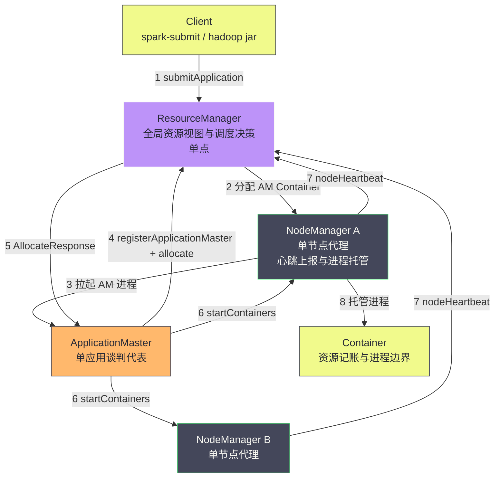
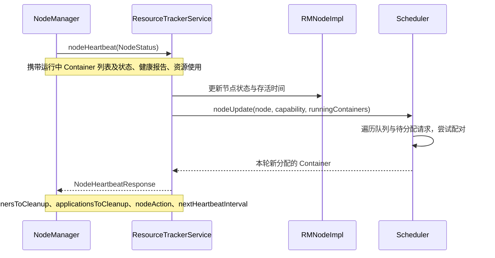
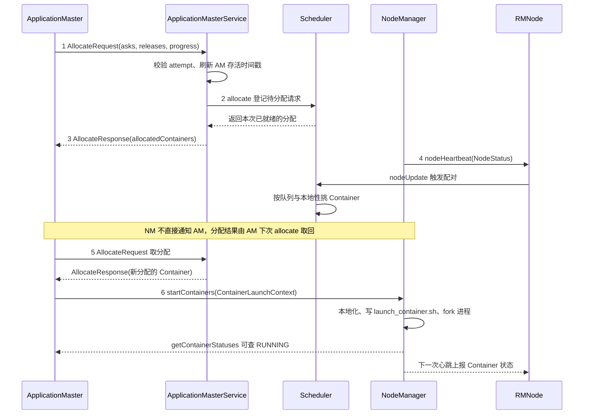
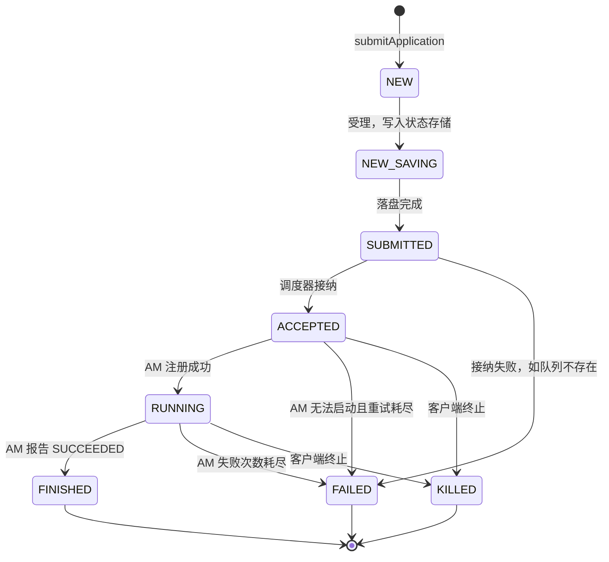

# YARN 整体架构全景——ResourceManager、NodeManager 与 ApplicationMaster 三角协作

**摘要：**

一个 Container 的申请，要穿过四份权力、四套协议、两个心跳周期，才从"我想跑"变成"进程在跑"。四个角色不是四个进程的别名——RM 管账、NM 管进程、AM 管谈判、Container 管边界，四者共享同一个 ContainerId，任何一环丢了消息，都会在某一份日志里留下缺口。本文不按组件列职责清单，而是跟着一条真实的申请请求走完全程：ApplicationMaster 把 AllocateRequest 交给 RM 的 ApplicationMasterService，调度器主要在 NodeManager 心跳带来的资源变化上做决策，分配结果随下一次 allocate 响应回到 AM，AM 再直连 NM 起进程，Container 的终局又沿 NM 心跳与 getContainerStatuses 两条路回流。这条链上没有真正的实时，每一步都要等一个节拍，等待的多少取决于配置而不是运气。沿途给出四个角色各自挂掉的后果、Application 与 Node 两个状态机的判定字段、四套协议对应的日志归属、REST 端点能回答与不能回答的问题，以及六个生产故障的判据。最后落一句可操作的结论：卡在 ACCEPTED 的应用，先去查队列配额与节点余量，再查标签与规格约束，而不是先去翻 AM 日志。

---

## 第 1 章 一条请求的旅行：先把角色摆正

### 1.1 案例：一个 20 个 Executor 的作业

设想一个 100 节点的集群，每台机器在 `yarn.nodemanager.resource.memory-mb` 里声明 64 GB、在 `yarn.nodemanager.resource.cpu-vcores` 里声明 32 个虚拟核，所有节点归属同一个 `default` 队列。某个晚上，用户敲下一条 `spark-submit`，参数是 `--num-executors 20 --executor-memory 8g --executor-cores 4`。八秒之后，第一个 Executor 开始向 Driver 反向注册，作业进入真正的计算阶段。

这八秒里发生的事情，用"YARN 把作业跑起来了"这种说法糊过去，等于什么都没解释。真实过程是一条申请请求依次经过四份权力：Spark 的 Driver 先向 ResourceManager 要一个能跑 AM 的位置，RM 挑一台机器并让那台机器上的 NodeManager 把 AM 进程拉起来；AM 起来以后向 RM 注册，然后一次性提出 20 个 8 GB / 4 核的 Container 申请；RM 的调度器把这些申请挂到账上，等到某个 NM 的心跳带来空闲资源时逐个配对；配对成功的 Container 通过下一次 allocate 响应交回 AM；AM 拿着 `nodeId` 直接连对应 NM 的 `startContainers`；NM 在本地落盘、写启动脚本、fork 进程；Executor 进程退出时，退出码先被 NM 记下，再分两路回到 AM 和 RM。

这条链上每一段都有明确的持有者，也都有明确的卡点。把角色和卡点对上号，YARN 的架构就立体了；只背"RM 管资源、NM 管节点、AM 管应用"，遇到 ACCEPTED 卡住时仍然无从下手。

### 1.2 四份权力，四条边界

YARN 里真正需要记住的不是三个组件，而是四份互不越界的权力。Container 之所以要和另外三个并列，是因为"资源记账"和"进程托管"这两件事只在 Container 这个粒度上会合，而它们的失败形态完全不同：资源记账出错表现为队列数字对不上，进程托管出错表现为退出码和日志。

四个角色的职责与失败后果可以并排看：

| 角色 | 负责什么 | 明确不负责什么 | 挂掉之后的直接后果 |
|---|---|---|---|
| ResourceManager | 全局资源视图、调度决策、应用准入与生命周期状态 | 不启动 Container、不跟踪 Task、不碰业务日志 | 无 HA 时集群失去调度能力：不能提交、不能扩容、不能回收；已运行的 Container 因 AM 与 NM 直连而短暂继续 |
| NodeManager | 单节点的资源声明、心跳上报、Container 进程托管与状态回收 | 不决定 Container 落在哪台机器、不决定跑什么应用 | 该节点上所有 Container 一并失去托管，RM 在心跳超时后把节点标记为 LOST，AM 收到节点失效通知后重做任务 |
| ApplicationMaster | 单应用内部的任务拆解、资源申请、Container 启动与状态追踪 | 不做全局调度、不跨应用协调、不管理节点资源 | 该应用失败，是否重试由 `yarn.resourcemanager.am.max-attempts` 一类的配置决定；重试耗尽则应用 FAILED |
| Container | 一份被记账的资源与一个被托管的进程之间的绑定关系 | 不自我调度、不自我扩容、不跨节点迁移 | 进程退出码经 NM 上报，AM 据此决定重跑任务还是判定作业失败 |

这张表最容易被读错的一行是 RM。它写着"全局资源"和"调度决策"，很容易被理解成"所有通信都经过它"。实际上 RM 只和 NM、AM 通信，AM 启动 Container 的指令根本不经过 RM：RM 给出的是"这个 Container 归你了，它在哪台机器上"，剩下的动作由 AM 直接找 NM 完成。这个"分配权与执行权分离"的设计，是 YARN 能承载上万节点规模的结构性原因，也是排查问题时最容易搞错日志归属的地方。

下面这张图把四个角色和四条通道画在一起，编号对应后文第 5 章的六步链路。

### 1.3 Container 为什么值得单列

把 Container 当成"一个跑任务的进程"，很多现象解释不了。譬如 8 GB 的 Executor 申请到了，但进程实际只用了 2 GB 堆，剩下 6 GB 在 RM 的账上依旧被占着，别的应用拿不走；又譬如进程被内核 OOM killer 杀掉，YARN 侧看到的不是"内存不够"，而是一个 `137` 的退出码。原因在于 Container 是两套语义的叠加：对 RM 与调度器而言它是一份 capability（内存 MB 加虚拟核数）的记账条目，对 NM 而言它是一个受监控的子进程及其本地目录。

这两套语义靠 `ContainerId` 对齐。RM 分配时生成 `ContainerId`（由 `ApplicationAttemptId` 加自增序号构成），NM 按这个 id 建目录、写脚本、启动进程、记录退出码，AM 按这个 id 追状态，RM 按这个 id 回收资源。四份视角共享同一个标识符，所以任何一个 id 在四份日志里都应该能对上；对不上，说明有环节丢了消息，而不是"YARN 就是这样"。

由此可以推出一个实用的排查习惯：拿到一个出问题的 Container，先把它的 id 在 RM 日志、NM 日志、AM 日志、`userlogs` 目录里各查一遍，缺哪一份，问题就在哪一段。这个动作比逐层读代码快得多，后文第 7 章会给出四份日志的具体归属。

---

## 第 2 章 ResourceManager：单点仲裁者与它的代价

### 2.1 三个对外的面，一个对内的核

RM 是一个 JVM 进程，对外暴露三个 RPC 服务面，对内维护一套由异步事件驱动的状态机。三个面对应三类调用方，这也是理解 RM 结构最省力的切法：

| 对外服务 | 调用方 | 实现的协议 | 主要动作 |
|---|---|---|---|
| `ClientRMService` | 客户端（spark-submit、hadoop jar、REST 网关之后的 CLI） | `ApplicationClientProtocol` | 申请 ApplicationId、提交应用、查询状态、终止应用、查队列 ACL |
| `ApplicationMasterService` | 各应用的 AM | `ApplicationMasterProtocol` | 注册 AM、allocate 申请与释放资源、上报进度、结束应用 |
| `ResourceTrackerService` | 各节点的 NM | `ResourceTracker` | 注册节点、周期心跳、汇报 Container 状态、领取待清理指令 |

对内的核由四块状态机加一块调度器组成：`RMAppImpl` 管应用、`RMAppAttemptImpl` 管应用的每一次尝试、`RMNodeImpl` 管节点、`RMContainerImpl` 管被分配的 Container，`CapacityScheduler` 或 `FairScheduler` 负责在队列之间与节点之间做配对。这些对象都挂在 `RMContext` 上，由 `AsyncDispatcher` 用事件队列串行推进。

这个**事件驱动**的结构解释了一个常见的困惑：RM 日志的时间顺序和请求到达的顺序经常对不上。客户端的 `submitApplication` 返回成功，只说明事件进了队列，不代表应用已经被调度器接纳；AM 的 `allocate` 返回了空列表，也不代表请求丢了，它只是还没被配对。判断真实进展要看状态字段，不要看 RPC 是否返回。

### 2.2 调度器只在两种时刻睁眼

调度器是 RM 里最重的模块，但它的触发条件少得出人意料。整个集群的分配决策主要发生在两类事件上：一是 NM 的 `nodeHeartbeat` 经 `ResourceTrackerService` 落到 `RMNodeImpl` 之后调用的 `nodeUpdate`，它告诉调度器"某台机器的空闲资源变了"；二是 AM 的 `allocate` 把新的 `ResourceRequest` 登记进调度器的待分配结构。

真正把 Container 配出去的动作，绝大多数落在 `nodeUpdate` 上。原因很直白：集群里能分的东西是节点上空出来的那部分资源，而节点资源的变化只有 NM 心跳知道。AM 提请求只是"挂单"，NM 心跳才是"上菜"。所以一个请求从提出到拿到 Container，天然要等**两次心跳**——一次是 NM 的心跳把空闲资源送到调度器面前，一次是 AM 自己的 allocate 把分配结果取走。

> [!info] 为什么不让 AM 一提交就实时分配
> 实时推送看起来更快，但代价是 RM 要为每个 AM 的每次请求立即跑一遍匹配，请求风暴时会直接把调度线程打满。把调度计算摊到 NM 的心跳节拍上，等于用固定的节拍消化波动的请求量，峰值被削平了，代价是最坏情况多等一个心跳周期。这是典型的用延迟换稳定性。

### 2.3 RM 挂掉之后

RM 是**单点**，这句话需要拆开说，因为"全集群停"在时间上是有层次的。

RM 进程退出后，第一层影响是准入：新的 `submitApplication` 全部失败，集群再也接纳不了新应用；第二层影响是调度：NM 的心跳失败后会不断重试，空闲资源不再被分配，已经在跑的作业无法扩容，也无法回收已完成的 Container；第三层影响才是应用层：AM 的 `allocate` 连不上 RM，重试若干次后放弃并自行退出，应用随之失败。至于已经拿到 Container 的 Task 与 Executor，它们的进程并不依赖 RM，AM 与 NM 直连的通道还在，所以会继续跑一段时间，直到 AM 放弃或 NM 因为拿不到指令而做本地清理。

这个层次差别在故障复盘里很关键。有人看到"RM 挂了但作业还在跑"，就断言 RM 不重要；也有人看到"RM 挂了作业就失败了"，就去查应用代码。两种判断都跳过了中间那层：AM 的心跳超时与重试次数才是决定作业能否熬过 RM 短暂不可用的关键参数，而 RM 的 HA 方案（Active/Standby、状态存储、NM 与 AM 的重连与 RESYNC）决定了这个窗口有多长。这部分机制在 [[08 YARN 高可用与故障恢复——ResourceManager HA 与 AM 重试机制]] 里展开，本篇只需要记住一个结论：RM 的单点性影响的是"调度能力"，不是"已经跑起来的进程"。

### 2.4 RM 的内存账单与 completed 应用数

RM 的内存占用随应用数量线性增长，这是它最容易被低估的运维成本。每提交一个应用，RM 至少要在内存里留下 `RMAppImpl`、一到多个 `RMAppAttemptImpl`、对应的 `RMContainerImpl` 记录、调度器侧的 `SchedulerApplicationAttempt`、以及日志与指标对象；应用结束后，这些对象不会立刻消失，而是按配置保留一段时间供查询。

`yarn.resourcemanager.max-completed-applications` 默认 10000，它决定了 RM 内存里最多留多少个已完成应用。下面按示例推算的口径估一下量级：若每个已完成应用连同 attempt 与 container 记录平均占 10 KB 到 30 KB，1 万个就是 100 MB 到 300 MB 的常驻堆；再叠加正在运行的应用、队列指标与 REST 序列化缓存，一个承载几百个活跃应用、保留上万个历史应用的 RM，堆开在 4 GB 到 8 GB 是常见做法，开 2 GB 就会频繁 Full GC，表现为 UI 卡顿、心跳处理变慢、进而出现节点假 LOST。这组数字是量级推算，不是基准测试，真实值取决于应用规模与调度器实现，读者应按自己集群的应用数反推。

RM 侧几个参数调的代价差别很大：

| 配置项 | 默认值 | 调大的代价 | 调小的代价 |
|---|---|---|---|
| `yarn.resourcemanager.max-completed-applications` | 10000 | RM 常驻内存与 `/ws/v1/cluster/apps` 响应体同步变大，UI 列表加载变慢 | 老应用被提前逐出，`yarn application -list -appStates ALL` 与 UI 都查不到，故障复盘缺证据 |
| `yarn.resourcemanager.scheduler.client.thread-count` | 50 | 调度事件并发变高，锁竞争与 CPU 上升，容易掩盖真正的瓶颈 | NM 与 AM 的请求在 RPC 层排队，心跳处理延迟堆积，超时后出现假 LOST |
| `yarn.scheduler.maximum-allocation-mb` | 8192 | 单个 Container 可以申请更大的整块资源，大作业能跑，但节点碎片化加剧、调度成功率下降 | 大内存 AM 或 Executor 起不来，提交即失败，报错往往只出现在 AM 侧 |
| `yarn.scheduler.maximum-allocation-vcores` | 4 | 单 Container 占用的虚拟核变多，默认按内存计量的调度器会把它当"免费"放行 | 高并行度的 Executor 申请被拒，报错只出现在 AM 侧 |

最后一行提前点出一个后文会展开的坑：在默认的 `DefaultResourceCalculator` 下，虚拟核数不参与分配判断，把 `maximum-allocation-vcores` 调大并不会让调度器更谨慎，只会让"账面上超卖"更严重。

---

## 第 3 章 NodeManager：节点上的代理人

### 3.1 两个面：向上报告，向下托管

NM 是 YARN 在每个 Worker 节点上的代理进程，它只有两个面：朝上是**报告面**，向 RM 汇报节点资源与 Container 状态，并领取清理指令；朝下是执行面，接收 AM 的启动、停止、查询请求，真正把进程拉起来、看住、收尸。

这两个面的失败形态完全不同，排查时不能混着看。报告面失效（心跳停了）会让 RM 把整台节点判定为不可用，影响的是调度与全局视图；执行面失效（起不来进程、本地化失败、监控误杀）只会影响落在这台节点上的具体 Container，表现为应用侧的任务失败与重试。同一台机器上可能只坏一面，所以"节点是 RUNNING 但任务一直失败"完全成立，反之"任务正常但节点被标 LOST"也成立。

### 3.2 心跳：YARN 的节拍器

NM 启动时先向 RM 发 `registerNodeManager`，声明自己的总资源、节点标签、版本与端口。注册成功后进入周期心跳，`nodeHeartbeat` 每次携带 `NodeStatus`：本节点正在运行的 Container 列表及状态、节点健康检查报告、资源使用情况、以及节点标签。RM 的响应不是空包，而是捎带了一串指令：要清理的 Container、要清理的应用凭证与目录、节点动作（`NORMAL`、`RESYNC`、`SHUTDOWN`），以及下一次心跳的间隔 `nextHeartbeatInterval`。

用"心跳与指令捎带"的方式传控制消息，好处是 NM 与 RM 之间只维持一条长连接，控制面的消息量被摊进了本来就有的心跳里；代价是所有下行指令都带着心跳延迟。RM 侧收到心跳后要做的事按顺序是：刷新节点的存活时间戳、把 `NodeStatus` 里的 Container 状态变化落到 `RMContainerImpl`、调 `Scheduler.nodeUpdate` 触发一轮分配、把待清理指令塞回响应。因此"心跳"这个词在 YARN 里同时承担了三件事：存活证明、状态上报、调度触发器。

下面这张时序图把一轮心跳的上下行内容摊开，注意响应里回来的不只一句"收到了"。

心跳的超时判据由 `yarn.nm.liveness-monitor.expiry-interval-ms` 控制，默认 600000 毫秒，也就是十分钟。这个十分钟经常被误读成"NM 每十分钟才心跳一次"。不是。NM 的**心跳节拍**由 `yarn.resourcemanager.nodemanagers.heartbeat-interval-ms` 控制，默认 1000 毫秒；十分钟是 RM 判定"这个节点已经没救了"的容忍窗口，等价于连续丢掉大约 600 次心跳。两个参数一个管节拍、一个管判决，调错哪一个后果都不一样。

| 配置项 | 默认值 | 调大的代价 | 调小的代价 |
|---|---|---|---|
| `yarn.resourcemanager.nodemanagers.heartbeat-interval-ms` | 1000 | 心跳变稀，调度触发频率下降，资源空闲到被利用的间隔变长，端到端延迟上升 | 心跳变密，RM 的 RPC 与调度事件量线性上涨，大规模集群下容易把 RM 的调度线程打满 |
| `yarn.nm.liveness-monitor.expiry-interval-ms` | 600000 | 节点真挂之后要等更久才被标记 LOST，这段时间里调度器仍以为资源可用，新任务可能被派给死节点 | 网络抖动、NM 长 GC、瞬时负载都会触发误判，节点被反复标记 LOST 又恢复，Container 被白杀 |
| `yarn.nodemanager.resource.memory-mb` | 8192 | 声明超出物理内存，Container 争抢导致 OOM killer 介入，退出码 137 集中出现 | 声明低于物理内存，节点资源被闲置，集群账面容量远小于硬件真实容量 |
| `yarn.nodemanager.resource.cpu-vcores` | 8 | 虚拟核声明过多但默认调度器不校验 CPU，等于只做账面扩容，实际 CPU 争抢加剧 | 虚拟核过少，即使内存充足也卡在 vcore 上限，Node 的 `availableVirtualCores` 长期为 0 |

### 3.3 执行面：从 startContainers 到进程退出

AM 拿到 Container 后，向 `nodeId` 对应的 NM 发 `startContainers`，请求体里每个 Container 带一份 `ContainerLaunchContext`：启动命令、环境变量、需要本地化的资源清单、安全凭证、服务数据。NM 收到之后的动作可以拆成四段，每段都有自己的失败模式：

第一段是本地化（localization）。NM 的 `ResourceLocalizationService` 把应用需要的 JAR、配置文件、归档从 HDFS 拉到 `yarn.nodemanager.local-dirs` 下的缓存目录，按 PUBLIC、PRIVATE、APPLICATION 三种可见范围分别存放。应用级资源只在第一次用到时下载，后续 Container 命中缓存。这一段失败通常表现为启动超时或 `Container launch failed`，根因多为 HDFS 抖动、本地磁盘满、下载并发被限。

第二段是目录与脚本准备。NM 在本地目录下建 `container_<appid>_<attempt>_<containerid>` 目录，把启动命令写进 `launch_container.sh`，把环境变量、工作目录、日志重定向都固化在脚本里。脚本化的意义是可复现：出问题时把脚本捞出来，就能看到这个 Container 到底被要求执行什么。

第三段是进程拉起。`DefaultContainerExecutor` 用 `bash launch_container.sh` 起进程；生产上要做 CPU 硬隔离或用户隔离，会换成 `LinuxContainerExecutor`，由它切到应用用户、套上 cgroup 再执行。这一段的时间大头是 JVM 启动，几百毫秒到一两秒不等，取决于机器负载与 JVM 参数。

第四段是监控与收尸。`ContainersMonitorImpl` 周期性采样每个 Container 的物理内存与虚拟内存，超过 `yarn.nodemanager.pmem-check-enabled` 与 `vmem-check-enabled` 的口径就杀进程；进程退出后 NM 记录退出码，通过下一次心跳把状态上报 RM，同时更新 AM 可查询的 Container 状态。

### 3.4 NM 挂掉的三种情形

"NM 挂了"其实是三种不同的故障，处置方式差别很大。

第一种是进程正常退出或优雅停止。NM 的关闭钩子会清理自己托管的 Container，进程被一并带走；RM 侧或收到下线通知、或因心跳中断，把节点移出可调度列表，属于可控下线。

第二种是进程被 `kill -9`。NM 没有机会清理，Container 的子进程可能被 init 收养继续运行，变成占着内存却无人记账的孤儿进程。RM 要等到心跳超时（默认十分钟）才把节点标为 LOST，这段时间里这些孤儿进程会持续占用资源，新任务还可能被调度过来，最终表现成"节点内存被吃满但 YARN 账面上没跑东西"。启用 `yarn.nodemanager.recovery.enabled` 与工作保持式重启（work-preserving restart）可以把 Container 接管回来，这也是滚动升级时更安全的做法。

第三种是**心跳假死**。NM 进程还在，但心跳线程被长 GC、磁盘 hang、网络分区卡住，RM 的判决与第二种相同：超时后标 LOST。此时 Container 进程可能完好无损，RM 却已经把它们的资源从账上抹掉，AM 收到节点失效通知后开始重跑任务，等 NM 恢复心跳，节点重新注册，同一批 Container 又冒出来，形成重复计算。分辨第二、第三种要看 NM 进程是否存活、NM 日志是否在心跳前后有时间空洞，而不是看 RM 上的节点状态。

RM 标记 LOST 之后还有一连串连锁反应：该节点上所有 Container 被视为失败，RM 释放对应资源并把节点从可调度列表里摘掉，AM 在 `allocate` 响应的节点更新列表里看到这台机器不可用，同时收到这些 Container 的完成状态（状态是失败），AM 据此重跑任务。这里有一个容易忽略的细节：LOST 并不检查那些 Container 的进程是否真的死了，它只是根据心跳做的推断。所以"进程还在跑但任务被重跑"在 NM 假死场景下是完全正常的现象。

### 3.5 Container：资源与进程的边界

Container 的 capability 是一份**承诺**，不是一份实测。调度器按承诺记账，NM 按实测监控，两者之间永远存在偏差。这个偏差是很多"莫名其妙"现象的根源：申请 8 GB 只用了 2 GB，账上照样占 8 GB；申请 4 个虚拟核，在默认调度器下根本没人为这 4 个核做任何保留。

进程死亡的证据是退出码。`0` 表示进程自己正常结束；`137` 是 128 加 9，表示进程收到 `SIGKILL`，常见来源是内核 OOM killer 或 NM 的内存超限巡查；`143` 是 128 加 15，表示收到 `SIGTERM`，通常是被 `stopContainers` 正常停止。除此之外，NM 还会用一组负数状态码表示"不是进程自己退出"的情形，譬如被抢占、因超出内存限制被杀、磁盘故障导致容器中止。这些码在 AM 侧看到的是一个整数，在 NM 日志里才有一句人话解释。

虚拟核在这里需要提前纠偏。`yarn.nodemanager.resource.cpu-vcores` 声明的是可记账的虚拟核数，默认的 `DefaultResourceCalculator` 只按内存做分配判断，虚拟核数根本不参与；换成 `DominantResourceCalculator` 之后虚拟核才进入计算，但那也只是记账口径，不具备 CPU 隔离能力。真正的 CPU 约束要靠 cgroup，那是 [[07 YARN 资源隔离——CGroups 与 Linux Container Executor 的工程实现]] 的主题。

---

## 第 4 章 ApplicationMaster：应用的谈判代表

### 4.1 AM 只做两件事

AM 是每个应用自己的调度代理，它运行在一个普通的 Container 里，用的也是普通 Container 的资源配额。它对外只有两件事要做：向 RM 要资源，向 NM 起 Container。中间的任务拆解、依赖管理、失败重试、进度汇总，全是框架自己的事，YARN 不规定也不干预。

这种"框架自己实现 AM"的分工，让 RM 的接口可以做得极窄。MapReduce 的 `MRAppMaster` 按输入分片算 Mapper 数，Spark 的 AM 按 `--num-executors` 申请 Executor，Flink 的 AM 拉起 JobManager 再按并行度申请 TaskManager，它们的调度逻辑毫无共同点，但都只用同一套 `ApplicationMasterProtocol` 和 RM 对话。RM 因此不需要理解任何计算框架，只需要理解"谁在什么时候要多少资源"。

AM 的价值在规模上体现得更清楚。一万个并发应用意味着 RM 要维护一万条 AM 心跳，这个量级 RM 扛得住；如果让 RM 去维护这些应用背后的数百万个 Task 状态，它立刻退化成 MRv1 的 JobTracker。把 Task 级状态放到各应用自己的 AM 里，等于把复杂度切成了互不干扰的碎片。

### 4.2 注册与心跳循环

AM 进程启动后的第一件事是 `registerApplicationMaster`，把主机名、端口、Tracking URL 报给 RM。注册成功之后，RM 才会把这个应用的状态从 ACCEPTED 推进到 RUNNING，这一步在后文状态机一节还会再提一次，因为它是判断"AM 到底起没起来"的唯一依据。

注册之后进入 `allocate` 循环。`allocate` 同时承担三个角色：心跳、资源申请、状态接收。AM 每次调用携带自上次以来新增的资源请求、要释放的 Container、当前进度，响应里带回分配到的 Container、已结束 Container 的状态、节点视图变化和给 AM 的指令。这个"一次调用办三件事"的设计把 RPC 数量压到了最低，代价是请求与响应的语义耦合得比较紧，排查时不能只看其中一半。

`allocate` 的节拍由各框架自己配置。MapReduce 侧是 `yarn.app.mapreduce.am.scheduler.heartbeat.interval-ms`，默认 1000 毫秒；Spark 侧是 `spark.yarn.scheduler.heartbeat.interval-ms`，默认也是 1000 毫秒。这个节拍直接决定了 AM 取回分配结果要等多久，是后文延迟账里的一项。

`AllocateRequest` 与 `AllocateResponse` 的字段值得逐项过一遍，因为很多误判都来自只看了其中一两个字段：

| 字段 | 方向 | 含义 | 读错会怎样 |
|---|---|---|---|
| `responseId` | 请求 | 上一次响应的编号，用于对齐请求与响应 | 忽略它会把重试造成的重复响应当成新分配 |
| `progress` | 请求 | 应用进度，0.0 到 1.0 | 把进度当完成度，误以为卡住的应用在推进 |
| `resourceRequests` | 请求 | 新增的 `ResourceRequest` 列表，含资源量、数量、本地性偏好、标签表达式 | 只看数量不看标签与本地性，会误判"资源够为什么不分" |
| `release` | 请求 | 主动归还的 Container 列表 | 不看这一项，会把 AM 主动缩容当成资源被抢 |
| `resourceBlacklistRequest` | 请求 | 节点黑名单的增删 | 黑名单会让某些节点"明明有空却不被分配" |
| `allocatedContainers` | 响应 | 本次新分配的 Container 列表，含 `nodeId` 与 capability | 只数个数不看 `nodeId`，会漏掉节点不均衡 |
| `completedContainersStatuses` | 响应 | 已结束 Container 的状态，含退出码与诊断信息 | 不看退出码，就会把 OOM 被杀当成框架 bug |
| `updatedNodes` | 响应 | 节点视图变化，节点失效或恢复都从这里来 | 不看它，会忽略节点级故障对应用的影响 |
| `availableResources` | 响应 | 集群当前可分配资源的总量 | 把它当成"我能拿到的量"，会误判排队原因 |
| `AMCommand` | 响应 | 给 AM 的指令，譬如复位或重新同步 | 忽略它，AM 可能错过 RM 侧的全局动作 |

这里有一个容易被二手资料带偏的点：`AllocateResponse` 里没有"其他 AM 的列表"。AM 只能看到自己应用的资源与集群节点视图，跨应用的信息要么去 REST 接口查，要么在 RM 日志里看。这个边界不是实现偷懒，而是隔离性要求：一个应用的 AM 不应该知道别的应用在抢什么资源。

### 4.3 AM 挂掉之后

AM 是应用的单点。它挂掉之后，RM 通过 `yarn.am.liveness-monitor.expiry-interval-ms`（默认 600000 毫秒）判定心跳超时，或者在 Container 退出时直接得知 AM 失败，然后把这次尝试记为失败，并按 `yarn.resourcemanager.am.max-attempts`（默认 2）决定是否再给一次机会。重试不是**原进程重启**，而是新起一个 AM Container，重新注册，重新走一遍申请流程。已经跑着的 Container 会被清理，任务从头再来，除非框架自己做了检查点或阶段性提交。

不同框架的重试开关不同名，这一点在跨框架运维时经常踩坑：MapReduce 侧对应 `mapreduce.am.max-attempts`（默认 2），Spark 侧对应 `spark.yarn.maxAppAttempts`（默认取 `yarn.resourcemanager.am.max-attempts` 的值），Flink 侧有 `yarn.application-attempts`。这些配置有一个共同的约束：框架侧的值不能超过 RM 侧的上限，超了会被静默压回上限。

重试的代价不只是时间。每次重试都是一次全新的 AM Container 申请，如果失败根因是"AM 内存不够"，重试只会再死一次；如果根因是"队列配额被占满"，重试会让失败的应用继续占着队首位置，把真正的排队者往后挤。判断该不该让重试继续，要看 AM 的退出码和诊断信息，而不是看"再试一次也许就好了"。

### 4.4 AM 不做的三件事

第一，AM 不做全局调度。它只关心自己应用要多少资源，不关心别的应用是否 starving，也不参与队列之间的分配。抢占是 RM 的调度器做的，AM 只是收到通知。

第二，AM 不做节点选择。它申请时给的是本地性偏好与资源规格，具体落到哪台机器由调度器决定。AM 收到 Container 才知道 `nodeId`，之前无从猜测。

第三，AM 不做资源隔离。它申请的 8 GB 就是 8 GB 的记账承诺，进程实际能不能用满、会不会被 NM 杀，由 NM 的监控与 cgroup 决定。AM 唯一能做的是在 Container 失败后决定重试还是放弃。

---

## 第 5 章 资源申请的完整链路

### 5.1 六步全景

把前面几章拼起来，一条申请请求的完整路径可以拆成六步：AM 提交 `AllocateRequest`；RM 的 `ApplicationMasterService` 把请求交给调度器挂单；调度器在 NM 心跳的 `nodeUpdate` 里配对并生成 Container；AM 在下一次 allocate 响应里取回分配结果；AM 向对应 NM 发 `startContainers`；NM 起进程并把状态分两路回传。下面这张时序图把六步和两个心跳节拍放在同一条时间轴上。

### 5.2 第一步：请求里到底装了什么

`AllocateRequest` 不是一句"给我 20 个 Container"，而是一组带约束的申请条目。每个 `ResourceRequest` 至少有四层信息：资源规格（capability，内存与虚拟核）、数量、本地性偏好（`resourceName` 是主机名、机架名还是通配 `*`）、以及优先级与节点标签表达式。AM 把"任意节点 8 GB 4 核、20 个"表达成一条通配请求，也可以把"必须落在有 GPU 标签的节点"写进 `nodeLabelExpression`。

本地性那一层最复杂。以 MapReduce 为例，它会为同一个输入分片同时提交三条请求：指定 DataNode 主机名的节点本地、指定机架名的机架本地、以及通配的任意节点，并带上 `relaxLocality` 标记表示"前一级满足不了可以降级"。调度器按优先级逐级尝试，这就是数据本地性的实现方式。Spark 的申请通常简单得多，Executor 不关心数据在哪，直接通配。

同一个 `ResourceRequest` 在调度器里会被合并去重：相同优先级、相同 `resourceName`、相同 capability 的请求会累加数量，而不是排队成多条。这个合并行为意味着 AM 反复提交同样的请求不会造成堆积，但也意味着"我提了 100 次申请"在调度器看来只是一条数量为 100 的条目，不能拿请求条数当排队长度的证据。

### 5.3 第二步：RM 侧的挂单与配对

`ApplicationMasterService` 收到请求后先做一轮校验：这个 attempt 是否存在、是否处于可以 allocate 的状态、AM 是否还活着（刷新 liveness 时间戳）、黑名单是否合法、优先级是否被偷偷改动。校验通过才把请求转给调度器。

调度器这一侧要区分"挂单"和"配对"两个动作。挂单发生在 `allocate` 路径上：请求被写进这个应用的待分配结构，等待资源。配对发生在 `nodeUpdate` 路径上：某台机器的心跳带来了空闲资源，调度器按队列的资源占比、应用优先级、本地性逐层挑选，把节点上的空闲资源切成符合请求规格的 Container。

配对时的约束比大多数人以为的多。至少要过**五道关**：队列的 `absoluteUsedCapacity` 不能顶到 `absoluteMaxCapacity`；单个 Container 的规格不能超过 `maximum-allocation-mb` 与 `maximum-allocation-vcores`；AM 占用的资源不能超过队列的 `maximum-am-resource-percent`（默认 0.1，也就是队列资源的百分之十）；节点标签要匹配；本地性要满足，或者在错过 `node-locality-delay` 次机会（默认 40）之后放宽到机架与任意节点。任何一道没过，请求就继续挂着，不会报错，也不会消失。

配对成功之后，RM 侧会生成 `RMContainerImpl` 记录，状态先落到 ALLOCATED，然后把 Container 写进该应用"待领取"的列表。这里有一个时限：如果 AM 拿到分配结果后迟迟不让 NM 启动这个 Container，RM 的分配过期机制会在 `yarn.resourcemanager.rm.container-allocation.expiry-interval-ms`（默认 600000 毫秒）之后把它回收。也就是说，分配不是永久有效的承诺，AM 必须尽快兑现。

### 5.4 第三步：分配结果怎样回到 AM

`AllocateResponse` 的装配发生在 `ApplicationMasterService`：把调度器本次返回的新分配 Container 列表、已结束 Container 的状态、节点视图变化、集群可用资源、以及给 AM 的指令打包。注意这里的"本次"是相对的：调度器可能一次给多个 Container，也可能一个都不给，AM 不能假设每次 allocate 都有收获。

响应里最容易被忽略的是 `availableResources`。它是集群层面的聚合可用量，不是"AM 能立刻拿到的量"。集群账面空闲 200 GB，可能分散在 30 台机器上，每台只剩 6 GB，而请求要的是 8 GB 整块，于是一个都配不出来。这种"总量够、碎片不够"的情形在 `/ws/v1/cluster/metrics` 上表现为 `availableMB` 很大、`containersPending` 居高不下，是生产上最常见的排队原因之一。

### 5.5 第四步：AM 向 NM 发 startContainers

AM 拿到 Container 后，从 `Container` 对象里读出 `nodeId`，向那台机器的 NM 发 `startContainers`。请求体里每个 Container 带一份 `ContainerLaunchContext`，内容大致是五样：启动命令、环境变量、需要本地化的资源清单、安全凭证（Token）、以及框架自定义的服务数据（譬如 Shuffle 服务的端口）。

这一步不经过 RM，所以 RM 完全不知道 Container 什么时候真正被启动。它能做的只有两件事：等 NM 的下一轮心跳把 Container 状态报上来，以及在分配过期之前没有收到启动确认时把 Container 收回。这个设计减少了 RM 的中转负担，但也带来了一个观测断点：从"RM 已分配"到"NM 已启动"之间，RM 的视角是空白的，只能靠 NM 心跳补齐。

启动请求失败的情形不少：Container 已经被 RM 过期回收、目标节点刚被标记 LOST、NM 的本地磁盘不健康拒绝写入、Container 规格超过节点当前可用、甚至 AM 与 NM 之间的网络不通。这些失败在 AM 侧都表现为 `startContainers` 抛异常或超时，而根因分散在 RM 与 NM 两侧，需要按后文第 7 章的日志归属去分头查。

### 5.6 第五步：NM 起进程

NM 收到启动请求后，先做准入检查：Container 是否属于这个应用、凭证是否有效、节点当前水位能否容纳、队列 ACL 是否允许。检查通过后进入异步启动流程，先本地化资源，再准备目录与脚本，最后 fork 进程。

这一步的时间构成与很多人的直觉不同。耗时大头通常不是"启动进程"本身，而是**本地化**的首次数百兆 JAR 下载；缓存命中之后，真正花时间的是 JVM 启动。一个 8 GB 堆的 Executor，JVM 初始化加上堆预留，一秒上下很常见，机器负载高时更久。这也解释了为什么同一份配置在不同集群上"起 Container 的速度"差很多：冷缓存、磁盘吞吐、机器负载三项都不一样。

进程起来之后，NM 把它记入自己的 Container 表，开始周期性监控内存使用，并在下一轮心跳里把状态上报 RM。此时 RM 侧的 `RMContainerImpl` 才从已分配推进到运行态，UI 上的 `runningContainers` 与 `allocatedMB` 也才真正开始增长。

### 5.7 第六步：状态回传的两条路

Container 结束之后，状态和退出码会沿两条路回到 AM，两条路的时效与盲区都不一样：

| 路径 | 载体 | 时效 | 能回答什么 | 看不到什么 |
|---|---|---|---|---|
| 经 RM 回流 | NM 心跳上报 RM，RM 在下一次 allocate 响应的 `completedContainersStatuses` 里带给 AM | 两个心跳周期，通常一到两秒 | Container 的最终状态、退出码、诊断信息，是 AM 判定任务成败的主要依据 | NM 失联时这条路径断掉，只能等节点被标 LOST 后按推断处理 |
| 直连 NM 查询 | AM 主动调 NM 的 `getContainerStatuses` | 一次 RPC 往返 | Container 当前是否在跑，适合做存活探测与临时排障 | 节点失联后查不到，且只能查到 NM 还认识的那些 Container |

两条路的语义差别值得强调：经 RM 的那条是**权威终局**，因为 RM 掌握全局的生命周期与节点状态；直连 NM 的那条是"现场快照"，快但不完整。生产排查时先用直连确认进程在不在，再用 RM 侧的状态确认生命周期有没有正常推进，两边对不上就说明消息在中间某一段丢了。

### 5.8 延迟账：把每一段都算一遍

把六步的等待拆开，能得到一个可验证的延迟模型。下面的量级是按默认配置做的示例推算，不是基准测试，真实值随集群规模、负载与框架实现变化：

| 环节 | 在等谁 | 典型量级 | 说明 |
|---|---|---|---|
| 请求入队 | AM 的 allocate RPC | 几十毫秒 | 网络往返加校验，通常忽略不计 |
| 第一次配对 | NM 心跳带来的 `nodeUpdate` | 平均半秒，最坏一秒 | 心跳间隔 1000 毫秒，请求到达时刻随机 |
| 取回分配结果 | AM 的下一次 allocate | 平均半秒，最坏一秒 | AM 心跳同为 1000 毫秒量级 |
| 资源本地化 | HDFS 与本地磁盘 | 首次数百毫秒到数秒，命中缓存几十毫秒 | 应用级资源只下一次，容器级资源每次都下 |
| 写脚本与 fork | 本地磁盘与内核 | 几十毫秒 | 生成 `launch_container.sh` 并执行 |
| 进程启动 | JVM | 零点五到两秒 | 堆越大、机器越忙，启动越慢 |
| 合计 | | 平均两到四秒，最坏五六秒 | 与开篇"八秒"的量级吻合 |

这张表解释了两件事。第一，为什么调小心跳间隔对延迟的改善有限：即便把两个心跳都压到 200 毫秒，进程启动与本地化那一段仍然是秒级，收益被稀释，而代价是 RM 的 RPC 与调度事件量涨五倍。第二，为什么"申请了但拿不到"不能用"等一会儿"来回答：排队时间是资源与配额的函数，跟心跳无关，等再久也不会自己变短。

如果集群启用了批量调度（`yarn.scheduler.capacity.scheduling-interval-ms` 大于 0），配对还会再叠加一个批次间隔；如果应用请求的是带标签的节点或严格本地性，`node-locality-delay` 那 40 次机会也会把等待拉长。这两项在数据本地性要求高的作业上经常是排队时间的主要成分。

### 5.9 判据：申请了但拿不到

判断"为什么拿不到"，先要分清卡在哪一层。应用状态为 ACCEPTED，说明连 AM 的 Container 都还没拿到，卡在准入与首次分配；应用状态为 RUNNING 而 `containersPending` 持续大于零，说明 AM 已经起来了，卡在资源申请，问题在队列与节点容量这一侧。

第一层判据是队列配额。查 `/ws/v1/cluster/scheduler` 里对应队列的 `absoluteUsedCapacity` 与 `absoluteMaxCapacity`，两者贴近甚至相等，说明队列已经顶到硬上限，再多的空闲资源也进不来。这类情形下 RM 日志里通常有一句关于队列容量的异常，AM 侧表现为请求一直 pending。

第二层判据是节点容量。看 `/ws/v1/cluster/metrics` 的 `availableMB` 与 `availableVirtualCores`，再对照 `/ws/v1/cluster/nodes` 里每台机器的 `availMemoryMB`。总量够但单节点都凑不出请求规格，就是碎片问题，处置方向是缩小 Container 规格或调整 `maximum-allocation-mb`，而不是继续等。

第三层判据是约束条件。节点标签表达式写错、黑名单把可用节点拉黑、请求规格超过 `maximum-allocation-mb`、AM 资源占用顶到 `maximum-am-resource-percent`，这四项都会让请求"合法地"拿不到资源，且不会在应用状态上体现为任何异常。它们只在调度器的队列信息与 RM 日志里有痕迹。

把三层判据串起来，可以得到一句可操作的结论：ACCEPTED 卡住不是 bug，**是配额**；RUNNING 但 pending 不是 bug，是容量或约束。真正需要当 bug 处理的是另一类现象——状态字段在正常推进，但每一步都比延迟模型慢一个数量级，那才说明有环节在排队或重试。

---

## 第 6 章 三个状态机：Application、Container、Node

### 6.1 Application 的状态

RM 侧的 `RMAppImpl` 是一个显式状态机，`yarn application -list` 与 `/ws/v1/cluster/apps` 里的 `state` 字段就是它的当前值。完整的枚举比常见资料多一个状态，`NEW_SAVING` 经常被漏掉，而它恰恰是"提交成功但还没进去排队"的现场。

| 状态 | 触发条件 | REST 与 UI 上的表现 | 该不该处理 |
|---|---|---|---|
| `NEW` | 客户端调用 `submitApplication` 之后、RM 受理之前 | `state=NEW`，`progress=0.0`，`startedTime` 已写入 | 瞬时状态，通常看不到 |
| `NEW_SAVING` | 应用描述正在写入状态存储 | 同上，`elapsedTime` 开始增长 | 若长时间停留，查状态存储与 RM 磁盘 |
| `SUBMITTED` | 状态存储写入完成，等待调度器接纳 | `state=SUBMITTED`，`finalStatus=UNDEFINED` | 长时间停留说明调度器尚未接纳，常见于队列或 ACL 校验未过、RM 事件队列积压，查 `diagnostics` 与 RM 日志 |
| `ACCEPTED` | 调度器接纳应用，开始为 AM 申请 Container | `state=ACCEPTED`，`allocatedMB=0`，`amHostHttpAddress` 为空 | 卡住要按配额与容量判据查，不是 bug |
| `RUNNING` | AM 注册成功 | `amHostHttpAddress`、`trackingUI` 有值，`allocatedMB` 开始增长 | 这是应用真正活着的起点 |
| `FINISHED` | AM 报告成功 | `state=FINISHED`，`finalStatus=SUCCEEDED` | 只做归档 |
| `FAILED` | AM 失败且重试耗尽，或无法启动 | `state=FAILED`，`finalStatus=FAILED`，`diagnostics` 有原因 | 看 AM 退出码与诊断 |
| `KILLED` | 被客户端或管理员终止 | `state=KILLED`，`finalStatus=KILLED` | 查是谁杀的 |

ACCEPTED 与 RUNNING 的分界只有一件事：**AM 有没有注册成功**。这个边界比很多人以为的更严格——AM 进程可能已经在某台机器上跑起来了，日志都写了几百行，但注册 RPC 因为网络或 RM 侧的问题没完成，应用状态就仍然停在 ACCEPTED。反过来，只要注册成功，状态立刻变 RUNNING，与 AM 是否已经开始申请 Container 无关。所以"UI 上还是 ACCEPTED 但 AM 日志有内容"不是矛盾，它精确地说明注册这一步没走通。

下面这张图把上表的转移关系画出来，重点在 ACCEPTED 这个"半启动"状态。

### 6.2 Container 的状态

Container 的状态有两套枚举，分属两个视角。RM 侧看到的是调度生命周期：从新建、预留、已分配、已被 NM 领取、运行中，到完成或被杀，每一步都对应资源账上的一次变动。NM 侧看到的是执行生命周期：本地化中、本地化完成、运行中、退出中，每一步对应本地文件与进程状态。

这两套枚举不能混读，混读的典型错误是拿 RM 的"已分配"当成"进程已在跑"。已分配只表示资源被划给了某个 AM，进程可能还没 fork。Container 生命周期的完整调用链在 [[04 Container 生命周期——从资源申请到进程启动的完整调用链]] 里逐段拆开，这里只留一个判据：RM 侧的 Container 进入运行态，唯一可信的信号是 NM 的心跳里带回了它的运行状态。

### 6.3 Node 的状态

`RMNodeImpl` 的状态机有七种取值，`/ws/v1/cluster/nodes` 的 `state` 字段直接暴露它。节点状态是集群健康度的第一手证据，比应用状态更早反映基础设施问题。

| 状态 | 触发条件 | 关键字段 | 对 Container 的影响 |
|---|---|---|---|
| `NEW` | 节点刚注册、尚未完成初始化 | `state=NEW`，无资源数字 | 不接收任何分配 |
| `RUNNING` | 注册完成且健康检查通过 | `state=RUNNING`，`availMemoryMB` 正常 | 正常接收分配 |
| `UNHEALTHY` | 磁盘、本地目录或自定义健康检查失败 | `state=UNHEALTHY`，`healthReport` 写明原因，`lastHealthUpdate` 停在最近一次健康检查 | 不再接收新 Container，已有 Container 继续跑，恢复后自动回 RUNNING |
| `DECOMMISSIONED` | 优雅下线完成或强制下线 | `state=DECOMMISSIONED`，`availMemoryMB=0` | 容器已迁移或结束，节点退出调度 |
| `LOST` | 心跳超过 `yarn.nm.liveness-monitor.expiry-interval-ms` 未到达 | `state=LOST`，`lastHealthUpdate` 停在超时前 | 该节点所有 Container 被判定失败，AM 收不到真实退出码 |
| `REBOOTED` | 节点以新端口重新注册，RM 把旧记录标为曾重启 | `state=REBOOTED` | 旧记录上的 Container 全部作废 |
| `SHUTDOWN` | RM 向 NM 下发关闭动作并完成 | `state=SHUTDOWN` | 节点退出集群，容器已停止 |

这张表里最需要反复看的是 UNHEALTHY 与 LOST 的区别。UNHEALTHY 是"这台机器知道自己有问题"，它主动上报，RM 只是不再往它身上派活，已有的 Container 不受影响，属于**温和降级**。LOST 是"RM 认为这台机器失联了"，它基于心跳超时的推断，把整台节点上的 Container 全部判死，属于激进处理。同样是节点不可用，前者不丢任务，后者丢任务并触发重算。

`healthReport` 字段值得单独看一眼，它是 NM 健康检查的文本结论，常见内容是磁盘使用率超阈值、本地目录不可读写、或者自定义检查脚本的返回值。`lastHealthUpdate` 则是判断"这份健康报告有多新"的依据：如果它停在几小时前，说明健康检查本身卡住了，节点状态可能随时被推进到 LOST。

### 6.4 三个状态机对读

把三个状态机放在一起看，会发现它们回答的是三个不同的问题。Application 回答"这个应用走到哪一步了"，Container 回答"这一次任务运行到哪一步了"，Node 回答"这台机器还能不能干活"。排查时先定层，再定状态，比直接翻日志快得多。

一个常见的对读练习：应用卡在 ACCEPTED，节点全部 RUNNING，队列的 `absoluteUsedCapacity` 还不到 `absoluteCapacity` 的一半。三个状态拼起来说明资源不缺、节点健康、应用已接纳，那么卡点只可能在 AM Container 的分配约束上，具体是哪一条约束，要到 RM 日志与调度器队列信息里找。这个推理过程不需要读一行应用代码。

反过来，应用 RUNNING、进度不动、某台节点变成 UNHEALTHY，三个状态拼起来的结论是任务在健康度下降的节点上出了状况，但 RM 还没判死节点，退出码也没回来。此时处置方向是先看这台节点的 `healthReport` 与 NM 日志，而不是重启作业。

---

## 第 7 章 四套协议与日志归属

### 7.1 协议名与服务类名不是一回事

YARN 的四条通道在代码里有**两套命名**：一套是 RPC 协议接口，一套是服务端实现类。文档里经常混着用，读源码或查日志时容易对不上。先把对应关系摆清楚：

| 协议接口 | 服务端实现 | 调用方 | 关键 RPC | 日志里该看哪个 logger |
|---|---|---|---|---|
| `ApplicationClientProtocol` | `ClientRMService` | 客户端 | `getNewApplication`、`submitApplication`、`getApplicationReport`、`killApplication` | RM 侧的 `ClientRMService`、`RMAppManager` |
| `ApplicationMasterProtocol` | `ApplicationMasterService` | 各应用的 AM | `registerApplicationMaster`、`allocate`、`finishApplicationMaster` | RM 侧的 `ApplicationMasterService`、`RMAppAttemptImpl`；AM 侧的 AMRM 客户端 |
| `ResourceTracker` | `ResourceTrackerService` | 各节点的 NM | `registerNodeManager`、`nodeHeartbeat` | RM 侧的 `ResourceTrackerService`、`RMNodeImpl`、`NMLivelinessMonitor`；NM 侧的 `NodeStatusUpdaterImpl` |
| `ContainerManagementProtocol` | `ContainerManagerImpl` | AM | `startContainers`、`stopContainers`、`getContainerStatuses` | NM 侧的 `ContainerManagerImpl`、`ContainerLaunch`、`ContainersLauncher`、`ContainersMonitorImpl` |

四条通道的日志落在三个进程里，这是排查时最容易乱的地方。客户端与 RM 的交互只在 RM 日志里有完整记录；AM 与 RM 的交互在 RM 与 AM 两侧各有一半；AM 与 NM 的交互在 NM 与 AM 两侧各有一半；NM 与 RM 的心跳在两侧都有，但 RM 侧只记异常与状态变化。所谓"看日志"，实际是按通道找到对应的两三个 logger，而不是把四个进程的日志从头翻到尾。

### 7.2 一条请求跨四份日志

把第 5 章的六步映射到具体日志文件，可以得到一张定位表。RM 的日志一般在 `yarn-resourcemanager-<host>.log`，NM 的是 `yarn-nodemanager-<host>.log`，AM 与 Container 的日志在 `userlogs` 目录下按 Container 分文件夹，开了日志聚合则落到 HDFS。下表中的关键行是按语义描述的，具体措辞随版本略有差异，检索时宜用关键词而不是整句。

| 步骤 | 发起方 | 日志文件 | 检索关键词 |
|---|---|---|---|
| 提交应用 | 客户端 | RM 日志 | 应用 id 加 `submit`，以及 `RMAppManager` 的受理记录 |
| 分配 AM Container | RM | RM 日志 | 应用 attempt id 加 `AM container`，以及调度器的分配记录 |
| 启动 AM 进程 | NM | NM 日志 | `ContainerLaunch`、容器 id、`launch_container.sh` |
| AM 注册 | AM | AM 日志与 RM 日志 | `registerApplicationMaster`、attempt 注册成功 |
| allocate 申请 | AM | RM 日志与 AM 日志 | `allocate`、请求条目的合并记录 |
| 启动业务 Container | NM | NM 日志 | `startContainers`、`localizing`、`Launching container` |
| Container 退出 | NM | NM 日志与容器日志 | 退出码、`Killing container`、`beyond physical memory` |

这张表还能解释一个常见的困惑：为什么 AM 日志里显示"已提交申请"之后长时间没有下文，而 RM 日志里也看不到分配。因为请求在调度器里只是挂单，没有配对就不产生日志。RM 的调度器默认不打分配尝试的详细日志，要看队列水位与请求积压，得靠 REST 指标而不是日志。指望在日志里找到"为什么没分给我"的答案，是很多人白耗时间的地方。

---

## 第 8 章 REST 接口与 UI：能回答什么，不能回答什么

### 8.1 四个端点的分工

RM 的 REST 接口是排查的主力观测面，四个端点各自回答一类问题，覆盖的粒度完全不同：

| 端点 | 回答什么问题 | 关键字段 | 不能回答什么 |
|---|---|---|---|
| `/ws/v1/cluster/metrics` | 集群整体水位如何 | `appsSubmitted`、`appsRunning`、`appsPending`、`allocatedMB`、`availableMB`、`containersPending`、`activeNodes`、`lostNodes`、`unhealthyNodes`、`decommissionedNodes` | 不区分队列，不给单节点余量，不能说明某个应用为什么排队 |
| `/ws/v1/cluster/apps` | 有哪些应用、各自走到哪一步 | `state`、`finalStatus`、`progress`、`queue`、`allocatedMB`、`allocatedVCores`、`runningContainers`、`amHostHttpAddress`、`trackingUI`、`startedTime`、`elapsedTime`、`memorySeconds`、`vcoreSeconds` | 不给请求级待分配明细，Container 明细要另开 attempt 级子端点 |
| `/ws/v1/cluster/nodes` | 每个节点现在什么状态、还剩多少 | `state`、`healthReport`、`lastHealthUpdate`、`numContainers`、`usedMemoryMB`、`availMemoryMB`、`usedVirtualCores`、`availableVirtualCores`、`rack`、`nodeLabels` | 不给节点历史状态，不给已结束 Container 的记录 |
| `/ws/v1/cluster/scheduler` | 队列树与各队列的占用 | `usedCapacity`、`capacity`、`maxCapacity`、`absoluteUsedCapacity`、`absoluteMaxCapacity`、`numActiveApplications`、`numPendingApplications`、`resourcesUsed` | 不给单个应用在队列里的排队序号，不给请求条目明细 |

四个端点的粒度差别是设计使然。`metrics` 是集群级聚合，`scheduler` 是队列级聚合，`apps` 是应用级，`nodes` 是节点级；**请求级待分配明细**四个端点都不给，Container 明细要沿 `/ws/v1/cluster/apps/{appid}/appattempts/{attemptid}/containers` 逐层下钻。想知道"这 20 个 Executor 申请里配出了几个"，可以从应用侧 `runningContainers` 与 `containersPending` 的差值倒推。

### 8.2 队列视图要读三个数

`scheduler` 端点的字段里，`absoluteCapacity`、`absoluteMaxCapacity`、`absoluteUsedCapacity` **三个数**最容易被误读。前两个分别是保证份额与弹性上限占整个集群的百分比，第三个是当前实际占用占整个集群的百分比，三者同一标尺，可以直接比较。`absoluteUsedCapacity` 逼近 `absoluteMaxCapacity`，说明队列已经顶到硬上限；它介于 `absoluteCapacity` 与 `absoluteMaxCapacity` 之间，说明队列在借用父队列的余量，属于正常弹性。

`numPendingApplications` 是判断排队严重程度的有效字段，但它统计的是应用数，不是 Container 数。一个应用挂着等 20 个 Container，在这个字段里只算一个。要判断排队的是不是"一个大作业堵住了队列"，得配合应用列表里的 `allocatedMB` 与 `runningContainers` 一起看，而不是只看这个计数。

### 8.3 UI 上的三层信息

RM 的 Web UI 与 REST 接口的数据源基本一致，页面结构大致分三层：应用列表页对应 `apps`，节点列表页对应 `nodes`，调度器页对应 `scheduler`。应用详情页能看到的粒度停在 attempt：每次 AM 尝试的时间、状态、诊断信息，以及从 AM 拉取的进度。Container 明细在 Web 页面上要淡一些，REST 侧则要下钻到 attempt 的子端点；真正的一手证据（stdout、stderr、syslog）仍在 AM 的 Tracking UI 与 NM 的 `userlogs` 目录里。

这个粒度分层带来一个实用推论：要回答"哪个 Container 挂了"，UI 详情页帮不上太多，得走容器子端点与容器日志；要回答"这个应用为什么一直排队"，NM 日志帮不上忙，得看队列视图与 RM 侧记录。

### 8.4 拿四个端点走一遍

回到开篇的 20 Executor 案例，假设用户报"作业提交后一直没动静"。一条最短的排查路径是：先看 `apps` 里的 `state`，如果是 ACCEPTED，说明 AM 还没起来，接着看 `scheduler` 里目标队列的 `absoluteUsedCapacity` 与 `absoluteMaxCapacity`，两者贴近就去查配额；两者悬殊，再看 `nodes` 里每台机器的 `availMemoryMB` 是否都小于 8 GB；如果节点余量都够，那就去查标签、黑名单与 `maximum-allocation-mb` 这些约束。

如果 `state` 已经是 RUNNING，路径换成：看 `apps` 里的 `runningContainers` 与 `allocatedMB`，长时间不涨就转去看 `containersPending` 与队列水位；如果队列没满、节点有余量而 Container 就是不涨，问题多半在 AM 侧的申请逻辑或本地性约束，这时候才需要读 AM 日志。

这条路径的价值在于把"翻日志"退到第三步：前两步都是**查字段**，几秒钟就有方向。

---

## 第 9 章 六个生产故障形态

### 9.1 六个形态的速查

下面六个形态覆盖了运维中大部分"看起来像 bug 其实不是"的场景，表里给判据与方向。

| 形态 | 现场现象 | 判据 | 根因方向 | 处置 |
|---|---|---|---|---|
| 应用卡 ACCEPTED | 状态长时间不变，`allocatedMB=0`，AM 页面打不开 | `state=ACCEPTED`、`finalStatus=UNDEFINED`、`amHostHttpAddress` 为空 | 队列配额、节点碎片、AM 资源超限、标签不匹配 | 先查队列与节点余量，再查约束 |
| NM 被标记 LOST | 节点突然消失，任务集体重算 | `state=LOST`，`lastHealthUpdate` 停在十分钟前 | 心跳线程卡住、网络分区、NM 长 GC、进程被 kill | 分辨进程是否存活，查 NM 心跳前后日志 |
| AM 反复重试 | 应用 attempt 数增长，进度反复归零 | attempt 列表长度大于一，`diagnostics` 有退出码 | AM 内存不足、AM 启动脚本错误、依赖缺失 | 看 AM Container 的 stderr 与退出码 |
| Container 退出码 137 | 任务失败，日志戛然而止 | 退出码 137，NM 日志有内存超限或 SIGKILL 记录 | 物理内存超限、堆外内存、内核 OOM killer | 提高容器内存或降堆外占用 |
| 队列最大容量异常 | 提交或分配报队列容量错误 | 日志出现队列最大容量的异常，`absoluteMaxCapacity` 已顶满 | 队列 `maximum-capacity` 限制、父队列无余量 | 调队列配置或换队列 |
| RM 内存不足 | UI 卡顿、心跳延迟、偶发 LOST | RM 日志有 OOM 或长 GC，应用数持续增长 | 已完成应用保留过多、堆太小 | 调堆或压低 `max-completed-applications` |

### 9.2 应用卡 ACCEPTED

判据是三件事同时成立：应用状态停留在 ACCEPTED、`allocatedMB` 与 `allocatedVCores` 都是零、`amHostHttpAddress` 为空。这三条说明 RM 还没有为 AM 配出 Container，连尝试启动都没有发生。

最常见的根因是队列的 AM 资源占比。每个队列默认只允许百分之十的资源被 AM 占用（`maximum-am-resource-percent`），一个队列里如果已经有一批小作业的 AM 占着这部分份额，新应用的 AM 就排不进去，而队列其余百分之九十的资源空着也用不上。此时 `usedCapacity` 看起来正常，`containersPending` 也不高，只有 AM 相关的分配被卡住，非常容易被误判成"集群有空为什么不给"。

第二常见的是节点碎片。AM 的默认资源需求不小（MapReduce 的 `yarn.app.mapreduce.am.resource.mb` 默认 1536 MB），如果集群里每台机器的空闲内存都被之前的 Container 切得很碎，凑不出一个连续块，AM 就一直挂着。第三是标签表达式写错，AM 要求某个标签而集群里没有带该标签的节点，这种情形下请求是合法的、资源是充足的、分配永远不会发生。

### 9.3 NM 心跳超时被标记 LOST

判据是 `state=LOST` 加上 `lastHealthUpdate` 停在十分钟之前（按默认的存活窗口）。这时该节点上所有 Container 在 RM 的账上已经判死，AM 收到节点失效通知后开始重算，但真实进程可能还在跑。

根因要先分辨两类。若 NM 进程已退出或被 kill，属于真失联，容器进程可能被 init 收养成孤儿，重启 NM 后要留意资源重复占用；若 NM 进程还在，属于心跳假死，常见原因是心跳线程被长 GC 或磁盘 hang 卡住、RPC 线程池耗尽、或者 NM 与 RM 之间的网络分区。分辨方法是看 NM 日志在超时窗口内有没有心跳记录，以及进程是否存活。

处置方向随根因不同：真失联要修进程与节点；假死要查 GC 与磁盘，并把 `yarn.nm.liveness-monitor.expiry-interval-ms` 的调整当成双刃剑——调小能更快发现真故障，但会把网络抖动误判成故障，反复杀容器。

### 9.4 AM 反复重试

判据是同一个应用出现多个 attempt，每次 attempt 的 AM Container 都以非零退出码结束，`diagnostics` 里能看到退出码与主机名。重试次数受 `yarn.resourcemanager.am.max-attempts` 与框架侧配置共同约束，超过上限后应用转 FAILED。

根因里最常见的是 AM 内存不足。AM 的堆要装下整个应用的调度状态，MapReduce 的 AM 在任务数多时内存开销不小，Spark 的 AM 还要装 Driver。堆不够就 OOM，进程被杀死，退出码 137，RM 判定 attempt 失败并重试，而重试用的还是同一份内存配置，于是必然再死一次。这类故障的现场很有欺骗性：每次 AM 都能启动、都能注册、都能跑几十秒，看起来像"随机失败"，实际是稳定复现。

处置的关键是把 AM 的内存配置与 Container 的实际峰值对上。看 AM Container 的 `stderr` 与 `syslog`，找 OOM 记录或被杀前的最后一行；再看 NM 日志里有没有内存超限的杀掉记录。两条都指向内存，就把 AM 的堆调大，同时注意 `yarn.scheduler.maximum-allocation-mb` 不能比它小。

### 9.5 Container 退出码 137

137 是 128 加 9，代表进程收到 `SIGKILL`。在 YARN 里它有两个主要来源：NM 的物理内存巡查判定超额后强杀，或者内核的 OOM killer 介入。两者在容器日志里都表现为"没有异常栈，输出直接截断"。

判据要把三处日志对上：容器日志的最后几行（有没有业务异常）、NM 日志里的内存超限记录、以及 `/ws/v1/cluster/apps` 里该应用 `memorySeconds` 与配置的对比。如果 NM 日志明确写了超出物理内存限制，属于配置问题，处置是把容器内存调大或者把堆外内存的用量压下来；如果 NM 没记录而内核日志有 OOM，属于节点级内存超卖，要回到 `yarn.nodemanager.resource.memory-mb` 的声明是否超出物理内存。

这里有一个常被忽略的细节：137 也可能是被主动杀。AM 调 `stopContainers` 杀容器、RM 因为分配过期回收、管理员 `kill` 应用，最后都可能表现为 137。判断"是资源杀还是人为杀"，要看同一时间点 RM 与 AM 的日志里有没有对应的停止指令，而不是只看退出码。

### 9.6 队列最大容量异常

判据是日志里出现 `Queue's maximum capacity` 一类关于队列最大容量的异常，同时 `scheduler` 端点里该队列的 `absoluteUsedCapacity` 顶到了 `absoluteMaxCapacity`。这类异常与"资源不足"是两回事：资源不足是排队，队列最大容量是硬拒绝，请求连排队的机会都没有。

根因通常是队列的 `maximum-capacity` 配得比 `capacity` 小得多的同时业务量增长，或者父队列的余量被兄弟队列借光，导致弹性扩张的上限被压死。处置有两条路：调大目标队列的 `maximum-capacity`，代价是挤占兄弟队列的弹性空间；或者把业务迁到容量更大的队列。两条都不是纯技术动作，需要和队列规划一起决定。

### 9.7 RM 内存不足

判据比前五个模糊：RM 日志里有 OOM 或频繁 Full GC、UI 响应变慢、心跳处理延迟上升，随后出现零星的节点 LOST。因为 RM 卡住时 NM 心跳也处理不过来，节点会被误判失联，所以症状往往从"节点故障"开始，根因却在 RM 自己。

最常见的消耗源是已完成应用越积越多。`yarn.resourcemanager.max-completed-applications` 默认保留一万个，每个应用的 `RMAppImpl`、attempt、container 记录、日志与指标对象都在堆里。应用提交频率高的集群，这个上限会很快被撑满，堆的常驻占用随之抬升，再叠加活跃应用与 REST 序列化，4 GB 的堆很容易不够。

处置有两种取向：把堆调大，成本是 GC 停顿变长，且在应用数继续增长后还会撞墙；把 `max-completed-applications` 压小，成本是历史应用提前消失，UI 与命令行都查不到，复盘时缺证据。多数生产集群会同时做两件事——堆适当放大，历史保留量按复盘需求设定，并配合外部系统归档应用历史。

---

## 第 10 章 反例与边界

### 10.1 把 ACCEPTED 当 bug

这是本篇最想纠正的一个误读。ACCEPTED 是一个**正常状态**，它表达的是"应用已被接纳，AM 尚未就位"，不是"系统出错了"。把 ACCEPTED 当成故障，会引出一连串错误动作：重启应用（重新排队，浪费更多时间）、扩容集群（资源本来够）、改 AM 内存（根因可能在队列配额）。正确的动作只有一条：按 5.9 的三层判据定位卡在哪一侧。

### 10.2 只看 AM 日志不看 RM 日志

AM 日志能回答"应用内部发生了什么"，回答不了"为什么拿不到资源"。申请被挂单、被队列配额挡住、被标签约束筛掉，这些决策都**发生在 RM 侧**，AM 只会看到一个空响应。只读 AM 日志的人很容易得出"AM 申请逻辑有问题"的结论，然后去改框架参数，而真正的瓶颈在队列配置上。

反过来，只看 RM 日志不看 AM 日志同样片面。RM 只知道 Container 的分配与状态变化，不知道应用内部的任务依赖与重试策略。两侧日志对读，才能把"分配成功但没有启动""启动成功但任务失败"这类跨边界的现象拆开。

### 10.3 以为虚拟核有 CPU 隔离

`yarn.nodemanager.resource.cpu-vcores` 的名字带有强烈的误导性。它声明的是可记账的虚拟核数，默认调度器 `DefaultResourceCalculator` 只按内存做分配判断，虚拟核数**完全不参与**；换成 `DominantResourceCalculator` 后虚拟核才进入计算，但那也只是让记账更公平，不代表进程真的被限制在若干个核上。真正的 CPU 隔离要 cgroup 参与，由 `LinuxContainerExecutor` 配合 cgroup 配置实现，纯 `DefaultContainerExecutor` 下即使申请了核数，进程也可以吃满整机 CPU。

这个误解的直接后果是容量规划失真：按虚拟核数估算集群算力，会得出远高于实际的结论；按虚拟核数做超卖，会让同一台机器上的任务互相抢 CPU，表现为"资源够但任务都变慢"。

### 10.4 边界：这套架构不解决什么

四角色架构解决的是资源分配与应用隔离，不解决调度公平性、不解决容器迁移、也不解决跨集群的资源共享。它不是通用调度器的终点，而是一个把"资源管理"与"计算框架"解耦的中间层。

需要 gang scheduling（全有全无）的作业在这套模型下会很别扭，因为 RM 只保证"分到了多少"，不保证"一次性分齐"；需要容器迁移或原地伸缩的负载，也不适合直接跑在上面。反过来，需要多框架共享一个大集群、需要把资源管理与计算逻辑分开演进的场景，YARN 的结构优势才真正体现。判断该不该用它，先看这三条需求对不对得上，而不是看它是不是"过时"。

---

## 第 11 章 收尾

四个角色、四套协议、三套状态机、四个观测端点，构成了 YARN 的骨架。骨架的价值不在于记住组件名，而在于遇到问题时能立刻回答**三个问题**：这条消息归谁管、这个状态是谁写的、这份日志该去哪找。ACCEPTED 卡住时先看队列与节点余量、LOST 出现时先分辨进程是否存活、137 出现时先分辨是资源杀还是人为杀，这些都是骨架给出的直接推论。

这套设计把复杂度切成了四份，也把观测面切成了四份。它的代价是排查时必须跨进程对读，收益是每一份都可以独立演进——调度器可以换、AM 可以由框架自己实现、NM 的执行器可以替换，而接口不变。理解这一点，比记住任何一张架构图都更有用。

需要继续深入时，RM 的调度器内核与资源抽象模型在 [[03 ResourceManager 深度解析——调度器内核与资源抽象模型]] 里展开，Container 从申请到进程启动的完整调用链在 [[04 Container 生命周期——从资源申请到进程启动的完整调用链]] 里逐段拆解，Capacity Scheduler 与 Fair Scheduler 的算法差异在 [[05 调度器深度解析——Capacity Scheduler 与 Fair Scheduler 的算法内核]] 里对照，Spark 场景下的 AM 行为在 [[06 ApplicationMaster 机制——以 Spark on YARN 为例]] 里给出实例。

---

## 参考资料

1. Apache Hadoop 官方文档：[Apache Hadoop YARN](https://hadoop.apache.org/docs/stable/hadoop-yarn/hadoop-yarn-site/YARN.html)
2. Apache Hadoop 官方文档：[Writing YARN Applications](https://hadoop.apache.org/docs/stable/hadoop-yarn/hadoop-yarn-site/WritingYarnApplications.html)
3. Apache Hadoop 官方文档：[ResourceManager REST API](https://hadoop.apache.org/docs/stable/hadoop-yarn/hadoop-yarn-site/ResourceManagerRest.html)
4. Apache Hadoop 官方文档：[NodeManager REST API](https://hadoop.apache.org/docs/stable/hadoop-yarn/hadoop-yarn-site/NodeManagerRest.html)
5. Apache Hadoop 官方文档：[Hadoop: Capacity Scheduler](https://hadoop.apache.org/docs/stable/hadoop-yarn/hadoop-yarn-site/CapacityScheduler.html)
6. Vavilapalli V. K., Murthy A. C., Douglas C., et al. Apache Hadoop YARN: Yet Another Resource Negotiator. SoCC 2013.
7. Apache Hadoop 源码：`org.apache.hadoop.yarn.server.resourcemanager.ApplicationMasterService`、`ResourceTrackerService`、`ClientRMService`、`rmapp.RMAppImpl`、`rmnode.RMNodeImpl`

---

> [!note] 思考题
> 1. 如果 AM 拿到分配的 Container 后迟迟不调用 `startContainers`，RM 会在分配过期后把它回收。这个时限存在的理由是什么，如果去掉它会带来什么问题？
> 2. UNHEALTHY 与 LOST 都让节点退出调度，但前者不杀 Container、后者判死 Container。这两套处理方式的取舍分别适合什么样的失败模式？
> 3. `AllocateResponse` 的 `availableResources` 是集群聚合可用量，而调度是节点级的。这个粒度错配会让哪些判据失效，实际排查时应该补看哪个端点？
> 4. AM 是应用的单点，重试会从头开始。哪些应用类型可以通过检查点或阶段性提交把重试代价降下来，哪些不行，判据是什么？
> 5. 虚拟核数不参与默认调度器判断，却仍然出现在 REST 的 `allocatedVCores` 与 `availableVirtualCores` 里。这种"记账但不约束"的字段在容量规划中应该怎么用？