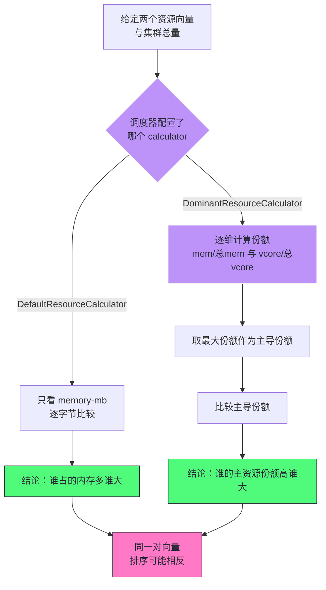
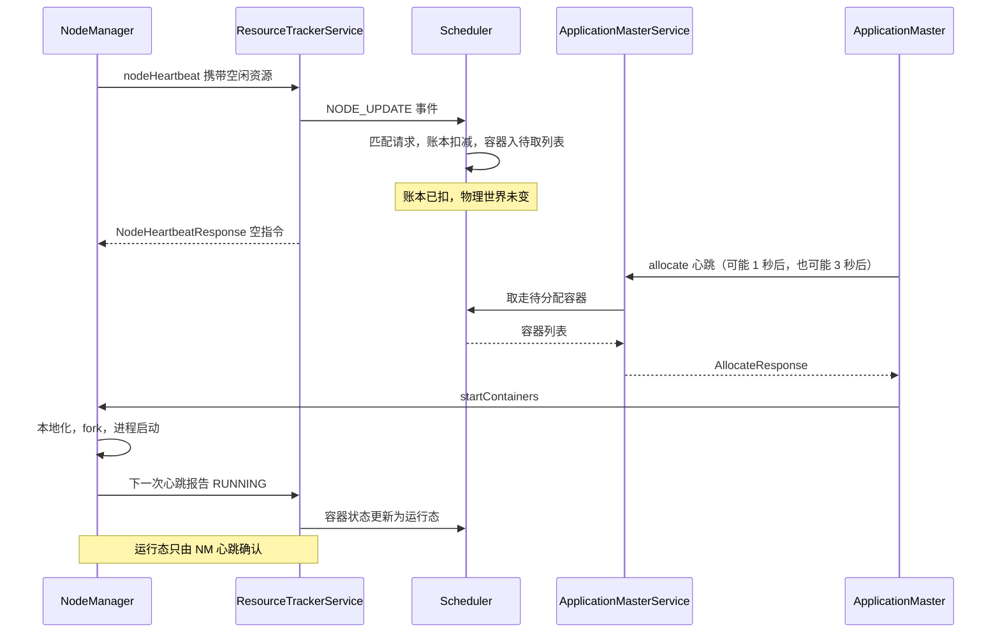
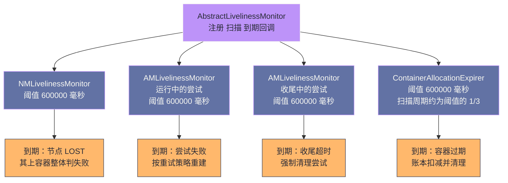
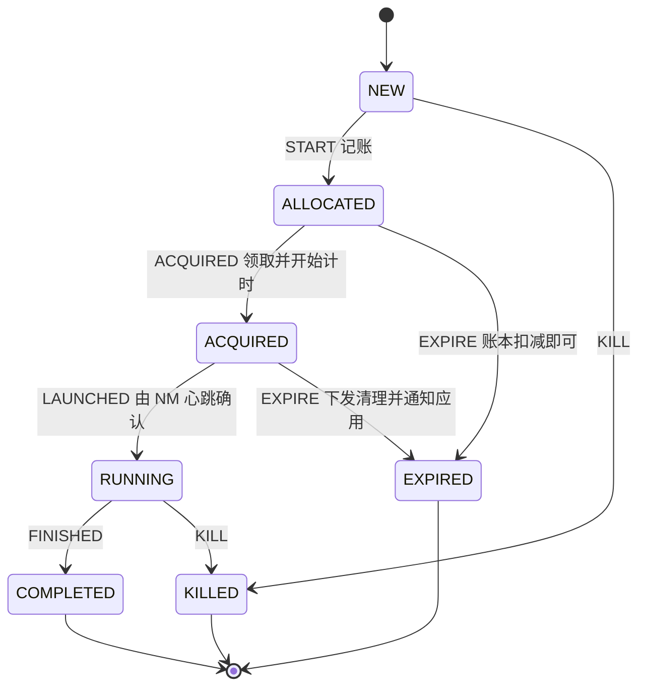

# ResourceManager 深度解析——调度器内核与资源抽象模型

**摘要：**

调度器算得准不准，先取决于它算的是什么。ResourceManager 内部并没有"CPU"和"内存"，只有四个被精心定义过的抽象：`Resource` 提供可比较的资源向量，`ResourceRequest` 把一次申请写成五元组，`ResourceProfile` 在 3.x 里试图把常用规格收成套餐，`ResourceCalculator` 决定这些向量怎么比、怎么规整。这四个抽象各自都带着失真：内存是真账，vCores 只是申报；默认计算器只认内存，规整时还会把 vCore 归一成 1；资源名可以是主机、机架或通配，语义随字符串形态漂移。本文先把四个抽象逐层拆开，给出同一批容器在两种计算器下排序相反的算例；再进 `ResourceScheduler`、`AbstractYarnScheduler`、`FiCaSchedulerNode` 的内部，说明 RM 侧的节点视图与 NM 真实状态之间只有心跳一条同步通道，这条通道决定了分配延迟的下界；随后清点 `RMContext` 挂的服务与四个存活监控，指出 `ContainerAllocationExpirer` 的计时起点在领取而非分配、撤销靠 NM 心跳回报运行态，这是 AM 卡住后容器无故消失的机制根源；最后给出 RM 内存账单的推算方法、六个 RM 侧故障形态的判据，以及一组不设上限的配置如何把 RM 推向 OOM。

---

## 第 1 章 账本与物理世界之间

### 1.1 从槽位到向量：责任转手

MRv1 的 TaskTracker 用槽位（Slot）描述能力，一个槽位意味着"这里能跑一个任务"，至于这个槽位对应多少 CPU、多少内存，由管理员在机器上凭经验设定，系统既不追问也不记账。槽位制在小集群里够用，因为它把资源规划的责任交给了运维，把不确定性留在了机器上。代价是调度器失去了做决策的原料：它不知道两个任务对资源的需求有什么不同，也就无法判断把哪一个任务放到哪一台机器上更划算。

YARN 在 2013 年前后把这份责任收回到框架侧，做法是要求申请方把需求写成显式的资源向量。这一步看起来只是把隐式参数改成显式参数，实际影响却深远：资源第一次成了可比较、可相减、可归一的对象，调度器才有可能在多个维度上做取舍；同时，声明与实际的裂口也第一次被固定下来——申请方写下的是期望，框架记下的是期望，而机器上发生的是另一回事。

### 1.2 记账、决策、执行是三层

把 RM 的内部拆开，会看到三个几乎不相干的层次在做三件不同的事。申请方（ApplicationMaster）把需求申报出来，RM 把申报值记进账本并据此做决策，NodeManager 在自己的机器上执行物理约束。三层之间靠心跳传递两个方向的少量信息，没有任何一层能看到完整的物理真实。

这带来一个贯穿全篇的结论：YARN 里的"资源"从头到尾是账本上的数字，它的准确性由申报纪律和心跳频率共同决定，而不是由监控系统的采样精度决定。**账本不会反向修正**——没有任何一条路径会把机器的真实负载写回 `SchedulerNode` 的已分配字段。RM 不知道一个容器实际用了多少 CPU，它只知道这个容器在账本上占了多少 vCore。把这个前提摆在前面，后面所有"资源够却分配不出去""机器空着队列却满了"的现象才有统一的解释。三个角色与四套协议如何协作，[[02 YARN 整体架构全景——ResourceManager、NodeManager 与 ApplicationMaster 三角协作]] 里有完整的链路，本文只盯住 RM 内部的那一层账本。

下图是这条链路的形状，注意图中三层的箭头是单向的，账本永远不会被物理用量反向修正：


### 1.3 贯穿案例：两种形状的容器

为了让后面的算例有统一的分母，这里先设定一个贯穿全文的集群。八台机器，每台在 `yarn.nodemanager.resource.memory-mb` 里申报 128 GB、在 `yarn.nodemanager.resource.cpu-vcores` 里申报 32 个虚拟核，合计 1,048,576 MB 与 256 个 vCore；所有节点归属同一个分区，队列 `root.prod` 的 `maximum-capacity` 是 100。

在这个集群上跑两类作业。一类是日志归并，容器的形状是 16 GB 内存配 2 个 vCore，属于大内存小 CPU 的形状，瓶颈在磁盘与内存带宽；另一类是特征计算，容器的形状是 4 GB 内存配 8 个 vCore，属于小内存大 CPU 的形状，瓶颈在算力。两类容器的内存比是 4:1，核数比是 1:4，正好互为镜像，后面用它们演示口径切换如何把排序翻过来。

---

## 第 2 章 四种资源抽象及其失真

### 2.1 Resource：内存是硬账，vCores 是申报

Hadoop 3.x 的 `Resource` 是一个抽象类，内建两个维度：`memory-mb` 与 `vcores`。其余资源类型通过 `ResourceInformation` 描述，由 `yarn.resource-types` 声明；3.3 的 `ResourceTypes` 枚举里只有 `COUNTABLE` 一种取值，属性型资源的概念更晚才出现，判断某个发行版对自定义资源的支持程度，要以对应版本的枚举与方法签名为准，不能按文档标题推断。这个结构很容易被读成"YARN 支持多维资源"，但结构支持不等于语义等价，两个内建维度的分量完全不同。**内存是真账，vCore 只是申报。**

内存这一维是真账。NodeManager 在 `yarn.nodemanager.resource.memory-mb` 里申报可用于容器的物理内存，默认值 `-1` 在硬件探测关闭时退化为 8192 MB；这个数字进入 RM 的账本，成为节点的 `totalResource` 的内存分量。容器的内存声明会被规整、记账、参与队列容量计算，最终在机器上由两条路径之一兑现：开启 `yarn.nodemanager.pmem-check-enabled`（默认 true）后由 NM 周期性采样并在超限时杀容器，或者走 LinuxContainerExecutor 的 cgroup 内存子系统做硬限。

vCore 这一维是申报。`yarn.nodemanager.resource.cpu-vcores` 的默认值同样是 `-1`，硬件探测关闭时取 8，而 Hadoop 自带的配置说明把这个字段的性质写得很直白：它只用于 RM 分配资源时的记账，并不用来限制容器实际能用的 CPU 数量。换句话说，一个容器声明 2 个 vCore，RM 账本上扣掉 2，机器上没有任何东西阻止它吃掉 6 个核的时间片。真正让 vCore 变成约束需要三个条件同时成立：使用 LinuxContainerExecutor、启用 cgroup、把 `yarn.nodemanager.linux-container-executor.cgroups.strict-resource-usage` 从默认的 false 改为 true。这个参数默认关闭时的语义是"允许应用在节点有空闲时借用 CPU"，只有打开才把应用压回自己那一份；配置说明还特意补了一句，这个开关不影响内存等其他子系统，因为内存本来就走另一套强制路径。cgroup 的工程细节在 [[07 YARN 资源隔离——CGroups 与 Linux Container Executor 的工程实现]] 里展开。

两种维度在记账与强制上的差别，可以并排列出来：

| 维度 | 由谁申报 | RM 如何记账 | 谁来强制 | 失真的表现形式 |
|---|---|---|---|---|
| 内存（`memory-mb`） | NM 申报节点容量，AM 申报容器需求 | 按 MB 精确加减，参与队列与节点余量计算 | NM 的 pmem 监控或 cgroup 内存子系统 | 申报偏小导致容器被杀，申报偏大导致节点放不下更多容器 |
| vCore（`vcores`） | NM 申报节点容量，AM 申报容器需求 | 按个数加减，默认计算器下甚至不参与比较 | 默认没有任何强制；cgroup 严格模式下才成为上限 | 账本显示 CPU 空闲或耗尽，与机器实际负载方向可以完全相反 |
| 自定义资源（`yarn.io/gpu` 等） | NM 通过资源插件发现，配置在 `yarn.resource-types` 声明 | 按数量记账，参与规整与比较 | NM 资源插件按需做设备隔离 | 记账数量与设备可用性脱钩，插件发现失败时账本仍然有值 |

这张表最后一行值得多说一句。GPU 这类资源的数量由 NM 的发现插件（默认通过 `nvidia-smi` 一类可执行文件查询）上报，RM 只负责把数字记进账本并在分配时扣减；设备是否真的被隔离、容器里能不能看到那张卡，取决于运行时（Docker 插件、`yarn.nodemanager.resource-plugins.gpu.allowed-gpu-devices` 等）与执行器的配合。账本与设备之间同样有一条缝，只是这条缝比 vCore 那条窄一些。

### 2.2 规整：声明值如何被改写

`Resource` 之上紧接着一个更隐蔽的环节：规整（normalize）。AM 申请的向量不会原样进入账本，RM 会以 `yarn.scheduler.minimum-allocation-mb`（默认 1024）与 `yarn.scheduler.minimum-allocation-vcores`（默认 1）为步长向上取整，并以 `yarn.scheduler.maximum-allocation-mb`（默认 8192）与 `yarn.scheduler.maximum-allocation-vcores`（默认 4）为上限截断。规整的目的是减少碎片：如果允许任意大小的内存申请，节点剩 2000 MB 时可能谁也放不进去。

问题在于规整由 `ResourceCalculator` 执行，而两个实现的规整语义并不一样。默认的 `DefaultResourceCalculator` 在规整时只处理内存，返回的向量由 `Resources.createResource(normalizedMemory)` 构造，这个工厂方法在内存大于零时把核数固定为 1。于是开启默认计算器的集群里，AM 申请 `{1500 MB, 3 vCores}`，规整后的账本值是 `{2048 MB, 1 vCore}`：内存向上取整到 2048，申请的 3 个核被静默改写为 1。`DominantResourceCalculator` 的规整则遍历所有可计数的资源类型，逐维取整并截断，上面的申请会规整成 `{2048 MB, 3 vCores}`。

默认计算器的这段实现值得原样看一眼，它的信息量集中在最后一行：

```java
// DefaultResourceCalculator.normalize 的节选（3.3.6）
public Resource normalize(Resource r, Resource minimumResource,
    Resource maximumResource, Resource stepFactor) {
  if (stepFactor.getMemorySize() == 0) {
    stepFactor = minimumResource;   // 步长为零时的兜底，防止除零与死循环
  }
  long normalizedMemory = Math.min(
      roundUp(Math.max(r.getMemorySize(), minimumResource.getMemorySize()),
          stepFactor.getMemorySize()),
      maximumResource.getMemorySize());
  return Resources.createResource(normalizedMemory); // 只带内存，核数被固定为 1
}
```

函数签名收下了完整的 `minimumResource`、`maximumResource`、`stepFactor` 三个向量，函数体却只读取了内存分量。这不是实现遗漏，而是这个类的设计前提——它认为内存是唯一需要精细切分的资源。前提在内存为王的年代成立，在容器形状分化之后就成了口径问题：**规整会静默改写申报**，而且改写方向固定为"核数变 1"。

这段差异在源码里只有十几行，落到集群上却是两种世界观。默认计算器下，一个容器的成本几乎完全由内存决定，申请的核数只影响它自己进程里的线程数，不影响别人能拿到多少；规整又把所有容器的账面核数压到 1，节点上"已用 vCore"这个指标因此退化成"已用容器数"，看板上的 CPU 水位与真实 CPU 负载不是同一个东西。这也解释了为什么有些集群的 vCore 利用率常年在 10% 上下，而机器负载已经饱和：两个数字本来就不该拿来互相对照。

### 2.3 ResourceRequest：从五元组到八字段

`Resource` 描述"要多少"，`ResourceRequest` 描述"要什么样的、要几个、要不要等本地"。Hadoop 3.x 的 `ResourceRequest` 在经典五元组之外又长了几个字段，把它们逐个摆开，才能看清哪些字段是承诺、哪些只是提示：

| 字段 | 语义 | 写错之后的后果 |
|---|---|---|
| `priority` | 申请所属优先级，决定同一应用内部的分配顺序 | 全部挤在默认优先级上，同应用内的关键容器无法插队 |
| `resourceName` | 期望位置：具体主机名、机架名、或 `*` | 写成 IP 与主机名混用、或机架路径拼错，请求永远匹配不上 |
| `capability` | 单个容器的资源向量 | 超过 `maximum-allocation-*` 被截断，低于 `minimum-allocation-*` 被抬高 |
| `numContainers` | 该条目期望同时存在的容器数 | 当成增量累加，导致重复申请或申请量翻倍 |
| `relaxLocality` | 匹配不上时是否允许降级到机架或任意节点 | 设为 false 后请求被钉死，节点永远等不到 |
| `executionTypeRequest` | 3.x 新增，`GUARANTEED` 或 `OPPORTUNISTIC` | 机会型容器被当成保证型统计，容量规划失真 |
| `nodeLabelExpression` | 3.x 的标签表达式，限定可落在哪个分区 | 表达式与队列可访问分区无交集，请求挂空 |
| `allocationRequestId` | 3.x 的请求标识，用于关联增容与释放 | 增容请求无法与原始请求对账，最后剩下孤儿容器 |

三个字段最容易踩。`resourceName` 的语义随形态漂移：写主机名时它是"我要这台机器上的本地数据"，写机架路径时它是"同一机架即可"，写 `*` 时它是"随便哪台"，同一个字符串位置承载了三种完全不同的约束强度。运维经验里常见的一类事故是集群改名或扩容后主机名解析变化，AM 手里还攥着旧主机名的本地请求，`relaxLocality` 又是 false，于是容器申请一直挂着，应用停在 ACCEPTED，队列与集群却都有空余。

`numContainers` 的语义容易被直觉带偏。**`numContainers` 是存量而非增量**：AM 每次 `allocate` 发送的是当前全量未满足的需求，RM 用新值覆盖旧值，而不是累加。这个设计是为了让通信具备幂等性，请求或响应在网络上丢失、重复，覆盖语义都能收敛回一致状态。反过来说，AM 侧若把 `numContainers` 当计数器用，每轮心跳都往上加，账本就会持续膨胀，表现出来是应用申请了几百个容器、实际只需要几十个，队列被自己的影子请求占满。

`capability` 与规整的关系前面说过，这里补一个边界：上限截断是静默的。申请 12 GB 而 `maximum-allocation-mb` 为 8192 时，账本按 8 GB 记，AM 不会收到任何错误，直到容器在机器上因内存不足被杀，才在某条诊断信息里看到端倪。把上限调到刚好覆盖业务最大规格、再留一点余量，比把上限调得很大更安全，因为上限越大，单个误配置的容器能造成的破坏越大。

3.x 还给申请加了第二条通道。`ResourceRequest` 之外，AM 可以通过 `SchedulingRequest` 提交带放置约束（`PlacementConstraint`）的请求，约束表达"与某类容器同节点""不与某类容器同节点"一类的拓扑要求，RM 侧用 `SingleConstraintAppPlacementAllocator` 承接；无法被满足的请求以 `RejectedSchedulingRequest` 的形式回给 AM。这条通道把"位置"从 `resourceName` 字符串里解放出来，代价是放置逻辑的一部分被搬到了请求侧：约束写得越复杂，AM 越难从拒绝原因里反推该放宽哪一条，现场表现为"请求被拒但不知道拒在哪"。两种通道在 3.x 里并存，排查时先确认应用用的是哪一种，比笼统地说"YARN 分配不到容器"有效得多。

### 2.4 ResourceProfile：被误读的那一层

ResourceProfile 常被描述成"3.x 用来支持 GPU 的扩展"，这个说法把两件事混在了一起。支持 GPU 等自定义资源的机制是 `ResourceInformation`、`ResourceTypes` 与 `yarn.resource-types`，加上 NM 的资源插件，这条线从 3.0 起就已经可用；ResourceProfile 是另一条线，目标是让用户不必每次手写完整的资源向量，而是给常用规格起个名字。

在 Hadoop 3.3.x 里，这条线落成的形态比名字朴素得多：RM 侧有一个 `ResourceProfilesManager`，从 `yarn.resourcemanager.resource-profiles.source-file`（默认 `resource-profiles.json`）读取"名字到 `Resource` 的映射"；总开关 `yarn.resourcemanager.resource-profiles.enabled` 默认是 false；客户端侧提供 `GetAllResourceProfiles` 与 `GetResourceProfile` 两个 RPC，供工具查询有哪些套餐。`ResourceRequest` 在这个版本里还没有携带套餐名的字段，也就是说套餐能被查询、能被管理，但还没有接进申请的主路径。要判断某个发行版是否已经支持"按套餐申请"，看 `ResourceRequest` 有没有对应字段、以及调度器是否接受这种请求，比看文档标题可靠。

把这条线的位置讲清楚，是为了避免另一种误判：有人看到 `yarn.io/gpu` 出现在 `yarn.resource-types` 里，就以为只要在 `yarn-site.xml` 里声明一下，调度器就会自动按 GPU 做公平性计算。自定义资源要真正进入比较，需要 `DominantResourceCalculator` 在这个资源类型上参与份额计算，而默认计算器连 vCore 都不看，更不会看 GPU。声明、记账、比较是三件事，缺任何一件，自定义资源都只是账本上的一个装饰性数字。

### 2.5 ResourceCalculator：谁在比较，按什么口径比

`ResourceCalculator` 是四个抽象里最不显眼、影响却最大的一个。它不是一个工具类，**比较口径就是世界观**：节点余量够不够、队列是不是顶到上限、哪个队列更饥饿、容器该如何规整，全都以它的方法为准。抽象基类定义的方法族包括 `compare`、`divide`、`ratio`、`normalize`、`roundUp`、`multiplyAndNormalizeUp`、`fitsIn` 等，两个实现分别给出两套语义。

`DefaultResourceCalculator` 的语义只有一句话：只看内存。`compare` 直接比较内存大小，`divide` 退化为内存比，`fitsIn` 只判断内存是否容得下。它简单、快、对以内存为稀缺资源的传统 Hadoop 负载足够，但它把 CPU 从调度视野里完全删掉了。

`DominantResourceCalculator` 的语义来自 DRF（Dominant Resource Fairness）：把一个资源向量的每个维度除以集群对应维度的总量，得到一组份额，取其中最大的那个作为这个向量的主导份额，两个向量比大小就是比主导份额。这套比较对多资源是自洽的，代价是每次比较都要做多次浮点除法，冲突时还要按维度逐个比较。

下面这张流程图是两种计算器在同一问题上的分岔，分岔点就在"比较哪几个维度"这一句上：



两个调度器怎么用这个类，各有一处容易被讲错的地方。Capacity Scheduler 从 `yarn.scheduler.capacity.resource-calculator` 读实现类，默认值是 `DefaultResourceCalculator`，这是一个显式的配置项，改它只影响 CS。Fair Scheduler 则没有一个同名开关：它的 `getResourceCalculator()` 返回的是硬编码的 `DefaultResourceCalculator` 实例，DRF 在 FS 里是以"调度策略"的形态存在的，`DominantResourceFairnessPolicy` 的 `NAME` 是 `DRF`，由队列的 `schedulingPolicy` 选择，默认是 `FairSharePolicy`。把"公平调度就是 DRF、容量调度就是内存"当成定论，会漏掉两层事实：FS 默认策略按内存做公平分配，而 CS 换成 Dominant 计算器之后同样具备多资源公平性。真正的判据不是调度器名字，而是查配置：CS 看 `resource-calculator`，FS 看队列的 `schedulingPolicy`。最常见的路径恰好是不配置——默认值生效，团队却以为自己在按主资源调度。两套算法在队列树、权重与抢占上的差异，[[05 调度器深度解析——Capacity Scheduler 与 Fair Scheduler 的算法内核]] 里逐层对照；此处只关心它们共用的比较口径。

### 2.6 算例：同一批容器，两种世界观

回到第 1 章设定的集群，总量 1,048,576 MB 与 256 vCore。先看两个单容器的向量：

| 容器形状 | 内存份额 | vCore 份额 | 默认计算器下的"大小" | Dominant 计算器下的主导资源与份额 |
|---|---|---|---|---|
| 日志归并 `{16384 MB, 2 vCore}` | 1.5625% | 0.78125% | 16384 | 内存，1.5625% |
| 特征计算 `{4096 MB, 8 vCore}` | 0.390625% | 3.125% | 4096 | CPU，3.125% |

按内存比，日志容器的成本是特征容器的四倍；按主导份额比，特征容器的成本是日志容器的两倍。**同一批容器，结论相反**，这就是口径的力量。

把规模放大到队列层面，同一套账还会翻转"哪个作业更该被限制"。假设队列里已经跑着日志作业 30 个容器与特征作业 20 个容器：

| 作业 | 容器数 | 占用内存 | 内存份额 | 占用 vCore | vCore 份额 | 默认口径排队依据 | Dominant 口径排队依据 |
|---|---|---|---|---|---|---|---|
| 日志归并 | 30 | 491,520 MB | 46.9% | 60 | 23.4% | 已用 46.9%，更接近上限 | 主导份额 46.9% |
| 特征计算 | 20 | 81,920 MB | 7.8% | 160 | 62.5% | 已用 7.8%，余地充足 | 主导份额 62.5% |

在默认计算器下，日志作业看起来已经把队列吃掉了将近一半，特征作业还很空，新申请若按"谁的份额低谁先得"来取舍，资源会继续流向特征计算；在 Dominant 计算器下，特征计算的主导份额已经到了 62.5%，是队列里更接近天花板的一方，限制应当落在它身上。集群状态完全相同，唯一变化的是比较的维度，调度结论就反了过来。

这个算例也能反过来解释一类现场争论。运维看到集群 CPU 已经跑满，调度器却还在往队列里塞容器，理由是"内存还剩一半"；开发看到内存还有一半，抱怨容器申请为什么排队。两个人说的都是账本上的真话，分歧在于账本只有一个维度被真正读取。想统一口径，要么把计算器切到 Dominant，让 CPU 进账；要么承认这是内存账本，用 cgroup 与优先级去处理 CPU 竞争，不要指望调度器替你做 CPU 的仲裁。

### 2.7 四种抽象各自失真的地方

把前面四节收在一张表里，失真点一目了然：

| 抽象 | 它承诺的东西 | 它实际只保证的东西 | 最典型的误读 |
|---|---|---|---|
| `Resource` | 描述一个容器的资源需求 | 内存分量可记账可强制，vCore 分量只是数字 | 以为 vCore 等于 CPU 隔离 |
| `ResourceRequest` | 表达位置、数量、规格的完整诉求 | 一次存量式覆盖的协商，位置匹配依赖字符串 | 以为 `numContainers` 是增量 |
| `ResourceProfile` | 把常用规格收成可复用的套餐 | 3.3 里只是 RM 侧的名字到向量的注册表，默认关闭 | 以为它是 GPU 扩展的载体 |
| `ResourceCalculator` | 提供资源比较与规整的统一口径 | 具体维度由实现类决定，默认实现只认内存 | 以为调度器天然多资源公平 |

---

## 第 3 章 调度器的内部结构

### 3.1 三层接口与它们各自持有的东西

YARN 的调度器由三个层次叠起来。最外面是 `YarnScheduler`，它面向 RM 的其他组件与 AM，提供分配、节点变更、应用增删等入口；中间是 `ResourceScheduler`，它加上 `Recoverable` 的恢复契约，并补上 `reinitialize`、`attemptAllocationOnNode`、`getNodeIds` 一类 RM 内部需要的方法；最里面是 `AbstractYarnScheduler`，它实现了节点与应用的登记、上限管理、容器完成处理这些共性逻辑，留给子类的只有分配算法本身。

`AbstractYarnScheduler` 持有的状态决定了 RM 的内存占用形状。它有一个 `ClusterNodeTracker`，节点按四张索引分别登记：按 `NodeId` 的哈希表、按主机名的表、按机架分组的列表、按分区标签分组的列表；有一个 `applications` 并发表，键是 `ApplicationId`，值是 `SchedulerApplication`；还有 `minimumAllocation` 与由 `maximum-allocation-*` 推导出的上限。四张节点索引是为了让"这台机器在哪""这个机架有几台""这个分区还剩多少"这三类查询都能常数或近常数完成，代价是每个节点被重复引用四次。

### 3.2 Capacity 与 Fair 的分叉点

两个调度器在这套骨架上分叉的位置很清晰。Capacity Scheduler 用 `ParentQueue` 与 `LeafQueue` 构成队列树，用 `CSQueueStore` 维护队列的并发访问，用 `FiCaSchedulerApp` 作为应用尝试的调度视图；它的分配决策从"最饥饿的叶队列"开始，逐层向下找应用、找请求。Fair Scheduler 用 `FSQueue`、`FSLeafQueue`、`FSAppAttempt` 一套类，队列结构与权重来自 allocation 文件，分配决策从"公平份额缺口最大的应用"开始。两者共享 `SchedulerNode` 的节点视图、`ResourceCalculator` 的比较口径与 `AbstractYarnScheduler` 的登记逻辑，差异集中在"先选谁"这一层。

`FiCaSchedulerApp` 的名字来自 FIFO 与 Capacity 的组合，它在 3.3 里被移到了 `scheduler.common.fica` 包下，与 `FiCaSchedulerNode` 放在一起。这个名字经常被误认为是"FIFO 调度器"，实际它只是 CS 的历史命名残留，CS 内部的分配顺序由队列策略与优先级决定，与 FIFO 没有关系。读源码时按包名找类比按类名前缀猜更可靠。

### 3.3 节点视图：RM 眼里的机器只剩账面

`SchedulerNode` 是 RM 侧对一台机器的全部认知。它持有节点总资源、已分配资源、已启动容器的映射、机架名、分区标签，以及一个经常被误读的 `numContainers`。可用资源不是独立字段，而是 `totalResource` 减去 `allocatedResource` 现算出来的，这个设计保证账本不会出现"总量减已分配不等于可用"的内部矛盾。

| 节点视图字段 | 数据来源 | 更新时点 | 容易误读的地方 |
|---|---|---|---|
| `totalResource` | NM 注册时的 `RegisterNodeManagerRequest` | 注册、重注册、资源上报变化 | 节点扩容后不重启 NM 不会立即反映 |
| `allocatedResource` | 调度器每次分配与回收时加减 | 分配决策发生时 | 计入的是申报值，不是实际用量 |
| `launchedContainers` | 完成事件与启动事件时增删 | 分配、启动、完成、回收 | 包含已分配未启动的容器 |
| `numContainers` | 同上，按 `ContainerId` 集合维护 | 同上 | 常被当成"运行中容器数" |
| `availableResource` | 现算：总量减已分配 | 读取时 | 有时会被当成"物理空闲资源" |

表格第二行的措辞需要留意：`allocatedResource` 在调度器做分配决策的那一刻就被加上了，此刻容器还没有在任何机器上出现。所以 RM 视角的"已分配"永远领先物理世界一段时间，这段时差是下一节的主题。

### 3.4 心跳是唯一同步通道

RM 与 NM 之间没有推送通道，NM 每隔 `yarn.resourcemanager.nodemanagers.heartbeat-interval-ms`（默认 1000 毫秒）发一次 `nodeHeartbeat`，携带本节点上容器的状态变化、资源使用、健康报告；RM 把分配决策攒在响应里带回去。RM 与 AM 之间同样只有请求响应：AM 每隔一段时间调用 `allocate`，RM 把这一轮攒下的分配结果放进响应。两条通道的节奏不同，拼接起来就产生了分配延迟。

一个容器从"被决定分配"到"进程在跑"，要经过四段等待：调度器在某个 NM 心跳里完成匹配，把容器放进应用尝试的待取列表；AM 在下一次 `allocate` 里取走它；AM 拿着容器信息直连 NM 调 `startContainers`；NM 落盘、fork、进程起来之后，在下一次自己的心跳里把运行态报回 RM。第一段与第四段受 NM 心跳约束（0 到 1 秒），第二段受 AM 心跳约束，第三段受本地化与进程启动影响。第三段里的本地化、令牌校验与进程拉起，[[04 Container 生命周期——从资源申请到进程启动的完整调用链]] 有逐段拆解，本文把它当作一段固定延迟处理。

MR 的 AM 默认每 1000 毫秒调一次 `allocate`（`yarn.app.mapreduce.am.scheduler.heartbeat.interval-ms`），Spark 的默认值是 3000 毫秒，且会被压到 AM 存活超时的一半以内，以避免自己把心跳发迟。把这几段叠起来估算：MR 作业的分配可见延迟大致在 1 到 3 秒量级，Spark 作业在 2 到 6 秒量级，再加上本地化耗时，首个小容器落地的端到端时间到 10 秒量级并不意外。这些数字是按时序推算的量级，不是基准测试结果，集群越忙、本地化越重，尾巴越长。

四段等待的约束来源与量级可以并排列出，标为"示例推算"的格子是按上文时序与常见间隔推出的量级，不是实测：

| 阶段 | 受谁约束 | 量级（示例推算） | 放大它的因素 |
|---|---|---|---|
| 调度器匹配到容器 | NM 心跳节奏 | 0 到 1 秒 | 心跳间隔调大、调度器持锁时间变长 |
| AM 取走容器 | AM 心跳节奏 | 0 到 1 秒（MR）、0 到 3 秒（Spark） | 框架心跳间隔、AM 侧 GC |
| AM 调 `startContainers` 并拉起进程 | NM 本地化与执行器 | 0.5 到数秒 | 资源包体积、磁盘与网络、执行器排队 |
| NM 心跳回报运行态 | NM 心跳节奏 | 0 到 1 秒 | 心跳线程阻塞、RM 处理延迟 |

下面的时序图把两条通道的交错画出来，注意分配与通知不在同一拍：



这张图里有一处最值得记住的不对称：**RM 记账即时，运行态延迟**。所以任何以"RM 显示已分配"为依据判断"资源被占用"的推断，都要打一个时间折扣；反过来，以"RM 显示容器还在跑"为依据判断"进程健康"，也不可靠，因为**运行态只能由 NM 心跳确认**，它只是 NM 最近一次心跳的说法，不是此刻的事实。

### 3.5 全局锁及其改造

调度器的内部状态高度耦合。分配一个容器要同时修改节点已分配资源、应用尝试的消耗、队列的已用量三处；三处若不在同一把锁里更新，两个 NM 心跳就可能同时判定同一份空闲资源可用，重复分配出去。CS 因此用一把读写锁保护核心状态，`nodeUpdate` 与 `allocate` 都取写锁。

锁的代价是吞吐。节点规模上千之后，全局写锁让调度器的处理能力变成单线程，NM 心跳会排队。3.x 的改造方向是缩短持锁区间而不是取消锁：用 `CSQueueStore`、`SchedulerNodeTracker` 一类的并发结构把"读多写少"的部分移出全局锁，把批量分配改成增量处理，把整棵队列树的遍历拆成可分段的工作。但"原子分配"这件事仍然需要互斥，因为账本的一致性比吞吐更基础。理解这一点，就能明白为什么大集群的 RM 需要更多 CPU 与更低的 GC 停顿，也能明白为什么调度器的优化空间始终有限。

---

## 第 4 章 RMContext 与内部服务

### 4.1 一个服务注册表

`RMContext` 是 RM 的服务注册表与共享上下文，几乎所有内部组件都通过它拿到自己需要的其他组件。把挂在它上面的东西按职责列一遍，RM 的内部分工就清楚了：

| 服务 | 职责 | 关键超时或开关 | 失效之后的表现 |
|---|---|---|---|
| `RMAppManager` | 应用的提交受理、完成清理、完成应用计数 | `yarn.resourcemanager.max-completed-applications` | 提交被拒或完成应用无限累积 |
| `ApplicationMasterService` | AM 的注册、`allocate`、注销 | `yarn.am.liveness-monitor.expiry-interval-ms` | 分配结果无法下发，AM 心跳被判超时 |
| `ResourceTrackerService` | NM 的注册与心跳 | `yarn.nm.liveness-monitor.expiry-interval-ms` | 节点状态无法更新，节点被判失效 |
| `NMLivelinessMonitor` | 按心跳时间判定节点存活 | 同上，默认 600000 毫秒 | 慢心跳节点被误判为死节点 |
| `AMLivelinessMonitor` | 判定 AM 的心跳是否还活着 | 默认 600000 毫秒 | 卡住的 AM 在十分钟后被判定失败 |
| `ContainerAllocationExpirer` | 回收领走却没用起来的容器 | `yarn.resourcemanager.rm.container-allocation.expiry-interval-ms`，默认 600000 毫秒 | 容器被静默回收，AM 侧看到异常完成 |
| `RMStateStore` | 应用与尝试状态的持久化 | `yarn.resourcemanager.store.class`，默认 `FileSystemRMStateStore` | 提交与完成卡在写状态阶段 |
| `RMNodeLabelsManager` | 分区与标签的映射 | 由标签配置决定 | 请求与分区匹配失败 |

这张表里有两个名字容易混淆。`NMLivelinessMonitor` 判的是节点，超时后节点进入 LOST，其上容器被整体判定失败；`AMLivelinessMonitor` 判的是应用尝试，超时后该次尝试失败并触发重试。两者都用同一套 `AbstractLivelinessMonitor` 骨架，语义却差得很远。

把与存活相关的四个对象单独画出来，机制的共用关系会更清楚。它们都是 `AbstractLivelinessMonitor` 的子类，共享"注册、扫描、到期回调、可撤销"这一套骨架，区别只在注册的对象、阈值与到期动作：



四个阈值默认都是十分钟，看起来整齐，含义却不同：节点与 AM 的十分钟是"多久没消息算死"，容器的十分钟是"领走之后多久没落地算废"。前者衡量通信，后者衡量动作，共用一套骨架只是实现上的复用，不能据此推断语义相同。

顺带澄清一处常见的引用错误：RM 侧并没有一个独立的 `RMAppLivelinessMonitor` 类来监控"应用存活"。3.3 的 `ResourceManager` 创建的是两个 `AMLivelinessMonitor` 实例，一个盯运行中的尝试，一个盯正在收尾的尝试，加上 `NMLivelinessMonitor` 与 `ContainerAllocationExpirer`，共四个基于同一骨架的监控。应用层的存活由尝试心跳推导，不存在第三套独立的应用级监控。

### 4.2 三条入口

RM 对外只有三条进入路径，每条对应一个服务。`RMAppManager` 面向客户端，处理提交、终止、完成应用的内存管理；`ApplicationMasterService` 面向 AM，处理注册与分配；`ResourceTrackerService` 面向 NM，处理注册、心跳与节点状态。三条路径都在 `AsyncDispatcher` 上以事件方式转交给内部状态机，处理器只负责把外部请求翻译成事件，真正的状态迁移由 `RMAppImpl`、`RMAppAttemptImpl`、`RMNodeImpl`、`RMContainerImpl` 四类状态机完成。

这种"入口翻译、状态机迁移"的分工带来一个排查上的直接后果：同一条链路上的四个状态机各自打各自的日志，看日志要按状态机的 logger 找，而不是按服务的 logger 找。一个应用卡在 ACCEPTED，入口服务的日志只写"受理成功"，真正为什么没被分配，藏在调度器的队列水位与分配尝试里。

### 4.3 存活监控：一套骨架，四种用途

四个监控里，`NMLivelinessMonitor`、两个 `AMLivelinessMonitor` 与 `ContainerAllocationExpirer` 共享同一套机制：注册对象、定期扫描、超时回调、可撤销。机制的实现是 `AbstractLivelinessMonitor`，它持有"对象到最近一次活跃时间"的映射，按监控周期扫描，超过阈值就调用抽象方法 `expire`。所有超时判定的准确性都建立在同一个假设上：网络与处理链路的抖动远小于阈值。

节点监控的阈值是 `yarn.nm.liveness-monitor.expiry-interval-ms`，默认 600000 毫秒，也就是 10 分钟。NM 心跳间隔是 1 秒，10 分钟意味着连续 600 次心跳没有到达才会被判死。这个余量对正常抖动极其宽容，GC 停顿几秒、网络短暂拥塞、RM 的 RPC 队列积压几秒，都不会触发。真正会触发的情况通常只有三类：NM 进程挂掉或僵死、机器网络彻底断开、RM 侧处理线程被长时间阻塞。因此"节点莫名其妙变成 LOST"时，第一嫌疑往往不是监控阈值太小，而是 RM 自身处理不过来，或者 NM 的发送线程卡住了。

AM 监控的阈值是 `yarn.am.liveness-monitor.expiry-interval-ms`，默认同样是 600000 毫秒。AM 心跳由各计算框架的客户端实现，间隔由框架配置，例如 Spark 会把自己的心跳值压到超时的一半以内，这个"自我约束"不是 YARN 强制的，而是各框架避免被误判的通行做法。理解了这一点，就能回答一个常被问到的问题：为什么 AM 卡住之后，作业不是立刻失败，而是等了十分钟才重试。

### 4.4 十分钟意味着什么

十分钟的超时在两条轴上有完全不同的含义。对稳定性而言，它意味着误判率极低，短暂抖动不会引发大规模容器重跑；对恢复速度而言，它意味着故障感知的上限是十分钟，AM 死在半夜，作业要到天亮前才可能重试，期间占用的资源一直挂在账上。**十分钟是宽容而非灵敏**，它买的是稳定，卖的是恢复速度。

这两个方向不可兼得。把阈值调小，故障发现更快，但 RM 一有短暂抖动就会批量判死节点，容器重跑的成本可能远超等待；把阈值调大，误判更少，但僵死的 AM 会占着资源空转更久。生产上更有效的做法不是调阈值，而是缩短抖动本身：给 RM 的调度线程留足 CPU、控制单节点容器数、避免在 RM 上跑重负载、把 NM 与 RM 之间的网络放在低延迟域内。阈值只负责兜底，不负责灵敏。

---

## 第 5 章 ContainerAllocationExpirer：十分钟的回收

### 5.1 计时起点不是分配，而是领取

`ContainerAllocationExpirer` 常被描述成"分配了不用的容器会被回收"，这句话方向对，但起点错了。**计时起点在领取而非分配**。翻 3.3 的 `RMContainerImpl` 状态机，注册动作发生在 `ACQUIRED` 转换里：当 AM 通过 `allocate` 取走一个容器，容器状态从 ALLOCATED 变成 ACQUIRED，这一刻才调用 `register(AllocationExpirationInfo)` 开始计时。分配完成后一直躺在待取列表里、AM 从没来取走的容器，不会被这个监视器回收。

这个细节决定了排查方向。一个 AM 完全停止工作，它的待取列表里的容器会一直挂着，账本上的资源一直被扣着，直到 `AMLivelinessMonitor` 在十分钟后判定尝试失败、把整个尝试清理掉；而一个 AM 正常心跳、取走了容器却没能让 NM 把进程启动起来的场景，才是 `ContainerAllocationExpirer` 的地盘。前者表现为"应用资源占用不降"，后者表现为"容器拿在手里消失了"。

计时器的节拍也不止一个参数。超时阈值来自 `yarn.resourcemanager.rm.container-allocation.expiry-interval-ms`（默认 600000 毫秒），扫描周期由基类按阈值的约三分之一计算，也就是说阈值 10 分钟时，实际的回收动作落在 10 到 13 分钟多之间的某个扫描点，不是一个精确的十分钟整。排查时按"至少十分钟、可能更久"来理解，比按精确值推算更接近现场。

### 5.2 撤销靠 NM 心跳

计时开始之后，什么时候撤销？源码给出的答案不在 AM 侧，而在 NM 侧。`RMNodeImpl` 处理 NM 心跳上报的容器列表时，一旦看到某容器状态是 RUNNING 且是自己第一次见到这个容器进入运行态，就调用 `unregister` 撤销计时；看到容器已经结束，也撤销。**撤销靠 NM 心跳，不靠 AM 自述**，AM 说自己启动了容器不算数，NM 把运行态报回来才算数。

这个设计把"容器是否真的跑起来"的唯一裁判权交给了 NM，与 3.4 节的结论一致：物理世界的事实只能由持有进程的一方回报。副作用是，如果 NM 的这次上报丢失或被延迟，计时器仍然在走，容器跑得好好的也可能被 RM 判为过期。生产上把 NM 心跳间隔调大、或让 NM 心跳线程被阻塞，都会放大这种风险。

### 5.3 到期之后走哪条路

到期事件的落点是调度器的 `CONTAINER_EXPIRED` 处理，它把容器当作完成来处理，但**两条过期路径强度不同**。从 ALLOCATED 状态过期，走的是普通的完成转移，容器从未在任何机器上出现，账本扣减即可；从 ACQUIRED 状态过期，走的是杀容器转移，除了从账本上扣减，还会给对应 NM 下发清理指令，并通知应用尝试这个容器已经结束。后者是"AM 手里拿着容器、NM 上可能已经起了进程但还没被 RM 确认"的那种状态，处理上必须假定进程可能已存在，所以要多做一步清理。

下图是这条状态机的全貌，注意 EXPIRED 有两条入边，分别对应"从未落地"与"可能已落地"：



3.x 的容器增容把这条机制用出了第二种形态。AM 为运行中的容器申请把规格从 4 GB 提到 8 GB，RM 批准后先在账本上记 8 GB，并给这个"增量"注册一个同样的过期计时，因为增量有没有真的落到 NM 上还不知道。计时期满而 NM 尚未确认新规格时，RM 把账面资源回滚到 `lastConfirmedResource`，也就是 NM 最后一次心跳确认过的规格。这解释了一个反直觉的现象：容器明明还在跑，账本上的资源却会自己降回去。看到"资源悄悄变少"，先查增容请求是否被批准过、NM 是否确认过，而不是怀疑账本出错。

### 5.4 AM 卡住时的完整时序

把这条机制放进一个真实场景里，故障的形状就清楚了。AM 取走容器之后，需要做三件事：把容器信息写进自己的调度器状态、向 NM 发起 `startContainers`、等待 NM 回报启动结果。如果 AM 在第一步之后卡住（例如发生了长时间的 Full GC、被线程死锁卡住、或者它调用的下游服务超时），容器就停在 ACQUIRED 态，计时器开始走，NM 那边什么也没收到。

十分钟后，RM 判定容器过期，走杀容器路径，账本扣减、把该容器加进对应 NM 的清理列表、通知应用尝试该容器异常结束。AM 如果此时恢复，会看到一个自己以为还在申请的容器突然变成了完成态，退出码是异常，它可能重试，也可能因此失败。整个过程中 NM 日志是干净的，因为它从未收到启动指令，清理指令到达时也多半查无此容器；RM 日志里只有一条过期回收记录；AM 日志里是"容器异常完成"的困惑。三方日志都没有明显的"错误"，这正是这类问题难查的原因。

> [!warning] 常见误判：不要先去查 NM
> 容器在 ACQUIRED 态过期，第一嫌疑对象是 AM 的心跳与启动动作，不是 NM。判据是三处对照：RM 侧该容器是否只有分配与过期两条记录、NM 侧是否完全没有该容器 id 的启动日志、AM 侧在容器取走之后是否有一段时间没有任何 `startContainers` 记录。三者齐备，基本可以确定是 AM 卡住而非 NM 故障。

### 5.5 判据与处置

| 观测量 | 正常情况下 | 出问题时的样子 | 处置方向 |
|---|---|---|---|
| RM 日志中的容器状态变迁 | 分配、领取、运行、完成四段齐全 | 缺少运行态，直接出现过期回收 | 查 AM 心跳与启动线程 |
| 容器在 ACQUIRED 的停留时长 | 毫秒到秒级 | 接近或超过十分钟 | 查 AM GC 与下游超时 |
| NM 侧容器 id 的启动记录 | 有 `startContainers` 对应日志 | 完全没有 | 说明 AM 没发出指令 |
| 应用尝试的资源占用 | 随容器完成而下降 | 长时间不降 | 查 `AMLivelinessMonitor` 超时 |
| 过期回收的频次 | 偶发且每一条都能对上原因 | 短时间内成批出现 | 查 AM 侧并发启动的瓶颈 |

处置上有一个容易走偏的方向：把 `yarn.resourcemanager.rm.container-allocation.expiry-interval-ms` 调大。调大确实能减少"AM 慢一点就被回收"的误伤，但它同时延长了资源被无效持有的时间，而且在 AM 卡死的场景里，AM 存活监控的十分钟才是真正的回收者，把容器过期时间调到比它还长，等于让这条保护机制失效。更合理的做法是把它当作诊断信号：这条回收记录频繁出现，说明 AM 的启动链路有系统性延迟，要修的是链路，不是阈值。

---

## 第 6 章 RM 的内存账单

### 6.1 三类常驻对象

RM 的堆里有三类东西会随集群与应用规模增长。第一类是节点对象，每个 NM 在 `ClusterNodeTracker` 里被四张索引引用一次，加上 `SchedulerNode` 自身的容器映射，单节点开销不大但节点数上万时总量可观。第二类是容器对象，`RMContainerImpl` 为每个分配过的容器保留状态、资源、节点、事件处理器等字段，活跃容器数与"分配过但未清理"的容器数都会推高它。第三类是应用对象，这是最容易失控的一类，因为它的保留策略由配置决定。

`RMAppImpl` 的大小不是固定的。它持有完整的 `ApplicationSubmissionContext`，后者又包着 `ContainerLaunchContext`，里面有启动命令、环境变量、本地资源清单、服务数据；它还持有 `ranNodes` 集合、诊断信息、日志聚合状态、调度环境变量表、用户身份对象。`ranNodes` 的规模随这个应用用过的不同节点数增长，一个在千节点集群上跑遍全集群的大作业，这个集合本身就是一份可观的负担。

三类对象之外还有一层容易漏算：应用尝试的调度视图。`SchedulerApplicationAttempt` 为每个尝试保留活跃容器映射、待取容器列表、消耗量、预留信息，`RMAppAttemptImpl` 又在 RM 侧保留尝试级状态机与度量。这些对象在应用运行期一直存在，与"完成应用保留上限"无关；应用数涨上来时，它们是先涨的那一批。度量结构还会按时间窗口累积，窗口越长、计数维度越多，开销越大。把这些算进去，再去看堆的直方图，才能对上号。

### 6.2 完成应用的上限

`yarn.resourcemanager.max-completed-applications` 控制 RM 内存里保留多少个已完成应用，超过上限时最老的完成应用会被清出内存。这个默认值在版本之间变过：Hadoop 2.x 时代是 10000，Hadoop 3.3.x 的 `YarnConfiguration` 与 `yarn-default.xml` 里是 1000。很多流传的调优文档仍按 10000 论述，照抄会得到错误的容量估算。还有一个联动项 `yarn.resourcemanager.state-store.max-completed-applications`，默认取前者的值，它约束的是状态存储里保留的完成应用数，直接决定 RM 重启时要读回多少条记录。

这两个参数一起构成一个"保留窗口"：内存里保留多少、存储里保留多少、重启时读回多少。**保留窗口重于单个参数**：把内存上限调大而不管堆，是把 OOM 的时间点往后推；把状态存储上限调大，是把重启时间往后推。两个方向的代价都不体现在正常运行期，而在故障发生时一次性暴露出来。

把 `max-completed-applications` 设成 -1 常被当成"永不清理"的开关，实际情况比"不清理"更糟。3.3 的清理逻辑在 `RMAppManager.checkAppNumCompletedLimit`，两个循环都以"已保留数大于上限"为条件：上限为负时条件恒真，于是它在链表里没有那么多条目可取的时候就去取下表或移除元素，先撞上下标越界。异常从事件处理线程里冒出来，两个循环都没跑完，完成应用既没有按上限裁剪，也没有被完整清理，内存里只增不减。想少留历史，就把上限设成一个长期承受得起的数字；想长期保留历史，要靠历史服务器一侧的归档，不是靠这个参数的负值。

### 6.3 示例推算

下面这组数字是按对象组成推算的量级，不是压测结果，目的是给出判断方向而不是精确容量。假设每个保留的完成应用平均占 10 到 25 KB 堆（包含应用对象、尝试对象、提交上下文、诊断信息、`ranNodes` 与少量度量），那么 1000 个完成应用约 10 到 25 MB，10000 个约 100 到 250 MB，十万个约 1 到 2.5 GB。把这些数与保留上限放在一起看才有意义：按 2.x 的 10000 配置，仅留下来的完成应用就要吃掉一百到数百 MB；再叠加运行中的应用、活跃容器与调度视图，量级继续往上走。

申请侧的开销还要单独算。每个待分配的应用尝试为每个调度键维护一个 `AppPlacementAllocator`，按位置分配的实现在内部持有一个"资源名到 `ResourceRequest`"的映射；如果 AM 大量提交 NODE_LOCAL 请求，映射的键就是主机名，条目数随集群节点数增长。千节点集群上，一个应用的一个优先级就可能挂上千条请求条目，几十个应用同时排队时，这部分内存同样不可忽略。**应用数与节点数相乘**，把乘积当作申请侧内存的粗略上界，比只看应用数更接近真相。

### 6.4 OOM 判据与处置

RM 堆耗尽的现场通常不是一次干净的 OOM，而是长时间的 GC 抖动：心跳处理变慢、分配延迟上升、`NMLivelinessMonitor` 开始误判、最后才是堆溢出。判据可以按三步走：先看 GC 日志里 Full GC 后的存活对象是否逼近堆上限，再看 `/ws/v1/cluster/apps?states=finished` 一类接口返回的完成应用数量是否与保留上限匹配，最后用堆直方图确认占用最大的类是不是 `RMAppImpl`、`RMAppAttemptImpl`、`RMContainerImpl` 与请求相关结构。

处置有四个方向，按代价从低到高排：把 `max-completed-applications` 从默认值继续往下调，减少完成应用保留；把状态存储的保留数一起调下来，缩短重启时的读回时间；控制 AM 的请求粒度，避免把节点级的本地请求拆得过细；最后才是加堆，因为加堆只是推迟问题，堆越大 Full GC 停顿越长，误判风险越高。

> [!info] 一条反向的判据
> 如果 RM 的堆占用平稳、完成应用数远低于上限，而 GC 停顿依然很长，问题通常不在应用对象，而在分配路径上的临时对象：一次大规模分配会创建大量 `Resource`、`Assignment`、候选节点集合。看 GC 日志里年轻代回收的频率与晋升量，比看堆总占用更有诊断价值。

### 6.5 参数与代价

| 参数 | 默认值 | 调大的代价 | 调小的代价 |
|---|---|---|---|
| `yarn.resourcemanager.max-completed-applications` | 1000（3.3.x，2.x 为 10000） | 堆占用线性上升，重启读回变慢 | 历史应用查询窗口变短，排障时查不到旧应用 |
| `yarn.resourcemanager.rm.container-allocation.expiry-interval-ms` | 600000 | 无效持有资源的时间变长，与 AM 存活超时错位 | AM 启动稍慢就被误回收，容器频繁异常完成 |
| `yarn.nm.liveness-monitor.expiry-interval-ms` | 600000 | 死节点占账时间变长，资源迟迟不释放 | RM 抖动即批量判死节点，容器大面积重跑 |
| `yarn.am.liveness-monitor.expiry-interval-ms` | 600000 | 僵死 AM 占用资源更久 | 慢 AM 被误杀，长任务反复重试 |
| `yarn.scheduler.minimum-allocation-mb` | 1024 | 小容器被放大，资源浪费与碎片同时增加 | 规整步长过细，节点内存碎片化，分配失败增多 |
| `yarn.scheduler.maximum-allocation-mb` | 8192 | 单个误配置容器能吃掉半台机器 | 大规格容器被静默截断，运行期被杀 |

---

## 第 7 章 六个 RM 侧故障形态

### 7.1 总表

这六种形态都在 RM 内部发生，与容器进程本身的健康无关，**判据要落在账本上**——REST 字段、日志关键词与账本数字三者能对齐，才说明判断成立。只凭一条日志或一个看板数字下结论，六种形态里有四种会互相冒充：

| 形态 | 主要判据 | 处置方向 | 最容易混淆的对象 |
|---|---|---|---|
| 应用停在 ACCEPTED | 应用状态为 ACCEPTED，队列 `used` 未超 `maximum-capacity`，AM 容器未分配 | 查 AM 资源上限、分区匹配、规格上限 | 与"队列满"混淆 |
| 容器被过期回收 | RM 日志出现过期回收，容器未进入运行态 | 查 AM 启动链路与 GC | 与 NM 杀容器混淆 |
| 节点被存活监控误判 | 节点变 LOST，NM 日志无异常退出 | 查 RM 处理能力与网络 | 与 NM 真挂混淆 |
| 队列上限拒绝分配 | 队列 `used` 顶到 `maximum-capacity`，分配被拒 | 调上限或调队列规划 | 与集群资源不足混淆 |
| RM 堆耗尽 | Full GC 后存活对象逼近上限，完成应用数接近保留上限 | 降保留数、控请求粒度、加堆 | 与网络问题混淆 |
| 状态存储拖慢启动 | RM 启动长时间停在读状态阶段，恢复的应用数接近保留上限 | 降存储保留数、换存储实现 | 与 ZooKeeper 选主问题混淆 |

### 7.2 ACCEPTED 卡住

应用进入 ACCEPTED 只说明它被受理、AM 容器被调度器接单，不说明 AM 容器已经落地。卡在这一步，问题一定在"AM 容器为什么配不上"。三个高频原因按出现频率排：队列的 AM 资源上限被占满（`yarn.scheduler.capacity.maximum-am-resource-percent` 默认 0.1，意味着一个队列里 AM 容器最多只占队列资源的十分之一）、请求的分区标签与队列可访问分区没有交集、AM 容器的规格超过 `maximum-allocation-*` 被截断后仍然放不进任何节点。三者的判据都在队列与节点标签的账本上，不在 AM 日志里。

第一条原因值得展开，因为它的算式违背直觉。假设一个队列的绝对容量是 100 个 vCore 与 400 GB，AM 上限 0.1，则 AM 容器最多占用 10 个 vCore 与 40 GB；如果每个 AM 容器按 2 vCore、8 GB 计，这个队列同时最多只能有 5 个应用到 RUNNING。第 6 个应用提交上来，AM 容器分不到资源，它就停在 ACCEPTED，而队列的 CPU 与内存账面各自还剩大量余量。判据是拿队列的 `usedResources` 与按比例算出的 AM 上限对照，不是拿集群总量对照。多租户共享队列时，这个上限经常在"没超容量却起不来应用"的现场被忽略。

### 7.3 容器被过期回收

判据在 5.5 节已经给过，这里补一句边界：这种回收不会产生"容器被杀"的 NM 日志，因为多数情况下 NM 根本没收到启动指令。看到"容器异常完成"而 NM 侧无迹可查，应当先怀疑这个机制，而不是怀疑网络丢包。

### 7.4 节点被存活监控误判

节点被判 LOST 时，RM 会把它上面的容器整体判定失败，AM 收到节点失效通知后重做任务。误判与真挂的区别在于 NM 进程本身是否还活着、日志是否还有输出。如果 NM 进程在、日志在写、只是心跳没到，那问题在 RM 侧的处理延迟或链路上，重启 NM 无用；如果 NM 进程已经消失，那才是真挂，处置在节点侧。

### 7.5 队列上限拒绝分配

队列的 `used` 顶到 `maximum-capacity` 时，调度器不再往这个队列放容器，应用维持在 ACCEPTED，即使集群其他分区还有空闲。判据是把队列的已用量与上限直接对照，而不是看集群总量；集群总量把各分区混在一起算，看不出单队列被卡住。处置只有两个方向：把上限调高，或者把队列规划重做，二者都会影响别的队列，属于容量决策而不是参数微调。

### 7.6 RM 堆耗尽

判据与处置见 6.4 节。这里补一条现场经验：RM 堆耗尽之前，最先报警的往往不是 RM 自己，而是节点侧的 LOST 计数，因为心跳处理被 GC 拖慢，节点监控先于堆溢出报警。把"节点批量 LOST"与"RM GC 停顿"关联起来看，能提前发现容量问题。

### 7.7 状态存储拖慢启动

RM 启动时要从 `RMStateStore` 读回应用与尝试状态，默认实现是 `FileSystemRMStateStore`，落在 `yarn.resourcemanager.fs.state-store.uri` 指向的路径上。读回的数据量与 `state-store.max-completed-applications` 同阶，存储本身的延迟、文件数量、元数据操作都会放大启动时间。判据是启动过程中的日志停在读状态阶段、恢复的应用数接近保留上限、存储路径的 IO 指标异常。处置是把存储保留数降下来、把存储放在低延迟文件系统上，或者在高可用场景下换用 ZooKeeper 实现。HA 与状态存储的完整机制在 [[08 YARN 高可用与故障恢复——ResourceManager HA 与 AM 重试机制]] 里展开。

---

## 第 8 章 结语：账本精度决定问题边界

把 ResourceManager 的内核看成一件事，它就是一本账。四种抽象定义记账的科目与精度，调度器定义记账的规则与顺序，内部服务定义记账的时限与兜底，状态存储定义账本能在崩溃后留下多少。每一个抽象都在替物理世界做简化，简化必然带来缝，缝的位置决定了哪些问题能在这套系统里被回答，哪些不能。

由此得到三条可以带走的判断。第一，**记账与强制是两条路径**，账本上的数字只在被强制执行的那一维上具有物理意义，vCore 的默认状态就是最典型的例子；想让它有意义，要么打开 cgroup 严格模式，要么承认它只是记账口径。第二，RM 对物理世界的认知完全依赖心跳，因此延迟与误判不是实现缺陷，而是这种设计的固有成本，调参只能改变成本的分布，不能消除成本本身。第三，`ContainerAllocationExpirer` 一类的兜底机制，方向是"宁可错杀不可挂账"，它保证的是账本最终收敛，代价是偶发误伤；把它的触发频率当成诊断信号，比把它当成需要调大的阈值更有用。

至于账本该不该换个算法，这不是参数问题。计算器的选择、保留窗口的大小、超时的长短，最终都落在同一个权衡上：账越精确，系统越慢、越复杂；账越粗糙，运维越省事，但需要人替系统承担判断。什么样的集群该用哪一档精度，取决于业务对资源争抢的敏感程度，也取决于团队有多少人力去解释那些数字。这个选择没有统一答案，但至少在做选择之前，得先知道账本上每一栏数字是从哪来的。

---

## 参考资料

1. Apache Hadoop 官方文档：[YARN Capacity Scheduler](https://hadoop.apache.org/docs/current/hadoop-yarn/hadoop-yarn-site/CapacityScheduler.html)
2. Apache Hadoop 官方文档：[YARN Fair Scheduler](https://hadoop.apache.org/docs/current/hadoop-yarn/hadoop-yarn-site/FairScheduler.html)
3. Apache Hadoop 官方文档：[ResourceManager REST API](https://hadoop.apache.org/docs/current/hadoop-yarn/hadoop-yarn-site/ResourceManagerRest.html)
4. Apache Hadoop 3.3.6 源码：`org.apache.hadoop.yarn.util.resource.DefaultResourceCalculator` 与 `DominantResourceCalculator`（[GitHub](https://github.com/apache/hadoop/blob/rel/release-3.3.6/hadoop-yarn-project/hadoop-yarn/hadoop-yarn-common/src/main/java/org/apache/hadoop/yarn/util/resource/DefaultResourceCalculator.java)；本文所引源码版本见 [hadoop rel/release-3.3.6](https://github.com/apache/hadoop/tree/rel/release-3.3.6)）
5. Apache Hadoop 3.3.6 源码：`org.apache.hadoop.yarn.server.resourcemanager.rmcontainer.RMContainerImpl` 与 `ContainerAllocationExpirer`（[GitHub](https://github.com/apache/hadoop/blob/rel/release-3.3.6/hadoop-yarn-project/hadoop-yarn/hadoop-yarn-server/hadoop-yarn-server-resourcemanager/src/main/java/org/apache/hadoop/yarn/server/resourcemanager/rmcontainer/RMContainerImpl.java)）
6. Apache Hadoop 3.3.6 源码：`org.apache.hadoop.yarn.server.resourcemanager.rmnode.RMNodeImpl` 中容器运行态的确认与过期计时撤销逻辑
7. Apache Hadoop 3.3.6 源码：`org.apache.hadoop.yarn.server.resourcemanager.scheduler.AbstractYarnScheduler`、`ClusterNodeTracker`、`scheduler.common.fica.FiCaSchedulerNode`
8. Apache Hadoop `yarn-default.xml`（3.3.6）：资源、心跳、存活监控与状态存储的默认值来源
9. Vavilapalli et al. (2013). *Apache Hadoop YARN: Yet Another Resource Negotiator*. SOCC 2013（[ACM](https://dl.acm.org/doi/10.1145/2523616.2523633)）
10. Apache Spark 配置文档：[Running Spark on YARN](https://spark.apache.org/docs/latest/running-on-yarn.html)（`spark.yarn.scheduler.heartbeat.interval-ms` 的语义与封顶规则）

---

> [!note] 思考题
> 1. `DefaultResourceCalculator` 把申请中的 vCore 压成 1，等于让账面核数只反映容器数量。如果一个集群的负载全是多核计算型作业，这种账面与实际的偏差会把容量规划引向哪个方向？
> 2. Fair Scheduler 默认用内存口径做公平分配，DRF 需要显式选择调度策略。把默认值改成 DRF 之后，哪些原本"公平"的队列会突然显得不公平，这种变化该由谁批准？
> 3. `ContainerAllocationExpirer` 的计时起点在 ACQUIRED 而不是 ALLOCATED，这个设计选择在 AM 完全停止心跳的场景里会带来什么后果，为什么责任被留给了 `AMLivelinessMonitor`？
> 4. `yarn.resourcemanager.max-completed-applications` 在 3.3 从 10000 降到了 1000，如果按旧文档把它调回 10000，RM 堆与重启时间分别会发生什么变化？
> 5. 自定义资源（GPU）的账本数量、设备发现与运行时隔离是三套独立的机制。三者中任意一套失效，现场会分别观察到什么现象？