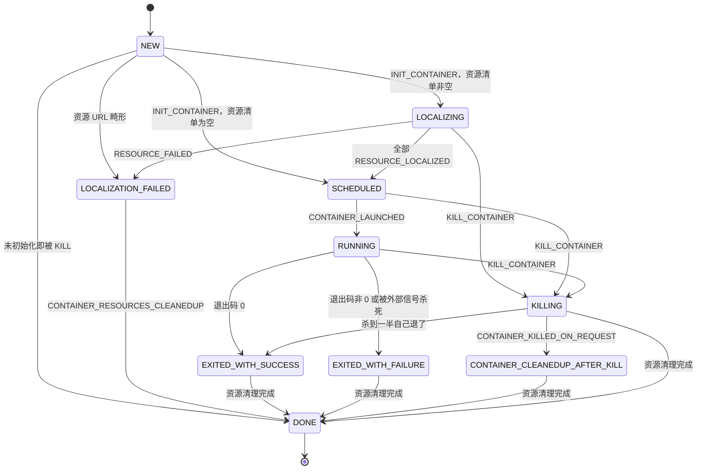
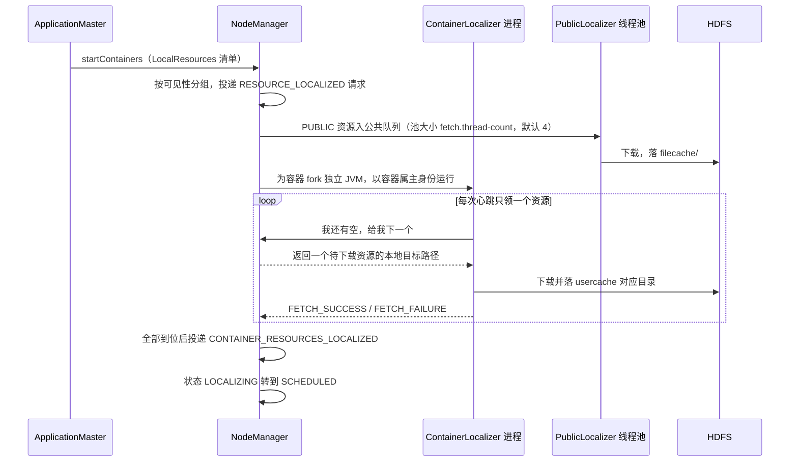
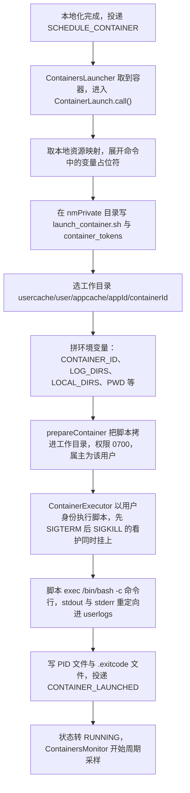
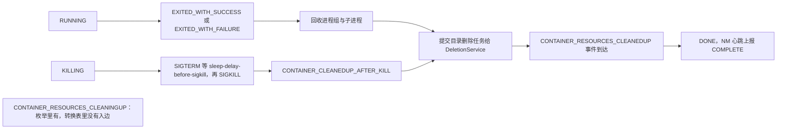
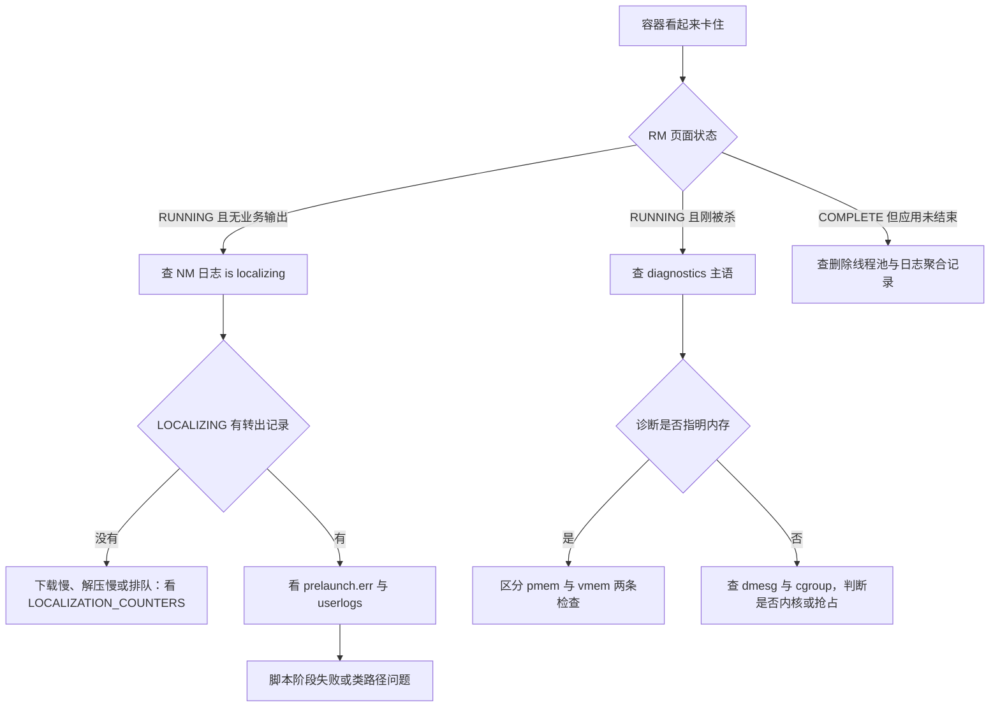

# Container 生命周期——从资源申请到进程启动的完整调用链

**摘要：**

一个容器跑了七八秒才吐出第一行日志，而 ResourceManager（RM）页面上从第一秒起就写着 `RUNNING`。这三个字骗过几乎所有第一次排查启动慢的人：它掩盖了后面还有 `LOCALIZING` 的下载、`SCHEDULED` 的排队、`EXITED_WITH_*` 之后的清理。本文不按"RPC 调用顺序"复述流程，而是把容器一生中真正存在的状态摊开，逐个数清楚谁持有它、什么事件推动它、在界面上能不能看见它。先给出计数口径：NM 侧十个状态加 RM 侧两个 NM 完全不存在的状态，合计十二个；再把其中最容易被跳过的一段——本地化——拆到源码级，说明 `LocalResource` 的四要素如何构成缓存键、PUBLIC 与 APPLICATION 两棵树为什么走两条完全不同的下载通道、`yarn.nodemanager.localizer.cache.target-size-mb` 为什么只算一半资源。随后是起进程的七个动作、`EXITING` 为什么必须单独存在，以及 137 这个退出码在 YARN 里怎样被翻译成负数状态码。最后给出三张判据表：本地化失败的五个原因、退出码对照、「从现象到该看哪个日志」。通篇落点在学习一件事：状态机的价值不在于状态多，而在于每个状态都能被观测到。

---

## 第 1 章 十二个状态，两台机器

### 1.1 三个字掩盖了六个阶段

先把场景摆出来。某个 Spark 作业的 Executor 容器，从 RM 分配出去到第一行 GC 日志落盘，中间隔了六秒多；这六秒里 AM 侧只看到容器"分配到了"，RM 侧只看到容器 `RUNNING`，两边都不报错，作业就那么晾着。等到六秒后才看见日志，于是结论往往是"机器慢"或者"JVM 启动慢"。

这里的问题出在**观测口径**上，不在系统本身。YARN 对外暴露的容器状态只有三个值：`NEW`、`RUNNING`、`COMPLETE`，定义在 `org.apache.hadoop.yarn.api.records.ContainerState` 这个面向应用的枚举里。而 NodeManager（NM）内部维护的是另外一套枚举 `org.apache.hadoop.yarn.server.nodemanager.containermanager.container.ContainerState`，Hadoop 3.3.6 里共十七个值。RM 侧还有第三套 `RMContainerState`，九个值。三套枚举同名不同源，同名不同义。

`ContainerImpl.getCurrentState()` 这个方法是三套口径之间的收口：除 `DONE` 映射成 `COMPLETE` 之外，`NEW`、`LOCALIZING`、`LOCALIZATION_FAILED`、`SCHEDULED`、`PAUSED`、`RESUMING`、`RUNNING`、`RELAUNCHING`、`REINITIALIZING`、`REINITIALIZING_AWAITING_KILL`、`EXITED_WITH_SUCCESS`、`EXITED_WITH_FAILURE`、`KILLING`、`CONTAINER_CLEANEDUP_AFTER_KILL`、`CONTAINER_RESOURCES_CLEANINGUP`、`PAUSING` 全部映射成 `RUNNING`。也就是说，一个进程已经死透、目录还在删的容器，在 RM 的眼里依然是 `RUNNING`。这不是粗糙，而是刻意：API 层的语义只承诺"这个容器占着资源"和"这个容器不再占资源"，中间的过程属于 NM 内部事务。

| 观测层 | 枚举 | 取值数 | 谁看它 | 粒度代价 |
|---|---|---|---|---|
| 应用 API | `org.apache.hadoop.yarn.api.records.ContainerState` | 3 | AM、RM UI、REST | 只有占资源与不占资源两种，中间态全部折叠 |
| NodeManager | `...nodemanager.containermanager.container.ContainerState` | 17 | NM 内部状态机 | 精确到下载、启动、清理每一步，但只在 NM 进程里 |
| ResourceManager | `...rmcontainer.RMContainerState` | 9 | 调度器、RM UI | 精确到账本口径，完全不知道 NM 里发生到哪 |

三者之中，只有中间那套是真正的执行状态。所以本文的计数口径选它，再加上 RM 侧两个 NM 里根本不存在的状态——`ALLOCATED` 与 `ACQUIRED`，这两个状态回答的是"资源记账"，NM 那边还没有容器对象。NM 侧十个位置加 RM 侧两个，是本篇标题所说的十二个；十一个 NM 枚举值里退出成功与退出失败合占一行，所以是十二行而不是十三个。

### 1.2 十二个状态的一览

下表是全篇骨架。第三列是持有者，第四列是推动它转换的事件，第五列写清"在外界眼里是什么样"，后文各章依次展开。

| # | 称呼 | 枚举值 | 持有者 | 进入触发 | 外界可见 |
|---|---|---|---|---|---|
| 1 | 建档 | `NEW` | NM | AM 的 `startContainers` 到达、Token 验过 | `RUNNING` |
| 2 | 拉资源 | `LOCALIZING` | NM | 资源清单非空，且资源尚未落在本地 | `RUNNING` |
| 3 | 待启动（旧称 `LOCALIZED`） | `SCHEDULED` | NM | 最后一个 `RESOURCE_LOCALIZED` 到齐 | `RUNNING` |
| 4 | 运行中 | `RUNNING` | NM | `CONTAINER_LAUNCHED`，即 `exec` 成功 | `RUNNING` |
| 5 | 已退出（旧称 `EXITING`） | `EXITED_WITH_SUCCESS` / `EXITED_WITH_FAILURE` | NM | 进程退出，退出码落到 `.exitcode` 文件 | `RUNNING` |
| 6 | 清理中 | `CONTAINER_RESOURCES_CLEANINGUP` | NM | 3.3.6 转换表里没有入边，见 5.1 说明 | `RUNNING` |
| 7 | 收尾 | `DONE` | NM | `CONTAINER_RESOURCES_CLEANEDUP` | `COMPLETE` |
| 8 | 正在杀 | `KILLING` | NM | `KILL_CONTAINER`，来自 AM、RM 抢占或超限 | `RUNNING` |
| 9 | 已杀干净 | `CONTAINER_CLEANEDUP_AFTER_KILL` | NM | `CONTAINER_KILLED_ON_REQUEST` | `RUNNING` |
| 10 | 本地化失败 | `LOCALIZATION_FAILED` | NM | `RESOURCE_FAILED` 或资源描述畸形 | `RUNNING` |
| 11 | 已分配 | `RMContainerState.ALLOCATED` | RM | 调度器在 NM 心跳中拍定 | NM 里尚无对象 |
| 12 | 已取走 | `RMContainerState.ACQUIRED` | RM | AM 的下一次 `allocate` 取走它 | 待发起 `startContainers` |

NM 枚举里另有 `RELAUNCHING`、`REINITIALIZING`、`REINITIALIZING_AWAITING_KILL`、`PAUSING`、`PAUSED`、`RESUMING` 六个，分别属于容器重试（`ContainerRetryPolicy`）与暂停恢复这两套较为少见的特性，它们不在这条主链上，本篇不摊开，只在讲到异常分支时点一句。第 6 行那个清理态需要单独说明：枚举里有它，3.3.6 的转换表里却没有指向它的边，它只出现在终态判定与 `ContainerSubState` 的映射中，属于状态机演进留下的壳。如果照着状态名去日志里搜却一次都搜不到，原因就在这里。

下面这张图把主链与异常分支画在一起。粗看是条直线，真正的复杂度都在分支的入口条件上。

### 1.3 为什么状态机要拆成两半

RM 和 NM 各自维护容器状态，看起来是重复，实际是两本不同的账。RM 记的是**账本**：这个容器占用了哪台机器的多少内存和 vCore、什么时候可以回收、能不能被抢占。NM 记的是**进程**：这个容器的 jar 下载到第几个字节、脚本写没写、`exec` 返回了什么、目录删完没有。

两本账的更新频率差了三个数量级。NM 这边一次本地化会连续产生几十条 `RESOURCE_LOCALIZED` 事件，一次启动会经历 `SCHEDULED`、`RUNNING` 两次跳转；RM 那边只关心"你把容器跑起来了没有"和"你退出时是什么结论"，所以它只有 `ALLOCATED`、`ACQUIRED`、`RUNNING`、`COMPLETED` 四个与执行相关的点，中间的信息全部通过 NM 心跳批量上报，抽象成 `NMContainerStatus`。

拆成两半的直接收益是**故障域隔离**：NM 进程内部的状态机可以写得繁琐，因为它只处理本机几百个容器，一次状态转移是一次内存里的事件投递；RM 的状态机必须写得极简，因为它要在一个事件循环里处理上万节点的账本。反过来看代价也很清楚：跨两个状态机的因果链断了，一个容器"卡住"的现象在 RM 侧只剩"资源被占着"，要还原真相必须去 NM 看。

### 1.4 旧名字与新名字

许多二手资料（包括十多年前那批分析 Hadoop 2.0 alpha 的博客）把主链记作 `NEW` → `LOCALIZING` → `LOCALIZED` → `RUNNING` → `EXITING` → `DONE`。这套名字在当时的枚举里确实存在，但在 Hadoop 3.3.6 的枚举里既没有 `LOCALIZED`，也没有 `EXITING`。

对应关系是这样：本地化完成后容器进入的是 `SCHEDULED`，语义是"资源齐了，等容器调度器给它排一次启动"，旧文档的 `LOCALIZED` 大体等同于此；进程退出后进入的是 `EXITED_WITH_SUCCESS` 或 `EXITED_WITH_FAILURE`，把旧文档含糊的 `EXITING` 按退出码一分为二；而旧文档里没有的 `CONTAINER_RESOURCES_CLEANINGUP`，在 3.3.6 的枚举里虽然存在，转换表里却没有给它留入口，这条线索留到第 5 章展开。本篇在讲旧名字时会标注"旧称"，在讲代码时一律用 3.3.6 的枚举名，避免读者拿着旧图去源码里搜索却搜不到。

这个改名本身也说明了一件事：`EXITING` 这个名字当年就带着含糊，它既想表达"进程在退出"，又想表达"退出后还要收拾"，一件事占一个状态，做不干净。3.x 的修正办法是按退出码拆成两个退出态，再把清理的完成与否交给事件去表达；代价是枚举膨胀到十七个值，收益是面对日志时能一句话分清"进程怎么死的"。

---

## 第 2 章 NEW 与入队：容器在 NM 上的第一秒

### 2.1 startContainers 到达之后

AM 拿着 RM 下发的 `ContainerToken` 与 `NMToken`，向目标 NM 发 `startContainers`。NM 侧的处理链是固定的四步：`ContainerManagerImpl` 先验 Token（HMAC 签名、有效期、容器 ID 与资源量是否与 Token 声明一致），通过后为每个容器创建 `ContainerImpl` 实例，投递 `INIT_CONTAINER` 事件，状态机从 `NEW` 起步。

`ContainerImpl` 的构造函数里做的事情值得留意：它从 `ContainerTokenIdentifier` 里取出应用提交者（`getApplicationSubmitter()`）作为容器的属主用户，把 `ContainerLaunchContext`（CLC）整个存下来，把资源量、优先级、诊断缓冲区上限一并记好。也就是说，一个容器在 NM 里的身份、权限、资源上限，全部来自 RM 签发的那张 Token，CLC 只提供"怎么启动"，不提供"能占多少"。这个分工是后面讲 `LOCALIZING` 权限问题时的基础。

状态机工厂的入口写在 `RequestResourcesTransition` 里，三个出口对应三种现实：

第一种，CLC 的 `LocalResources` 为空。这种情况在真实集群里不罕见——简单 shell 任务、完全依赖宿主机预置环境的容器都属于此类。此时 NM 直接调到 `SCHEDULED`，跳过整个本地化阶段。所以"所有容器都要本地化"是个错误印象，`LOCALIZING` 只在资源清单非空时才出现。

第二种，清单非空，且 `ResourceSet.addResources()` 成功。NM 把资源按可见性分组，投递 `ContainerLocalizationRequestEvent`，状态进 `LOCALIZING`，同时在日志里打一行 `Container container_xxx is localizing: [路径列表]`。这一行是排查启动慢的第一落点。

第三种，清单里的资源 URL 畸形——`URISyntaxException` 或 `IOException`。此时容器不进 `LOCALIZING`，直接 `LOCALIZATION_FAILED`，诊断信息里带异常栈。这类失败通常是 AM 侧拼错了 HDFS 路径（比如 scheme 写漏、端口拼错），与 NM 的健康状况无关，去 NM 日志里找 `Failed to parse resource-request` 即可认定。

### 2.2 Token 为什么能离线验证

NM 验证 `ContainerToken` 时并不回问 RM。RM 与 NM 共享一份由 `SecretManager` 体系维护的密钥（RM 侧是 `RMSecretManagerService`，NM 在首次向 RM 注册时取得），Token 本身就是一段用这份密钥做 HMAC 签名的载荷。NM 收到 `startContainers` 后解出载荷，比对签名、比对 `ContainerTokenIdentifier` 里的容器 ID 与资源量是否与请求一致、比对有效期，三项全过才算验过。整个验证是一次本地 HMAC 计算，耗时在微秒级，不产生任何跨机调用。

这个设计要解决的问题是 RM 的可扩展性。如果每次启动容器都要回 RM 验一次，一个万节点集群的启动风暴会把 RM 打穿；把验证做成可离线计算，代价就转移到密钥管理上——密钥一旦轮换，所有在途 Token 同时失效。所以 YARN 的选择是"Token 短有效期 + 频繁签发"，而不是"密钥勤轮换"，这也解释了为什么长时间挂起的容器更容易踩到 Token 过期相关的失败：过期时间戳写在 `ContainerTokenIdentifier` 载荷里、由 RM 签发时定下，AM 拿到容器后拖太久才发起启动，NM 这一侧的第三项校验就会失败。

`NMToken` 是同一套机制，验的是 AM 对特定 NM 的访问权。两者都塞在 `Credentials` 里随 CLC 下发，最终落到容器工作目录的 `container_tokens` 文件中，供容器内的进程访问 HDFS 或与 NM 通信时使用。这一串动作解释了 `LOCALIZING` 失败时一个隐蔽原因：如果 Token 在本地化期间过期，localizer 以用户身份访问 HDFS 会失败，报错指向 token 无效或认证失败而不是网络超时，处置方向是查 AM 从取走容器到发起启动的间隔，而不是查 HDFS。

### 2.3 RM 侧的两个独占状态

`ALLOCATED` 与 `ACQUIRED` 是 NM 里根本不存在的状态，因为此时 NM 还没有这个容器的对象。区分它们只用问一句：容器被谁"按住"了。

调度器在 NM 心跳里决定把这个容器给某个应用，`RMContainer` 进 `ALLOCATED`，资源记账立刻生效——节点的可用内存减少、队列的已用额度增加。容器在这个状态等待 AM 的下一次 `allocate` 心跳把它取走；取走后进 `ACQUIRED`，AM 才拿到 `ContainerToken` 并开始向 NM 发 `startContainers`。

这两个状态之间藏着一个真实的故障形态：AM 取走了容器却迟迟不发启动请求，或者发出去之后 NM 一直没回音，资源就被"持有但不用"。RM 用 `yarn.resourcemanager.rm.container-allocation.expiry-interval-ms`（默认 600000，即十分钟）做兜底，超时后容器被 `EXPIRED` 回收。

| RM 侧的回收口 | 枚举 | 触发场景 | 观测特征 |
|---|---|---|---|
| 过期 | `EXPIRED` | 分配后长期未被取走或未被确认 | 集群空闲但队列额度不降，`yarn queue -status` 显示已用资源不回退 |
| 释放 | `RELEASED` | AM 主动释放（如动态缩容） | AM 侧有 `release` 调用，NM 侧完全没有容器记录 |
| 被杀 | `KILLED` | RM 侧终止（应用结束、抢占策略、管理员动作） | `ContainerExitStatus` 为负数，NM 侧可能有也可能没有对应目录 |

`EXPIRED` 最容易被误判成"调度器不干活"。判据很简单：看队列已用资源与节点实际运行容器的差额，差额持续存在且不随时间回落，就是有分配被悬空；此时去 RM 日志里搜 `Container ... expired` 一类记录，比盯着调度器算法看有效得多。

### 2.4 谁在动

到这一步为止，"谁在动"的答案很清楚：AM 发起、NM 的 `ContainerManagerImpl` 接收、`ContainerImpl` 的状态机在 NM 的 `AsyncDispatcher` 事件线程里推进，默认是一个线程按序消费事件，没有单独的定时任务。也正因为是事件驱动，`NEW` 状态的停留时间等于"Token 验证耗时"，通常是一毫秒级；如果观察到一个容器在 `NEW` 停留很久，唯一可能的解释是事件队列堵了——此时该看的是 NM 的事件队列长度，而不是这个容器本身。

---

## 第 3 章 LOCALIZING：被跳过的那一段

### 3.1 本地化做的是三件事，不是一件

通常把本地化说成"从 HDFS 下载文件"。下载只是第一件事。

第一件是**下载**：把 CLC `LocalResources` 里每个资源按 URL 拉取到本地。第二件是**校验**：核对文件大小与时间戳是否与声明一致，不一致要重新拉；`LocalResource` 的时间戳字段在这里起决定作用，它是缓存失效的唯一依据。第三件是**解压并建链接**：`LocalResourceType` 为 `ARCHIVE` 的资源（典型是 `tar.gz`、`.zip` 打包的 Python 虚拟环境、预编译框架目录）要在本地展开，展开后再在容器工作目录里建同名符号链接；`FILE` 类型则直接建链接，`PATTERN` 类型按通配符匹配一组文件后逐个建链接。

第三件事经常被低估。解压是纯 CPU 加磁盘写，与网络无关，一个小文件包解出几万个小文件的场景（`node_modules`、Python site-packages）在机械盘上能吃掉十几秒，而且这段时间在日志里表现为 `LOCALIZING` 迟迟不结束，看起来像"网络慢"，实际是磁盘随机写慢。判据是看 NM 本地盘 iowait 与 `LOCALIZING` 时长的相关性：网络慢则带宽曲线打满、iowait 不高；解压慢则带宽空闲、iowait 与 util 都高。

### 3.2 三个可见性，三棵树

`LocalResourceVisibility` 有三个取值，语义方向与直觉相反，值得逐字读一遍：`PUBLIC` 是全节点所有用户共享，`PRIVATE` 是同一用户的所有应用共享，`APPLICATION` 是同一应用的所有容器共享。三者落在 `yarn.nodemanager.local-dirs` 下三棵不同的目录树里。

| 可见性 | 本地路径（相对每个 local-dir） | 共享范围 | 清理时机 | 典型资源 |
|---|---|---|---|---|
| `PUBLIC` | `filecache/` | 全节点所有用户 | 引用计数归零后由缓存清理线程按 LRU 淘汰 | Hadoop 公共 jar、公共字典、公共二进制 |
| `PRIVATE` | `usercache/<user>/filecache/` | 同一用户的所有应用 | 同上，与 PUBLIC 共用一个目标容量 | 用户级公共配置、跨作业复用的依赖包 |
| `APPLICATION` | `usercache/<user>/appcache/<appId>/` | 同一应用的所有容器 | 应用结束即随应用目录整体删除 | 作业自己的 jar、作业配置、作业级归档 |

这三棵树在源码里对应三个 tracker：`ResourceLocalizationService` 里 `publicRsrc` 每个 NM 一个、`privateRsrc` 按用户名索引、`appRsrc` 按 `applicationId` 索引。第 5 章讲到缓存淘汰时，"只清 PUBLIC 和 PRIVATE"这条限制就很自然了——应用树的生命周期由应用本身管，缓存清理线程不该越界。

顺手纠正一个流传很广的说法：有些资料写"本地化缓存分 PUBLIC / APPLICATION / CONTAINER 三级"，把容器私有资源也算作一级缓存。`LocalResourceVisibility` 里没有 `CONTAINER` 这个取值，容器工作目录（`usercache/<user>/appcache/<appId>/<containerId>/`）不是缓存，它是运行现场：里面放 `launch_container.sh`、`container_tokens`、符号链接和用户进程的临时文件，容器结束后整个目录随应用或随容器删除，不参与缓存命中与淘汰。

### 3.3 缓存键的四要素

`LocalResource` 是 AM 声明"我需要这个文件"的载体，字段不多，但每一个都影响行为。

| 字段 | 作用 | 改它会怎样 |
|---|---|---|
| `resource`（URL） | 唯一确定源文件 | 换路径即视为全新资源，重新下载，旧路径下的副本等下轮淘汰 |
| `timestamp` | 判断本地副本是否仍有效 | 内容改了但时间戳没改，本地继续用旧副本；这是"改了 jar 不生效"的常见根因 |
| `type`（`FILE`/`ARCHIVE`/`PATTERN`） | 决定是否解压、如何建链接 | 同一 URL 从 `FILE` 改成 `ARCHIVE` 会生成不同缓存键，两套都留 |
| `visibility` | 决定进哪棵树、谁能共享 | 从 `APPLICATION` 提到 `PUBLIC` 能跨应用复用，但要求内容与调用方都够"公共" |

四个字段里前三个参与缓存键的计算（NM 侧封装成 `LocalResourceRequest` 作为 tracker 的 Map 键），`visibility` 不参与键，但决定这个键进哪一个 tracker。这个区分解释了两个常见现象：同一个 jar 被两个应用以 `APPLICATION` 声明，节点上会出现两份副本，因为它们在两棵树上；把其中一份改成 `PUBLIC` 后副本仍然只有一份新的，因为旧的两份还挂在各自的树上等淘汰。

`timestamp` 那一行值得多说一句。YARN 用**声明的时间戳**判断本地副本新鲜度，它不比对内容校验和。所以作业代码更新后如果重传路径没变、时间戳也没变（比如从本地打包时保留了原始 mtime，或者上游用 `-p` 参数拷贝），NM 会理直气壮地复用旧副本，表现为"改了代码没生效"。处置方式不是清缓存，而是在 AM 侧让资源 URL 带上版本目录或时间戳后缀，把失效逻辑交给路径。

### 3.4 两条完全不同的下载通道

这里是最容易被简化的地方。很多资料一句话带过"NM 起线程池下载"，实际有两条通道，机制差别很大。

`PUBLIC` 资源走 `PublicLocalizer`：这是 NM 进程内的一个线程池，池大小由 `yarn.nodemanager.localizer.fetch.thread-count`（默认 4）决定，线程名形如 `PublicLocalizer #0`。因为 PUBLIC 资源的属主不确定（任何用户都可能用它），只能由 NM 自己的身份下载，下载完落到 `filecache/`，权限设为全节点可读。

`PRIVATE` 与 `APPLICATION` 资源走 `ContainerLocalizer`：NM 为每个需要本地化的容器 fork 一个**独立 JVM 进程**，以该容器所属的 Linux 用户身份运行，JVM 参数由 `yarn.nodemanager.container-localizer.java.opts`（默认 `-Xmx256m`）控制，日志级别由 `yarn.nodemanager.container-localizer.log.level` 控制。这个进程启动后并不自己决定下什么，而是通过 RPC 连回 NM 的 `ResourceLocalizationService`（监听 `yarn.nodemanager.localizer.address`，默认 8040），反复问"下一个给我什么"。

为什么非要 fork 进程而不是起线程？因为权限。`usercache/<user>/` 必须以该用户身份创建和写入，否则容器进程（以用户身份运行）读不到自己该读的文件；用 NM 进程身份（通常是 `yarn`）下载再改属主，会绕过 Linux 的权限模型，在开启 `LinuxContainerExecutor` 的集群上直接踩到 `container-executor` 的权限校验。

图里那个 `loop` 是本篇最有实用价值的一个细节：**同一时刻只下载一个资源**。源码里对这段有明确注释，说明暂不支持单个 localizer 并发多下载。于是"高并发启动慢"的机理就清楚了：并发度并不由某个全局线程池决定，而是约等于"同时处于 `LOCALIZING` 的容器数乘以一"，再加上 PUBLIC 通道那 4 个线程。一批 200 个容器同时启动、每个容器要拉 3 个 APPLICATION 资源，理论上下载并发是 200，但同一节点上真正在写盘的是 200 个 JVM 进程——磁盘争抢、元数据锁、内存换页会把这 200 条流互相拖慢。

还有一个抑制重复下载的机制：同一个资源被 N 个容器同时请求时，tracker 用信号量 `tryAcquire` 抢占，只有一个容器拿到下载权，其余容器在 `LOCALIZING` 里等它的 `ResourceLocalizedEvent`。这是"同一资源在节点上只下载一次"的实现方式，也意味着缓存未命中时，等待时间被所有请求方共享——一个 300MB 的归档从 HDFS 拉下来要 4 秒，那这 4 秒里排队的 50 个容器全部一起等。

### 3.5 共享缓存的容量与淘汰

本地缓存不是无限的。`yarn.nodemanager.localizer.cache.target-size-mb` 默认 10240，即每个 NM 十吉字节。配置注释里有一句关键限定：这个目标容量**只算 PUBLIC 与 PRIVATE**，不含 `APPLICATION`。原因是应用级资源由应用生命周期兜底，容器结束、应用结束时它们自然被删，不需要缓存线程操心。

淘汰由 `LocalCacheCleaner` 执行，触发周期是 `yarn.nodemanager.localizer.cache.cleanup.interval-ms`（默认 600000，十分钟）。判定条件两条：引用计数为零（没有容器在用）、加入淘汰集合后按最近使用时间排序取超出目标容量的部分。这里用了一个 `LRUCacheHashMap` 做近期清理记录，避免同一批资源被反复选中。两点推论：其一，正在运行的容器不会因为缓存超限而丢资源，因为引用计数不为零；其二，缓存的实际峰值可以显著超过目标容量，因为清理是周期性的、不是实时的——把一个 300MB 归档在十分钟内分发到二十个不同应用（且都声明为 `PUBLIC`），峰值就是 6GB，目标容量拦不住。

`yarn.sharedcache.*` 那一套是另一层东西，别和节点内缓存混为一谈。共享缓存（Shared Cache）的设计是把 `PUBLIC` 资源再往上一层抬，落到 HDFS 上的一个共享区，让整个集群的节点不必各自从源站拉；它默认关闭（`yarn.sharedcache.enabled` 为 `false`），在 3.3.x 里仍属实验特性，配置与运维成本都不低。绝大多数集群实际依赖的是节点内的 `filecache/` 加"每个资源只下一次"的抢占机制，这也解释了为什么首次作业永远比后续作业慢。

### 3.6 本地化失败的五个原因

`LOCALIZING` 是唯一一个会"静默失败"的阶段——进程还没起来，用户看不到任何应用侧日志，只能从 NM 侧判断。下表按出现频率排列，每一条都给出可验证的判据。

| 原因 | 机理 | NM 日志里的样子 | 处置 |
|---|---|---|---|
| HDFS 上资源不存在或无权限 | 下载抛异常，localizer 上报 `FETCH_FAILURE`，tracker 投递 `RESOURCE_FAILED` | `Localizer failed for`、`failed for <资源>` 加异常栈；`FileNotFoundException` 或 `AccessControlException` | 校验 AM 拼的路径与 delegation token 的权限范围 |
| `local-dirs` 空间不足 | 选盘时找不到满足 `getEstimatedSize` 的目录，或写盘时报 `No space left on device` | `local path ... could not be found. Disks might have failed` | 扩容或增盘；先看 disk-health-checker 是否已把盘标坏 |
| 下载超时 | 客户端 socket 超时或 HDFS 侧慢，超过 `ipc.client` / `dfs.client.socket-timeout` 类上限 | `SocketTimeoutException`、`Failed to connect` 出现在 localizer 段 | 查 NameNode/DataNode 负载与该节点到 NN 的网络 |
| `usercache` 权限错 | 以用户身份写 `usercache/<user>/` 被拒，常见于目录属主被手工改过或 umask 异常 | `Permission denied`，指向 `usercache` 路径 | 停 NM 后修正属主与权限，NM 启动时会重建并校验这三棵树的权限 |
| 并发过高 | 不制造失败，只制造等待：抢占排队的容器长期停在 `LOCALIZING` | 没有错误行，只有大量 `is localizing` 迟迟没有后续 | 限流启动速率；把大归档改为 `PUBLIC` 或预置到本地 |

最后一行要单独说明，因为它经常被误列为"失败原因"。并发超限在 YARN 里不触发错误码，它是排队。真正会因此"失败"的是 AM 侧：容器启动看门狗（各类框架自己的超时，MapReduce 侧是任务超时，Spark 侧是 Executor 启动超时）等不及，把容器杀掉重试，于是在 RM 侧看到的是容器被杀、在 NM 侧看到的是本地化从未完成。判据就是这种错位：RM 报 `KILLED` 或 `FAILED`，NM 报 `LOCALIZING`。

### 3.7 观测本地化的三个原生钩子

不装任何监控插件，NM 也留了三个可以直接读的口子。

第一是日志时间差。`Container container_xxx is localizing: [...]` 这行与随后 `transitioned from LOCALIZING to SCHEDULED` 那行之间的时间差，就是一次本地化的完整耗时，含排队。

第二是环境变量。`ContainerLaunch.sanitizeEnv` 会把 `LOCALIZATION_COUNTERS` 写进容器环境，值是五个整数：`BYTES_MISSED,BYTES_CACHED,FILES_MISSED,FILES_CACHED,MILLIS`。MapReduce 框架把它们转成 `LOCALIZED_BYTES_MISSED` 一类计数器，Spark 侧的 Task 也能读到同一个环境变量。命中率算得出来：`FILES_CACHED / (FILES_CACHED + FILES_MISSED)`。

第三是 NM 指标。`ContainerImpl` 内部记了 `localizationDuration` 与 `localizationComplete`，并通过 `ContainerStartMonitoringEvent` 交给监控组件；每个容器的统计还会汇总到 NM 的 `localizationCacheHitMiss`。这三个指标走 NM 的 metrics2 体系发布，接上 Graphite 或自建导出器就能得到时间序列，不需要碰业务代码。

### 3.8 一次启动的时间拆解

把"分配完成到进程起来"这段按阶段拆开，各段的量级差异极大，而它们在外界看起来完全一样。

| 阶段 | 典型耗时（示例推算） | 主要成本 | 判据 |
|---|---|---|---|
| RM 分配后等 AM 心跳取走 | 0 到 1 秒 | AM 心跳间隔 | `ACQUIRED` 与 `ALLOCATED` 的时间差 |
| NM 校验 Token | 微秒级 | 本地 HMAC 计算 | 只看事件队列是否拥堵 |
| 缓存命中，只建符号链接 | 毫秒级 | 元数据操作 | `LOCALIZATION_COUNTERS` 里 `FILES_CACHED` 大 |
| 缓存未命中，下载大归档 | 数秒到数十秒 | 网络带宽与源端读取 | `FILES_MISSED` 与 `BYTES_MISSED` 大 |
| 归档解压并铺开小文件 | 数秒到十数秒 | 磁盘随机写与 inode 操作 | 带宽空闲但 iowait 高 |
| 排队等同一资源的下载权 | 与首个下载者同长 | 抢占信号量 | 同一时刻多个容器一起从 `LOCALIZING` 转出 |
| 写脚本、切用户、exec | 数百毫秒 | 磁盘同步写与权限切换 | 脚本阶段报错看 `prelaunch.err` |
| JVM 启动到 main 执行 | 1 到 3 秒 | 类加载与 JIT 预热 | 容器内第一行业务日志的时间戳 |

量化一下这段能占多少启动时间。假设一个节点上批量启动 8 个容器，每个容器都要一个 300MB 的应用归档，节点到最近 DataNode 的读带宽按 80MB/s 估算，则该资源首次下载约 3.75 秒；由于抢占机制，8 个容器共享这一次下载，全部 8 个容器的 `LOCALIZING` 都接近 4 秒。同一批容器的 JVM 冷启动在 1 到 3 秒之间。也就是说本地化吃掉了启动时间的一半以上，而这段时间在 RM 页面上一片安静。以上数字是示例推算，真实值取决于带宽、缓存命中率与解压量，但量级关系是稳定的：**本地化是首个时间黑洞**，冷缓存时尤其如此。

这张表还有一个用法：它把"启动慢"这个模糊抱怨变成可分类的问题。耗时集中在第 4 与第 6 行，是缓存与分发问题；集中在第 5 行，是打包方式问题（几万个小文件比一个大归档贵得多）；集中在第 8 行，才是应用自己的启动逻辑问题。三类问题的处置手段完全不同，先分类再动手，比笼统加内存或加节点有效。

---

## 第 4 章 SCHEDULED 到 RUNNING：起进程的七个动作

### 4.1 从"资源齐了"到"脚本在跑"

本地化完成只意味着文件到位，离进程起来还隔着七个动作。这七个动作构成了 `ContainerLaunch.call()` 的主干，也是 `SCHEDULED` 到 `RUNNING` 之间真实发生的事。

图里 `D` 与 `G` 两个节点容易混：脚本**先写在 nmPrivate 私有区**，校验通过后才被拷到用户可见的工作目录。私有区里的路径是 `nmPrivate/<appId>/<containerId>/launch_container.sh`，权限模式在代码里写死为 `0700`；拷贝动作由 `ContainerExecutor.prepareContainer` 完成，拷贝后的属主是容器所属用户。这样容器用户只能看到属于自己那一份可执行脚本，既看不到别的容器脚本，也无法在脚本被创建之后篡改内容——`LinuxContainerExecutor` 会校验脚本所有者必须是 NM 用户，否则拒绝执行。审计与防注入这两件事，靠的就是"先写私有区、后拷工作目录"这个顺序。

### 4.2 脚本里到底有什么

`launch_container.sh` 是排查启动失败的第一现场，而它自己就是一个 shell 脚本加一组 `export`。生成的脚本开头固定 `#!/bin/bash` 与 `set -o pipefail -e`——后者意味着一行命令失败整个脚本立即退出，所以"脚本里前一条 export 出错"这种事故不会静默淹没。

环境变量分两类。第一类是 NM 强制写入、容器不可覆盖的，如下表；第二类是 AM 在 CLC 里提供的（`JAVA_HOME`、`CLASSPATH`、各类 `-D` 参数），NM 按依赖顺序拓扑排序后写成 `export`，确保引用关系正确——`CLASSPATH` 引用 `HADOOP_CONF_DIR` 这类链式引用能正确展开，靠的就是这个排序。

| 变量 | 值 | 排查用途 |
|---|---|---|
| `CONTAINER_ID` | `container_<ts>_<seq>_<attempt>_<id>` | 与 NM 日志、RM 页面上的容器号对齐 |
| `NM_HOST` / `NM_PORT` / `NM_HTTP_PORT` | 本节点地址与端口 | 确认容器连的是哪台 NM（IP 漂移时尤其有用） |
| `LOCAL_DIRS` | 该应用在各 local-dir 下的 appcache 目录，逗号分隔 | 校验多盘是否都被用上，只有一项说明只配了一个盘 |
| `LOCAL_USER_DIRS` | 该用户在各 local-dir 下的 usercache 目录 | 排查跨盘写入与权限 |
| `LOG_DIRS` | 该容器在各 log-dir 下的日志目录，逗号分隔 | stdout 与 stderr 的实际落点 |
| `PWD` | 容器工作目录 `usercache/<user>/appcache/<appId>/<containerId>` | 相对路径类报错的基准目录 |
| `USER` / `LOGNAME` / `HOME` | 容器属主与家目录 | `Permission denied` 时先确认身份 |
| `LOCALIZATION_COUNTERS` | 五个整数的本地化统计 | 换算缓存命中率 |
| `JVM_PID` | `$$`，即脚本自身的 PID | 与 `container_xxx.pid` 对照 |

`LOCAL_DIRS` 与 `LOG_DIRS` 都是逗号分隔的多值，这个设计直接对应多盘配置：一个节点配四块盘跑 local-dirs，`LOCAL_DIRS` 里就有四项，用户程序如果要写临时文件，应该在这四项里轮询或随机选，而不是固定写死第一项——否则四块盘里只有一块被写满，其余三块闲置，而 disk-health-checker 会因为那一块到 90% 把整台节点标记为不健康。

### 4.3 exec、PID 与退出码

脚本最后一行是 `exec /bin/bash -c "<AM 给的完整命令行>"`，并用 `1>` 与 `2>` 把 stdout 与 stderr 分别重定向到 `<log-dir>/<appId>/<containerId>/stdout` 与 `stderr`。用 `exec` 而不是直接调用，是为了让脚本进程被命令进程替换掉，不留一个中间的 shell 父进程——这样 NM 拿到的 PID 就是真正的 JVM 进程 PID，杀进程时不会出现"杀了 shell、JVM 变孤儿"的情况。

PID 落在 `nmPrivate/<appId>/<containerId>.pid`，进程退出后退出码落在它旁边、文件名再缀一个 `.exitcode` 后缀——即 `container_<id>.pid.exitcode`。NM 通过 `reapContainer` 读这两个文件：先用 PID 判断进程是否还活着，再等 `.exitcode` 出现，等不到就按 `yarn.nodemanager.container-executor.exit-code-file.timeout-ms`（默认 2000 毫秒）超时并记为 `LOST`。这条路径解释了两种奇怪现象：容器明明退出了但 NM 一直显示 `RUNNING`，通常是 `.exitcode` 没写出来（比如进程被 `SIGKILL` 打断在写文件之前）；容器退出码在应用侧显示为 `154`，那不是应用的错，是 NM 没拿到退出码。

### 4.4 三种 ContainerExecutor

`ContainerExecutor` 是"怎样把脚本变成进程"的抽象，3.3.x 里有三种可直接选用的实现，另有一族容器运行时叠加在 `LinuxContainerExecutor` 之上。

| 实现 | 身份 | 隔离 | 适用场景 | 代价 |
|---|---|---|---|---|
| `DefaultContainerExecutor` | 全部容器以 NM 进程用户（通常是 `yarn`）运行 | 无文件系统与用户隔离 | 单用户测试集群、开发环境 | 多租户下等于没有权限边界，一个容器能读另一个用户的文件 |
| `LinuxContainerExecutor` | 以容器属主的 Linux 用户运行，经 setuid 的 `container-executor` 切换 | 用户隔离，加 CGroups 做 CPU 与内存硬限制 | 生产集群的唯一合理选择 | 需要维护 `container-executor` 的属主与 setuid 位，需要宿主机上存在对应用户 |
| `WindowsSecureContainerExecutor` | Windows 下的等价实现 | 用户隔离 | Windows 集群 | 生态与运维支持都弱 |
| Docker / runc / javasandbox 运行时 | 叠加在 LCE 之上，先切用户再进容器 | 文件系统、网络、PID 空间隔离 | 需要自定义运行时或强隔离的场景 | 镜像分发、存储驱动、GPU 直通都要单独运维 |

`DockerContainerExecutor` 这个名字在很多资料里还能看到，它已经被移除，取而代之的是 `DockerContainerRuntime`（配置前缀 `yarn.nodemanager.runtime.linux.docker.*`），并且必须与 `LinuxContainerExecutor` 搭配使用，通过 `yarn.nodemanager.runtime.linux.allowed-runtimes` 白名单启用。若还按"三种 Executor 并列"来理解，照着配 `yarn.nodemanager.container-executor.class` 会直接起不来——`DockerContainerExecutor` 这个类名在 3.3.x 里根本不存在，能配的只有运行时白名单。

`LinuxContainerExecutor` 的 setuid 切换细节属于资源隔离话题，`[[07 YARN 资源隔离——CGroups 与 Linux Container Executor 的工程实现]]` 里有完整的权限位与 CGroups 挂载链路，这里只留一个生产判据：集群多租户、宿主机上跑不同业务方的作业、需要按容器维度限内存，三者命中任何一个就必须上 LCE；只有一个运维团队、作业彼此可信、且宿主机用户就是 `yarn`，才可以用默认实现省掉那套权限配置。

### 4.5 RUNNING 之后 NM 还在做什么

`CONTAINER_LAUNCHED` 之后状态进 `RUNNING`，NM 的活并没有结束。`ContainersMonitor` 开始按 `yarn.nodemanager.container-monitor.interval-ms` 周期采样每个容器进程树的物理内存与虚拟内存，与容器申请的资源量比对；超限则投递 `KILL_CONTAINER`，并在诊断信息里写下那句标志性的 `is running beyond physical memory limits`。物理内存检查由 `yarn.nodemanager.pmem-check-enabled`（默认 `true`）控制，虚拟内存检查由 `yarn.nodemanager.vmem-check-enabled`（默认 `true`）与 `yarn.nodemanager.vmem-pmem-ratio`（默认 2.1）共同控制。

这一段属于监控范畴，但在本篇的状态机语境里有一个必须点出的后果：**超限走 `KILLING` 分支**，不是 `EXITED_WITH_FAILURE`。所以一个因为 OOM 被杀的容器，在 NM 侧的状态序列是 `RUNNING` → `KILLING` → `CONTAINER_CLEANEDUP_AFTER_KILL` → `DONE`，而不是很多人以为的直接退出。由此产生的诊断信息落在 `KILLING` 那一步，`diagnostics` 里写的是 `running beyond physical memory limits` 加当时的使用量，这是判断"是不是内存超限"最直接的证据。

---

## 第 5 章 EXITING：进程死了，容器还没完

### 5.1 为什么要单独一个状态

进程退出与容器结束之间隔着一串清理动作：回收进程组（避免子进程变孤儿继续占资源）、删除容器工作目录、触发日志聚合、释放资源映射、减引用计数。任何一步慢，容器就卡在那里。旧文档把这段统称 `EXITING`，3.x 把它按退出码拆成 `EXITED_WITH_SUCCESS` 与 `EXITED_WITH_FAILURE` 两个态，原因很直接：退出码是唯一能区分"正常做完"与"出错退出"的信息，含糊的 `EXITING` 承载不了。至于清理本身，3.x 在枚举里留了一个 `CONTAINER_RESOURCES_CLEANINGUP` 想表达"目录还没删完"，但转换表里没有为它安排入口，真正标记完成的是 `CONTAINER_RESOURCES_CLEANEDUP` 这个事件。所以"进程已死、目录未清"这个窗口在 3.3.6 里是可观测的，只是靠事件与日志，不靠状态名。

图中 `D` 到 `E` 那一跳是异步的：删除动作不在退出线程里做完，而是提交给 `DeletionService`，由它的线程池慢慢做，做完才投递 `CONTAINER_RESOURCES_CLEANEDUP`。这就是"卡在退出"的物理原因——不是容器有什么没做完，是删除任务在排队。孤立在左下角的 `K` 是那个没有入边的清理态，画出来只为提醒它存在。

### 5.2 删除是一支有界线程池

`yarn.nodemanager.delete.thread-count` 默认 4。四个线程处理全节点所有容器的目录删除（本地目录、日志目录、聚合后的临时目录都在其中）。注意配置项的真名是 `delete.thread-count`，不是某些资料里写的 `delete.threads`，写错名字不会报错，只会静默用默认值 4。

一笔吞吐量估算，用于说明它什么时候会成为瓶颈。每个容器工作目录里主要不是大数据，而是几十个字节到几 KB 的脚本、Token、符号链接和两三个日志文件，一次 `rm -rf` 在本地盘上通常只要几毫秒到二十毫秒。按每次 10 毫秒、四线程算，理论吞吐约 400 个目录每秒。这个数字看着很宽裕，于是问题往往出在两头：如果 `local-dirs` 落在网络存储（NFS、某些分布式文件系统挂载）上，单次 unlink 的延迟可能到几十毫秒，吞吐掉到几十个每秒；如果一场作业一次性结束上千个容器，删除任务的排队深度会瞬间到千级，`DONE` 的时间被推到几十秒之后。以上为示例推算，但两个放大因子是确定的：**目录所在存储的延迟**与**容器结束的集中程度**。

由此得到一条调参判据：批量作业频繁、单节点容器数上百的场景，把 `delete.thread-count` 调到 8 到 16 是合理的；调高它的代价是删除时的磁盘随机 I/O 与元数据争抢会影响到正在运行的容器，所以不应超过本地盘数的两倍。想"留着现场看"的场景调低它没有意义，那种延迟由 `yarn.nodemanager.delete.debug-delay-sec`（默认 0）控制。

### 5.3 退出码的两级翻译

这是全篇最容易出错的一节，因为没有两次翻译的说法，很多排错就卡在"我明明看到 137，为什么 YARN 说是 -102"。

第一级是**进程级**：JVM 被信号杀死时 shell 返回 `128 + 信号编号`，于是 `SIGKILL`（9）对应 137，`SIGTERM`（15）对应 143。`ContainerExecutor.ExitCode` 里因此有三个常量：`SUCCESS(0)`、`FORCE_KILLED(137)`、`TERMINATED(143)`，外加一个 `LOST(154)` 表示 NM 没能拿到退出码。

第二级是**YARN 级**：NM 把退出原因翻译成 `ContainerExitStatus` 的负数状态码再上报给 RM 与 AM。这套码表才是诊断的主语。

| 进程侧现象 | 退出码 | YARN 侧状态码 | 语义 | 判据 |
|---|---|---|---|---|
| 正常结束 | 0 | `SUCCESS` (0) | 容器成功 | 应用侧日志有正常收尾 |
| 收到 SIGTERM 后退出 | 143 | 视来源而定 | AM 或 RM 请求停止 | diagnostics 含 `killed on request` 或 `killed by the ApplicationMaster` |
| 收到 SIGKILL 后退出 | 137 | `ABORTED` -100 或 `KILLED_BY_*` -105 到 -108 | 被框架杀掉，或宿主机 OOM killer 下手 | 见下节四步判定 |
| 应用自身异常退出 | 1 或其他非零 | 原样上报 | 业务代码错误 | 应用 stderr 有异常栈 |
| 超出物理内存 | 137 | `KILLED_EXCEEDED_PMEM` -104 | NM 的监控线程主动杀 | diagnostics 含 `beyond physical memory limits` |
| 超出虚拟内存 | 137 | `KILLED_EXCEEDED_VMEM` -103 | NM 的虚拟内存检查主动杀 | diagnostics 含 `beyond virtual memory limits` |
| 磁盘被判坏 | 不适用 | `DISKS_FAILED` -101 | local-dirs 或 log-dirs 大面积失效 | NM 日志有 disk health 报告 |
| 被抢占 | 不适用 | `PREEMPTED` -102 | 调度器抢占 | RM 侧有抢占记录 |
| NM 未取到退出码 | 不适用 | `LOST` 154 | 进程消失但文件没写成 | 容器目录缺 `.exitcode` |

这张表的读法要注意列的对齐关系：左两列是操作系统层面的事实，中间一列是 YARN 翻译后的语义，右边两列才是判据。同一个 137 可以映射到四种状态码，所以看到状态码反推退出码是通的，看到退出码直接断言原因则不成立。

还有一处细节会让诊断凭空消失：`diagnostics` 缓冲区有大小上限，`yarn.nodemanager.container-diagnostics-maximum-size` 默认 10000 字符，超出后从头部截断。容器开启重试（`ContainerRetryPolicy`）时，每次失败都会往里追加一段，最早那次失败的诊断最先被挤掉，而"最早为什么失败"往往才是根因。要看全量现场，得同时抓 NM 日志里的诊断落盘记录，不能只信容器详情页那一栏。

### 5.4 137 到底是不是 OOM

137 只是一个事实：进程收到了 `SIGKILL`。谁发的、为什么发，它一个字都没说。可能是 NM 因为超出物理内存杀它，可能是 NM 因为超出虚拟内存杀它，可能是 AM 主动 `stopContainer` 时先 `SIGTERM` 再补一刀，也可能是**宿主机内核的 OOM killer** 看容器不顺眼把它干掉——最后这种与 YARN 完全无关，YARN 只是被动地看到一个 137。

四步判定，按顺序做，每一步都能排除一类原因：

第一步看 `diagnostics`。RM 页面容器详情里那段文字，或者 `yarn logs` 头部，只要出现 `running beyond physical memory limits`，就是 NM 的物理内存检查干的；出现 `running beyond virtual memory limits`，是虚拟内存检查干的；出现 `Container killed by the ApplicationMaster`，是 AM 主动的；出现 `Killed by external signal`，是外部信号。四句话对应四种主语，一步就能定调。

第二步看 NM 日志的 `KILLING` 段。搜索容器 ID，看 `transitioned from RUNNING to KILLING` 前后有没有监控线程的日志，以及 `container-killed` 一类的审计记录。如果 NM 侧完全没有杀它的记录，那 YARN 是旁观者。

第三步看宿主机的内核日志。`dmesg -T | grep -i "killed process"` 或 `journalctl -k` 里搜容器主进程的 PID，内核 OOM killer 会留下带内存峰值的记录。这条线索是唯一能区分"YARN 杀"与"内核杀"的证据，而两者的处置完全不同：前者要调容器内存配额，后者要看宿主机整体内存水位（通常是混部或 NM 配置的内存上限超过了物理内存）。

第四步看 cgroup。如果开了 `LinuxContainerExecutor` 加内存 cgroup，读该容器的 `memory.events`（cgroup v2）或 `memory.oom_control`（v1），`oom_kill` 计数是否增长能直接回答"是不是撞到了 cgroup 上限"。cgroup 杀与 NM 用户态杀的差别在于：cgroup 是内核在分配那一刻就拒绝，进程来不及记日志；NM 用户态杀是先记录再动手，所以日志里有一句诊断。

顺带一句虚拟内存检查。`yarn.nodemanager.vmem-check-enabled` 默认是 `true`，而 JVM 在启动时会预留远大于堆的虚拟地址空间，`-Xmx4g` 的进程 VSZ 常见到十几 GB，按 2.1 的 `vmem-pmem-ratio` 算，申请 4GB 内存的容器虚拟内存上限是 8.4GB，于是容器一启动就超限被杀，现象是"还没输出任何日志就被 137"。这类事故的典型特征是 NM 诊断明确写着 `beyond virtual memory limits` 而物理内存用量很低，处置是关掉虚拟内存检查、保留物理内存检查——两个开关必须分开看，这是 YARN 里最容易被一起关掉的组合。

---

## 第 6 章 磁盘、日志与配置：把状态机落到盘上

### 6.1 多盘与磁盘健康

`yarn.nodemanager.local-dirs` 支持逗号分隔的多个路径，生产集群的常规做法是每块数据盘挂一个目录。多盘的价值不只是容量：`LocalDirsHandlerService` 在选盘时按可用空间与健康状态挑选，使得本地化与容器工作目录能分散到不同盘上，减少单盘 IO 争抢。

磁盘健康由 `yarn.nodemanager.disk-health-checker.*` 一族控制，判据是两条：单盘使用率超过 `max-disk-utilization-per-disk-percentage`（默认 90.0），或可用空间低于 `min-free-space-per-disk-mb`（默认 0，即不启用），该盘被标记为坏盘；健康盘占比低于 `min-healthy-disks`（默认 0.25，即至少四分之一目录可用）时，整台 NM 上报 `UNHEALTHY`。`UNHEALTHY` 的后果不是停机，而是 RM 不再往这台节点分配新容器——既有容器继续跑，于是节点上的容器慢慢结束、节点慢慢变空，表现为"集群资源还在但排不进新任务"。判据是 `yarn node -list -states` 里该节点状态变为 `UNHEALTHY`，同时 NM 日志里有 disk health 报告。

这里有一条与本地化直接相关的链路：`ContainerLaunch.call()` 在开始前会检查 `dirsHandler.areDisksHealthy()`，不健康则直接以 `ContainerExitStatus.DISKS_FAILED`（-101）失败，连脚本都不写。所以"本地化一直失败但 HDFS 通"的现象，先看磁盘健康，再看权限。

### 6.2 日志三个位置

容器的日志不在一处，而是三层，查错顺序与它们的因果顺序相反：先看最下游的现象，再回溯到上游的原因。

| 位置 | 内容 | 什么时候看 | 关键行/文件 |
|---|---|---|---|
| `<local-dirs>/.../appcache/<appId>/<containerId>/launch_container.sh` | NM 生成的启动脚本，含全部 export 与最终命令行 | 容器起不来、环境变量不对 | 脚本末行的 `exec /bin/bash -c` 与各段 `export` |
| `<log-dirs>/<appId>/<containerId>/` | `stdout`、`stderr`、`directory.info`、`prelaunch.out`、`prelaunch.err`（开启 debug info 时还有脚本副本） | 进程起来了但行为异常 | `stderr` 的异常栈；`directory.info` 的目录清单 |
| NM 的 `hadoop-yarn-nodemanager-<host>.log` | 状态转移、本地化、Token 校验、杀死原因 | 容器没起来、启动慢、被杀 | `transitioned from A to B`、`is localizing`、`is running beyond` |
| RM 的 `hadoop-yarn-resourcemanager-<host>.log` | 分配、过期、抢占、应用生命周期 | 分配层面的问题 | `Container ... expired`、`Assigning container` |

`prelaunch.out` 与 `prelaunch.err` 是脚本层的中间文件，很多人不知道：脚本在执行用户命令行之前，自身的输出走这两个文件，用户命令行的输出走 `stdout` 与 `stderr`。所以如果 `stdout` 是空的而容器已经退出，那么脚本阶段就失败了，这时该看 `prelaunch.err`；如果 `prelaunch.*` 正常而 `stdout` 空，才是用户命令自己没输出。

日志清理依赖两套机制，别记反：日志聚合开启时，容器结束即上传到 HDFS，本地按 `yarn.log-aggregation.enable-local-cleanup`（默认 `true`）删除；日志聚合关闭时，本地日志按 `yarn.nodemanager.log.retain-seconds`（默认 `3 * 60 * 60`，即三小时）保留，由 `yarn.nodemanager.log.deletion-threads-count`（默认 4）的线程池清理。所以"三小时"这个数字在开启聚合的集群里根本不生效——不少运维笔记把它当成通用默认值，于是在聚合集群上按三小时去等日志被清，永远等不到，因为 NM 早就把本地副本删了。

### 6.3 从现象到该看哪个日志

下面这张表按"你看到什么"索引，不按"系统有什么"索引，目的是把排查第一步固定下来。表前的那张决策树把入口再收窄一层：先分清容器是根本没起来、起了一半，还是起来了才出事。

| 你看到的现象 | 第一落点 | 关键判据 |
|---|---|---|
| 容器一直 `RUNNING`，应用无输出 | NM 日志 `is localizing` | `LOCALIZING` 未转 `SCHEDULED`，看是下载慢、解压慢还是排队 |
| 容器启动失败，应用侧无任何日志 | `prelaunch.err` | 脚本阶段就失败，多为权限或变量展开错误 |
| `stdout` 有栈但无业务输出 | `stderr` 与 `userlogs` 的 `directory.info` | 类路径缺文件、符号链接断了 |
| 容器被杀，退出码 137 | 诊断信息 + `dmesg` + cgroup | 四步判定（见 5.4） |
| 集群有空闲资源但任务排不进 | `yarn node -list -states` | 节点 `UNHEALTHY`，看磁盘健康报告 |
| 队列额度不降、任务不动 | RM 容器过期 | `ALLOCATED` 或 `ACQUIRED` 卡住，看 600 秒过期记录 |
| 作业结束后大批容器迟迟不消失 | NM 日志的删除与清理记录 | 删除线程池排队，看 `delete.thread-count` 与存储延迟 |
| 改了 jar 但行为没变 | 本地化缓存 | 时间戳未变导致复用旧副本，看 `LOCALIZATION_COUNTERS` 的 CACHED 计数 |

### 6.4 配置项与调节代价

| 配置项 | 默认值 | 调大 | 调小 |
|---|---|---|---|
| `yarn.nodemanager.localizer.fetch.thread-count` | 4 | PUBLIC 资源并发下载变快，代价是对 HDFS 与该节点网络的瞬时压力 | 冷启动更慢，但减少与业务 IO 的争抢 |
| `yarn.nodemanager.localizer.cache.target-size-mb` | 10240 | 命中率上升、重复下载减少，代价是本地盘被长期占用 | 命中率下降，冷启动变多，盘空间回收快 |
| `yarn.nodemanager.localizer.cache.cleanup.interval-ms` | 600000 | 清理更省 CPU，但峰值占用可能远超目标容量 | 清理更及时，代价是频繁扫描与删除 |
| `yarn.nodemanager.delete.thread-count` | 4 | 大批容器结束时排空快，代价是删除 IO 影响在跑的容器 | 排空慢，`DONE` 滞后，但运行期干扰小 |
| `yarn.nodemanager.log.retain-seconds` | 10800 | 本地留证更久，代价是 log-dirs 容量压力（仅聚合关闭时生效） | 排障窗口变短 |
| `yarn.nodemanager.disk-health-checker.min-healthy-disks` | 0.25 | 容忍更多坏盘（比例越低越宽松） | 更容易整节点 `UNHEALTHY` |
| `yarn.nodemanager.disk-health-checker.max-disk-utilization-per-disk-percentage` | 90.0 | 允许写更满，代价是写满后本地化直接失败 | 更早标坏盘，节点可用时间缩短 |
| `yarn.nodemanager.sleep-delay-before-sigkill.ms` | 250 | 给应用更多优雅退出时间，代价是杀死变慢、回收滞后 | 更快回收，代价是应用来不及刷盘 |
| `yarn.nodemanager.vmem-check-enabled` | true | 保留（默认即开）可拦住虚拟内存泄漏 | 关闭可避免 JVM 预留地址空间被误杀 |
| `yarn.nodemanager.local-cache.max-files-per-directory` | 8192 | 单目录文件多时减少哈希子目录层数 | 低于 37 时 NM 直接启动失败，属硬约束 |

最后一行那个 37 不是排版错误。`ResourceLocalizationService.validateConf` 在校验时会拒绝小于 37 的取值并抛出 `YarnRuntimeException`，因为缓存目录用两级十六进制哈希分桶，桶数不足会让单目录文件数失控。这类"配置写错导致 NM 起不来"的硬约束，比调优参数更值得先记住。

---

## 第 7 章 三个反例

### 7.1 把 137 一律当 OOM

这是最常见的一条。137 只说明信号是 `SIGKILL`，而 `SIGKILL` 在 YARN 里有至少五个来源：NM 的物理内存检查、NM 的虚拟内存检查、AM 主动停止时补的第二刀、RM 抢占、宿主机内核 OOM killer。把它们一律当 OOM 去调大容器内存，后果是资源越给越多、事故依旧——尤其是虚拟内存超限那种，调大内存配额反而让虚拟内存上限同步变大，治标一时、下一批参数又踩线。正确顺序是先看 diagnostics 那句话的主语，再看 NM 有没有杀它的记录，最后才轮到内核日志与 cgroup。三步都不做就直接加内存，等于在猜。

### 7.2 `local-dirs` 只配一个盘

单盘配置在功能上没有错，NM 会正常跑起来，一切看起来都对。代价要到压力上来才显现：本地化与容器工作目录全挤在同一块盘，`LOCAL_DIRS` 里只有一项，用户程序的临时文件也只能落这一项；高并发启动时这块盘的 util 打满，`LOCALIZING` 时长整体抬升，同时 disk-health-checker 只要这唯一一块盘到 90% 就把整台节点标记为 `UNHEALTHY`——因为坏盘比例从 0 直接跳到 1，超过 0.25 的阈值。多盘配置的真实收益不是容量，而是**解耦了这两件事**：四块盘坏一块，健康占比是 0.75，远高于 0.25 的阈值，节点继续接活；单盘坏一块，健康占比直接归零，同一个故障就不再是"少一块可用盘"，而是"整台机器退出调度"。

### 7.3 高并发场景下留着 `delete.thread-count` 默认值

默认 4 在小集群上完全够用，所以这条反例不容易被发现。它的爆发条件是"批量作业集中结束"：一场两千容器的作业在几十秒内陆续结束，删除任务排队进入千级，容器的 `DONE` 被推到分钟级；RM 那边的资源要等 NM 心跳上报 `COMPLETE` 才回收，于是队列额度出现"看着在降、降得很慢"的假象，调度器判不出资源已释放，后续任务继续排队。识别办法是看 NM 日志里容器从退出态到 `DONE` 的时间差分布，也就是从 `EXITED_WITH_*` 到 `DONE` 的两次状态记录间隔，而不是只看应用的结束时间。处置办法是把它调到本地盘数的两倍以内，同时确认 `local-dirs` 不在网络存储上——在网络存储上，线程数再翻倍也救不回单次 unlink 的延迟。

---

## 第 8 章 结语：状态多不等于可观测

回到开篇那六秒。整篇文章拆完之后，那六秒可以被完整归因：`LOCALIZING` 占了大半（冷缓存、下载加解压），`SCHEDULED` 到 `RUNNING` 之间的 JVM 冷启动占一到三秒，剩下的在两处排队里——本地化时等同一个资源的下载权，结束时等删除线程池。四段都真实存在，四段在 RM 页面上统统显示为 `RUNNING`。

由此可见，YARN 的三值 API 并不是设计缺陷，它是对外的契约：应用只应该关心资源是否被占用，中间过程属于平台内部事务。但契约一旦把过程折叠掉，可观测性就必须从别处补回来——补在 NM 的十七个状态里，补在 `LOCALIZATION_COUNTERS` 这个环境变量里，补在 `transitioned from A to B` 这行日志里。一个状态机设计得好不好，不看它有多少个状态，而看每个状态是否都有对应的观测手段：能看见 `LOCALIZING`，本地化耗时就变成一个可以优化的数字；看不见，它就永远是"机器慢"。

同样的权衡也解释了那几处看起来笨拙的设计。为什么退出码一定要拆成两个状态？因为不拆就分不清"正常做完"与"出错退出"，而这两件事的处置完全相反。为什么本地化要 fork 进程而不是起线程？因为权限边界必须由操作系统来守，而不是靠应用自觉。为什么退出码还要经过两级翻译？因为进程只懂信号，调度器只懂语义，中间的翻译层是唯一能同时服务两边的地方。

这些选择都有代价：状态多了、进程多了、翻译层多了，每多一层就多一处可能卡住的地方。生产运维的经验因此往往反着来——不去背状态机的全貌，而是记住三四个观测点：`is localizing`、`transitioned from`、`beyond physical memory limits`、`.exitcode`。剩下的部分，等真的卡住了再去源码里查也不迟。

---

## 参考资料

1. Apache Hadoop 3.3.6 API：[`ContainerState`（NodeManager）](https://hadoop.apache.org/docs/r3.3.6/hadoop-yarn/hadoop-yarn-server/hadoop-yarn-server-nodemanager/apidocs/org/apache/hadoop/yarn/server/nodemanager/containermanager/container/ContainerState.html)
2. Apache Hadoop 3.3.6 API：[`RMContainerState`（ResourceManager）](https://hadoop.apache.org/docs/r3.3.6/hadoop-yarn/hadoop-yarn-server/hadoop-yarn-server-resourcemanager/apidocs/org/apache/hadoop/yarn/server/resourcemanager/rmcontainer/RMContainerState.html)
3. Apache Hadoop 3.3.6 源码：[`ContainerImpl.java`（状态机工厂与各转换）](https://github.com/apache/hadoop/blob/rel/release-3.3.6/hadoop-yarn-project/hadoop-yarn/hadoop-yarn-server/hadoop-yarn-server-nodemanager/src/main/java/org/apache/hadoop/yarn/server/nodemanager/containermanager/container/ContainerImpl.java)
4. Apache Hadoop 3.3.6 源码：[`ResourceLocalizationService.java`（三棵资源树与缓存清理）](https://github.com/apache/hadoop/blob/rel/release-3.3.6/hadoop-yarn-project/hadoop-yarn/hadoop-yarn-server/hadoop-yarn-server-nodemanager/src/main/java/org/apache/hadoop/yarn/server/nodemanager/containermanager/localizer/ResourceLocalizationService.java)
5. Apache Hadoop 3.3.6 源码：[`ContainerLaunch.java`（启动脚本与环境变量）](https://github.com/apache/hadoop/blob/rel/release-3.3.6/hadoop-yarn-project/hadoop-yarn/hadoop-yarn-server/hadoop-yarn-server-nodemanager/src/main/java/org/apache/hadoop/yarn/server/nodemanager/containermanager/launcher/ContainerLaunch.java)
6. Apache Hadoop 3.3.6 源码：[`ContainerExecutor.java`（`ExitCode` 与信号定义）](https://github.com/apache/hadoop/blob/rel/release-3.3.6/hadoop-yarn-project/hadoop-yarn/hadoop-yarn-server/hadoop-yarn-server-nodemanager/src/main/java/org/apache/hadoop/yarn/server/nodemanager/ContainerExecutor.java)
7. Apache Hadoop 3.3.6 API：[`ContainerExitStatus`（YARN 级退出状态码表）](https://hadoop.apache.org/docs/r3.3.6/hadoop-yarn/hadoop-yarn-api/apidocs/org/apache/hadoop/yarn/api/records/ContainerExitStatus.html)
8. Apache Hadoop 官方文档：[YARN NodeManager](https://hadoop.apache.org/docs/r3.3.6/hadoop-yarn/hadoop-yarn-site/NodeManager.html)

---

> [!note] 思考题
> 1. `ContainerImpl.getCurrentState()` 把所有中间态折叠成 `RUNNING`，只有 `DONE` 映射成 `COMPLETE`。如果让你在不改动 API 契约的前提下让本地化阶段对外可见，你会选择扩展状态枚举、扩展指标，还是让 AM 侧自己探测本地目录？三种做法各自的兼容成本在哪。
> 2. 一个 `ContainerLocalizer` 进程同一时刻只下载一个资源，这是源码注释里明确承认的限制。若把并发下载数提上去，`usercache` 的写放大、抢占信号量的粒度、本地盘的随机写会分别受什么影响？
> 3. `yarn.nodemanager.localizer.cache.target-size-mb` 只统计 `PUBLIC` 与 `PRIVATE`，不含 `APPLICATION`。这个设计把应用级资源的管理责任交给了应用生命周期，那么当一个应用长时间运行、容器不断重启时，`appcache` 目录会不会成为无人清理的角落？
> 4. 137 有两个"YARN 内部"来源（物理内存检查、虚拟内存检查）与至少三个"YARN 外部"来源（内核 OOM killer、AM 主动补刀、RM 抢占）。如果只允许你看一个证据来区分内外，你选 diagnostics 还是宿主机 `dmesg`，为什么。
> 5. 容器目录删除走的是固定大小的线程池，而容器结束是脉冲式的。如果做一个自适应方案（按队列深度动态扩缩删除线程），磁盘随机 I/O 与正在运行的容器之间的干扰该如何划界？