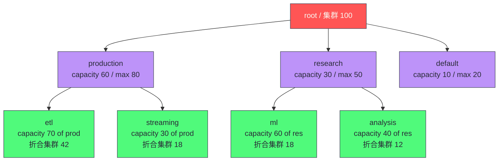
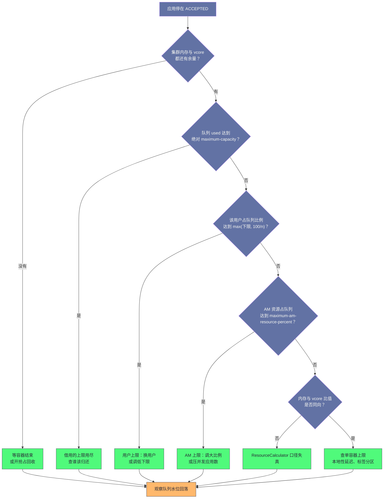
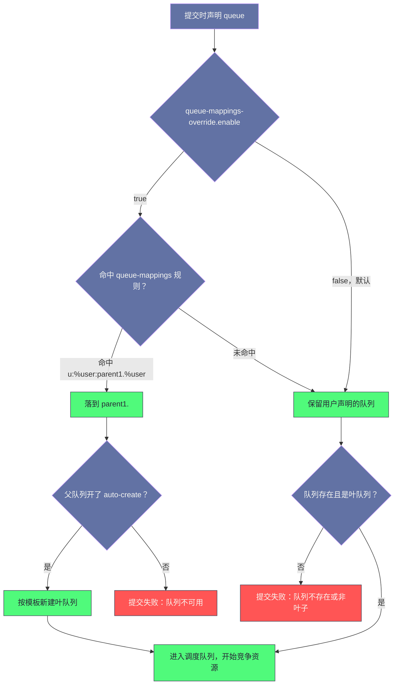
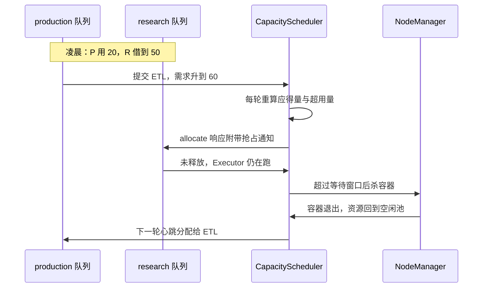
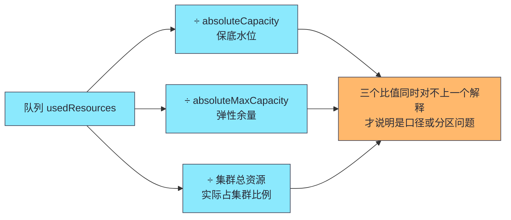

# 调度器深度解析——Capacity Scheduler 与 Fair Scheduler 的算法内核

**摘要：**

YARN 的队列配置里有三个百分比：`capacity` 保底、`maximum-capacity` 封顶、`minimum-user-limit-percent` 在队列内部再切一刀。三者分母各不相同，作用方向也各不相同，把它们的语义混成一件"配额"，就成了"配额明明够却拿不到资源"这类问题的起点。三层账之外还有两件常被顺手忽略的事：究竟是谁在比较资源，以及这些数在什么时点被校验。本文按账本的思路重排调度器的知识：先拆开三层资源账，说清每一层的分母、比较口径与越界后果；再交代记账员本身，也就是 `resource-calculator` 取默认的 `DefaultResourceCalculator` 时只看内存造成的口径失真；然后把三层账与 AM 资源上限、单容器上限合起来，给出一张"作业卡住时该看哪个数"的判据表；接着对比 FIFO、Capacity、Fair 三种策略的算法与选型判据，落到队列层级、Auto-Creation 与 `queue-mappings` 的放置规则；最后给出六个调度侧故障形态、一张带调大调小代价的参数表，以及"队列已用"与"集群已用"的对比读法。贯穿全文的问题是同一个：一个容器从申请到被分到节点上，中间要过几道闸门，每一道闸门被谁拧着。

---

## 第 1 章 一个卡住的作业与三本账

### 1.1 先看一个不动的作业

某天早上，一个 Spark 批作业提交到 `root.production.etl`，状态从 `NEW` 走到 `ACCEPTED` 之后就不动了，既没有报错，也没有新的诊断信息。运维打开 RM 的 Scheduler 页面，看到两行数字：etl 队列已用 42%，集群已用 63%；再打开 Nodes 页面，还有一屏节点显示可用内存不为零。两个数字都对，拼在一起却像在互相矛盾：集群明明有空闲，队列明明没到 100%，作业为什么一个容器都分不到。

这类现象在 YARN 上反复出现，原因几乎都不是"资源不够"，而是算账时用错了分母，或者用错了口径。etl 那个 42% 说的是"集群资源的 42% 归这个队列应得"，它既不是上限，也不是"已经吃掉的集群比例"；集群那个 63% 说的是所有队列已分配容器之和，它不含被节点标签切出去的分区，不含被 AM 上限挡住的申请，更不含因为内存与 vcore 口径不一致而"看起来空着"的资源。三个数字各自成立，答案藏在第四个数字里——那个数字通常是某道没人注意的上限，而不是总容量。

笔者把调度器这一层要处理的所有判断归成三本账：队列与队列之间的分配账、队列内部的二次分配账、单次分配的度量账。三本账对应三组配置，也对应三类卡住的方式。把这三本账分开算，调度器那几百个配置项就不再是一张需要背的参数表，而是一棵能顺着往下查的树。

### 1.2 队列的四个数

任何一次"为什么分不到资源"的追问，最后都会落到四个数上：两个配置值，一个观测量，一个基数。

| 数字 | 含义 | 分母或基准 | 作用方向 |
|---|---|---|---|
| `capacity` | 队列应得的资源份额 | 父队列的资源 | 下限，允许被超出 |
| `maximum-capacity` | 队列可弹性借到的上限 | 父队列的资源 | 上限，硬约束 |
| `used` | 队列内全部容器已分配资源之和 | 无，绝对值 | 观测量，不是配置 |
| 集群总资源 | 所有已注册 NodeManager 的可分配资源之和 | 无，绝对值 | 所有百分比的实际基数 |

四个数里最容易混淆的是前两个：配置值都写成百分比，分母却都不是集群。对 `root` 的直接子队列而言，父队列就是 `root`，而 `root` 持有 100% 的集群资源，于是"父队列的百分比"与"集群的百分比"在数值上恰好相同，这个巧合让很多人把 `maximum-capacity` 直接理解成"占集群多少"，一旦队列层级往下走一层，这个理解立刻失效——孙子队列的 `maximum-capacity` 是相对父队列的，不是相对集群的。

`used` 的度量口径则取决于调度器用什么 `ResourceCalculator` 比较资源。这一点后面单开一章，此处只需记住：`used` 是一个"被算出来的数"，算法换一种，同一个队列的已用占用就会呈现不同的样子，而调度决策跟着 `used` 走。

### 1.3 三层账怎么叠起来

第一层回答"资源归哪个组织"：`capacity` 把集群按百分比分给顶层队列，再逐层分给子队列，形成一棵带权重的树。第二层回答"组织之间能借多少"：`maximum-capacity` 给每个队列的弹性设一个顶，防止一个队列在别人空闲时把集群吃干净。第三层回答"组织内部几个人怎么分"：`minimum-user-limit-percent` 与 `user-limit-factor` 限制单个用户能占队列多少，避免一个提交账号把整条队列占满。

这三层不是并列的，而是串联的：一个容器要落地，必须同时满足三层，再叠加 AM 资源上限与单容器规格上限。任何一层被顶住，申请就会停在原地，而停在原地时界面上显示的原因往往只有一句笼统的"等待资源"。

譬如一栋合租的写字楼：`capacity` 是租约里写明的工位数，按出资比例谈好，别的公司在淡季可以临时借用你空着的工位；`maximum-capacity` 是公共区最多能临时占用多少，免得一家把整层楼都堆满；用户限制则是你们公司内部几个小组怎么分这些工位，第一个到的人不能把全部工位都占上。这个比喻只能覆盖份额的静态结构，覆盖不了动态部分：工位不会因为谁先到就自动换位置，而在 YARN 里，容器落在哪台机器上由 NM 心跳、本地性延迟与分区标签共同决定，借来的资源也不会在你需要时立刻搬回来。

### 1.4 为什么 capacity 必须是下限

要理解"为什么配额够还是分不到"，得先理解 `capacity` 为什么被设计成下限而不是上限。文档开篇给出的动机很朴素：每个组织各自建私有集群，容量必须按峰值准备，平均利用率因此很低，运维成本却按集群数量线性增长；让大家共摊一个集群，组织的顾虑是"别人会不会用掉我的 SLA 资源"。`capacity` 就是这两者之间的契约：它保证的是你有权拿到的那一份，而不是你只能拿到的那一份。

把这句话反过来做一次反事实推演：假设 `capacity` 就是硬上限，三个队列按 40/40/20 切分，各自的负载峰值在一天里错开。硬上限下，每个队列的峰值不能超过自己的份额，于是集群在任何时刻都只能用到接近最大单队列份额的水平，峰谷差被浪费；弹性共享下，峰值错开的时间差就是可借用的空间，集群平均利用率可以明显高于硬切方案。多租户共享的意义，一大半就建立在这个"空闲可借、有需归还"的机制上。

### 1.5 哪些是硬闸门

顺着三层账往下数，真正能把申请挡住的硬闸门有六道：`maximum-capacity`（借用的上限）、用户上限（单账号占队列的比例）、AM 资源上限（`maximum-am-resource-percent` 或 Fair Scheduler 的 `maxAMShare`）、单容器规格上限（`yarn.scheduler.maximum-allocation-mb` 与 `-vcores`）、队列状态（`STOPPED` 的队列不接受新应用）、以及节点标签分区（队列只被允许落在某类节点上）。

`capacity` 不在这张清单里。这条事实几乎能解释大半"配额够却拿不到"的困惑：配额是下限，卡住你的永远是清单上的某一项。后面的章节按"三层账—记账员—四道判定—三种策略—放置规则—故障形态"的顺序走，就是为了把这张清单逐项展开成可操作的判据。

---

## 第 2 章 第一层账：capacity 与兄弟求和

### 2.1 一条硬约束：兄弟之和等于 100

`capacity` 的配置约束非常直白，代价也非常直白：同一个父队列下，所有子队列的 `capacity` 之和**必须等于 100**。注意这句约束的范围——是"同一个父队列下"，不是"全集群"。`root` 下的 `production`、`research`、`default` 三个队列加起来必须正好 100；`production` 下的 `etl` 与 `streaming` 加起来也必须正好 100；`research` 下的 `ml` 与 `analysis` 同样如此。每一层各自归一，互不干扰。

这条约束之所以硬，是因为调度器要拿它算绝对容量：某个叶队列的绝对容量等于从根一路乘下来的百分比乘积。若某一层的和不等于 100，乘出来的绝对值就没有意义——可能超过集群总量，也可能在集群里留出一段无主的空白，调度器无法判断这段空白该算谁的保底。

和这条约束相关的两个常见错误，都出在"和不等于 100"上：一类是手写配置时漏改了一个队列，60 + 30 + 10 改成了 60 + 30 + 15；另一类是用了三位小数，三个 33.3 凑成 99.9。后一类尤其隐蔽，因为配置文件读起来完全正常，只有 RM 启动时才会报错。

### 2.2 一个数字，两个身份

同一个 `capacity` 值，在队列树里同时扮演两个角色：对它的父队列而言，它是"我从父队列分到的比例"；对它的子队列而言，它是"我可以往下分的总量"。这种双重身份是层级队列的全部算术基础，也是换算时最容易出错的地方。

假设 `root` 下有三个队列：`production` 60、`research` 30、`default` 10。`production` 下再分 `etl` 70 与 `streaming` 30，`research` 下分 `ml` 60 与 `analysis` 40。把它们折算到集群口径：

| 队列 | 配置 `capacity` | 相对谁 | 折合集群资源 |
|---|---|---|---|
| `root.production` | 60 | `root`（100%） | 60 |
| `root.production.etl` | 70 | `production`（60%） | 42 |
| `root.production.streaming` | 30 | `production`（60%） | 18 |
| `root.research` | 30 | `root` | 30 |
| `root.research.ml` | 60 | `research`（30%） | 18 |
| `root.research.analysis` | 40 | `research`（30%） | 12 |
| `root.default` | 10 | `root` | 10 |

这张表的结构值得盯着看一会儿。第一，每一行的乘积都落在父队列的范围内，`etl` 的 42 与 `streaming` 的 18 相加正好是 `production` 的 60。第二，叶队列的绝对容量之和等于 100，因为每一层都规整地归一了。第三，`default` 只有 10%，一旦它成为某个误投作业的落点，这个队列会很快打满，表现就是"集群很空但作业等待"——`default` 是所有映射规则的兜底去处，也是容量规划里最容易被忽略的一条队列。

下面这张图把上面那张表画成树，节点标签上同时标出 `capacity` 与 `maximum-capacity`，两者用的是同一个分母，这一点在下一章会展开。



### 2.3 配置写法：队列清单与 queue path

Capacity Scheduler 的配置全部写在 `capacity-scheduler.xml` 里，键名用"路径"组织：从 `root` 开始，以点号分隔，一个队列的完整路径就是它在树里的坐标。定义一个队列的子队列，是在该队列的路径后面接 `queues`。

```xml
<!-- 顶层队列清单：root 下挂三个队列 -->
<property>
  <name>yarn.scheduler.capacity.root.queues</name>
  <value>production,research,default</value>
</property>

<!-- production 的子队列：路径接 .queues -->
<property>
  <name>yarn.scheduler.capacity.root.production.queues</name>
  <value>etl,streaming</value>
</property>

<!-- research 的子队列 -->
<property>
  <name>yarn.scheduler.capacity.root.research.queues</name>
  <value>ml,analysis</value>
</property>

<!-- 叶队列的容量：70 表示占父队列 production 的 70% -->
<property>
  <name>yarn.scheduler.capacity.root.production.etl.capacity</name>
  <value>70</value>
</property>
```

这套键名结构里有一个容易踩的坑：`queues` 只是"声明有哪些孩子"，它不携带任何容量信息，容量必须逐个孩子在各自的路径上写明。若某个孩子出现在 `queues` 清单里却没有配 `capacity`，它不会从兄弟那里自动匀到份额，多数版本按 0 容量对待，少数版本直接在校验阶段拦下。按 0 容量对待时表现为"队列存在、可以提交、永远分不到资源"——这种状态比队列不存在更难查，因为提交成功、应用也能进入调度队列，只是永远停在原地。

另一处是叶队列与父队列的区分：只有叶队列能接收应用提交，父队列只负责分配。把应用提交到父队列路径会失败，而失败信息往往只说队列不可用，不解释"它是父队列"。

### 2.4 百分比与绝对值：两套格式，两套求和规则

3.x 的 Capacity Scheduler 支持用绝对值配置容量，格式是 `[memory=1024,vcores=8]` 这样的方括号表达式，直接给出队列的保底资源量，字段名与单位以对应版本示例为准。两种格式各有各的求和规则：

| 格式 | 写法示例 | 兄弟求和规则 | 适用场景 |
|---|---|---|---|
| 百分比 | `60`、`12.5` | 同一父下必须恰好 100 | 集群规模稳定、按组织比例分配 |
| 绝对值 | `[memory=102400,vcores=64]` | 兄弟之和可以小于父队列的绝对值容量，差额视为未分配 | 集群规模会变、按固定资源量签 SLA |

两种格式的差异不止写法。百分比格式下，集群扩容会自动同比例放大每个队列的额度；绝对值格式下，扩容出来的新资源不会被任何队列自动继承，得手工改配置，好处是"给某团队 200 个 vcore"这类承诺不会随集群规模漂移。文档明确写了绝对值情形下"子队列绝对值之和可以小于父队列的绝对值容量"，这段差额在调度器眼里不属于任何队列的保底，只能通过弹性借用被用掉。

两种格式混用会出问题，而且是在解析阶段出问题。同一个父队列下，一部分孩子写百分比、另一部分写绝对值，求和规则无法同时成立；同一个分支上父队列用百分比、子队列用绝对值，乘出来的绝对容量也对不上。实际后果是 RM 在加载 `capacity-scheduler.xml` 时直接抛出配置异常，队列树建不起来。要混，也只能在"整棵树都按绝对值"或"整棵树都按百分比"之间选一种，并以所在版本的文档为准。

### 2.5 刷新配置之后：超配状态

`capacity` 是可以热更新的，改完 `capacity-scheduler.xml` 执行 `yarn rmadmin -refreshQueues` 即可，不需要重启 RM。但热更新只改配置，不动已经发出去的容器：队列的绝对容量变小了，里面跑着的容器不会因此被赶走，于是队列会进入一种"已用大于容量"的状态。

这个状态有两个后果。其一，队列的 `used/capacity` 比值超过 1，在按饥饿度排序的调度算法里它排在最后，新申请拿不到资源——这不是故障，而是缩容的正常余波，只能等容器自然结束。其二，如果缩容幅度大到 `used` 超过 `maximum-capacity`，队列就处在一个自相矛盾的位置：既超出保底又超出上限，调度器只能靠拒绝新申请和等待释放来慢慢收敛。所以容量调整的正确做法是分步走：先调小 `maximum-capacity` 让它自然收敛，观察几天队列水位降下来，再调 `capacity`。一次性把容量砍掉一半，等于给这条队列判了几个小时的"缓刑"。

---

## 第 3 章 第二层账：maximum-capacity 与借用的边界

### 3.1 弹性上限的分母还是父队列

`maximum-capacity` 的语义只有一句话：它限制队列的弹性。取值 0 到 100 的百分比，或者绝对值；设为 -1 等价于 100%。它不保证任何东西，只负责封顶。

关键在于分母。与 `capacity` 一样，`maximum-capacity` 的百分比基准是父队列的资源，而不是集群。对 `root` 的直接子队列，父是 `root`，所以 `maximum-capacity` 80 读作"最多能占到集群的 80%"；对 `production` 的子队列，`maximum-capacity` 80 读作"最多能占到 `production` 的 80%"，也就是集群的 48%。同一句配置，换个位置含义完全不同，这是层级队列在运维中最容易读错的一个数。

由此得到一条推论：队列的实际弹性上限是"从根一路乘下来"的**连乘结果**。`production` 的 `maximum-capacity` 是 80，`etl` 的 `maximum-capacity` 是 90，那么 `etl` 真正能摸到的天花板是 80% × 90% = 72% 的集群资源，而不是 90%。中间任何一层收紧，下面的所有队列都会被同步压住——这条连乘关系正是"父队列的 maximum-capacity 决定了整棵子树的弹性"的原因，也是调优时"改一个父队列顶过改十个叶队列"的原因。

### 3.2 兄弟上限与保底上限

`maximum-capacity` 与 `capacity` 之间有一条不等式：`maximum-capacity` 不能小于 `capacity`。理由是显然的——保底的目标值不该超过上限，否则队列连自己应得的那一份都拿不到。违反这条不等式的配置会在加载或刷新时被拒绝，报错信息里通常带 `maximum capacity` 字样。这条校验是下一章"六个故障形态"里的第二个，此处先记住它的判据：异常出现在配置加载或 `-refreshQueues` 阶段，而不是应用运行阶段。

不等式之外还有一个隐性的约束：弹性上限的"兄弟预算"。同一父队列下的几个孩子各自有 `maximum-capacity`，它们的和可以超过 100，这正是弹性存在的原因——两个队列都配 100 的上限，意味着谁先需要谁就能用满，另一个只能等。若把每个孩子的 `maximum-capacity` 都配成等于自己的 `capacity`，整个集群的弹性就被全部关掉了，退化成硬切：每个队列只能用自己那一份，空闲资源谁也借不走。这种配置看起来"公平"，实际效果是把共享集群改造回了私有集群，而且往往是在一次"防止互相抢占"的应急调整中被悄悄加上去的。

### 3.3 反例：maximum-capacity 设成 100 以为能独占

一个很常见的误解是：把 important 队列的 `maximum-capacity` 设成 100，就能保证它总能拿到资源。这个推理漏掉了方向——`maximum-capacity` 是"最多能用多少"，不是"至少留给我多少"。设成 100 的真实含义是"允许这个队列在别人不用时吃掉整个集群"，它对保底没有任何贡献。

更麻烦的是它的副作用。`maximum-capacity` 100 的队列一旦在夜里把集群吃到 90%，第二天早上另一个队列提交作业时，那些资源正被容器占着；若抢占没有开启，只能等容器自然结束。此时 important 队列的高优先级作业同样要排队，因为"占用"这件事不看配置，只看容器什么时候退出。真正能保护高优先级负载的手段是抢占（`ProportionalCapacityPreemptionPolicy`）与优先级配置，而不是把上限设成 100。

正确的一组配置是：`capacity` 给保底，`maximum-capacity` 给弹性空间，重要队列的 `capacity` 高于常态水位，抢占策略负责在关键时刻把资源拿回来。三者缺一，都会在某个时刻被证明无效。

### 3.4 上限、分区与标签：另一个乘数

引入节点标签之后，集群资源被切成若干分区，每个分区内各自算一套账。队列在某个分区上的容量与上限是独立配置的，`maximum-capacity` 在分区里同样生效。这意味着"队列上限"其实是一个按分区展开的矩阵，而不是一个标量：一个队列在默认分区上有 80% 的弹性，在 GPU 分区上可能只被允许用 50%。

这一点在排查"集群有空、队列没满、作业不动"时很关键。Scheduler 页面上那个总的 used 比例，是把所有分区混在一起算的；但调度器在为一次申请找节点时，只会在"队列被允许访问的分区"里找。若队列没被允许访问有闲资源的那类节点，看总账永远看不出问题。判断这类情况要把 `absoluteUsedCapacity` 与分区容量分开看，或者直接去看队列与节点的标签关联。

---

## 第 4 章 第三层账：用户限制与队列内部的再分配

### 4.1 minimum-user-limit-percent 的算术

前三层账里，`capacity` 与 `maximum-capacity` 管的是队列本身；用户限制管的是队列内部的第二次分配。`minimum-user-limit-percent` 的默认值是 100，含义是"**不做用户限制**"——先提交的那个用户可以吃满整条队列，后来者排队等。这个默认值在多团队共用一个队列时非常危险，因为它把"队列公平"完全交给了提交时间。

把值调下来，语义是"保证每个用户至少能拿到队列的多少"。文档给了一个完整算例：设为 25 时，若队列里有两个用户有资源需求，任何一个用户最多能用队列的 50%；若有三个用户，上限变成 33%；四个及以上用户时，上限落到 25%。规律是单用户上限取"`minimum-user-limit-percent`"与"100 除以活跃用户数"中的较大者：

| 活跃用户数 | `minimum-user-limit-percent` | 单用户上限（占队列） | 说明 |
|---|---|---|---|
| 1 | 100（默认） | 100% | 不设限，先到先占 |
| 1 | 50 | 100% | 只有一个用户时，均分值高于下限，仍可吃满 |
| 2 | 50 | 50% | 两人正好分完 |
| 3 | 50 | 50% | 前两人即可占满，第三人排队 |
| 2 | 25 | 50% | 均分值高于下限，取均分 |
| 3 | 25 | 33% | 同上，取均分 |
| 4 | 25 | 25% | 均分等于下限 |

这张表里有两个反直觉的格子。第一处是第二行：下限设成 50，队列里却只有一个用户时，这个用户仍然能占满整条队列，而不是被卡在一半——因为均分值 `100 ÷ 1` 是 100%，比下限高，取较大的那个。下限只在用户数多到 `100 ÷ n` 低于它时才真正生效，这一点常被读反，进而得出"设了下限就一定留出余量"的错误结论。第二处是第四行：三个用户、下限 50 时，前两个用户就能把队列占满，第三个用户只能等，因为每个人的上限都是 50%，两人凑够 100% 了。想让三个人都能开始跑，下限得压到 33 以下。

### 4.2 user-limit-factor：借用的第二道闸

`user-limit-factor` 管的是另一件事：单个用户能不能借用超出队列容量的资源。默认值 1，含义是"一个用户最多用到队列容量的 1 倍"，即便集群完全空闲也一样。文档把这句写得很清楚：默认值确保单个用户永远不会超过队列配置的容量，不管集群多闲。

这个参数与 `minimum-user-limit-percent` 是两个方向。前者按"队列容量 × 倍数"给单用户封顶，后者按"队列容量 × 比例"给单用户封顶，两者同时生效时取更严的那一个。把 `user-limit-factor` 调到 3，等于允许单用户在集群空闲时用到 3 倍队列容量；这个能力在"一个团队独占一条队列、队列容量只是名义保底"的场景里有用，在"多用户共用一条队列"的场景里则会把用户限制架空——倍数一开，先来的用户照样能借到队列容量之外去，后来的用户还是要等。

### 4.3 队列空着，用户却拿不到

有一个很典型的现场：某个队列 `capacity` 30、`maximum-capacity` 60，集群里空闲资源足够，队列已用只有 20%，但某个用户提交的第二个应用一直不启动。直觉会让人去查用户限制，可 `minimum-user-limit-percent` 这时是 100，等于不设限，用户维度根本没有拦他。真正把他挡住的是另一类上限：`maximum-applications` 或 `max-parallel-apps` 到了，或者 AM 资源占队列的比例到了 `maximum-am-resource-percent`。

这类困惑的根源是把"队列满"与"用户满"混为一谈。队列水位看的是队列的总 `used`，用户水位看的是该用户名下的 `used`；两者可以一个宽松一个紧绷。当一条队列被同一个提交账号（比如调度平台的统一服务账号）独占使用时，用户限制本身失效，因为所有应用都算同一个用户，此时真正起作用的往往是 `maximum-applications`、`max-parallel-apps` 与 `maximum-am-resource-percent` 这三个"应用数/AM 资源"型上限。**统一账号提交**是多租户集群里最常见的架构选择，也是用户限制被静默废掉的最常见原因：`minimum-user-limit-percent` 在这种情况下完全没有保护作用，因为"用户"这一维度根本不存在。

### 4.4 三层账的合并判据

把三层的数放在一起，判断一个队列是否"真的满"需要三个比值，而不是一个：

| 比值 | 算法 | 落在哪里说明什么 |
|---|---|---|
| 保底水位 | `used` ÷ 绝对 `capacity` | 大于 1 说明在吃弹性，小于 1 说明还没用满应得份额 |
| 弹性余量 | `used` ÷ 绝对 `maximum-capacity` | 接近 1 说明上限用尽，此时集群再空也借不到 |
| 集群占比 | `used` ÷ 集群总资源 | 与队列的绝对容量比较，用来核对换算是否出错 |
| 用户水位 | 该用户 `used` ÷ 队列 `used` | 与 max(下限, 100/用户数) 比较，判断是不是人被限住 |

四个比值里，第二个是最容易被忽略的：队列看起来"才用了一半"，但如果它的一半正好等于 `maximum-capacity`，那它确实已经到顶。第三个用来验算配置：如果队列显示占集群 42%，而配置换算出来的绝对容量也是 42，说明换算没错，问题不在配置层。

---

## 第 5 章 记账员：resource-calculator 与口径失真

### 5.1 默认计算器只看内存

前面三章反复出现"已用""容量""上限"，这些数都要经过一次比较才能变成调度决策：队列 A 的已用是不是比队列 B 更接近它的应得份额、这台节点剩下的资源够不够放下一个容器、队列是不是已经顶到 `maximum-capacity`。做这次比较的组件叫 `ResourceCalculator`，由 `yarn.scheduler.capacity.resource-calculator` 指定，**默认只看内存**。

这个默认值写在文档里，语气很平淡，却是整套调度配置里最反直觉的一条。它意味着：只要内存还放得下，调度器就认为有资源，哪怕这台机器的 vcore 已经全部发完；队列的已用百分比、队列之间谁更饥饿、`maximum-capacity` 是否用尽，全部按内存算。vcores 在配置里、在 REST 返回里、在 NM 的容器规格里都存在，唯独不参与"够不够"的判断。

口径失真带来的现场不是报错，而是变慢。容器照样被分出去，NM 照样启动进程，只是这台机器上的 vcore 被超卖了几倍，多个 JVM 抢同一批核，伴生的是 load 升高、GC 停顿变长、Spark 的 Shuffle 阶段耗时拉长。作业不失败，指标上只有一个"慢"字，而队列水位看起来还很健康。这类问题最难查，因为它没有任何一条错误日志能对上。

### 5.2 算一笔账：口径差在哪里

举一个便于计算的假设场景。集群 40 台节点，每台可分配 32 个 vcore、100 GB 内存；运行一类 Spark 批作业，每个 Executor 容器申请 4 个 vcore、4 GB 内存——这是偏 CPU 型的配置，常见于 ETL 里的聚合与 Join。

| 口径 | 集群总量 | 单容器需求 | 可容纳容器数 | 谁先到顶 |
|---|---|---|---|---|
| 内存 | 4000 GB | 4 GB | 1000 | 内存 |
| vcore | 1280 个 | 4 个 | 320 | vcore |

按内存算，集群能放下 1000 个容器；按 vcore 算，只能放下 320 个。`DefaultResourceCalculator` 采用前一个数，于是在第 321 个容器被分配出去的时候，集群的 CPU 已经超卖了三倍，调度器却仍然认为"还剩 680 个容器的余量"。此时若把同一批机器换成 1 vcore、16 GB 内存的内存型容器，结论就反过来：内存先到顶，vcore 大量闲置，而调度器依然只认内存，判断倒是正确的——口径失真的方向取决于负载的资源配比，而不是固定偏向某一边。

换算到队列口径，失真会被放大成"配额错觉"。设某队列的绝对容量是集群的 40%，即 1600 GB 与 512 个 vcore。当队列的 320 个容器跑满时，内存已用 1280 GB，比值 80%，界面上还有 20% 的余量；可 vcore 已经用掉 1280 个，是队列 vcore 容量的 2.5 倍。调度器仍在按 80% 这个数给它排序、判断它是否还可以继续分配。作业方看到的是"队列才 80%，为什么拿不到资源"；调度器看到的是"队列才 80%，给它继续分"。两边都没错，是尺子错了。

### 5.3 DominantResourceCalculator 的比较语义

另一个选项是 `DominantResourceCalculator`，它按主导资源（Dominant Resource）比较资源：把一个资源向量的内存占比与 vcore 占比算出来，取其中较大的那个作为这个向量的"**主导份额**"，两个向量比大小就是比主导份额。这套比较方式来自 DRF 算法，语义与 Fair Scheduler 的多资源公平一致。

换用之后，"内存还有、vcore 没了"会被正确识别成资源不足：节点的剩余向量里 vcore 占比接近 1，主导份额就接近 1，任何还需要 vcore 的请求都放不进去。队列之间的排序也跟着改变口径——原来的 `used/capacity` 是内存比值，现在是主导份额比值，某些过去靠内存口径"占便宜"的队列会突然显得更饥饿或更饱。

代价有两面。第一面是历史容量规划要重算：按内存百分比做的队列规划，在双维度口径下不再等价，原来的 40% 不再是"内存加 vcore 都占 40%"，而是"主导资源占 40%"。第二面是生效方式：这个参数属于调度器初始化参数，改完通常需要重启 RM 才稳妥，不能指望一次 `-refreshQueues` 就彻底切换，具体行为以对应版本文档为准。改之前先确认两件事——集群的 vcore 与内存配比是否合理（`yarn.nodemanager.resource.cpu-vcores` 与 `yarn.nodemanager.resource.memory-mb` 的比值），以及容器的 vcore 请求是否真的反映了 CPU 消耗，否则只是把一种失真换成另一种。

### 5.4 判据：什么时候该怀疑尺子

出现下面这组症状时，先怀疑计算器，而不是先去加资源：队列的内存水位长期低于 70%，但任务普遍变慢；节点上 `load average` 与容器数同向上涨；同一份作业在容器数增加后耗时反而变长；`yarn node -list` 里节点的可用内存还有富余，可用 vcore 已经趋近于零。

数据侧的判据在 `/ws/v1/cluster/scheduler` 的返回里：`usedResources` 同时给出 `memory` 与 `vcores` 两个字段，把它们分别除以队列的绝对容量（内存按 MB、vcore 按个数换算），会得到两个明显不同的比值。两个比值差距越大，口径失真的影响越严重。此时正确的动作是切到 `DominantResourceCalculator`，并把 `yarn.scheduler.minimum-allocation-vcores` 与 Spark 的 executor 核数对齐，让"一个 vcore"在账面上尽量接近"一个物理核"。

---

## 第 6 章 四道闸门：配额够却拿不到的判据

### 6.1 从外到内的检查顺序

把前面的账本合成一条检查链，顺序是**从外到内**：集群有没有空闲资源、队列有没有触到自己的上限、用户与 AM 有没有触到各自的比例上限、单个容器的规格与位置是否被允许。这个顺序不能颠倒，因为每一层的判据只在上一层成立时才有意义——集群满载时去查用户上限，是白费工夫。

第一道是集群。把集群的总资源按内存与 vcore 分别与已分配量比较，两者都要看；只看内存会落入上一章的口径陷阱。第二道是队列上限，比较队列的 `used` 与绝对 `maximum-capacity`，而不是与 `capacity`。第三道是用户与 AM：单用户占队列的比例是否达到 max(下限, 100/活跃用户数)，AM 资源是否达到 `maximum-am-resource-percent`（Capacity）或 `maxAMShare`（Fair）。第四道是容器规格与位置：请求的容器是否超过单容器上限、队列是否被允许访问有空闲的那类节点、本地性延迟是否还在等待窗口内。

### 6.2 判据流程图

下面这张图把四道闸门按检查顺序串起来，每个判断节点给出的都是"下一步该看什么"，而不是"结论"。真正下结论需要把节点旁边的数据取出来看，图中的分叉只是把排查路径收窄。



### 6.3 排查顺序表

| 步骤 | 查什么 | 数据来源 | 得到的结论 |
|---|---|---|---|
| 1 | 集群内存余量与 vcore 余量 | Scheduler 页顶部、`/ws/v1/cluster/metrics` | 集群真的满了，还是看起来满了 |
| 2 | 队列 `used` ÷ 绝对 `maximum-capacity` | `/ws/v1/cluster/scheduler` 的 `absoluteMaxCapacity` 与 `absoluteUsedCapacity` | 是否顶到弹性上限 |
| 3 | 队列 `used` ÷ 绝对 `capacity` | 同上（`absoluteCapacity`） | 是吃弹性还是用保底 |
| 4 | 单用户已用 ÷ 队列已用 | `schedulerInfo.queues.queue[].users[]` | 是否被用户上限挡住 |
| 5 | AM 资源 ÷ 队列资源 | `resourcesUsed` 与 AM 容器数、`maximum-am-resource-percent` | 是否被 AM 上限挡住 |
| 6 | 请求规格 vs `maximum-allocation-mb` / `-vcores` | AM 日志、`yarn application -status` | 是否规格超限 |
| 7 | 节点标签分区与本地性 | 队列的 `accessible-node-labels`、`node-locality-delay` | 是否被位置约束挡住 |

### 6.4 三个容易漏的细节

第一，AM 容器本身也占队列的 `used`。一个队列里有 50 个应用，就至少有 50 个 AM 容器，它们的资源记在同一个 `used` 里，也计入 `maximum-capacity`。小容器、多应用的工作负载里，AM 开销可以占到队列资源的可观比例，看到"队列满了但业务容器没几个"时，先把 AM 数量与规格捞出来看一眼。

第二，AM 上限是按资源算的，不是按应用数算的。`maximum-am-resource-percent` 限制的是 AM 容器合计消耗的资源占队列资源的比例，默认 10%。它不关心你提交了多少个应用，只关心这些应用的 AM 加起来占了多少。Spark 的 AM 默认 1 个 vcore、内存默认与 driver 配置相关，若 driver 内存配到 8 GB，同样是 50 个应用，占用的 AM 资源会比 1 GB driver 高八倍，触顶的速度完全不同。

第三，机会容器（Opportunistic Container）与预留（Reservation）会让账面出现"看不见的占用"。机会容器的资源在部分口径里不计入常规队列账，预留资源则是提前从 `Plan` 里划走的。若集群启用了这两类特性，Scheduler 页面上的 `used` 与物理空闲之间的差额会更大，排查时要把这两块单独扣掉。

### 6.5 等本地性不等于卡死

`node-locality-delay` 的默认值是 40，含义是连续错过 40 次调度机会之后，才允许把一个原本要求节点本地的请求降级为机架本地。若心跳间隔是 1 秒、集群有几十个节点在同时上报，40 次机会可能只对应十几秒，也可能对应几分钟——取决于该应用还有多少其它待满足的请求参与竞争。在这段时间里，应用显示 `ACCEPTED` 或 `RUNNING` 但容器数为零，看起来像卡死，其实是在等本地性窗口。

判断方法很简单：把 `node-locality-delay` 调成 -1（关闭本地性约束）再提交一次同样的作业，若立刻能拿到容器，说明卡的是本地性，不是容量。这个实验的代价是那一次作业会跨机架读数据，所以只在排查时做，不要在容量规划里把它当成常规手段。

---

## 第 7 章 三种策略：FIFO、Capacity、Fair 的算法与判据

### 7.1 FIFO：单队列与队头阻塞

FIFO 调度器只有一个队列，应用按提交顺序排队，先来的先拿资源，后来的等前面的拿够。它在 Hadoop 1.x 时代是默认，逻辑简单到几乎不需要解释，问题也简单到无法回避：队列头部那个大作业会把后面所有作业挡住，哪怕集群里还有零散的空闲资源——因为资源分配是按应用串行满足的，前面那个没满足完，后面的不上桌。

FIFO 的退场不是因为某个 bug，而是因为需求变了：集群从"一个团队跑一类批作业"变成"多个团队跑多类负载"，单队列既不能做组织隔离，也不能做优先级表达（优先级只在同一队列内部起作用），更无法阻止一个大作业把集群占满几个小时。2.x 之后默认调度器换成 Capacity Scheduler，3.x 的文档与生产实践基本围绕后两者展开，FIFO 只剩教学与极小规模场景的价值。

### 7.2 Capacity：层级排序与队列内 FIFO

Capacity Scheduler 的算法可以拆成两段：队列之间怎么选，队列内部怎么选。

队列之间是逐层比较。每次 NM 心跳带来一批可分配的容器槽位，调度器从 `root` 开始向下走，在每一层比较子队列的"已用 ÷ 应得"比值，选出比值最小的那个继续往下；到达叶队列后开始分配容器。这个比较用的是 `used/capacity` 的相对量，而不是绝对量，所以 60% 容量用掉一半的队列，和 10% 容量用掉一半的队列，在同一个父队列下被同等对待。这就是"**饥饿度**"排序的含义：谁离自己的应得份额更远，谁先被满足。

队列内部默认按 FIFO 排序（`ordering-policy` 默认值是 `fifo`），应用优先级只在这个排序策略下生效；把 `ordering-policy` 改成 `fair`，队列内的多个应用会按公平份额竞争，此时应用优先级不再起作用。这一点常被忽略：很多团队配了应用优先级却发现不生效，原因就是队列内排序策略不是 `fifo`。

Capacity 的弹性归还有两个来源。其一是自然结束：借用方的容器跑完退出，资源回到队列池，下一个心跳按新的饥饿度重新分配。其二是抢占：`ProportionalCapacityPreemptionPolicy` 周期性地算出每个队列的应得份额、超用量与欠缺量，向 AM 发抢占通知，AM 不主动释放就在 `max-wait-before-kill` 之后强杀容器。抢占默认是关闭的（`yarn.resourcemanager.scheduler.monitor.enable` 默认 false），要显式打开监控并把策略类配上。这意味着大量集群的弹性归还实际上只有"自然结束"一条路——这也是"队列满、集群空"能持续几个小时的根本原因。

### 7.3 Fair：fairShare 与 maxAMShare

Fair Scheduler 的算法核心是"公平份额"（fairShare），而 fairShare 有两种口径。**瞬时公平份额**（Instantaneous Fair Share）只统计当前活跃的队列，用于实际的调度决策；稳态公平份额（Steady Fair Share）统计所有队列，不管有没有应用在跑，只在配置或容量变化时重新计算，主要用于界面展示与容量预期。两者不一致是正常现象：一个队列可能瞬时份额很高（因为其他队列都闲着），但稳态份额只有配置的那一份。

调度时，Fair Scheduler 选"已用 ÷ fairShare"比值最低的队列，再在队列内部按 `schedulingPolicy` 选应用：`fifo` 比提交时间，`fair` 比各自的公平份额，`drf` 比主导资源占比。队列权重 `weight` 决定份额比例，`minResources` 给保底，`maxResources` 给上限，`maxAMShare` 限制 AM 能占 fairShare 的比例——它只能配在叶队列上，默认 0.5，设为 -1 关闭该检查。

Fair Scheduler 的抢占默认也是关闭的（`yarn.scheduler.fair.preemption` 默认 false），开启后还有两道闸门：集群利用率超过 `yarn.scheduler.fair.preemption.cluster-utilization-threshold`（默认 0.8）才考虑抢占，以及队列低于公平份额阈值的持续时间超过 `fairSharePreemptionTimeout`。这两道闸门的存在说明它的抢占哲学是"温和"：只在集群确实紧张、且亏欠持续时才动手。分配文件的重载周期是 10 到 15 秒，`yarn.scheduler.fair.update-interval-ms` 默认 500 毫秒，调度的反应速度比 Capacity 的配置刷新更快。

### 7.4 选型判据

三种调度器的差异，落在"份额怎么定义"与"份额外怎么表达"两件事上：

| 维度 | FIFO | Capacity | Fair |
|---|---|---|---|
| 份额定义 | 无 | 队列 `capacity` 百分比，层级继承 | 队列 `weight` 比例 + `minResources` 保底 |
| 份额外控制 | 无 | `maximum-capacity` 封顶 | `maxResources` 封顶 |
| 队列内顺序 | FIFO | `ordering-policy` 默认 `fifo`，可设 `fair` | `schedulingPolicy` 可选 `fifo`/`fair`/`drf` |
| 归还方式 | 自然结束 | 自然结束 + 可选抢占 | 自然结束 + 可选抢占（默认关） |
| 配置载体 | 无 | `capacity-scheduler.xml` | `fair-scheduler.xml` |
| 层级队列 | 不支持 | 支持 | 支持 |
| 适用负载 | 单团队、单类型 | 多团队、离线批处理、有明确配额 | 多用户共享、短作业响应、动态均衡 |

按负载形状给判据：离线批处理、有清晰的组织级配额与 SLA、作业时长以小时计、能接受分钟级的归还延迟，用 Capacity；多用户即席查询、短作业占比高、需要在用户之间做动态均衡、对保底要求不严，用 Fair。两个判据都成立时（既有组织配额又有大量短作业），看谁更刚性——组织配额更刚性就选 Capacity，用队列内的 `fair` 排序策略补上短作业响应。

有一个现实因素要摆上桌面：3.x 的 Capacity Scheduler 已经吸收了 Fair 的多数能力，包括按用户/组的队列映射、Auto-Creation、绝对资源容量、`ordering-policy` 的 `fair` 选项；而 Fair Scheduler 的文档更新与功能推进相对停滞。于是新集群的默认选择基本都是 Capacity，Fair 主要存在于历史集群。已经跑在 Fair 上的集群不必为了"更主流"而迁移，迁移的收益通常小于队列语义重写与作业重新映射的成本。

---

## 第 8 章 队列层级与放置规则

### 8.1 层级的三条硬约束

队列树的结构本身有三条约束，违反任何一条都会在配置加载或提交阶段报错。第一条是每层子队列的 `capacity` 之和为 100（绝对值格式除外，规则换成"不得超过父队列的绝对值"）。第二条是只有叶队列接收应用，父队列只做分配。第三条是父队列的容量是"它的子队列之和的上限"，子队列不可能通过配置拿到超出父队列的资源——父队列的 `maximum-capacity` 一旦收紧，整棵子树的弹性同步收紧。

这三条约束共同保证了一件事：任意一个叶队列的绝对容量，都可以由路径上所有百分比连乘算出，且所有叶队列的绝对容量之和不超过 100。调度器的所有比例判断都建立在这个可加性上。一旦某处配置打破了可加性，调度器不会"尽力而为"，它直接在启动阶段拒绝加载。

### 8.2 Auto-Creation：让 `%user` 找到父队列

队列树需要人工规划，但"每人一条队列"这种布局没法手工配——用户数上千，队列数也跟着上千。Auto-Creation 就是为这种布局准备的：父队列开启自动创建后，调度器在放置应用时按映射规则动态建出叶子队列。

配置分三步。父队列上打开开关 `yarn.scheduler.capacity.<queue-path>.auto-create-child-queue.enabled`；给出新建叶队列的模板 `leaf-queue-template.capacity`（必填，表示新队列的保底容量），模板还可以带 `maximum-capacity`、`ordering-policy`、`user-limit-factor` 等属性；最后配一条把用户映射到该父队列下的规则，例如 `u:%user:parent1.%user`，任何用户提交时就会落到 `parent1.<用户名>` 这个新建的叶队列里。

自动建的队列多了，容量怎么分？这由管理策略决定，默认实现是 `GuaranteedOrZeroCapacityOverTimePolicy`：按父队列当前可用容量与应用提交顺序，给每个自动队列"配置的容量或零容量"，尽力而为。这句描述值得读两遍——它说的是没有硬保底，用户多的时候，一部分队列可能长期拿不到容量。Auto-Creation 解决的是"队列多得没法手工配"的问题，不是"每个人都能拿到保底"的问题。

还有两条限制容易踩。其一，开启了自动创建的父队列不能同时挂预配置的子队列，两种模式不能混在同一层。其二，自动队列的容量由管理策略周期性地重算，重算间隔由 `yarn.resourcemanager.monitor.capacity.queue-management.monitoring-interval` 控制，默认 1500 毫秒，这个参数配得太小会给 RM 增加无谓的负担。

### 8.3 queue-mappings 的语法与覆盖语义

Capacity Scheduler 的放置规则写在 `yarn.scheduler.capacity.queue-mappings` 里，格式是 `[u|g]:[name]:[queue_name][,next_mapping]*`：`u` 表示按用户、`g` 表示按组，`name` 是用户名或组名，`queue_name` 是目标队列。名字与队列名都可以用占位符：`%user` 表示提交用户，`%primary_group` 表示主组，`%secondary_group` 表示从组，队列名里写 `%user` 表示"与用户名同名的队列"。

```xml
<!-- 多条映射用逗号分隔，按顺序匹配，先命中者生效 -->
<property>
  <name>yarn.scheduler.capacity.queue-mappings</name>
  <value>u:etl:root.production.etl,g:data:root.research.ml,u:%user:root.parent1.%user</value>
</property>
```

一个关键开关是 `yarn.scheduler.capacity.queue-mappings-override.enable`，默认 false。默认值下的语义是：应用在提交时自己声明的队列优先，映射规则只在没有声明时兜底。改成 true 之后，映射规则会**覆盖用户声明的队列**——这对"强制归队"很有用，对"允许用户自己选队列做实验"则是灾难，因为提交参数里的队列名会被静默改道，而客户端不会收到任何提示。把它打开之前，先确认没有团队依赖声明队列来做灰度或隔离。

### 8.4 放置发生在提交时

放置不是调度阶段的事，而是提交阶段的事：客户端把应用提交给 RM，RM 在接纳应用时解析队列名、应用映射规则、检查队列是否存在、是否有权限提交，任何一步失败，应用都不会进入调度队列。这个顺序决定了两类失败的形态完全不同——提交阶段失败会立刻报错，调度阶段失败则表现为长时间停在 `ACCEPTED`。



这张图也解释了为什么"队列不存在"和"队列满了"的处置完全不同：前者是提交期的问题，改配置、刷新队列、重新提交即可，与资源无关；后者是运行期的问题，要按第 6 章的四道闸门逐层查。把两者混在一起猜，是最常见的排查弯路。

---

## 第 9 章 六个调度侧故障形态与判据

### 9.1 应用停在 ACCEPTED

`ACCEPTED` 是"已接纳、未运行"的状态，含义是资源申请还没有被满足。它的成因不止一种，Capacity Scheduler 在接纳阶段的检查有三道，顺序固定：先看 `maximum-applications`（超过即直接拒绝提交，不会停在 `ACCEPTED`），再看 `max-parallel-apps`（超过则接纳但停在 `ACCEPTED`，等并行数腾出来），最后看 `maximum-am-resource-percent`（AM 资源不够则同样停在 `ACCEPTED`）。

判据在数据里而不在状态里：用 `yarn application -list -appStates ACCEPTED` 取出清单，再看这条队列的 `numPendingApplications`、AM 容器数量与队列 `usedResources`。若 AM 数已经接近"队列绝对容量 × 10% ÷ 单个 AM 规格"，是第三道；若队列里跑着的应用数正好卡在 `max-parallel-apps`，是第二道；若提交直接被拒，是第一道。三者的处置完全不同：调参数、等应用结束、还是压并发，选错了只是把问题推后。

### 9.2 异常信息里出现 maximum capacity

配置校验类的失败通常发生在 RM 启动或 `-refreshQueues` 阶段，异常信息里带 `maximum capacity` 字样。最常见的两种原因：`maximum-capacity` 配得比 `capacity` 小（同分母下直接违反不等式），或者绝对值格式下 `maximum-capacity` 的绝对值小于 `capacity` 的绝对值。第三种原因出现在热更新时——新配置的 `maximum-capacity` 低于队列当前的 `used`，队列在刷新后立刻进入超配状态。

分辨的关键是失败发生的时点：如果 RM 起不来或者刷新命令返回非零，问题在配置；如果配置已经生效、队列水位显示 `used` 大于 `absoluteMaxCapacity`，问题在"缩容没有分步走"。前者的处置是改数值，后者的处置是等容器自然结束，或者临时把 `maximum-capacity` 调回去、按第 2 章的分步法重新收敛。

### 9.3 队列满了，集群却空着

这是本文开头那个场景的通用形态，也是调度侧最有代表性的故障。集群有空闲资源，作业却拿不到，可能的原因有四种，判据各不相同：队列借到 `maximum-capacity` 了（`used` 与绝对 `maximum-capacity` 的比值趋近 1）、单用户被用户上限挡住（用户水位到顶）、AM 资源到顶（AM 占比到 10%）、尺子口径失真（内存与 vcore 比值背离）。

前三种都能从 Scheduler 页面上的四个数里读出来；第四种要打开 REST 返回看 `usedResources` 的两个字段。处置也分四路：调大 `maximum-capacity`、调低 `minimum-user-limit-percent` 或换提交账号、调大 AM 上限、切换 `DominantResourceCalculator`。把这些混成一个"加机器"的动作，往往机器加了、问题还在。

还有一种常见成因不在这四种里：资源在别的队列手里，而抢占没开。此时队列的上限没顶、用户没限、AM 没满、口径也对，纯粹是"**别人不归还**"。判据是另一条队列的 `used` 长期高于它的 `capacity`，且集群总空闲为零。处置只能是开抢占，或者调整两条队列的容量比例，让占用方在配置上就拥有它实际占着的那部分。

借用与归还的时序可以画成下面这张图。假设 `production` 的保底是 60、上限是 80，`research` 的保底是 30、上限是 50；凌晨 `production` 只用到 20%，`research` 借到 50%；早上 `production` 提交一批 ETL，需求升到 60%。



图中最后两步之间的距离，就是归还的全部成本：抢占关闭时这段距离是无穷，只能等容器自然结束；抢占开启时它等于监控周期加上 `max-wait-before-kill`，再乘以需要回收的容器批次数。窗口越短，归还越快，AM 越没有机会优雅收尾，Spark 的 Shuffle 数据可能来不及落盘。

### 9.4 AM 起不来：maxAMShare 与 AM 资源比例

Fair Scheduler 的 `maxAMShare` 默认 0.5，限制叶队列的 AM 能占它公平份额的比例；Capacity Scheduler 的 `maximum-am-resource-percent` 默认 0.1，限制 AM 能占队列资源的比例。两个参数的名字不同，作用相同：给 AM 留一块固定的额度，防止大量小应用的 AM 把计算资源吃光。

触顶时的现象是"应用很多、AM 很少、业务容器几乎不增加"，队列 `used` 里绝大部分是 AM。判据很直接：把队列的 AM 容器数乘以单个 AM 的规格，除以队列资源，若接近 10%（Capacity）或接近 fairShare 的 50%（Fair），就是这一条。

处置有两步：先确认真的需要这么多并发应用——大量小应用本身就是反模式，把批次合并、把调度频率降下来通常比调参数更有效；确实需要时再调大比例，代价是 AM 占用的资源变多，可用于跑任务的算力变少，集群的实际吞吐会下降。把比例调到 0.3 以上要谨慎，尤其是 driver 内存配置偏大的 Spark 场景。

### 9.5 叶子队列不存在

这一类失败发生在提交阶段，症状是提交命令直接返回错误，应用根本没进 RM。典型信息里带队列名与"不存在"或"不可用"的意思，客户端框架（Spark、Flink）会把它包装成"无法提交到 YARN"。

三条同时满足才算这一类：`yarn.scheduler.capacity.root.queues`（或对应层级的 `.queues`）里没有这个名字、`yarn queue -status <队列>` 返回失败、父队列也没有开 Auto-Creation。处置按成本从低到高：先在已有队列里换一个能用的，再补配置并刷新队列，最后才考虑上 Auto-Creation。若映射规则本身就写错了（譬如把 `%user` 写成了 `$user`），表现也是"队列不存在"，此时要连 `queue-mappings` 一起核对。

### 9.6 capacity 之和不等于 100

这一类是配置期故障，后果最直接：RM 启动失败，或者 `-refreshQueues` 被拒绝，集群整体不可用。先看启动日志里的配置校验异常，再核对 `capacity-scheduler.xml` 中每一层子队列的加总。

处置没有捷径，只能逐层核对。两个容易忽略的点：一是 `root` 下新增队列时忘了从别的队列里扣出份额，导致总和 110；二是怕出现循环小数，把三个队列写成 33.3、33.3、33.3，总和 99.9。后一种情况要用 33.3、33.3、33.4 这样的组合，或者干脆改用绝对值格式，避开浮点求和的坑。

---

## 第 10 章 关键参数与代价表

### 10.1 单容器上限

`yarn.scheduler.maximum-allocation-mb` 与 `yarn.scheduler.maximum-allocation-vcores` 定义单个容器能申请的最大规格，集群级默认分别是 8192 MB 与 4 个 vcore（以对应版本的 `yarn-default.xml` 为准）。它们可以被队列级参数覆盖，队列级的值必须小于等于集群级，否则配置校验失败。

调小的代价是立竿见影的：任何超过新上限的申请都会被拒，报错信息里通常只说请求的资源不合法，不会告诉你"是队列级的单容器上限"。Spark 的 executor 内存、Flink 的 TaskManager 内存若超过这个值，作业会直接起不来。调大的代价则隐蔽得多：一个容器可以占掉节点的大半资源，调度粒度变粗，节点上出现"剩 10 GB 但放不下 8 GB 容器"的碎片，大容器也让抢占的代价更高——杀一个就少一大块算力。

### 10.2 本地性延迟

`yarn.scheduler.capacity.node-locality-delay` 默认 40，含义是连续错过多少次调度机会后把节点本地降级为机架本地；`rack-locality-additional-delay` 默认 -1，含义是用公式 `L × C ÷ N` 推算额外的机会数（L 是请求里的位置数、C 是容器数、N 是集群规模）。

调大前者，本地性更好、跨机架流量更少，代价是**启动更慢**，短作业尤其吃亏——一个跑两分钟的作业等四十轮机会，等的时间比跑的时间还长。调小前者，容器起点更快，代价是跨机架读数据变多，机架间带宽成为新的瓶颈。把它设成 -1 会彻底关闭本地性约束，只在 YARN 与存储分离（数据在对象存储上、本地性本就无意义）时才是合理选择。

### 10.3 AM 与批量分配

`maximum-am-resource-percent` 决定 AM 能占多少，上一章已经讲过代价。批量分配是另一组参数，名字在两个调度器里不同：Capacity 用 `yarn.scheduler.capacity.per-node-heartbeat.multiple-assignments-enabled`（默认 true）与 `maximum-container-assignments`（默认 100），Fair 用 `yarn.scheduler.fair.assignmultiple`（默认 false）与 `yarn.scheduler.fair.dynamic.max.assign`（默认 true）。

批量分配的意义在于把"一次心跳分配一个容器"变成"一次心跳分配一批"。假设集群 1000 个节点、心跳间隔 1 秒、每个容器 1 个 vcore，那么单容器分配的吞吐上限约是 1000 容器/秒；把单次上限提到 10，理论上限抬到 10000 容器/秒。这是示例推算，不是实测数据——真实吞吐受 RM 调度线程数、队列锁竞争与节点实际剩余量的限制，通常只能取到理论值的几分之一。代价也在同一个方向上：单次心跳的调度耗时会变长，RM 的调度线程被占得更久，跨机架分配的数量（`maximum-offswitch-assignments`，默认 1）若不控制，会带来额外的网络开销。

### 10.4 参数与代价表

| 参数 | 默认值（3.3.x） | 作用 | 调大的代价 | 调小的代价 |
|---|---|---|---|---|
| `yarn.scheduler.maximum-allocation-mb` | 8192 | 单容器内存上限 | 调度粒度变粗、碎片增多、抢占更痛 | 大容器申请直接被拒 |
| `yarn.scheduler.maximum-allocation-vcores` | 4 | 单容器 vcore 上限 | 单容器可占满节点核心，队列间隔离变差 | CPU 型容器申请失败 |
| `yarn.scheduler.capacity.node-locality-delay` | 40 | 节点本地降级轮数 | 本地性提高，启动延迟增加 | 跨机架流量上升 |
| `yarn.scheduler.capacity.rack-locality-additional-delay` | -1 | 机架本地降级轮数 | 更本地，等待更久 | 更早跨机架 |
| `yarn.scheduler.capacity.maximum-am-resource-percent` | 0.1 | AM 资源占队列比例 | 并发应用上限提高，算力被 AM 挤占 | 应用排队等 AM 额度 |
| `yarn.scheduler.capacity.per-node-heartbeat.maximum-container-assignments` | 100 | 单次心跳分配容器数 | 吞吐提高，单次调度耗时变长 | 分配变慢、批次变多 |
| `yarn.scheduler.capacity.per-node-heartbeat.maximum-offswitch-assignments` | 1 | 单次心跳跨机架分配数 | 调度更快，跨机架带宽压力上升 | 本地性更好，可能空等 |

这张表的读法是"每一个参数都**有一对代价**"，没有单向的优化。把它们调到极值不会得到"最好的调度器"，只会得到另一种形态的坏。

---

## 第 11 章 观测点：把账读出来

### 11.1 调度器 REST 端点

`/ws/v1/cluster/scheduler` 是 RM 暴露队列树的主端点，返回一个 `schedulerInfo`，里面嵌着队列数组，每个队列节点又带着自己的子队列，结构与队列树同构。读这个端点要盯住几个字段：`queueName`、`capacity`、`maximumCapacity`、`absoluteCapacity`、`absoluteMaxCapacity`、`absoluteUsedCapacity`、`usedResources`。

前两个是配置值，基准是父队列；`absolute` 开头的两个是折算到集群口径的百分比，可以用来做跨层级比较；`usedResources` 是绝对量，内存与 vcore 两个字段都有。把 `absoluteUsedCapacity` 与 `absoluteMaxCapacity` 相除，得到的是弹性余量；与 `absoluteCapacity` 相除，得到的是保底水位。这两个比值就是第 4 章那张表的自动版。

```bash
# 取队列树，只看需要的几个字段
curl -s http://rm-host:8088/ws/v1/cluster/scheduler \
  | jq '.scheduler.schedulerInfo.queues.queue[] | {queueName, capacity, maximumCapacity, absoluteUsedCapacity, usedResources}'
```

字段名与嵌套层级在版本之间有过调整，脚本里断言字段存在比断言字段顺序稳妥；写监控采集时，用 `jq` 的 `// empty` 兜底，比直接取下标可靠。

### 11.2 命令行与页面

`yarn queue -status <队列名>` 直接打印一条队列的状态，包含容量、最大容量、当前使用与应用数，适合放进巡检脚本做前后对比。它的优点是不依赖 REST 结构，缺点是只覆盖单条队列，看不出树形关系。

RM UI 的 Scheduler 页给出树形视图，每个节点上标着已用、上限与队列状态，Capacity 与 Fair 都会显示各自的份额信息——Fair Scheduler 在这里额外显示瞬时公平份额与稳态公平份额（`Instantaneous Fair Share`、`Steady Fair Share`），前者是调度决策的依据，后者是容量预期，两者不一致属于正常。要把"配置对不对"和"运行得怎么样"分开看时，页面上的配置值与使用值要对照着读。

### 11.3 队列已用与集群已用的对比方法

单个比值说明不了问题，**三个比值**放在一起才能定位层级。下面这张图给出三个除法各自的含义：除以保底得到"吃了多少应得份额"，除以弹性上限得到"还能借多少"，除以集群总量得到"实际占集群多少"。



三个比值还能反查配置错误。若"实际占集群比例"与"absoluteCapacity"明显不等，先怀疑换算——父队列的 `capacity` 是不是漏改了、绝对值格式是不是算错了总量。若两者相等但"保底水位"与业务感知不一致，怀疑的是分母之外的东西：节点标签分区、队列状态、或 AM 上限。关于 RM 侧的调度循环、资源向量的规整与 `ResourceCalculator` 的比较实现，[[03 ResourceManager 深度解析——调度器内核与资源抽象模型]] 里有更底层的一层交代，两篇对照着读能把"数从哪来"和"数怎么比"接上。

| 字段或命令 | 口径 | 判据用法 |
|---|---|---|
| `absoluteUsedCapacity` | 占集群的百分比 | 与 `absoluteCapacity` 比，看保底水位 |
| `absoluteMaxCapacity` | 占集群的上限 | 与 `absoluteUsedCapacity` 比，看弹性余量 |
| `usedResources.memory` | 已分配内存（MB） | 与队列内存容量比，核对内存口径 |
| `usedResources.vcores` | 已分配 vcore 数 | 与内存比值背离时，怀疑计算器 |
| `numApplications` / `users[]` | 应用数与用户分布 | 判断是否被用户上限或 AM 上限挡住 |
| `state` | 队列状态 | `STOPPED` 时新提交一律失败 |

---

## 第 12 章 三个反例的共同结构

第 2 章、第 3 章与第 5 章各埋了一个反例，分别对应一层账：把 `maximum-capacity` 设成 100 以为能独占，是把"封顶"读成了"保底"；只看内存不看 CPU，是让尺子只量了一个维度；把 `capacity` 的百分比与绝对值混写，是让两套求和规则同时生效。三个错误看起来毫不相干，成因却是同一个——把配置项的语义方向当成了运行时的行为，而没有先问一句"这个数在回答哪个问题"。

把这句话拆成三个可以复用的追问：这个数的分母是谁，父队列、集群还是队列自身；这个数承诺的是**保底还是封顶**，保底可以被超出，封顶不会；这个数在哪个时点被校验，启动与刷新时校验的配置错误不会等到运行期才暴露，运行期才暴露的问题通常来自超配或口径。三个问题问完，绝大多数"配置明明对、结果不对"的困惑都能收敛到一个具体字段上。

需要补一句边界：这套追问能定位的是"账算错了"，定位不了"账该不该这么算"。队列容量怎么切给业务、弹性上限留多少、抢占窗口设多长，属于容量规划与 SLA 谈判的范畴，取决于业务峰谷与成本分担，不是调度器参数能回答的。队列与业务的映射方法、容量规划的分步收敛、以及和 Kubernetes 的取舍判据，落在 [[09 YARN 性能调优与生产实践——队列规划、调度优化与 Kubernetes 展望]] 里；本篇只管把账算清楚，让那些决策有据可依。

---

## 第 13 章 结语

调度器这一层的复杂，不在参数多，而在每个参数都在回答不同的问题，却共用"配额"这一个词。`capacity` 回答"我应得多少"，`maximum-capacity` 回答"我最多能借多少"，用户限制回答"我们几个人怎么分"，`resource-calculator` 回答"拿什么尺子量"。四者混在一起，就会出现配额够、资源空、作业不动的局面，而且每一方都能拿出对自己有利的数字。

把账分开算之后，调度器的行为是可以被预测的：弹性来自 `capacity` 与 `maximum-capacity` 之间的那段空间，归还的速度由抢占开关与等待窗口决定，公平的上限由用户限制与 AM 上限决定，而所有判断的可信度由计算器的口径决定。这四件事里，前三件是配置选择，最后一件是认知前提——**尺子错了**，前三件调得再精细也只是在错的地图上找路。

集群利用率与隔离强度从来是一对反向的力：把 `maximum-capacity` 收得越紧，隔离越硬，空闲越难被利用；把用户限制放得越松，队列越容易被一个账号吃满；把抢占窗口调得越短，归还越快，作业的优雅收尾越难。没有一组参数能同时让这三对矛盾都消失，能做的只是知道自己在哪一头。

---

## 参考资料

1. Apache Hadoop 3.3.5 文档：[Capacity Scheduler](https://hadoop.apache.org/docs/stable/hadoop-yarn/hadoop-yarn-site/CapacityScheduler.html)，队列容量、`maximum-capacity`、`minimum-user-limit-percent`、Auto-Creation 与批量分配参数的口径来源。
2. Apache Hadoop 3.3.5 文档：[Fair Scheduler](https://hadoop.apache.org/docs/stable/hadoop-yarn/hadoop-yarn-site/FairScheduler.html)，`fairShare`、`maxAMShare`、权重与分配文件格式。
3. Apache Hadoop 3.3.5 文档：[YARN Commands](https://hadoop.apache.org/docs/stable/hadoop-yarn/hadoop-yarn-site/YarnCommands.html)，`yarn queue -status`、`yarn rmadmin -refreshQueues`、`yarn schedulerconf` 的用法。
4. Apache Hadoop 3.3.5 文档：[Resource Manager REST API](https://hadoop.apache.org/docs/stable/hadoop-yarn/hadoop-yarn-site/ResourceManagerRest.html)，`/ws/v1/cluster/scheduler` 的返回结构与 Scheduler Activities 端点。
5. Ghodsi A., Zaharia M., Hindman B., et al. *Dominant Resource Fairness: Fair Allocation of Multiple Resource Types*. NSDI 2011，主导资源公平性的原始论文。
6. Apache Hadoop 源码：`org.apache.hadoop.yarn.server.resourcemanager.scheduler.capacity.CapacityScheduler`、`LeafQueue`、`ParentQueue`、`ProportionalCapacityPreemptionPolicy`，以及 `org.apache.hadoop.yarn.util.resource.DefaultResourceCalculator` 与 `DominantResourceCalculator` 的比较实现。

---

> [!note] 思考题
> 1. 若把某个队列的 `minimum-user-limit-percent` 设为 50，而这条队列长期只有一个提交账号在用，这半个队列的容量会被浪费在哪一层？有没有配置能同时保住"用户公平"与"不浪费"？
> 2. `maximum-capacity` 的连乘结构意味着改父队列一处等于改整棵子树。若两条业务线的峰值时段完全错开，你会把弹性放在父队列还是叶队列上，判据是什么？
> 3. 切换 `DominantResourceCalculator` 之后，某些队列的"饥饿度"排序会变化。原本靠内存口径占便宜的队列会怎样？这种变化算不算一次隐性的容量重分配？
> 4. 抢占关闭时，借出去的资源只能等容器自然结束才归还。对于运行十几个小时的长任务，这个等待窗口对 SLA 意味着什么？你会用哪些手段替代抢占？
> 5. Auto-Creation 的默认管理策略只给"配置容量或零容量"，用户多时会出现长期拿不到容量的队列。这种布局适合什么样的组织，不适合什么样的组织？
