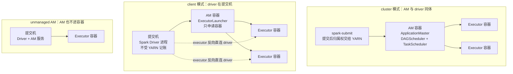
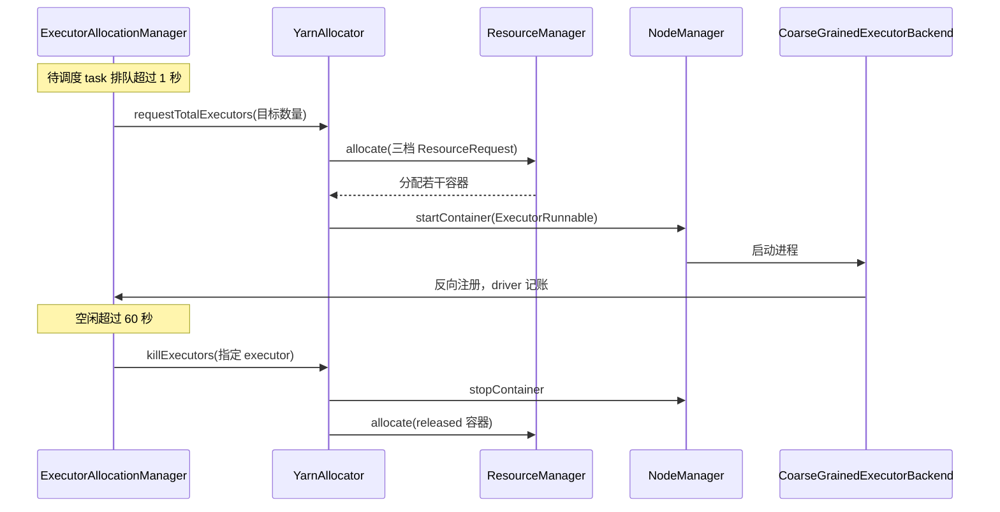
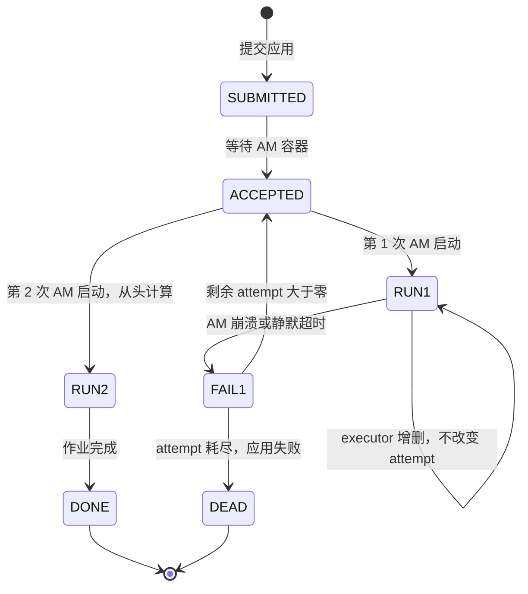
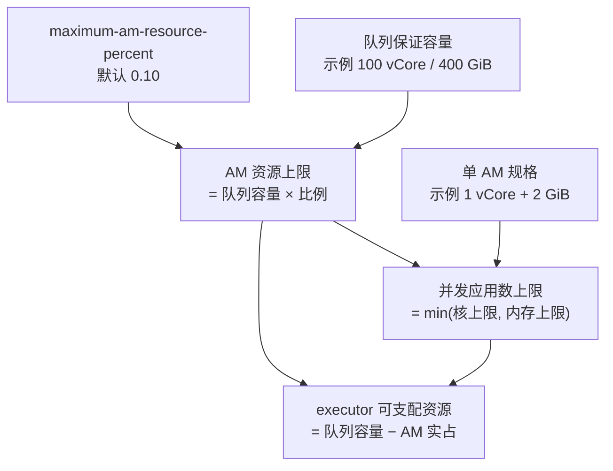
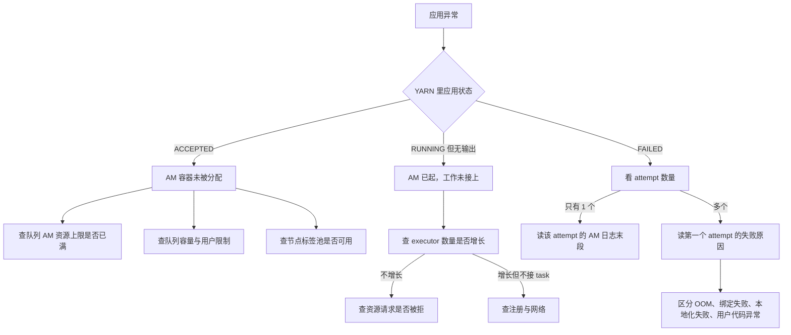

# ApplicationMaster 机制——以 Spark on YARN 为例

**摘要：**

ApplicationMaster（AM）是每个 YARN 应用自带的驻场进程，也是唯一同时知道"这个应用要什么"和"集群现在有什么"的角色。它一旦挂掉，应用的调度中枢随之消失，正在算的进度也没有第二份副本，因此它的位置、内存与重试次数都不是运维细节，而是应用侧必须自己负责的设计决定。本文以 Spark on YARN 为贯穿案例，沿三条主线展开：其一，AM 站在哪里——cluster、client 与 unmanaged 三种运行模式的判据，以及 client 模式四个容易被忽略的代价，即提交机成为单点、网络共享、日志分散、driver 内存不入账；其二，AM 要多少资源——从 `YarnClusterSchedulerBackend` 提请求、`YarnAllocator` 谈资源、`ExecutorRunnable` 起容器到 `CoarseGrainedExecutorBackend` 反向注册的完整链路，把 `spark.executor.memory` 到容器申请量之间的换算讲透，并给出申请被拒的三种判据；其三，AM 死了怎么办——attempt 语义、三层重试上限，以及"重试等于从零重算"这个与 MapReduce 截然不同的后果。文中反复回到两条判据：应用停在 ACCEPTED 多半是被 AM 配额挡住，而不是集群没资源；重试抬高的是可用性，从不抬高完成度。最后以六种 AM 侧故障形态收口，逐一给出判据与处置代价。

---

## 第 1 章 AM 的位子：从 JobTracker 拆出来的那一半

2013 年秋，Hadoop 2.0.0 正式发布，MRv1 里那个既管资源又管任务进度的 JobTracker 被切成两块：一块是 ResourceManager（RM），只对集群资源负责；另一块是 ApplicationMaster，只对单个应用负责。这个切法常被解释成"把调度与资源管理解耦"，但真正改变运维形态的是另一半——**应用级单点**。集群级的单点可以靠主备切换和状态存储兜住，应用级的单点没有这条路，因为每个应用都自带一个单点，而且每个单点长得都不一样。

### 1.1 AM 在一个应用里管的三件事

翻看任何一个框架的 AM 实现，职责都可以归成三件事。第一件是注册与心跳：AM 启动后向 RM 的 `ApplicationMasterService` 注册，之后按固定间隔发 allocate 心跳，RM 靠这条心跳判断它还活着，`yarn.am.liveness-monitor.expiry-interval-ms`（默认 600000 毫秒）就是这条生命线的宽容度。第二件是资源谈判：AM 不是直接把任务塞进队列，而是把"我需要什么规格、要几个、偏好放在哪"整理成资源请求（ResourceRequest）交给调度器，等调度器在某个节点心跳时把容器分配回来。第三件是监督与清理：容器起来之后是否真的接上了工作、失败了几次、应用结束时要怎么释放、退出码要不要上报，全部由 AM 决定，RM 只负责传递消息。

这三件事拼在一起，构成了一个很朴素的比喻：AM 像是驻场项目经理，甲方（RM）只跟他一个人对接，施工队（Executor）只听他一个人调度。项目顺利时，项目经理看起来多余；项目出问题时，所有人都在等他做决定。三者之间的完整分工——RM 管资源与状态机、NM 管容器与本地化、AM 管应用语义——在 [[大数据/Hadoop/Yarn/02 YARN 整体架构全景——ResourceManager、NodeManager 与 ApplicationMaster 三角协作|YARN 整体架构]]里给出全景，本章只取 AM 这一角。

### 1.2 为什么"框架无关"的代价是"应用级单点"

YARN 的核心卖点之一是框架无关：MapReduce、Spark、Flink、Tez 都能跑上来，RM 一行代码不用改。这件事之所以成立，靠的正是 AM 把框架语义全部吞进自己肚子里，只向 YARN 暴露一套很薄的接口——申请容器、启动容器、报告状态。代价也随之而来：YARN 完全不知道 AM 内部在做什么，也就无法替 AM 保存任何应用状态。RM 能给的不是"帮你继续跑"，只是"帮你再起一个"。

这条推论在实际运维里很硬。集群级的故障可以靠 RM 主备切换来兜，因为 RM 的状态是集群的公共状态，可以写进 ZooKeeper 或状态存储；AM 的状态是应用私有的（DAG、血缘、已完成的 stage、shuffle 输出的位置），YARN 既没有接口去读它，也没有义务去存它。所以当有人期待"YARN 的 AM 重试能像数据库主从一样无缝接管"时，答案在原理上就是否定的。

### 1.3 三个设计问题的引线

后面几章围绕三个问题展开，它们分别对应 AM 的位子、AM 的账和 AM 的死法。

位子问题是"AM 和 driver 是不是同一个进程"，答案是三种运行模式；账的问题是"AM 自身占多少资源、替 executor 要多少资源"，答案是内存换算口径和队列的 AM 资源上限；死的问题是"AM 挂了之后 YARN 会做什么、应用会付出什么"，答案是 attempt 语义和重算量。这三个问题之所以值得单独拎出来，是因为它们的默认值几乎都配错了却看不出来——client 模式默认能提交，AM 资源上限默认只有 10%，重试次数默认只有 2 次。

---

## 第 2 章 三种运行模式：AM 站在哪里

Spark 的 `--deploy-mode` 只暴露了两个值，但 YARN 上的 AM 运行形态其实有三种。三种形态的差别不在于"哪个更快"，而在于进程边界画在哪里，以及边界之外的那部分由谁负责可靠性。

### 2.1 判据只有一条：driver 和 AM 是不是同一个进程

Spark 有自己的主控程序 Driver，负责建 DAG、切 stage、分发 task；YARN 有自己的 AM，负责谈资源、起容器、报心跳。这两者是否合体，决定了所有后续行为。

cluster 模式下 `spark-submit` 提交的主类是 `org.apache.spark.deploy.yarn.ApplicationMaster`，它在同一个 JVM 里先向 RM 注册，再单开一个线程执行用户代码，用户代码里创建的 `SparkContext` 反过来把自己的 host 和 port 交给 AM，AM 用这对地址向 RM 注册自己——注册的正是 driver 的地址。所以 **AM 即 driver**，不是比喻，是同一个进程里的同一份状态。

client 模式下提交的主类换成了 `org.apache.spark.deploy.yarn.ExecutorLauncher`，driver 留在提交机上，AM 变成一个纯粹的代理人：它向 RM 注册（注册时上报的端口是 -1，因为它不监听任何连接），替 driver 申请容器并起动容器，但它不参与 task 的分发——executor 起来之后直接连 driver，task 从 driver 发出去，AM 只是一个不见面的中介。两条模式的差别可以用一句粗话说清：cluster 模式是把司机也一起租进车队，client 模式是让自家的电脑远程开一辆租来的车。

### 2.2 cluster 模式：AM 就是 driver

cluster 模式的链路有一个与直觉相反的顺序：客户端提交应用上下文 → RM 分配 AM 容器 → NM 在容器里拉起 `ApplicationMaster` → AM 先单开线程跑用户代码 → 等 `SparkContext` 初始化完成拿到 driver 的 host/port → 这时才用这对地址向 RM 注册 → 建 `YarnAllocator` 开始申请 executor → 解除用户线程的阻塞。也就是说 AM 是"先算起来、后注册"的，注册动作发生在用户代码已经把 `SparkContext` 建好之后，因为注册需要上报 driver 的地址，而地址只有 `SparkContext` 建好才知道。注册之前如果失败，退出码走的是 `EXIT_SC_NOT_INITED` 那条路径，而不是普通的失败上报——这也是判读 AM 日志时的一个路标。

客户端这边由 `spark.yarn.submit.waitAppCompletion`（默认 true）决定是否等应用结束；即使客户端进程被关掉，应用仍在集群里继续跑，因为归属权已经在 YARN 那一侧。

这里有一个容易被误读的等待窗口。AM 启动用户代码线程后，要等 `SparkContext` 创建完成才能继续，这个等待由 `spark.yarn.am.waitTime`（默认 100 秒）兜底，超时后 AM 以 `Timed out waiting for SparkContext.` 失败退出。这解释了集群上常见的一类失败：用户在 `main` 里做了很久的准备工作（读配置、连外部系统、跑一段本地计算）才创建 `SparkContext`，AM 等不及就先走了。它不是资源问题，是时序问题。

### 2.3 client 模式：AM 只是一个代理人

client 模式下，driver 在提交机上跑，AM 在集群里跑，两者之间是一条 RPC 通道。executor 起来之后不与 AM 通信，而是直接连 driver——这意味着提交机必须能被集群里的每一个 executor 节点反向访问，`spark.driver.host` 必须是集群可达的地址，而不能是 `localhost`、`127.0.0.1` 或者某个只有提交机能解析的主机名。这条要求在多网卡机器、容器化提交环境、VPN 接入的笔记本上几乎必然出问题。

更要紧的是失败语义。client 模式下，应用最终状态的判定权在 AM 那一侧，而 AM 常常无法区分"用户主动杀了客户端"和"客户端真的崩了"，所以 Spark 3.3 引入了两个开关来修正这个默认行为：`spark.yarn.am.clientModeTreatDisconnectAsFailed`（默认 false）让 AM 与 driver 的非正常断开记为失败，`spark.yarn.am.clientModeExitOnError`（默认 false）让 driver 在拿到 FAILED 或 KILLED 的最终状态时停掉 `SparkContext` 并以退出码 1 结束。两个默认值都是 false，含义很直接——**失败在记录里消失**，调度系统看到的是 SUCCESS，而数据其实没算完。

### 2.4 client 模式的四个隐形代价

client 模式在开发和调试阶段确实顺手：终端里能直接看到 driver 日志，断点能打，报错不用去翻容器日志。但把它放进生产，要付四笔账，每一笔都不会在提交成功时提醒你。

第一笔是提交机成了单点。driver 是一个普通 JVM 进程，没有容器边界、没有 NM 监控、没有 YARN 的重试。提交机重启、网络抖动、SSH 会话被杀、磁盘写满导致日志写不进去，任何一个都会让 driver 消失；driver 一消失，AM 因为连不上它而退出，YARN 认为应用失败。cluster 模式下这些故障中的大部分会被 YARN 的 attempt 机制接住（虽然代价是重算），client 模式下连接住的机会都没有。

第二笔是 AM 与客户端共享网络。AM 在集群里，driver 在集群外，两者之间是跨边界的 RPC；executor 又必须直连 driver，于是"提交机到每个工作节点"的网络质量成了应用稳定性的隐含前提。跨机房提交、通过跳板机提交、在办公网提交，都会把这条隐含前提变成偶发的超时和 `FetchFailed`。

第三笔是日志分散。`yarn logs -applicationId` 只能聚合容器日志，client 模式的 driver 日志留在提交机的当前目录或 `SPARK_LOG_DIR` 里，与 executor 日志隔了一道边界；`spark.yarn.am.includeDriverLogsLink` 这类配置也只能在 driver 自己写日志的前提下改善链接体验。排障时最常见的场景是：YARN 上看一切正常，容器日志里没有任何异常，因为异常全在提交机上，而提交机已经重装过了。

第四笔是 `spark.driver.memory` 吃的是提交机的内存。这个参数在 client 模式下不经过 YARN 记账，它直接决定提交机上那个 JVM 的 `-Xmx`：设 8g 就是占提交机 8g，设 16g 就可能把一台跳板机拖死，而集群侧完全看不到这笔开销，容量规划里也不会算它。反过来，如果提交机内存不够，driver 会 OOM，而这个 OOM 与集群的资源水位毫无关系。

### 2.5 unmanaged AM：把 AM 也交给客户端

第三种形态不太常见但确实存在。`spark.yarn.unmanagedAM.enabled`（Spark 3.0 起，默认 false）让客户端自己在本地启动 AM 服务，只向 RM 申请一个"非托管"的应用标识，AM 进程不进 YARN 容器。它的用途是调试 AM 本身——改一行 AM 代码不用重新打包提交、不用等容器调度，本地就能跑起来对。代价也很直白：AM 既不受 YARN 的资源限制，也不受 YARN 的存活监控，client 模式的四笔账它一笔不少地继承下来，还多了一笔"AM 的资源不计入任何队列"。它属于开发工具，不属于部署方案。

### 2.6 三模式对照与生产选择

三种形态的差异集中在进程边界与可靠性归属上，下图把它画在同一张图里。



对照表按运维关心的维度排列，最后一行是判据。

| 维度 | cluster 模式 | client 模式 | unmanaged AM |
|---|---|---|---|
| driver 位置 | YARN AM 容器内 | 提交机本地进程 | 提交机本地进程 |
| 提交的主类 | `ApplicationMaster` | `ExecutorLauncher` | `ExecutorLauncher` 的变体 |
| AM 是否监听端口 | 是，上报 driver 的 host/port | 否，上报端口 -1 | 否 |
| driver 资源记账 | 计入队列，受 `spark.driver.memory` 约束 | 不计入，直接吃提交机内存 | 不计入，也不占 AM 配额 |
| driver 失败谁处理 | YARN 的 attempt 机制 | 无处理，应用失败 | 无处理，应用失败 |
| 日志落点 | 容器日志，可被 `yarn logs` 聚合 | 提交机本地文件 | 提交机本地文件 |
| 默认最终状态判定 | 按 AM 上报的真实状态 | 常以 SUCCESS 收尾 | 同 client |
| 适用判据 | 任何被调度系统触发的生产作业 | 交互式调试、`spark-shell` | 只用于调试 AM 代码本身 |

如果只能记一条判据，那就是：作业一旦由调度系统触发，就必须用 cluster 模式。调度系统的语义是"提交后无人值守"，而无人值守与"driver 挂在某个随时会重启的提交机上"是互斥的；把这两件事放在一起，等于给调度系统埋了一个它看不见的失败源。

---

## 第 3 章 从 requestTotalExecutors 到 executor 注册

AM 上线之后干的活，本质是一场持续的采购谈判：driver 说要几个 executor，AM 把它翻译成 YARN 能懂的采购单，等货到、验货、安装、接线。这条链路里任何一环的记账口径不同，都会表现为"资源明明申请了却用不上"。

### 3.1 请求的发起：SchedulerBackend 与 ResourceRequest

cluster 模式下，driver 里的 `SchedulerBackend` 实现是 `YarnClusterSchedulerBackend`，它把 `spark.executor.instances`、动态分配的扩缩容请求、以及本地性偏好整理成一次 `requestTotalExecutors(targetNumExecutors, localityAwareTasks, hostToLocalTaskCount)` 调用，通过同 JVM 内的 RPC 发给 AM 的 `YarnAM` 端点。client 模式下对端换成 `YarnClientSchedulerBackend`，调用跨网络走到 `ExecutorLauncher`。

`localityAwareTasks` 与 `hostToLocalTaskCount` 这两项是关键：driver 把"有多少待调度 task 是本地性敏感的"和"每个主机上有多少 task 想就近跑"报给 AM，AM 再据此生成三档资源请求（节点、机架、任意）。这套接口刻意做得很薄——YARN 不知道 task 的存在，Spark 也不需要理解队列、标签、抢占。

### 3.2 心跳与分配：YarnAllocator 的账本

AM 里的 `YarnAllocator` 维护三份账：目标数、待发请求表、已运行容器表。每轮 allocate 心跳它做四件事：把还没满足的请求重新提交给 RM、收下 RM 分配回来的容器、把不匹配请求的容器退回去、启动匹配上的容器。

请求在提交前会被规整成三档，并带上 `relaxLocality` 标记。节点档（`resourceName` 是主机名）允许降级，任意档（`resourceName` 是 `*`）不允许降级，调度器在等待超时后按照降级顺序把请求往下一档挪。**三档请求同时在场**，是这套机制能兼顾"就近"与"尽快"的关键，也是判读分配日志时最容易看晕的地方——同一轮 allocate 里既有主机名，也有一个星号。这段逻辑是 Spark 侧本地性与 YARN 侧延迟调度的接缝，调度器那一半的算法在 [[大数据/Hadoop/Yarn/05 调度器深度解析——Capacity Scheduler 与 Fair Scheduler 的算法内核|调度器内核]]里展开。

心跳节奏本身在变。常规间隔是 `spark.yarn.scheduler.heartbeat.interval-ms`（默认 3 秒），但只要还有待满足的请求，AM 就用 `spark.yarn.scheduler.initial-allocation.interval`（默认 200 毫秒）连追几轮，直到请求被满足才退回 3 秒。这意味着一次提交之后的前几百毫秒里，AM 对 RM 的心跳频率是平时的十五倍——短作业启动快、长作业开销小，靠的就是这个自适应。

容器真正启动还有第二道闸：`spark.yarn.containerLauncherMaxThreads`（默认 25）限制了同时调用 NM `startContainer` 的线程数。一次申请 200 个 executor 时，AM 不会同时向 200 个 NM 发指令，而是排队分批，这就是为什么大规模扩缩容时"分配到了"和"起来了"之间总有一段肉眼可见的时延。

分配回来的容器不一定都能用。RM 只在节点心跳时做分配，它给出的是"这个节点此刻有这么多资源"，而 AM 的请求可能已经变化——目标数被调小、某个主机不再需要、本地性已经降级。对不上请求的容器不会被强行使用，AM 会把它退回（release），由 RM 重新分配；这一步在日志里表现为"收到若干容器、实际使用若干容器"的两组数字，两个数字长期偏差很大，通常意味着请求表与目标数在频繁抖动，动态分配的扩缩容尤其容易制造这种抖动。

容器启动失败还有一层防护，默认是关着的：`spark.yarn.executor.launch.excludeOnFailure.enabled`（3.1 起，默认 false）让 AM 记住那些反复启动失败的节点并在后续申请中排除，`spark.yarn.exclude.nodes`（3.0 起）则允许在提交时直接给出一个排除清单。两者都是为了应对"某个节点本地化持续失败"这类问题——一个坏节点可以让成百上千个 executor 申请在它身上反复失败，而应用侧看到的现象只是"executor 起不来很快又没了"。

### 3.3 ExecutorRunnable：容器里的那条命令

拿到容器后，AM 会构造一个 `ExecutorRunnable`，把启动参数打包成容器启动上下文（ContainerLaunchContext）：命令、环境变量、要本地化的资源（jar、archive、file）、以及安全令牌。命令的骨架大致如下，注释标出每一段是为了解决什么。

```bash
# AM 交给 NM 的 executor 启动命令（简化，实际由 ExecutorRunnable.prepareCommand 生成）
java \
  -server \
  -Xmx4096m \
  -Djava.io.tmpdir=$PWD/tmp \
  -Dspark.yarn.app.container.log.dir=<LOG_DIR> \
  org.apache.spark.executor.CoarseGrainedExecutorBackend \
    --driver-url spark://CoarseGrainedScheduler@<driver-host>:<driver-port> \
    --executor-id <executor-id> \
    --hostname <container-host> \
    --cores 4 \
    --app-id <app-id> \
    --resourceProfileId 0 \
    1><LOG_DIR>/stdout 2><LOG_DIR>/stderr
```

三个参数承担了整条链路的接续：`--driver-url` 是 executor 反向注册的目标，`<driver-host>:<driver-port>` 取自 AM 注册时上报的 driver 地址（cluster 模式就是这个 AM 自己），`--cores` 告诉 executor 它能并发跑几个 task，`--executor-id` 由 AM 分配，是后续所有记账的主键。`PWD` 与 `LOG_DIR` 指向 NM 为这个容器准备的目录，所以 executor 看不到宿主机上的其它东西——这是容器本地化的副产品。

### 3.4 反向注册：容器起来不等于 executor 可用

命令拉起来之后，`CoarseGrainedExecutorBackend` 要先连上 driver（`spark://CoarseGrainedScheduler@...`）才算注册成功；注册成功后 driver 才把它纳入调度池，才开始往上派 task。这条从 executor 到 driver 的握手是**反向注册**，方向与申请链路正好相反，也是 client 模式对网络要求苛刻的根源。在这之前，YARN 的视角里容器已经 RUNNING，Spark 的视角里 executor 数量还是零。

**容器起来不等于 executor 可用**，这个中间态是所有"申请到了却卡住"类问题的藏身处。判据很简单：看 driver 日志里 executor 数量是否增长，看 AM 日志里 `Launching container ...` 之后有没有对应的注册回执，再看 YARN 里该容器的状态是不是 RUNNING 且退出码为空。三者对不上，就是注册链路断了，而不是资源没给。

### 3.5 内存换算：executor.memory 为什么变成更大的容器

`spark.executor.memory` 只买堆，YARN 卖的是整容器。容器申请量由四项相加：堆、非堆（`spark.executor.memoryOverhead`）、堆外内存池（`spark.memory.offHeap.size`，默认 0）、以及 PySpark 的 Python worker 额度（`spark.executor.pyspark.memory`，默认不设）。非堆那一项的默认值不是一个数，而是一个表达式：`max(executor.memory × spark.executor.memoryOverheadFactor, 384 MiB)`，因子在 3.x 默认 0.10。

举例推一下，`spark.executor.memory=4g`、默认因子 0.10，则非堆为 `max(4096 × 0.1, 384) = 410 MiB`，容器申请量 4506 MiB；再按集群的 `yarn.scheduler.minimum-allocation-mb`（默认 1024 MiB）向上规整，实际落到 5120 MiB。这就是"executor 内存设了 4G、YARN 上看到申请了 5G"的完整来路——不是 YARN 多收，是两笔账记在了一起。

| `spark.executor.memory` | 因子 | 非堆（MiB） | 相加（MiB） | 规整到 1024 后（MiB） |
|---|---|---|---|---|
| 2g | 0.10 | 384（下限生效） | 2432 | 3072 |
| 4g | 0.10 | 410 | 4506 | 5120 |
| 8g | 0.10 | 819 | 9011 | 9216 |
| 8g | 0.20 | 1638 | 9830 | 10240 |
| 16g | 0.10 | 1638 | 18022 | 18432 |

配置项本身也换过一次名字。3.0 之前写作 `spark.yarn.executor.memoryOverhead`、`spark.yarn.driver.memoryOverhead`，3.0 起统一成 `spark.executor.memoryOverhead`、`spark.driver.memoryOverhead`，并用 `spark.executor.memoryOverheadFactor`、`spark.driver.memoryOverheadFactor` 表达比例；旧键在 3.x 仍被识别，但新写的作业不该再依赖它们。另一处容易忽略的差异是默认因子并非全局的 0.10：非 JVM 作业（以 PySpark 为主）在 Kubernetes 上的默认值是 0.40，同一个作业换执行引擎，容器规格会凭空变大几倍。

vCore 那一侧的记账比内存简单得多，也粗暴得多：`spark.executor.cores` 的值直接作为容器的 vCore 请求量，低于 `yarn.scheduler.minimum-allocation-vcores`（默认 1）时按 1 算。但"记了账"不等于"按它调度"——如果容量调度器配置的是 `DefaultResourceCalculator`，它在分配容器时只看内存，vCore 只是记在账上用于展示。结果是节点上 4 个 vCore 可以跑出 16 个 executor，每个 executor 都认为自己独占 4 个核，实际在争抢同一批 CPU；现象是 task 数量上去了、单 task 变慢、GC 时间占比上升，而 YARN 的队列视图里 vCore 早已超卖。要让 vCore 参与决策，得换 `DominantResourceCalculator`，代价是它对内存与 vCore 一起取主导资源，装箱更严格，小容器更难凑满节点。

> [!warning] 一处常见的误配
> 只把 `spark.executor.memory` 从 4g 调到 8g，却把 `spark.executor.memoryOverhead` 写成固定值 512MiB。堆翻倍而非堆不涨，Netty 直接缓冲、线程栈、Metaspace 的开销却随并发 fetch 数与线程数一起涨，结果就是容器被 NM 以物理内存超限杀掉，而 JVM 堆里干干净净、一个 `OutOfMemoryError` 都没有。

### 3.6 申请被拒的三种判据

申请被拒不是一个现象，而是三种，各自的判据不同，处置方向也不同。

其一是单容器规格超过集群上限。RM 侧会抛 `InvalidResourceRequestException`，文案明确写着"请求的资源大于最大允许分配"，并且附带说明了那个常被忽略的事实——最大允许分配不只看配置的 `yarn.scheduler.maximum-allocation-mb`（默认 8192 MiB），还要看已注册 NM 上报的最大资源，取两者中较小的那个。所以配置写成 8192 而集群里最大的机器只有 8g 可用时，实际上限可能小于 8192。

其二是队列配额不足。请求合法但队列的保证容量与最大容量已被占满，容器就一直不分配；集群看起来不忙，因为空闲资源在别的队列里。这类等待没有报错，只有时间。

其三是节点剩余资源不足或规格无法装箱。请求合法、配额也有，但没有一个节点的剩余资源能容下这个规格，于是请求一直在待满足状态里打转。判据是 RM 侧的待分配请求数与集群的空闲资源对不上——比如集群空闲 40 vCore，却一个 16 vCore 的请求都满足不了，因为空闲量分散在六个节点上。

### 3.7 弹性分配：动态分配与它的前提

静态分配把 executor 数量钉死，问题在两头：宽依赖 stage 需要大量并行时不够用，窄依赖 stage 又让 executor 空转。动态分配（Dynamic Allocation）由 driver 里的 `ExecutorAllocationManager` 驱动：待调度 task 排队超过 `spark.dynamicAllocation.schedulerBacklogTimeout`（默认 1s）就申请新 executor，后续轮次用 `sustainedSchedulerBacklogTimeout`（默认同前）继续，数量按翻倍增长，上限是 `maxExecutors`；executor 空闲超过 `spark.dynamicAllocation.executorIdleTimeout`（默认 60s）就通知 AM 释放容器。AM 这边只负责执行 `requestTotalExecutors` 和 `killExecutors`，它不理解"为什么"。

释放 executor 有一个硬前提：executor 上的 shuffle 数据不能随进程一起消失。Spark 3.5 的文档列了四条满足路径——部署了外部 shuffle 服务（`spark.shuffle.service.enabled`，`spark.shuffle.service.port` 默认 7337）、开启 `spark.dynamicAllocation.shuffleTracking.enabled`、同时开启 `spark.decommission.enabled` 与 `spark.storage.decommission.shuffleBlocks.enabled`、或者提供自定义的 `ShuffleDataIO`。四者一个都不满足就打开动态分配，表现是 reducer 端 `FetchFailed` 连环触发 stage 重试，而 AM 侧一切正常。



---

## 第 4 章 AM 挂了会怎样

这一章是全文的核心。AM 挂掉之后发生的事情，一半由 YARN 决定（判死、重建），一半由应用自己决定（重算、状态恢复），两者交接的位置就是"重试"这个词最容易产生误解的地方。

### 4.1 判死：600 秒的静默与立即的退出

RM 判定 AM 死亡有两条路径。如果 AM 容器自己退出（JVM 崩溃、OOM 被杀、节点宕机），NM 会立刻上报容器完成，RM 随即把这次 attempt 记为失败，延迟只有秒级。如果 AM 进程还在但不再发心跳（网络分区、长时间 GC、被挂起），RM 要等 `yarn.am.liveness-monitor.expiry-interval-ms` 到期，默认 600000 毫秒，也就是十分钟。

这个十分钟是个非常尴尬的默认值。它足够长，长到在这段时间里应用的所有资源都白白占着、所有 executor 都在等一个不会来的 task；它又不够长，长不回来那些已经被操作系统清理掉的状态。所以看到"应用在集群上莫名挂了，时间点比预期晚了十分钟"的现场，第一反应应该是去看 AM 是否曾经静默过。

还有一套完全独立的存活判定在同时运转。AM 与 RM 之间的心跳走 YARN 的十分钟闸门，driver 与 executor 之间的心跳走 Spark 自己的 `spark.network.timeout`（默认 120 秒）；两套判定的对象、时间尺度、后果都不一样。这中间因此存在一个错位窗口：driver 侧早就认定某个 executor 失联并把它的 task 重新排队，RM 侧却认为 AM 一切正常；反过来，AM 已经不再发心跳、正在等 RM 判死，driver 仍在正常给 executor 派 task，直到进程真正被杀。排障时把这两种"失联"混为一谈，会得出互相矛盾的结论——一边说 executor 死了很多次，一边说 AM 心跳一直正常。

### 4.2 三层上限：谁在数 attempt

YARN 侧有两个名字相近的参数，加上应用侧的一个，一共三层。`yarn.resourcemanager.am.max-attempts`（默认 2）是应用未指定时的默认上限，`yarn.resourcemanager.am.global.max-attempts` 是全局硬上限，默认取前者的值；应用可以通过提交上下文里的 `MaxAppAttempts` 请求一个自己的值，但超过全局上限时会被 RM 覆盖回上限值。

Spark 侧的入口是 `spark.yarn.maxAppAttempts`，它的默认值就是 RM 配置的那个数，且必须不大于全局上限；MapReduce 侧的名字则是 `mapreduce.am.max-attempts`（默认 2），而不是 `yarn.app.mapreduce.am.max-attempts` 这种看上去更"YARN 味"的拼法——后者在 Hadoop 3.3 的 `mapred-default.xml` 里并不存在，不少调优文档照抄错了之后，配置静默失效。

| 参数 | 默认值 | 语义 | 调大的代价 / 调小的代价 |
|---|---|---|---|
| `yarn.resourcemanager.am.max-attempts` | 2 | 应用未显式指定时的 attempt 总数上限 | 调大：失败作业反复重来，持续占用 AM 配额；调小：偶发失败直接终结 |
| `yarn.resourcemanager.am.global.max-attempts` | 取上一项的值 | RM 侧全局硬上限，覆盖应用请求 | 调大：任何应用都能申请更多重试，集群失去兜底；调小：自定义上限被压平 |
| `spark.yarn.maxAppAttempts` | 取 RM 的值 | Spark 提交时请求的 attempt 总数 | 调大：单作业重算成本成倍放大；调小：丧失一次快速重试的机会 |
| `mapreduce.am.max-attempts` | 2 | MR 作业的 attempt 总数 | 同上 |
| `spark.yarn.am.attemptFailuresValidityInterval` | 不启用 | AM 稳定运行超过该时长后失败计数清零 | 启用后：长跑作业的偶发重启不会累积到上限；副作用是掩盖重复故障 |

请注意第一行措辞：max-attempts 是 attempt 的**总次数**，不是重试次数。默认 2 的含义是"第一次 + 一次重试"，总共跑两次；把它理解成"重试两次"是很常见的偏差，直接导致有人以为默认配置能扛两次失败。

### 4.3 重试之后：新的 driver，白纸一张

RM 决定重试后做的动作很干脆：为同一个应用创建新的 attempt（`appattempt_..._000002`），重新找一个节点起新的 AM 容器。上一个 attempt 名下的容器不会被交接——容器 ID 里带着 attempt 编号，attempt 结束它们就失去归属，YARN 按失败清理；而 executor 这一侧，`CoarseGrainedExecutorBackend` 一旦发现与 driver 的 RPC 连接断开，会自行退出。

所以新 attempt 面对的是一张白纸：没有 RDD 血缘、没有 stage 完成记录、没有 map 输出位置，只有一个待申请的 executor 池和一个从头开始的 driver。`spark.yarn.maxAppAttempts` 保证的是"这个应用还能不能再起一次"，不是"这个应用能不能接着跑"。

下图把一个应用从提交到 attempt 耗尽的过程画全，注意每个 attempt 都是一条完整的新链路，不是上一条链路的续接。



### 4.4 重算量：重试不接续

**重试不等于续跑**，这是 Spark 的 AM 重试与 MapReduce 最本质的差别。MR 的 AM 重启会尝试从作业历史与 staging 目录里恢复已完成的 task 状态（`MRAppMaster` 的 Recovery 机制），因此它的 attempt 计数是"部分回退"；Spark 没有 task 级的持久记录可恢复，粗粒度执行模型下 task 的生命周期完全依附于 driver 的内存状态，driver 一死，所有进度归零。

把重算量算清楚很有必要，下面是一个示例推算（假设单次 attempt 跑完全量需要 T）：

| 场景 | attempt 数 | 已跑进度 | 实际耗时 | 有效产出 |
|---|---|---|---|---|
| 第 1 次即成功 | 1 | — | T | T |
| 第 1 次跑到 70% 失败，第 2 次成功 | 2 | 0.7T 作废 | 0.7T + T = 1.7T | T |
| 两次都跑到 70% 失败（默认上限耗尽） | 2 | 1.4T 全废 | 1.4T | 0 |
| 把上限调到 4 次、前三次都在 70% 失败 | 4 | 2.1T 全废 | 2.1T + T = 3.1T | T |

这张表的结论比任何调优建议都直接：重试抬高的是可用性，不是完成度。同一个作业重试一次的代价，接近把它的运行时间乘以 1.7；如果故障点在 90% 之后，代价逼近 1.9 倍。这也解释了为什么长跑作业（小时级以上的批处理、流处理）在工程上更愿意把中间结果落到外部：Hive 表、Iceberg/Delta 的提交语义、Structured Streaming 的 checkpoint。它们不是为了让 AM 重启更快，是为了让 AM 重启之后不必从零开始。在 Spark 体系里把这条路走通的主要是 Structured Streaming——checkpoint 里存着 offset 与状态存储的元信息，新 driver 从最近一次提交的批次续上，前面完成的批次不会重算。

外部 shuffle 服务在这里容易造成错觉：启用了它之后，被 kill 的 executor 写下的 shuffle 文件仍然留在节点磁盘上，看起来"数据还在"。但新 driver 的 `MapOutputTracker` 里没有任何记录，它不知道这些文件属于谁、对应哪个 stage、是否完整，于是 map 阶段照旧重跑。数据没消失，元数据消失了，而 Spark 执行靠的是元数据。

重算范围还会沿着血缘往外扩一层。设有一条链 A → B → C，B 与 C 之间是宽依赖；attempt 重启后，A、B 都要重算，连带 C 里已经完成的部分也要重来，因为 C 的输入来自 B 的 shuffle 输出，而 B 的输出位置已经无从查证。换句话说，重算的粒度不是"挂掉的 task"，而是"最后一个还没有被固化到外部的 shuffle 边界之后的全部计算"。反过来说，如果作业在某个位置做了检查点或者把中间结果落成了表，那个位置就成了一道新的边界，边界之前的可以不算，边界之后的仍要算——这也解释了为什么 checkpoint 的位置选择比 checkpoint 的频率更影响恢复成本。

> [!note] 关于 AM 重试的定位
> 把 AM 重试理解成"进程级看门狗"更准确：它保证应用不会因为一次进程崩溃就永久失败，但它不提供状态连续性。真正的连续性是另一个话题——RM 主备切换、状态存储、work-preserving restart，这些在 [[大数据/Hadoop/Yarn/08 YARN 高可用与故障恢复——ResourceManager HA 与 AM 重试机制|YARN 高可用]]里另有讨论；而应用自身能否续跑，取决于应用有没有把状态放出去。

### 4.5 观测：怎么确认它在重试

判据按从外到内的顺序排列，越往后越接近根因。

| 层级 | 观测点 | 看什么 |
|---|---|---|
| 应用 | `yarn application -status <appId>` | `State`、`Final-State`、`Diagnostics`（会写明失败了几次、AM 容器退出码） |
| attempt | `yarn applicationattempt -list <appId>` | 是否出现多个 attempt，各自的状态与失败时间 |
| attempt 详情 | `yarn applicationattempt -status <appAttemptId>` | 该 attempt 的 AM 容器 ID 与主机 |
| REST | `/ws/v1/cluster/apps/{appid}/appattempts` | 同一份数据的程序化视图，适合接监控 |
| RM 日志 | 以 `appattempt_`、`Application Attempt` 为关键词 | attempt 的状态迁移与 AM 容器分配记录，用于确认判死时刻 |
| AM 日志 | `yarn logs -applicationId <appId> -containerId <containerId>` | 该 attempt 的最后一个异常，通常是真正的原因 |
| executor 日志 | 同上，换容器 ID | `Completed container ... (state: ..., exit status: ...)` 与退出码 |

命令名有个小坑：列出 attempt 的子命令是 `yarn applicationattempt`（对应 shell 客户端的 `ApplicationAttemptReport`），不是大家口语里常说的 `yarn appattempts`；照着简称敲会得到"命令未找到"，而在排障现场这往往被误判成权限或客户端版本问题。

### 4.6 重试不是高可用

如果只从 YARN 的视角看，AM 重试是一次典型的"会死会重生"设计：进程死掉，换一个起来，外界几乎无感。但从应用的视角看，重生的代价由应用全额承担。这个视角差在集群上会表现为一种很迷惑的现象：应用的成功率看起来还行，但集群的 CPU 时间消耗远高于业务量应有的水平，因为失败作业在背后反复重跑。

因此对"AM 反复重试"的正确态度不是调大上限，而是把它当症状：反复重试说明有一个稳定的触发条件，可能是 AM 内存不足、可能是某个节点的本地化持续失败、可能是 driver 里的用户代码存在固定位置的异常。默认上限 2 的设计意图恰恰是限制这类症状的放大——它只给你一次重试的机会，让你不得不去看日志。

---

## 第 5 章 AM 的资源占比：队列里最贵的空转

讨论 AM 的资源时容易陷入一个错觉：AM 只要 1 个 vCore 和 2G 内存，比起动辄几十个 executor 的作业微不足道。单看一个 AM 确实如此，但队列里同时跑的应用一多，AM 的总量就成了决定"这个队列能跑多少应用"的硬约束。

### 5.1 上限的定义与它的算法

Capacity Scheduler 用 `yarn.scheduler.capacity.maximum-am-resource-percent`（默认 0.1）限制一个队列里所有 AM 合计能占用的资源比例。官方文档的措辞值得逐字读：它限制的是"用于运行 application master 的资源百分比，用来控制并发活跃应用的数量"，并且"每个队列的限制与该队列的容量和用户限制成正比"。换成工程语，就是 AM 资源上限 = 队列可用容量 × 该比例，而且这个比例可以按队列单独覆盖（`yarn.scheduler.capacity.<queue-path>.maximum-am-resource-percent`），也可以在根队列上给全局默认。

"与该队列的容量成正比"这句话里藏着两个容易被忽略的口径。其一，分母是队列的容量（保证份额），不是集群当前的空闲资源，所以队列再空闲，AM 能用的资源也不会随之膨胀；队列被打满时，AM 的资源也不会被优先让出。其二，"与用户限制成正比"意味着用户维度的上限（`user-limit-factor` 一类参数）会与 AM 上限叠加生效，一个用户想把队列的 AM 配额吃满，得先过自己那道限制。

超过这个上限的申请不会被拒绝，而是留在 ACCEPTED 状态等——文档明确写了这一点。于是"应用提交成功却一直不 RUNNING"最常见的一种解释浮出水面：不是队列没资源，是 AM 配额满了。

三个上限的检查顺序也值得记住：`maximum-applications` 超了直接拒绝提交；`max-parallel-apps` 超了停在 ACCEPTED；AM 资源上限超了同样停在 ACCEPTED。三者表现相似，处置完全不同，排队时先看清是哪一个在挡。

### 5.2 一个队列能跑几个应用

把上限换成应用数，只需要一个除法：并发应用数 ≈（队列保证容量 × AM 比例）÷ 单个 AM 容器规格。这里必须同时算两个维度——内存与 vCore——取更紧的那个。下面这张图把四个量之间的关系摊开，其中"AM 实占"与"executor 可用"是同一块资源的两面，这也是调大比例之所以有代价的位置。



下表是按常见规格做的示例推算，用来展示量级，不是任何集群的实测值。

| 队列保证容量 | AM 比例 | AM 资源上限 | 单 AM 规格（1 vCore + 2 GiB） | 估算并发应用数 |
|---|---|---|---|---|
| 100 vCore / 400 GiB | 0.10 | 10 vCore / 40 GiB | 1 / 2 | 10（vCore 先到顶） |
| 100 vCore / 400 GiB | 0.20 | 20 vCore / 80 GiB | 1 / 2 | 20 |
| 200 vCore / 800 GiB | 0.10 | 20 vCore / 80 GiB | 1 / 2 | 20 |
| 200 vCore / 800 GiB | 0.10 | 20 vCore / 80 GiB | 2 / 4（AM 给了 2 核） | 10 |

最后两行的对比是这张表真正的信息量所在：同样的队列、同样的比例，只因为 AM 规格从 1 核 2G 变成 2 核 4G，并发应用数就腰斩。AM 的规格是按应用计的固定开销，它不会因为应用规模小就缩小，也不会因为 app 只算 100 行数据就少占一个 vCore。这条性质决定了小作业在共享队列里的真实成本：一个跑 30 秒的作业，占用 AM 配额的时间可能是它实际计算时间的几倍。

### 5.3 调大与调小的代价

这个参数是集群里最容易"拍脑袋调大"的一类，原因是它的症状（应用排队）与它的名字（百分比）之间隔着两层推导，而调大的效果立竿见影。

| 方向 | 直接效果 | 代价 |
|---|---|---|
| 调大（0.1 → 0.3） | ACCEPTED 排队的应用快速变成 RUNNING | AM 挤压真正干活的 executor：30% 的资源给了一堆 1 核 2G 的空转进程，作业实际吞吐下降 |
| 调小（0.1 → 0.05） | executor 可支配资源变多，单作业更快 | 并发应用数直接减半，短作业排队时间变长，调度系统看到的是提交积压 |
| 按队列分设 | 交互队列调大、批处理队列保持默认 | 配置复杂度上升，根队列默认值容易被忽略，造成"某队列行为与全局预期不符" |

判断该不该调的判据不是资源利用率，而是应用形态：以短作业为主的队列（交互式查询、调度器高频触发的 ETL）需要更高的 AM 比例，因为它们的瓶颈在排队不在计算；以长作业为主的队列可以维持低比例，因为并发应用本来就少。把这两类应用塞进同一个队列，然后纠结比例该设多少，本身就是队列规划没做好。

### 5.4 AM 自己该给多少内存

两种模式下 AM 内存的来源完全不同。cluster 模式下 AM 就是 driver，内存由 `spark.driver.memory`（默认 1g）决定，非堆由 `spark.driver.memoryOverhead`（默认 `max(10%, 384 MiB)`）决定，vCore 由 `spark.driver.cores` 决定；client 模式下 AM 只是代理人，内存由 `spark.yarn.am.memory`（默认 512m）决定，非堆由 `spark.yarn.am.memoryOverhead`（默认 `max(10%, 384 MiB)`）决定，vCore 由 `spark.yarn.am.cores`（默认 1）决定。

| 模式 | 堆 | 非堆 | vCore | 典型容器申请量 |
|---|---|---|---|---|
| cluster（默认） | `spark.driver.memory` 1g | `spark.driver.memoryOverhead` 384m 起 | `spark.driver.cores` | 约 2048 MiB（按 1024 规整） |
| cluster（调优） | `spark.driver.memory` 4g | 约 410m | `spark.driver.cores` 2 | 约 5120 MiB |
| client | `spark.yarn.am.memory` 512m | 384m 起 | `spark.yarn.am.cores` 1 | 约 1024 MiB |

这里有一个与集群习惯相反的事实：把 AM 的内存调大，收益通常不在"跑得更快"，而在"不容易死"。driver 的堆里放的是 DAG、stage 元信息、task 状态、广播变量句柄、以及 collect 之类操作的结果汇总（受 `spark.driver.maxResultSize` 约束，默认 1g），一个几千 stage 的作业、一个频繁广播大表的作业、一个把结果 collect 到 driver 的作业，都会让 1g 的默认值不够用。反过来，把 AM 内存调到 8g 而作业规模很小，除了浪费队列的 AM 配额，没有任何好处。

### 5.5 AM 内存不足的表现

**AM 内存不足时先死的是 driver**，所以它的形态与 executor 失败完全不同，有三种表现。

第一种是堆内 OOM。堆里装不下 DAG 或结果汇总，抛 `java.lang.OutOfMemoryError: Java heap space`，AM 容器以非零退出码结束，RM 记为 attempt 失败。这种最好判，日志里有一行明确的异常。

第二种是非堆越界。堆没满，但 RSS 超过了容器申请量，NM 的内存监控把容器杀掉，退出码 137（128 + SIGKILL）。AM 日志在这一行之前往往没有任何异常，因为进程是被外部杀的，Spark 侧看到的只是"容器被 YARN 杀了、物理内存超限"，提示里会建议提高 overhead 一类的参数。这一种在 cluster 模式下尤其常见于广播变量多、`spark.driver.maxResultSize` 放得过宽的作业。

第三种是长时间 GC。堆没 OOM，非堆也够，但堆的利用率长期在 90% 以上，Full GC 频繁，AM 发心跳的间隔被拉长；如果单次停顿接近或超过 600 秒的判死阈值，RM 会认为它已经死了。这是最隐蔽的一种：日志里既没有 OOM，也没有 137，只有一堆 GC 记录和一次"莫名"的重试。

---

## 第 6 章 位置、本地性与端口

AM 的位置问题有两层：它自己落在哪个节点，以及它替 executor 要求的那些节点偏好落在哪里。前一层决定它能不能起来，后一层决定数据要不要跨网络。

### 6.1 AM 落在哪个节点

AM 自己也是一个容器，第一层调度由 RM 决定，而 RM 的分配逻辑只看两件事：哪个节点有资源、请求带了什么标签约束。所以 AM 落点本质上不可控，能做的只有排除——用 `spark.yarn.am.nodeLabelExpression` 把 AM 限制到带某个节点标签的机器上，比如只允许落在带 `gateway` 标签的节点。这样做的好处是 AM 的网络出口可预测（便于放通到外部系统）；代价是可用节点池变小，标签节点一忙，AM 就起不来，表现是 ACCEPTED 卡住而集群整体还有空闲资源。

### 6.2 AM 启动前的本地化

**本地化先于进程**：容器分到了并不等于 AM 开始了，NM 要先把它声明的资源下载到本地目录——Spark 的 jar 包（`spark.yarn.jars` 或 `spark.yarn.archive`）、用户 jar（`spark.yarn.user.jar` 与 `spark.yarn.secondary.jars`）、分发的 archive（`spark.yarn.dist.archives`）。这些资源默认从 HDFS 的 staging 目录拉，因此 AM 起不来的原因里有一整类与本地化有关：节点磁盘写满、HDFS 读慢、文件权限不对、多个应用同时抢一个节点的下载带宽。

把 `spark.yarn.jars` 指向 HDFS 上的一个路径（而非默认的上传行为）是常见的止血手法，它让 NM 走 public cache，同一个节点上的第二次启动不必重新下载；代价是 Spark 版本升级时要同步更新这份公共 jar，否则会出现"新老版本混用"的诡异现象。这条链路的完整机制，包括本地化失败的日志判据，在 [[大数据/Hadoop/Yarn/04 Container 生命周期——从资源申请到进程启动的完整调用链|Container 生命周期]]里详述。

### 6.3 executor 的本地性偏好怎么变成 ResourceRequest

executor 的本地性偏好与数据分布有关：driver 知道每个 task 想跑在哪些主机上，AM 把这些偏好翻译成三档请求。简化后的逻辑如下，重点是三档请求的取舍关系。

```scala
// YarnAllocator 生成 ResourceRequest 的核心思路（简化示意）
val hostLocal = pendingTaskLocations
  .flatMap(_.preferredLocations)
  .groupBy(identity)
  .view.mapValues(_.size).toMap

// 节点档：只对偏好 task 最多的前若干个主机提请求，relaxLocality 允许降级
for ((host, count) <- hostLocal.take(numPendingExecutors)) {
  requests += ResourceRequest(host, capability = executorResource,
    numContainers = 1, relaxLocality = true)
}

// 任意档：兜底，保证没有数据偏好的 executor 也能申请到，不允许降级
requests += ResourceRequest(ResourceRequest.ANY, capability = executorResource,
  numContainers = numPendingExecutors, relaxLocality = false)
```

三档请求同时存在于同一个 allocate 心跳里，调度器先从节点档试，等不到再降级到机架档、任意档；等待多久由调度器的延迟调度策略决定。这也是"申请了很久 executor 才起来"与"executor 起来得很快但全是远程读"这两种现象的共同来源：前者是调度器在等本地性，后者是本地性已经降级。

### 6.4 端口：AM 没有自己的端口配置

Spark 3.x 的配置清单里没有 `spark.yarn.am.port` 这一项，原因在 `ApplicationMaster` 的实现里写得很清楚：client 模式的 AM "不监听任何入向连接"，注册时直接上报端口 -1；cluster 模式的 AM 上报的是 driver 的 `spark.driver.host` 与 `spark.driver.port`。也就是说，AM 的端口问题全部落到了 driver 侧的三个参数上。

| 参数 | 默认值 | 作用 | 固定取值的代价 |
|---|---|---|---|
| `spark.driver.port` | 随机 | driver 监听 executor 连接的端口 | 放通防火墙容易，但重试时可能撞上尚未释放的旧端口 |
| `spark.blockManager.port` | 随机 | driver 的 BlockManager 端口 | 同节点多实例时固定值必然冲突 |
| `spark.driver.bindAddress` | 取 `spark.driver.host` | 监听地址，可与对外地址不同 | 配错则监听成功但对端连不上 |

固定端口的动机通常来自网络侧：安全组、白名单、NAT 映射都只愿意为确定的端口开口。这在受控环境里是合理妥协，但要把代价一起接受——随机端口的语义是"每次启动都不同"，固定端口的语义是"每次启动都可能撞车"。

随机并非疏忽，而是有意选的安全侧。`ApplicationMaster` 启动时会检查 `spark.ui.port`，若用户没有显式设置就把它置为 0（临时端口），代码注释给出的理由正是避免同一台机器上多个 Spark 进程互相冲突。这条细节其实已经回答了"AM 重试时端口怎么办"：Spark 自己先选了随机，把冲突概率降到最低，把可达性问题留给网络侧解决。

### 6.5 重试时的端口冲突

固定 `spark.driver.port` 之后，AM 重试会遭遇一种只有在重试用例里才暴露的故障：新的 attempt 可能被调度到同一台机器上，而这台机器上旧的 AM 进程可能还没完全退出，或者虽然退出了但端口处于 TIME_WAIT，新进程绑定失败，抛 `java.net.BindException: Address already in use`，AM 在启动阶段就失败，RM 计入一次 attempt，下一次再撞，直到 max-attempts 耗尽。

这个故障之所以危险，是因为它看起来像"AM 起不来"，而排查方向很容易被引到资源上。判据是 AM 容器日志的第一段（不是最后一段）：如果命令刚拉起就报了绑定异常，与 executor、与队列都没关系。处置方向有两个：其一，接受随机端口（默认值本来就该随机），把防火墙按网段放通而不是按端口；其二，如果业务上必须固定，就把 `spark.driver.port` 固定值与 `spark.blockManager.port` 的固定值分开规划，并接受"同节点同应用只能有一个"的约束。

---

## 第 7 章 六种 AM 侧故障形态

AM 相关的问题之所以难判，是因为症状都落在"应用起不来、应用挂了、应用卡住"这三个笼统的描述上，而根因分散在调度、资源、网络、代码四个层面。下面先给一张按顺序排除的决策树，再把六种形态逐一拆开。

### 7.1 定位顺序



顺序的关键在于"从外到内、从最后一次到第一次"：先看应用状态决定追哪条线，再看 attempt 数量决定读哪一份日志。多个 attempt 时一定要读第一份，因为后续 attempt 往往在重复同一个失败，而第一份日志里的上下文最完整。

### 7.2 形态一：AM 起不来，应用停在 ACCEPTED

症状是提交成功、状态一直 ACCEPTED，客户端也看不出错。判据有两条：队列的 AM 资源上限已满（RM Web UI 的队列视图里 AM 相关用量与上限已接近），而队列的 executor 资源并未占满；把应用换到另一个队列提交，立刻能起来。处置分两种：短期调大该队列的 `maximum-am-resource-percent`，长期是把短作业队列拆出去单独给配额。代价见第 5 章，调大是拿 executor 资源换应用并发。

### 7.3 形态二：AM 反复重启

症状是 `yarn applicationattempt -list` 里出现 `000001`、`000002` 甚至更多，`yarn application -status` 的 Diagnostics 会写明失败了几次、AM 容器退出码是多少。判据是"两次失败发生在同一个阶段"——都在启动后几秒、都在本地化结束前后、都在某个固定动作处。处置的前提是先接受一个事实：重试次数是症状的放大系数，不是解药。真正的动作是读第一个 attempt 的日志，找到那个稳定的触发条件。

### 7.4 形态三：AM OOM

症状是应用在运行中挂掉，YARN 侧看到 AM 容器退出码非零或 137。判据分三类：日志里有 `OutOfMemoryError` 的是堆内不足；日志里没有异常、只有 NM 的"超出物理内存限制"是 overhead 不足；日志里有大量 Full GC 而进程未死是第三种，往往表现为心跳超时后被 RM 判死。处置分别是加 `spark.driver.memory`、加 `spark.driver.memoryOverhead`、以及减少 driver 侧的内存占用（广播变量、collect 用法、stage 数量）。

### 7.5 形态四：executor 申请到了但注册不上

症状是 YARN 上能看到 executor 容器在跑，Spark UI 上 executor 数是 0，AM 日志里 `Launching container ...` 之后没有下文。判据按顺序：driver 日志里有没有来自该 executor 的注册请求；executor 容器日志里连的是哪个 `--driver-url`；那个地址从 executor 所在节点能否连通。最常见的三个根因是网络不可达（提交机在集群外、跨网段、安全组未放通）、端口不通（固定了端口但没放通）、以及 `spark.driver.host` 配成了对端解析不了的地址。这类故障会一路累积到 `spark.yarn.max.executor.failures`（默认 `max(2 × executor 数, 3)`）耗尽，然后应用以"executor 失败次数达上限"整体失败——那时看到的是应用失败，而根因在第一次注册失败时就已注定。

### 7.6 形态五：client 模式客户端退出导致应用失败

症状是用户关掉终端或 SSH 断开之后，应用很快变成 FAILED 或 KILLED。判据是应用提交方式为 client 模式，且失败时间与客户端退出时间对齐。处置不是调参数，而是换模式——这个形态没有配置层面的正解，因为 driver 本来就是那个进程。附带一条：client 模式下应用常常以 SUCCESS 收尾，所以要先确认"失败"是不是真的失败，再去看为什么客户端会退出（OOM、被运维清理、跳板机回收）。

### 7.7 形态六：AM 与 driver 混淆

症状是排障时找错了对象：在 client 模式下以为 AM 挂了就是应用挂了，或者在 cluster 模式下反复去提交机找 driver 日志。判据一句话——看 `--deploy-mode`：cluster 模式下 AM 就是 driver，AM 容器日志就是 driver 日志，`spark.driver.memory` 就是 AM 的内存；client 模式下 AM 只是 `ExecutorLauncher`，driver 日志在提交机，AM 日志里只有资源申请的记录。搞混这一条，会浪费掉大量排查时间，因为两边的日志里都不存在对方的关键信息。

| 形态 | 主要判据 | 处置方向 | 处置代价 |
|---|---|---|---|
| AM 起不来 | 应用停在 ACCEPTED，队列 AM 上限已满 | 调大 AM 比例或拆队列 | executor 资源被 AM 挤占 |
| AM 反复重启 | attempt 列表出现多个编号，失败阶段相同 | 读第一个 attempt 的日志找稳定触发条件 | 需要停作业整改，影响时效 |
| AM OOM | 退出码 137 或 `OutOfMemoryError`，或 GC 后心跳超时 | 加 driver 内存/非堆，或减少 driver 侧占用 | AM 变大，队列 AM 配额消耗增加 |
| 注册不上 | 容器 RUNNING 而 executor 数为 0 | 修网络、修 `spark.driver.host`、放通端口 | 需要网络侧配合 |
| client 客户端退出 | 失败时间与客户端退出对齐 | 改为 cluster 模式 | 失去提交机上的直接日志 |
| AM 与 driver 混淆 | 按 `--deploy-mode` 判断日志归属 | 建立按模式索引的排障路径 | 无资源代价，只是认知成本 |

---

## 第 8 章 三个反例

### 8.1 反例一：生产上用 client 模式

这件事在中小团队里极常见，理由通常是"能直接看到日志"。它的问题不在单次运行，而在四笔账的复利：driver 在提交机上，提交机重启就是一次应用失败；driver 内存吃提交机内存，容量规划看不见；driver 日志不在 YARN 里，事后无法追；应用最终状态默认以 SUCCESS 收尾，调度系统误以为成功，下游任务拿到的是不完整的数据。前三笔会在某次故障里同时兑现，第四笔不会报错，只会让数据慢慢错。

### 8.2 反例二：把 maxAppAttempts 调大当自愈

把 `spark.yarn.maxAppAttempts` 从 2 调到 10，看起来像是给作业加了九次机会。实际发生的是：同一个作业在集群上跑了十遍，每遍都在同一个位置失败，集群的 CPU 时间被消耗十倍，队列的 AM 配额长期被这个应用占着，而运维看到的只是"这个作业老在跑"。更糟的是它与 `spark.yarn.am.attemptFailuresValidityInterval` 的配合容易被误解成"稳定运行一段时间后就清零计数"，于是有人把两个都调大，得到一个能无限重试的作业。

正确用法反过来：上限维持默认或略调大，同时用外部手法兜住不可续跑的损失——把长跑作业拆成可重入的分段，把中间结果落到有提交语义的表里，把流作业的 checkpoint 放在可靠存储上。**重试不等于自愈**，它只是给一次机会。

### 8.3 反例三：只调 executor.memory，不看 overhead

这类调整的动机通常是"executor 老被杀，加内存就好了"。加完之后，容器申请量按 1.1 倍的速度涨，很快就撞上 `yarn.scheduler.maximum-allocation-mb`（默认 8192 MiB）或者某个节点的剩余资源上限，于是从"被杀"变成"申请不出来"，而症状换了一个，人还在原来的方向上找。

正确的动作顺序是先算容器账，再决定加哪里：容器申请量 = 堆 + 非堆 + 堆外 + Python 额度，规整到 `yarn.scheduler.minimum-allocation-mb` 的整数倍；确认这个数没有超过集群的单容器上限；确认节点剩余资源能装下这个规格；最后才决定是加堆还是加非堆。**先算容器账，再加内存**，顺序反了就是拿一次故障换一次更贵的故障。

---

## 第 9 章 小结：把 AM 当组件设计

把三章的内容压成一句话：AM 不是 YARN 的组件，是应用自己的组件，所以它的位置、资源与重试都得由应用侧负责。这句话的每一半都有对应的判据。

位置这一半，判据是"谁持有 driver"：持有它的是 YARN 容器，就得到 attempt 机制与统一日志；持有它的是提交机，就得到调试便利与四个隐形代价。生产环境的选择没有悬念，除非作业本身就是交互式会话。

资源这一半，判据是"两笔账分开记"：AM 自己的账（cluster 模式看 `spark.driver.memory` 与非堆，client 模式看 `spark.yarn.am.memory`）与 executor 的账（堆 + 非堆 + 堆外 + Python 额度，再按最小分配粒度规整），两笔账最终都要落在队列的 AM 资源上限之内。账算不清，调优就是猜。

重试这一半，判据是"重试能救什么、不能救什么"：它救的是进程崩溃之后的可用性，救不了已完成的工作量。这个区分的工程含义是，AM 的可用性设计不能停在调大重试次数上，而要把可恢复性做在应用内部——checkpoint、中间结果落表、分段可重入。AM 的三种死法与三种代价合起来，其实只说明一件事：能用状态替代重试的地方，就别用重试替代状态。反过来，如果状态确实无处可放（作业本身不可切分、中间结果没有落地的地方），那么剩下的选择就是把重试次数当预算来用——算清楚一次重跑要多久、集群愿意为它付多少，而不是把上限调到一个看起来安全的数字。

---

## 参考资料

1. Apache Hadoop 3.3.6 文档：[YARN Capacity Scheduler](https://hadoop.apache.org/docs/r3.3.6/hadoop-yarn/hadoop-yarn-site/CapacityScheduler.html)（`maximum-am-resource-percent`、`maximum-applications`、`max-parallel-apps` 的语义与检查顺序）
2. Apache Hadoop 3.3.6 默认配置：[yarn-default.xml](https://hadoop.apache.org/docs/r3.3.6/hadoop-yarn/hadoop-yarn-common/yarn-default.xml)（`yarn.resourcemanager.am.max-attempts`、`yarn.am.liveness-monitor.expiry-interval-ms`、`yarn.scheduler.minimum-allocation-mb` 等默认值）
3. Apache Hadoop 3.3.6 默认配置：[mapred-default.xml](https://hadoop.apache.org/docs/r3.3.6/hadoop-mapreduce-client/hadoop-mapreduce-client-core/mapred-default.xml)（`mapreduce.am.max-attempts`、`yarn.app.mapreduce.am.resource.mb`）
4. Apache Hadoop 3.3.6 文档：[ResourceManager REST API](https://hadoop.apache.org/docs/r3.3.6/hadoop-yarn/hadoop-yarn-site/ResourceManagerRest.html)（`/ws/v1/cluster/apps/{appid}/appattempts`）
5. Apache Spark 3.5.0 文档：[Running Spark on YARN](https://archive.apache.org/dist/spark/docs/3.5.0/running-on-yarn.html)（`spark.yarn.am.memory`、`spark.yarn.maxAppAttempts`、`spark.yarn.max.executor.failures` 等）
6. Apache Spark 3.5.0 文档：[Spark Configuration](https://archive.apache.org/dist/spark/docs/3.5.0/configuration.html)（`spark.executor.memoryOverhead`、`spark.driver.port`、动态分配参数）
7. Apache Spark 3.5.0 文档：[Job Scheduling](https://archive.apache.org/dist/spark/docs/3.5.0/job-scheduling.html)（动态分配的前提条件与外部 shuffle 服务）
8. Apache Spark 源码：[ApplicationMaster.scala](https://github.com/apache/spark/blob/v3.5.0/resource-managers/yarn/src/main/scala/org/apache/spark/deploy/yarn/ApplicationMaster.scala)（`runDriver`、`runExecutorLauncher`、`allocationThreadImpl`）
9. Apache Spark 源码：[YarnAllocator.scala](https://github.com/apache/spark/blob/v3.5.0/resource-managers/yarn/src/main/scala/org/apache/spark/deploy/yarn/YarnAllocator.scala)（容器申请、启动与完成处理）
10. Apache Spark 源码：[config.scala](https://github.com/apache/spark/blob/v3.5.0/resource-managers/yarn/src/main/scala/org/apache/spark/deploy/yarn/config.scala)（YARN 侧配置项与默认值）
11. Apache Hadoop 源码：[InvalidResourceRequestException.java](https://github.com/apache/hadoop/blob/rel/release-3.3.6/hadoop-yarn-project/hadoop-yarn/hadoop-yarn-api/src/main/java/org/apache/hadoop/yarn/exceptions/InvalidResourceRequestException.java)（超限报错文案与最大分配的计算口径）
12. Vavilapalli, V. K. et al. (2013). *Apache Hadoop YARN: Yet Another Resource Negotiator*. SoCC 2013（YARN 把 JobTracker 拆分为 RM 与 AM 的原始设计动机）

---

> [!note] 思考题
> 1. cluster 模式下 AM 就是 driver，那么"AM 内存"与"driver 内存"这两个概念在容量规划里应该记一笔账还是两笔？如果把 `spark.driver.memory` 调大而队列的 `maximum-am-resource-percent` 不变，受影响的是单作业的稳定性还是整个队列的并发度？
> 2. 一个作业的 AM 反复在启动后几秒内失败，且失败阶段完全一致。此时把 `spark.yarn.maxAppAttempts` 调大，除了多消耗几次重试，还会对集群产生什么可观测的影响？
> 3. client 模式下应用常以 SUCCESS 收尾，即使 driver 已经异常退出。这个默认行为对调度系统的幂等设计意味着什么？`spark.yarn.am.clientModeTreatDisconnectAsFailed` 打开之后，会不会反向制造"假失败"？
> 4. 固定 `spark.driver.port` 是为了让防火墙只需要放通一个端口。在 AM 重试、同节点可能有多个 executor、以及 driver 可能在多网卡主机上重启这三种场景里，固定端口各自会带来什么约束？
> 5. 动态分配释放 executor 的前提是 shuffle 数据不能随之消失，四条满足路径选哪一条，取决于集群已经具备什么。如果集群既没有外部 shuffle 服务，也不希望开启 shuffle tracking，还有第三种可行解吗？