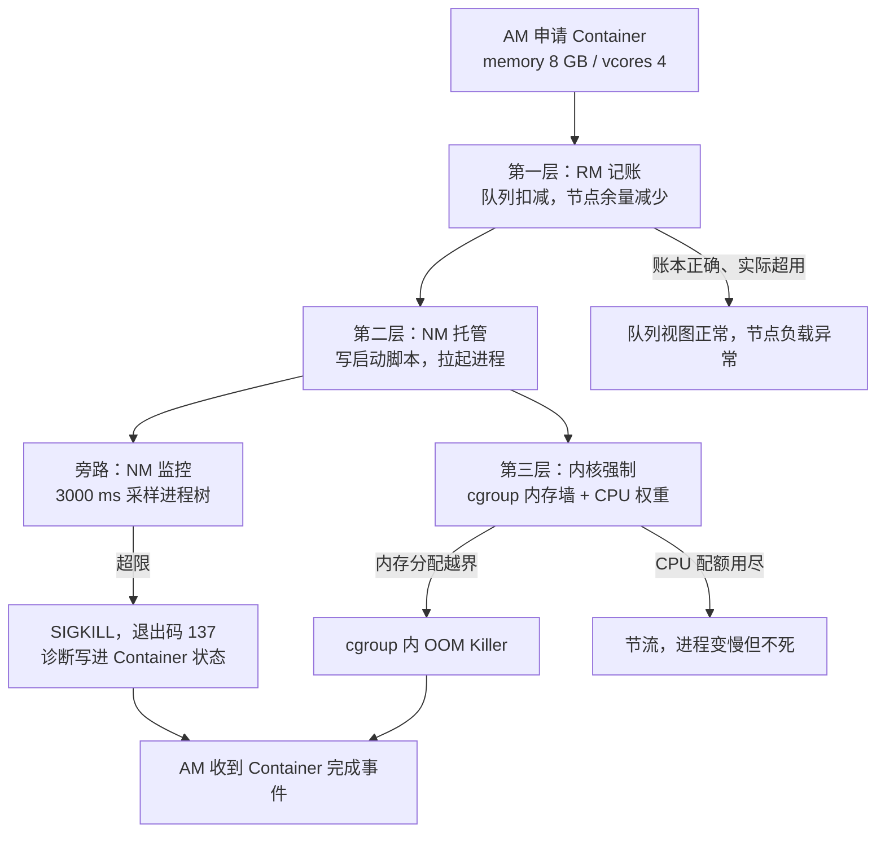
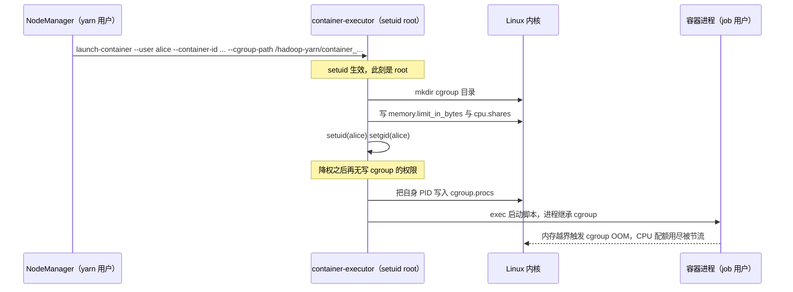
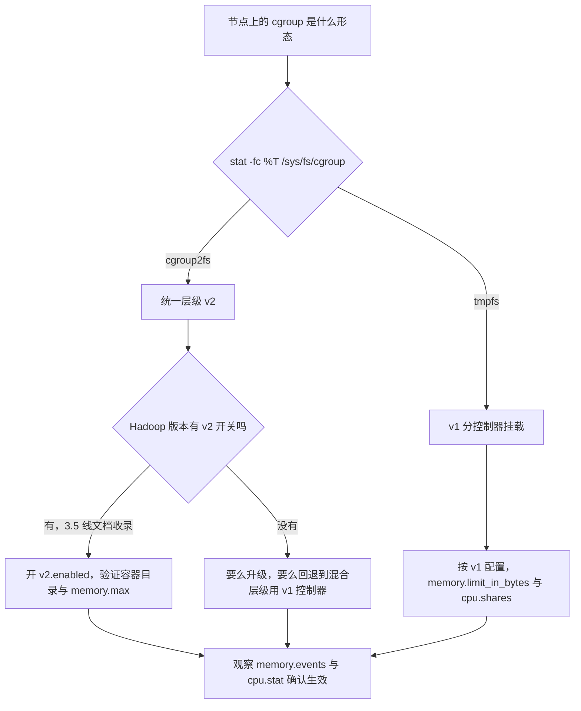
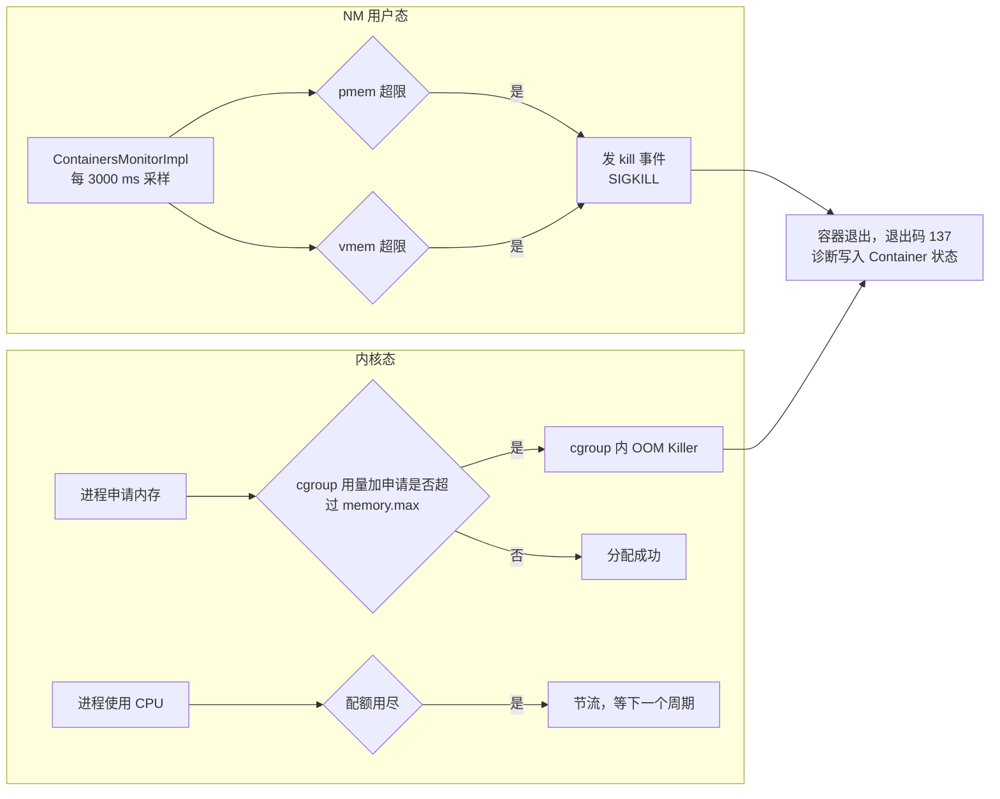
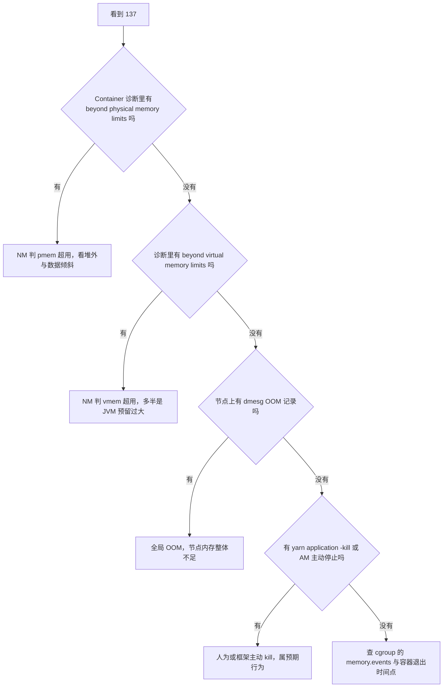

# YARN 资源隔离——CGroups 与 Linux Container Executor 的工程实现

**摘要：**
YARN 把资源分成内存、虚拟核（vCore）与磁盘三类来记账，但这三类资源的隔离强度根本不在一个水平上：内存是唯一能在内核里被真正卡住的资源，前提是 LinuxContainerExecutor 配合 cgroups 写入 `memory.limit_in_bytes`；vCore 默认只是一句"我不共享"的声明，一个容器可以用满整机 CPU，要变成上限得再加 `cpu.cfs_quota_us` 或 cgroup v2 的 `cpu.max`；磁盘则几乎没有隔离，只能靠 `local-dirs` 分盘与健康检查兜住最坏情况。这些差异决定了配置不能一刀切：同一套集群里，内存可以做到硬隔离，CPU 只能做到权重或配额，磁盘只能做到事后止损。本文以一个 8 GB / 4 vCore 的 Executor 落在 32 核节点上为贯穿案例，先给出三种资源的隔离强度判据表与三层防线的节拍差，再拆开 LinuxContainerExecutor 的 setuid 机制与运维代价，包括 `container-executor` 的 6050 权限、组与白名单校验、`limits.conf` 的连带限制；随后对比 cgroups v1 与 v2 的层级结构、控制器文件与 YARN 的版本现实——v2 的开关直到 3.5 线的文档才出现，然后把 NM 的 3000ms 监控节拍、容器被杀的四种原因与 137 的归因流程逐条落到判据上，最后列出五条反例与这套机制管不到的边界。文中的判据尽量落在可执行的动作上：查哪个目录、读哪个文件、搜哪一行日志。

---

## 第 1 章 三个直觉，三个谎言

### 1.1 申请了 4 个 vCore，容器真的只能用 4 个核吗

一个 32 核、128 GB 的节点，`yarn.nodemanager.resource.cpu-vcores` 配成 32，`yarn.nodemanager.resource.memory-mb` 配成 122880。某个 Spark 应用的 Executor 提交参数是 `--executor-memory 8g --executor-cores 4`，于是 RM 在账本上扣掉 4 个 vCore 与 8 GB 内存，把 Container 交给节点上的 NodeManager。到这里为止一切都符合直觉，问题在于接下来：这个 Executor 里如果跑着一个多线程的压缩任务，它会真的只用 4 个核吗？

不会。默认配置下，YARN 没有任何机制拦住它。vCore 在 Capacity Scheduler 的 `DefaultResourceCalculator` 里甚至不参与分配判断，只按内存算账；换成 `DominantResourceCalculator` 之后 vCore 进入了计算，但那也只是让记账更公平，不代表进程被限制在若干个核上。一个申请 4 个 vCore 的容器，完全可以开 32 个线程把整机 CPU 吃满，代价是同一节点上其他容器被饿着，而 RM 的队列视图里一切正常——因为账本只记"分出去多少"，不记"实际用了多少"。

这条链路值得先摆清楚，因为几乎所有关于 YARN 隔离的误解，都来自把"记账"当成了"强制"。记账发生在 ResourceManager 的调度器里，对象是队列与节点上的可用量；强制发生在 Linux 内核里，对象是进程组。两者之间隔着 NodeManager，而 NodeManager 默认什么都不做，**记账不等于强制**。

### 1.2 内存的两种命运：一笔账，和一道墙

内存比 vCore 幸运一些，它有两条完全不同的实现路径。

不开 cgroups 时，内存隔离只是 RM 的记账加 NM 的监视。Container 的进程以普通进程身份跑在节点上，内核不知道它属于哪个 Container，也就不会在它申请内存时做任何拦截；NM 的 `ContainersMonitorImpl` 每 3000ms 采样一次进程树的内存占用，发现超过申请量再补一刀 `SIGKILL`。这意味着从超用发生到被杀之间，存在一段最长为采样周期的窗口，窗口里超出的内存是真的被分配出去了，机器上其他容器只能陪它一起承担后果。

开了 cgroups 之后，`container-executor` 会把容器进程放进一个 cgroup，并在 `memory.limit_in_bytes` 里写下上限。此时内存分配在内核的缺页处理路径上就被检查，超过上限的分配要么触发 cgroup 内的 OOM Killer 杀掉组内某个进程，要么让申请者自己失败。这是真正的**硬隔离**，代价是运维复杂度上一个台阶：setuid 二进制、组与白名单、cgroup 挂载与层级权限、发行版差异，每一项都能让 NodeManager 起不来。

### 1.3 判据表：到底隔离了什么

把三种资源放在一张表里对照，是本文最想交付的东西。右侧两列是关键：一列是"不开这套东西时的现象"，一列是"一分钟内能做的判据"。

| 资源 | RM 记账字段 | 默认是否真的限制 | 靠什么才真的限制 | 未生效时的现象 | 一分钟判据 |
|---|---|---|---|---|---|
| 物理内存 | `memory-mb` | 否，仅记账，靠 NM 轮询补杀 | LCE + cgroups 的 `memory.limit_in_bytes` | 容器超用数秒后才被杀，期间可能引发整机 OOM | `ls /sys/fs/cgroup/memory/<hierarchy>/` 下有容器目录且 `memory.limit_in_bytes` 等于申请量 |
| 虚拟内存 | `memory-mb` × `vmem-pmem-ratio` | 是，但由 NM 用户态判定，误杀率高 | 没有对应的内核机制，只能关检查或调大 `vmem-pmem-ratio` | JVM 堆外与线程栈预留较多时容器被杀，日志出现 `beyond virtual memory limits` | `yarn.nodemanager.vmem-check-enabled` 的取值与 NM 日志里的 vmem 超限行 |
| vCore | `vcores` | 否，完全只是声明 | cgroups 的 `cpu.shares`（权重）或 `cpu.cfs_quota_us`（硬限） | 一个容器吃满整机 CPU，同节点其他容器变慢 | `cat /sys/fs/cgroup/cpu/<hierarchy>/<cid>/cpu.stat` 看 `nr_throttled` 是否增长 |
| 磁盘容量 | 不记账 | 否 | `local-dirs` 分盘、disk-health-checker、日志大小监控 | 坏盘被停用、节点被判 UNHEALTHY、容器写盘失败退出 | `df -h` 看 `local-dirs` 使用率，NM 日志搜 `local-dirs are bad` |
| 磁盘带宽 | 不记账 | 否 | cgroups 的 `blkio` 控制器（YARN 侧支持有限） | 一个 Shuffle 打满 IO，全节点写入变慢 | `iostat -x 1` 看 `%util`，对比容器所在 `blkio` 组的 `blkio.throttle.*` |
| 网络 | 不记账 | 否 | 无 | Shuffle 抢占带宽，容器间互相拖慢 | 无容器粒度判据，只能看网卡总量 |

这张表最容易被误读的是第一行与第三行的差别。内存那一行的"默认是否真的限制"写的是"否，仅记账"，但后半句"靠 NM 轮询补杀"是实打实的动作，所以内存即使不开 cgroups，也比 vCore 强——它至少会死，vCore 连死都不会死，只会让邻居一起慢。

### 1.4 三层防线与它们的节拍

把上面这些机制串起来，YARN 的隔离其实是三层叠在一起的防线，每层的时间尺度差一个数量级：

第一层是毫秒到分钟级的调度决策，第二层是秒级的进程托管，第三层是微秒级的内核检查，而那条旁路监控是 3000ms 的轮询。四者并不互斥，谁先触发谁在日志里留下证据——这也解释了为什么同一个"容器被杀"的现象，在不同集群上的日志归属完全不同：开了 cgroups 的集群，证据多半在 `dmesg` 与 cgroup 的 `memory.events` 里；没开的集群，证据只在 NM 日志的那一行警告里。

---

## 第 2 章 记账层：RM 的资源抽象为什么不等于隔离

### 2.1 三种资源的记账口径

ResourceManager 眼里的节点是一组数字：可用内存、可用 vCore、可用 GPU 之类的扩展资源。这些数字来自 NodeManager 启动时上报的配置，而不是来自节点上真实的负载——`yarn.nodemanager.resource.memory-mb` 说这个节点有 122880 MB 可供 YARN 使用，RM 就认为有这么多，至于这 122880 MB 里有多少被操作系统页缓存占着、有多少被非 YARN 进程吃着，RM 一概不知。

调大与调小各有代价。把 `memory-mb` 调大，能让更多容器落在这台机器上，提高装箱率，但如果超过了物理内存减去系统与守护进程所需的余量，节点就会在容器都跑起来之后开始换页甚至触发整机 OOM，表现为"作业跑着跑着整台机器失联"。调小则相反，安全但浪费，集群的账单会明显高于实际算力。

`cpu-vcores` 的口径更微妙。它的默认值是 8，与真实核数毫无关系；一个 64 核的机器如果不去改这个值，RM 只认 8 个 vCore，剩下的 56 个核在调度器眼里不存在。调大它意味着允许更多容器并发落在同一节点，也意味着 CPU 超卖更严重——因为 vCore 本身不限制任何东西，调大只是把"允许同时跑多少个容器"的门槛降低了。

### 2.2 vCore 的来历：一个为装箱而生的虚拟单位

vCore 不是物理核，也不是超线程，它是一个为"让不同规格的机器可以用同一套调度口径比较"而发明的虚拟单位。早期 Hadoop 用 slot 记账，一个节点有多少个 map slot、多少个 reduce slot 是写死的，导致内存大的机器与 CPU 多的机器无法公平比较；YARN 把 slot 拆成内存与 vCore 两维，调度器就可以按需选择用哪一维做主导资源。

这套抽象解决的是装箱问题，不是隔离问题。好比酒店前台按"标准间"卖房，房间的实际面积由建筑决定，前台只是在系统里记了一笔"这间已经卖出"；客人能不能把行李堆到走廊上，前台管不了。vCore 就是那张房卡，它证明你有权使用，但它拦不住你把走廊占满。

### 2.3 不这样会怎样：坏邻居的三种形态

没有内核级强制时，坏邻居的破坏方式可以归成三类，每一类的现象都不一样。

第一类是内存越界挤占。某个 Executor 因为数据倾斜，实际用了 12 GB 而申请的是 8 GB，操作系统照给不误。当整机内存吃紧时，内核的全局 OOM Killer 会按 `oom_score` 挑一个进程杀掉，被杀的很可能是隔壁那个规规矩矩用内存的容器——因为它的 `oom_score` 同样高，而内核并不知道谁越了界。受害者看到的是"Executor 无故消失"，施害者毫无察觉。

第二类是 CPU 抢占。一个申请 2 个 vCore 的容器开了 16 个线程做矩阵运算，在 shares 模式下它会与邻居按权重分配，但如果邻居此刻在等 IO、CPU 空闲，它就能一路吃满；等到邻居回来要 CPU，只能按权重分到一小份。整机吞吐未必下降，但延迟敏感的任务会明显变慢。

第三类是磁盘与 IO 挤占。Shuffle 写放大、日志刷盘、临时文件堆积，都会让同一块盘上的其他容器变慢。YARN 对这类资源几乎没有约束，只能靠 `local-dirs` 分散到多块盘、靠健康检查在盘满之前把节点摘出去。

### 2.4 记账的价值：它是隔离的前提，不是替代品

这里需要给记账一个公正的评价。没有 RM 的记账，集群根本无法做任何装箱决策：调度器不知道还剩多少内存，就只能在提交时盲试。记账把"有限资源如何分配"这件事从操作系统层面提到了集群层面，才使得多租户共享一个大集群成为可能。

但记账的边界也很清楚：它约束的是"分给谁"，不约束"用了多少"。一个集群可以记账非常准确、调度非常公平，同时每个容器都在超用资源，二者并不矛盾。把这两件事分开看，后面所有配置项的取舍才有落脚点。

---

## 第 3 章 内存：唯一接近"真隔离"的资源

### 3.1 不开 cgroups 时，NM 是怎么发现超用的

NodeManager 内部有一个 `ContainersMonitorImpl`，它按 `yarn.nodemanager.container-monitor.interval-ms` 的节拍（默认 3000ms）醒来一次，去读容器进程树的内存数据。它关心的不是 JVM 报上来的数字，而是操作系统视角的进程状态：物理内存用量来自进程的常驻集大小，虚拟内存用量来自进程的虚拟地址空间大小，多个进程则累加成进程树的总量。

采样、比较、判定的流程很短：把进程树的物理内存用量与容器的内存上限比较，把虚拟内存用量与"内存上限 × `yarn.nodemanager.vmem-pmem-ratio`"比较，任意一项越界就发一个 kill 事件，NM 随即对进程树发 `SIGKILL`，容器的完成状态被标成超限退出，诊断文本写进 Container 状态里回传给 ApplicationMaster。

这套机制有一个根本特征：它是**事后**的。进程先超用，NM 后来才发现，中间的时间差不是精度问题，而是设计上的固有开销——用户态的轮询不可能比内核在缺页时的检查更快。

### 3.2 超用窗口有多大

把窗口算成一个可以比较的数字，比记住"3 秒"这个词有用。窗口由三段时间组成：第一次越界发生在两次采样之间（平均 1.5s，最坏 3s）、采样到判定完成（毫秒级）、判定到进程真正被杀（毫秒到百毫秒级，取决于进程树规模）。所以最坏情况下的超用窗口约为一个采样周期加上百毫秒。

窗口的破坏力取决于容器的分配速率。假设一个 Executor 在做大 buffer 的聚合，突发分配速率是 2 GB/s，在一个 3 秒的窗口里，它可以在限额之外多占约 6 GB 内存；如果这台机器当时的空闲内存只有 4 GB，整机就会先一步进入全局 OOM，内核去杀别的进程。这是示例推算，真实速率取决于作业形态，但数量级足以说明为什么"只在内存紧张的机器上出事"。

把采样周期调小可以缩短窗口，代价是 NM 的 CPU 开销上升，因为每次采样都要遍历进程树并读多个 proc 文件。把一个 64 核节点上数百个容器的进程树每 500ms 遍历一次，NM 自身会稳定吃掉一两个核，这在装箱率高的节点上并不便宜。多数集群把它留在 3000ms，把真正的确定性交给 cgroups。

### 3.3 cgroups 的墙：三行文件与一次缺页

启用 cgroups 之后，`container-executor` 在启动容器前做三件事：在层级下建一个以容器 ID 命名的目录、把内存上限写进 `memory.limit_in_bytes`、把进程 PID 写进 `tasks`。此后容器里任何一次内存分配，都要经过内核的检查：cgroup 当前用量加上本次申请是否超过上限，超过就触发这个 cgroup 内的回收与 OOM Killer。

与 NM 的轮询相比，这个检查发生在缺页处理路径上，粒度是单次分配，**没有窗口**。差别好比信用卡的额度管理：轮询式监控是"先刷卡，月底对账发现超额再冻结"，cgroups 是"刷卡时就校验余额"。前者的问题不是不严格，而是慢了一步，而内存这件事慢一步就可能把整台机器拖下水。

还有一个常被忽略的细节是 swap。v1 里除了 `memory.limit_in_bytes`，还有 `memory.memsw.limit_in_bytes`，它限制的是内存加 swap 的总量。如果只设前者而不管后者，容器可以在内存打满后把页面换出去继续申请，实际的资源占用超过了你以为的上限。不少发行版默认给节点留了 swap，这一项没配好，隔离就等于漏了一半。

### 3.4 pmem 与 vmem：两档检查，两种误杀

内存检查其实有两档，物理内存（pmem）与虚拟内存（vmem）。pmem 的口径是常驻集，也就是真正占了物理页的部分；vmem 的口径是整个虚拟地址空间，包含已申请未触碰的页、映射的文件、线程栈的预留区。

vmem 的上限默认按 `yarn.nodemanager.vmem-pmem-ratio`（2.1）从内存上限折算：一个 8 GB 的容器，虚拟内存上限是 16.8 GB。这条规则在 C/C++ 程序上大致合理，在 JVM 上却非常危险——JVM 启动时会为堆预留整块地址空间，加上元空间、代码缓存、直接内存、每个线程的栈，虚拟地址空间的占用经常是堆大小的两倍以上，而实际常驻内存远小于此。

于是就有了那类"什么都没干就被杀"的容器：日志里写着 `Current usage: 4.1 GB of 4 GB physical memory used; 12.3 GB of 8.4 GB virtual memory used. Killing container.`。注意后半句的 8.4 GB 就是 4 GB × 2.1。这类误杀在 Spark、Flink 这类 JVM 负载上极其普遍，很多集群索性把 `yarn.nodemanager.vmem-check-enabled` 设为 false，只保留 pmem 检查。关掉它不是"放弃隔离"，而是承认**这个估算口径对 JVM 不成立**，把判定权交给 cgroups 的物理内存墙。

### 3.5 JVM 的坑：堆是堆，容器是容器

即使 pmem 与 cgroups 都配对了，仍然有一类容器会莫名其妙地死在 137 上：堆设得太接近容器上限。

Spark 的 `--executor-memory 8g` 只决定 JVM 堆（`-Xmx8g`），容器向 YARN 申请的内存是堆加上 `spark.executor.memoryOverhead`，后者的默认取值约为堆的 10% 与 384 MB 中的较大者。也就是说一个 `--executor-memory 8g` 的 Executor，实际申请的容器内存约为 8.8 GB 出头；JVM 的元空间、代码缓存、直接内存（Netty 的 off-heap buffer 在这里）、线程栈、GC 自身的辅助结构，全部要从这 0.8 GB 里出。

一旦作业的并行度高、线程多、或者 shuffle 用了大量直接内存，这 0.8 GB 就不够用，JVM 的非堆部分会顶到 cgroup 的上限，内核在 cgroup 内触发 OOM，杀掉 Executor。表现是 Executor 反复退出、退出码 137、堆 dump 里看不出 OOM——因为堆根本没满。判据很直接：如果 `jmap` 或 GC 日志显示堆水位健康，而容器内存曲线贴着上限，那就该调大 overhead，而不是调大堆。

### 3.6 判据：怎么证明内存隔离真的生效了

有三条互相独立的证据，凑齐两条就可以认为起了作用。

第一条看文件系统：在 `yarn.nodemanager.linux-container-executor.cgroups.hierarchy` 指定的层级下（默认 `/hadoop-yarn`），容器运行期间应该存在以容器 ID 命名的目录，其 `memory.limit_in_bytes` 等于该容器的申请内存。目录不存在，说明 cgroups 根本没接管。

第二条看 NM 日志：启用 cgroups 后，NM 启动时会打印 cgroup 的挂载与层级初始化信息；如果配置写错，通常会看到 `CgroupsLCEResourcesHandler` 相关的告警或初始化异常。日志里完全没有 cgroup 字样，说明 `yarn.nodemanager.linux-container-executor.resources-handler.class` 还是默认的 `DefaultLCEResourcesHandler`。

第三条看行为：制造一次可控的超用，观察容器是"几秒后被 NM 杀"还是"立刻被内核杀"。前者说明只有轮询在起作用，后者说明墙已经立起来了。这个实验在预发集群上做一次，胜过读十篇配置文档。

---

## 第 4 章 vCores：默认完全没有隔离

### 4.1 从声明到权重：shares 是怎么算出来的

启用 cgroups 的 CPU 控制器后，YARN 会为每个容器写一个 `cpu.shares`。折算口径大致是每个 vCore 对应 1024 shares，也就是 cgroup v1 的默认权重值：申请 4 个 vCore 的容器拿到 4096 shares，申请 1 个的拿到 1024。

这里的关键是 shares 的语义。它不是一个上限，而是一个比例：当同一层级下多个 cgroup 竞争 CPU 时，内核按各自的 shares 占比分配时间片。如果只有一个 cgroup 有任务在跑，它拿到的就是 100% 的 CPU，与 shares 是 1024 还是 4096 无关。**shares 是权重，不是上限**，这是 CPU 隔离里最容易记错的一句。

用一个具体的例子说明。节点 32 核，容器 A 申请 4 vCore（4096 shares），容器 B 申请 2 vCore（2048 shares）。如果两者都在满负荷跑，内核按 2:1 分，A 大约拿到 21 核、B 拿到 11 核——注意 A 只申请了 4 个 vCore，实际却拿到了 21 核。这就是"权重不是上限"的最直白体现。

### 4.2 为什么默认给权重，而不是给上限

这个默认值不是疏忽，而是有意为之。大数据作业的主流形态是批处理，追求的是集群吞吐而不是单容器的确定性延迟。给权重意味着：机器闲的时候，一个容器可以借用空闲 CPU 尽快把自己跑完；机器忙的时候，大家按申请量分。对吞吐型负载，这比硬上限划算得多——硬上限会让 CPU 在空闲时也闲置，等于花钱买了不用。

但这个选择有前提：集群里的负载大体同质、且没有延迟敏感型任务。一旦混部了在线服务、流式作业或者需要稳定 SLA 的任务，权重模式的副作用就出来了——一个批处理容器在机器空闲时把 CPU 吃满，正好压在流式作业的窗口上，后者的处理延迟会突然抖动，而监控上看不出任何资源不足。

### 4.3 硬上限：把权重换成配额

要真限制，得打开 `yarn.nodemanager.linux-container-executor.cgroups.strict-resource-usage`，设为 true 后 YARN 除了写 shares，还会写 `cpu.cfs_period_us` 与 `cpu.cfs_quota_us`：周期默认 100000 微秒（100ms），配额等于 vCore 数乘以周期，也就是 4 个 vCore 对应每 100ms 最多 400ms 的 CPU 时间。容器在一个周期内用完配额后，剩下的时间被节流，即使整机空闲也拿不到 CPU。

这就是它的代价：**确定性是用利用率换来的**。一个 CPU 密集但并行度不高的作业，在严格模式下可能只跑出 60% 的机器利用率；而在权重模式下同样的作业能跑满。所以这个开关不能全局无脑打开，得按队列或节点池区分——把延迟敏感的负载放在开了硬限的节点池，把批处理放在权重池。

顺便澄清一个流传很广的配置名。有些资料把 CPU 硬限开关写作 `yarn.nodemanager.linux-container-executor.cgroups.cpu-hard-limit-enable`，笔者在 3.3.5 与 3.5.0 的官方 cgroups 文档里都没有找到这一项，真正起作用的是 `strict-resource-usage`。这类拼错的配置名不会让 NM 报错，只会被静默忽略——于是集群"明明配了硬限"却仍在超用，排查时还以为是 cgroups 没生效。

cgroup v2 里对应的文件换了名字：权重是 `cpu.weight`（默认 100，范围 1 到 10000），硬限是 `cpu.max`（格式为"配额 周期"，例如 `400000 100000`，写成 `max 100000` 表示不设上限）。语义与 v1 一一对应，但文件数少了一半以上。

### 4.4 NM 级封顶：所有容器加起来也不许超

除了单容器的限制，还有一个节点级的上限：`yarn.nodemanager.resource.percentage-physical-cpu-limit`，它限制的是这台节点上所有 YARN 容器累计能用多少物理 CPU，单位是百分比。这个参数的存在感很低，但它解决了一个实际问题——把机器的一部分 CPU 留给 NodeManager、DataNode、监控 agent 这些非 YARN 进程，避免容器把整机吃满导致守护进程被饿死、心跳超时、节点被判失联。

调小它的代价是容器可用的总算力下降，装箱率降低；调大则回到守护进程与容器抢 CPU 的老问题。经验上给系统进程留出 10% 到 20% 是常见做法，具体取值要看节点上还跑了哪些常驻服务。

### 4.5 节流判据：用 cpu.stat 判断配额够不够

开了硬限之后，"CPU 够不够"这件事可以用数字回答，而不是靠感觉。cgroup 的 `cpu.stat` 里有三个字段：`nr_periods` 是统计周期总数，`nr_throttled` 是被节流的周期数，`throttled_time` 是累计被压住的时间（纳秒）。

节流率的算法是 `nr_throttled / nr_periods`。这个比值长期高于两成，基本可以判定配额偏小：容器有真实的 CPU 需求，但每个周期都会撞到配额。处置方向有两条，一是调大申请的核心数，二是降低容器内的并发度（譬如减少 Executor 的 task 线程数），让同样的核心数被更充分地利用。反过来，如果节流率极低而作业仍然慢，问题多半不在 CPU，该去看 IO 与 GC。

### 4.6 判据表：什么时候该开硬限

| 场景 | 建议 | 代价 | 判据 |
|---|---|---|---|
| 纯批处理，负载同质 | 只给 shares | CPU 空闲时被邻居借走，单作业完成时间波动 | 队列内作业类型单一，无 SLA 承诺 |
| 批处理与流式混部 | 流式节点池开硬限 | 批处理池利用率下降，需要两套节点池 | 流式作业的端到端延迟有抖动，且与邻居负载相关 |
| 多租户共享，按队列计费 | 开硬限 | 需要按队列规划 vCore，超卖空间变小 | 计费口径是申请的 vCore 而非实际用量 |
| 单团队独占集群 | 不开 | 无 | 没有邻居，隔离没有意义 |
| GPU 或特殊资源作业 | CPU 硬限意义有限 | 瓶颈在设备侧 | `nvidia-smi` 显示设备利用率才是关键指标 |

最后一行值得单独说一句：很多"CPU 隔离没做好"的抱怨，实际瓶颈在 GPU 或网络，把 CPU 配额调大并不会让作业变快。

---

## 第 5 章 磁盘：几乎没有隔离

### 5.1 一个没有被记账的资源

YARN 的资源模型里没有磁盘容量这一维。容器申请内存与 vCore，RM 按这两维调度，`local-dirs` 里能写多少、写到什么时候满，调度器完全不参与。这意味着一个往本地写临时文件的容器，可以合法地把节点磁盘写满，而 RM 的账本上一片祥和。

这是有意的取舍：磁盘容量不像内存那样可以精确地在容器之间切分，文件系统是共享的，一个容器的写入会立刻影响其他容器的可用空间；而调度器如果按磁盘容量装箱，就需要预估每个容器的写入量，这个预估在批处理场景里几乎不可能准确。

### 5.2 分盘能做的：把鸡蛋放进不同的篮子

`yarn.nodemanager.local-dirs` 支持配置多个目录，通常的实践是每个数据盘配一个目录。NM 会把容器的本地化文件与临时目录分散到这些目录里，从而把写入压力摊到多块盘上。这样做有两个收益：一是单块盘被打满时，其他盘上的容器还能正常工作；二是并行 IO 能力随盘数线性增长，Shuffle 与 spill 的吞吐会明显改善。

它的局限也很清楚：分盘只改变分布，不改变总量。如果一批容器同时往不同盘上写，所有盘会一起满。真正决定"会不会满"的是作业的写入量，而这个量 YARN 侧无法约束。

### 5.3 disk-health-checker 到底做什么

`yarn.nodemanager.disk-health-checker.enable` 默认开启。它按 `yarn.nodemanager.disk-health-checker.interval-ms`（默认 120000ms，即两分钟）检查 `local-dirs` 与 `log-dirs` 对应磁盘的状态，检查项包括权限、可写性、文件系统是否只读，以及剩余空间。

判定阈值有两个：`max-disk-utilization-per-disk-percentage`（默认 90，即使用率超过 90% 判为坏盘）与 `min-free-space-per-disk-mb`（默认 0）。被判定为坏的盘会被 NM 停用，不再往里放新容器；如果通过检查的盘少于 `min-healthy-disks`（默认 0.25，也就是四分之三的盘都坏了），整个节点会被标记为 UNHEALTHY 上报给 RM，RM 随即停止向这台节点分配新容器。

请注意这里的行为边界：**它不杀容器**。已经跑在坏盘上的容器会继续跑，直到自己写失败或者作业结束。这个细节很关键，因为它意味着"磁盘满了导致容器被杀"这个说法在多数情况下是误判——容器不是被 NM 杀掉的，而是自己把自己弄死了。

### 5.4 真正能弄死容器的三件事

第一件是写入失败。容器往 `local-dirs` 写 spill 文件或临时文件时磁盘满了，写操作返回 `ENOSPC`，上层程序通常以异常或非零退出码结束；如果写的是内存映射文件，可能收到 `SIGBUS`。这两种退出在 AM 眼里都是"容器异常退出"，而日志里只有业务侧的 IOException，看不到任何资源超限的字样。

第二件是日志把盘写满。3.3 的文档里已经提供了容器日志大小监控（`yarn.nodemanager.container-log-monitor.enable`，默认关闭），开启后单个容器日志目录超过 `dir-size-limit-bytes`（默认 1 GB）或总日志超过 `total-size-limit-bytes`（默认 10 GB），容器会被杀掉。这是真正意义上的"NM 因磁盘原因杀容器"，但它默认不启用，所以很多集群里并不存在这条路径。

第三件是节点被判 UNHEALTHY 之后的上层反应。RM 停止分配新容器，已经在跑的应用会缺少资源补充；如果 AM 恰好需要新容器而集群余量不足，应用会卡在等待里。节点上的容器本身仍然活着，只是失去了后续保障。

### 5.5 判据：磁盘问题怎么定位

先看 `df -h`，确认 `local-dirs` 与 `log-dirs` 所在盘的使用率，超过 90% 就是危险区。再看 NM 日志，搜索 `local-dirs are bad`、`log-dirs are bad` 这类行，它们会明确列出哪块盘被判坏。最后看 RM 的节点页面，UNHEALTHY 的节点会带上健康检查的说明文本，这一点在 `/ws/v1/cluster/nodes` 的返回里也有。

如果容器确实死于写盘失败，证据在容器自己的日志里，会有一条 `No space left on device`。这时候需要区分两种情况：作业本身的写入量就超出节点容量，属于容量规划问题；还是个别容器失控写入，属于作业参数问题。前者要加盘或限制单作业写入量，后者要调 `local-dirs` 的分布或者作业的临时目录策略。

---

## 第 6 章 LinuxContainerExecutor：真正的隔离执行器

### 6.1 默认执行器的三个缺陷

`yarn.nodemanager.container-executor.class` 的默认值是 `DefaultContainerExecutor`。它的实现简单到近乎敷衍：写好启动脚本，用 NM 自己的用户身份拉起 `bash` 执行脚本，仅此而已。

由此带来的三个缺陷很难绕开。第一是没有用户切换：节点上所有容器都以运行 NM 的那个用户身份执行，容器里的进程可以读同一个用户在本地目录下的任何文件，多租户之间的文件隔离等于不存在。第二是没有 cgroups：cgroups 的写入需要 root 或特定目录的写权限，一个普通用户身份的 NM 做不到，所以默认执行器下 cgroups 无法生效。第三是容器进程就是 NM 的子进程，进程树管理与资源限制全靠 NM 的用户态代码。

`LinuxContainerExecutor`（LCE）解决这三件事的方式是引入一个**特权中间人**：setuid 的 `container-executor` 二进制。它由 NM 以 root 权限执行，替 NM 完成那些需要特权的动作——切换用户、创建 cgroup、写限制、设置目录属主，然后把控制权交给真正的容器进程。

### 6.2 setuid 与 6050：一个必须精确的权限位

`container-executor` 的所有者必须是 root，所属组是与 NM 配置一致的那个组，权限位是 6050。这四位数字值得拆开看：第一位 6 是 setuid 与 setgid 两个特殊位的组合；后三位依次是属主、属组、其他人，即属主无权限、属组可读可执行、其他人无权限。最终呈现为 `---Sr-s---`。

这样的权限设计意图很清楚：只有属于那个组的用户（也就是 NM 的运行用户）能执行它，而一旦执行就以 root 身份运行（setuid 生效），所以它内部的每一步都必须是安全的、受控的。它也意味着这个二进制本身是一个高价值目标，任何能改写它的人等于拿到了 root，所以它的路径与父目录的权限同样要卡死。

配置上还要注意一个连带项：`yarn-site.xml` 里的 `yarn.nodemanager.linux-container-executor.group` 必须与 `container-executor.cfg` 里的同名配置**完全一致**，这一项是二进制校验调用者身份的依据。它默认是 `hadoop`，而很多发行版与托管平台的 NM 用户属于 `yarn` 组，改配置时漏掉任何一处，后果见 9.3 节。

### 6.3 配置项全表

| 配置项 | 作用 | 调大的代价 | 调小的代价 |
|---|---|---|---|
| `yarn.nodemanager.container-executor.class` | 指定执行器实现 | 换成 LCE 后必须配齐二进制与 cgroups，配错则 NM 起不来 | 留在默认执行器则无用户隔离、无 cgroups |
| `yarn.nodemanager.linux-container-executor.resources-handler.class` | 指定 cgroups 资源处理器 | 设为 `CgroupsLCEResourcesHandler` 才启用 cgroups，需先备好层级 | 保持默认 `DefaultLCEResourcesHandler`，配置了 cgroups 也不生效 |
| `yarn.nodemanager.linux-container-executor.group` | 校验调用者的组 | 组名写错则二进制拒绝执行，容器全部起不来 | 与 NM 用户的组不符时同样拒绝执行 |
| `yarn.nodemanager.linux-container-executor.cgroups.hierarchy` | 容器 cgroup 的父层级，默认 `/hadoop-yarn` | 层级过深时目录权限与递归 chown 更容易出错 | 层级过浅可能与其他系统混用 |
| `yarn.nodemanager.linux-container-executor.cgroups.mount` | 是否让 YARN 自行挂载 cgroupfs | 设为 true 需要特权且已被安全选项默认禁用 | 保持 false，要求预先挂载，责任落在运维 |
| `yarn.nodemanager.linux-container-executor.cgroups.mount-path` | 指定 cgroup 根路径 | 路径写错则初始化失败，NM 无法启容器 | 不指定则按 `/proc/mounts` 探测 |
| `yarn.nodemanager.linux-container-executor.cgroups.strict-resource-usage` | CPU 是否用硬配额 | 设为 true 后 CPU 利用率下降 | 保持 false 则只给权重，容器可超用 |
| `yarn.nodemanager.linux-container-executor.nonsecure-mode.limit-users` | 非安全模式下是否限制为单一用户 | 保持 true 时容器统一以 `nobody` 运行 | 设为 false 才按提交用户切换，需要所有节点存在同名用户 |

最后一行是很多人的认知盲区：没有启用 Kerberos 的集群里，LCE 默认把所有容器都跑在 `nobody` 用户下，所以"按用户隔离文件"这件事在非安全模式下并不成立。要让它成立，得关掉 `limit-users`，并保证提交作业的用户在每一台节点上都有同名账号与一致的 UID。这个前提在跨部门共享的集群里很难满足，这也是不少团队干脆不上 LCE 的原因之一。

### 6.4 启动时序：cgroup 先于 setuid

LCE 启动一个容器的时序值得完整看一遍，因为**顺序本身就是安全设计**的一部分。

顺序上有两个关键点。其一，写 cgroup 的动作发生在降权之前，此时进程还是 root，有权限操作 `/sys/fs/cgroup`；降权之后 alice 对该目录没有写权限，容器内的代码无法修改自己的限制，这是防绕过的核心。其二，PID 加入 cgroup 的动作发生在降权之后、exec 之前，因为此时进程已经确定，加入之后 fork 出来的所有子进程都会自动继承这个 cgroup，包括 exec 之后的业务进程。

如果顺序反过来——先降权再写限制——容器里的用户就有机会在限制生效前抢跑，或者在限制生效后改回去。这类顺序错误在自研执行器里出过一次就够记一辈子。

### 6.5 白名单：三道门，报错各不相同

`container-executor.cfg` 是那个二进制的第二个配置文件（另一个是 `yarn-site.xml`），它由 root 拥有、只允许属主读，内容通常包含五项：组名、禁用用户、允许的系统用户、最小用户 ID、以及若干功能开关。

三道门的含义要分清。`yarn.nodemanager.linux-container-executor.group` 校验的是调用者（NM 用户）的身份；`banned.users` 是黑名单，列在里面的用户不能提交应用；`min.user.id` 是 UID 下限（默认 1000），低于它的系统账号默认不能跑容器，除非被列入 `allowed.system.users` 白名单。

这三道门对应**三种完全不同的报错**，混淆它们会浪费很多时间：

- 组配置错或权限位错，现象是 NM 启动阶段就失败，日志里是 `Failed to initialize container executor` 与 `Cannot run program ".../container-executor": error=13, Permission denied`，或者 `Linux container executor not configured properly`。这时候一个容器都起不来，NM 本身状态异常。
- UID 低于下限且不在白名单，现象是应用提交后 AM 容器启动失败，容器日志或 NM 日志里出现 `Requested user xxx is not whitelisted and has id 980, which is below the minimum allowed 1000`。这条报错的根因是 `min.user.id` 与 `allowed.system.users`，与组配置无关。
- 用户在 `banned.users` 里，现象是提交直接被拒，报错会直接点名该用户被禁用。

把 `not whitelisted` 当成组配置问题去改 `linux-container-executor.group`，是笔者见过最多的无效排查。真正要改的是 `allowed.system.users`，或者把那个服务账号的 UID 提到 1000 以上。

### 6.6 运维代价：三笔看不见的账

第一笔是 `limits.conf`。容器进程由 NM 用户 fork 出来，它继承的是 NM 用户的资源限制，而不是提交作业用户的限制。如果 `/etc/security/limits.conf` 里给 yarn 用户的 `nofile` 只有 1024、`nproc` 只有 4096，那么所有容器里的进程都受这个限制——这就是"**容器里 ulimit 特别小**"的根源。表现是作业打开大量文件时 `Too many open files`，或者创建线程时 `unable to create native thread`，而作业在裸机上跑同样的代码毫无问题。

处置办法是给 NM 用户单独提高这两个限制，并且注意 systemd 管理的服务不读 `limits.conf`，需要在 unit 里用 `LimitNOFILE` 显式设置，否则改完不生效。

第二笔是目录属主。`yarn.nodemanager.local-dirs` 与 `yarn.nodemanager.log-dirs` 必须属于 NM 用户与配对的组，权限为 `drwxr-xr-x`；cgroup 层级目录需要 NM 用户有递归写权限，新建的层级在节点重启后可能丢失。这几项在装机脚本里漏一个，表现就是容器启动时目录创建失败，报错看起来像"权限问题"但指向的目录每次都不一样。

第三笔是二进制与配置的版本绑定。`container-executor` 是原生二进制，与 Hadoop 版本、glibc 版本、编译时的配置目录路径都相关；升级 Hadoop 后如果不重新编译或替换这个二进制，可能出现校验失败或路径找不到。排查时可以用 `container-executor -checksetup` 做一次自检，它会检查配置文件位置、权限位与关键配置，把多数低级错误一次性暴露出来。

### 6.7 判据：什么时候可以不启用 LCE

LCE 不是所有集群的必需品。判断标准是"有没有真正的多租户与隔离诉求"。

单团队独占、节点上只跑自家作业、作业之间互相信任的集群，用默认执行器加 NM 的内存检查就够了，省掉二进制、组、白名单、limits 这一整套运维负担。反过来，只要存在跨部门共享、按队列计费、或者有安全合规要求，LCE 加 cgroups 就是必须的——因为默认执行器给不了文件隔离，也给不了内核级的资源墙。

还有一类折中方案值得知道：用 LCE 但不启用 cgroups。这样拿到的是用户隔离与目录权限管理，资源限制仍靠 NM 轮询。它的适用场景是"文件权限要隔离，但资源超用可以容忍几秒"，代价是内存与 CPU 仍然没有硬墙。

---

## 第 7 章 cgroups v1 与 v2：两代层级，两套文件

### 7.1 v1：每个控制器一棵树

cgroup v1 把每种资源控制器挂成独立的层级。典型的挂载点长这样：`/sys/fs/cgroup/memory` 负责内存，`/sys/fs/cgroup/cpu,cpuacct` 负责 CPU 与统计，`/sys/fs/cgroup/blkio` 负责块设备 IO，`/sys/fs/cgroup/devices` 负责设备访问。每棵树下可以建任意深度的目录，每个目录里有该控制器特有的参数文件，以及一个 `tasks` 文件用来放进程。

这种结构的优点是控制器之间互不干扰，内存限制与 CPU 限制可以分别设置、分别理解；缺点是进程要同时加入多棵树（内存一棵、CPU 一棵、IO 一棵），节点上的 cgroup 目录会变得难以对账——你很难一眼回答"这个容器到底在哪些 cgroup 里、它们的限制是多少"。

YARN 在 v1 上的工作就是把容器 ID 作为目录名，在每一棵需要参与的树下各建一个目录，然后把进程 PID 写进去。`CgroupsLCEResourcesHandler` 负责这套映射，内存上限与 CPU shares 都写在对应目录的文件里。

### 7.2 v2：一棵树，靠 subtree_control 开启控制器

cgroup v2 改成单一层级：`/sys/fs/cgroup` 是唯一的挂载点（文件系统类型是 `cgroup2`），控制器不再各自挂载，而是在同一棵树里按需启用。启用方式是往父节点的 `cgroup.subtree_control` 里写控制器名，譬如 `+cpu +io +memory`，子节点里才会出现对应的控制文件。

v2 还有一条硬规则：**非叶子 cgroup 里不能放进程**。这条规则的本意是让资源分配关系变得干净——中间节点只做分配，叶子节点才承载进程。对 YARN 的影响是，层级结构必须是"YARN 根节点下面直接挂容器目录"，容器的进程放在容器目录里，而 YARN 根节点本身不能有进程。如果 NM 的进程不小心留在那个节点下，内核会拒绝启用子树的控制器。

还有一步容易漏：v2 下控制器不是默认就挂上的，需要先在 `cgroup.subtree_control` 里逐个开启。按 YARN-11669 的验收说明，还要显式打开对应的资源控制器开关（该说明里写作 `yarn.nodemanager.resource.cpu.enabled`）。漏掉前者，容器目录里根本没有 `memory.max` 可写；漏掉后者，目录建出来了但控制器没挂上，看起来一切正常，实际什么都没限制。

相比 v1，v2 的文件名与语义都做了统一：内存上限是 `memory.max`，CPU 权重是 `cpu.weight`，CPU 硬限是 `cpu.max`，IO 上限是 `io.max`，进程列表是 `cgroup.procs`。swap 不再有独立的 memsw 文件，改由 `memory.swap.max` 单独控制。

### 7.3 文件对照

| 能力 | cgroup v1 | cgroup v2 |
|---|---|---|
| 层级根 | 每控制器独立挂载，`/sys/fs/cgroup/<controller>` | 单一挂载点 `/sys/fs/cgroup`，类型 `cgroup2` |
| 控制器启用 | 挂载即启用 | 写 `cgroup.subtree_control` 逐个开启 |
| 内存硬限 | `memory.limit_in_bytes` | `memory.max` |
| 内存用量 | `memory.usage_in_bytes` | `memory.current` |
| 内存+swap 上限 | `memory.memsw.limit_in_bytes` | `memory.swap.max` |
| 内存 OOM 事件 | `memory.oom_control` 与 `memory.failcnt` | `memory.events` 中的 `oom` 与 `oom_kill` |
| CPU 权重 | `cpu.shares`（默认 1024） | `cpu.weight`（默认 100） |
| CPU 硬限 | `cpu.cfs_quota_us` + `cpu.cfs_period_us` | `cpu.max`（配额与周期写在一个文件） |
| CPU 节流统计 | `cpu.stat` | `cpu.stat` |
| 进程列表 | `tasks` | `cgroup.procs` 与 `cgroup.threads` |
| IO 限速 | `blkio.throttle.*` | `io.max` |
| IO 权重 | `blkio.weight` | `io.weight` |

这张表可以直接拿来做对照排查：在 v1 的集群里找一个不存在的 `memory.max`，或者在 v2 的节点上写 `cpu.shares`，都会失败，而且报错往往只说"文件不存在"，不会提示版本差异。

### 7.4 YARN 的 v2 开关与版本现实

YARN 对 cgroup v2 的支持有一个明确的开关：`yarn.nodemanager.linux-container-executor.cgroups.v2.enabled`。设为 true 后 YARN 会尝试使用统一层级与 v2 控制器；如果节点上没有挂载统一层级，则回退到 v1。配套还有一个 `yarn.nodemanager.linux-container-executor.cgroups.v2.mount-path`，用于 v1 与 v2 并存的混合模式——例如 v1 控制器挂在 `/sys/fs/cgroup` 下、v2 挂在 `/sys/fs/cgroup/unified` 下时，需要显式告诉 YARN v2 在哪里。

**版本口径**需要说清楚，因为网上流传的说法与文档并不一致。3.4.0 的官方文档里，cgroups 配置表中还没有 v2 相关的条目；到 3.5.0 的文档，才出现 `v2.enabled` 与 `v2.mount-path` 这两项。而主线 JIRA 上那组以 "cgroup v2 support" 为题的伞形任务（YARN-11669）在笔者查证时仍处于进行中状态，blkio、GPU/FPGA、出向带宽等资源处理器的 v2 适配还没收尾。

因此"3.4 起支持 v2"这个说法要打一个问号：即便某个 3.4 分支的补丁里带了部分实现，也不代表整套资源控制都能在 v2 上工作。稳妥的判断方式是查自己所用版本的默认配置文件有没有这两项，而不是看博客里的版本号。没有这两项配置的版本，谈 v2 支持是没有意义的。

### 7.5 mount 与 mount-path：谁负责挂载

这里有一个容易踩的坑。早期的做法是让 YARN 自己挂载 cgroupfs（`cgroups.mount` 设为 true），但这条路径后来因为安全问题被默认关闭：`container-executor.cfg` 里的 `feature.mount-cgroup.enabled` 默认为 0，也就是说即使 yarn-site 里写了 true，二进制也不会去挂载。

现在的正解是运维预先挂好 cgroup，把 `cgroups.mount` 保持为 false，让 YARN 去 `/proc/mounts` 里探测；如果挂载点是通过 lxcfs 之类的方式模拟的、不在 `/proc/mounts` 里可见，则用 `cgroups.mount-path` 显式指定路径。这两种方式都要求 YARN 用户在启动前对目标层级目录有读写权限。

挂载责任转移之后，节点的初始化脚本就成了关键资产：它必须保证每次开机后 cgroup 层级存在、属主正确、控制器已在 `subtree_control` 里开启，并且在 NM 启动之前完成。这一条没做好，表现就是节点重启后 cgroup 目录消失，容器仍能跑但完全没有限制——这种"静默降级"比报错更危险。

### 7.6 该用 v1 还是 v2

判据可以按发行版与版本两条线交叉：

| 条件 | 选择 | 理由 |
|---|---|---|
| RHEL 9、Ubuntu 21.10 之后的发行版，默认统一层级 | v2，前提是 Hadoop 3.5 线 | 发行版已不给 v1 控制器，硬套 v1 等于放弃强制 |
| 同上，但 Hadoop 是 3.3 或更早 | 用内核参数切回混合层级跑 v1，或升级 | 旧版本没有 v2 开关，接口对不上 |
| RHEL 8 一类混合层级 | 先确认控制器实际挂在哪，再按探测结果配 | 混合模式最容易配错，必须看 `/proc/mounts` 而不是猜 |
| 已有大量 v1 生产集群 | 保留 v1，新节点池试点 v2 | v1 的运维路径已经跑通，迁移的收益主要是跟随发行版 |
| 需要 blkio 或 GPU 侧限制 | 暂留 v1 | v2 上这些控制器的适配在主线尚未完成 |

最后两行说明了取舍的本质：v2 是方向，但方向不等于现在就该迁。cgroup 版本的选择不是审美问题，而是"发行版给什么、Hadoop 版本支持什么、你的资源控制器用到了哪些"三者求交集。

---

## 第 8 章 监控与强制：3000ms 的节拍与四类死法

### 8.1 两条并行的回路

把内存与 CPU 的强制路径画在一起，可以看到 NM 的轮询与内核的检查是两条并行的回路，它们并不互斥。

两条回路的证据形态不同：NM 那条会在 NM 日志里留下明确的一行警告，附带"当前用量 / 上限"的数字；内核那条只在容器状态里留下超限退出，同时在 `dmesg` 或 cgroup 的 `memory.events` 里留下 OOM 记录，具体留下哪一份取决于内核版本与 cgroup 版本。

### 8.2 内存的三道闸与它们谁先响

一个内存超用的容器，可能撞上三道闸：NM 的 pmem 检查、NM 的 vmem 检查、cgroup 的内存墙。三道闸的响应速度不同，cgroup 是即时的，NM 的两项检查最多延迟一个采样周期。

谁先响取决于超用的形态。突发大分配（一次性申请几 GB）几乎必然先撞 cgroup，因为 NM 还没采样到；缓慢增长（每秒多占几十 MB）则可能先被 NM 抓到，因为它在采样点上越过了阈值。这也解释了为什么同样的配置在不同作业上表现不一致：作业的内存曲线形状不同，撞上的闸就不同。

### 8.3 四类死法与判据

这是排查"容器为什么死了"时最该先看的一张表。

| 死法 | 触发者 | 证据位置 | 关键证据 | 处置方向 |
|---|---|---|---|---|
| 物理内存超用 | NM 的 `ContainersMonitorImpl` | NM 日志、Container 状态诊断 | `is running beyond physical memory limits` 并附 `X of Y physical memory used` | 调大容器内存、修数据倾斜、检查堆外内存 |
| 虚拟内存超用 | 同上，vmem 分支 | NM 日志 | `is running beyond virtual memory limits`，上限约为申请量的 2.1 倍 | 关掉 `vmem-check`，或调大 `vmem-pmem-ratio` |
| 磁盘写不进去 | 内核返回 `ENOSPC`，或容器日志监控 | 容器自身日志、NM 的磁盘健康日志 | `No space left on device`；`local-dirs are bad` | 清盘、加盘、调日志大小监控、限制临时文件 |
| 容器没起来 | 本地化失败、启动脚本失败、分配过期 | NM 日志、AM 日志 | `Container launch failed`、分配过期回收 | 查本地化与服务端连通性、查启动脚本与依赖路径 |

四类里只有前两类会被 NM 记为"资源超限"，**后两类不算被杀**。把第四类也归到"被杀"里是一种常见的表述偷懒，实际它连进程都没跑起来，自然也不会有退出码 137。区分的方法是看容器有没有产生过 stdout 日志：有日志说明进程起来过，没有日志说明死在启动之前。

### 8.4 137 的归因流程

退出码 137 的含义很单一：进程收到了 `SIGKILL`。但发信号的人可能是 NM、可能是内核、可能是运维的 `kill -9`，也可能是容器运行时自己的清理逻辑。所以要归因的不是 137 这个数字，而是它前面那条诊断。

这个流程的用处是把"137"从一个结论变成一个问题。运维现场最常见的误判是看到 137 就调大内存，结果容器还是照样死，因为真正的原因是 JVM 堆外内存撑破了 cgroup，堆余量本来就不小。

### 8.5 观测点清单

NM 侧的日志关键字有四个：`beyond physical memory limits`、`beyond virtual memory limits`、`local-dirs are bad`、`Container launch failed`。这四个词覆盖了四类死法的绝大部分证据，把它们加进日志检索的快捷方式比翻文档快。

cgroup 侧的文件有两个：内存看 `memory.events` 里的 `oom_kill` 计数，CPU 看 `cpu.stat` 里的 `nr_throttled`。这两个文件的好处是可以在容器还活着的时候观察，不必等它死。

集群侧看两个地方：`/ws/v1/cluster/nodes` 的节点健康状态与 `health-report` 字段，能回答"节点是不是被判了 UNHEALTHY"；`/ws/v1/cluster/apps/{appid}` 里的容器列表，能回答"这个应用一共死了几个容器、死时的诊断是什么"。RM 的 Web 界面是这两份数据的渲染，但接口更适合做批量统计。

### 8.6 开销与量化

cgroups 本身的开销主要在三处：创建与销毁 cgroup 目录的系统调用、每次内存分配时的用量检查、以及 NM 读取 cgroup 文件做统计的 IO。前两项是内核路径上的常数级开销，对吞吐的影响通常可以忽略；第三项与容器数量成正比，数百个容器时 NM 每轮的额外 IO 会达到数千次文件读。

这是示例推算，不是基准数据：一个节点 200 个容器，NM 每 3000ms 采样一轮，每轮读 200 个 cgroup 的 4 个文件，就是 800 次读操作分布在 3 秒内，平均每秒不到 300 次；这个量级对现代文件系统毫无压力，真正的成本是 NM 遍历进程树的 CPU 时间，而进程树规模取决于容器内的进程数而非容器数。所以调小采样周期时，先看容器里的进程数，而不是容器总数。

---

## 第 9 章 反例与边界

### 9.1 反例一：以为 vcores 有 CPU 隔离

这是最普遍的一个误会，而且它有一个很坏的副作用：容量规划会系统性地偏高。按 vCore 数估算集群算力，会得出一台 32 核机器能同时跑 32 个"1 vCore 容器"所以很宽裕的结论；实际上这 32 个容器每一个都能各自吃满 32 核，机器的 CPU 争抢会比想象中严重得多，表现为"资源显示充足但任务都很慢"。

判断方法很直接：在节点上跑 `top`，看是否有容器的 CPU 使用率超过它申请的 vCore 数。如果超过，说明没有硬限；如果长期贴着申请的核数且 `cpu.stat` 有节流，说明硬限生效。

### 9.2 反例二：开了 vmem-check，堆又贴着上限

`yarn.nodemanager.vmem-check-enabled` 默认是 true，而 JVM 的虚拟地址空间占用往往是堆的两倍以上。一个 `-Xmx8g` 的 Executor，虚拟内存很容易到 20 GB 以上，默认的 vmem 上限是容器内存的 2.1 倍，算下来只有 18 GB 左右，于是容器在什么都没做错的情况下被杀。

更糟的是这个配置与"堆贴上限"叠加。如果把 `--executor-memory` 调到接近容器申请量，物理内存又会在高峰期越界，变成两档检查同时报警。处置的顺序应该是先确认是哪一档报的警，再决定是关 vmem 检查还是调 overhead；两件事一起改，出了新问题就说不清是哪一项引起的。

### 9.3 反例三：container-executor 权限或组配错

这类故障的特点是"NM 起不来容器，但日志指向的地方看起来不像根因"。典型的链条是：`yarn-site.xml` 里写了 `LinuxContainerExecutor`，`container-executor` 的所有者不是 root 或者权限位不是 6050，NM 在初始化执行器时执行二进制失败，报 `Permission denied`；如果权限对了但组配错（yarn-site 与 container-executor.cfg 不一致），校验同样失败，报 `Linux container executor not configured properly`。

这两类都是启动阶段就失败，节点上所有容器都起不来，RM 上表现为该节点不接新容器或者反复注册。排查时先看 NM 启动日志有没有 `Failed to initialize container executor`，再用 `ls -l` 检查二进制的属主与权限、用 `groups <nm-user>` 检查 NM 用户的组、用 `container-executor -checksetup` 做一次自检。三件事做完，多数低级的配置错误会当场暴露。

还有一类更隐蔽的情况：配置全对，但容器里跑的进程无法创建目录。这通常是 `local-dirs` 的属主或权限不对，LCE 以 job 用户身份创建 `usercache` 下的目录时被拒。日志里出现的是 `Can't create directory .../usercache/...: Permission denied`，报文很短，容易被当成磁盘问题。

### 9.4 反例四：层级权限与重启丢失

cgroups 目录的权限有个特点：新建的子目录继承父目录的属性，但如果父目录是被 `mkdir` 出来的，属主是 root，YARN 用户就写不进去。所以层级目录需要预先创建并递归授权，而且这个授权要在每次节点重启后重新执行——因为 `/sys/fs/cgroup` 是内存文件系统，重启即清空。

漏掉这一步的后果是**静默降级**：NM 发现目录不可写，容器仍然能启动，但没有写进 cgroup，隔离悄无声息地失效。这类问题只能靠行为验证发现，也就是 3.6 节说的第三条证据：制造一次超用，看容器是立刻死还是过几秒才死。

### 9.5 反例五：换了容器运行时，以为 cgroup 配置自动继承

在 LCE 之上启用 Docker 或 runC 作为容器运行时之后，资源限制的施加方会发生变化：容器运行时自己会创建 cgroup，YARN 侧的配置是否仍然生效取决于运行时与 LCE 的配合方式。一个常见的坑是只配了运行时的内存参数，却以为 yarn-site 里的 cgroup 配置还在管内存，结果两道限制取更严的那个，容器比预期更早死。

判据是看实际生效的 cgroup 上限：进入容器对应的 cgroup 目录，读 `memory.max`（v2）或 `memory.limit_in_bytes`（v1），与你以为的数值比较。数值对不上，说明限制不是你以为的那一方在施加。

容器运行时补上的是另一类边界，它和资源隔离不是一回事，分开看更清楚：

| 边界 | LCE + cgroups | 再加容器运行时（Docker / runC） |
|---|---|---|
| 内存与 CPU 的硬限 | 有，内核 cgroup 施加 | 有，运行时再套一层，取更严者 |
| 文件系统视图 | 无，共享节点文件系统 | 有，独立镜像与挂载视图 |
| 依赖与运行时版本 | 全节点共用一套，冲突只能绕 | 每个镜像自带，冲突消失 |
| 进程可见性 | 无，容器内能看到同节点其他进程 | 有，独立 PID 命名空间 |
| 网络端口冲突 | 无，共享主机网络栈 | 取决于网络模式配置 |
| 启动延迟 | 低，直接 fork | 高，需镜像拉取与容器创建 |
| 运维复杂度 | 中，二进制与 cgroup 层级 | 高，还要维护镜像仓库与分发 |

两类边界出问题时的表现也不一样：资源隔离出问题，看到的是容器被杀或变慢；运行时隔离出问题，看到的是依赖找不到或者端口冲突。把两类问题混进同一张排查清单，通常两边都查不快。

### 9.6 边界：这套机制不管什么

cgroups 的内存限制只管"进程能否分配到内存"，不管页缓存怎么回收：容器大量读写文件时，页缓存会**把容器记在内存账上**（v1 的 `memory.usage_in_bytes` 包含 page cache），容器看起来"内存超了"，实际是可回收的缓存，杀掉它得不偿失。这就是为什么有些集群会给容器设 `memory.high` 之类的软阈值先触发回收，而不是直接硬杀。

它也不管 GPU、网络、CPU 频率与超线程。GPU 的内存与算力由设备驱动与 MIG 之类的机制管，YARN 侧只能做调度层面的分配；网络带宽要靠 tc 与 cgroup 的 net_cls，YARN 用得很少；CPU 频率由内核调频器决定，容器限制的是时间片不是频率。

磁盘带宽算是半个例外：cgroup 的 blkio 控制器能按设备做限速，但 YARN 侧的支持与配置成熟度都远不如内存与 CPU，多数集群没有启用。

### 9.7 什么时候不需要这套东西

如果集群是单团队独占、作业之间互相信任、资源整体富余，那 cgroups 这一整套东西的收益很有限：没有坏邻居，就没有隔离诉求；资源富余，超用也压不垮节点。这时候把 NM 的 pmem 检查留着兜底就够，省下的运维复杂度是实打实的。

反过来，只要出现这三种信号中的任意一种，就该上 LCE 加 cgroups：不同团队的作业开始互相影响，且影响与作业类型相关；节点出现无法归因的失联或整机 OOM；容器里出现权限越界（能读到不该读的文件）。这三种信号分别对应资源隔离、内存墙与用户隔离，恰好是这套机制的三个交付物。

---

## 第 10 章 收尾

资源隔离这件事，说到底是在回答**谁有权超用**这个问题。RM 的记账回答了"分给谁"，NM 的监控回答了"事后追究"，cgroups 回答了"当场拦住"。三者叠起来才是完整的隔离，缺任何一层都会留下一种特定的故障形态：缺记账则装箱无序，缺监控则超用无人知晓，缺 cgroups 则超用只在事后被追究。

三种资源的强度差异不是设计缺陷，而是成本与收益的折中。内存可以做硬墙，因为内核提供了精确的计量点；CPU 只能做权重或配额，因为时间片的分配本身就是概率性的；磁盘干脆不做，因为文件系统是共享的，容器间的容量切分在工程上不划算。理解这个梯度，比追求"三种资源都硬隔离"更接近现实。

版本层面的选择同样需要克制。cgroup v2 是方向，但 YARN 在 v2 上的控制器适配尚未收尾，发行版切换与 Hadoop 升级的时间点也很难对齐；在两者交汇之前，混合层级与 v1 仍是大量生产集群的常态。真正决定隔离是否生效的，不是配置项写得多漂亮，而是有没有一条能被验证的行为证据。

需要继续深入时，Container 从申请到进程启动的调用链在 [[04 Container 生命周期——从资源申请到进程启动的完整调用链]] 里逐段拆解，RM 的资源抽象与调度记账在 [[03 ResourceManager 深度解析——调度器内核与资源抽象模型]] 里展开，把这些隔离参数放进整体调优的语境里，则要看 [[09 YARN 性能调优与生产实践——队列规划、调度优化与 Kubernetes 展望]]；cgroup 本身的用法细节可以参照 [[03 Cgroups 资源限制与控制]]。

---

## 参考资料

1. Apache Hadoop 官方文档：[Using CGroups with YARN（3.3.5）](https://hadoop.apache.org/docs/stable/hadoop-yarn/hadoop-yarn-site/NodeManagerCgroups.html)
2. Apache Hadoop 官方文档：[Using Cgroups with YARN（3.5.0，含 v2 配置项）](https://hadoop.apache.org/docs/current3/hadoop-yarn/hadoop-yarn-site/NodeManagerCgroups.html)
3. Apache Hadoop 官方文档：[YARN Secure Containers](https://hadoop.apache.org/docs/stable/hadoop-yarn/hadoop-yarn-site/SecureContainer.html)
4. Apache Hadoop 官方文档：[NodeManager（Disk Checker 与容器日志监控）](https://hadoop.apache.org/docs/stable/hadoop-yarn/hadoop-yarn-site/NodeManager.html)
5. Apache Hadoop JIRA：[YARN-11669 cgroup v2 support 伞形任务](https://issues.apache.org/jira/browse/YARN-11669)
6. Apache Hadoop JIRA：[YARN-6169 container-executor 报错信息改进（not whitelisted 的来源）](https://issues.apache.org/jira/browse/YARN-6169)
7. Linux 内核文档：[Control Group v2](https://docs.kernel.org/admin-guide/cgroup-v2.html)
8. Linux 内核文档：[Memory Resource Controller（cgroup v1）](https://docs.kernel.org/admin-guide/cgroup-v1/memory.html)
9. Cloudera 社区文章：[LinuxContainerExecutor Security Best Practices](https://community.cloudera.com/t5/Community-Articles/LinuxContainerExecutor-Security-Best-Practices/ta-p/244576)

---

> [!note] 思考题
> 1. 把 `yarn.nodemanager.container-monitor.interval-ms` 从 3000ms 调到 500ms，能缩短内存超用窗口，但 NM 的采样开销会上升。在你的节点规格与容器密度下，这个交换的临界点大概在哪里，用什么指标判断？
> 2. `cpu.shares` 是权重、`cpu.cfs_quota_us` 是上限，一个集群同时存在批处理与流式作业时，为什么常见做法是按节点池分别设置，而不是全局统一？
> 3. 非安全模式下 LCE 默认以 `nobody` 运行容器，此时"用户级文件隔离"其实并不存在。要让它在不启用 Kerberos 的前提下成立，需要哪些前提，代价是什么？
> 4. cgroup v2 的"非叶子节点不能放进程"规则，与 YARN 的层级目录设计之间会不会冲突？如果 NM 进程恰好落在 YARN 根节点下，会发生什么？
> 5. 判断一个容器是被 NM 的资源检查杀掉，还是被内核的全局 OOM 杀掉，除了看诊断文本，还能从哪些数据源交叉验证？