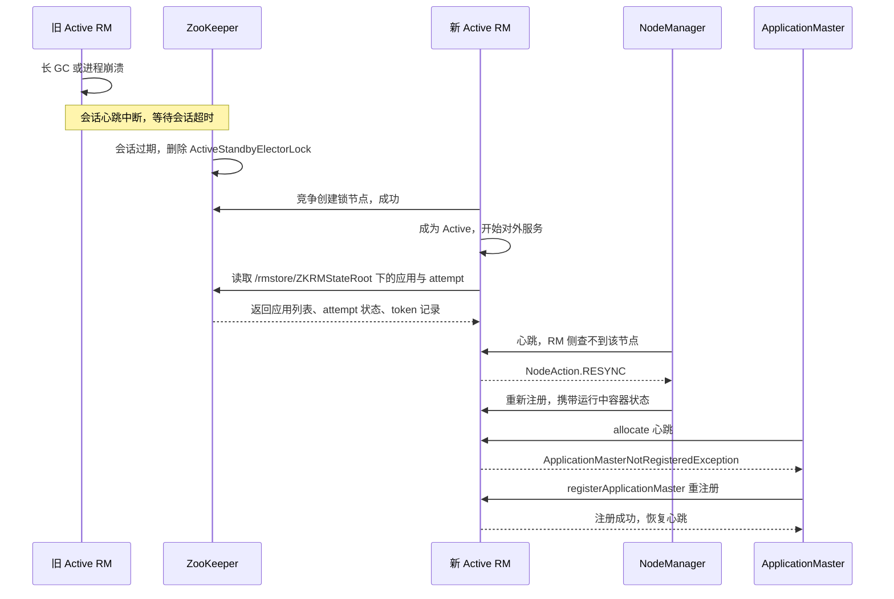
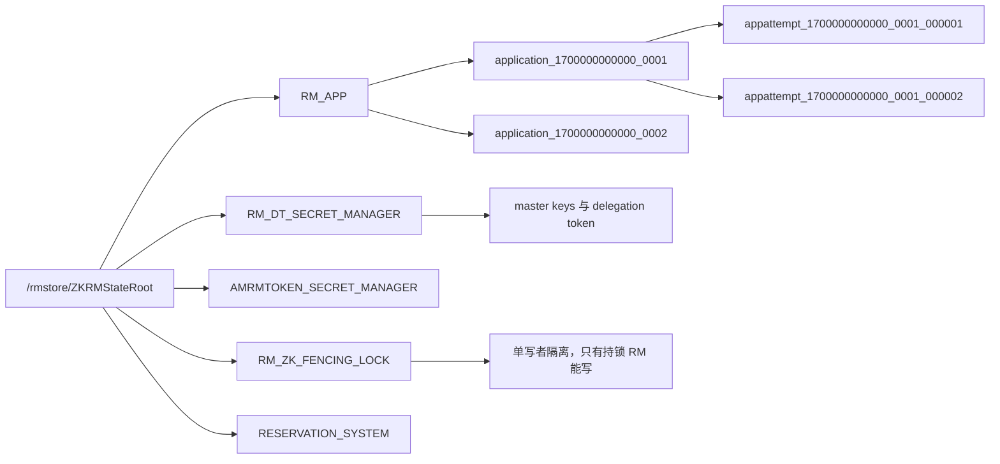
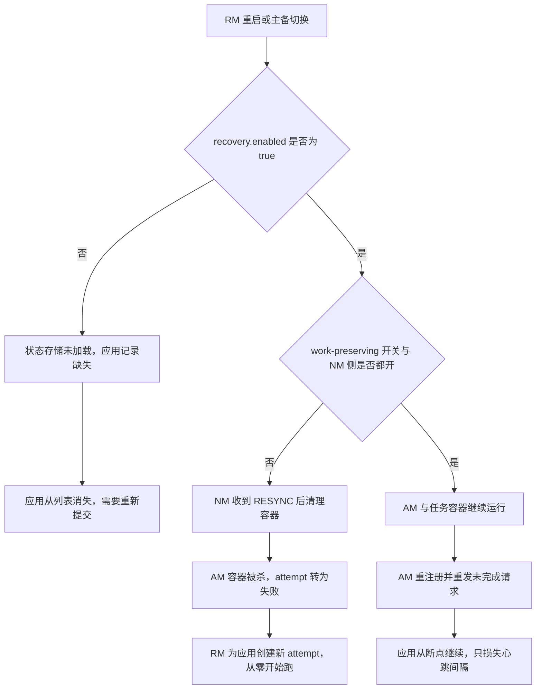
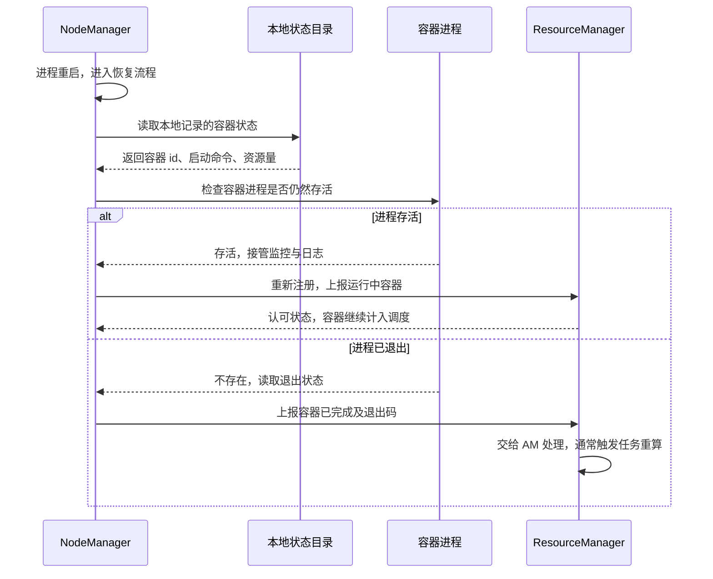
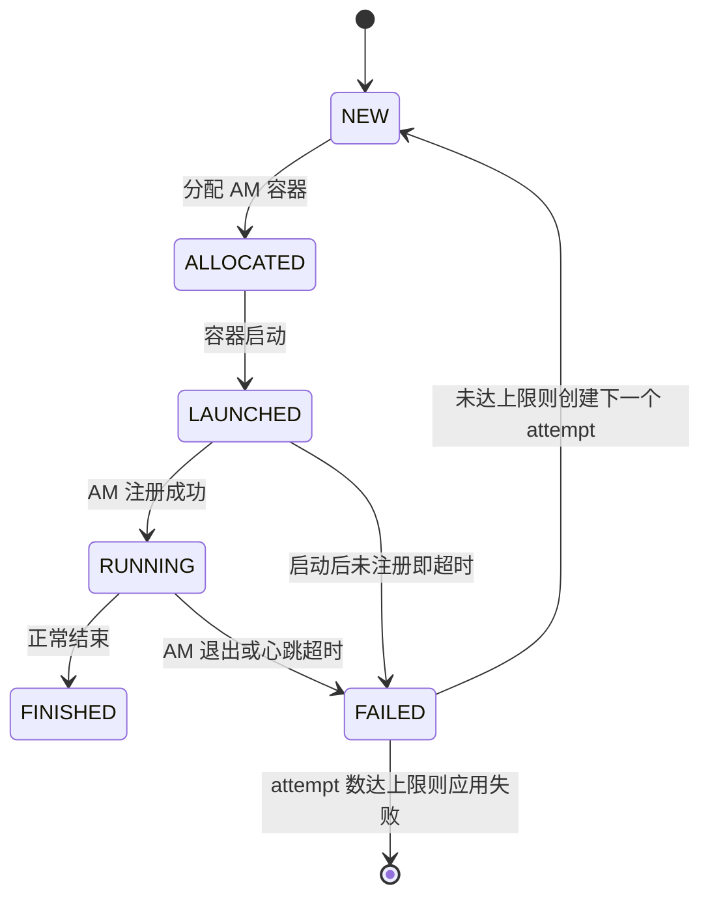
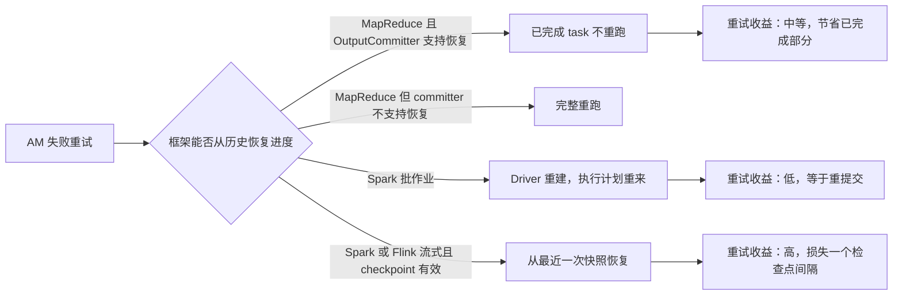

# YARN 高可用与故障恢复——ResourceManager HA 与 AM 重试机制

**摘要：**

凌晨两点，`rm1` 的 JVM 被一段没有上限的重试逻辑把堆顶满，随后是十几秒的 Full GC，ZooKeeper 会话过期，选主锁节点消失，`rm2` 抢到锁成为新的 Active。二十分钟后集群看起来一切正常：网页能打开、`yarn node -list` 照常、新作业能提交。但那天晚上真正丢掉工作的作业，死因跟 RM 一点关系都没有——它的 AM 在切换后没能重新注册，被框架自己判了死刑。这个错位是本文的起点：**RM HA 只买"集群还能接活"**，跑着的应用死不死，由另外三件事决定。

全文按四条线推进。第一条是选主与状态存储：ZooKeeper 用一把锁决定谁是 Active，用一组 znode 记住应用与 attempt 的状态，而这两件事只覆盖"账目"，不覆盖"进程"。第二条是切换之后 AM 的命运：旧 AM 收不到什么"重启命令"，它只是在下一次 `allocate` 上撞到一个 `ApplicationMasterNotRegisteredException`，然后要么重注册继续，要么被新 attempt 取代。第三条是 work-preserving restart 的四个前提，以及它在 RM 与 NM 两侧必须一致这个最容易踩的坑。第四条是重试语义：`yarn.resourcemanager.am.max-attempts` 的三层上限、attempt 编号的读法、MapReduce 能从 history 里捞回多少进度，以及 Spark 为什么全量重算。

落点是一句可操作的结论：把"RM HA 能救的故障"和"只能靠应用层 checkpoint 救的故障"分开列清楚，别让一个开关同时背两个承诺。

---

## 第 1 章 两笔账：集群能接活，和作业不被打断

### 1.1 一个切换现场

设想一个 600 节点的集群，两个 RM 跑在 `rm1`、`rm2` 上，ZooKeeper 三节点。某个整点批量任务把集群压到九成负载，`rm1` 的堆开始抖动，接着是一轮长达十五秒的 Full GC——在这个窗口里它既处理不了 NM 心跳，也处理不了 AM 的 `allocate`，ZooKeeper 那边只看到会话心跳断了。

ZooKeeper 判定会话过期，`rm1` 持有的临时节点被删除。`rm2` 监听到节点消失，重新竞争同一个位置并成功，随即从状态存储里读出应用与 attempt 的记录，再等各个 NM 上报正在运行的容器。整个过程没有人工介入，从 `rm1` 卡住到 `rm2` 能对外服务，区间落在十几秒到几十秒之间。

此时集群上跑着三类作业：一个 Spark 批作业正在第四个 stage 的 shuffle 读阶段，一个 MapReduce 作业在 reduce 阶段，一个 Flink 流作业已经连续跑了两周。切换之后，它们的结局并不一样——有的只是丢了几十秒的心跳，有的整段重算，有的干脆被判失败后重新拉起来。

### 1.2 把"高可用"拆成两笔账

同一个词"高可用"，在 YARN 里至少要拆成两笔账，混在一起谈就会得出错误结论。

第一笔是**控制面**：集群还能不能接纳新应用、还能不能分配新容器、还能不能回答查询。这是 RM HA 直接负责的部分，靠选主和状态共享实现，恢复时间以秒计。

第二笔是**运行面**：已经跑起来的容器会不会被杀、AM 会不会被重启、应用内部算到一半的数据还在不在。这笔账 RM HA 自己管不了，它由 work-preserving 开关、NM 的恢复能力、AM 所在框架的恢复逻辑三方共同决定，而这三件事的默认值，往往与人的直觉相反。

把两笔账分开之后，很多"高可用没生效"的抱怨会立刻归位：网页能打开、新作业能提交，说明第一笔账结了；作业进度归零、attempt 从 `_000001` 变成 `_000002`，说明第二笔账亏了，而亏损点不在 RM 的选举上。

| 现场现象 | 归属层 | 直接判据 |
|---|---|---|
| 提交应用报错、`yarn node -list` 超时 | 控制面 | RM 无 Active、`/ws/v1/cluster/info` 连不上 |
| 应用还在列表里，进度从 90% 掉回 5% | 运行面 | attempt 数量增加，`yarn applicationattempt -list` 出现第二个 attempt |
| 应用消失，只能重新提交 | 控制面 | 状态存储里没有该应用记录，`recovery.enabled` 未开 |
| 单个节点上的任务集体失败，其他节点正常 | 节点面 | 该节点 NM 重启且未开 recovery |
| 应用卡在某个进度，AM 日志无输出 | AM 面 | AM 心跳超时、`ApplicationMasterNotRegisteredException` |

这张表最容易被读错的一行是第三行。应用消失并不等于"RM 挂了"，而是"RM 重启后没有从状态存储里把它读回来"——`yarn.resourcemanager.recovery.enabled` 默认是 `false`，HA 打开而 recovery 没开，在配置层面完全合法，在事故现场就是灾难。

### 1.3 为什么两笔账容易混

混的根源在于两者的可观测信号重叠：都表现为"切换之后作业出了问题"。想区分，只能把时间线和归属对上——切换发生在第几秒、AM 日志里第一条异常是什么、NM 日志里有没有清理容器的记录、attempt 数量有没有变。

还有一个更隐蔽的原因：RM HA 的验收方式天然只覆盖第一笔账。运维做完 HA，验证手段通常是"杀掉一个 RM 看另一个能不能接管"，而这个动作恰好不影响正在运行的容器（容器由 NM 托管），所以验证会通过，第二笔账的窟窿要到真正的故障里才暴露。这也是为什么后文要用整整一章讲切换验证清单，而不是给一条 `rmadmin` 命令了事。

### 1.4 四条骨架

后文围绕四条骨架展开。选主与状态存储回答"控制面靠什么接活"，AM 的重注册回答"切换瞬间应用经历了什么"，work-preserving 与 NM 恢复回答"运行面能保住多少"，重试语义回答"保不住的时候，框架会替你做几次重来"。四条骨架的配置项加起来不到二十个，但每一个都有明确的调大调小代价，也都有明确的判据。

---

## 第 2 章 选主：为什么 YARN 不需要一个 ZKFC

### 2.1 从 Hadoop 2.4 说起

官方文档里有一句话值得记住：在 Hadoop 2.4 之前，ResourceManager 是 YARN 集群的单点。HA 的引入方式是 Active/Standby 双机——任一时刻只有一个 Active，其余处于 Standby 等待接管，接管可以由管理员用 CLI 触发，也可以在开启自动故障转移后由内嵌的故障转移控制器触发。

HDFS 的做法要多一层：除了 NameNode 主备，还要另起一个 `DFSZKFailoverController` 进程，由它去 ZooKeeper 抢锁、监控 NameNode 健康、必要时做隔离，细节见 [[大数据/Hadoop/HDFS/06 NameNode 高可用——QJM 协议与 Active-Standby 切换机制|NameNode HA]]。YARN 没有照抄这个结构，它把选主逻辑内嵌进 RM 进程：3.x 里对应的类是 `ActiveStandbyElectorBasedElectorService`，底层复用 Hadoop 公共库的 `ActiveStandbyElector`。**没有独立的 ZKFC 守护进程**，RM 自己既是候选人也是裁判。

采用内嵌方式之后，选主的 znode 结构非常简单，全部落在 `yarn.resourcemanager.ha.automatic-failover.zk-base-path` 之下（默认 `/yarn-leader-election`）：

- `/yarn-leader-election/<cluster-id>/ActiveStandbyElectorLock`：临时节点，谁建成谁就是 Active，会话断开即自动删除；
- `/yarn-leader-election/<cluster-id>/ActiveBreadCrumb`：持久节点，记录上一次持锁者的信息，供新的 Active 在接管时参考。

`cluster-id` 来自 `yarn.resourcemanager.cluster-id`，它的作用是防止一个 RM 误接管另一个集群的 Active 位置——多集群共用一套 ZooKeeper 时，这个隔离比想象中重要。

### 2.2 一次切换的时序

把切换摊开，可以看到它由四段串行组成，任何一段变慢都会直接推高 RTO。下面这张时序图按真实顺序画出四段：会话过期与抢锁、加载状态、NM 重新注册、AM 重新注册。

四段各自的量级差别很大。会话过期这一段由 ZooKeeper 的会话超时决定，`hadoop.zk.timeout-ms` 默认十秒（旧键 `yarn.resourcemanager.zk-timeout-ms` 已被映射到它），这意味着最坏情况下要白等十秒才承认旧 Active 已死；抢锁本身是一个 ZooKeeper 事务，通常在一秒以内；加载状态取决于应用数量，几千个应用就是几千次读 znode，串行读的量级落在秒到十几秒；最后两段受心跳节拍约束，各自大约一到两个心跳周期。

### 2.3 脑裂与 fencing

Active/Standby 架构最怕的不是切换慢，而是同时出现两个 Active。如果两个 RM 都认为自己是 Active，它们会各自把状态写进存储、各自给 NM 下发指令，最后状态存储里的记录取决于谁写得晚，集群就进入不可信状态。

YARN 对这一点的处理方式是让状态存储本身成为单写者。`ZKRMStateStore` 在语义上只接受一个写入者，也就是持有选主锁的那个 RM，锁不在手里的 RM 即使进程还活着，写入也会失败；状态存储里另有一个 `RM_ZK_FENCING_LOCK` 节点承担隔离职责。官方文档把这件事说得很直白：只有 ZooKeeper 版的状态存储支持 fencing，因此**HA 集群必须用 ZK 状态存储**。

这也解释了一个常见的配置误解。有人在 HA 集群里配 `FileSystemRMStateStore`，看到两个 RM 都能正常启动、也都能切换，就认为可用。真实情况是：HDFS 版存储不提供 fencing，两个 RM 可能同时写同一个目录，切换过程中状态记录会互相覆盖，而被覆盖的那部分恰好是"谁在跑、跑到第几次 attempt"这类关键信息。这类故障不会立刻报错，只在某次切换后表现为"应用凭空多了几个 attempt"或"应用状态倒退"，极难排查。

手动模式要特别小心。`yarn.resourcemanager.ha.automatic-failover.enabled` 默认为 `true`，但只在 HA 打开时生效；自动故障转移开着的时候，`yarn rmadmin -transitionToActive` 会被拒绝，必须加 `-forcemanual`。这个设计是在提醒：在自动模式下强行人工干预，等于绕过锁的仲裁，人为制造脑裂风险。

---

## 第 3 章 状态存储：ZK 里到底存了什么

### 3.1 目录结构

`ZKRMStateStore` 的根路径由 `yarn.resourcemanager.zk-state-store.parent-path` 指定，默认 `/rmstore`；根之下还有一层固定的 `ZKRMStateRoot`，所以完整路径是 `/rmstore/ZKRMStateRoot/...`。这一层经常被写错，很多文章直接写成 `/yarn-applications/<cluster-id>`，实际并不存在。

下面这张图画的是关键节点，节点标签标出它承载的内容。

节点职责可以分成三类。`RM_APP` 下挂每个应用的状态和它的 attempt 记录，是切换后恢复的主干；`RM_DT_SECRET_MANAGER` 与 `AMRMTOKEN_SECRET_MANAGER` 管凭证，包括 delegation token 的主密钥和 AM 访问 RM 用的 AMRMToken 密钥，这也是"安全集群里 RM 重启后 AM 还能不能连上"的关键；`RM_ZK_FENCING_LOCK` 与 `RESERVATION_SYSTEM` 分别负责隔离与预留资源。

还有一个与规模有关的细节：应用节点支持分片。`yarn.resourcemanager.zk-appid-node.split-index` 指定按 appId 的某一位拆分，开启后 `RM_APP` 下会出现 `HIERARCHIES/0` 到 `HIERARCHIES/9` 十个子目录，应用节点按位落进去。默认不分片，几千个应用就是同一个父节点下的几千个子节点，读取和监听都会变慢，这件事与配置洁癖无关，它直接算进切换的 RTO。

### 3.2 写入发生在哪一步

状态存储的写入不是"定时快照"，而是状态机推进的同步前置动作。应用从 `NEW` 进入 `NEW_SAVING`，先把 `ApplicationSubmissionContext` 写进存储，写完才进 `SUBMITTED`；应用结束时进 `FINAL_SAVING`，把最终状态与诊断信息写进去，写完才算终态。attempt 的注册、失败、完成同样有对应的保存点。

这个顺序决定了失败语义：存储写不进去，状态机就停在那里。应用侧看到的是提交失败或长时间的 `NEW_SAVING`，而不是"提交成功但状态丢失"。这是一种用可用性换一致性的选择——宁可拒绝服务，也不制造内存与存储不一致的状态。

写入内容是应用级与 attempt 级，不包含容器级。很多资料说状态存储连容器状态一起保，实际并不然：attempt 记录里只带 AM 容器的标识与状态，任务容器一个都不在里面，切换后只能靠 NM 上报重建。这一点直接决定了 RPO 的算法：应用与 attempt 的状态在切换后能精确恢复到"最后一次成功写入"那一刻，而这个写入是同步的，所以 RPO 近似为零；容器的状态从来不在存储里，切换后必须由 NM 上报重建，重建期间的容器状态是"推断"出来的，不是"恢复"出来的。

| 状态对象 | 是否持久化 | 切换后由谁重建 | 丢失窗口 |
|---|---|---|---|
| 应用基本信息与提交上下文 | 是，提交时同步写 | 直接从存储读 | 近似零 |
| 应用的 attempt 列表与状态 | 是，每次状态推进写 | 直接从存储读 | 近似零 |
| AM 容器标识与 Tracking URL | 是，随 attempt 记录保存 | 直接从存储读 | 近似零 |
| Delegation token 与 AMRMToken 主密钥 | 是 | 直接从存储读 | 近似零 |
| 队列占用与调度器内部结构 | 否 | 配置加 NM 上报的容器重建 | 一个重建周期 |
| 运行中的容器明细 | 否 | NM 重新注册时上报 | 一个重建周期 |
| NM 注册信息与心跳状态 | 否 | NM 重新注册 | 一个心跳周期 |
| 容器内进程与内存里的数据 | 否 | 无 | 永久 |

### 3.3 三种存储与队列配置

官方提供了三种状态存储实现，定位完全不同：

- `ZKRMStateStore`：唯一支持 HA 的选择，代价是 znode 数量随应用数增长、每个 znode 写入都要走 ZooKeeper 的 fsync 与快照机制；
- `FileSystemRMStateStore`：默认实现，适合非 HA 的单机部署与测试，URI 由 `yarn.resourcemanager.fs.state-store.uri` 指定，默认落在 `${hadoop.tmp.dir}/yarn/system/rmstore`；
- `LeveldbRMStateStore`：本地 LevelDB，写入放大比 HDFS 小、原子性更好，但同样不支持 fencing，无法用于 HA。

队列配置是另一份需要共享的状态。Capacity Scheduler 在 3.x 里支持把队列定义本身放进可插拔的配置存储，由 `yarn.scheduler.configuration.store.class` 选择实现，默认是 `file`；切成 `zk` 后由 `ZKConfigurationStore` 承担，路径前缀由 `yarn.scheduler.configuration.zk-store.parent-path` 指定，默认 `/confstore`。

为什么队列配置也要进 ZK？因为两个 RM 必须看到同一份队列树。如果配置留在各自节点的 `capacity-scheduler.xml` 里，一次升级漏改其中一台、或者某次在线改队列只写到了当前 Active 的本地文件，切换之后新 Active 的队列结构与旧的不一致，应用的队列归属、配额、`maxCapacity` 全部错位，而错误不会在切换瞬间报出来，只会表现为"某些应用的资源突然拿不到"。

ZooKeeper 作为状态存储的代价是实打实的。每个应用至少一个 znode，attempt 再来一个，delegation token 还有若干；几千个应用的集群，`/rmstore` 下的节点数是万级。ZooKeeper 的写入要落事务日志，读要过内存数据库，单次写入的延迟取决于磁盘 fsync，通常在毫秒量级——应用提交的吞吐上限因此被 ZooKeeper 的写延迟按住，这是高并发提交场景里绕不开的一笔账。

### 3.4 四个必须逐台不同的配置

HA 的配置写法里有一类坑只与"前缀"有关：同一组配置要按 RM 各写一份，写错一个后缀，故障时才发现某台 RM 的地址根本没人配。四个关键项如下：

| 配置项 | 含义 | 调错或写错的后果 | 备注 |
|---|---|---|---|
| `yarn.resourcemanager.ha.id` | 本 RM 在集群内的身份标识 | 两台 RM 用同一个 id，等于给它们发了同一张身份证，选主与状态写入行为不可预期 | 不显式设置时按主机名推导，容器化部署最容易撞 |
| `yarn.resourcemanager.ha.rm-ids` | 所有 RM 的逻辑 id 列表 | 客户端与 NM 枚举不到另一台 RM，切换后连接不上新 Active | 逗号分隔，与各 `*.address.<id>` 的后缀一一对应 |
| `yarn.resourcemanager.address.<id>` | ClientRMService 地址，默认端口 8032 | 提交与查询走错地址，表现为提交超时而不是报错 | 逐台设置，覆盖 `yarn.resourcemanager.hostname.<id>` |
| `yarn.resourcemanager.webapp.address.<id>` | Web 与 REST 地址，默认端口 8088 | 负载均衡探活指向了 Standby，页面能开但应用提交失败 | Standby 的页面会自动重定向到 Active，见第 10 章 |

这四项之外，`hadoop.zk.address` 是整套 HA 的地基：它同时被状态存储与内嵌选主使用，写错等于两个 RM 各连了一套 ZooKeeper，选主与状态共享同时失效，而这套配置在启动日志里通常只体现为一次连接告警。至于各 `*.address.<id>` 的"调大调小代价"，实际是端口与连接数的取舍：端口改动会牵连客户端、NM、负载均衡与防火墙四处，调之前先确认没有第二处硬编码。

---

## 第 4 章 切换之后：下一次心跳里藏着答案

### 4.1 AM 收不到"重启命令"

流行说法是"RM 切换后会给 AM 发一个 Reboot 指令，AM 收到后重启"。这个说法与 3.x 的实际路径不符，值得拆开纠正。

`AMCommand` 这个枚举确实存在，`AM_RESYNC` 与 `AM_REBOOT` 两个值也都还在，但它们在源码里已被标记为废弃，且不是 RM 切换的主路径。真正的机制是：RM 重启后，`ApplicationMasterService`（它的对外职责在 [[02 YARN 整体架构全景——ResourceManager、NodeManager 与 ApplicationMaster 三角协作|YARN 三角协作]] 里拆过）里记录"这个 attempt 已注册"的内存状态是空的，旧 AM 的下一次 `allocate` 请求进来时，RM 查不到注册记录，于是抛异常。异常文案在源码里写得很清楚，大意是"该 attempt 的 AM 未注册，或者 RM 在该 AM 注册之后重启过，AM 应当重新注册"。

AM 侧收到的是 `ApplicationMasterNotRegisteredException`，而不是一条指令。MapReduce 的 `RMContainerAllocator` 捕获它之后的动作是固定的三步：把 `lastResponseID` 归零、调用 `register()` 重注册、调用 `addOutstandingRequestOnResync()` 把未完成的资源请求重发一遍。日志里会出现一句 "ApplicationMaster is out of sync with ResourceManager, hence resync and send outstanding requests"。

这一段揭示了两个常被忽略的细节。其一，切换被发现的延迟等于一个 AM 心跳周期，AM 心跳通常一秒一次，所以 AM 侧的感知很快；其二，旧 AM 必须重新注册并重发请求，因为 RM 在重启过程中丢掉了未满足的资源请求，只恢复了应用与 attempt 的元数据。用 `AMRMClient` 库写的框架由库代劳，自己实现 RPC 的框架要自己补这两步，漏掉重发请求的 AM 会表现为"重注册成功了，但从此再也不申请容器"。

### 4.2 三条分岔

同一个切换，AM 的结局取决于两个开关加上 NM 侧的配置是否同步。下面这张流程图把三条分岔画在一起，判断顺序是先看 recovery，再看 work-preserving，最后看 attempt 是否被保留。

三条分岔的关键差别不在 RM 侧，而在 NM 侧。work-preserving 关闭时，NM 收到 `NodeAction.RESYNC` 会走 `cleanupContainersOnNMResync()`，把这个节点上正在运行的容器全部清掉——包括 AM 容器。容器一死，AM 的进程没了，attempt 只能在 NM 上报"AM 容器已结束"之后转为失败，再由 RM 创建新的 attempt。

反过来，work-preserving 打开时，NM 收到同一个 `RESYNC`，走的是另一条分支：保留容器、重新注册、把容器状态报给新 Active。日志里对应的两句话是 "Cleaning up running containers on resync" 和 "Preserving containers on resync"，排查时直接搜这两句，比翻十页配置快。

| 组合 | 容器 | AM | 应用结局 |
|---|---|---|---|
| recovery 开、work-preserving 两侧都开 | 继续运行 | 继续运行，重注册 | 断点续跑，损失一个心跳间隔 |
| recovery 开、work-preserving 未开或两侧不一致 | 被 NM 清理 | 被杀 | 新 attempt 从零开始，已算的工作丢失 |
| recovery 开、work-preserving 开但 NM 侧配错 | 被 NM 清理 | 被杀 | 与上一行相同，差异只在日志 |
| recovery 未开 | 继续运行但不被 RM 记账 | 重注册失败 | 应用记录缺失，可能被当作孤儿清理 |

### 4.3 给"切换期间应用会不会死"一个准确回答

准确的说法是：不必然死，但会短暂失去联系，能否继续取决于四个条件同时成立。

第一个条件是 RM 侧保留了该 attempt 的记录，也就是 work-preserving 生效；第二个条件是 NM 没有收到清理指令，也就是 work-preserving 的开关在 NM 侧同样打开；第三个条件是 AM 在客户端连接容忍窗口内重连成功，`yarn.resourcemanager.connect.max-wait.ms` 默认十五分钟、`yarn.resourcemanager.connect.retry-interval.ms` 默认三十秒，配上 `yarn.client.failover-retries` 默认为零的快速重试，这个窗口足够宽；第四个条件是 AM 本身能重放未完成的请求，这一步由框架实现决定。

四个条件里最容易漏的是第二个。开关的名字里带 `resourcemanager`，直觉上会以为只影响 RM，实际 NM 读的是同一个键来决定"清理还是保留"——配置文件只发到 RM 节点、没发到 NM 节点，是这个坑最常见的成因。

还有一个反向的误解：不少人以为"容器不受 RM 切换影响"是 YARN 的固有性质。它确实不受 RM 进程死亡的影响，因为容器由 NM 托管，AM 与 NM 之间的 `startContainers` 也不经过 RM；但"不受影响"的前提是没人下清理指令，而 RESYNC 恰恰就是一条清理指令。

### 4.4 影响窗口的量级

把第 2 章的四段与本章的 AM 重注册拼起来，可以得到一个量级估算。以下数字是示例推算，不是基准测试，真实值随集群规模与硬件变化：

- 会话过期：十秒左右，由 `hadoop.zk.timeout-ms` 决定，调小会加快检测但增加误判；
- 抢锁与切换状态：一秒以内；
- 加载状态：与应用数成正比，几千个应用大致落在几秒到十几秒；
- NM 重新注册与容器重建：一个到数个心跳周期，千级节点时会被分摊到多个心跳；
- work-preserving 的调度等待：`yarn.resourcemanager.work-preserving-recovery.scheduling-wait-ms` 默认十秒，这段时间里 RM 只重建状态、不做新分配；
- AM 重注册：一个 AM 心跳周期，通常一秒。

小集群的合计落在十几秒，几千个应用的集群落在三十秒到一分钟。这个窗口对批处理几乎无感，对延迟敏感的长连接应用则足以触发客户端超时——所以后者的健康检查阈值要按窗口大小来定，而不是按"服务端通常很快"来定。

### 4.5 一个会让人误判的细节：容器 id 里的 epoch

开启 work-preserving 恢复后，容器 id 的格式会变：从 `Container_<clusterTimestamp>_<appId>_<attemptId>_<containerId>` 变成 `Container_e<epoch>_<clusterTimestamp>_<appId>_<attemptId>_<containerId>`，其中 epoch 从零开始，每重启一次 RM 加一，为零时省略。

这个细节会带来两类误判。一类是把 id 变化当成"容器被重建了"——容器并没有重建，只是 RM 换了一代，新的分配要用新的 epoch 避免与旧记录撞号；另一类是脚本里的正则只认老格式，切换后所有日志匹配失败，运维以为日志丢了。看到 `Container_e17_` 这种前缀，正确的反应是"这个 RM 已经重启过十七次"，而不是"集群出问题了"。

---

## 第 5 章 work-preserving：保住的是账，不是命

### 5.1 两个模式的定义

RM 重启有两种模式，官方文档把差别写得很清楚。

非 work-preserving 模式：RM 从状态存储里读出应用元数据，重新提交那些尚未完成的应用。重启期间 NM 与客户端一直轮询等待，RM 起来后向所有 NM 与 AM 发重同步指令，NM 会杀掉它托管的所有容器并重新注册，AM 被期望在收到重同步指令后退出；RM 随即为每个未完成应用创建新的 attempt，从头再跑一遍。

work-preserving 模式：RM 不只恢复应用元数据，而是重建整个运行态——调度器里各容器的生命周期、应用的头寸（headroom）与资源请求、各队列的占用。重建的原料来自两处：NM 上报的容器状态，以及 AM 重新发来的未完成请求。AM 不需要被杀掉重来，它可以重新同步之后从原处继续。

两种模式的分界线落在运行态能否被重建上，重启快不快只是结果。非 work-preserving 只恢复账本，不恢复账本背后的过程；work-preserving 试图把过程也恢复出来，代价是它依赖更多前提。

### 5.2 四个前提

work-preserving 要真正生效，四个前提必须同时成立。缺任何一个，行为都会退化到非 work-preserving，而退化方式往往不留显式报错。

第一个前提是**状态存储可共享且能隔离**：`yarn.resourcemanager.recovery.enabled` 为 `true`，存储类是 `ZKRMStateStore`，两个 RM 连同一套 ZooKeeper。少了这条，切换后新 Active 手里没有应用记录，后面三步都无从谈起。

第二个前提是**开关在 RM 与 NM 两侧一致**。`yarn.resourcemanager.work-preserving-recovery.enabled` 在 3.3.x 的默认值是 `true`（注意键名末尾是 `enabled` 而不是 `enable`，写错的那个键会被当成未知配置静默忽略），而 `yarn.resourcemanager.recovery.enabled` 默认是 `false`——**默认值的组合才是真相**：只开着 work-preserving 而没开 recovery，等于什么都没发生；两个都开、但 yarn-site.xml 只同步到了 RM 节点，NM 会按自己的默认或旧配置走清理分支。

第三个前提是**NM 与容器进程都还活着**。RM 切换不杀容器，但也不复活容器；如果故障本身把某台机器的 NM 与容器一起带走了，work-preserving 只能让 RM 的账重建得漂亮一点，不能把那台机器上的进程找回来。

第四个前提是**AM 能重注册并重发请求**。用 `AMRMClient` 库的 AM 由库代劳；自研 AM 要自己处理 `ApplicationMasterNotRegisteredException`，并把未满足的资源请求重新提交。漏掉重发的 AM 能"活下来"，但会卡在某个进度上不动，这种半死状态比直接失败更难查。

### 5.3 调度等待为什么必要

`yarn.resourcemanager.work-preserving-recovery.scheduling-wait-ms` 默认十秒，含义是 RM 在恢复期间先等一段时间，再做新的容器分配。这个等待是纠错性的：集群有上千个 NM 时，重新注册是分散在多个心跳里完成的，如果 RM 一起来就分配容器，它可能把资源分给了一个尚未上报状态的节点，而那个节点上其实还挂着一批容器，结果是账面资源与实际资源对不上。

调大这个值的代价是恢复窗口变长，切换后十秒到一分钟内新提交的应用拿不到容器；调小的代价是资源超卖与分配抖动，表现为切换后的一小段时间里出现大量容器分配失败或节点被判超载。判断依据是集群的节点数：节点越多，重新注册越慢，等待就越应该留足。

### 5.4 它保不住的四件事

把 work-preserving 当成"应用不死"的万能开关，是这篇最想拦住的误解。它保不住的第一件事是容器内进程的死亡：进程被 OOM killer 杀掉、被 `SIGKILL`、自己 `exit`，这些与 RM 的账无关；第二件事是 AM 自身的状态丢失：AM 重注册只是恢复与 RM 的通信，AM 内部记到哪一步，取决于框架自己的恢复逻辑；第三件事是资源隔离前提之外的东西，譬如节点被判 `LOST` 后其上容器的归属；第四件事是外部副作用的幂等性：AM 重启后重放一段逻辑，写了两次目标表、提交了两次外部任务，YARN 不会帮你发现。

一句话概括：work-preserving 保住的是 RM 眼里的账，账能对上，集群就能继续调度；账背后的进程与数据，各有各的负责人。

---

## 第 6 章 NM 恢复：保得住托管关系，保不住进程

### 6.1 默认行为等于没有恢复

`yarn.nodemanager.recovery.enabled` 的默认值是 `false`。这个默认值的含义很直接：NM 进程一重启，它不会再接管任何在跑的容器，之前托管的容器在 RM 那边被判为失败，应用侧看到的是一批任务同时失败并触发重算。

这条默认值经常被忽略，因为 RM HA 的存在给了人"整条链都高可用"的错觉。RM 有主备、ZooKeeper 有仲裁、应用有重试，唯独节点这一层是"进程一死，容器全丢"。运维做单机维护、打内核补丁、升级 NM 版本的时候，代价是节点上所有作业重跑，而这件事在配置里没有任何提示。

### 6.2 开启恢复要配对的四件事

只把 `recovery.enabled` 改成 `true` 还不够，YARN 的文档里列了一组前置条件，任何一条不满足，恢复都会失败或者部分失败。

| 配置项 | 默认值 | 作用 | 配错或配小的代价 |
|---|---|---|---|
| `yarn.nodemanager.recovery.enabled` | `false` | 是否在本地状态存储中记录容器状态，重启后据此恢复 | 保持默认即节点重启等于容器全丢 |
| `yarn.nodemanager.recovery.dir` | `${hadoop.tmp.dir}/yarn-nm-recovery` | 状态目录 | 放在会被清理的临时目录，重启后状态文件消失，恢复无效 |
| `yarn.nodemanager.recovery.supervised` | `false` | NM 退出时是否清理容器 | 不开则 NM 正常停止时容器被一起清掉，恢复没有对象 |
| `yarn.nodemanager.address` | `${hostname}:0` | NM 的 RPC 地址 | 端口为 0 时重启前后端口变化，原有连接全部失效，恢复等于白做 |

第四条最容易被当成小事。文档把"显式指定非临时端口"写成了启用 NM 恢复的前置条件，原因是容器与客户端在重启前建立的是指向具体端口的连接，端口一变，这些连接全部断开，容器即使活着也联系不上 NM。

还有一条不在表里但同样关键：**辅助服务要支持恢复**。MapReduce 的 ShuffleHandler 是典型例子，它默认监听固定的 `mapreduce.shuffle.port`，并在 NM 重启后重新加载之前的状态；如果换成自研的辅助服务，监听临时端口又不做状态重载，那么 NM 恢复之后，活着的 reducer 会卡在拉取 shuffle 数据这一步，表现为"容器还在、任务不动"。

### 6.3 supervised 的准确含义

`yarn.nodemanager.recovery.supervised` 常被误读成"是否启用恢复"。它的准确含义是：开启之后，NM 退出时不会尝试清理容器，而是假定自己马上会被拉起来并恢复这些容器。

这带来一个重要的行为差别。不开 supervised 时，NM 正常停止（`systemctl stop`、升级、重启）会顺手把容器清干净，即使 `recovery.enabled` 为 `true`，重启后也没有可恢复的对象；开了 supervised 时，NM 退出前不动容器，重启后再接管。两个开关分工不同：`recovery.enabled` 决定能不能记住，`supervised` 决定退出时会不会自己拆台，要一起开。

但 supervised 有一个硬前提：**容器的进程必须还活着**。它不负责把死掉的进程拉起来，只负责不在自己退出时杀掉它们。机器断电、内核 panic、OOM killer 连带把容器进程干掉，这些场景下重启后的 NM 只能把容器标记为已完成并把退出状态报上去，AM 侧照样要重算。

### 6.4 恢复过程里 NM 做了什么

下面的时序图画的是 NM 重启后的恢复路径，注意"进程还活着"与"进程已死"两条分支的差别。

两条分支的结果差别很大，但都不是"恢复原状"。存活分支恢复的是**托管关系**：NM 重新看住这些进程、继续收日志、继续上报资源使用；退出分支连托管关系都恢复不了，只能如实上报。这也解释了为什么 NM 恢复在滚动升级时效果最好（进程不动，只是守护进程换了个版本），在机器故障时基本无效（进程与守护进程一起没了）。

---

## 第 7 章 AM 重试：attempt 的形状与三层上限

### 7.1 attempt 长什么样

AM 的每一次尝试都是一个独立的 attempt，标识格式为 `appattempt_<clusterTimestamp>_<appId>_<attemptId>`，例如 `appattempt_1700000000000_0001_000002`。attempt 编号从 1 开始，第一个 attempt 是 `_000001`；因此某个应用的 attempt 一旦出现 `_000002`，就说明它的 AM 至少重启过一次。监控脚本常见的错误是按"第几次失败"来推 attempt 编号，而实际的编号包含首次尝试，差了一位。

attempt 的状态迁移可以用状态图概括，重点是"失败"与"被新 attempt 取代"是两个不同的事件。

读这张图的关键在 `LAUNCHED --> FAILED` 这条边。RM 重启后如果 attempt 的记录里没有最终状态，它会把 attempt 放回 `LAUNCHED`，然后等两件事之一：NM 在重新注册时报告 AM 容器已结束，或者 AM 的心跳存活监控超时。非 work-preserving 模式下走的就是这条路径，所以"切换后应用重启"的延迟不一定是一个心跳，最坏情况下是 AM 心跳超时窗口——`yarn.am.liveness-monitor.expiry-interval-ms` 默认十分钟。

### 7.2 三层上限

attempt 次数不是一个数字能说清的，它有三层：集群硬顶、集群默认值、应用请求值。

| 层级 | 配置项 | 默认值 | 说明 |
|---|---|---|---|
| 集群硬顶 | `yarn.resourcemanager.am.global.max-attempts` | 未设置，回落到下一层 | 真正的天花板，用于给整个集群设一条不可逾越的线 |
| 集群默认 | `yarn.resourcemanager.am.max-attempts` | 2 | 应用不显式请求时使用，也是硬顶未设置时的回落值 |
| 应用请求 | `mapreduce.am.max-attempts`、`spark.yarn.maxAppAttempts` | MapReduce 为 2；Spark 跟随集群值 | 框架在提交应用时写进 `ApplicationSubmissionContext` |

应用侧只能调小，不能调大。3.x 的实现是在 `RMAppImpl` 构造时比较应用请求值与集群上限：应用值大于上限时，直接采用上限并打一条 WARN，日志里的措辞大意是"使用全局最大值代替"；应用值小于等于零时，也回落到 RM 的默认值。也就是说，调大不会让提交失败，只会被静默压回去——运维以为把 `spark.yarn.maxAppAttempts` 设成 5 就多四次机会，实际还是两次。Spark 的文档也提示这个值"不应大于 YARN 配置里的全局最大尝试次数"，但文档提示不等于运行期报错，静默截断才是真实行为。

### 7.3 计数不是简单累加

attempt 失败的计数不是"历史上失败几次就累计几次"。应用可以指定一个失败有效窗口，`ApplicationSubmissionContext.setAttemptFailuresValidityInterval` 对应的就是这个语义：早于窗口的失败记录会被剔除，只有窗口内的失败才计入次数。Spark 把它暴露成 `spark.yarn.am.attemptFailuresValidityInterval`，默认不设置，也就是不启用重置。

这个机制的存在理由很实际：一个能稳定跑几小时的 AM，偶然因为一次节点故障失败，不应该和"刚启动就崩"的 AM 共享同一个预算。反过来，启用之后"最大尝试次数"的语义从"总共几次"变成了"在窗口内几次"，容量规划时要按后者估算。

还有一个特例要单独记：`maxAppAttempts` 显式设为 1 时，RM 的代码里有一条特别处理，注释的意思很直白——如果用户明确把次数设成 1，说明他对"AM 重启导致的状态不一致"有顾虑，那么就不再尝试。这句话是官方对"重试有代价"最坦率的承认，第 8 章会把这份代价展开。

### 7.4 失败判据从哪读

应用最终失败时，`diagnostics` 字段里会有一段固定格式的诊断，大意是"应用失败了 N 次，原因是某个 AM 容器以某个退出码结束；全局上限为 X，本地上限为 Y"。这段话里有两个有用信息：失败次数与两个上限的对比，能立刻判断出是"用完了集群给的名额"还是"应用自己只要了这么多次"。

另一个判据是 AM 心跳超时。`yarn.am.liveness-monitor.expiry-interval-ms` 默认十分钟，含义是 RM 连续十分钟没收到某个 AM 的心跳就判定它失活。这个值调小的代价是把长 GC、磁盘抖动、瞬时负载都算成 AM 死亡，触发不必要的重试与重算；调大的代价是 AM 真死之后要等更久才重启，作业的空转时间变长。十分钟的默认值是按"宁可慢一点也不要误杀"设的，对延迟敏感的作业可以调小，但要配合第 5 章的 work-preserving 一起评估。

### 7.5 五个旋钮的代价

与重试和失联判定相关的旋钮不多，但每一个都双向收费。下面这张表把它们的代价并排列出，判断时按"集群规模加业务延迟要求"两条轴去选，而不是照抄别人的值。

| 配置项 | 默认值 | 调大的代价 | 调小的代价 |
|---|---|---|---|
| `yarn.resourcemanager.am.max-attempts` | 2 | 失败应用会反复占用资源，全量重算的作业把消耗按倍数放大，非幂等副作用重复 | 一次偶发故障就让应用失败，靠外部调度重提，重提要重新排队 |
| `yarn.am.liveness-monitor.expiry-interval-ms` | 600000 | AM 真死之后要等更久才被判失败，作业空转，资源被占着不放 | 长 GC、磁盘抖动都会被当成 AM 死亡，触发不必要的重试与重算 |
| `hadoop.zk.timeout-ms` | 10000 | 旧 Active 已经失联却迟迟不被判死，接管推迟，RTO 直接变长 | 一次网络抖动就误判会话过期，选主反复震荡，甚至出现双主风险 |
| `yarn.resourcemanager.work-preserving-recovery.scheduling-wait-ms` | 10000 | 恢复窗口变长，切换后新提交的应用一段时间拿不到容器 | 节点状态尚未上报就开始分配，账面资源与现场对不上，分配抖动 |
| `yarn.resourcemanager.connect.max-wait.ms` | 900000 | 客户端与 AM 长时间卡在等待里，故障感知迟钝，重试语义变得含糊 | 一次稍长的切换就让客户端放弃，本来能续跑的应用被判失败 |

---

## 第 8 章 重试之后还剩多少工作：MR 与 Spark 的分野

### 8.1 MapReduce 能从 history 里捞回多少

MapReduce 的 AM 重试不是"容器保活"，而是"进度保活"。新的 `MRAppMaster` 启动后，如果条件满足，会去读上一轮 attempt 留下的 job history，重建已完成任务的状态，只重新提交未完成的部分。这套逻辑的开关是 `yarn.app.mapreduce.am.job.recovery.enable`，默认 `true`。

但"默认开启"不等于"一定恢复"。3.x 的 `MRAppMaster` 里有一段 `shouldAttemptRecovery` 的判断，五个条件同时满足才会真正尝试恢复：

- 当前 attempt 不是第一次尝试，首次尝试无历史可读；
- 恢复开关为 `true`；
- 作业的 `OutputCommitter` 支持恢复，自定义 committer 如果不实现恢复语义，一律不恢复；
- 有 reducer 时，shuffle 密钥必须由作业客户端提供，否则密钥是 attempt 级的，恢复后 reducer 拉不动数据；
- 有 reducer 且开启了中间数据 spill 加密时，不恢复，因为加密密钥没有持久化。

这五条里，第三条在事故现场最常被证实，第二条偶有遇到——有的团队为了排查问题把恢复开关关掉，事后忘了打开。很多团队以为"MR 天然支持 AM 重启恢复"，实际用的是自定义 `OutputCommitter`，恢复被静默跳过，日志里只有一行 "Recovery is not supported by ..."，很容易淹没在几万行日志里。

恢复成功时，保住的是"已完成的任务不再重跑"，不是"容器还在"。旧 attempt 失败时，它名下的容器会被 RM 释放，map 输出随之丢失；因此 reducer 需要的 map 输出如果还没被读走，这部分 map 仍然要重跑。job history 里还有一类信息专门用于正确性：commit 标记文件记录在开始与结束提交时的状态，新的 AM 读到"提交已成功"的标记就不会重复提交——这保护的是输出的正确性，不是重算的工作量。

### 8.2 Spark 为什么是全量重算

Spark on YARN 的 cluster 模式下，AM 就是 Driver。AM 失败重试意味着一个新的 Driver 进程、一个新的 `SparkContext`、一套全新的 Executor——旧的 Executor 随旧 attempt 一起被释放，它们本地的 shuffle 文件与缓存全部作废。

这由架构决定，与实现上的偷懒无关：Spark 的执行计划在 Driver 内存里，RDD 的血缘关系也在 Driver 内存里；Executor 是无状态的执行者，只持有分区的中间数据。Driver 一换，血缘没了，只能按提交时的那份计划从头再算。有 External Shuffle Service 时，shuffle 数据能在 Executor 退出后仍然可读，但它救的是"同一个应用内 Executor 的动态伸缩"，不是"Driver 重启后的重建"——新 Driver 的 stage 划分与 partition 编号对不上旧数据，照样得重算。

唯一的例外是带状态的流式作业。Spark Streaming 的 `StreamingContext.getOrCreate` 配合 checkpoint 目录，可以在重启后恢复 DStream 图与已处理的批次位置；Structured Streaming 的 checkpoint 目录里存着 offset 与状态存储，重启后可以从上次的 offset 继续。两者都依赖一个前提：checkpoint 路径必须固定且不含应用 id、时间戳这类每次提交都会变的东西。把 checkpoint 路径写成带 `application_xxx` 的形式，第一次上线看着没问题，第二次重启就找不到目录，等于没做 checkpoint。

### 8.3 判据：什么时候该调大，什么时候该设一

把两类作业放在一起，重试的收益差别就很清楚。

判据可以写成三句话。第一，**重试收益高**的作业（流式加有效 checkpoint、MapReduce 加支持恢复的 committer），把 `maxAppAttempts` 调到 3 到 5 是合理的，因为每次重试确实能省下大部分工作。第二，**重试收益接近零**的作业（Spark 批作业、无 checkpoint 的长任务），调大次数只是把"全量重算"重复几遍，占用的集群资源按倍数增长，正确做法是设为 1 让应用快速失败，由外部调度系统带着确定的参数重新提交——重试的位置比重试的次数更重要。第三，**有外部副作用**的作业（写外部数据库、发消息、调用第三方接口），重试会重复副作用，除非每一步都幂等，否则宁可失败也不要自动重来。

这三句话背后是同一个判断：重试解决的是"进程级故障"，不解决"状态丢失"。框架能把状态恢复到什么程度，决定了重试值不值得。把 `maxAppAttempts` 当成"越大越可靠"的旋钮，是把可靠性问题误当成配置问题。

---

## 第 9 章 四种看起来像 HA 的安排

### 9.1 配了主备，但状态存储各写各的

最典型的一种：两个 RM 都配了 HA，也都配了 `yarn.resourcemanager.recovery.enabled=true`，但存储用的是 `FileSystemRMStateStore`，路径分别是两台机器上的本地目录。

这种配置在测试里能通过：杀掉 Active，Standby 接管，应用列表还在——因为应用本来就是它自己启动的。真实故障里会出问题：两个 RM 写的是两份互不相干的记录，Standby 从来没有见过 Active 写下的应用，切换后它恢复出来的是自己那份旧账。更糟的是缺少 fencing，两个 RM 在极端情况下可能同时写，留下两个互相矛盾的"真相"。

判据只有一条：读 `/ws/v1/cluster/info` 的 `rmStateStoreName` 字段，它直接告诉你当前 RM 用的是哪个存储实现。这个字段比翻配置文件可靠，因为配置文件可能改过但没重启。

### 9.2 以为 work-preserving 默认就保活

`yarn.resourcemanager.work-preserving-recovery.enabled` 的默认值是 `true`，很多人看到这个就放心了。但它的生效前提是 `recovery.enabled` 为 `true`，而后者默认为 `false`；再加上这个开关在 NM 侧同样要被读到，配置只发到 RM 节点时，NM 会走清理分支。

判据是 NM 日志里的那两句话，切换后立刻能看出走了哪条路：出现 "Cleaning up running containers on resync" 说明容器被清了，出现 "Preserving containers on resync" 说明保住了。这句日志比任何配置核对都直接。

### 9.3 没开 NM recovery，却按"整链高可用"做容量规划

RM 有主备、ZooKeeper 有仲裁、AM 有重试，运维就按"任何单点故障都不丢工作"做容量规划：假设节点宕机只损失该节点的算力，不损失计算进度。而实际上 `yarn.nodemanager.recovery.enabled` 是 `false`，节点重启一次，那台机器上的所有容器全部重跑，重跑带来的资源消耗会以"故障节点数乘以平均任务时长"的量级叠加到集群上。

判据是看 `yarn.nodemanager.recovery.dir` 指向的目录里有没有内容，以及 `yarn.nodemanager.recovery.supervised` 是否为 `true`——后者不开，NM 正常停止时就会把容器清掉，恢复配置形同虚设。

### 9.4 把 maxAppAttempts 调大，但应用不幂等

把重试次数当成可靠性旋钮，调到 5 甚至 10，却没检查应用是否幂等。后果在批处理里通常是资源浪费（多跑几遍，占用翻倍），在流处理与写外部系统的作业里则是数据事故：同一批数据写了两次、同一个外部任务提交了两次、同一个 commit 执行了两次。

判据要先看副作用的性质。写 Hive 表的 `INSERT OVERWRITE` 是幂等的（覆盖同一分区），`INSERT INTO` 不幂等；调用外部接口要幂等需要业务上的去重键；写 Kafka 需要事务或幂等生产者。这些判断与 YARN 无关，但重试次数直接决定了这些判断的后果。

| 伪 HA 安排 | 表面依据 | 实际缺口 | 一句判据 |
|---|---|---|---|
| 双 RM + 本地文件状态存储 | 切换后应用还在 | 状态不共享、无 fencing | `/ws/v1/cluster/info` 的 `rmStateStoreName` |
| 打开 work-preserving 但没开 recovery | 开关默认是 true | 配置组合无效 | 两个开关是否都开 |
| 只配 RM 侧 work-preserving | RM 配置完整 | NM 会清理容器 | NM 日志的 resync 分支 |
| 不开 NM recovery | RM 已高可用 | 节点重启即容器全丢 | `recovery.dir` 是否非空 |
| 调大重试但不幂等 | 重试次数多 | 副作用重复 | 副作用是否幂等 |

---

## 第 10 章 切换验证清单

### 10.1 七个观测点

HA 的验收不能只看"切换成功"，要把控制面与运行面分开验。下面七个观测点覆盖了两笔账，全部是只读操作。

| 观测点 | 读取方式 | 期望结果 | 说明 |
|---|---|---|---|
| 服务状态 | `yarn rmadmin -getServiceState rm1` 与 `rm2` | 一 active 一 standby | 两台都要查，只看一台会漏掉"两个都以为自己是 active" |
| HA 与存储 | `GET /ws/v1/cluster/info` 的 `haState`、`rmStateStoreName`、`haZooKeeperConnectionState` | `haState` 与预期一致，存储类为 `ZKRMStateStore`，ZK 连接为已连接 | 一个端点同时验三件事 |
| 活跃探针 | `GET /isActive` | Active 返 200，Standby 返 405 | 负载均衡的探活就该指这个 |
| 应用与 attempt | `yarn application -list`、`yarn applicationattempt -list <appId>` | 应用仍在，attempt 未新增 | attempt 从 1 变 2 说明应用被重跑了 |
| 容器去向 | NM 日志检索 resync 相关行 | 出现 preserving 或 cleaning 中的一句 | 直接读出容器是被保留还是被清理 |
| 集群水位 | `GET /ws/v1/cluster/metrics` 的 `activeNodes`、`appsRunning`、`containersPending` | 节点数与运行中的应用数回到切换前量级 | 计数器随 RM 重启归零，累计值不能与前值直接比较 |
| 状态存储 | ZooKeeper 客户端数 `/rmstore/ZKRMStateRoot/RM_APP` 的子节点数，配合 RM 日志里的存储初始化行 | 子节点数与当前应用数同量级，日志无加载失败 | 只读检查，别在切换窗口里写 znode |

第三行要单独说。Standby 的 Web 页面会自动重定向到 Active（除 About 页），所以在 Standby 上打开 8088 看到的其实是 Active 的界面——**页面能打开，不能证明这台 RM 是 Active**。负载均衡如果按"网页能否打开"探活，会把流量和探活都指向一个重定向端点，切换后依旧可用，故障后却无法定位。`/isActive` 返回 200 或 405 的语义是明确的，用它做探活才不会被重定向骗过。

集群水位这一行有一个容易忽略的坑：`/ws/v1/cluster/metrics` 里既有实时量也有累计计数器，RM 重启会把 `appsSubmitted`、`containersLaunched` 这类计数器清零，拿切换前的数值与切换后的数值直接相减，会得出"应用全丢了"的错误结论。判断恢复情况要盯 `activeNodes`、`appsRunning`、`containersPending` 这三个实时量，它们反映的是当下，不带历史。

状态存储的健康只能间接读。REST 端点不暴露存储内部状态，`haZooKeeperConnectionState` 反映的是选主用的那条连接，不是状态存储的连接；可靠的办法是数 znode，把 `/rmstore/ZKRMStateRoot/RM_APP` 下的子节点数与 `yarn application -list` 的应用数对比，数量级一致说明状态存储与 RM 的账对得上。再配一眼 RM 日志里的存储初始化记录，确认加载过程没有抛错。

### 10.2 核对顺序

切换后的核对应该按时间顺序走，而不是按组件走。先确认谁在服务（两个 `getServiceState`，加一次 `/isActive`），再确认账本在不在（`/ws/v1/cluster/info` 的三个字段，加 `/rmstore` 下的 znode 数与当前应用数是否同量级），然后确认账本与现场是否对得上（应用列表里的状态与 attempt 数量），最后确认容器去了哪（NM 日志的 resync 分支）。

这个顺序的价值在于每一步都能独立下结论。第一步失败说明选主或 ZooKeeper 有问题，第二步失败说明状态存储有问题，第三步失败说明恢复逻辑与现场不一致，第四步失败说明 NM 侧配置不一致。四步都通过，控制面这套 HA 才算验收完成，运行面还要再看一次应用的实际进度有没有掉。

### 10.3 三个"看起来正常"的假象

第一个假象是页面能打开。前面说过，Standby 会重定向，页面正常不代表这台 RM 在服务。

第二个假象是应用还在跑。切换后应用还在列表里、容器还在跑，可能只是因为容器由 NM 托管，跟 RM 的账对不对完全无关；真正的判据是 AM 有没有重新注册、attempt 数量有没有增加。AM 日志里如果找不到重注册的记录，而 RM 日志里也没有注册事件，说明这条链路根本没走通，只是还没到暴露的时候。

第三个假象是 `getServiceState` 返回正常。这个命令读的是 RM 自己上报的 HA 状态，如果 RM 与 ZooKeeper 的连接已经断了但进程还认为自己持锁（极端网络分区下可能出现），状态字段与真实的服务能力会不一致。补一个 `/isActive` 的实际访问，比再读一次状态更可靠。

### 10.4 演练怎么做才有意义

定期演练是唯一能在平时暴露配置错误的手段，但演练方式决定了能发现什么。只做 `kill -9` 杀进程，验证的是"进程死了另一台能不能接管"；这个动作不触发 NM 的清理分支（容器进程不受影响），所以发现不了 work-preserving 与 NM recovery 的配置问题。

更有信息量的演练是分三步：先用 `yarn rmadmin -transitionToStandby` 做一次手工主备切换（自动故障转移打开时要加 `-forcemanual`，这一步等于绕过锁的仲裁，演练前要确认没有并发故障），观察 `haState` 翻转与 AM 重注册日志；然后重启一台 NM，观察该节点容器是被接管还是被判失败；最后在维护窗口内重启一次两个 RM，观察 work-preserving 是否生效、容器 id 是否出现新的 epoch。三步分别对应选主、节点恢复、RM 恢复，覆盖了本章前面的七个观测点。

---

## 第 11 章 两套 RPO/RTO 的账

### 11.1 RM 的 RTO 拆解

RTO 是恢复服务所需的时间，RM 的 RTO 是四段之和，只报一个总数会掩盖瓶颈。下表是示例推算，量级用于判断"该优化哪一段"，不是基准数据。

| 阶段 | 触发条件 | 典型量级 | 主要影响因素 | 可调项 |
|---|---|---|---|---|
| 故障检测 | 旧 Active 停止响应 | 十秒级 | ZooKeeper 会话超时 | `hadoop.zk.timeout-ms` |
| 抢锁与状态切换 | 锁节点消失 | 一秒以内 | ZooKeeper 往返与仲裁 | 无 |
| 状态加载 | 新 Active 读状态存储 | 秒到十几秒 | 应用数、znode 分片、ZooKeeper 负载 | `split-index`、应用留存数 |
| 运行态重建 | NM 与 AM 重新注册 | 数秒到数十秒 | 节点数、心跳节拍、调度等待 | `work-preserving-recovery.scheduling-wait-ms` |

四段里最容易被低估的是状态加载。它随应用数线性增长，而应用数又受 `yarn.resourcemanager.max-completed-applications` 影响——这个配置默认保留一万个已完成应用，它们在状态存储里同样有记录，切换时都要读一遍。把历史应用压小、或者开启 znode 分片，是两条直接的优化路径。

### 11.2 RM 的 RPO

RPO 是能容忍丢失多少数据，RM 的 RPO 接近零，但这份"零"的代价要说清楚。

代价之一是同步写。应用状态推进时必须先写存储再改内存，写不进去就不推进，所以 RPO 小的本质是"写成功才继续"，不是"写得快"。代价之二是拒绝服务：ZooKeeper 不可用时，应用提交与状态推进都会失败，集群虽然还有 Active，但接不了新活。也就是说，RM 用局部不可用换状态不丢，这笔交易在批处理场景是划算的，在提交量极大的场景里就要评估 ZooKeeper 的写入能力。

还有一处容易被忽略的边界：RPO 小的是应用与 attempt 的元数据，不是容器状态。切换时容器状态由 NM 上报重建，重建窗口内 RM 对集群的认知是"推断"的——它知道某个容器在某个节点上，但不知道这个容器的进度、不知道它会不会马上结束。这段时间里 RM 的调度决策基于不完整信息，`scheduling-wait-ms` 的十秒等待就是为这段不完整买的保险。

### 11.3 容器这一层没有 RPO

这是全文最想立住的一句话：容器这一层没有 RPO 可言，进程死了就是丢了。

原因在语义层面，而不在实现层面。RPO 描述的是"恢复点与故障点之间允许丢多少数据"，前提是存在"可以恢复到的数据"；而容器的状态是进程内存里的一堆变量、打开的文件、未落盘的缓冲，YARN 从不承诺保存这些。RM 的状态存储只记到应用与 attempt，NM 的恢复只重建托管关系，AM 的重试只是把应用拉起来重跑——三层加起来，能恢复的是"这个应用还在"，恢复不了"这个容器算到哪儿了"。

真正能提供容器级恢复能力的是应用自己：Flink 的 checkpoint、Spark Streaming 的 checkpoint、MapReduce 的 job history、数据库作业的事务与断点。YARN 提供的所有机制，最多把"重跑"变成"从某个外部记录点续跑"，把恢复数据这件事留给了框架与业务。

### 11.4 四层对照

把四层的账放在一起，能看清每一层到底买了什么。

| 层级 | 典型 RTO | RPO 语义 | 保住什么 | 保不住什么 |
|---|---|---|---|---|
| RM 主备切换 | 十几秒到一分钟 | 应用与 attempt 元数据，近似零 | 集群能接活、应用记录还在 | 容器内的进度、未满足的资源请求 |
| RM 重启加 work-preserving | 同量级，再加调度等待 | 同上 | 运行中的容器与 AM 继续被记账 | 进程已死的容器、AM 内部状态 |
| NM 重启加 recovery | 一个到数个心跳 | 托管关系，无数据语义 | 存活容器的托管与上报 | 已退出进程的任务、本地中间数据 |
| AM 重试 | 一个新 attempt 的启动时间 | 取决于框架的检查点 | 应用这个抽象还在 | 除检查点之外的全部计算量 |

这张表最后一行是落点。AM 重试看起来是最强的兜底——应用总会再被拉起来一次，但它也是最贵的一层：每次重试意味着从某个检查点重算，没有检查点就是从零重算。把重试次数当可靠性指标，等于用最贵的方式买最少的保障。

### 11.5 落点

YARN 的这套故障恢复体系是一个分层设计，每一层只承诺自己那一小段：RM 承诺"还能调度"，NM 承诺"还能托管"，AM 承诺"还能重来"，容器什么都不承诺。分层的收益是每层可以独立演进与独立配置，代价是可靠性不是一个开关，而是四层配置与框架能力的乘积——任何一层配错，上层的努力都会打折。

判断自己的集群够不够用，可以按业务类型反推：批处理作业只看 RM 的 RTO 与 AM 的重试策略，容器重跑是可以接受的成本；流处理作业必须把 checkpoint 与应用侧恢复当作主线，YARN 的 HA 只是"别让集群失联"的底座；有外部副作用的作业要优先解决幂等，再谈重试次数。三者的配置取向不同，用同一套默认值套所有业务，是最常见也最贵的错误。

---

## 第 12 章 收尾

两笔账分开之后，很多争论会自动消失。RM HA 的职责边界是"集群还能接活"：选主靠 ZooKeeper 的一把锁，状态共享靠 `ZKRMStateStore` 的一组 znode，恢复时间由会话超时、抢锁、状态加载与运行态重建四段拼成。运行面的职责边界在别处：work-preserving 决定容器会不会被清理，NM recovery 决定节点重启后还认不认自己的容器，AM 重试决定应用还能被拉起来几次，而容器里那份数据，从来只有应用自己记得住。

由此可见，配置这套东西的关键不是把开关都打开，而是清楚每个开关承诺到哪一层：`recovery.enabled` 承诺账本，`work-preserving` 承诺运行态，`nodemanager.recovery` 承诺托管关系，`am.max-attempts` 承诺重来次数。四个承诺叠在一起，也不等于"作业不丢"，只等于"作业有机会被重来"。至于重来值不值得，要看框架能从检查点里捞回多少——那是另一半故事，也是决定这套 HA 到底够不够用的地方。

RM 的调度器内部结构在 [[03 ResourceManager 深度解析——调度器内核与资源抽象模型]] 里拆解，AM 在 Spark 场景下的完整行为在 [[06 ApplicationMaster 机制——以 Spark on YARN 为例]] 里展开，队列规划与生产落地的取舍在 [[09 YARN 性能调优与生产实践——队列规划、调度优化与 Kubernetes 展望]] 里收口。

---

## 参考资料

1. Apache Hadoop 官方文档：[ResourceManager High Availability](https://hadoop.apache.org/docs/stable/hadoop-yarn/hadoop-yarn-site/ResourceManagerHA.html)
2. Apache Hadoop 官方文档：[ResourceManager Restart](https://hadoop.apache.org/docs/stable/hadoop-yarn/hadoop-yarn-site/ResourceManagerRestart.html)
3. Apache Hadoop 官方文档：[NodeManager](https://hadoop.apache.org/docs/stable/hadoop-yarn/hadoop-yarn-site/NodeManager.html)
4. Apache Hadoop 官方文档：[YARN Commands](https://hadoop.apache.org/docs/stable/hadoop-yarn/hadoop-yarn-site/YarnCommands.html)
5. Apache Hadoop 官方文档：[ResourceManager REST API](https://hadoop.apache.org/docs/stable/hadoop-yarn/hadoop-yarn-site/ResourceManagerRest.html)
6. Apache Hadoop 配置参考：[yarn-default.xml](https://hadoop.apache.org/docs/stable/hadoop-yarn/hadoop-yarn-common/yarn-default.xml)
7. Apache Hadoop 源码：`org.apache.hadoop.yarn.server.resourcemanager.recovery.ZKRMStateStore`、`ApplicationMasterService`、`rmapp.RMAppImpl`、`rmapp.attempt.RMAppAttemptImpl`
8. Apache Hadoop 源码：`org.apache.hadoop.ha.ActiveStandbyElector`、`org.apache.hadoop.yarn.server.nodemanager.NodeManager`、`org.apache.hadoop.mapreduce.v2.app.MRAppMaster`
9. Apache Spark 文档：[Running Spark on YARN](https://spark.apache.org/docs/latest/running-on-yarn.html)
10. Apache ZooKeeper 文档：[ZooKeeper Programmer's Guide](https://zookeeper.apache.org/doc/current/zookeeperProgrammers.html)

---

> [!note] 思考题
> 1. work-preserving 的开关要在 RM 与 NM 两侧一致才有效。如果运维只把配置同步到 RM 节点，切换后会出现哪些可观测信号，你会先查哪两个日志？
> 2. 一个 Spark 批作业需要跑六小时，`maxAppAttempts` 设成 5 是更稳还是更糟？如果是带 checkpoint 的流式作业，答案会怎么变？
> 3. RM 的 RPO 接近零，代价是"写成功才继续"。如果改成异步写换取更高吞吐，会丢掉哪一类状态，事故现场会表现成什么样？
> 4. 切换后容器 id 出现 `Container_e17_` 前缀，这说明什么？为什么依赖 id 格式的监控脚本会因此误报？
> 5. NM 恢复能保住托管关系但保不住进程，这条边界对滚动升级与机器故障分别意味着什么？
> 6. 一次只做 `kill -9` 的 HA 演练，能发现哪些配置错误，又会漏掉哪些？