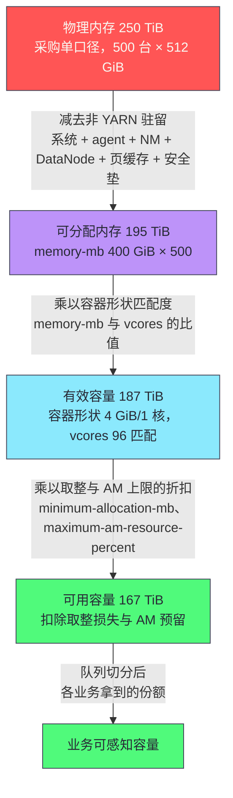
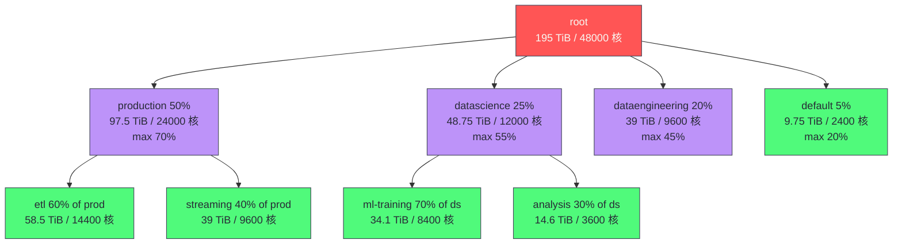
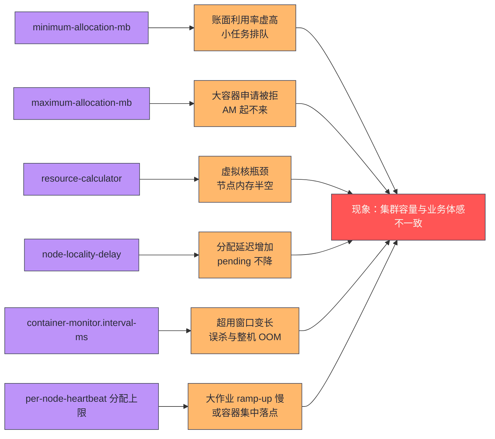
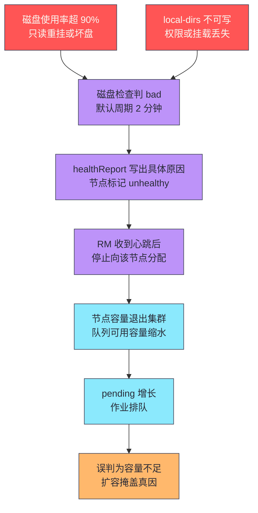
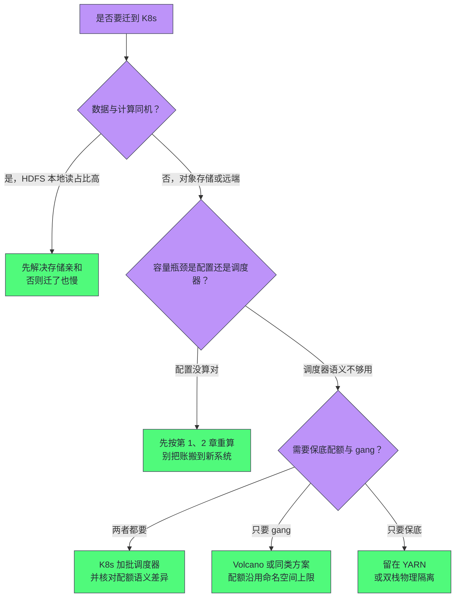

# YARN 性能调优与生产实践——队列规划、调度优化与 Kubernetes 展望

**摘要：**

YARN 的调优有一半不是调参数，而是算账：一台机器该向 ResourceManager 报多少内存、多少虚拟核，一个队列该分到集群的百分之几，一套配置改完之后集群还剩多少真正能被容器接住的容量。这些数彼此咬着，报多了会把节点撑爆，报少了会让作业排队，而真正决定作业能不能跑起来的往往不是总量，是容器形状与节点配比之间那个除法除不尽的小数。本文先做容量规划的算术，把物理内存、系统预留、虚拟核比值、最小分配取整与 AM 预留逐项拆开，给出一套可以照着算的预算表；再给队列规划的四个判据，回答队列按什么切、切多少个、改一次配置要付什么代价；然后摆出六个调优旋钮与它们各自调大调小的代价，以及六种把旋钮拧错方向的现场，每一种都配一句判据和一行观测命令；接着落到运维的日常清单，包括节点被判 UNHEALTHY 的三种成因与调度线程阻塞的读法；最后处理 YARN 与 Kubernetes 的取舍，给出迁移判据表与三种混合部署形态的代价。全文只回答一个问题：给定一批机器和一批业务，账该怎么算，才算得对。

---

## 第 1 章 两台机器的账：从物理内存到可分配内存

### 1.1 验收现场：三个数对不上

扩容验收那天，机房里进来 500 台新机器，每台 512 GiB 内存、48 颗物理核（开了超线程，96 个逻辑核）。采购单上写的是 250 TiB 内存，RM 首页的 `totalMB` 折出来只有 195 TiB，运维解释说是"预留了 20%"。这句话听上去没毛病，但接下来的作业表现让人没法交差：节点内存使用率在监控上看只有 40% 出头，集群却开始出现排队，`pendingContainers` 一路涨，而 RM 页面上那些节点的 `AvailableGB` 明明还是三位数。

三个数字都对，只是它们说的不是同一件事。采购单上的 250 TiB 是物理内存；RM 首页的 195 TiB 是 `yarn.nodemanager.resource.memory-mb` 加总出来的可分配内存；监控上那 40% 是 cgroup 里容器真实吃掉的驻留内存；而作业感受到的容量，是第四个数字——在现有容器形状下节点真正能装下的那些容器加起来能得到多少。这四个数之间隔着三道减法与一道除法，每一道都在消耗容量，而每一道都有配置项在控制它。

笔者把这道链条分三层：**标称容量**由节点资源配置决定，**有效容量**由容器形状与取整规则决定，**可用容量**还要再扣掉 AM 与抢占留下的空转。三层里最容易出错的是第一层，因为它的错误最安静——配置写错了不会报错，只会让集群容量凭空少一块，然后被解释成"这批机器性能不行"。

### 1.2 memory-mb 是减出来的，不是乘出来的

`yarn.nodemanager.resource.memory-mb` 这个配置项的语义只有一句话：这台机器上允许多少内存被容器用掉。它不是一个比例，而是一个预算，预算的来源是一串减法。默认值是 8192 MiB，那是个在单机上跑教学示例的默认值，放到任何一台生产机器上都必须改；还有一个 `yarn.nodemanager.resource.detect-hardware-capabilities`，打开之后 NM 会自己探测硬件，并按 `yarn.nodemanager.resource.system-reserved-memory-mb` 扣掉系统预留，但这个自动值是按通用假设算的，它不知道你这台机器上还跑着 HBase 的 RegionServer。

所以生产环境里的做法是关掉自动探测，自己算。算的方式是把每个不归 YARN 管的驻留项列出来：

| 扣减项 | 判据 | 纯计算节点示例 | 混部节点示例 |
|---|---|---|---|
| 内核、systemd、sshd 与基础工具 | 实测 `available` 的缺口，不按比例 | 4 GiB | 4 GiB |
| 监控与日志 agent | agent 个数 × 单 agent 峰值 RSS，注意日志突发时会上冲 | 3 GiB | 3 GiB |
| NodeManager 自身的 JVM | 堆 + 元空间 + 线程栈 + DirectBuffer，进程 RSS 通常大于 `-Xmx` | 2 GiB | 2 GiB |
| DataNode 的 JVM | 块管理与并发传输的堆，块数越多、管线越多，堆外越高 | 4 GiB | 4 GiB |
| 同机其它服务（RegionServer、Impala、Kafka 等） | 堆 + 堆外缓存 + 句柄，全部按峰值算 | 无 | 64 GiB |
| 页缓存工作集 | 想留给 HDFS 本地读的那部分，见 1.3 | 64 GiB | 32 GiB |
| 故障安全垫 | 物理内存的 2% 到 3%，用于 JVM 抖动、内核 slab、突发映射 | 12 GiB | 8 GiB |
| 合计扣减 | 上面各项之和 | 89 GiB | 117 GiB |
| `memory-mb` | 物理内存减去合计，再向整留余量 | 400 GiB | 128 GiB |

两台机器的差别值得盯着看。512 GiB 的纯计算节点，扣完还剩 423 GiB，取 400 GiB，占物理内存的 78%，"预留 20%"这个拍法在这里碰巧接近；256 GiB 的混部节点，RegionServer 拿走 64 GiB，页缓存还要 32 GiB，扣完只剩 139 GiB，取 128 GiB，只占物理内存的 50%。同一条 20% 的经验在第二台机器上会超卖 30 个百分点，而超卖的后果不在 YARN 的账本里，在 Linux 的 OOM Killer 里——最先被杀的通常不是容器，是 RegionServer。

这就是"预留多少"唯一可靠的判据：**看节点上还跑着什么**，把每一项按峰值列出来加总。经验比例之所以流行，是因为在大规模同构集群里，节点角色统一，列出来的清单每次都一样，于是被压缩成了一个数字；一旦集群里出现第二种节点角色，那个数字立刻失效，而失效的方式是静默的。

### 1.3 页缓存为什么必须单列

上面那张表里最容易引起争议的是页缓存那一行。它不是进程，没有 RSS，`ps` 看不见它，但它直接决定 HDFS 读的性能：客户端从一个节点读到热数据时，如果这块数据还在该节点的页缓存里，读就是内存带宽级别的；如果不在，就得旋转磁盘。YARN 的容器内存上限一旦设得太高，容器的匿名页会把页缓存挤出去，集群的账面上利用率上去了，作业的实际读取速度掉下来，于是出现"扩容之后作业反而变慢"这种很难归因的现象。

页缓存与匿名页的竞争还带来一个反直觉的推论：给 YARN 多留内存并不总是提高吞吐。在 Shuffle 密集、数据本地读比例高的集群里，把 `memory-mb` 从 400 GiB 提到 440 GiB，多跑的那几个容器带来的并行度，可能抵不上页缓存被压缩导致的本地读退化。这条权衡没有普适的拐点，只能靠观测：比较同一批作业在两种配置下的读取延迟分布，而不是只看集群利用率。

页缓存的另一面在容器内部。容器写本地文件产生的脏页记在容器的 cgroup 头上，这部分内存同样受容器上限约束，于是"容器内存超过限制"的告警有时跟堆毫无关系，纯粹是写盘写得太多。这一点在 `[[07 YARN 资源隔离——CGroups 与 Linux Container Executor 的工程实现]]` 里有更细的拆解，此处只需要记住判据：看到容器因内存被杀而堆监控正常，先查它写了多少本地文件。

### 1.4 cpu-vcores 的默认 8 与它的三种来历

第二个数比第一个数更容易出错，因为它的默认值看起来毫无冒犯性：`yarn.nodemanager.resource.cpu-vcores` 的**默认值是 8**。一台 48 核的机器向 RM 报 8 个虚拟核，听上去像是某种保守的换算，实际上是 2010 年前后一台典型工作站的核数，被原样留在了默认配置里。

这个默认值能在生产集群里存活十年，有三个原因。其一，`yarn.nodemanager.resource.detect-hardware-capabilities` 默认关闭，不显式配置就取默认值；其二，Capacity Scheduler 默认的 `yarn.scheduler.capacity.resource-calculator` 是 `DefaultResourceCalculator`，它比较资源时只看内存，虚拟核根本不参与分配判断，于是 8 个虚拟核既不会挡住分配，也不会在界面上显得异常；其三，队列容量在界面上是按两个维度分别显示的，虚拟核那一列长期是空的，没人会去追问一个空列。

这三个原因叠在一起，把一个严重的问题藏了起来。一旦按 3.3.x 文档的建议把 `resource-calculator` 换成 `DominantResourceCalculator`，虚拟核进入分配判断，那一台报 8 个虚拟核的机器会立刻变成整个集群最紧的瓶颈：400 GiB 内存配 8 个虚拟核，比值是 50 GiB 每核，一个申请 4 GiB 内存、1 个虚拟核的容器，在 DRF 下占掉的是节点内存的 1% 与虚拟核的 12.5%，虚拟核是主导资源，节点只能装 8 个这样的容器，剩下 368 GiB 内存全部闲置。集群的标称容量没变，有效容量掉到 8%。

正确的设置方式是按节点的真实并行能力报：48 颗物理核、开了超线程，批处理为主的集群可以报 96；对超线程带来的吞吐增益持保留态度的，报 48 到 72 更保守。开了 `detect-hardware-capabilities` 之后，虚拟核数由 `count-logical-processors-as-cores` 决定取物理核还是逻辑核，再乘 `pcores-vcores-multiplier`；这个乘数的存在是为了适配 cgroup 行为与硬件拓扑特殊的主机，具体组合以对应版本的 `yarn-default.xml` 为准。笔者在实践中的偏好是关掉自动探测、显式写死数字：一个能被算出来的数比一个"通常合适"的自动值更容易在扩容验收时对上账。

```xml
<!-- 关掉自动探测，让容量完全由显式配置决定：扩容验收时能对上采购单 -->
<property>
  <name>yarn.nodemanager.resource.detect-hardware-capabilities</name>
  <value>false</value>
</property>
<!-- 400 GiB 是按 1.2 节清单减出来的，不是 512 的百分比 -->
<property>
  <name>yarn.nodemanager.resource.memory-mb</name>
  <value>409600</value>
</property>
<!-- 96 = 48 物理核 × 2 超线程，批处理集群；混部节点通常取 48~72 -->
<property>
  <name>yarn.nodemanager.resource.cpu-vcores</name>
  <value>96</value>
</property>
```

### 1.5 比值决定容器形状，而不是决定 CPU 上限

虚拟核这个数最容易被误解成"CPU 限制开关"。它确实不是：`vcores` 只进账本，真正限制 CPU 的是 cgroup 的 `cpu.cfs_quota_us`，默认根本没设。虚拟核真正决定的是一件别的事——**它给容器形状定价**。

拿两台同样 256 GiB 的机器做对照，一台报 64 个虚拟核，一台报 32 个。前者的内存虚拟核比是 4 GiB 每核，后者是 8 GiB 每核。现在有一个申请 4 GiB 内存、1 个虚拟核的容器：

在 64 核那台上，按比例它"应得" 4/256 × 64 = 1 个核，实际申请 1 个核，记账与需求恰好对齐，节点能装 64 个这样的容器，内存与虚拟核同时打满。在 32 核那台上，按比例它"应得" 4/256 × 32 = 0.5 个核，但虚拟核的分配粒度是整数，它只能申请 1 个，于是它为一个 0.5 核的需求支付了 1 核的账；节点只能装 32 个，128 GiB 内存闲置。同一个容器，在两台机器上能拿到的核数一个是"刚好"，一个是"多付一倍"；而集群感受到的差别是有效容量从 100% 掉到 50%。

把这件事倒过来写，就是容量规划里最好用的一条判据：节点上 `memory-mb` 与 `vcores` 的比值，应该等于主力容器形状的"内存每核"比值。这笔账可以用一张表算清楚，节点取 400 GiB / 96 虚拟核，比值 4.17 GiB 每核：

| 容器形状（内存 / 虚拟核） | 内存维可容 | 虚拟核维可容 | 实际可容 | 有效容量 | 有效与标称之比 |
|---|---|---|---|---|---|
| 2 GiB / 1 核 | 200 | 96 | 96 | 192 GiB | 48% |
| 4 GiB / 1 核 | 100 | 96 | 96 | 384 GiB | 96% |
| 4 GiB / 2 核 | 100 | 48 | 48 | 192 GiB | 48% |
| 8 GiB / 1 核 | 50 | 96 | 50 | 400 GiB | 100% |
| 8 GiB / 2 核 | 50 | 48 | 48 | 384 GiB | 96% |
| 16 GiB / 4 核 | 25 | 24 | 24 | 384 GiB | 96% |

表里最刺眼的是第二行与第三行：同样的 4 GiB 内存，虚拟核从 1 改成 2，有效容量从 96% 掉到 48%。这并不是说"申请 2 核是错的"，而是说当一个集群的节点比值是 4.17、而业务提交的容器形状是 2 GiB 每核时，一半的内存在账面上就无法被使用。它的现场表现是节点 `AvailableGB` 还有一半，`pendingContainers` 却一直在涨——调度器不是不肯分，是虚拟核已经为满。

由此可见，`cpu-vcores` 的正确取法不是"物理核数"这么一句，而是"物理核数 × 超线程比 × 与业务容器形状匹配的修正"。前者决定节点的并行上限，后者决定这个上限能不能被填满。笔者见过的集群里，虚拟核设错导致的容量损失，普遍比内存设错更大，因为内存设错会立刻 OOM，而虚拟核设错只是让集群"看起来还有空"。

### 1.6 把 500 台机器的账算完

回到验收现场。500 台机器按 1.2 节的预算配成 400 GiB 内存、96 虚拟核，集群标称容量是 195 TiB 内存与 48000 虚拟核。业务的主力容器形状是 4 GiB / 1 核，按 1.5 节那张表，有效容量是 96%，也就是 187 TiB。再按第 2 章的取整与 AM 预留扣一遍，落到 167 TiB 上下。从采购单的 250 TiB 到可用的 167 TiB，中间那三成没有任何一项是"浪费"，每一项都能在配置里指出来。

下面这张图把这四层的关系画出来，四个框对应四个数，箭头上的字是每层的控制项。看这张图的时候请注意：越往下，可控性越强，而越往下的损失越不容易在 RM 首页上直接看到。



---

## 第 2 章 有效容量：取整、形状与大容器饥饿

### 2.1 取整：调度器只认整数倍

集群的账本是按整数倍记的。`yarn.scheduler.minimum-allocation-mb` 的默认值是 1024，`yarn.scheduler.minimum-allocation-vcores` 的默认值是 1，调度器在把 AM 的资源请求收进队列之前会先做一次归一化：内存向上取到最小分配单位的整数倍，虚拟核向上取到最小虚拟核单位。取整方向只有一个，向上。于是每一次取整都是**一次静默的加价**，加价幅度取决于申请值落在粒度区间的哪个位置。

这件事的算术很简单。设取整单位为 g、容器的真实内存需求为 m，则单容器的账面虚高在 0 到 g 之间，若 m 在区间内均匀分布，期望虚高是 g/2，相对虚高是 g/(2m)。把 195 TiB 的集群、12000 个并发容器、平均真实需求 3.5 GiB 代进去：

| 取整单位 | 单容器期望虚高 | 相对虚高 | 12000 容器的账面虚高 | 占 195 TiB 的比例 |
|---|---|---|---|---|
| 1024 MiB | 512 MiB | 14.3% | 6 TiB | 3.1% |
| 512 MiB | 256 MiB | 7.1% | 3 TiB | 1.5% |
| 256 MiB | 128 MiB | 3.6% | 1.5 TiB | 0.8% |

这张表是示例推算，用来说明量级而不是任何集群的实测值。它传达的信息有两层：第一层，取整损失在集群口径上不大，通常只占几个百分点，所以把 `minimum-allocation-mb` 设成 1 GiB 并不会让集群容量凭空少一半；第二层，损失在节点口径上被放大了，因为节点是逐个装容器的，一个 400 GiB 的节点按 4 GiB 记账能装 100 个容器，而这 100 个容器的真实需求只有 350 GiB；剩下那 50 GiB 不是"闲置的内存"，是"按 4 GiB 卖出去、实际只用 3.5 GiB"的差额，它在账上已经属于某个容器了。

所以取整损失真正的代价不是容量，是可观测性：账面上的利用率永远低于真实利用率，而这个差值无法从 RM 上读出来。一个集群如果长期显示 72% 的利用率、而节点上的 cgroup 读数只有 58%，中间那 14 个百分点很可能就是取整粒度造成的。判断方法很直接，拿 `minimum-allocation-mb` 除以平均申请量，得到的就是量级。

调小取整单位是有代价的，代价不在资源上，在调度与 NM 上：容器数量变多意味着 AM 的心跳里要维护更多的资源请求、NM 要启动与监控更多的进程、本地化目录里的条目更多、每个容器的固定开销（JVM 启动、日志、监控采样）被摊薄到更少的计算量上。512 MiB 是常见的折中，256 MiB 只在容器普遍很小的场景（交互式查询、小批量 ETL）里划算。反过来说，把 `minimum-allocation-mb` 设成 4096 以求"减少碎片"，结果会是所有小于 4 GiB 的作业都被按 4 GiB 收钱，账面利用率反而更难看。

### 2.2 第二种碎片：大容器只能落在大节点上

取整之外的第二种损失来自节点规格不一致。集群里如果同时有 400 GiB 与 128 GiB 两种节点，一个申请 100 GiB 的容器在 128 GiB 的节点上永远放不下，因为 `maximum-allocation-mb` 只是上限，能不能落下去还要看节点余量。于是这个容器实际可用的节点池只剩一半，而调度器不会为此报错，它只会等。

这种"大容器饥饿"在混部集群里很常见，表现是某个 Hive 大查询或某个单机内存密集的 Spark executor 长期停在 ACCEPTED，而 RM 页面上"可用内存"充足。判据是算一次可落点：把申请量与该节点池里每台机器的 `memory-mb` 相除，看有几台能装下；如果答案是"只有大机器能装，而大机器已经被小容器填满"，那就不是容量不足，是装箱顺序的问题——调度器按 FIFO 或按队列顺序分配，小容器先到就把大机器的零碎余量占走了。

处置有两条。一条是节点标签，把大内存节点打上标签，让大容器作业指定标签调度，代价是节点池被静态切开，标签池空闲时其他队列借不到；另一条是把 `maximum-allocation-mb` 压到节点的最小公倍数以内，让所有容器在所有节点上都有可能落地，代价是大作业必须拆小，而拆小本身会改变作业的执行计划。两条都不是免费的，选哪条取决于大容器的比例：比例高就分池，比例低就压上限并把少数大作业放到专用队列里。

### 2.3 AM 预留：不是扣掉，是限流

第三个吃容量的项是 AM。`yarn.scheduler.capacity.maximum-am-resource-percent` 的默认值是 0.1，它限制的是一个队列里所有 AM 容器合计能占用的资源比例。这个上限的算法、按队列覆盖的方式、以及调大调小的代价，在 `[[06 ApplicationMaster 机制——以 Spark on YARN 为例]]` 里已经拆开写过，这里只取它对容量规划的那一面：它是**分母上的一道闸**，不是分子上的一次扣除。

说它不是扣除，是因为在应用数没有顶到上限时，AM 实际占用的资源远小于这个比例，剩下的部分仍然给 task 用。它成为容量损失，只发生在应用数把上限顶满的时候。于是容量规划里要算的不是"扣掉 10%"，而是"这个队列最多能同时跑几个应用，以及这个数够不够"：

| 队列绝对容量 | AM 比例 | AM 资源上限 | 单 AM 规格 | 并发应用数上限 | 卡在哪一维 |
|---|---|---|---|---|---|
| 40 TiB / 9600 核 | 0.1 | 4 TiB / 960 核 | 2 GiB / 1 核 | 960 | 虚拟核 |
| 40 TiB / 9600 核 | 0.1 | 4 TiB / 960 核 | 4 GiB / 2 核 | 480 | 虚拟核 |
| 40 TiB / 9600 核 | 0.2 | 8 TiB / 1920 核 | 2 GiB / 1 核 | 1920 | 虚拟核 |
| 40 GiB / 10 核 | 0.1 | 4 GiB / 1 核 | 2 GiB / 1 核 | 1 | 虚拟核 |

最后一行是这张表真正的用处：一个只有 40 GiB / 10 核绝对容量的叶队列，按默认比例只允许 1 个虚拟核的 AM 资源，刚好够跑一个 1 核 2 GiB 的 AM。如果这个队列里跑的是三个并发的短作业，第二个作业会永远停在 ACCEPTED，而队列看起来"还有 36 GiB 空闲"。这条约束在小队列上比在任何地方都更容易触发，而队列规划时几乎没有人会先算它。

反过来，AM 比例调大也不是白拿的。占比上去了，AM 容器本身吃掉的资源就多，task 能用的资源相应变少；一批 1 核 2 GiB 的 AM 长期占着队列 30% 的容量，真正干活的 executor 只有 70%，作业的吞吐会明显下降。这个旋钮的方向判断依据是应用形态而不是资源紧张程度：短作业为主的交互队列需要更高的 AM 比例，长作业为主的批处理队列维持默认即可。

### 2.4 一次有效容量体检

把 2.1 到 2.3 的项合起来，一个集群的有效容量可以按四行数估出来：各节点 `memory-mb` 之和、各节点 `vcores` 之和、主力容器形状、`minimum-allocation-mb`。第一步按 1.5 节的表算形状匹配度，第二步按 2.1 节的表算取整虚高，第三步按 2.3 节的表算 AM 能撑多少应用，第四步把前三步的折扣乘起来。

500 台 400 GiB / 96 核的节点、主力形状 4 GiB / 1 核、`minimum-allocation-mb` 取 1024、AM 比例 0.1，这套体检的结果是：标称 195 TiB / 48000 核，形状匹配 96%、取整折扣约 97%、AM 折扣约 92%（假设应用数接近上限），落到 167 TiB 上下。三个折扣里没有一个超过 10%，但它们乘起来就是 14% 的缺口。

这个体检的价值不在于算出精确值，而在于把"集群为什么不够用"拆成三个可以分别回答的问题：形状匹不匹配、粒度合不合适、应用数够不够。三件事混成一句"容量不足"，处置就只能靠扩容，而扩容未必解决问题——容器形状与节点配比不匹配时，扩容只是让闲置的内存更多。

---

## 第 3 章 队列怎么划：四个判据与两个边界

### 3.1 四种切法，各自封住什么变化点

队列的本质是**一个资源配额的边界**，所以划队列的第一个问题不是"我们有几个团队"，而是"哪一类变化需要被隔离"。按这个思路看，常见的四种切法封的不是同一件东西：

| 切法 | 封住的变化点 | 适用的前提 | 失效时的形态 |
|---|---|---|---|
| 按业务线 | 成本归属与资源预算 | 各业务线独立核算，预算能谈判 | 业务线内部峰谷差异大，队列一半空闲一半排队 |
| 按优先级 | 延迟敏感度 | 在线与离线混跑，且能用抢占兜底 | 高优队列无活可干时，低优队列不敢用满 |
| 按 SLA 等级 | 承诺的响应等级 | 服务有明确的分级合同或 SLO | 等级内混入了形态差异极大的作业，SLO 无法归因 |
| 按团队 | 谁负责调参与超支 | 自服务数据平台，团队有能力自助调优 | 团队小而作业杂，每个团队都要被单独教一遍 |

四种切法可以叠加，但叠加的层数就是队列树的深度。实践中最常见的是"业务线做父队列、SLA 或团队做叶队列"两层，再加一个 `default` 兜底。三层以上就开始出现"这个作业该投哪个队列"的咨询成本，而咨询成本最后会以误投的形式体现出来——误投到 `default` 的作业既没有配额保障，也污染了那个队列的基线。

另一条经常被提起的是"按作业类型切"，但这条很少是对的。把 Spark 和 MapReduce 分成两个队列，等于假设这两种框架的负载曲线不同、需要不同的配额，而实际上它们服务的是同一批业务，同一批业务的峰谷同时出现在两种框架上。按框架切的结果是两个队列同时被峰谷打到，谁也借不到谁的空闲，隔离出一条本不存在的边界。

### 3.2 两个边界：下界是单作业峰值，上界是运维成本

队列数不是越少越好，也不是越多越好，它被两个边界夹在中间。

**下界由单作业峰值定**。一个队列的绝对容量如果小于该队列里最大那个作业的峰值资源需求，这个作业的容器就会在自己的配额里互相挤，表现为"作业永远跑不满并行度"。这笔账要按队列逐个算：某业务的单作业峰值是 800 个容器 × 4 GiB = 3.2 TiB，如果这个队列只分到 2 TiB，那个作业在任何时候都只能跑到 62% 的并行度，而它又不是被别的队列抢了资源——它是在自己的配额里排队。

上界由三件事共同决定：可观测性、变更成本、以及小队列的 AM 门槛。可观测性指的是 Scheduler 页面与 `yarn queue -status` 的可读性，十几个叶队列还能一眼扫完，五十个就只能靠脚本；变更成本指的是每次调整容量都要重算一百分账并和所有利益方对齐，叶队列越多，一次调整涉及的谈判越多；AM 门槛是 2.3 节算过的那个约束，队列绝对容量乘以 AM 比例必须至少装得下一个 AM 容器。

把这三条落成一张表，可以看清队列数增加的代价是怎么累加的（示例推算，集群 195 TiB / 48000 核，AM 2 GiB / 1 核）：

| 叶队列数 | 每队列平均绝对容量 | AM 资源上限（0.1） | 能起的 2 GiB AM 数 | 能同时容纳的 4 GiB 容器数 |
|---|---|---|---|---|
| 8 | 24.4 TiB / 6000 核 | 2.44 TiB / 600 核 | 600 | 6000 |
| 20 | 9.75 TiB / 2400 核 | 0.98 TiB / 240 核 | 240 | 2400 |
| 50 | 3.9 TiB / 960 核 | 399 GiB / 96 核 | 96 | 960 |
| 200 | 0.98 TiB / 240 核 | 100 GiB / 24 核 | 24 | 240 |
| 500 | 399 GiB / 96 核 | 40 GiB / 10 核 | 9 | 96 |

第五行是很多"按人建队列"的集群会滑到的位置：每个叶队列 399 GiB、9 个并发应用、96 个 4 GiB 容器，而一个中等规模 Spark 作业的 200 个 executor 就能吃掉两个这样的队列。此时队列已经失去了容量规划的意义，它变成了一个命名空间。判据也很清楚：一个叶队列的绝对容量至少要能装下该业务单作业的峰值，装不下就该合并，或者改用父队列加自动创建的方式，而不是继续手工细拆。

笔者的经验区间是顶层 3 到 8 个父队列、叶队列 8 到 20 个。超过 20 个叶队列时，先问一个问题：多出来的那些队列，是因为配额真的不同，还是因为"看起来整齐"。如果只是后者，用队列名或用 `queue-mappings` 的命名规则解决，比多切一个队列便宜得多。

### 3.3 一百分账与改一次配置的代价

`capacity` 的硬约束在 `[[05 调度器深度解析——Capacity Scheduler 与 Fair Scheduler 的算法内核]]` 里拆开过：同一个父队列下所有子队列的 `capacity` 之和必须等于 100，写成 60 + 40 可以，写成 60 + 45 会让 RM 在加载配置时直接拒绝。这条约束在队列规划阶段只是算术，在变更阶段就变成了代价——每加一个队列，就要从别的队列身上切一块下来，切谁的那一块都要谈。

变更的手段与代价列在下表里（Hadoop 3.3.x）：

| 变更类型 | 手段 | 需要重启进程吗 | 主要风险 |
|---|---|---|---|
| 改 `capacity` 或 `maximum-capacity` | 改 `capacity-scheduler.xml` 后 `yarn rmadmin -refreshQueues` | 不需要 | 调低容量会触发抢占，正在跑的容器可能被杀 |
| 新增叶队列 | 同上，配置里加队列名并重配兄弟队列的百分比 | 不需要 | 兄弟队列的百分比忘了改，求和不为 100 导致刷新被拒 |
| 删除叶队列 | 先把队列状态置为 `STOPPED` 并等它清空，再从配置里删 | 不需要 | 队列里还有运行中的应用时无法删除 |
| 走 API 动态改配置 | `yarn.scheduler.configuration.store.class` 设为 leveldb 或 zk，再调 `/ws/v1/cluster/scheduler-conf` | 不需要 | 该能力在文档里标注为 alpha；启用后文件方式与 `-refreshQueues` 会被禁用 |
| 改 `yarn.resourcemanager.scheduler.class` | 改 `yarn-site.xml` 并重启 RM | 需要，且影响全集群 | 调度器实现切换后队列配置格式完全不同 |
| 改 `memory-mb` / `cpu-vcores` | 改 NM 配置后重启 NM | 需要，逐台滚动 | 重启期间该节点容量归零，队列容量同步缩水 |
| 改节点标签或分区 | `yarn rmadmin` 相关命令配合 RM 配置 | 部分操作需要重启 | 标签池划分错误会让整个队列没有可落点 |

这张表最重要的两行是第五行与第六行。前四行说的都是"改配置不重启"，这句话容易被误读成"改配置没有代价"，而真正的代价在换调度器与改节点资源配置这两行：后者（也就是第 1 章那三个数）的变更必须重启 NM。滚动重启 500 台节点，按每台两分钟算就是十几个小时的窗口，期间集群容量按比例缩水，而被缩掉的那部分正是所有队列共享的弹性空间。

于是队列规划里有一条容易被忽略的纪律：节点侧的三个数应当在集群上线前就算准，因为它们决定的是**集群的物理能力**；队列侧的百分比可以随组织变化随时调，因为它们决定的是分配规则。把这两类配置混在一起讨论，就会出现在"调整队列"的会议上讨论"要不要给节点多留点内存"这种跑题，而那次讨论的结论注定无法执行——它需要一次全集群滚动重启。

### 3.4 一个 500 节点集群的队列树

把前面的算术套进一个具体场景：500 节点、195 TiB / 48000 核，三个团队共享，另有一个兜底队列。生产团队跑关键 ETL 与准实时链路，SLA 最严；数据科学团队跑模型训练与探索分析，峰谷差异最大；数据工程团队跑数仓查询，日间高峰、夜间低谷。



按 3.2 节的两个边界检查这棵树，需要把每个叶队列的绝对容量与它承载的单作业峰值对齐：

| 叶队列 | 绝对容量 | AM 上限（0.1） | 能起的 2 GiB AM 数 | 承载的单作业峰值 | 结论 |
|---|---|---|---|---|---|
| `etl` | 58.5 TiB / 14400 核 | 5.85 TiB / 1440 核 | 1440 | 约 15000 容器 × 4 GiB = 58.6 TiB | 峰值顶到容量，作业会在自己队列里排队 |
| `streaming` | 39 TiB / 9600 核 | 3.9 TiB / 960 核 | 960 | 常驻约 2000 个容器（2 GiB / 1 核）→ 3.9 TiB | 峰值约占一成，余量充足 |
| `ml-training` | 34.1 TiB / 8400 核 | 3.4 TiB / 840 核 | 840 | 单作业约 11.7 TiB（3000 容器 × 4 GiB） | 单作业占队列三分之一，偏高 |
| `analysis` | 14.6 TiB / 3600 核 | 1.46 TiB / 360 核 | 360 | 约 500 容器 × 6 GiB = 2.9 TiB | 余量充足 |
| `default` | 9.75 TiB / 2400 核 | 0.98 TiB / 240 核 | 240 | 不可预期 | 兜底队列，需限制 `maximum-applications` 防止被误投打满 |

第一行的结论是这张表要交付的东西：`etl` 的绝对容量装不下它承载的单作业峰值，这个作业会在自己的队列里排自己的队。处置不是把 `production` 的 50% 调大，而是先确认那个峰值是不是一个作业——如果是多个作业叠加的峰值，容量没问题；如果是单个作业，要么降低单作业并发（拆批），要么把这个作业移到 `ml-training` 这类有更大余量的队列里，要么给 `etl` 加节点标签池。三种处置的代价各不相同，但都比"扩容"精确。

---

## 第 4 章 六个旋钮，以及它们各自的方向

### 4.1 一张表看全

调优的经验之谈之所以难传，是因为同一个参数在不同集群上要往相反方向拧。**把方向依赖讲清楚**，比给一个推荐值有用。下表把六个旋钮的默认值、作用、以及两个方向各自的代价放在一起：

| 旋钮 | 3.3.x 默认 | 作用点 | 调大的代价 | 调小的代价 |
|---|---|---|---|---|
| `yarn.scheduler.minimum-allocation-mb` | 1024 | 单容器最小规格、取整单位 | 小容器按大规格收钱，账面虚高，AM 最小规格变粗 | 容器数上升，调度与 NM 的固定开销上升，本地化条目变多 |
| `yarn.scheduler.maximum-allocation-mb` | 8192 | 单容器上限 | 一个容器可吃多个节点份额，调度粒度变粗，抢占与本地性退化 | 超过上限的申请被直接拒绝，大作业永远起不来 |
| `yarn.scheduler.capacity.resource-calculator` | `DefaultResourceCalculator` | 资源比较的维度 | 换 `DominantResourceCalculator` 后虚拟核进入判断，历史调参经验失效，配置错误立刻暴露 | 换回默认后虚拟核不再参与判断，CPU 维度失控且不可见 |
| `yarn.scheduler.capacity.node-locality-delay` | 40 | 延迟调度的等待步数 | 本地性提高，分配延迟增加，短任务等不起 | 本地性下降，跨机架流量上升，小任务启动变快 |
| `yarn.nodemanager.container-monitor.interval-ms` | 3000 | 容器内存采样周期 | 采样开销降低，超用窗口变长，可能拖垮整机 | 监控更及时，采样与杀容器的判断变敏感，抖动易误杀 |
| `yarn.scheduler.capacity.per-node-heartbeat.maximum-container-assignments` | 100 | 单次 NM 心跳的分配上限 | 大作业 ramp-up 变快，容器集中落点，本地化突发 | 单心跳分配变少，大规模作业启动变慢 |

这张表里有三个默认值需要单独说明，因为它们经常被记错。`minimum-allocation-mb` 与 `maximum-allocation-mb` 在有的发行版文档里写作 `yarn.scheduler.capacity.minimum-allocation-mb` 与 `yarn.scheduler.capacity.maximum-allocation-mb`，那是早期别名，3.x 的现行键名不带 `capacity`；`maximum-allocation-vcores` 的默认值是 4，比内存的 8192 更容易成为大容器的隐形天花板。另一个常被引用的 `assign-multiple` 类语义，在 3.3.x 里由 `per-node-heartbeat.*` 这一组承担，`multiple-assignments-enabled` 默认 true、单次上限 100、其中 off-switch 分配默认只允许 1 个。这三个数的组合决定了大作业能不能快速把容器铺开。

下面这张图画的是六个旋钮与它们影响的现象之间的连线。连线上的字不是因果证明，是排查时该先看哪个参数的提示。



### 4.2 最小分配：往小拧省容量，往大拧省心跳

`minimum-allocation-mb` 的方向判断有一个反直觉的地方：它并不是"越小越好"或者"越大越好"，而是由集群里最小的那个作业决定的。如果集群里存在大量 512 MiB 级别的容器（小批量的 Hive 查询、短生命周期的 MapReduce task），1 GiB 的粒度会让它们全部按 1 GiB 收钱，浪费率超过 50%；反过来，如果集群的主力是 8 GiB 以上的 Spark executor，把粒度降到 256 MiB 并不会带来任何容量收益，只会让 AM 的资源请求列表变长。

调小之后还有一个连带影响值得注意：`minimum-allocation-mb` 同时是 AM 容器的最小规格下限。它设得很大时，一个本来只需要 512 MiB 的 AM 会被按大规格申请，AM 的账变重，2.3 节那张表里的并发应用数随之下降。这条连带关系是"把 `minimum-allocation-mb` 设成 4096 以减少碎片"这类操作最容易忽略的代价。

### 4.3 最大分配：往小拧是自杀，往大拧是失控

`maximum-allocation-mb` 的**方向不对称**得厉害：往小拧会让超过上限的申请直接被拒绝，作业连试都试不起来；往大拧只是让一个容器可以很大，代价体现在调度粒度与故障域上。一个吃满半个节点的容器一旦 OOM，损失的是半个节点；同样的内存切成四个容器，损失是四分之一。

这条不对称决定了它的取法：下限必须大于等于业务里最大的单容器需求，上界则是"允许一个容器吃掉节点多大比例"。若节点 400 GiB、上限 8192，一个容器最多吃节点的 2%，调度粒度细，故障域小；若把上限提到 64 GiB，一个 Hive 排序任务能一次拿到 16%，但同节点上其他容器的落点被切碎。实践中 8 GiB 到 32 GiB 是常见区间，具体取哪个值取决于集群里最大的那几个作业是不是真的需要——如果它们需要，取大；如果只是个别作业偶尔需要，给它们单独的队列与节点标签，比抬高全局上限便宜。

### 4.4 资源计算器：换过去才有 CPU 维度

`yarn.scheduler.capacity.resource-calculator` 只有两个实用取值，默认的 `DefaultResourceCalculator` 只比较内存，换成 `DominantResourceCalculator` 之后内存与虚拟核都进入比较，取占比更高的那个作为主导资源。Fair Scheduler 的默认值本来就是 DRF，Capacity Scheduler 的默认值不是，这个不一致造成了大量"为什么我们集群的 CPU 用不起来"的困惑。

换过去不是没有代价。第一，虚拟核从账面的装饰品变成了硬约束，第 1 章那个默认 8 的问题会立刻暴露成容量骤降，表现为"改了一个 resource-calculator，集群容量少了八成"。第二，队列的 `used` 与 `usedCapacity` 口径变化，历史监控曲线在切换点断裂，容量预测模型需要重算。第三，以内存为主的作业会开始因为虚拟核不足而排队，而它们的实际 CPU 用量可能连申请的 20% 都不到，于是团队会提出"把 vcores 调小"的需求，而这个需求会与第 1.5 节的形状匹配冲突。

换成 DRF 是推荐的，但要把它当成一次容量变更来执行：先按第 1 章把 `cpu-vcores` 配准，再切计算器，再观察一周的虚拟核饱和度。顺序颠倒就会出现"切了计算器发现集群不够用，于是又切回去"的循环。

### 4.5 延迟调度：等待步数不是秒数

`node-locality-delay` 这个名字容易让人以为它是个时间量，实际上文档的定义是"**错过调度机会的次数**"：调度器在连续这么多次机会里都没能满足节点本地性，才把约束放宽到机架本地。默认值 40 的由来是"大约一个机架里的节点数"，文档同时建议按集群节点数取值；把它设为 -1 会直接关闭延迟调度，也就是请求的资源位置约束被忽略，这在 YARN 与存储分离部署、本地性本就没有意义的场景里是正确做法。

把它等效成时间只在一种情况下成立：NM 心跳间隔是 1 秒、调度是同步的、每个心跳只调度一次。这种情况下 40 次机会约等于 40 秒。一旦打开了 `yarn.scheduler.capacity.schedule-asynchronously.enable`（3.3.x 默认关闭，部分后续版本改为默认开启，以对应版本文档为准），调度循环的节拍与心跳解耦，40 次机会可能对应几秒，也可能对应几十秒，取决于队列里有多少待分配的请求。

方向的判据按任务时长给：MapReduce 的 map task 跑 60 秒以上，等 40 步换本地性划算；Spark 的短 task 跑 10 到 20 秒，等待的机会成本高于本地性收益，10 到 20 更合适；跑几秒的 task 或根本不读 HDFS 的训练作业，取 0 甚至 -1。

### 4.6 监控节拍：更勤的采样不等于更准的判断

`yarn.nodemanager.container-monitor.interval-ms` 的默认值是 3000，NM 每 3 秒采样一次容器的进程树内存，超过申请量就补一刀。这个数字的调小看起来是纯粹的收益——超用窗口从 3 秒缩到 1 秒，整机被拖垮的概率下降——但采样本身有成本：每次采样要遍历进程树并读 `/proc`，节点上跑着上百个容器时，单次采样的开销累加起来不可忽视。

更麻烦的是判断精度。内存超限的判断依据是一次采样值，而 JVM 的内存曲线不是平滑的：一次 Full GC 之后堆会短暂回落到低位，一次大的序列化会产生瞬时尖峰。采样周期越短，越容易恰好采到尖峰，把一次抖动判成超用。这就是"调小之后容器被杀得更频繁"的原因，它与实际内存超用无关，与采样时机有关。

方向判据：默认 3000 在多数集群上够用。把它调到 1000 的场景是"容器超用会在几秒内拖垮整机"（大内存容器、写盘密集的容器）；把它调到 5000 以上的场景是"节点容器密度极高、采样开销本身成了负担"。两个方向都要配 cgroup 的硬限制兜底，否则监控节拍只能决定"多久之后发现问题"，不能决定"问题会不会发生"。

### 4.7 单心跳分配数：大作业的起步速度

`per-node-heartbeat.maximum-container-assignments` 默认 100，`maximum-offswitch-assignments` 默认 1。前者限制一次 NM 心跳最多分配多少容器，后者限制其中跨机架的有多少个。一条 500 节点的集群，一次心跳最多能分配 500 × 100 个容器，这个数远大于任何单个作业的需求，所以它通常不是瓶颈；真正的瓶颈是 `maximum-offswitch-assignments` 的 1——当作业的请求没有位置偏好、或者本地节点已经满了，每个心跳只能做一次跨机架分配，大作业的 ramp-up 就被这个 1 卡住了。

这个 1 的设计意图是保护本地性：让调度器优先在本地分配，只在没有本地选项时才跨机架。代价是大作业在小集群上铺开得慢，尤其是那些请求里不带位置偏好的作业（不读 HDFS 的训练、纯计算任务）。调大它能加快铺开速度，代价是同一次心跳里把容器集中扔到少数节点上，造成局部热点。

---

## 第 5 章 六个拧错方向的现场

### 5.1 只看内存不看虚拟核

现象是集群利用率长期停在 55% 上下，`pendingContainers` 从早涨到晚，扩容之后照旧。查 RM 的 Scheduler 页面，内存那一列还有余量，虚拟核那一列已经贴着 100%。`yarn queue -status` 打出来的 `usedCapacity` 与内存已用比例差得很远，前者一直更高。

账在 1.5 节那张表里：虚拟核先耗尽，内存维还有一半装得下但拿不到配额。判据是算两个维度各自的占用率，若虚拟核占用率持续高于内存占用率 1.3 倍以上、同时 pending 在涨，瓶颈就在虚拟核。处置按 1.4 节重设 `cpu-vcores`，注意这项变更必须重启 NM，要按队列余量分批滚动。

### 5.2 最小分配用了默认 1 GiB 跑小任务

现象是节点上跑着 60 个容器，`ps` 一看一半以上是几百 MiB 的轻量 task，RM 显示节点已满，而 `free` 还有一半内存。作业团队抱怨"明明申请了 512 MiB 却要排队"。

账在 2.1 节：请求被向上取整到 1 GiB，粒度把账做大了。判据是拿平均容器实际 RSS 与 `minimum-allocation-mb` 比，若比值长期低于 50%，取整就是主要原因；`curl` 一下 `/ws/v1/cluster/metrics` 看 `allocatedMB` 与节点 cgroup 读数相比虚高多少，两个口径的差额就是取整损失的近似值。处置是把粒度降到 512 MiB，同时要求作业侧按 512 MiB 对齐申请量，两件事必须一起做——只降粒度而不改申请习惯，收益会被申请值本身的随意性吃掉。

### 5.3 最大分配小于最大容器需求

现象是某个 Hive 大查询或某个 GPU 训练作业反复失败，Spark 侧报的是内存或核数超过集群阈值，MapReduce 侧报的是资源请求非法。作业团队改了半天的执行计划，问题一点没动。

`maximum-allocation-mb` 与 `maximum-allocation-vcores` 是两个绝对上限，超过的请求在任何节点上都不会被满足，因为它们不是"暂时没有资源"，而是"参数上不允许"。判据很直接：把业务里最大的单容器需求与这两个上限对齐，Spark 会核 `spark.executor.memory + spark.executor.memoryOverhead`，MR 会核单个 reduce 的堆与 `mapreduce.reduce.memory.mb`，其中任一项超过上限就必然失败。处置是把上限提到最大容器之上并留一成余量，或者把那类作业拆小。抬上限的代价在 4.3 节：调度粒度变粗、故障域变大。

### 5.4 vmem-check 开着，而堆贴着容器上限

现象是 executor 毫无征兆地消失，退出码 137，日志里没有 OOM，driver 侧只看到"容器被 YARN 杀掉"。查 NM 日志，有一行 "beyond virtual memory limits"。

账在**虚拟地址空间**：容器的 pmem 上限是申请量，vmem 上限是申请量乘 `yarn.nodemanager.vmem-pmem-ratio`（默认 2.1）。JVM 的虚拟地址空间里除了堆，还有 Metaspace、CodeCache、压缩类空间、直接内存、每线程 1 MiB 的栈，以及 glibc 为多线程分配的多份 arena 保留区。这些项在 RSS 上大多看不见，却全部计入虚拟内存。当堆被设到容器上限的 90% 时，留给这些项的空间只剩一成，一个线程数上千的 executor 很容易把它耗尽。

判据是在 NM 日志里搜虚拟内存超限的那一行，而不是看堆监控。处置有三条，代价依次升高：把堆降到容器上限的 70% 到 75%，牺牲单容器堆换取稳定性；调大 `vmem-pmem-ratio`，牺牲判断精度；关掉 `yarn.nodemanager.vmem-check-enabled`，此时 pmem 监控与 cgroup 限制仍然有效，这条路的依据与代价在 `[[07 YARN 资源隔离——CGroups 与 Linux Container Executor 的工程实现]]` 里有完整交代。

### 5.5 队列的 maximum-capacity 全设成 100

现象是平时一切正常，资源紧张时集群出现大面积容器被杀的抖动，被杀的不一定是低优队列，高优队列也在抖。翻抢占日志，某几分钟内被抢占的容器数是平时的几十倍。

`maximum-capacity` 是弹性上限，全设 100 意味着任何一个队列都可以在别人空闲时吃满整个集群。这在空闲时是好事，利用率高；在紧张时是坏事，因为当某个队列需要拿回自己的**保底容量**时，其他队列已经占满了全部物理资源，抢占必须一次性杀够量才能腾出空间，于是出现集中抖动。判据是看队列的峰值用量是否长期高于 `capacity`、同时 `root` 的整体用量长期贴近 100%，再看被抢占容器数是否呈周期性尖峰。

处置是给每个队列一个与 `capacity` 成比例的弹性上限，常见取法是 `capacity` 的 1.2 到 1.5 倍。这个上限越低，抢占越平滑，但集群在峰谷错开时的利用率也越低；两个方向都是真实的代价，取值取决于业务峰谷的重叠程度。

### 5.6 node-locality-delay 设得很大

现象是小任务的平均完成时间变长，任务本身跑得很快，但从提交到启动的等待很长。RM 上资源是有的，`pendingContainers` 稳定在一个不大的数字上不动，看起来像"调度器不干活"。

`node-locality-delay` 的作用是在放弃本地性之前先等若干次调度机会。把它按"集群节点数"取到几百，短任务就要为一次未必等得到的本地性付出几百次机会的代价。判据是看调度活动：把 `/ws/v1/cluster/scheduler/app-activities/{appid}` 的 `actions` 设为 `refresh,get` 拉一次，若请求长时间停在 node-local 的等待态、而其他节点上明明有空闲，问题就在这个参数。

处置要分清队列：这个参数是集群级配置，不能按队列设，所以更细的做法是用节点标签把短任务限制到一组节点上，让本地性更容易被满足；或者按 4.5 节的判据把全局值调到与任务时长匹配的量级。设成 -1 关闭延迟调度是另一种选择，代价是所有请求都不再考虑位置，跨机架流量上升。

### 5.7 六个现场的共同结构

把这六个现场并排看，它们有一个共同的形状：都能在 RM 上看到一个"看起来正常"的数字，而问题藏在那个数字的口径里。下表把每个现场压缩成一句判据与一行观测，方便在值班时按顺序过一遍：

| 现场 | 一句判据 | 一行观测 |
|---|---|---|
| 只看内存不看虚拟核 | 虚拟核占用率长期高于内存占用率 1.3 倍且 pending 在涨 | `yarn queue -status <queue>` 对比两维已用 |
| 最小分配过大 | 容器实际 RSS 长期低于申请量的一半 | `/ws/v1/cluster/metrics` 的 `allocatedMB` 对比节点 cgroup 读数 |
| 最大分配过小 | 报错是"超过阈值"而不是"暂无资源" | RM 日志搜 `InvalidResourceRequest` 与 Spark 侧阈值提示 |
| vmem 误杀 | 137 退出且堆监控正常 | NM 日志搜 `beyond virtual memory limits` |
| 弹性上限全开 | 抢占容器数呈周期性尖峰 | 抢占日志按分钟聚合被抢占数 |
| 延迟调度过久 | 请求停在 node-local 等待位 | `/ws/v1/cluster/scheduler/app-activities` |

---

## 第 6 章 运维的日常检查清单

### 6.1 节点为什么被判 UNHEALTHY

节点被判不健康之后，RM 不再向它分配容器，但已经在跑的容器不会立刻停，于是这个节点的容量从集群里"**静默消失**"，队列的可用容量同步缩水。这就是"集群没坏、容量却少了"最常见的一种来源。三个成因覆盖了绝大多数现场：

| 成因 | 具体形态 | 判据 | 处置 |
|---|---|---|---|
| 磁盘不可用 | `local-dirs` 或 `log-dirs` 所在盘使用率超过 90%（`max-disk-utilization-per-disk-percentage` 默认 90）、盘被以只读方式重挂、坏盘 | `healthReport` 里的 "local-dirs are bad" 或 "log-dirs are bad" | 清理本地化缓存与容器日志，换盘；阈值侧可下调 `max-disk-utilization-per-disk-percentage`，代价是盘更容易被判成不可用 |
| `local-dirs` 不可写 | 目录权限被改、挂载点丢失（重启后未挂载）、NFS 服务端异常 | `healthReport` 里给出具体目录路径，手工 `touch` 验证 | 恢复挂载与属主，NM 恢复健康需要等下一轮磁盘检查 |
| cgroup 相关失败 | LCE 初始化时找不到挂载点、cgroup 版本差异、`/sys/fs/cgroup` 只读 | NM 启动日志报错，容器全部起不来；配了健康检查脚本的集群会被判 UNHEALTHY | 修正挂载与权限，或临时改回默认执行器（代价见 07 篇） |

第三行需要一点辨析：cgroup 挂载失败在多数集群里并不直接表现为节点 UNHEALTHY，它更常见的表现是 NM 起不来或者所有容器启动失败；只有当集群配了 `yarn.nodemanager.health-checker.scripts` 来检测 cgroup 目录时，它才会被翻译成 UNHEALTHY。把这两种表现混为一谈，会导致排查方向从一开始就偏——看到 UNHEALTHY 就去查 cgroup，往往白费时间。

把三个成因连成一条链，可以看清容量是怎么在无人察觉的情况下少掉的：



### 6.2 看 healthReport，不要只看状态

`yarn node -list -states UNHEALTHY` 给出的是节点清单，真正有用的是每个节点后面的 `health-report` 字段，它由 NM 的健康检查服务生成，直接写出是哪个目录坏了、使用率是多少。同样的信息可以从 REST 拿到：`/ws/v1/cluster/nodes?states=UNHEALTHY` 返回的 `healthReport` 字段。

这里有一个时序细节值得记住：磁盘检查的默认周期是 2 分钟，健康检查脚本的默认周期是 10 分钟，而心跳是 1 秒。所以从盘满到节点被判不健康，最长有 2 分钟的滞后；从清理完到节点恢复健康，同样要等下一轮检查。排查时看到"已经清理了但还是 UNHEALTHY"，先确认检查周期过没过，再怀疑别的原因。

### 6.3 日志轮转与磁盘的因果链

YARN 的日志与容器数据往往落在同一批盘上，于是有一条很容易被忽略的因果链：某个作业疯狂打日志，容器日志目录涨到几十 GB，把 `log-dirs` 所在盘的使用率推过 90%，磁盘检查把节点判成 UNHEALTHY，集群容量少一台，队列开始排队。整条链上没有任何一个环节报"日志太多"，直到有人去翻 `healthReport`。

处置有两层。短期靠 `yarn.nodemanager.container-log-monitor.enable`（默认关闭）与它的目录大小上限，让超限的容器日志被截断；中期靠日志聚合（`yarn.log-aggregation-enable`）把容器日志及时收进 HDFS 并清理本地副本，同时把 RM 与 NM 自身的日志按大小滚动，别让守护进程的日志成为压垮盘的那一份。轮转策略本身不难配，难的是把"日志目录与本地化目录共用磁盘"这件事在设计阶段就分开。

### 6.4 jstack RM：看调度线程卡在哪

RM 的调度默认发生在处理 NM 心跳的线程里（开了异步调度才分出去），所以一旦调度变慢，最直接的表象是心跳处理线程堆积，随之而来的是 NM 被误判为超时、节点被标记为 LOST，这条链路的判死与重连见 `[[08 YARN 高可用与故障恢复——ResourceManager HA 与 AM 重试机制]]`。判断这件事不需要复杂工具，`jcmd <pid> Thread.print` 或 `jstack <pid>` 抓一份线程快照，看处理心跳的那批线程停在哪个调用上。

三种读法值得记住：大量线程停在调度器的分配循环里，说明单次调度的工作量太大（队列树太深、请求太多、单心跳分配数太高）；大量线程在等同一把锁，说明存在热锁（队列或节点级别的对象竞争）；线程都在正常推进但队列长度仍在上冲，说明瓶颈不在 RM 的 CPU，而在下游（NM 的本地化、存储的读带宽）。这三种情况对应三套完全不同的处置，**抓一次线程栈**比看十张监控图更快区分它们。

### 6.5 告警阈值的取法

监控指标在 `/ws/v1/cluster/metrics` 与 `/ws/v1/cluster/scheduler` 上都拿得到，难的是阈值。下表给的是示例阈值，用意是说明每一项该看哪个口径，具体数值要按各集群的基线校准：

| 指标 | 口径 | 示例告警线 | 说明 |
|---|---|---|---|
| 内存利用率 | `allocatedMB / totalMB` | 持续 30 分钟高于 85% | 与虚拟核利用率一起看，单看一项会误判 |
| 虚拟核利用率 | `allocatedVirtualCores / totalVirtualCores` | 持续 30 分钟高于 85% | DRF 下这一项通常先到顶 |
| 待分配容器数 | `pendingContainers` | 持续 10 分钟大于 0 且队列未满 | 队列满时的 pending 是正常排队 |
| 不健康节点 | `unhealthyNodes` | 大于 0 即告警 | 同时看 `lostNodes`，两者含义不同 |
| 应用失败率 | `appsFailed` 与完成数之比 | 滚动 1 小时高于 5% | 与应用形态强相关，需按队列分设 |
| 队列饱和率 | `usedCapacity / maximumCapacity` | 高于 90% 且 pending 增长 | 说明弹性上限也不够了 |
| AM 资源占比 | 队列 AM 已用 / 队列容量 | 接近 `maximum-am-resource-percent` | 到顶时表现为应用停在 ACCEPTED |

最后一行与 2.3 节呼应：AM 占比接近上限时，监控上看不出资源紧张，只有应用数在排队。把这一项单独设告警，能提前发现"队列容量还空着但应用起不来"的那类问题。

---

## 第 7 章 YARN 与 Kubernetes：判据而不是口号

### 7.1 两条调度栈优化的是不同的目标函数

讨论"要不要迁 K8s"之前，先把两者的目标函数摆清楚，否则讨论会滑向版本新旧之争。YARN 优化的是批处理的确定性与数据亲和：它知道 HDFS 的机架拓扑，会用延迟调度换取本地性，用队列配额保证组织之间的确定性，用 AM 把"一个应用的资源谈判"从集群层剥离出去。Kubernetes 优化的是服务编排的收敛与生态统一：它用声明式 API 描述期望状态，用控制器不断收敛，用命名空间与配额做多租户，用一整套生态覆盖发布、伸缩、配置与可观测；跑在它上面的 Spark 还能靠动态分配在作业内部伸缩 executor，而节点池本身由平台侧统一扩缩。

两者的差别可以逐项对照：

| 维度 | YARN | Kubernetes |
|---|---|---|
| 调度单元 | Container，内存与虚拟核记账 | Pod，CPU 与内存的 requests/limits |
| 资源维度 | 内存、虚拟核、标签、GPU/FPGA（需配置） | CPU、内存、GPU（设备插件）、扩展资源 |
| 数据亲和 | 内建 HDFS 拓扑感知与延迟调度 | 通过亲和性与拓扑感知调度实现，需存储侧配合 |
| 多租户配额 | 队列树、`capacity`、`maximum-capacity`、用户限制、AM 上限 | Namespace、ResourceQuota、LimitRange，队列语义靠调度器插件 |
| 批处理语义 | AM 模型天然支持应用级谈判与重试 | 需 Volcano、YuniKorn 等插件补 gang 与队列 |
| 弹性 | 应用层动态分配，节点池静态 | 集群自动伸缩、HPA/KEDA，平台层实现 |
| 运维对象 | RM、NM、History、Timeline | API Server、控制器、CNI/CSI、Operator |

这张表最容易被误读的是"多租户配额"一行。Kubernetes 的 ResourceQuota 限制的是命名空间的总量，它没有"保底容量"这个概念——**配额是上限，不是下限**；YARN 的 `capacity` 是下限，允许被超出。这两种语义对应两种组织关系：前者适合"各团队自己承担上限"的自服务模型，后者适合"多组织分摊一台集群、需要保底"的共享模型。把这层差别抹掉，迁移之后就会出现"资源明明有，我的作业却排不上"的新问题。

### 7.2 迁移判据表

把上面的差别落成场景判据，比给一句"看情况"有用：

| 场景 | 建议 | 理由 |
|---|---|---|
| 数据在 HDFS 上，作业重本地性，集群已有规模 | 留 YARN | 本地性感知与配额语义都是内建的，迁走的收益抵不上重建成本 |
| 已在云上，存储对象化（S3/OSS），无 HDFS 依赖 | 迁 K8s | 本地性本就不存在，YARN 的优势项为零，K8s 的弹性与统一运维是净收益 |
| AI/ML 训练为主，需要 GPU 与 gang 启动 | 迁 K8s，配 Volcano 一类批调度器 | GPU 与 gang 的设备与调度生态成熟；YARN 3.x 虽有原生 GPU 支持，但 gang 与弹性要靠额外组件，选型面窄 |
| 强多租户、需要保底容量与成本分摊 | 留 YARN，或 K8s 上引入带队列语义的调度器 | 保底语义在 K8s 原生模型里没有对应物，需要额外组件且语义不完全等价 |
| 在线服务与离线批处理希望同一套发布与观测 | 迁 K8s | 统一编排的收益主要在运维侧，不在调度性能 |
| Kerberos、HDFS 权限体系深度耦合，短期无替代 | 留 YARN | 认证与授权链路的迁移是独立工程，不能顺带完成 |
| 作业规模小、团队小、无专人运维 | 迁 K8s | 两套栈的运维成本对小团队是硬约束 |

表中没有一行写"因为 K8s 是趋势"。趋势不构成判据，成本才构成判据：一次迁移要重建认证、存储挂载、日志与指标采集、队列配额、作业提交入口、以及值班手册，这些成本与"调度器本身好不好"关系不大。反过来说，如果迁移的动机只是"想用云原生"，那么最该先做的是把第 1 章的账算清楚——很多集群的容量问题不是调度器选型问题，而是 `cpu-vcores` 少配了一个数量级。

### 7.3 混合部署的三种形态与它们的代价

完全迁移很少见，更常见的是共存。共存有三种形态，代价差别很大：

| 形态 | 做法 | 主要代价 |
|---|---|---|
| 双栈物理隔离 | YARN 节点池与 K8s 节点池各自独立，互不混跑 | 资源不能互相借用，两边都要按峰值准备，整体利用率下降；运维两套栈 |
| 同节点共存 | 同一台机器上同时跑 kubelet 与 NM，用 cgroup 静态切分 CPU 与内存 | 双重记账、超卖冲突、OOM 时互相伤害、NUMA 与大页争用、监控口径分裂 |
| YARN 容器化到 K8s | RM 与 NM 以 Pod 形式部署，作业仍在 YARN 内调度 | 两级调度叠加、本地性与短路读失效、LCE 需要特权、卷与本地盘映射复杂、驱逐策略与 NM 生命周期冲突 |

第一种形态**最安全也最贵**，适合两类负载的峰谷不重叠、且组织上本来就分属两个团队的场景。第二种形态看起来最省机器，实际最难：两台调度器各自认为自己对节点资源有支配权，任何一侧的突发都会让另一侧的容器莫名被杀，而两侧的监控与告警各说各话，故障归因的成本远高于省下来的机器。第三种形态的诱人之处是"用 K8s 统一交付 YARN 组件"，代价是 YARN 赖以生存的两件事被削弱——数据本地性与容器执行器的权限模型；它适合的场景是"YARN 集群规模不大、且数据本就不在这些节点上"，而不是大规模 HDFS 集群。

### 7.4 三个自测问题

面对"要不要迁"的讨论，笔者习惯先让对方回答三个问题，答案比任何架构图都直接。

第一个问题：这些作业读的数据在哪里，和计算节点是不是同一批机器。如果答案是同一批 HDFS 节点，本地性就是实打实的收益，迁移必须先解决存储侧的亲和问题，否则跨网络读会把省下的调度成本吃回去。第二个问题：现在的容量瓶颈是调度器能力不足，还是配置没算对。如果是后者，迁移只是把一个没算对的账搬到另一套系统上，第 1 章与第 2 章的算术在新系统里同样成立。第三个问题：迁移之后谁来值班，出问题时第一份要看的是哪套日志。如果这个问题答不上来，说明迁移的运维侧还没设计，而运维侧才是迁移成本的大头。

下面这张图把这三个问题串成一棵判据树，走到叶子上的结论不是"应该迁"或"不该迁"，而是"先补哪一块"。



---

## 结语 两台机器的答案

回到验收现场那两台机器。512 GiB 的纯计算节点报 400 GiB 与 96 个虚拟核，78% 的内存可分配，容器形状 4 GiB 每核时能装到 96% 的有效容量；256 GiB 的混部节点报 128 GiB，只有 50% 可分配，因为 RegionServer 与页缓存先拿走了一大块。两个数都不是 20% 乘以物理内存得到的，而是把驻留项逐条列出来减出来的。这就是容量规划的全部秘密：它不神秘，只是要求你把清单写完整。

三张表可以带走。第一张是六个旋钮的代价表，横轴是参数，纵轴是调大与调小各自的账单，用它判断某个动作会把系统推向哪一边；第二张是六个拧错方向的现场的判据表，一行一句判据配一行观测命令，用它把"感觉集群不够用"压缩成可以验证的假设；第三张是迁移判据表，用它回答 YARN 与 K8s 之间那个被问过太多次的问题——答案取决于数据在哪、配额语义要多强、谁值班，而不是哪套调度器更新。

**容量从来不是标称值**。它是一串减法之后剩下的那个数，再经过容器形状与节点配比的除法，最后被取整与 AM 上限各砍一刀。这四步里每一步都能在配置里找到对应的开关，也都能在监控里找到对应的口径。把四步都算对，扩容才花得值；算错任何一步，扩容只是让闲置的那部分更大。

---

## 参考资料

1. Apache Hadoop 3.3.6：[Capacity Scheduler](https://hadoop.apache.org/docs/r3.3.6/hadoop-yarn/hadoop-yarn-site/CapacityScheduler.html)，队列属性、延迟调度与单心跳分配上限。
2. Apache Hadoop 3.3.6：[NodeManager](https://hadoop.apache.org/docs/r3.3.6/hadoop-yarn/hadoop-yarn-site/NodeManager.html)，磁盘检查、日志监控与心跳周期。
3. Apache Hadoop 3.3.6：[yarn-default.xml](https://hadoop.apache.org/docs/r3.3.6/hadoop-yarn/hadoop-yarn-common/yarn-default.xml)，`memory-mb`、`cpu-vcores`、`minimum/maximum-allocation-*`、`vmem-*`、`container-monitor.*` 的默认值。
4. Apache Hadoop 3.3.6：[Using CGroups](https://hadoop.apache.org/docs/r3.3.6/hadoop-yarn/hadoop-yarn-site/NodeManagerCgroups.html)，LCE 与 cgroup 的挂载方式。
5. Apache Hadoop 3.3.6：[Node Labels](https://hadoop.apache.org/docs/r3.3.6/hadoop-yarn/hadoop-yarn-site/NodeLabel.html)，分区与队列可访问标签的配置。
6. Apache Spark：[Running Spark on Kubernetes](https://spark.apache.org/docs/latest/running-on-kubernetes.html)，Spark on K8s 的提交模型与动态分配前提。
7. Volcano：[volcano.sh](https://volcano.sh/)，Kubernetes 上的批处理与 gang 调度。
8. Apache YuniKorn：[yunikorn.apache.org](https://yunikorn.apache.org/)，在 Kubernetes 上提供队列与配额语义的调度器。
9. Vavilapalli, V. K. et al. (2013). *Apache Hadoop YARN: Yet Another Resource Negotiator*. SoCC '13.
10. Burns, B. et al. (2016). *Borg, Omega, and Kubernetes*. ACM Queue, 14(1).

---

> [!note] 思考题
> 1. 一台节点同时跑 RegionServer 与 NodeManager，`memory-mb` 的预留应该按 RegionServer 堆的配置值算，还是按它的 RSS 峰值算？两者差值在什么情况下会大到不能忽略？
> 2. 把 `minimum-allocation-mb` 从 1024 降到 512，收益是可以算出来的，代价却要落到调度器 CPU 与 NM 进程数上。你会用什么指标来量化这笔代价？
> 3. 一个叶队列的 `maximum-capacity` 长期被吃满，原因更可能在容量规划，还是在抢占策略？给出你的判断顺序。
> 4. 若把 `cpu-vcores` 设为逻辑核数，DRF 的记账口径与 cgroup 的 CPU 硬限就不一致了，容量规划该以哪个数为准？
> 5. Spark on K8s 的动态分配与 YARN 上的动态分配在回收时机上有何差别，这个差别对"队列被占满"这类问题意味着什么？
