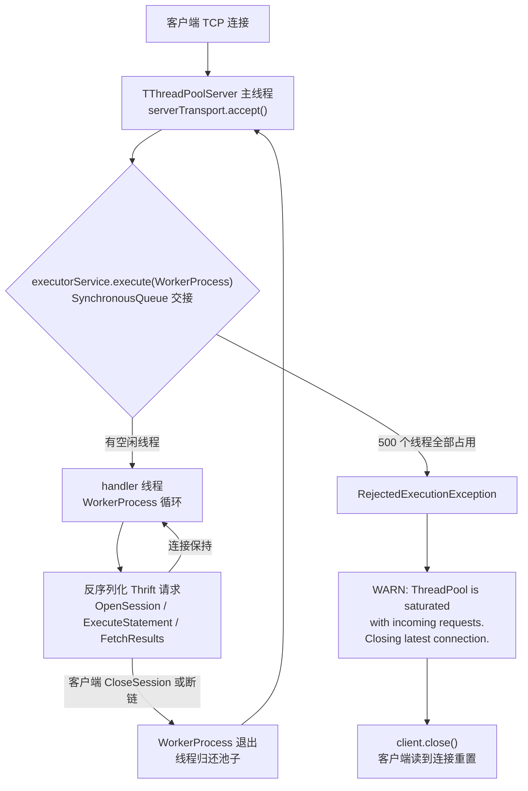
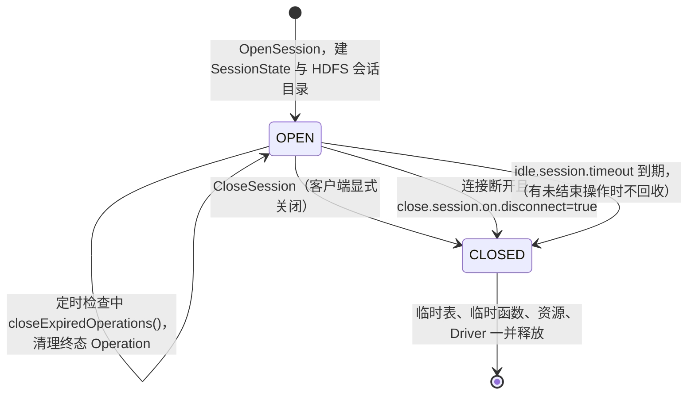
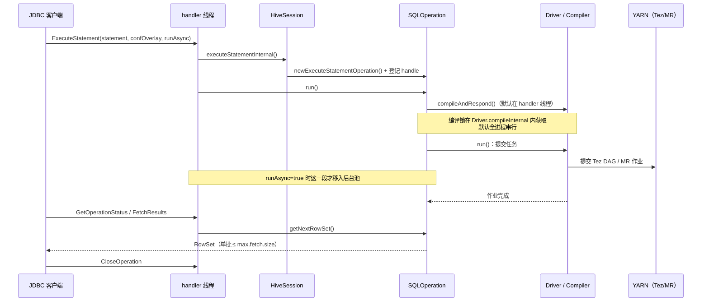
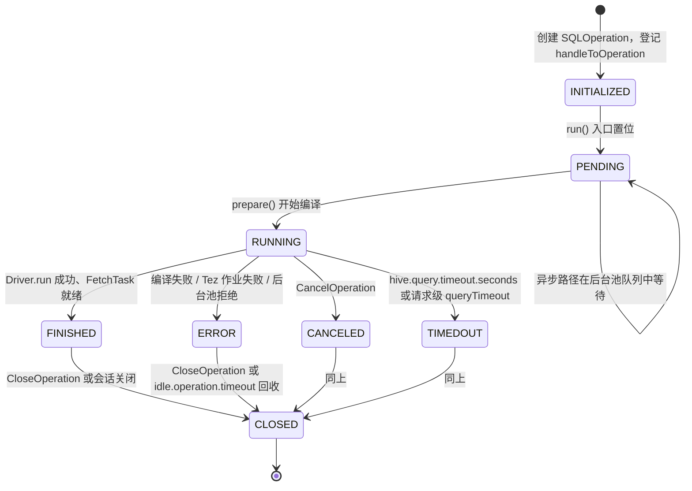
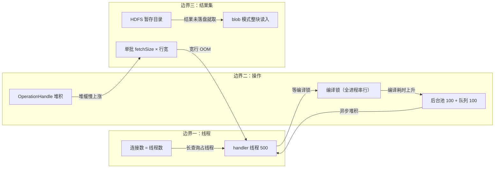
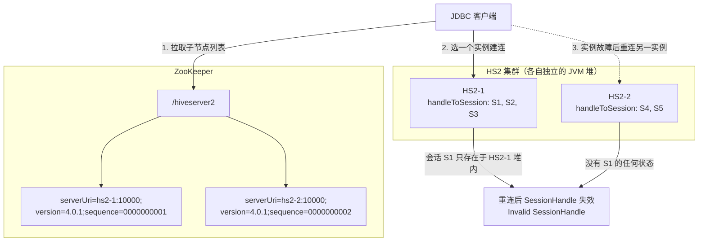

# 01 HiveServer2 架构深度解析：从 Thrift 到 Session 生命周期

**摘要：**

HiveServer2（HS2）是 Hive 集群唯一的入口：Beeline、JDBC 应用、BI 工具、调度平台提交的每一条 SQL，都要先在这个 JVM 里被接住、被分配一个会话、被编译成执行计划，再把结果一行行递回客户端。绝大多数 HS2 的容量事故，最后都能收敛到三个资源边界上——连接占用的线程、会话持有的状态、结果集的取用方式，而这三个边界的默认值、耦合关系与失效表现，散落在 `HiveConf` 的几百个配置项和几个关键类的几十行代码里。本文以一次 JDBC 连接的完整生命周期为主线：先看 Thrift 服务端为什么是 `TThreadPoolServer` 而不是 NIO 的 `TThreadedSelectorServer`，一个连接如何独占一个 handler 线程直到断开；再看 `SessionState` 里到底装了什么，为什么 `SET` 只影响本连接；随后沿 `CLIService` → `SQLOperation` → `Driver` 的调用链走完一次查询，指出全局编译锁这个常被忽略的串行点；然后把线程、操作、结果集三个边界的量化关系与打满后的现场逐项拆开，并说明异步执行（`runAsync` 与 `async.compile`）究竟改变了什么。最后落到多实例高可用：HS2 进程是无状态的，会话却是有状态的，这正是"连接漂移后会话丢失"的根源。文中配置默认值以 Hive 4.0.1 源码为准，与 Hive 2.x/3.x 的差异单独标注。

---

## 第 1 章 把"一次连接"当成研究对象

### 1.1 HiveServer1 留下的教训

Hive 早期只有 HiveServer1（HS1），它把 Thrift 生成的接口实现直接挂在一个 Thrift 服务端上，客户端连上来就能提交 HQL。问题在于它的并发能力：多个客户端同时连入时，请求并没有真正并行推进，一个跑了两个小时的 `INSERT OVERWRITE` 会把后面所有 Beeline、报表工具、数据质量脚本挡在门外。官方在 HiveServer2 的说明里，把"受 Thrift 服务端限制、无法处理并发连接"和"缺少认证"列为替换 HS1 的两条主要理由，Hive 0.11（2013 年）引入的 HS2 因此把多用户并发、Kerberos 认证、会话隔离、JDBC/ODBC 兼容写进了设计目标。

这段历史值得回看，是因为它划定了 HS2 的架构底色：它更像一个替每个客户端保管上下文的**执行宿主**，而不是无状态的 RPC 网关。RPC 网关可以任意水平扩容，请求打到哪台都一样；执行宿主不行，宿主里住着会话，会话里有临时表、有 `SET` 覆盖的配置、有正在跑的 Operation。我们后面关于容量、高可用、故障判定的讨论，都从这里长出来。

### 1.2 HS2 的三个角色

拆开看，HS2 进程同时扮演三个角色，每个角色对应一组线程和一类资源。

第一个角色是 **Thrift RPC 服务端**：监听 10000 端口（HTTP 模式是 10001），完成 SASL/Kerberos 认证，把字节流反序列化成 `TOpenSessionReq`、`TExecuteStatementReq`、`TFetchResultsReq` 这样的请求对象。它决定了 HS2 能接住多少条连接，也决定了连接打满时客户端看到什么。

第二个角色是 **会话容器**：每条连接打开一个 `HiveSessionImpl`，会话里挂着 `SessionState`，后者是配置覆盖、当前库、临时表、临时函数、`ADD FILE` 资源的实际存放处。它决定了不同用户的上下文如何互不干扰，也决定了"客户端断开后资源什么时候释放"。

第三个角色是 **Driver 的宿主**：真正干活的 `Driver` 由 `SQLOperation` 在编译前创建，负责把 HQL 编译成 Operator 树、提交给 Tez 或 MapReduce、再把结果交回来。编译和提交发生在 HS2 的 JVM 里，执行发生在 YARN 的容器里，这条分界线是理解"HS2 CPU 打满但 YARN 空闲"这类现象的关键。

### 1.3 贯穿案例与三个边界

后文用一个固定的场景承载所有机制：某数据平台的订单宽表 `dwd_order_wide` 按 `dt` 天分区，每日增量约 300 个分区、单分区几 GB，业务侧再把它和两千行的 `dim_shop` 维表做 join 出报表；访问入口有两个，一个是 BI 工具的 JDBC 连接池（20 条长连接），一个是调度平台凌晨批量拉起的 beeline 进程（200 个，每个一条连接），全部指向同一个 HS2 实例。早上九点，两股流量撞在一起。

把这个场景抽象一下，HS2 面对的永远是这样三个边界：**门有多宽**（能同时接住多少条连接，对应线程数）、**房间有多大**（会话里能放多少状态、放多久，对应 `SessionState` 与回收策略）、**取货窗口一次递多少**（结果集怎么取、在哪儿暂存，对应 `fetchSize` 与结果序列化）。三个边界互为因果，任何一个先打满，另外两个的压力都会跟着上来。

不妨用银行网点做个类比：柜员窗口数决定同时能服务多少客户，储物柜决定客户的东西能存多久，取款窗口决定一次能递出多少现金。类比的失真之处要提前说清——银行的窗口可以临时加开，而 HS2 的窗口（线程）与客户（连接）是绑定关系，客户不走，窗口就不能接待下一位；这一点是 HS2 容量模型的地基，也是它与普通 Web 服务最大的不同。

---

## 第 2 章 Thrift 服务端：门到底有多宽

### 2.1 TServer 家族与两种并发模型

Apache Thrift 的 Java 实现提供了几种服务端，核心差别在于"谁来读 socket、谁执行业务方法"。

最简单的是 `TSimpleServer`：一个线程 accept、读请求、调业务方法、写响应，全串行，只适合调试。`TThreadPoolServer` 走的是"一连接一线程"模型：主线程阻塞在 `accept()`，每接受一条连接就把这条连接包装成一个任务丢进线程池，池里的线程在这条连接上循环读请求、调方法、写响应，直到连接关闭才回去接新连接。`TThreadedSelectorServer` 和 `TNonblockingServer` 走 NIO 模型：少量 selector 线程负责所有连接的读写事件，读到完整请求帧后交给业务线程池处理，一条连接在两次请求之间不占用任何线程。

两种模型没有优劣，只有取舍。NIO 模型的连接数上限远高于线程数，适合"大量连接、少量活跃请求"的场景，譬如七层网关、长轮询推送；一连接一线程的模型实现简单、请求处理天然串行，适合"连接数可控、单连接可能长时间有请求在跑"的场景。代价是连接数直接等于常驻线程数，线程的栈内存与对象内存随连接数线性增长。

| 服务端实现 | 并发模型 | 连接数与线程数的关系 | 单连接内请求 | HS2 是否采用 |
|---|---|---|---|---|
| `TSimpleServer` | 单线程串行 | 连接数 1、线程数 1 | 串行 | 否 |
| `TThreadPoolServer` | 阻塞 accept + 线程池 | 一一对应，线程被连接独占 | 串行 | 是（binary 传输） |
| `TThreadedSelectorServer` | NIO selector + 业务池 | 连接数与线程数解耦 | 可并发 | 否 |
| `TNonblockingServer` | 单 selector | 全解耦 | 串行 | 否 |

### 2.2 Hive 4.0.1 的选择：TThreadPoolServer

不少资料把 HS2 的网络层写成 `TThreadedSelectorServer`，并给出一个 `hive.server2.thrift.selector.threads` 参数。笔者逐行核对过 Hive 4.0.1 的 `ThriftBinaryCLIService` 与 `HiveConf`，这个说法找不到依据：`ThriftBinaryCLIService` 里没有 `TThreadedSelectorServer` 的引用，`HiveConf` 里也没有 selector 线程数的配置项。真实实现是 `ThriftBinaryCLIService.initServer()`：用一个 `ThreadPoolExecutor` 配 `SynchronousQueue`，外面套 `TThreadPoolServer`。

```java
// Hive 4.0.1 ThriftBinaryCLIService.initServer()（省略认证与 SSL 分支）
ExecutorService executorService = new ThreadPoolExecutor(
    minWorkerThreads,          // hive.server2.thrift.min.worker.threads，默认 5
    maxWorkerThreads,          // hive.server2.thrift.max.worker.threads，默认 500
    workerKeepAliveTime,       // hive.server2.thrift.worker.keepalive.time，默认 60s
    TimeUnit.SECONDS,
    new SynchronousQueue<>(),  // 没有排队缓冲：交不出去就直接拒绝
    new ThreadFactoryWithGarbageCleanup("HiveServer2-Handler-Pool"));

TServerSocket serverSocket = HiveAuthUtils.getServerSocket(hiveHost, portNum);
TServer server = new TThreadPoolServer(new TThreadPoolServer.Args(serverSocket)
    .processorFactory(hiveAuthFactory.getAuthProcFactory(this))  // SASL + Kerberos 在这一层
    .transportFactory(hiveAuthFactory.getAuthTransFactory())
    .protocolFactory(new TBinaryProtocol.Factory())
    .executorService(executorService));
```

三个细节决定了 HS2 的容量性格。`SynchronousQueue` 不是普通队列，它没有容量，任务的"入队"必须直接交接给一个空闲线程，交接失败就意味着拒绝——所以 HS2 的 handler 池不存在"第 501 个连接在队列里等一会儿"这回事。`minWorkerThreads=5` 是常驻线程下限，流量退潮后多余线程会在 60 秒空闲后被回收，池子会自动缩回 5 个线程。`maxWorkerThreads=500` 才是真正意义上的连接上限，它限制的不是每秒请求数，而是同时存活的连接数。

HTTP 传输模式（`hive.server2.transport.mode=http`）换了一套壳：`ThriftHttpCLIService` 起一个 Jetty `Server`，把 Thrift 的 `TServlet` 挂在 `hive.server2.thrift.http.path`（默认 `cliservice`）上，Jetty 的 `ExecutorThreadPool` 同样由 min/max worker threads 参数构造，也配 `SynchronousQueue`。差别在于线程与连接的绑定关系被打破了：HTTP 是请求-响应模型，一次请求处理完线程就归还池子，连接由 Jetty 的 connector 线程维持，所以 HTTP 模式下 500 个线程限制的是**并发请求数**，而不是并发连接数。这个差别在排查"连接数明明没到 500 却报拒绝"时很关键。

### 2.3 一个连接一个线程意味着什么

`TThreadPoolServer` 的内部类 `WorkerProcess` 是一个 `while(true)` 循环：取一条连接，在这条连接上反复 `readMessage` → 调 `TProcessor.process` → 写响应，直到客户端关闭连接或发生异常才退出循环，线程归还池子。把这段行为翻译成工程语言，就是**一个连接一个 session 线程**：在这条连接存续的整个期间，它独占一个 handler 线程；同一条连接上的多个 RPC 是严格串行的，后一个请求必须等前一个返回。

这条语义有两个直接推论。第一，客户端的并发度上限被连接数卡住：BI 工具连接池配 20 条连接，这个客户端对 HS2 的并发 RPC 就永远不超过 20，哪怕 HS2 还有 480 个空闲线程。第二，长查询会长时间占着线程：一条同步执行的 `INSERT OVERWRITE` 在 handler 线程里从编译一路跑到执行完成，这期间该线程不能服务同一连接上的任何其他请求，也不能被别的连接借用。

HS2 之所以敢用这种"低效"模型，是因为它把长任务的下半段交给了 YARN：编译提交完成后，`Driver.run()` 大部分时间在等 Tez/MR 作业的完成通知，线程是阻塞的，但 CPU 几乎不消耗。这种"阻塞线程但不占 CPU"的模式对线程数量不敏感，对内存敏感——每多一条连接，就多一份线程栈、一份 Thrift 缓冲区、一份会话对象。反过来，一旦编译或结果取用变得耗时，阻塞线程就开始真正消耗资源，500 这个数字会显得非常不够用。

下图是连接进入 HS2 的完整路径，也是后面所有"连接被拒"现象的现场图。



### 2.4 连接打满时的现场

连接打满时没有"变慢"这个阶段，它直接表现为立刻失败。Thrift 0.16 的 `TThreadPoolServer.execute()` 捕获到拒绝异常后，只做两件事：打一条 WARN 日志，关掉刚接受的这条连接。

```text
WARN org.apache.thrift.server.TThreadPoolServer: ThreadPool is saturated with
incoming requests. Closing latest connection.
```

客户端侧看到的是连接层面的失败，不是"服务繁忙"：`TTransportException`、`java.net.SocketException: Connection reset`、`Could not open client transport with JDBC Uri ...` 一类错误；如果是 Beeline，表现为 `Error: Could not open client transport`；如果是调度平台的 shell，表现为 beeline 退出码非零。因为 TCP 握手已经完成、应用层立刻关闭，客户端拿到的通常是 reset 或 EOF，而不是 `Connection refused`——后者意味着端口根本没在监听，说明进程已经挂了，那是另一类故障。

这里有个容易误判的对照，你大概见过这种现场：**连接被拒但 CPU 不高、YARN 队列也不忙**。如果 HS2 只是算力吃紧，表现出来应该是查询变慢、GC 时间上升、`Compile` 阶段耗时变长，连接本身还能建立；一旦连 `OpenSession` 都失败，排查方向就应该从"算力"切换到"连接槽位"，去看 `hive.server2.thrift.max.worker.threads` 和当前连接数的比值，去看是不是有一批连接拿着不放（连接池没设空闲回收、客户端进程僵死、长事务挂住）。

顺便说明 Thrift 服务端本身没有提供"连接排队"的配置。accept 之后如果交接失败就关闭，操作系统层面的 accept 队列只是 TCP 握手的缓冲，不构成应用层排队。所以调大 `max.worker.threads` 之前，得先算清楚这些线程会吃掉多少内存。

### 2.5 三层连接控制与配置代价

HS2 的连接控制实际上是三层叠加的：Thrift 线程池的硬上限、按用户/IP 的软限制、客户端连接池的规模。三层里任何一层的数字不匹配，都会在生产上表现为"连接被拒"。

| 配置项 | 默认值 | 作用 | 调大的代价 | 调小的代价 |
|---|---|---|---|---|
| `hive.server2.thrift.max.worker.threads` | 500 | handler 线程上限，等于 binary 模式的并发连接上限 | 每线程一份栈与缓冲区，500→2000 会多出约 1.5 GB 线程栈（示例推算，按 `-Xss 1m` 计）；上下文切换与 GC 根集合变大 | 高峰期连接直接被拒，客户端重试放大瞬时压力 |
| `hive.server2.thrift.min.worker.threads` | 5 | 常驻线程下限 | 空闲期也占内存，收益很小 | 突发流量时要现造线程，首包延迟抖动 |
| `hive.server2.thrift.worker.keepalive.time` | 60s | 超出下限的空闲线程存活时间 | 线程回收变慢，内存占用下降慢 | 频繁建销线程，抖动增加 |
| `hive.server2.limit.connections.per.user` | 0（不限） | 单用户最大连接数 | 单个失控客户端可以吃掉全部槽位 | 设得过小会让连接池较大的应用直接连不上 |
| `hive.server2.limit.connections.per.ipaddress` | 0（不限） | 单 IP 最大连接数 | 同上；代理或 NAT 后的大量客户端会被算成一个 IP | 共享出口 IP 的场景容易误伤 |
| `hive.server2.close.session.on.disconnect` | true | 连接断开时是否关闭会话 | 改为 false 后会话会活过连接，靠 idle 超时回收，槽位释放变慢 | 保持默认即可 |

最后一行值得单独说明。`close.session.on.disconnect=true` 意味着连接与会话是"同生共死"的：客户端进程被 kill、网络被防火墙掐断、LB 把空闲连接踢掉，HS2 在 `deleteContext` 里发现这条连接上的会话还没关闭，会替它清理并打一条很具体的日志。

```text
WARN org.apache.hive.service.cli.thrift.ThriftBinaryCLIService:
Client connection bound to SessionHandle(...) unexpectedly closed: closing this
Hive session to release its resources. The connection processed 137 total
messages during its lifetime of 812034ms. Inspect the client connection for
time-out, firewall killing the connection, invalid load balancer configuration, etc.
```

这条日志同时给出了三个信息：会话被异常关闭、这条连接一共处理了多少次 RPC、连接活了多久。连接活了 13 分钟却只处理了 137 个 RPC，基本可以断定对方是一个长连接池里的空闲连接；而如果连接活了很久、RPC 数很少，却反复出现这条日志，就该去看客户端侧的网络设备了。若把该参数置为 false，会话会活过连接，只能等 `hive.server2.idle.session.timeout`（默认 4 小时）来收尸，槽位被占的时间会明显变长——这是少数不建议改默认值的参数。

### 2.6 为什么 Hive 一直没有换成 NIO 服务端

把"一连接一线程"换成 NIO 模型，理论上能把连接上限从 500 提到几万，Hive 却始终没有做这个替换，原因不在性能测算，而在会话上下文与线程的绑定关系。`SessionState` 是 `ThreadLocal` 的：handler 线程在处理某条连接的请求前，要确保当前线程的 `ThreadLocal` 指向正确会话；一连接一线程的模型让这件事几乎不需要写代码——线程从头到尾只服务一个会话，`ThreadLocal` 天然正确。

换成 NIO 就不同了：业务方法在共享线程池里执行，同一个线程这一毫秒处理会话 A、下一毫秒处理会话 B，每次调用前都得把 `SessionState`、`Hive` 对象、UGI 上下文搬一遍再搬回去。Hive 已经在异步执行路径上手工做过一次这种搬运，`SQLOperation.BackgroundWork` 里就有几行代码专门恢复上下文。

```java
// SQLOperation.BackgroundWork.run()：把父线程的上下文搬到后台线程
Hive.set(parentHive);                                      // 恢复 Hive 对象（含 HMS 客户端）
SessionState.setCurrentSessionState(parentSessionState);   // 恢复会话上下文
SessionState.getPerfLogger();                              // 恢复性能日志
LogUtils.registerLoggingContext(queryState.getConf());     // 恢复日志上下文
```

一次查询搬一次上下文是可以接受的成本，成千上万个 RPC 都搬就变成了风险点：漏搬一处就是串会话的严重 bug，搬错一处就是日志串台、权限串号。对 HS2 这种"连接数由客户端连接池决定、单连接可能持续数小时"的服务来说，NIO 带来的连接数收益远不如"连接语义简单"带来的确定性重要，所以这个选型不是疏忽，而是有意的匹配。

## 第 3 章 Session：房间与柜子

### 3.1 OpenSession 做了什么

一次连接的建立，从 `OpenSession` 开始。调用链是 `ThriftCLIService.OpenSession` → `CLIService.openSession` → `SessionManager.openSession` → `HiveSessionImpl` 构造与 `open()`，最后把 `SessionHandle` 放进 `SessionManager.handleToSession` 这张 `ConcurrentHashMap`。

```java
// HiveSessionImpl 构造与 open() 的关键动作（简化）
this.sessionConf = new HiveConf(serverConf);          // 从服务端配置深拷贝一份会话级配置
this.operationLock = serverConf.getBoolVar(
    ConfVars.HIVE_SERVER2_PARALLEL_OPS_IN_SESSION)    // 默认 true，则为 null
    ? null : new Semaphore(1);                        // 为 false 时，会话内操作串行

sessionState = new SessionState(sessionConf, username, cleanupService);
sessionState.setIsHiveServerQuery(true);
SessionState.start(sessionState);                     // 建会话目录、设当前库、绑定线程上下文
sessionState.loadAuxJars();                           // hive.aux.jars.path
processGlobalInitFile();                              // 执行 hive.server2.global.init.file
if (sessionConfMap != null) configureSession(sessionConfMap);
lastAccessTime = System.currentTimeMillis();          // idle 超时的计时起点
```

`SessionState.start()` 做的事情比看上去多：它在 `hive.exec.scratchdir`（默认 `/tmp/hive`）下为这个用户和会话建 HDFS 临目录，在本地建会话临时目录，写入一个会话锁文件，把当前库设成 `default`，并把 `SessionState` 绑定到当前线程的 `ThreadLocal`。这些目录和文件是"HDFS 上莫名多出很多小目录"的来源，也是 HS2 重启后旧目录靠清理服务回收的原因。

`configureSession` 支持两种带前缀的键：`set:` 开头的会走 `SetProcessor.setVariable`，等价于在会话里执行了一次 `SET`；`use:` 开头的会把当前库切过去。这就是 JDBC URL 上 `?set:hivevar:dt=2026-11-19`、`?use:dw` 一类写法的实现位置，也是很多 BI 工具"取数时自动带上业务变量"的机制。

### 3.2 SessionState 里到底装了什么

会话状态落地为一组具体字段，而非抽象的"上下文"。Hive 4.0.1 的 `SessionState` 有近两千三百行，真正和容量、隔离相关的字段可以归成五类。

| 类别 | 典型字段 | 内容 | 何时写入 | 何时释放 |
|---|---|---|---|---|
| 配置 | `sessionConf`、`overriddenConfigurations` | 会话级 `HiveConf` 副本；被 `SET` 改过的键值对 | OpenSession、每次 `SET` | 会话关闭 |
| 位置 | `currentDatabase`、`currentCatalog` | 当前库与 catalog | `USE`、`set:`/`use:` 参数 | 会话关闭 |
| 资源 | `resourceMaps`、`resourceDownloader` | `ADD FILE/JAR/ARCHIVE` 的路径映射与本地化文件 | `ADD` 类命令 | 会话关闭（文件由清理服务删） |
| 临时对象 | `tempTables`、`tempPartitions`、`tempTableColStats` | 临时表、临时分区及其统计信息 | `CREATE TEMPORARY TABLE` | 会话关闭 |
| 函数 | `registry`、`currentFunctionsInUse` | 会话内函数注册表、临时函数记录 | `CREATE TEMPORARY FUNCTION` | 会话关闭 |
| 执行态 | `queryStateMap`、`tezSessionState`、`txnMgr`、`hiveDb` | 查询状态、Tez 会话、事务管理器、元数据客户端 | 每次查询、首次访问 HMS | 会话关闭 |

这张表里有三个细节值得展开。其一，临时表的元数据存在 `tempTables` 这张会话内的 `ConcurrentHashMap` 里，不进 HMS；客户端断开、会话关闭，这些表就随之消失，所以"临时表丢了"几乎总是会话换了。其二，函数注册表在 Hive 4 里是会话级的（`SessionState` 构造时 `new Registry(false)`），这意味着两个会话可以各自注册同名临时函数而互不覆盖；Hive 2.x/3.x 时代函数注册表偏向进程级共享，同名临时函数的可见性以对应版本文档为准，这也是升级到 4.x 后 UDF 相关问题形态会变的一个原因。其三，`tezSessionState` 挂在会话上，所以"Tez 会话复用"本质上是同一个 Hive 会话在复用，换一个 HS2 实例、或者换一条连接重新开会话，Tez 会话也要重新申请，容器申请与预热成本会重新付一遍。

**进程内隔离**是这个设计的另一面：所有会话共享同一个 JVM 堆。某个会话在编译一个几十路 join 的查询时临时对象暴涨，触发的是全进程的 GC，其他会话的响应时间会跟着抖动。这是"单进程多租户"的固有代价，算不上实现瑕疵；要彻底隔离只能一进程一会话，那样的资源开销在几百连接的规模上不可接受。

### 3.3 为什么配置是 session 级的

HS2 的配置实际上分三层，作用范围逐层收窄：服务端启动时读到的 `hive-site.xml` 是静态层，进程内所有会话共享；`HiveSessionImpl` 构造时 `new HiveConf(serverConf)` 复制出的 `sessionConf` 是会话层，`SET` 命令只改这一份；`ExecuteStatement` 请求里携带的 `confOverlay` 是操作层，`Operation` 构造时被塞进该次查询的 `QueryState`，随查询结束丢弃。

`SET` 落到会话层这件事，在代码里是一条很直接的路径：`SetProcessor.setConf` 取 `SessionState.get().getConf()`，改这个 `HiveConf` 实例，同时把键值记进 `overriddenConfigurations` 供 `SET` 列表展示。所以两个客户端即便同时执行 `SET hive.exec.parallel=true`，彼此也看不见对方的值；同一个客户端连接池里的一条连接执行过 `SET`，之后复用这条连接的查询都会带着这个设置——这是**连接池复用带来的配置污染**，也是 session 级配置最容易被忽视的一面。

由此可以得到一条判据：**用 `SET` 配服务端参数不会生效**。`hive.server2.thrift.max.worker.threads`、`hive.server2.async.exec.threads`、`hive.server2.session.check.interval` 这类参数在 HS2 启动构造线程池和定时器时就已经读走，会话里改它只是往自己的 `HiveConf` 副本里写了个没人读的键。反过来，`hive.exec.*`、`hive.tez.*` 这类参数在会话里改是有效的，譬如 `hive.exec.parallel` 控制同一作业内的无关任务能否并行提交，它影响的是编译与执行阶段的决策，而编译恰好发生在会话上下文里。分清这两类，能省掉大量"改了没反应"的排查。

### 3.4 会话的回收

HS2 用一个后台线程做会话与操作的超时回收，代码在 `SessionManager.startTimeoutChecker()`。这个线程没有独立成守护线程，它被提交到 `backgroundOperationPool` 里运行——也就是说，100 个后台线程里有 1 个长期被这个 `while(!shutdown)` 循环占着，实际可用于异步执行的线程是 99 个。

回收判据有四个参数：检查周期 `hive.server2.session.check.interval`（默认 15m，代码里 `Math.max(interval, 3000)` 兜底，配置校验器也要求不短于 3 秒）、会话空闲阈值 `hive.server2.idle.session.timeout`（默认 4h）、操作空闲阈值 `hive.server2.idle.operation.timeout`（默认 2h）、以及 `hive.server2.idle.session.check.operation`（默认 true，表示判断会话是否空闲时还要看有没有未结束的操作）。

```text
每 check.interval 遍历一次 handleToSession：
  若 lastAccessTime + idle.session.timeout <= now
     且（check.operation 为 false 或 noOperationTime > idle.session.timeout）：
         closeSession(handle)，记 HS2_ABANDONED_SESSIONS 指标
  否则：
     session.closeExpiredOperations()   // 按 idle.operation.timeout 清理长尾 Operation
```

`idle.operation.timeout` 的语义有一个容易忽略的分支：取正值时只清理处于终态（FINISHED、CANCELED、CLOSED、ERROR）的操作，取负值时才连运行中的操作一起清。这解释了一种典型的现场——客户端拿到 `OperationHandle` 之后就再没来 `FetchResults`，操作在终态挂了两小时被回收，客户端过一会儿再取结果，收到的是 `Invalid OperationHandle: ...`。

下图是会话从建立到回收的状态流转，注意"连接断开"这条边与"空闲超时"这条边是两条独立路径，走的都是关闭逻辑，但触发条件和日志完全不同。



这里可以对照一份真实故障加深印象：知识库里 [[HiveServer2 Redis UDF 文件描述符泄漏故障报告]] 记录的那次事故，问题既不在连接数也不在会话数，而是编译期常量折叠反复实例化 UDF、每次实例化都建一个最小空闲连接数为 5 的 Redis 连接池，最终把 HS2 进程的文件描述符耗到 `Too many open files`，端口直接不可用。它说明三个资源边界之外还站着一个不写在任何配置表里的第四个边界——进程的 fd 上限，而触发点恰好在编译期，也就是发生在 HS2 自己的 JVM 里。

## 第 4 章 一次查询的完整路径

### 4.1 从 Thrift 请求到 FetchResults

把一次查询拆成时间线，依次经过这些环节：客户端 `Statement.execute()` 发 `ExecuteStatement`；handler 线程进入 `HiveSessionImpl.executeStatementInternal`；`OperationManager.newExecuteStatementOperation` 创建 `SQLOperation` 并登记到 `handleToOperation`；`operation.run()` 进入编译与执行；成功后客户端用 `OperationHandle` 反复 `FetchResults` 取行；最后 `CloseOperation` 或会话关闭时释放。

```java
// SQLOperation.runInternal()：同步与异步在这里分岔（Hive 4.0.1 简化）
setState(OperationState.PENDING);
final boolean doRunAsync = shouldRunAsync();          // 来自 TExecuteStatementReq.runAsync
final boolean asyncPrepare = doRunAsync && HiveConf.getBoolVar(
    queryState.getConf(), HIVE_SERVER2_ASYNC_EXEC_ASYNC_COMPILE);  // 默认 false
if (!asyncPrepare) {
  prepare(queryState);                                // 编译：在 handler 线程里同步做完
}
if (!doRunAsync) {
  runQuery();                                         // 同步：执行也在 handler 线程
} else {
  Future<?> h = getParentSession().submitBackgroundOperation(work);  // 只把执行丢进后台池
}
```

`prepare()` 里做的事情是 `driver.compileAndRespond(statement)`，`runQuery()` 里是 `driver.run()`。也就是说，默认配置下即便客户端调用的是 `executeAsync`，编译仍然发生在 handler 线程上，只有执行阶段被移进后台线程池。这一点是理解"异步执行没有提高并发"的关键，第 6 章展开。

`Driver.run()` 内部又分三段：`compileInternal()` 做解析、语义分析、逻辑与物理优化，产出 Operator 树和任务计划；`lockAndRespond()` 拿执行阶段的锁；`execute()` 交给 `Executor` 提交 Tez/MR 任务并等待完成。如果走的是 fetch task 路径（`hive.fetch.task.conversion` 默认 `more`，阈值 200 MB），则不提交任何 YARN 作业，直接由 HS2 打开 HDFS 读取器边读边回。编译链路的细节见 [[03 SQL 编译全链路：从 HQL 到 Operator Tree]]，执行引擎的差异见 [[04 执行引擎对比：MapReduce vs Tez 的本质差异]]。

下图把这条路径画成时序，注意编译与执行在默认配置下都发生在同一条"handler 线程"的生命周期里，只有 `runAsync=true` 才把执行段交给后台池。



一次查询里最贵的两段是编译与执行，而它们消耗的资源类型完全不同。编译在 HS2 的 JVM 里做，`compileInternal` 依次经过语法解析（`ParseDriver`）、语义分析（`SemanticAnalyzer`，要反复访问 HMS 拉表与分区元数据）、逻辑优化与物理优化（CBO 需要统计信息，CPU 与内存都吃）、任务编译（把 Operator 树切成 Tez DAG 或 MR 作业）。其中语义分析是 I/O 密集，优化是 CPU 密集，任务编译是内存密集——这也解释了为什么 HS2 的 GC 曲线常常和"同时有多少条复杂 SQL 在编译"高度相关。执行段消耗的是 YARN 的资源，HS2 侧只是一个阻塞等待的线程。编译各阶段的细节见 [[03 SQL 编译全链路：从 HQL 到 Operator Tree]]，本文只关心它对 HS2 线程与内存的占用方式。

### 4.2 编译锁：被忽略的串行点

Hive 在 `CompileLockFactory` 里维护了一个静态的公平可重入锁 `SERIALIZABLE_COMPILE_LOCK`。当 `hive.driver.parallel.compilation` 为 false（默认）时，所有会话的编译都串行在这一个锁上；只有显式打开并行编译，锁才会退化为会话级锁，或按 `hive.driver.parallel.compilation.global.limit` 的数量做全局配额。

```java
// CompileLockFactory：默认路径下，所有编译抢同一把进程内公平锁
private static final ReentrantLock SERIALIZABLE_COMPILE_LOCK = new ReentrantLock(true);

boolean parallel = HiveConf.getBoolVar(conf, HIVE_SERVER2_PARALLEL_COMPILATION); // 默认 false
Lock underlying = parallel ? SessionState.get().getCompileLock() : SERIALIZABLE_COMPILE_LOCK;
long timeout = HiveConf.getTimeVar(conf, HIVE_SERVER2_COMPILE_LOCK_TIMEOUT, SECONDS); // 默认 0s
return new CompileLock(underlying, timeout, command);
```

`hive.server2.compile.lock.timeout` 默认 0 秒，而 `CompileLock.tryAcquire` 在超时值不大于 0 时的行为是 `underlying.lock()`——无限期阻塞等待。把它设成正数，等待超时会直接抛错，错误码 10308，消息是 `Attempt to acquire compile lock timed out.`。

不过，这把锁把 HS2 的并发模型改写成了另一个样子：即便有 500 个 handler 线程、100 个后台执行线程，**全进程只有一个查询在编译**。一条编译要 8 秒的复杂 join，会让后面所有 `ExecuteStatement` 都卡在 handler 线程里排队，每条连接各占一个线程。于是出现了本章最要紧的一条因果链：

```text
复杂查询编译慢（十几秒甚至更久）
  → 编译锁被长时间持有（parallel.compilation=false 时全进程唯一）
  → 其他 ExecuteStatement 在 handler 线程里阻塞等锁
  → 500 个 handler 线程被逐个占满
  → 新连接被 SynchronousQueue 拒绝，Thrift 关闭连接
  → 客户端报 Connection reset / Could not open client transport
```

这条链条解释了为什么"HS2 CPU 只有 30%、YARN 队列很空、但用户连不上"是一个真实且常见的现场。此时去看 CPU 和 YARN 都是误导，正确的观测点是 handler 线程状态（大量线程停在 `CompileLock.tryAcquire`）和 `WAITING_COMPILE_OPS` 这个指标（`compileInternal` 进入时 +1、拿到锁后 -1）。

### 4.3 Operation 的状态机

Operation 是 HS2 对"一次执行请求"的抽象，状态枚举包括 `INITIALIZED`、`PENDING`、`RUNNING`、`FINISHED`、`CANCELED`、`CLOSED`、`ERROR`、`TIMEDOUT`、`UNKNOWN`。状态迁移的关键点在于：`PENDING` 在同步与异步路径上都会被置位（`runInternal` 第一行就设置状态），同步路径上它只存在一瞬，异步路径上它会随后台池排队而延长；`TIMEDOUT` 由查询超时触发；`INITIALIZED` 是创建到 `run()` 之间的极短窗口。



超时机制值得单独交代一句：`hive.query.timeout.seconds` 默认 0，表示不设超时；一旦设成正数，每条开启超时的查询都会额外创建一个单线程 `ScheduledExecutorService` 来定时取消自己。也就是说，全局开启查询超时能防住"挂死查询"，代价是每条受控查询多一个线程——这在连接数几千的实例上是笔不小的开销，值得在容量规划里算进去。

### 4.4 结果集：拉取而不是推送

很多资料把 HS2 的结果集描述成"查询完成后把整个结果集缓存到内存里，客户端分批取"。这个描述只对了一小半。真实的取用方式是**结果集是拉取式的**：`SQLOperation.getNextRowSet` 拿到 `Driver` 的 `FetchTask`，按本次请求的行数上限从 `FetchOperator` 读一批行，装进本次请求的 `RowSet` 返回，然后清空缓冲等待下一次 `FetchResults`。

```java
// SQLOperation.getNextRowSet()：每次 FetchResults 只产出本次请求的 RowSet
maxRows = min(requestedRows, hive.server2.thrift.resultset.max.fetch.size); // 上限 10000
if (fetchTask.getWork().isUsingThriftJDBCBinarySerDe()) {
  maxRows = 1;              // 二进制序列化模式：一次取一个 blob
  isBlobBased = true;
}
RowSet rowSet = RowSetFactory.create(schema, protocolVersion, isBlobBased);
driver.setMaxRows(capacity);
driver.getResults(convey);  // 从 FetchTask 拉一批行
return decode(convey, rowSet);
```

有两点需要先澄清。其一，网上把结果集暂存相关参数写成 `hive.server2.async.resultset.*` 系列，这个前缀在 Hive 4.0.1 的 `HiveConf` 里搜不到，与结果集有关的配置全部挂在 `hive.server2.thrift.resultset.*` 之下。其二，三个参数决定了结果集边界的位置：`hive.server2.thrift.resultset.default.fetch.size` 默认 1000，客户端没指定 `fetchSize` 时用它；`hive.server2.thrift.resultset.max.fetch.size` 默认 10000，是服务端强制的单次上限，客户端传再大也会被压到这个值；`hive.server2.thrift.resultset.serialize.in.tasks` 默认 false，为 true 时结果在任务端就序列化成 SequenceFile 落在 HDFS 上，HS2 每次取一个 blob（`maxRows` 被强制为 1）。协议版本 V6 及以上会用列式 `ColumnBasedSet` 承载，V5 及以下用行式 `RowBasedSet`。

这套设计的好处是 HS2 不会为了"等客户端来取"而把百万行结果常驻堆内，坏处是单次 `FetchResults` 的内存占用等于"行数上限 × 单行宽度"，而行数上限只按行数限制、不看字节数。一万行、每行一万个字符的宽行，一次取用就是上百 MB 的瞬时对象，几个并发客户端同时取就是几百 MB 的垃圾——这才是 HS2 因结果集 OOM 的真实路径，而不是"结果集全量缓存"。

---

## 第 5 章 三个资源边界

### 5.1 边界一：线程数与连接数

第一个边界的载体是 `HiveServer2-Handler-Pool`，它的默认上限是 500 条连接。这个数字本身并不吓人，吓人的是它隐含的内存模型：每条连接对应一个线程，每个线程有独立的栈（HotSpot 64 位默认 `-Xss 1m`），线程上还挂着这条连接独占的 `TTransport`、反序列化用的协议对象、以及一个 `HiveSessionImpl` 加 `SessionState`。

笔者按示例推算一次：500 条连接 × 1 MB 线程栈，仅栈就要 500 MB 的地址空间（Linux 下是虚拟内存，实际提交量取决于使用深度）；每条连接的 Thrift 缓冲、SASL 上下文、协议对象合计按 0.5–1 MB 估，又是 250–500 MB；每个已打开会话的 `SessionState`（含配置副本、会话目录句柄、Hive 客户端、Tez 会话状态）按 1–3 MB 估，500 个会话就是 0.5–1.5 GB。三项相加在 1.5–2.5 GB 量级，还没算编译期的临时对象、结果集的 `RowSet`、以及 JVM 自身的元空间。给 HS2 配 8 GB 堆、500 个 handler 线程，常驻占用就吃掉三成以上；如果同时有几十个查询在编译，堆压力会迅速上来。这些数字是量级判断而非基准测试，具体到某个集群必须按自己的线程栈设置实测。

| 并发连接数 | 线程栈（`-Xss 1m`） | 连接与协议对象 | 已打开会话的 `SessionState` | 合计（示例推算） |
|---|---|---|---|---|
| 200 | 200 MB | 100–200 MB | 200–600 MB | 0.5–1.0 GB |
| 500 | 500 MB | 250–500 MB | 500 MB–1.5 GB | 1.3–2.5 GB |
| 1000 | 1 GB | 0.5–1 GB | 1–3 GB | 2.5–5 GB |

这个边界还会被连接池放大。BI 工具配 20 条连接、调度平台每个作业一条、ETL 框架的池子配 50 条、再加上各个数据服务的嵌入式连接——账面上每个应用都不大，加起来很容易顶到 500。更麻烦的是空闲连接不释放，譬如客户端连接池配了 `minIdle`、又没配空闲回收，一条连接可以躺一整天，占着线程和会话，只在 idle 超时（4 小时）时才被 HS2 单方面回收，而客户端浑然不觉，下次用这条连接时才发现会话没了。

### 5.2 边界二：操作与后台池

第二个边界是操作数。这里要先澄清一个流传较广的参数：`hive.server2.max.concurrent.operations` 在 Hive 4.0.1 与 4.1.0 的 `HiveConf` 里都不存在，网上把它当成 HS2 的并发查询上限是一种误读。HS2 没有"全局并发操作数"这个开关，真正的操作边界由四样东西共同构成：后台线程池的线程数、后台池的队列长度、编译锁、以及每个会话里堆积的 Operation 句柄。

后台池由 `SessionManager.createBackgroundOperationPool()` 构造：`hive.server2.async.exec.threads` 默认 100，`hive.server2.async.exec.wait.queue.size` 默认 100，队列用 `LinkedBlockingQueue`，拒绝策略是 `ThreadPoolExecutor` 默认的 `AbortPolicy`，超时回收线程还占掉其中一个线程。它只服务 `runAsync=true` 的操作，同步操作根本不经过它。

```java
// SessionManager：后台池是有界队列 + 直接抛异常
final BlockingQueue<Runnable> queue = new LinkedBlockingQueue<>(poolQueueSize);  // 默认 100
backgroundOperationPool = new ThreadPoolExecutor(poolSize, poolSize,   // 默认 100
    keepAlive, TimeUnit.SECONDS, queue, new ThreadFactoryWithGarbageCleanup(...));
backgroundOperationPool.allowCoreThreadTimeOut(true);   // 空闲可缩容
// 池满 + 队列满时抛 RejectedExecutionException，SQLOperation 侧转成下面的报错：
// "The background threadpool cannot accept new task for execution, please retry the operation"
```

于是第二个边界的失效形态与第一个不同：它表现为请求本身被拒绝，报错信息里明确要求客户端重试，与"连接被重置"是两回事。这个区别在排查时很好用——`Connection reset` 指向连接边界，`background threadpool cannot accept new task` 指向操作边界。用示例推算感受一下量级：100 个后台线程，如果每个操作在后台池里平均待 30 分钟（编译提交加等待 Tez 完成，同步等待都算在这段里），那么后台池的吞吐约是每小时 200 个异步操作，队列 100 个位置对应约 30 分钟的排队缓冲；一旦上游在十分钟内推上千个异步查询，队列瞬间打满，后续请求全部即时失败。

除后台池之外，操作边界还有第二个观察点：`OperationManager.handleToOperation` 这张表没有容量上限。客户端每 `ExecuteStatement` 一次就多一个 `OperationHandle`，如果客户端拿了句柄不关、也不让会话关闭，操作会一直挂在表里，直到 `idle.operation.timeout`（默认 2 小时）把它们清掉。一个天天跑几千个查询、从不 `CloseOperation` 的长连接，可以把 `OPEN_OPERATIONS` 指标堆到几千，每个操作还带着 `QueryInfo`、查询日志、Operator 树引用，堆内存缓慢上涨。这一点在 Hive 4 里靠 `SessionManager` 的定时清理兜底，但兜底是 2 小时粒度的，扛不住短时间内的句柄洪水。

会话内还有一个正交的开关：`hive.server2.parallel.ops.in.session` 默认 true，表示一个会话里可以同时跑多个操作；若置为 false，`HiveSessionImpl` 会构造一个 `Semaphore(1)`，同一会话的操作串行执行。如果集群的 `hive-site.xml` 显式写了 false（早期为了规避会话内并发带来的竞争，不少集群这么配过），行为就退回"一个会话只能跑一个查询"，连接池里的第二条语句要等第一条结束，看起来像"连接被占住"。

### 5.3 边界三：结果集与暂存

第三个边界是结果集的取用。三条路径决定了结果落在哪儿、占多少内存。

第一条是 fetch task 路径（`hive.fetch.task.conversion` 默认 `more`，表大小不超过 `hive.fetch.task.conversion.threshold` 默认 200 MB）：不提交作业，HS2 直接读 HDFS，边读边回。这条路省掉了 YARN 的调度延迟，代价是读取发生在 HS2 进程内，HDFS 客户端缓冲区、解压缓冲区、ORC/Parquet reader 的对象都在 HS2 堆里，一个并行度高的宽表扫描能把 HS2 的 CPU 和堆同时拉起来。

第二条是普通作业路径：作业在 YARN 上跑完，结果写在 `hive.exec.scratchdir` 下的临时目录，`FetchTask` 持有一个读取器，`FetchResults` 时按批读取。结果"暂存"在 HDFS 而不是堆里，堆里只有当前批次的 `RowSet`。

第三条是二进制序列化路径（`hive.server2.thrift.resultset.serialize.in.tasks=true`）：结果在任务端就被 `ThriftJDBCBinarySerDe` 序列化成 SequenceFile，HS2 侧一次取一个 blob。这条路把"逐行编解码"的开销从 HS2 挪到了任务端，适合结果要整体传给上层引擎（如 Spark 读 Hive 结果）的场景，代价是结果必须先完整落盘才能开始取，首行延迟变长，且单个 blob 的大小直接决定 HS2 侧一次 `FetchResults` 的内存峰值。

结果集边界的失效形态是"取不到"。客户端开始取结果时操作已经被回收，收到 `Invalid OperationHandle`；会话被回收，收到 `Invalid SessionHandle`；服务端在取一批宽行时 OOM，客户端收到连接中断，HS2 日志里是 `OutOfMemoryError` 或者 `GC overhead limit exceeded`。这三种现象看起来都是"结果取不到"，但判据完全不同：第一种要看操作的 `lastAccessTime` 与 `idle.operation.timeout`，第二种要看会话是不是被 idle 回收或换了实例，第三种要看堆和单批行宽。

### 5.4 三个边界如何互相传导

三个边界之间是串联关系，不是并列关系：线程被长查询占住 → 编译锁排队加剧 → handler 线程被等锁的请求占满 → 后台池里堆积的操作越来越多 → 客户端为了拿结果开更多连接。下图把这条传导链画出来，也标出了每个环节对应的观测点。



这张图想说明的判断顺序：看到连接被拒，先确认是线程被"执行"占住还是被"等锁"占住；看到操作被拒绝，先确认后台池的排队时间；看到取结果失败，先确认操作与会话是否还活着。三个边界的处置手段完全不同，把症状归错边界，就会做出"调大线程数"这种把内存问题变成 OOM 的处置。

### 5.5 三个边界之外的第四个：文件描述符

HS2 进程还要为每一条连接、每一个到 HMS 的连接、每一个 HDFS 客户端、以及 UDF 里打开的每一个外部连接维护一个文件描述符。fd 上限不是 `HiveConf` 里的参数，而是进程启动时的 `ulimit -n`，所以它从来不进"HS2 参数调优"的清单，直到耗尽为止。

[[HiveServer2 Redis UDF 文件描述符泄漏故障报告]] 记录的现场很典型：自定义 UDF 把连接池写成实例变量，优化器在常量折叠阶段反复实例化 UDF，每次实例化都建一个最小空闲连接为 5 的 Redis 连接池，实例被回收后底层 TCP 连接却没有关闭。泄漏发生在编译期，也就是发生在 HS2 的 JVM 里，最终 HS2 无法再与 HMS、HDFS 建立新连接，系统抛 `Too many open files`，端口不再响应。同一时期知识库里那篇 [[用Beeline-EXPLAIN分析Hive常量折叠是否触发UDF兼容性问题]] 从另一个角度说明了同一个机制：常量折叠让 UDF 在编译期就被执行，编译期的一切副作用都落在 HS2 进程里。

这类问题的判据很直接：`ls /proc/<hs2_pid>/fd | wc -l` 与 `ulimit -n` 的比值持续高于 70% 就该告警，日志里出现 `Too many open files` 已经是失守阶段。处置方向不在 HS2 的参数里，而在 UDF、外部客户端与 `ulimit` 三处，完整路径见 [[12 故障排查手册：从 HS2 无响应到 Tez 作业失败的系统诊断]]。

---

## 第 6 章 异步执行改变了什么

### 6.1 runAsync 的语义

Thrift 的 `TExecuteStatementReq` 有一个 `runAsync` 字段，默认 false。Hive JDBC 的 `HiveStatement.executeAsync()` 会把它置为 true，然后立刻返回，客户端再用 `GetOperationStatus` 轮询。服务端侧，`HiveSessionImpl.executeStatementAsync` 走的还是同一个 `executeStatementInternal`，只是把 `runAsync` 传成 true。

异步的价值在于把"执行等待"从 handler 线程上挪走。同步路径下，一条跑 40 分钟的 Tez 查询会把 handler 线程占 40 分钟；异步路径下，执行阶段交给后台池，handler 线程在提交完成后就能回去服务这条连接上的其他 RPC——注意是"其他 RPC"，因为同一条连接的请求仍然只能串行处理，客户端要在一条连接上并发提交多个查询，仍然需要多条连接。

### 6.2 async.compile 的取舍

`hive.server2.async.exec.async.compile` 默认 false，它控制的是编译阶段要不要也放进后台线程。默认关闭时，异步查询的编译（`driver.compileAndRespond`）仍发生在 handler 线程上，只有 `driver.run()` 那一半进后台池。这个默认值的用意写在配置说明里：编译完成后才能确定这条查询有没有结果集，客户端在 `ExecuteStatement` 返回时即可知道要不要准备 `FetchResults`。

打开之后，`ExecuteStatement` 可以更快返回，编译与执行都在后台线程里完成，handler 线程的占用时间进一步缩短；代价是客户端在收到响应时还不知道查询会不会产出结果集，需要等编译完成后再通过状态查询确认。这个取舍对大批量短查询的吞吐有利，对需要"立刻知道结果集形态"的客户端不友好。

### 6.3 异步不等于更高并发

把异步理解成"HS2 能同时跑更多查询"是一种常见误解。异步改变的是**线程的占用方式**，不改变**编译的串行性**，也不改变**执行引擎的资源总量**。默认配置下，100 个后台线程加上 100 个队列位置，理论上的并发异步操作上限就是 200 个在途；超出的请求即时失败。而编译仍然要抢那把全局锁，100 个后台线程里也只有一个能在同一时刻编译。真正决定"能同时跑多少查询"的，还是 YARN 队列的容量和 Tez 的 container 供给。

异步还带来一个运维上的副作用，方向恰好与直觉相反：客户端断开时，真正发生的是"服务端替客户端收尾"。默认 `hive.server2.close.session.on.disconnect=true`，连接关闭会触发会话关闭，`HiveSessionImpl.close()` 遍历会话里的每个 `OperationHandle` 调 `closeOperation`，`SQLOperation.cleanup()` 对后台任务发中断（`backgroundHandle.cancel(true)`）并关闭 `Driver`，已经提交到 YARN 的作业尽力撤销。取消是尽力而为的：中断信号能不能穿透到引擎、Tez 会不会立刻 kill 掉运行中的 DAG，取决于引擎侧对取消的处理。

真正的"孤儿查询"来自没有代码执行取消的场景：HS2 进程被 kill 或 OOM 崩溃，JVM 一起消失，YARN 上的作业仍在跑，没有人再持有它的句柄，只能等作业超时或手工 kill；或者运维把 `close.session.on.disconnect` 置成了 false，连接断了会话还活着，会话里的查询按原计划跑完但客户端已经不在。这两种情况在 [[12 故障排查手册：从 HS2 无响应到 Tez 作业失败的系统诊断]] 里都有更系统的处置路径，判据是 HS2 日志里有没有那条 `unexpectedly closed: closing this Hive session`。

---

## 第 7 章 高可用：无状态的进程与有状态的会话

### 7.1 两种 HA 形态

HS2 的高可用有两种实现，方向完全不同。常见的是**多活**：多个 HS2 实例同时对外服务，客户端通过 ZooKeeper 拿到实例列表，自己选一个连。较新的 Hive 版本还提供了**主备**形态：`hive.server2.active.passive.ha.enable` 打开后，实例通过 ZooKeeper 的 leader latch 选主，只有 active 实例接受客户端会话，注册用的命名空间由 `hive.server2.active.passive.ha.registry.namespace` 指定（默认 `hs2ActivePassiveHA`）。主备形态适用于 LLAP 之类"会话与应用实例强绑定"的场景，普通 JDBC 场景用多活更简单。

多活模式的注册细节在 `HiveServer2.start()` 里：开启 `hive.server2.support.dynamic.service.discovery`（默认 false）后，实例在 ZooKeeper 的 `hive.server2.zookeeper.namespace`（默认 `hiveserver2`）下创建一个临时顺序节点，节点名前缀是 `serverUri=<host>:<port>;version=<版本>;sequence=`；`hive.server2.zookeeper.publish.configs` 默认 true，会把一批配置也发布到节点数据里，供客户端读取后自行配置。`hive.zookeeper.session.timeout` 默认 120000 毫秒，决定实例崩溃后多久从 ZooKeeper 上消失——这个值同时决定了"故障实例还会被客户端选中多久"。



### 7.2 无状态的是进程，有状态的是会话

HS2 自己几乎不持有需要持久化的状态：配置从 `hive-site.xml` 读，元数据在 HMS，数据在 HDFS，作业状态在 YARN。这就是它"无状态"、可以随意多实例部署的由来。但会话状态全在 JVM 堆里：`SessionManager.handleToSession` 是进程内的 `ConcurrentHashMap`，`SessionState` 是堆对象，`OperationHandle` 指向的 `Operation` 也在堆里。ZooKeeper 上注册的只有一个地址字符串，没有任何会话信息。

两条结论直接由此推出。第一，**连接漂移必然导致会话丢失**：客户端从 HS2-1 漂到 HS2-2，带着旧的 `SessionHandle` 去 `ExecuteStatement`，HS2-2 的 `SessionManager.getSession` 查不到，抛 `Invalid SessionHandle`；正在运行的查询因为 Driver 随实例消失而中断，YARN 上的作业变成孤儿。第二，**故障转移只保证新连接可用**。把这个边界告诉业务方，比在故障时反复解释"为什么重试就好了、为什么临时表没了"更有效。

客户端侧的配置也要匹配这套模型。JDBC URL 用 `jdbc:hive2://zk1:2181,zk2:2181,zk3:2181/;serviceDiscoveryMode=zooKeeper;zooKeeperNamespace=hiveserver2` 的形式，让驱动自己解析实例列表；`hive.server2.thrift.client.retry.limit`（默认 1）、`hive.server2.thrift.client.connect.retry.limit`（默认 1）、`hive.server2.thrift.client.retry.delay.seconds`（默认 1s）决定重试行为。这些默认值对"实例重启"级别的故障偏保守，重试一次就放弃，业务侧需要自己包一层带退避的重连逻辑，并显式重建会话（重新 `OpenSession`、重新 `SET`、重新注册临时函数）。把会话状态当成"可丢弃的缓存"来设计应用，HS2 的多实例部署才真正可用。

中间还站着一层容易被忽略的角色：负载均衡器。四层 LB 按 TCP 连接转发，一条 JDBC 长连接一旦建好就固定在某个实例上，天然满足会话粘性，问题出在"连接重试"这个瞬间——连接池发现连接断了、重新建连，可能落到另一个实例，旧会话随之作废。七层代理如果按请求轮询后端，则会把同一条 JDBC 连接上的 `OpenSession`、`ExecuteStatement`、`FetchResults` 分发到不同实例，会话在第二个请求上就失效；要支持这种部署形态，代理必须按会话标识或按客户端 IP 做粘性路由。这也是很多集群在 HS2 前面不挂普通七层 LB、而是让客户端直连 ZooKeeper 发现列表的原因：会话状态在服务端，路由越"聪明"，越容易把会话打散。

### 7.3 会话回收与实例切换的交互

多实例环境下，会话回收参数会被放大成业务可见的故障。设想一个客户端连接池，连接在 HS2 上被 idle 超时回收（4 小时），而客户端侧的连接还活着，下一次复用这条连接时收到 `Invalid SessionHandle`。如果这个客户端没有"会话失效则重建"的逻辑，它会持续失败；如果它重试时恰好因为负载均衡换到了另一个实例，失败就变成偶发，排查难度陡增。

处置方向是把两侧的超时对齐：客户端连接池的空闲回收时间要小于 HS2 的 `idle.session.timeout`，中间件（LB、ProxySQL 风格的代理）的空闲超时要小于客户端池的空闲超时，形成"客户端先回收，服务端后回收"的次序。反过来配置就会出现"服务端已经关会话、客户端还以为连接可用"的窗口。

---

## 第 8 章 与 Metastore 的关系

HS2 是 Hive Metastore（HMS）的客户端，仅此而已。会话打开时创建的 `Hive` 对象持有一个 `IMetaStoreClient`，之后所有库表查询、分区列举、权限校验、临时表登记之外的元数据操作，全部经由 Thrift 请求发往 HMS；HMS 再经 JDBC 访问 MySQL/PostgreSQL。这条链路决定了 HMS 在 HS2 故障谱里的位置：HMS 不可用时，HS2 进程还活着、还能 `OpenSession`（会话建立本身不强依赖元数据），但任何需要解析表名、拉分区列表的查询都会在编译阶段失败。

这个差别在排查时非常重要。"HS2 连不上"和"HS2 连上了但查询全报错"是两类完全不同的事故：前者去看连接边界（线程、端口、认证），后者去看 HMS 与 MySQL。HS2 一侧的典型表现是编译期抛元数据异常，`SemanticAnalyzer` 阶段报找不到表或库，或者连接 HMS 超时；已经持有元数据客户端的会话可能在 HMS 短暂重启后仍能工作一段时间（客户端有连接重试），这也解释了"为什么有的查询正常、有的报错"的分裂现象。

HMS 的元数据模型、三种部署模式与高可用方案见 [[02 Hive Metastore 深度解析：元数据体系与 HMS 高可用]]。这里只留一条判据：如果 HS2 日志里出现大量 `MetaException`、`TTransportException` 指向 9083 端口、或者 `RetryingMetaStoreClient` 的告警，问题在 HMS 侧，调 HS2 的任何线程参数都不会有帮助。

---

## 第 9 章 症状与判据

判据依赖观测，而 HS2 的指标默认是关闭的：`hive.server2.metrics.enabled` 默认 false，需要显式打开并配好上报方式（JMX 或 JSON 文件）。打开之后，前文反复提到的几个量都能直接看到：`OPEN_CONNECTIONS`（当前连接数，贴着 handler 线程上限就是边界一告警）、`CUMULATIVE_CONNECTION_COUNT`（累计连接数，用于看连接抖动）、`OPEN_OPERATIONS`（未关闭的操作数，缓慢上涨多半是句柄泄漏）、`EXEC_ASYNC_QUEUE_SIZE` 与 `EXEC_ASYNC_POOL_SIZE`（后台池队列与线程数）、`HS2_ABANDONED_SESSIONS`（被超时回收的会话累计数，突增说明客户端保活出了问题）、`WAITING_COMPILE_OPS`（等待编译的操作数，持续为正说明编译锁排队）。这些指标在 HS2 的 JMX 与 Web UI 里都能取到，把它们和日志关键字配成两条并行的证据链，判据才站得住。

日志侧的关键字不多，但每一个都对应一个明确的边界：`ThreadPool is saturated` 对应连接边界；`Waiting to acquire compile lock` 与错误码 10308 对应编译锁；`background threadpool cannot accept new task` 对应后台池；`unexpectedly closed: closing this Hive session` 对应连接异常断开；`is Timed-out (last access` 对应会话被 idle 回收；`Too many open files` 对应 fd 边界。对照表如下。

把前面各章的机制收成一张对照表，覆盖生产上最高频的四类现象。判据列给出的是"看到这个就能定位到边界"的信号，不是完整的排查流程。

| 症状 | 关键判据 | 根因所在边界 | 处置方向 |
|---|---|---|---|
| 连接被拒、`Connection reset`、`Could not open client transport` | HS2 日志出现 `ThreadPool is saturated with incoming requests`；`OPEN_CONNECTIONS` 指标贴着 `max.worker.threads`；CPU 不高 | 边界一：线程 | 找出占住线程的长查询/等锁请求；核对连接池总数；在内存允许范围内调大上限，或按用户做连接配额 |
| 查询提交后长时间无响应、客户端拿不到状态 | handler 线程栈里大量停在 `CompileLock.tryAcquire`；`WAITING_COMPILE_OPS` 持续为正；HMS 与 YARN 均正常 | 边界二：操作（编译锁） | 打开 `hive.driver.parallel.compilation` 并按 CPU 设配额；设置合理的 `compile.lock.timeout` 避免无限等待；拆解超复杂 SQL |
| 异步提交报 `background threadpool cannot accept new task` | 后台池队列指标（`EXEC_ASYNC_QUEUE_SIZE`）到顶；近期有大批 `executeAsync` 请求 | 边界二：后台池 | 降低异步提交速率；评估是否真的需要异步；按内存与等待时间权衡池大小与队列长度 |
| 查询提交后长时间停在"已提交、等待资源"、Tez 作业迟迟不出容器 | YARN 队列的可用资源与 container 供给不足；HS2 侧线程正常、日志无等锁记录 | HS2 之外的执行引擎资源 | 扩队列或调配额；倾斜与 DAG 优化见 [[10 Tez 调优实战：DAG 诊断、内存配置与数据倾斜治理]] |
| `FetchResults` 报 `Invalid OperationHandle` | 操作已进入终态且超过 `idle.operation.timeout`；客户端取了句柄不再取数 | 边界三：结果集 | 客户端及时 `CloseOperation`；缩短 `idle.operation.timeout`；检查是否有"执行完不取结果"的调用模式 |
| 会话突然失效、`Invalid SessionHandle`、临时表消失 | 客户端连到了另一个 HS2 实例；或会话被 idle 超时回收；日志有 `unexpectedly closed: closing this Hive session` | 会话状态与实例归属 | 客户端实现会话重建；把连接池空闲超时压到 `idle.session.timeout` 之下；临时表改为持久表 |
| HS2 端口无响应、`Too many open files` | 进程 fd 数逼近 ulimit；日志出现 `Too many open files`；UDF 或外部连接池相关 | 第四个边界：文件描述符 | 修复资源泄漏；提高 ulimit；按 [[12 故障排查手册：从 HS2 无响应到 Tez 作业失败的系统诊断]] 的路径排查 |

这张表的用法是自上而下：先用客户端报错定位层次，再用判据确认边界，最后才动手调参。跳过判据直接调参，最常见的后果是把一个线程边界的问题改造成内存边界的问题。

---

## 第 10 章 反例与量化边界

### 10.1 反例一：连接池配得比 HS2 线程数还大

一个典型配置是：四个业务应用各配 200 条连接，合计 800，超过 HS2 的 500 上限。表面上看只是高峰期部分连接被拒，实际后果更糟——被拒的客户端会重试，重试会放大瞬时连接数；存活的 500 条连接里有大量空闲连接占着会话，真正需要连接的查询反而挤不进来。正确的做法是让连接数留出余量（例如总池子上限控制在 `max.worker.threads` 的 70% 以内），并且每个池子都配空闲回收与 `validationQuery` 类的保活策略。连接池与 Kerberos 委派令牌刷新的配合、以及池子参数在应用侧怎么落地，见 [[11 生产运维：Kerberos 认证、连接池与监控体系]]。

### 10.2 反例二：用 session 级的 SET 配全局参数

在 Beeline 里执行 `SET hive.server2.thrift.max.worker.threads=2000;` 然后期待并发能力提升，是完全没有效果的：这个参数在 HS2 启动构造线程池时已经读走，会话里的写入只是往 `HiveConf` 副本里塞了一个无人读取的键。同理，`SET hive.server2.session.check.interval`、`SET hive.server2.async.exec.threads` 也都属于服务端启动参数。需要长期生效的配置应该写进 `hive-site.xml` 并滚动重启，需要按查询生效的配置才用 `SET`。

### 10.3 反例三：长查询不设任何超时

`hive.query.timeout.seconds` 默认 0（不超时），`hive.server2.idle.operation.timeout` 默认 2 小时只清终态操作，客户端又常常没有应用层超时。三者叠加的结果是：一条因数据倾斜卡住的查询可以占着 handler 线程或后台线程几个小时，客户端早已放弃，服务端还在等。给查询设一个业务能接受的上限（例如 3600 秒），并让客户端侧的 socket 超时略大于它，才能让失败可预期。注意设了超时就要接受"每条查询多一个定时线程"的成本。

### 10.4 反例四：无脑调大线程数

把 `max.worker.threads` 从 500 调到 2000，在内存充足、查询都是短查询的集群上确实能提升吞吐；但如果瓶颈在编译锁，调大线程数只会让更多线程一起等同一把锁，把"排队"从客户端搬到服务端，顺带把线程栈内存翻四倍。判断依据是线程状态分布：如果大量线程处于 `BLOCKED` 或等待锁的状态，问题在锁不在线程数。

### 10.5 示例推算：排队时间怎么估

给一个可以直接套用的估算方法，前提是知道两个输入——平均编译耗时（可从 HS2 的 `Compile` 阶段耗时或 `PerfLogger` 的 `WAIT_COMPILE` 拿到）和并发提交速率。

```text
编译排队（全局锁串行，服务时间固定）：
  若同一分钟内有 N 条查询要编译、单条编译耗时为 t
  第 k 条查询的等待 ≈ (k - 1) × t，平均等待 ≈ (N - 1) × t / 2
  取 N = 40、t = 2s  → 平均等待约 39s，尾部约 78s
  取 N = 40、t = 20s → 平均等待约 390s（6.5 分钟），尾部 13 分钟

后台池（100 线程、队列 100、单操作平均占用 30 分钟）：
  可容纳的在途异步操作 ≈ 100 + 100 = 200 个
  吞吐上限 ≈ 100 / 30min ≈ 3.3 个/分钟 ≈ 200 个/小时
  提交速率持续高于 3.3 个/分钟时，队列在数十分钟内打满，之后全部即时拒绝
```

这些数字是示例推算，用来说明量级与方向，不能当作基准结论。真实环境里把 `WAIT_COMPILE`、`EXEC_ASYNC_QUEUE_SIZE`、`OPEN_OPERATIONS` 三个指标画在同一张时间轴上，就能看清当前瓶颈落在哪个边界上。

---

## 结语

HS2 的容量问题之所以难排查，是因为它把三件本来应该分开的资源配置绑在了一个进程里：连接数的上限是线程数，线程数受堆内存约束，会话状态与操作状态又在同一个堆里争空间，而编译这个 CPU 密集的动作还额外被一把进程内的锁串行化。理解了这层绑定关系，很多"玄学"现象就有了确定性解释——连接被拒时不用先怀疑网络，查询卡住时不用先怀疑 YARN，取结果失败时不用先怀疑客户端。真正需要反复权衡的，是在连接数、内存、编译并发之间选一个适合自己负载比例的组合，这个组合没有通用答案，只有因地制宜的取舍。

## 参考资料

1. Apache Hive 4.0.1 `ThriftBinaryCLIService`（handler 线程池与 `TThreadPoolServer` 构造）：[GitHub](https://github.com/apache/hive/blob/rel/release-4.0.1/service/src/java/org/apache/hive/service/cli/thrift/ThriftBinaryCLIService.java)
2. Apache Hive 4.0.1 `ThriftHttpCLIService`（Jetty 线程池与 HTTP 传输）：[GitHub](https://github.com/apache/hive/blob/rel/release-4.0.1/service/src/java/org/apache/hive/service/cli/thrift/ThriftHttpCLIService.java)
3. Apache Hive 4.0.1 `SessionManager`（后台池、会话超时检查、会话注册表）：[GitHub](https://github.com/apache/hive/blob/rel/release-4.0.1/service/src/java/org/apache/hive/service/cli/session/SessionManager.java)
4. Apache Hive 4.0.1 `HiveSessionImpl`（会话打开、`SET`/`USE` 前缀处理、操作锁）：[GitHub](https://github.com/apache/hive/blob/rel/release-4.0.1/service/src/java/org/apache/hive/service/cli/session/HiveSessionImpl.java)
5. Apache Hive 4.0.1 `SQLOperation`（同步/异步分岔、`getNextRowSet`）：[GitHub](https://github.com/apache/hive/blob/rel/release-4.0.1/service/src/java/org/apache/hive/service/cli/operation/SQLOperation.java)
6. Apache Hive 4.0.1 `Driver` 与 `CompileLockFactory`（编译锁与全进程串行编译）：[Driver](https://github.com/apache/hive/blob/rel/release-4.0.1/ql/src/java/org/apache/hadoop/hive/ql/Driver.java)、[CompileLockFactory](https://github.com/apache/hive/blob/rel/release-4.0.1/ql/src/java/org/apache/hadoop/hive/ql/lock/CompileLockFactory.java)
7. Apache Hive 4.0.1 `SessionState`（`SessionState` 字段与生命周期）：[GitHub](https://github.com/apache/hive/blob/rel/release-4.0.1/ql/src/java/org/apache/hadoop/hive/ql/session/SessionState.java)
8. Apache Hive 4.0.1 `HiveConf`（本文所有默认值来源，含 `hive.server2.*` 系列）：[GitHub](https://github.com/apache/hive/blob/rel/release-4.0.1/common/src/java/org/apache/hadoop/hive/conf/HiveConf.java)
9. Apache Thrift `TThreadPoolServer`（一连接一线程与拒绝时的日志）：[GitHub](https://github.com/apache/thrift/blob/master/lib/java/src/main/java/org/apache/thrift/server/TThreadPoolServer.java)
10. Apache Hive 官方 Wiki：HiveServer2 概览与配置说明：[HiveServer2 Overview](https://cwiki.apache.org/confluence/display/Hive/HiveServer2+Overview)、[Setting Up HiveServer2](https://cwiki.apache.org/confluence/display/Hive/Setting+Up+HiveServer2)

---

> [!note] 思考题
> 1. HS2 用 `TThreadPoolServer` 实现"一连接一线程"，连接数与线程数绑定。如果要把 HS2 改造成 NIO 模型（连接数与线程数解耦），哪些现有语义会失去？请从"同一连接上 RPC 串行"这一点出发，分析 `SessionState` 的 `ThreadLocal` 绑定会遇到什么问题。
> 2. `hive.driver.parallel.compilation` 默认 false，意味着全进程编译串行。把它打开后，除了编译吞吐提升，还会引入哪些新的风险（内存峰值、执行阶段的锁、Tez 会话竞争）？如果只允许按会话设置编译配额，你会如何设计？
> 3. 客户端拿不到结果集有两种典型原因：操作被 `idle.operation.timeout` 回收、会话被 `idle.session.timeout` 回收。设计一个实验，用最小配置在本地 HS2 上分别复现这两种情况，并说明如何从 `OperationHandle` 与 `SessionHandle` 的报错信息区分它们。
> 4. HS2 多实例部署下，会话状态无法跨实例迁移。如果业务方坚持要求"断线重连后临时表与 `SET` 配置还在"，在不修改 HS2 源码的前提下，有哪些可行的应用层补偿方案？各自的边界在哪里？
> 5. 文档里说后台池 100 个线程、队列 100 个位置。假设你的业务以 `executeAsync` 为主，平均每 30 分钟才有一个操作退出后台池，此时把队列调大到 1000 会带来什么后果？请从"排队时间与服务端内存"两个维度给出判断。
> 6. `hive.server2.thrift.resultset.max.fetch.size` 只按行数限制单批结果，不看字节数。结合宽表（几百列、含大字符串）的取数场景，设计一个能同时约束行数与字节数的客户端取数策略。