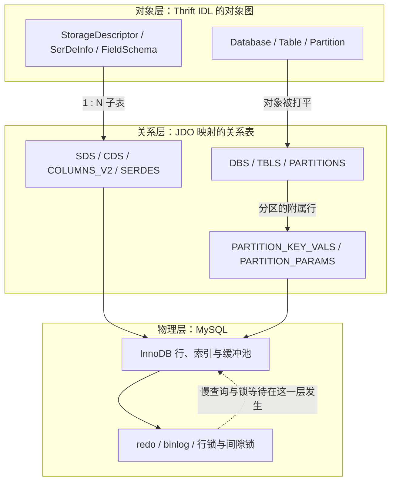
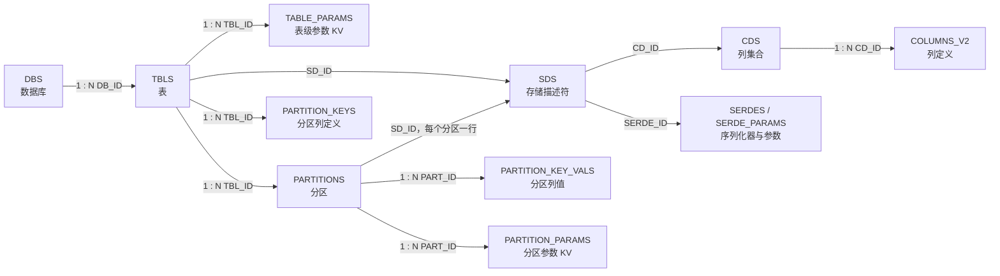
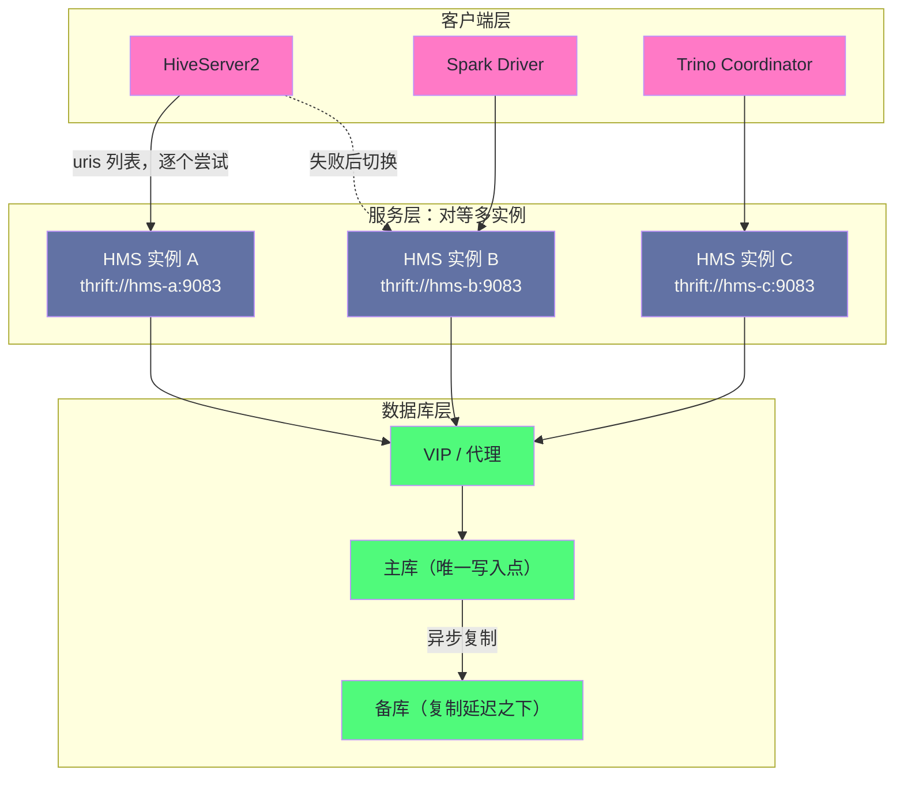
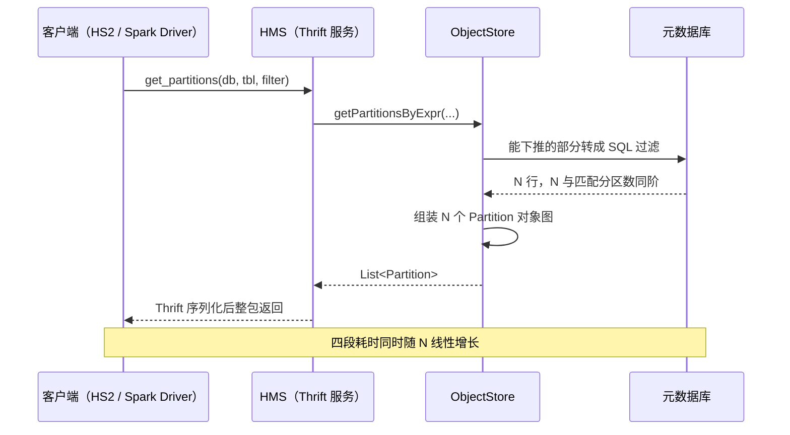
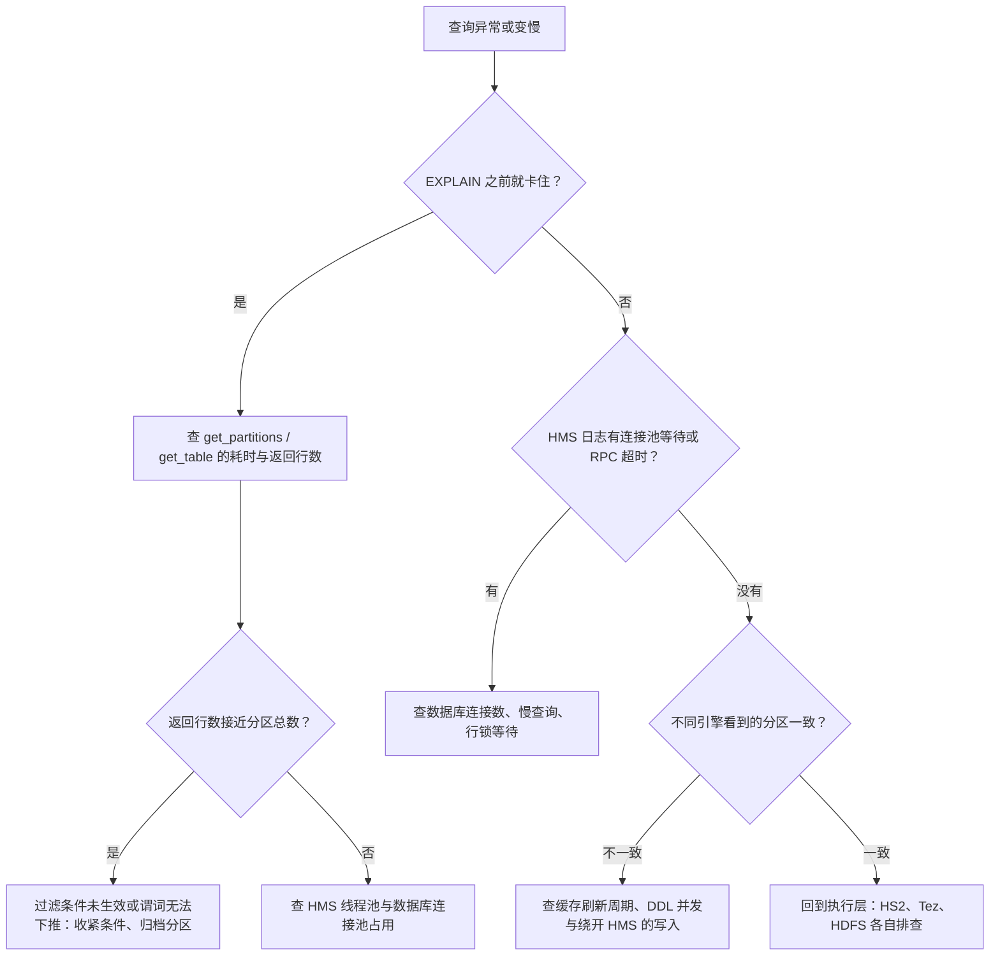

# 02 Hive Metastore 深度解析：元数据体系与 HMS 高可用

**摘要：**

Hive Metastore（HMS）常被称作 Hive 生态的元数据大脑，但真正决定它行为方式的，并不是 Thrift 接口有多少个方法，而是它把一棵对象树摊平成几十张关系表的方式。本篇沿着对象层、关系层、物理层这套三层存储模型展开：先看 `DBS`、`TBLS`、`COLUMNS_V2`、`SDS`、`SERDES` 如何拼出一张表，再看分区元数据为什么是行而不是目录——`PARTITIONS` 一行为一个分区，`PARTITION_KEY_VALS` 按分区列展开，`PARTITION_PARAMS` 按参数键再展开，于是"一百万分区"在库里是数百万行、在 RPC 里是数百兆消息，这就是百万分区让 HMS 变慢的算术来源。随后比较内嵌模式与远程服务的分野，说明 Derby 的进程内锁如何把内嵌模式锁死在单进程，以及 Hive 3 起独立部署的 `metastore-server` 与请求对象化协议带来的兼容边界。高可用部分把结论压在数据库上：多实例、共享库、客户端 URIS 列表都只是外围，连接数、锁与慢查询才是真正的瓶颈。最后给出元数据操作的代价清单、缓存不一致的故障形态、症状到判据的对照表，以及几个在生产里反复出现的反例。

---

## 第 1 章 元数据的来历与代价

### 1.1 从裸文件到 Schema on Read

Hive 诞生于 Facebook 内部对 HDFS 裸文件做 SQL 化查询的需求，2010 年成为 Apache 顶级项目之后，它把"用 SQL 描述 HDFS 上的数据"这件事变成了整个大数据行业的默认姿势。要理解 HMS，得先回到它出现之前那个看起来很朴素的年代：数据只是 HDFS 上的一批文件，`/user/data/2026/01/15/part-00000` 里躺着若干行以制表符分隔的文本，没有任何东西声明第三列是金额、第七列是时间戳。

那个年代的 MapReduce 作业只能把 Schema 硬编码在代码里，于是每次格式微调都要沿血缘通知十几个作业，新人接手只能靠口口相传去猜目录结构，同一个数据集在五个作业里被解析出五种类型映射也不稀奇。更麻烦的是发现——HDFS 只会告诉你目录叫什么、文件多大，不会告诉你这些文件意味着什么。

HMS 带来的转变可以用一句话概括：把"数据的描述"从代码里抽出来，变成一份可以查询、可以共享、可以演进的登记簿。这个模式后来被称作读时模式（Schema on Read）——写入方不必声明结构，读取方在打开数据前先去登记簿里查一次，按登记的结构去解释字节流。对比写时模式（Schema on Write，传统数据库在写入时就校验并落结构），读时模式换来的是写入路径的极简与格式的极致灵活，代价是把"解释"这一步从写入时的一次性成本，转移成了每次读取都要支付的固定开销。

### 1.2 解耦换来的新依赖

这笔交易并不免费。当元数据从代码里搬进一个独立服务，系统里就多了一个所有参与者都必须先访问的环节：任何引擎在执行任何语句之前，都要先"认识"这张表。这是同步的强依赖，不是可以异步补偿的后台任务，也不是可以降级处理的旁路。

一个具体的对比能说明问题的性质。HDFS 的 NameNode 挂掉，读写会失败，但数据文件还在、路径语义还在；而 HMS 的元数据库如果丢了，HDFS 上一个字节都没少，你却无法再知道 `orders_wide` 有几列、哪些是分区列、`dt=2026-01-15/region=US` 对应哪一行。数据还在，语义没了，数仓就从"可查询"退化成"一堆字节"。

> [!info] 一句话定位
> HMS 不是缓存，也不是索引，它是权威源（System of Record）。缓存丢了可以重建，索引坏了可以重做，权威源坏了只能靠备份恢复，而备份的恢复点决定了你能接受多大的数据语义损失。

### 1.3 贯穿案例：订单宽表

为了把后面所有数字落到实处，这里先立一个贯穿全文的例子。某电商数仓有一张订单宽表 `orders_wide`，按天分区，再按八个大区做二级分区，保留三年，于是分区总数约为 `365 × 3 × 8 = 8760` 个；表的列数是 60 列，其中 2 列是分区列；每天有一次 `INSERT OVERWRITE` 写入当天全部大区，日报 SQL 再把这张宽表和一张十万行的 `dim_shop` 维表做 Join。

这张表在正常年份里安分守己，HMS 处理它的元数据请求只需要几毫秒。但同一个模型如果改成按小时分区、再加上渠道维度，分区数会在一两年内跨过百万量级——那时同一条 SQL 的编译阶段就会从"几乎无感"变成"秒级乃至分钟级等待"，这就是本篇要解释的核心现象。分区数之所以能撬动这么大的差异，答案藏在下一章的三层存储模型里。

---

## 第 2 章 三层存储模型

### 2.1 对象层、关系层、物理层

HMS 的元数据在结构上要穿过三层，每一层的形态都不一样，而性能与故障几乎都发生在层与层的转换处。

第一层是**对象层**，由 Thrift IDL 定义：`Database`、`Table`、`Partition`、`StorageDescriptor`、`SerDeInfo`、`FieldSchema` 构成一棵以表为中心的对象树，它既是对外 API 的契约，也是所有引擎看到的元数据形态。第二层是**关系层**，DataNucleus（JDO 实现）把这棵树打平成几十张 MySQL 表，引用变成外键，集合变成一对多的子表。第三层是**物理层**，InnoDB 的页、索引、redo log 与行锁，真正决定吞吐上限的东西在这里。

三层之间的关系如图 2-1 所示。

值得留意的是这层转换的方向不是单向的。写路径是"对象图 → 行"，一个 `Partition` 对象会被拆成一行 `PARTITIONS`、若干行 `PARTITION_KEY_VALS`、若干行 `PARTITION_PARAMS`；读路径是"行 → 对象图"，一次 `get_partitions` 要把成千上万行重新组装成对象列表。中间那次拆与装，就是 HMS 的 CPU 时间花掉的地方。

把这件事想成图书馆的分册书与卡片柜更直观：一套分册书被拆成标准卡片塞进柜子，按规则能拼回去，但每次借阅都要照索引抽出几十张再重新装订；书没变薄，装订的人工却随册数线性增长。

### 2.2 核心表的骨架

把对象层摊平之后，元数据模型的主干可以用十来张表说清楚，它们之间的引用关系如图 2-2。

各表的职责与增长方式列在表 2-1，注意最后一列"增长量级"，它是后面所有容量估算的基础。

| 表 | 一行代表什么 | 关键字段 | 增长量级 |
|---|---|---|---|
| `DBS` | 一个数据库 | `DB_ID`、`NAME`、`DB_LOCATION_URI` | 与库数同阶，数量级最小 |
| `TBLS` | 一张表或视图 | `TBL_ID`、`DB_ID`、`SD_ID`、`TBL_TYPE` | 与表数同阶 |
| `TABLE_PARAMS` | 表级一个参数 | `TBL_ID`、`PARAM_KEY`、`PARAM_VALUE` | 表数 × 参数条数，约 5-15 行每表 |
| `SDS` | 一份存储描述符 | `SD_ID`、`CD_ID`、`SERDE_ID`、`LOCATION`、`NUM_BUCKETS` | 表数 + 分区数，**与分区数同阶** |
| `CDS` | 一个列集合版本 | `CD_ID` | 与改列次数同阶 |
| `COLUMNS_V2` | 列集合里的一列 | `CD_ID`、`COLUMN_NAME`、`TYPE_NAME`、`INTEGER_IDX` | 列集合版本 × 列数 |
| `SERDES` | 一份序列化配置 | `SERDE_ID`、`SLIB` | 与格式种类同阶，通常很少 |
| `PARTITION_KEYS` | 一个分区列定义 | `TBL_ID`、`PKEY_NAME`、`PKEY_TYPE`、`INTEGER_IDX` | 表数 × 分区列数 |
| `PARTITIONS` | 一个分区 | `PART_ID`、`PART_NAME`、`SD_ID`、`TBL_ID` | **与分区数同阶** |
| `PARTITION_KEY_VALS` | 一个分区的一个分区列值 | `PART_ID`、`PART_KEY_VAL`、`INTEGER_IDX` | 分区数 × 分区列数 |
| `PARTITION_PARAMS` | 一个分区的一个参数 | `PART_ID`、`PARAM_KEY`、`PARAM_VALUE` | 分区数 × 参数条数 |

几个细节值得单独点出来。第一，`TBLS` 只认 `TBL_ID` 与 `DB_ID` 的关系，"库名 + 表名"的唯一性由索引保证，这也是重命名表在 HMS 里是一次带锁的行更新、而不是目录改名。第二，视图与表共用 `TBLS`，视图 SQL 文本存在 `VIEW_EXPANDED_TEXT` 这类 `MEDIUMTEXT` 列里，一张视图的元数据可能比普通表大一个数量级。第三，`SDS` 的 `LOCATION` 是每个分区独有的部分，这正是 `SDS` 行数跟着分区数走的原因。

### 2.3 列集合与存储描述符的复用

`SDS` 与 `CDS` 之间隔了一层间接，这一层是 Hive 元数据模型里最值得称道的设计。列定义并不直接挂在 `SDS` 上，而是先归到一个列集合 `CDS.CD_ID` 名下，`COLUMNS_V2` 按 `CD_ID` 分组、按 `INTEGER_IDX` 排序；`SDS` 只持有一个指向列集合的 `CD_ID`。于是"给表加一列"这件事在元数据里的操作不是逐行修改列定义，而是生成一个新的 `CD_ID` 与新一批 `COLUMNS_V2` 行，再把引用切过去——一次指针切换，而不是一次全表重写。

同类的共享还有 `SERDES`：序列化器的类名存在 `SERDES.SLIB`，参数存在 `SERDE_PARAMS` 的 KV 行里，多个 `SDS` 可以指向同一个 `SERDE_ID`。这块共享的理由很实在——一个集群里可能只有 ORC、Parquet、Text 等少数几种格式，没必要为每个分区各存一份序列化配置。

但笔者要在这里纠正一个流传很广的简化说法：分区可以共用同一个 `SDS` 记录，从而避免十万条重复的存储描述符。这个说法只在"除位置之外完全一致"的前提下成立一瞬，实际上 `SDS` 里带着 `LOCATION`，而每个分区的 HDFS 路径必然不同，所以分区基本各有各的 `SDS` 行；真正被共享的是列集合与序列化器，不是存储描述符本身。把这条简化假设当成默认前提，很容易把百万分区的容量算小一个数量级。

列集合共享还留了一道边界：`ALTER TABLE ... ADD COLUMNS` 改的是表级存储描述符指向的列集合，已存在分区的 `SDS` 仍指向旧的 `CD_ID`，此后"读分区时以表级列定义为准还是以分区自己的为准"，就成了不同引擎行为不一致的来源；Spark 用 `CASCADE` 补了这个语义，具体行为仍以对应版本文档为准。

### 2.4 一次建表究竟写了哪些行

把三层模型落到 SQL 行数上，很多抽象的代价立刻变成可以算的算术。以 `orders_wide` 为例，`CREATE TABLE` 成功之后，元数据库里新增的东西大约是：`TBLS` 一行、`SDS` 一行、`CDS` 一行、`COLUMNS_V2` 六十行、`SERDES` 一行（若格式是新的）、`SERDE_PARAMS` 若干行、`TABLE_PARAMS` 十来行、`PARTITION_KEYS` 两行，合计八十到一百行（示例推算，随参数与列数变化）。

而 `ALTER TABLE ... ADD PARTITION` 每加一个分区，大约新增：`PARTITIONS` 一行、`PARTITION_KEY_VALS` 两行、`PARTITION_PARAMS` 五到八行、`SDS` 一行，合计九到十二行。按每天八个大区计算，一天的写入就是近百行元数据；按三年天分区计算，八万多个分区的表在元数据库里的行数在百万量级——注意这里说的还只是八万分区，不是百万分区。

这个算术马上就能推出一个结论：元数据体量**由分区数主导，而非表数**。一个有一万张表、每表百来个分区的集群，元数据库里百分之九十以上的行来自分区相关的四张表；把监控和容量规划的重点放在"表数量"上，基本属于看错了地方。

---

## 第 3 章 分区是行不是目录

### 3.1 目录视图与行视图的分歧

围绕分区最常见的误解，是把 HDFS 上的目录结构当成元数据本身。`orders_wide` 的一个分区确实对应一个目录 `hdfs://ns/warehouse/orders_wide/dt=2026-01-15/region=US`，目录名长得也像 `key=value`，于是很容易得出"分区就是目录、分区裁剪就是列目录"的印象。但在 HMS 里，分区是 `PARTITIONS` 表里的一行登记，附带若干行键值与参数；目录只是这行登记里 `LOCATION` 字段指向的一个位置。

两种视图的分歧在数据不一致时暴露得最彻底。只有目录没有登记，HDFS 上明明有数据，`SELECT` 却报分区不存在——`MSCK REPAIR TABLE` 做的就是扫描目录、把缺失的登记补上。只有登记没有目录，元数据查得到、能通过语法与权限检查，真正读文件时才抛 `FileNotFoundException`。前者让人以为数据丢了，后者让人以为元数据坏了，两类事故的处置路径完全不同，而它们都源于"目录与行是两套独立的事实"。

### 3.2 PARTITION_KEY_VALS 的字符串事实

分区键值单独成表，是这套模型里最影响性能的一处设计。`PARTITION_KEY_VALS` 的结构极其朴素：`PART_ID` 指向分区，`PART_KEY_VAL` 是一个 `VARCHAR(256)`，`INTEGER_IDX` 表示这是第几个分区列。于是一个两级分区在库里是"一行 `PARTITIONS` + 两行 `PARTITION_KEY_VALS`"，分区列越多，行数按列数成倍放大。

关键事实是**值一律以字符串存储**。分区列的类型定义在 `PARTITION_KEYS.PKEY_TYPE` 里，但值本身没有类型：`dt=2026-01-15` 存成 `'2026-01-15'`，`hour=09` 存成 `'09'`，数值分区列 `shard=007` 与 `shard=7` 是两个不同的字符串，即便在语义上它们可能被期望等价。这带来几个连锁后果：谓词里的数值与日期要经过字符串比较或显式转换，转换规则由引擎侧的实现决定；补零、大小写、前后空格这类肉眼易漏的细节会直接改变匹配结果；而分区名里能不能出现某些字符，还受分区名白名单正则这类开关约束（相关配置键名以对应版本文档为准）。

更要紧的是这条事实对裁剪流程的约束：既然分区列的类型与顺序只存在于元数据里，引擎就不可能靠解析目录名来完成语义级裁剪。目录名只是一个字符串路径，它不告诉你哪个是分区列、哪个是值、值该按什么类型比较；而 `PARTITION_KEYS` 与 `PARTITION_KEY_VALS` 才知道这些。所以分区裁剪天然是一次"先查元数据、再决定扫哪些目录"的动作，顺序不能颠倒。

### 3.3 PARTITION_PARAMS 的隐性膨胀

如果说 `PARTITION_KEY_VALS` 的膨胀是按分区列数放大，那么 `PARTITION_PARAMS` 的膨胀就是按参数条数放大，而且它更隐蔽。这张表是三列 KV 结构：`PART_ID`、`PARAM_KEY`、`PARAM_VALUE`，HMS 在每个分区上维护一组统计与状态参数，常见的键包括文件数、行数、总字节数、最后一次 DDL 时间戳、列统计是否准确等标识。

这些参数不是装饰。`numFiles` 和 `totalSize` 被优化器用来估算扫描成本，`transient_lastDdlTime` 被用来判断缓存与统计信息的新鲜度，列统计准确标识决定 CBO 敢不敢用这行数据。它们也不是一次写死的：每次 `INSERT` 完成，HMS 都要回来更新这几个键，于是一次数据写入在元数据侧对应的是若干行 `UPDATE`，落盘成本按"分区数 × 参数条数"放大。

把两张附属表放在一起看，一个分区在库里的真实体积大约是：`PARTITIONS` 一行（约二百字节）、`PARTITION_KEY_VALS` 按列数各一行（每行约八十字节）、`PARTITION_PARAMS` 五到八行（每行约一百二十字节）、`SDS` 一行（约三百字节，因为带路径）。合计落在四百到八百字节这个量级（示例推算，随路径长度与参数条数变化）。这个数字是下一节全部估算的基石。

### 3.4 百万分区的行数算术

现在可以回答那个原始问题了：为什么百万分区会让 HMS 变慢。先看库里发生了什么。

一个百万分区的两级分区表，在元数据库里的行数大致是：`PARTITIONS` 一百万行，`PARTITION_KEY_VALS` 两百万行，`PARTITION_PARAMS` 五百万到八百万行，`SDS` 一百万行，合计九百到一千二百万行（示例推算）。按上一节四百到八百字节的单分区体积折算，仅这些行连同索引就是几个 GB 到十几个 GB 的规模。MySQL 完全存得下，问题从来不在"存"。

| 项目 | 八万分区（`orders_wide` 现状） | 一百万分区（按小时加渠道） | 放大倍数 |
|---|---|---|---|
| `PARTITIONS` 行数 | 8 万余 | 100 万 | 约 12 倍 |
| `PARTITION_KEY_VALS` 行数 | 16 万余 | 200 万 | 约 12 倍 |
| `PARTITION_PARAMS` 行数 | 40 万到 64 万 | 500 万到 800 万 | 约 12 倍 |
| `SDS` 行数 | 8 万余 | 100 万 | 约 12 倍 |
| 元数据占库体积 | 数百 MB | 数 GB 到十余 GB | 约 12 倍 |
| 一次 `get_partitions` 返回的分区对象数 | 8 万 | 100 万 | 约 12 倍 |
| 一次 `get_partitions` 的序列化规模 | 数十 MB | 数百 MB 以上 | 约 12 倍 |

问题出在"操作这些行"的代价随行数线性增长，而且这条线性链上有四个串联的放大器。第一段在 MySQL 里：取出百万行要走索引、拼 JOIN、排序，缓冲池被这几十 GB 的工作集冲刷一遍，同库上其他请求的命中率同步下降。第二段在 HMS 的 JVM 里：百万行要被 ORM 组装成百万个 `Partition` 对象，每个对象再挂一个 `StorageDescriptor` 与 `SerDeInfo` 引用，堆内存占用在数十 GB 级别的表上很难收敛，Full GC 一旦介入，整个 HMS 的 RPC 处理全部停顿。第三段在序列化上：Thrift 把这百万个对象编码成消息体，CPU 打满的同时网络带宽被吃掉。第四段在客户端：HS2 或 Spark Driver 收到消息后要反序列化成同样的对象列表，再把它们转成自己的分区描述结构，客户端 OOM 与 HMS OOM 往往同时出现。

这里还有一个比"慢"更常见的结局：**直接报错**。HMS 服务端对单帧消息有大小上限（`metastore.server.max.message.size`，官方文档记为 100MB 量级，以版本为准），一次 `get_partitions` 的响应如果越界，客户端看到的不是超时而是一个与消息大小相关的异常。这解释了为什么有些百万分区的表在低版本客户端上"偶尔能跑"，换了客户端之后就"永远跑不动"——差异不在 Hive 的版本，在消息大小与超时阈值。

### 3.5 裁剪为什么必须先问元数据

把上面的机制拼起来，一条带分区过滤的 SQL 在编译阶段实际发生的事是：语义分析器拿到 `WHERE dt = '2026-01-15' AND region = 'US'`，把它翻译成 HMS 能理解的分区表达式，调用 `get_partitions`（或带表达式的变体），拿回一组 `(分区键值, 位置)` 的对应关系，再据此决定 TableScan 要打开哪些目录。

HMS 侧对这条查询的处理还有一层实现差异。分区与统计信息的读写有一条绕过 ORM 的直连 SQL 通路（`metastore.try.direct.sql` 一类开关控制，默认开启），简单谓词能被翻译成对 `PARTITIONS` 与 `PARTITION_KEY_VALS` 的过滤，省掉把全部对象加载进 JVM 的开销；表达式一旦复杂到翻译器处理不了，实现会退化成"取回全部分区、在内存里逐条求值"，日志里通常能看到降级告警。

反过来说，能不能绕开元数据、直接列 HDFS 目录来推断分区？部分引擎提供了这种回退，但它只能拿到字符串，还要自己补齐列顺序、类型与转义规则，遇到 `dt=2026-01-15` 与 `dt=2026-1-15` 这类脏数据就会得出两个不同分区。回退能救急，不能替代元数据，这从反面证明了元数据不是目录。

### 3.6 DROP PARTITION 不是 rm -r

同一条"分区是行"的事实，在删除路径上的表现更值得强调。`ALTER TABLE ... DROP PARTITION` 删除的是登记行（以及默认情况下的数据目录），而直接在 HDFS 上 `rm -r` 只删目录、不删登记。后者的后果不是"删多了"，而是"删少了"：元数据里那一行还在，`SHOW PARTITIONS` 依然列出这个分区，查询会通过编译、通过权限检查，然后在读文件时抛 `FileNotFoundException`。此后每一次涉及该分区的查询都带一条失败记录，直到有人手工 `DROP PARTITION` 或者让引擎跳过缺失路径。

反过来，`MSCK REPAIR TABLE` 是"扫目录补行"，它遍历分区目录、逐个与元数据比对、为缺失目录补登记。八万分区跑一次已经是可观的元数据写入量，百万分区跑一次基本等于对 HMS 发起一次百万次的批量写——这也解释了为什么清理历史分区必须走分区 DDL，而不是夜里挂一个 HDFS 清理脚本了事。

---

## 第 4 章 两种部署形态

### 4.1 内嵌：uris 为空的那一刻

HMS 的部署形态由一个配置项决定：`hive.metastore.uris`。当它为空时，客户端不发 RPC，而是在自己的 JVM 里直接构造一个 HiveMetastore 实例，元数据读写全部在本进程内完成，这就是内嵌模式（Embedded Metastore）。默认的元数据存储是 Apache Derby，一个纯 Java 的嵌入式数据库，连接串形如 `jdbc:derby:;databaseName=metastore_db;create=true`，数据落在启动目录下的 `metastore_db` 文件夹里。

内嵌模式在开发环境里几乎是完美的：不用装数据库、不用起服务、一条命令就能建表查询。它的单人单机体验甚至比 MySQL 方案更顺手，因为整个元数据就是一个可以随手删掉的目录。

但它有一个硬约束：Derby 的进程内锁**只允许一个 JVM 打开同一个库**。这个约束不是 Hive 加上去的，是 Derby 自己的进程内锁与 `db.lck` 文件机制。第二个进程去打开同一个 `metastore_db` 时，拿不到锁，于是报出那个让无数初学者困惑的错误——`ERROR XSDB6: Another instance of Derby may have already booted the database`，或者一句语焉不详的"Unable to obtain lock"。更隐蔽的情形是同一个进程里起了两个 Hive 实例，锁在进程内也能撞上。

于是内嵌模式的边界非常清晰：适合一个人在本地验证，不适合任何两人以上同时使用的场景，更不适合长期运行的服务。理由不止是锁——Derby 没有网络服务端、没有独立的备份与审计体系，元数据与查询还共用同一份 JVM 内存和同一个磁盘目录，一次大查询的 GC 抖动会连累元数据访问。

### 4.2 Local 形态：换库不换架构

把 Derby 换成外部数据库（通常是 MySQL）、但 HMS 仍然跑在客户端进程内，就是文档里所说的本地模式（Local Metastore）。它解决了内嵌模式最刺痛的两个问题：多个人可以共享同一份元数据，Derby 的单进程锁消失了。

但它没有解决架构问题，只是把矛盾推到数据库那一侧。每个客户端进程内都有一份 HMS 实例、一个连接池、一份缓存，N 个客户端就是 N 份连接池与 N 份缓存；MySQL 连接数按"客户端数 × 池大小"膨胀，而缓存之间互不通知，同一个 DDL 在不同进程里被看到的时间可能相差几分钟。

本地模式的实际位置，更像是"临时脚本与本地调试的便利选项"，譬如在 Spark local 模式下跑通一段读写逻辑、在临时机器上验证一个建表语句，而不是任何需要长期稳定共享的部署方式。

### 4.3 Remote 与独立部署的 metastore-server

当 `hive.metastore.uris` 配上 `thrift://host:9083` 时，形态就变成远程服务（Remote Metastore）：HMS 作为独立进程长期运行，所有引擎通过 Thrift 连过来，MySQL 连接由 HMS 进程统一持有。前两节提到的问题在这里一次性收敛——连接池只有一份、缓存只有一份、升级只重启服务端、客户端不需要元数据库口令。

Hive 3 起这件事做得更彻底：元数据服务被拆成独立的 `standalone-metastore` 模块，`metastore-server` 可以脱离 Hive 发行版单独构建与部署，启动方式还是 `hive --service metastore`，对外只暴露一个 Thrift 端口。配套的变化在配置上：新配置项以前缀 `metastore.*` 出现（譬如 `metastore.rawstore.impl`、`metastore.warehouse.dir`），老配置里的 `hive.metastore.*` 仍被兼容读取。

独立部署还有一个必须承认的代价：**schema 版本与二进制版本绑定**。元数据库里有一张记录 schema 版本的表，服务启动时做兼容性校验，版本不匹配直接拒绝服务。这意味着单独升级 metastore-server 可行，但必须连同 `schematool` 的升级步骤一起规划，回滚也必须有对应的库备份。

### 4.4 两条接口边界：Thrift 与请求对象

HMS 对外主要是一条 Thrift 接口，但这条接口内部其实分成两代调用风格，混跑时会撞出麻烦。

老一代是"方法 + 裸参数"，譬如 `get_table(dbname, tblname)`、`get_partitions(dbname, tblname, filter, max_parts)`，方法名与参数列表直接写在 IDL 里。新一代从 Hive 3 前后开始铺开，改成"请求对象 + 能力协商"：`get_table_req(GetTableRequest)`、`get_partitions_req(GetPartitionsRequest)` 这类接口把参数收进结构体，并在结构体里带上客户端能力声明（`ClientCapabilities`），服务端据此判断能不能返回新字段、要不要做兼容降级。服务端侧对应一个能力校验开关（`metastore.client.capability.check`，旧名带 `hive.` 前缀），关掉它可以让老客户端连上新服务端，代价是放弃了服务端对新特性的保护。

这条边界在升级窗口里的典型表现，是客户端报 `Invalid method name: 'get_table_req'`：新客户端在调老服务端不认识的方法，整条查询在取表元数据这一步就断了。这条兼容性问题历史上被反复修补，但它揭示的结构性事实不会变：协议版本由方法名与方法签名构成，**与二进制版本无关**。

### 4.5 形态判定的现场手法

接手一个不熟悉的集群时，判断当前是哪一种形态，比看配置文件更可靠的办法是看现场证据，表 4-1 给了几条判据。

| 判据 | 内嵌（Derby） | 本地（外部库，进程内 HMS） | 远程服务 |
|---|---|---|---|
| `hive.metastore.uris` | 空 | 空 | 非空，通常是 `thrift://host:9083` 列表 |
| 9083 端口监听 | 无 | 无 | 有，由 HMS 进程持有 |
| 进程列表 | 看不到独立 metastore 进程 | 看不到独立 metastore 进程 | 能看到 `RunJar ... metastore` 进程 |
| 元数据库连接来源 | 只有本机本进程 | 每个客户端进程各一组连接 | 只有 HMS 主机发起连接 |
| 现场文件痕迹 | 启动目录下有 `metastore_db/` 与 `derby.log` | 有 MySQL 连接配置、无 `metastore_db/` | HMS 主机有 `hive-site.xml` 与 metastore 日志 |
| 典型故障签名 | `XSDB6`、取锁失败 | 连接数暴涨、缓存不一致 | RPC 超时、Schema 版本不匹配 |

看到 `metastore_db/` 与 `derby.log` 同时出现，基本可以断定这是内嵌模式，后续所有"多客户端共享"的讨论都不适用；看到 9083 端口被一个独立进程占着、且元数据库只接受来自它的连接，才是标准的生产形态。

---

## 第 5 章 单点的四个成因

### 5.1 编译期的同步前置

HMS 之所以重要到"不能只当一个普通服务看待"，第一个原因在于它卡在编译路径上。一条 SQL 要执行，先要语义分析，语义分析要先取表定义，取表定义要发 RPC——这条链是同步的，没有异步补偿的余地，也没有"先跑起来再纠正"的可能。对比 HDFS：一次读取失败了可以重试，NameNode 短暂不可用只影响这一批任务的启动；而 HMS 不可用时，连"这句话在语法和语义上是否成立"都判断不了，所有引擎的入口同时堵死。

这个前置性还决定了它承受的调用形态：绝大多数请求是毫秒级的 `get_table`、`get_database`，混入少数秒级乃至分钟级的 `get_partitions`。平均 QPS 在这种混合负载面前没有意义，有意义的是尾部分布。

### 5.2 权威元数据的唯一写入点

第二个原因在于它是权威源的唯一写入点。多实例部署时所有实例对等地往同一个数据库写，元数据没有"副本可以择优读"的选项，也没有"某个节点落后一点也能接受"的空间。无状态服务可以随意重启与摘流，HMS 不行——它可以在重启期间短暂不可用（客户端重试），但不能在重启期间丢失一次已确认的写入。

这一点直接决定了 HA 设计的方向：不能指望通过"多副本 + 选主"来提升写入可用性，因为写入的可用性实际由数据库决定；HMS 侧能做的只是把"单点故障"从进程级收敛到数据库级，再把数据库级的单点用成熟的数据库 HA 方案处理掉。

### 5.3 真正不能扩的是数据库

第三个原因最容易被低估：HMS 进程可以横向扩，**它背后的数据库不能**。

从进程侧看，HMS 除内存缓存之外几乎没有状态，加一个实例就多一份 RPC 处理能力，几乎线性。但所有实例共享同一个数据库主库，于是扩展立刻撞上三堵墙。第一堵是连接数：每个 HMS 实例持有一个连接池，实例数乘池大小就是数据库侧的常驻连接数，三个实例、每池五十个连接就是一百五十个连接，而 MySQL 的 `max_connections` 默认值是一百五十一。第二堵是锁：DDL 与分区写入在数据库里是带锁的行操作，并发越高，元数据表上的行锁与间隙锁冲突越频繁，重试与死锁随之出现。第三堵是慢查询：大分区表上的分区列表查询本身要消耗几秒的数据库时间，这段时间里它占着一个连接不放。

三堵墙的性质是共同的：它们都在数据库侧，HMS 加实例只会让墙更早出现。这也是"多部署两个 HMS 就高枕无忧"这类想法站不住的原因——扩容的正确方向是把数据库换成更强的机器或更好的架构，而不是把 HMS 铺得更密。

### 5.4 长尾请求与连接池的传染

第四个原因比容量问题更隐蔽，值得单独说：慢请求和快请求共用同一个连接池，于是长尾会传染。

假设某个 HMS 实例的连接池大小为五十，平时每秒处理几百个毫秒级的 `get_table`，池子占用长期在个位数。此时来了几个百万分区表上的 `get_partitions`，每个请求在数据库里要跑十秒以上，这十秒里它各占一个连接；当这类请求的到达速率与持续时间之积超过池子容量，池子被慢请求占满，后面那些本该一毫秒返回的 `get_table` 开始排队，排队时间从毫秒涨到秒，客户端的元数据 RPC 超时开始连锁触发。

这条传染链解释了很多"说不清为什么变慢"的现场：监控上 HMS 平均响应时间只从五毫秒涨到二十毫秒，业务侧的查询编译却从几百毫秒变成十几秒。修这类问题不能靠加实例（那只是把慢请求分到更多池子里），得从源头上限制单次分区返回的规模，或者把大分区表拆开。

> [!warning] 一个反直觉的结论
> HMS 的平均延迟是最没用的指标之一。它的健康程度要看**分位数与连接池占用**：p99 在涨、池子占用逼近上限，说明长尾已经在挤占快路径；平均延迟正常而 p99 抖动，是连接池即将耗尽的早期信号。

### 5.5 QPS 与并发的量级

给一个量级判断，避免讨论停在定性层面。一个中等规模数仓（数百张活跃表、十几万分区、两三百个并发查询）的 HMS，日均 RPC 调用量在数百万到千万量级，峰值 QPS 在数百这个量级；其中真正耗时超过一秒的请求占比通常在百分之几以内（示例推算，随调度模式与分区规模变化很大，仅作量级参考）。这组数字的含义是：HMS 的常态负载并不重，重的是分布尾部和突发——譬如凌晨调度同时起批时的连接建立风暴，或者某个大表刚加完十万个分区之后的第一批查询。

对容量的正确直觉因此不是"每秒钟能扛多少请求"，而是"最坏的十分钟里有多少个慢请求同时在线"。按前文的池子算术，一个实例的池子大小决定了它能同时容忍多少个慢请求，而这个数量通常远小于运维同学的心理预期。

---

## 第 6 章 高可用的三层结构

### 6.1 整体形状

HMS 的高可用由三层拼成：服务层的多实例、数据库层的 HA、客户端层的发现与重试。三层的关系如图 6-1 所示。

三层里最容易被高估的是中间那层。把 HMS 从一台加到三台，解决的只是"某个进程崩了还有别的能接"；如果把数据库那一层的切换做不好，三台 HMS 会在同一秒一起失效——它们是同一个数据库的三个前端，不是三个独立的系统。

### 6.2 服务层：对等多实例

HMS 的多实例是真正的对等结构，没有主从、没有选主、没有实例间的状态同步协议。任何一个实例都能处理读写请求，并发安全由数据库的事务与行锁保证：两个实例同时给同一张表加同一个分区，最终会有一方因主键冲突或唯一约束失败，返回一个可重试的异常，而不是悄悄产生两条重复登记。

这种对等结构的运维含义是：摘掉一个实例不需要协调，加一个实例也不需要重启别的——前提是客户端的地址列表或服务发现能感知到变化。如果客户端配置的是静态的两三个地址，那么"加实例"这件事对老客户端没有意义，它们永远只会连原来那两个；这在实际运维里经常造成"扩容了但压力没下降"的困惑。

### 6.3 数据库层：才是硬骨头

数据库层的可用性方案是成熟的工程问题：主备复制加虚拟 IP 或代理做切换，或者用数据库自身的多节点方案（组复制一类），HMS 通过 VIP 连过去，不关心背后是哪台机器在当主。关键在于两个约束。

第一个约束是**只能有一个写入点**。HMS 的写入量不大，但正确性依赖数据库事务语义，任何"双写"或"双主"的设计都会把分区登记的冲突变成数据错误，而不是可重试的失败。第二个约束是**读路径不能随意用备库**：`add_partitions` 在主库提交、`get_partitions` 从备库读，那个延迟窗口里新分区就是"写了但看不见"，跨引擎甚至会出现同一分区在两个引擎里存在性不同。

这两条约束决定了 HMS 的 HA 实际上等价于"数据库的 HA + 客户端的重试"，HMS 进程本身能做的最多是把故障窗口缩短到客户端一次重试能覆盖的范围内。

### 6.4 客户端：地址列表与重试

客户端这一侧的能力集中在两个机制上：地址列表与重试包装。配置里把多个 HMS 地址用逗号写在 `hive.metastore.uris` 里，客户端按顺序或随机挑选连接；外层再套一层重试包装（`RetryingMetaStoreClient`），连接失败或遇到特定异常时换下一个地址重试，并配合连接重试、失败重试两组计数参数控制重试的节奏。

这套机制的效果上限由两个细节决定。一是重试只对"可重试异常"生效，对语义错误（表不存在、权限不足、schema 不匹配）不会无脑重试，所以现场看到"重试了但每次都失败"，基本可以排除网络抖动。二是重试会把一次失败放大成若干次数据库访问，在数据库本身有压力时，重试风暴会让状况更糟。

### 6.5 发现机制：静态列表与注册中心

地址列表的维护方式有两种：静态写死在客户端的 `hive-site.xml` 里，或者交给注册中心动态发现（ZooKeeper 里的 HMS 注册节点一类实现，配合客户端的动态发现开关）。静态方式简单直接，缺点是变更要动所有客户端配置；动态方式省去了配置分发，代价是多了一个 ZooKeeper 依赖和一条"注册信息过期"的故障路径。

两种方式没有高下，取决于集群规模与变更频率：几十个客户端的集群用静态列表更稳，少一个依赖就少一类故障；几百个客户端、HMS 又要频繁扩缩，才有必要引入注册中心。真正不能接受的是第三种状态——配置里写着一个已下线的地址，又没有健康检查把它摘掉，于是每次连接都先撞一次超时。

### 6.6 切换时的连接残留

故障切换的最后一段路，往往不是切换本身，而是切换之后还挂在旧连接上的那些会话。HMS 客户端与服务端之间是长连接，数据库切换、HMS 实例重启之后，客户端手里的连接已经失效但未必立刻知道——它可能要在下一次读写时才发现，而那个时刻可能是几分钟后的一个业务请求。

这类问题的典型表现是"切换完成后少量查询报连接重置或 socket 超时，重试即恢复"，处置要靠健康检查周期、socket 超时与重试策略共同把失效连接的发现时间压短；人工重启 HS2 也能解决，但那是把可用性问题转成运维负担。

表 6-1 汇总了客户端与服务端最值得关注的一组参数，以及调整方向带来的代价。

| 参数 | 作用 | 调大的代价 | 调小的代价 |
|---|---|---|---|
| `hive.metastore.uris` | 客户端连接地址列表 | 列表越长，故障时逐个尝试的等待越久 | 地址太少，单点故障时无备可选 |
| `hive.metastore.connect.retries` / `hive.metastore.failure.retries` | 连接与调用失败的重试次数 | 重试风暴放大数据库压力，故障期整体更慢 | 一次抖动就直接失败到业务侧 |
| `metastore.client.socket.timeout` 一类超时 | 单次 RPC 的等待上限 | 慢请求长期占用连接，池子被拖死 | 大分区表的正常查询被误判为超时 |
| `datanucleus.connectionPool.maxPoolSize` | 单实例数据库连接池大小 | 多实例叠加后打满数据库连接上限 | 慢请求少量即可占满池子，快请求排队 |
| `metastore.server.max.message.size` | 单帧消息上限 | 单次返回过大会把服务端与客户端一起拖进 OOM | 大分区表的查询直接报消息超限 |
| `metastore.server.min.threads` / `max.threads` | Thrift 工作线程池 | 线程数超过连接池容量只会增加排队与上下文切换 | 并发稍高就排队，RPC 延迟抖动 |

---

## 第 7 章 缓存与不一致

### 7.1 CachedStore 的位置

HMS 侧最知名的缓存是 CachedStore：Hive 3.0 之前元数据只有 `ObjectStore` 一种实现，Hive 3.0 起多了一个把数据库对象缓存在内存里的实现，通过把 `metastore.rawstore.impl` 设为 `org.apache.hadoop.hive.metastore.cache.CachedStore` 启用（老配置文件里写作 `hive.metastore.rawstore.impl`，两者是兼容关系）。

它的位置很容易搞混：CachedStore 不是客户端缓存，也不是 Thrift 层缓存，而是替换了存储访问层（RawStore）的实现——请求仍然走 Thrift、走 `HMSHandler`，只是到了"从数据库读对象"这一步先看内存里有没有。它省掉的是数据库往返与 ORM 组装，命中时一次 `getTable` 从几十毫秒降到亚毫秒级。

### 7.2 刷新周期决定一致性窗口

CachedStore 的一致性模型是"写穿 + 定时重扫"：经由本实例发生的变更会自动更新缓存，多个 HMS 实例之间则靠周期性刷新来对齐，官方文档记录的默认刷新频率是一分钟（配置键形如 `metastore.cached.rawstore.cache.update.frequency`，具体单位与默认值以对应版本文档为准）。

一分钟这个量级，在批处理场景里几乎无感：T+1 的链路本就不要求"刚加的分区立刻被所有引擎看见"。但两种场景会变成事故：一是秒级 ETL，上游写完立刻触发下游，下游连到另一个实例就要等到刷新才发现分区存在，于是偶发"分区不存在"、重跑一次又好了；二是 DDL 密集的变更窗口，多个实例的缓存走在不同版本上，同一时刻不同会话看到不同表结构。

### 7.3 二级缓存与陈旧对象

另一层缓存藏在 ORM 里。DataNucleus 提供二级缓存（`datanucleus.cache.level2`），把查出来的实体对象缓存在 JVM 内跨事务复用；它默认关闭，官方描述里明确提到"如果有独立于 HMS 的进程修改元数据，就要关掉它"——这句话点明了风险模型：二级缓存假设自己是元数据的唯一写入者。

二级缓存造成的故障形态很特别：不是"查不到"，而是"查到的还是旧的"。表结构改了，`DESCRIBE` 出来还是老列；分区删了，`SHOW PARTITIONS` 还在；而重启一次 HMS 一切正常。看到"重启就好、过一阵又坏"的循环，且坏的时候数据在数据库里查是对的，基本可以锁定在缓存层。

### 7.4 不一致的故障形态

把缓存相关的问题归纳成可辨识的几种形态，比记住配置名更有用。

第一种是"新增可见性延迟"：写入方刚提交的分区，另一条链路看不到，重试或等待后可见。判据是时间——延迟量级与刷新周期吻合（分钟级），且换到写入方连接的同一个 HMS 实例就正常。
第二种是"删除残留"：分区或表已删，部分会话仍能查元数据，直到缓存过期或实例重启。判据是数据库里查不到对应行，HMS 却还返回对象。
第三种是"跨实例不一致"：同一时刻两个会话问同一个问题得到不同答案，且分别连着不同实例。判据是把 `hive.metastore.uris` 固定为单个地址后现象消失。
第四种是"缓存与存储层打架"：缓存命中返回了元数据，但底层文件已被移动或删除，于是查询在扫描阶段失败——这种最容易被误判成 HDFS 问题，实际是元数据与物理数据的时间差问题。

### 7.5 何时不该开缓存

缓存是有明确适用面的。判断标准不是"集群大不大"，而是"元数据变更是否能容忍分钟级可见性延迟"以及"是否存在绕开 HMS 直接改库的路径"。

适合开的场景：离线批处理为主、DDL 集中在调度空窗、表结构稳定、有多个 HMS 实例需要分摊数据库读压力。不适合开的场景：秒级链路要求写完即可见、有大量 DDL 交错、存在元数据修复脚本直接写库、以及"排查阶段"——排查期间最忌讳的就是把一个可能引起不一致的层留在链路上。

---

## 第 8 章 元数据操作的代价

### 8.1 get_partitions 的全量语义

在 HMS 的所有接口里，`get_partitions` 是最典型的"语义上就是全量"的接口：给它一个表名与一个过滤条件，它返回的是**匹配该条件的所有分区对象**，没有分页、没有游标、没有流式返回。这个接口设计在分区数不大时毫无问题，在百万分区时就变成了一个必须规避的陷阱。

一次 `get_partitions` 在服务端的完整路径如图 8-1 所示。

这条链上没有任何一段可以"提前结束"：数据库必须给出完整结果集，服务端必须组装完整对象图，序列化必须编码完整消息。想让某一段变短，唯一的手段是让 N 变小——也就是让过滤条件真的把分区筛掉，而不是筛完之后才发现要全取。

### 8.2 get_table 的往返次数

相比 `get_partitions`，`get_table` 看起来便宜得多，但它的成本结构同样是"每条 SQL 都要付一次"的固定开销。

一次 `get_table` 在服务端要拼出完整的表对象：`TBLS` 的基本字段、`SDS` 的存储描述符、`CDS` 与 `COLUMNS_V2` 的列定义、`SERDES` 与 `SERDE_PARAMS` 的序列化配置。在 ORM 视角下这是若干条 SQL，在直连 SQL 通路下会合并，但一次 RPC 至少要落三到六条数据库查询（示例推算，随参数加载策略变化）。

把它放大到一条业务 SQL 上：五张表做 Join，编译阶段至少五次 `get_table`；每张分区表还要各来一次分区裁剪；CBO 若要列统计，还要按列取统计信息。一条复杂查询编译期的元数据往返次数在两位数，串行累加就是几百毫秒的编译开销——这就是元数据服务繁忙时"SQL 提交后半天不出计划"的由来。

### 8.3 接口代价对照

把高频接口按"代价来源"分类，比按调用时机记忆更有效，见表 8-1。

| 接口 | 主要调用方与时机 | 触及的表 | 代价随什么增长 | 可做的规避 |
|---|---|---|---|---|
| `get_database` | 编译期校验库存在 | `DBS` | 基本恒定，走主键 | 无需优化 |
| `get_table` | 编译期取表结构与列 | `TBLS`、`SDS`、`CDS`、`COLUMNS_V2`、`SERDES` | 列数与参数数，弱相关 | 减少重复编译，复用执行计划 |
| `get_partitions` | 分区裁剪 | `PARTITIONS`、`PARTITION_KEY_VALS`、`SDS` | **与匹配分区数线性** | 收紧过滤条件、控制分区总量、避免全表裁剪 |
| `get_partitions_by_names` | 按分区名精确取 | 同上 | 与名字个数线性，但可批量 | 优先于 `get_partitions` |
| `get_partition_names` | 只取名字列表 | `PARTITIONS` | 与分区数线性，但无 SD 开销 | 只做存在性判断时的轻量选择 |
| `add_partitions` | 动态分区写入结束时 | `PARTITIONS`、`PARTITION_KEY_VALS`、`PARTITION_PARAMS`、`SDS` | 与提交的分区数线性 | 批量提交、控制单次分区数 |
| `drop_partitions` | 保留期清理 | 同上加删除 | 与删除分区数线性 | 分批执行，避开高峰 |
| `get_table_column_statistics` / `get_partition_column_statistics` | CBO 取统计 | `TAB_COL_STATS`、`PART_COL_STATS` | 与列数、分区数线性 | 按需取、避免全表统计拉取 |

### 8.4 统计信息与 CBO 的接口

统计信息在这套模型里有两张专门的表：表级列统计与分区级列统计（本知识库在 [[05 查询优化器：RBO 规则集与 CBO 代价模型|查询优化器]] 一篇里详述 CBO 如何消费它们，这里只讲存储侧的后果）。`ANALYZE TABLE` 的结果不是文件，是行；`ANALYZE TABLE ... PARTITION (...) FOR COLUMNS` 的结果是"每个分区 × 每列"的行。一张百万分区、一百列的表，如果全量收集分区级列统计，写入的行数在亿级（示例推算）。

这条算术解释了两个现象。第一，统计信息收集本身就是元数据写压力：`ANALYZE` 跑起来时 HMS 的写入放大、数据库的 redo 与索引维护同步上涨。第二，过期统计对 CBO 的伤害不对称：它不会让查询报错，只会让优化器选错策略，表现为同一条 SQL 忽快忽慢，而人往往去查数据倾斜，真正的问题在 `PART_COL_STATS` 里某几行的陈旧值。

分区级统计还有一个隐含成本：它把"分区是行"这件事又放大了一层。分区越多，统计信息的行数按分区数乘列数增长，于是"分区数膨胀"在下游一路传导——先是 `PARTITIONS` 行数，再是 `PARTITION_PARAMS` 行数，最后是 `PART_COL_STATS` 行数，三处同时膨胀，而它们的清理策略通常只有一处被记得。

---

## 第 9 章 症状、判据与处置

### 9.1 查询前慢

笔者见过最多的一类现场是"查询提交后长时间没反应，`EXPLAIN` 都出不来"。这时候要区分是编译慢还是执行慢，判据是看时间花在拿到执行计划之前还是之后：如果 `EXPLAIN` 本身要跑几十秒，问题在编译期的元数据访问；如果 `EXPLAIN` 秒出而真正执行慢，问题在执行引擎。

编译慢的具体判据有三条。第一，看涉及的表的分区总数，`SHOW PARTITIONS` 或元数据库里数一下，超过十万就要怀疑；第二，看 HMS 日志里对应的 `get_partitions` 调用耗时与返回行数，返回行数与表分区总数接近说明过滤条件没起作用；第三，看是否走了直连 SQL 快路径，日志里有降级告警说明谓词没能下推。处置上优先动数据模型（合并粒度、归档旧分区），其次是把查询改成按分区名精确取，最后才是加 HMS 实例——加实例对这类问题基本无效。

### 9.2 连接打满

第二类现场是"大量查询报元数据相关的超时，HMS 本身 CPU 不高"。判据要落在连接与线程上：在元数据库侧看当前连接数与峰值连接数，与 `max_connections` 的距离；在 HMS 日志里找连接池等待、`Timeout waiting for idle object` 一类关键字；在 HMS 进程上 `jstack` 看工作线程卡在哪里，如果大量线程停在等待数据库连接或等待 socket 读，方向就明确了。

这类问题的根因分布很有规律：连接池配置过小、慢请求占满池子、客户端连接泄漏、多实例叠加把数据库连接打满。处置顺序是先限流慢请求、再调池子、最后才动数据库连接上限——单纯调大连接数，只是把瓶颈从池子推到数据库的 CPU 与内存上。

### 9.3 元数据不一致

第三类现场是"不同引擎、不同会话看到的东西不一样"。判据的组合是：数据库里的行是否一致、HMS 返回是否一致、把客户端固定到单个 HMS 实例后现象是否消失。三个问题的答案基本能定位层次——数据库行本身不一致，说明有绕开 HMS 的写入；单实例正常而多实例异常，说明是缓存刷新窗口；所有实例都不一致但数据库行是对的，说明缓存或 ORM 层有陈旧对象。

处置上要分清"可等待"与"需修复"。缓存窗口造成的不一致可以等一个刷新周期，或者在关键链路上把刷新周期调短；绕开 HMS 写入造成的不一致必须手工修复，并且要找到那条写入路径从源头上堵掉——最常见的来源是"用 SQL 客户端直接改元数据库"和"用 HDFS 操作代替分区 DDL"。

### 9.4 MetaException 的根因分类

`MetaException` 是 HMS 最外层的异常包装，它的 message 往往只说明"某处失败了"，真正的根因要往内层看。表 9-1 按 message 特征给出了分类与处置方向。

| message 特征 | 常见根因 | 关键判据 | 处置方向 |
|---|---|---|---|
| 连接类（无法连接数据库、通信链路失败） | 数据库不可达、VIP 未切换、连接串错误 | HMS 主机上直连数据库测试 | 修网络与数据库，检查 VIP 与代理 |
| schema 版本类 | HMS 二进制与元数据库 schema 不匹配 | 版本表里的 schema 版本与二进制版本对比 | 用 `schematool` 升级或回退，先备份 |
| 消息过大 / 反序列化失败 | 单次返回的分区过多 | 返回行数与分区总数对比 | 收紧过滤条件、归档分区 |
| 表或分区不存在 | 元数据未登记、DDL 未提交、缓存陈旧 | 数据库里查对应行 | 补登记（`MSCK`）或修缓存 |
| 锁等待 / 死锁 | DDL 并发、批量分区提交冲突 | 数据库 `SHOW ENGINE INNODB STATUS` | 串行化 DDL、缩小事务、加重试 |
| 权限类（拒绝访问、口令错误） | 元数据库账号、Kerberos 凭据 | 连接账号与认证日志 | 修凭据，检查 keytab 与 TGT |
| 磁盘类（空间不足、写入失败） | 元数据库所在盘满 | 磁盘与 inode 使用率 | 扩容、清理 binlog 与备份 |

分类之后还有一条通用判据：看这次失败是否可重试。连接类与锁类通常可重试，schema 类与不存在类不可重试——如果现场看到"重试了十次全失败"，基本可以排除抖动，直接去查语义。

### 9.5 监控口径

监控要覆盖三层，只盯 HMS 进程是看不见数据库侧问题的。表 9-2 给出指标与告警口径。

| 层次 | 指标 | 告警口径 | 说明 |
|---|---|---|---|
| HMS 进程 | RPC 分位延迟（p99、p999） | p99 持续高于基线数倍 | 平均值掩盖长尾，只看 p99 以上 |
| HMS 进程 | 堆内存与 GC 停顿 | 老年代占用高且 Full GC 频繁 | 百万分区表的全量返回会在这里露头 |
| HMS 进程 | 工作线程池占用 | 长期高水位 | 与连接池一起看才能区分瓶颈在哪 |
| 数据库 | 连接数（当前与峰值） | 峰值接近 `max_connections` 的八成 | 多实例场景最容易踩 |
| 数据库 | 慢查询数量与最慢语句 | 出现秒级以上的分区表查询 | 通常能直接定位到大分区表 |
| 数据库 | 行锁等待与死锁次数 | 出现持续增长 | DDL 并发的直接证据 |
| 数据库 | 元数据表体积与增长趋势 | 增速异常（某个表分区暴增） | 提前发现分区膨胀 |
| 客户端 | 元数据 RPC 失败率与重试率 | 失败率抬头 | 区分网络、语义、超时三类 |

这八项里最容易被漏掉的是最后一项。客户端侧的失败率与重试率是唯一能反映"用户体验"的指标，HMS 与数据库都正常但客户端大量重试，说明问题在中间——地址列表里有失效节点、DNS 抖动、或者某些客户端配置了错误的超时。

图 9-1 把前面几节的判据串成一棵决策树。

---

## 第 10 章 反例与边界

### 10.1 百万分区不做归档

第一个反例最普遍：分区粒度按"业务可能的需要"设计，历史数据按"以后可能还要"保留，于是表越活越久、分区越来越多，直到某天查询编译超时才发现问题。这里的错误不在分区本身，而在把分区当成免费的物理分组——它是一行行元数据，每一次全量裁剪都要把这些行搬一遍。

正确的做法是把分区当成有配额的对象：按保留期做分区级清理（走分区 DDL，不是删目录），在表设计阶段就把粒度定在"最细查询需求"而不是"最小时间单位"，对已经失控的大表做重建或归档。判据很简单：如果一张表的分区数需要运维同学"想一下才知道有多少"，它就已经在风险区了。

### 10.2 HMS 与 HS2 混部

第二个反例是资源混部。HMS 是共享底座，某个 HS2 实例上的一次长时间 Full GC 会连带同机 HMS 的 RPC 排队；反过来 HMS 的一次大分区查询也会吃掉同机 HS2 的 CPU 与内存。而 HS2 是"可以重启的"，HMS 是"重启要谨慎的"，两类不同重要级别的进程放在一起，等于让可重启的那个去影响不可重启的那个。

混部在小集群里是成本约束下的合理妥协，但必须配上隔离措施：至少给 HMS 独立的堆与 CPU 配额，把大分区表的查询引导到专门的实例，并且在监控上把两类进程的资源曲线分开看。若集群规模已经大到需要三台以上 HMS，混部就不再是妥协，而是设计缺陷。

### 10.3 不看数据库连接数

第三个反例是监控盲区：只看 HMS 进程的 CPU 与堆，不看元数据库的连接数与慢查询。HMS 进程上一切正常，数据库侧却已经有上百个连接被慢查询占着，这时任何一次调度高峰都会把池子余量耗尽。

这个盲区之所以常见，是因为元数据库往往由 DBA 团队维护、HMS 由平台团队维护，两边的监控面板不同源。落地时要么把数据库关键指标接进同一块面板，要么至少把"HMS 的数据库连接池使用率"这一个指标挂到 HMS 自己的监控上——它能间接反映数据库侧的健康程度，是跨团队边界上最划算的一个代理指标。

### 10.4 手工造目录绕过元数据

第四个反例是用 HDFS 操作代替元数据操作：数据同步工具把文件推上 HDFS、目录结构完全符合分区规范，但没有人调 `ADD PARTITION`，于是数据"在但不可见"。另一头，清理脚本 `rm -r` 删了目录却没 `DROP PARTITION`，于是元数据里留下指向空位置的登记。

这两类操作在事故复盘里出现频率很高，因为它们"看起来完成了工作"。判断标准只有一条：分区目录的增删**必须成对伴随元数据变更**，目录是结果，登记才是事实。批量同步场景应该在作业末尾统一做 `MSCK REPAIR TABLE` 或批量 `ADD PARTITION`，清理场景应该走分区 DDL，把这两条写进 SOP 比事后排查划算得多。

### 10.5 单点可以接受的场景

反过来，也有"单点其实可接受"的边界，把这条说清楚才不算吹毛求疵。当集群是单团队使用、离线 T+1、有明确的调度空窗，且元数据库有可验证的备份与十分钟级的恢复能力时，一个 HMS 实例加一个主备数据库的组合，往往比三个 HMS 实例更稳——实例越多，DDL 的锁竞争越多，缓存不一致的面越大，运维复杂度也越高。

判据是"故障窗口是否落在业务可接受的时间段"以及"恢复是否有确定的、演练过的路径"。对很多中等规模的离线数仓，这两条的答案都是肯定的；此时把精力投在分区治理与备份演练上，收益远大于多加两个 HMS 进程。真正需要多实例的场景是：多引擎共享同一套元数据、有在线或准在线查询、以及单点故障会直接违反 SLA。

---

## 第 11 章 把元数据当一等公民

回头把整篇的线索收一收，可以落在三个判断上。

第一，HMS 的性能问题几乎都能翻译成行数与往返次数。分区是行、参数是行、统计信息是行，"百万分区慢"不是 MySQL 存不下，而是这几百万行要被组装、序列化、反序列化、再组装一遍；理解了这一点，优化方向自然收敛到"减少行数"与"减少全量操作"两个动作上，而不是去调 JVM 参数。

第二，HMS 的可用性问题是数据库问题，不是进程问题。多实例、地址列表、重试包装都是必要的，但它们只把故障窗口缩短到"客户端一次重试能覆盖"的范围；真正的单点在数据库，在连接数、行锁与慢查询上。把监控与容量规划的重心放在数据库侧，是这类系统运维里性价比最高的一步。

第三，元数据的形态决定了整个数据平台的边界。分区是行，所以目录增删必须伴随登记变更；列定义是共享的列集合，所以加列与改结构的代价不对称；统计信息也是行，所以 CBO 的质量与元数据写入量绑定。这些不是 Hive 的实现缺陷，而是"用关系数据库承载对象树"这一选择的必然结果——它换来了事务性、可备份、可被任意引擎共享，代价是任何涉及规模的操作用户都得自己算清楚行数。

HiveServer2 如何把这些调用串成一次查询，见 [[01 HiveServer2 架构深度解析：从 Thrift 到 Session 生命周期|HiveServer2 架构]]；分区的物理落地与分桶布局见 [[07 分区与分桶：物理数据组织的核心机制|分区与分桶]]；线上分诊顺序见 [[12 故障排查手册：从 HS2 无响应到 Tez 作业失败的系统诊断|故障排查手册]]。

---

## 参考资料

- [Hive Metastore Administration（官方 wiki）](https://cwiki.apache.org/confluence/display/Hive/AdminManual+Metastore+Administration)
- [CachedStore 设计说明（官方 wiki）](https://cwiki.apache.org/confluence/display/Hive/CachedStore)
- [Hive Configuration Properties（官方配置清单）](https://cwiki.apache.org/confluence/display/Hive/Configuration+Properties)
- [Metastore MySQL Schema 定义（源码，3.1.0 版本）](https://github.com/apache/hive/blob/master/standalone-metastore/metastore-server/src/main/sql/mysql/hive-schema-3.1.0.mysql.sql)
- [HIVE-16520：引入 CachedStore 的 JIRA](https://issues.apache.org/jira/browse/HIVE-16520)
- [HIVE-15062：get_table_req 与客户端能力校验](https://issues.apache.org/jira/browse/HIVE-15062)
- [Hive DDL 语言手册（分区与表操作）](https://cwiki.apache.org/confluence/display/Hive/LanguageManual+DDL)

---

> [!note] 思考题
> 1. 分区元数据是行、分区目录是路径，两者靠 `LOCATION` 关联。如果让设计者重新选一次，是否应该让 HMS 直接从 HDFS 目录推断分区？在什么样的规模与一致性要求下，这个替代方案会比现在的登记模式更合适？
> 2. 百万分区的表在 `get_partitions` 上撞的是消息大小上限而不是超时，这个细节对"要不要给 HMS 加分页/流式接口"的技术判断有什么影响——是接口设计的问题，还是分区治理的问题？
> 3. 多实例加共享数据库的 HA 结构，把故障从进程级推到了数据库级。如果元数据库本身无法做多节点（譬如只能用单机 MySQL），你会用哪些手段把恢复时间压到可接受范围？
> 4. CachedStore 的一致性窗口是一分钟量级，这与"秒级 ETL 要求写完即可见"直接冲突。除了缩短刷新周期，还有哪些架构层面的替代方案（譬如按表划分实例、把实时链路与离线链路拆到不同元数据服务）？
> 5. 统计信息以行的形式存在元数据库里，百万分区表的全量列统计会写出亿级行。这种情况下 `ANALYZE` 的收益与元数据写压力如何权衡？有没有"只对参与 Join 的列收集"之外的办法？