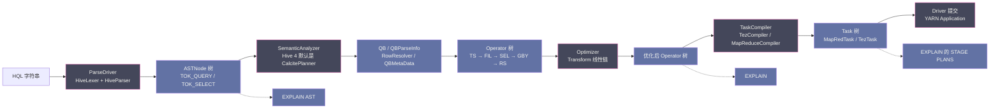
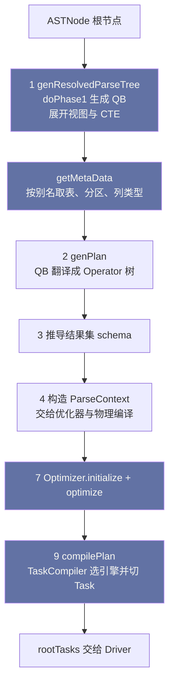
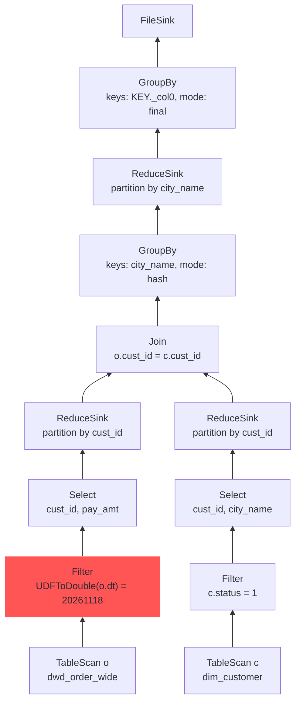
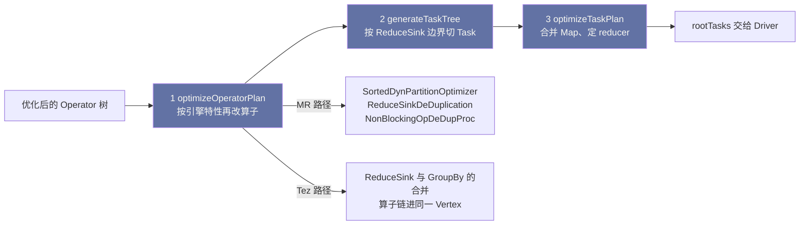
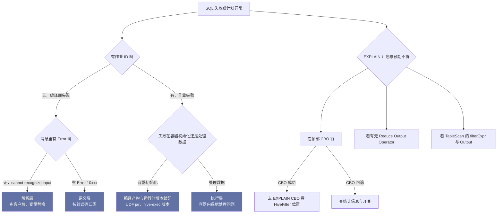

# 03 SQL 编译全链路：从 HQL 到 Operator Tree

**摘要：**

一条 HQL 从进入 HiveServer2 到变成可提交的 MapReduce 或 Tez 任务，要穿过六个彼此交接的层：`ParseDriver` 把字符串变成 AST，`SemanticAnalyzer` 把 AST 变成带语义的 `QB` 与 `Operator` 树，`Optimizer` 在算子上做等价变换，`TaskCompiler` 选执行引擎并把算子切成 `Task`，`Task` 树最后交给 YARN。每层的产物形态不同，观察它们的工具也不同：AST 只对 `EXPLAIN AST` 可见，`Operator` 树是 `EXPLAIN` 的主体，物理计划出现在 `STAGE PLANS` 里，`Task` 树要到提交之后才以作业的面目出现。本文沿这条链逐层拆解，重心放在三个容易被跳过的交界处：名字解析如何把用户写的列名变成算子里的 `_col0`，规则顺序如何让同一个开关在 CBO 成功与失败时走进完全不同的分支，以及编译耗时为什么只能被日志切成段而不能按层切。此外还会交代 `EXPLAIN` 各子句的适用边界、编译慢的日志锚点定位法，以及一张从症状到层次的判据表。这条链的每一站都留下了可查的痕迹，难点不在理解机制，而在把痕迹与机制对上号。读完之后，面对一段 `EXPLAIN` 输出或一行 `SemanticException`，应当能判断它出自哪一层，也能判断该换哪种工具去看。

---

## 第 1 章 编译是一条链，不是一个函数

### 1.1 六个层次与四种中间产物

教科书式的说法是「Hive 把 SQL 编译成 MapReduce」，这句话省掉了全部有信息量的部分。真实情形是一条单向流水线，每一站把上一站的产物换成另一种形态，而换形态的同时也在丢弃信息：`AST` 丢掉了字面文本的排布，`QB` 丢掉了语法树的括号结构，`Operator` 树丢掉了 `QB` 里的子查询嵌套，`Task` 树又丢掉了算子之间的部分邻接关系。调优时之所以经常「看得见结果、看不见原因」，就是因为问题往往发生在上游某一站，而你能看到的是下游的形态。

四层中间产物、六次形态转换，可以对照着记：

| 层次 | 输入到输出 | 代码入口 | 该层留下的日志锚点 | 对外可观察的方式 |
|---|---|---|---|---|
| 解析层 | HQL 字符串 → `ASTNode` 树 | `ParseDriver.parse` | `Compiling command` | `EXPLAIN AST` |
| 语义分析层 | `ASTNode` → `QB` / `ParseContext` | `SemanticAnalyzer.analyze` | `Starting Semantic Analysis` | 报错信息里的表名与列名 |
| 算子树构建 | `QB` → `Operator` 树 | `SemanticAnalyzer.genPlan` | `Completed getting MetaData` | `EXPLAIN` 的 `Map Operator Tree` |
| 逻辑优化层 | `Operator` 树 → 等价的新树 | `Optimizer.optimize` | `Completed plan generation` | `EXPLAIN` 里谓词与列的位置 |
| 物理编译层 | `Operator` 树 → `Task` 树 | `TaskCompiler.compile` | 同上（与优化合并计时） | `EXPLAIN` 的 `STAGE DEPENDENCIES` |
| 提交层 | `Task` 树 → YARN Application | `Driver.execute` | `Completed compiling command` 之后 | YARN 的 application 与 Tez DAG |

把这张表当成地图用，读者会立刻发现一个不对称：解析有独立的计时区间，语义分析以及它之后的优化、物理编译则挤在同一个区间里，日志能划出的边界比层次的边界少两处。这一点在处理编译慢时会被反复用到，此处先记下。

整条链的形状如下，注意每层的产物同时是下一层的输入，而 `EXPLAIN` 的挂载点分散在 AST、优化后的算子与 Task 树三处：



### 1.2 编译发生在会话里，而且串行

进入细节之前要先确认一件事：编译是会话私有动作，还是集群共享动作。答案在 `Driver` 的构造与 `Compiler` 的调用关系里。早年的 Hive 把解析、语义分析、优化、物理编译全部塞在 `Driver.compile` 一个方法里，方法长到难以阅读；到了 Hive 4.0，这段逻辑被抽到独立的 `org.apache.hadoop.hive.ql.Compiler` 类，`Driver.compile(command, resetTaskIds, deferClose)` 只剩转调。分工变了，时序没变：每个 `Driver` 实例对应一个会话，`Compiler` 也是会话内新建的对象，所以不同会话的编译彼此独立，可以并行。

但并行有两道闸门。第一道是 HiveServer2 的编译锁：`Driver.compileInternal` 用 `CompileLockFactory.newInstance(...)` 取一把名为 `CompileLock` 的锁，取不到就抛 `COMPILE_LOCK_TIMED_OUT`，而 `hive.server2.compile.lock.timeout` 的默认值是 `0s`，意思是根本不等。第二道是 `WAIT_COMPILE` 这一段独立计时的区间，它专门统计排队等待的时间，与真正的编译时间分开记录。这两点在排障时的意义很直接：用户抱怨「SQL 编译要十几秒」时，先要分清他等的是编译还是排队，前者看 `PARSE` 与 `ANALYZE` 两段的时间差，后者看 `WAIT_COMPILE` 段与被拒绝的报错。

编译锁的存在本身说明了一个设计取舍：语义分析会往 HMS 客户端与 `SessionState` 里写不少共享状态，Hive 选择用粗粒度锁把同一 HS2 实例上的编译串行化，换取实现上的简单。代价是编译吞吐量被锁的持有时间限制，反过来说，任何让编译变慢的因素都会以「别人排队」的形式扩散出去。

### 1.3 一条贯穿查询

后文的每一层都要落回到同一条 SQL 上，这样形态变化才有对照。设一个常见的数仓场景：订单宽表 `dwd_order_wide` 按天分区，字段包含 `order_id`、`cust_id`、`pay_amt`、`dt`；客户维表 `dim_customer` 是十万行量级的小表，字段包含 `cust_id`、`city_name`、`status`。业务方想按城市看一天的成交额：

```sql
SELECT c.city_name, sum(o.pay_amt) AS gmv
FROM dwd_order_wide o
JOIN dim_customer c ON o.cust_id = c.cust_id
WHERE o.dt = '2026-11-18' AND c.status = 1
GROUP BY c.city_name;
```

这条 SQL 不长，却把编译链上几个关键机制全踩到了：分区过滤要能被下推到扫描层、`JOIN` 要决定是 Map 端广播还是 Reduce 端连接、`GROUP BY` 要决定聚合分成几段、`sum` 的可结合性要允许 Map 端预聚合、结果要经 `ReduceSink` 归并到 Reducer。而它的执行计划只有两个 Stage，读起来还不至于失去耐心，适合当作标本。

---

## 第 2 章 解析层：ParseDriver 与 AST

### 2.1 文法、词法与语法

Hive 的解析器不是手写的。早期版本确曾用递归下降的 Java 代码手工解析 SQL，一旦要支持窗口函数、`CTE`、复杂类型构造器，维护成本就失控了；后来改用 ANTLR（ANother Tool for Language Recognition），用 `.g` 文法文件声明规则，由 ANTLR 生成 `HiveLexer` 与 `HiveParser` 两个 Java 类。文法的内容与生成物都不在 `ql` 模块里，Hive 4 把它们放在独立的 `parser` 模块，路径为 `parser/src/java/org/apache/hadoop/hive/ql/parse/`，除了主文法 `HiveParser.g` 与 `HiveLexer.g`，还有 `SelectClauseParser.g`、`FromClauseParser.g`、`IdentifiersParser.g` 等子文法。拆成多个文件有工程上的理由：ANTLR 为单个大文法生成的方法体容易膨胀到超出 JVM 对单个方法字节码的限制，拆开之后每个生成类都落在安全区内。

一次解析分两步走。词法分析把字符串切成 Token 序列，Token 的种类在生成代码里是整型常量，关键字、标识符、数字字面量、标点各成一类；语法分析再按文法把 Token 序列组装成树。两步都是线性的，词法严格 O(n)，语法分析在这个文法上也不做回溯，所以解析一条普通 SQL 的耗时在毫秒量级，长到几千行的大 SQL、或者带几万个元素的 `IN` 列表，才可能涨到几十毫秒。

### 2.2 AST 的形状

`ParseDriver.parse` 返回的根节点类型是 `ASTNode`。这个类在 Hive 4.0.1 里仍然写着 `extends CommonTree implements Node, Serializable`，也就是说它复用了 ANTLR 运行时的树节点，同时实现 Hive 自己的 `Node` 接口——这一层接口统一让后续的图遍历框架能同时处理 AST 与 `Operator` 树，不必写两套遍历器。节点的类型区分靠一个整数，常量定义在生成的 `HiveParser` 里，`TOK_QUERY`、`TOK_FROM`、`TOK_SELECT`、`TOK_WHERE`、`TOK_GROUPBY` 这些名字在源码里随处可见。

上面那条 SQL 的 AST 大致长这样，缩进表示父子关系：

```text
TOK_QUERY
  TOK_FROM
    TOK_JOIN
      TOK_TABREF
        TOK_TABNAME dwd_order_wide
        (alias: o)
      TOK_TABREF
        TOK_TABNAME dim_customer
        (alias: c)
      = (o.cust_id, c.cust_id)
  TOK_INSERT
    TOK_DESTINATION
    TOK_SELECT
      TOK_SELEXPR  c.city_name
      TOK_SELEXPR  sum(o.pay_amt)  (alias: gmv)
    TOK_WHERE
      and
        = (o.dt, '2026-11-18')
        = (c.status, 1)
    TOK_GROUPBY
      c.city_name
```

这段结构给不了任何执行信息，但它精确记录了用户写了什么、写在哪一层。很多语义错误的根源就在这张图上：谓词写在 `TOK_WHERE` 还是写在 `TOK_JOIN` 的条件子树里，决定了后续下推与裁剪能走多远；聚合函数出现在 `TOK_GROUPBY` 的兄弟节点还是嵌套在表达式里，决定了聚合能否被拆分。

### 2.3 AST 里没有的东西

必须强调 AST 的「无语义」性质：节点里的 `o`、`c`、`city_name`、`pay_amt` 全是原始文本，此时编译器并不知道 `dwd_order_wide` 是内部表还是外部表、`pay_amt` 是 `decimal(16,2)` 还是 `double`，也不知道 `sum` 是内置函数还是某个 jar 里注册的自定义聚合函数。这些都要等到语义分析去 HMS 取元数据才落地。因此 AST 阶段任何与「表存不存在、列类型对不对」相关的判断都不可能发生，反过来说，这一阶段抛出的错误必然与语法或词法有关。

`EXPLAIN AST` 可以把这棵树直接打出来，输出是 S-表达式，形如 `(TOK_QUERY (TOK_FROM ...) (TOK_INSERT ...))`。日常调优用不到它，但在两种场合价值很高：一是确认客户端发过来的 SQL 到底长什么样（多行脚本、变量替换、注释混入时经常与预期不同），二是配合 `EXPLAIN EXTENDED` 定位常量折叠这类编译期变形——折叠前后的 AST 对比能直接看出哪个表达式被求值了。

### 2.4 ParseException 的判据

解析层抛 `ParseException`，消息通常是 `cannot recognize input near '<token>' in <context>` 的样子。这句提示几乎没有歧义：字符串本身不合文法，与库里的数据、权限、表结构全部无关。常见来源有几类，按笔者遇到的频率排列：变量替换失败导致 SQL 里留下空串或半个标识符；客户端把多行 SQL 粘进交互模式时被 readline 的补全提示污染；关键字被用作标识符而没有加反引号；括号或 `CASE ... END` 没有闭合；`EXPLAIN` 后面跟了不支持的子句组合。

其中客户端污染这一类最容易被误判。Shell 里的 `beeline` 在遇到 `and`、`or` 等前缀匹配时可能弹出补全提示，用户的回车就把提示文本混进了 SQL，最终表现为一条报错位置离现场很远的 `ParseException`。用 `-f` 执行 SQL 文件可以绕开，这也是仓库里那份 Beeline 排障手册的做法（见 [[用Beeline-EXPLAIN分析Hive常量折叠是否触发UDF兼容性问题]]）。判据很干脆：报错行号指向的位置在前一行末尾，而不是在报错的那个符号上。

---

## 第 3 章 语义分析：从 AST 到 QueryBlock

### 3.1 一个类族与一条流水线

`SemanticAnalyzer` 不是一个类在干活，而是一个类族。基类 `BaseSemanticAnalyzer` 持有 `rootTasks`、`inputs`、`outputs` 这些所有分析器的公共资产；`SemanticAnalyzer` 负责查询与 DML，是最大的一块；`DDLSemanticAnalyzer`、`LoadSemanticAnalyzer`、`FunctionSemanticAnalyzer` 各自处理建表、加载、注册函数。查询类命令再往下分叉：`SemanticAnalyzerFactory.get` 在分发分析器的同时会设置 `HiveOperation`（这个枚举决定权限检查项、锁的粒度和并发语义），并且按 `hive.cbo.enable` 决定注入哪个实现——打开时用 `CalcitePlanner`，它是 `SemanticAnalyzer` 的子类，把 Calcite 的代价优化嵌在语义分析内部；关闭时用 `SemanticAnalyzer` 本体。

这个事实要记住：**Hive 4 默认让 `CalcitePlanner` 接管语义分析**，它解释了一类常见困惑：明明读的是 `SemanticAnalyzer` 的源码，`EXPLAIN` 里却出现了 Calcite 的 `HiveJoin`、`HiveProject` 之类节点。因为真正跑的是 `CalcitePlanner`，它的 `analyzeInternal` 先调父类的带 `PlannerContext` 重载，在生成解析后树的阶段插入 CBO 尝试，成功就沿用 Calcite 产出的计划，失败则设一个 `cboInfo` 说明原因，再退回纯 RBO 路径。

`SemanticAnalyzer.analyzeInternal` 的步骤在源码里带编号注释，照着它走一遍就能看清整条语义分析流水线：



三个中间阶段各有日志可查：`Completed phase 1 of Semantic Analysis`、`Completed getting MetaData in Semantic Analysis`、`Completed plan generation`。这三行日志的位置值得记住，第 8 章会直接用它们把编译耗时切成段。

### 3.2 QueryBlock：语义分析的中间产物

`QB`（QueryBlock）把「一个有语义的查询单元」表达成数据。一个 `SELECT` 对应一个 `QB`，一层子查询生成一个嵌套的 `QB`，`UNION` 用 `QBExpr` 把两个 `QB` 串起来。它的内容分成四块：

- `QBParseInfo`：按输出目标（`dest`）索引的各类表达式集合，包括 `destToSelExpr`、`destToWhereExpr`、`destToGroupby`、`destToHaving`、`destToOrderBy`、`destToLimit`、`destToClusterBy`，以及 `aliasToSubq` 记录子查询别名到 `QB` 的映射。`INSERT` 多路输出时一个 `QB` 就有多个 `dest`，这也是 `FROM ... INSERT ... INSERT ...` 语法能被支持的原因。
- `QBJoinTree`：`JOIN` 的树形描述，记录左表、右表、连接条件、`join` 类型，以及是否是 `mapjoin`、`semi`、`sorted merge` 等变体。单表查询没有这棵子树。
- `QBMetaData`：`alias` 到 `Table`/`Partition` 的映射，以及输出目标是表、分区还是目录。`getMetaData` 阶段填的就是这一块。
- `QB` 自身的状态：是否 `CTAS`、是否有 `limit`、是否是 `subquery`、`parent` 与 `QBExpr` 的指针。

这四块合起来是「执行这个查询所需知道的全部语义信息」，但还不是执行结构。从 `QB` 到 `Operator` 树的那一步翻译，本质上是把声明式的谓词集合、连接树、聚合列表按固定顺序铺成算子链。

### 3.3 RowResolver：名字解析的现场

如果只允许记住一个类名来解释「语义分析到底做了什么」，笔者会选 `RowResolver`。它解决的问题极具体：算子的输入输出是一行一行的列，而 Hive 内部并不用用户写的列名来标记这些列，而是用内部名。`ColumnInfo` 里同时装着三样东西——`internalName`（内部名，形如 `_col0`）、`type`（`TypeInfo`）、`tabAlias`（来源表别名）。`RowResolver` 就是一张 `(表别名, 列别名) → ColumnInfo` 的表，外加一个表达式到 `ColumnInfo` 的旁路映射。

它有三个动作需要单独看：

- `put(tabAlias, colAlias, colInfo)`：登记一个新列。`SELECT a AS x` 会登记 `x`，同时把 `a` 的来源记在 `ColumnInfo` 里。
- `get(tabAlias, colAlias)`：查列，查不到就抛 `SemanticException`，消息形如 `Invalid table alias or column reference 'xxx'`。这条报错是语义分析层最典型的指纹之一。
- `reverseLookup(internalName)`：反向查，把内部名还原成 `(别名, 列名)` 对。写 `EXPLAIN` 解读时用得到——输出里那些 `KEY._col0`、`VALUE._col1` 就是这里的内部门名。

`RowResolver` 由 `OpParseContext` 持有。这个包装类在 4.0.1 的源码里只有一个字段，就是 `RowResolver`；真正把它挂到算子上的是 `SemanticAnalyzer` 侧维护的 `opParseCtx` 映射，键是 `Operator`、值是 `OpParseContext`。含义是：每个 `Operator` 都知道自己输出什么列、什么类型、列从哪里来。这个设计在后续优化里省了大量工作，列裁剪不必逆向推导类型，只要顺着 `opParseCtx` 查每个算子实际消费了哪些 `internalName`，就能从 `TableScan` 上删掉没人用的列。换句话说，**列裁剪能成立，是因为语义分析阶段已经把「列身份」固化下来了**。

### 3.4 类型检查与隐式转换的位置

类型检查发生在表达式构造时。Hive 用 `FunctionRegistry` 查函数描述符，再要求 `GenericUDF.getTypeInference` 给出返回类型；比较、算术、连接条件都走同一条检查路径。不兼容时抛 `SemanticException`，消息里通常带「Cannot convert column」或「Argument type mismatch」之类的措辞。

真正需要警惕的不是报错，而是**不报错**的那部分：Hive 的类型提升规则允许跨类型比较，于是隐式转换被静默插入。这种插入不是隐喻，它会在算子树里变成显式节点——`UDFToDouble`、`UDFToLong`、`UDFToString` 这些转换函数会出现在 `EXPLAIN` 的 `expressions` 里。看一段 `EXPLAIN` 输出时若在谓词里发现 `UDFToDouble(o.dt)`，就应当立刻意识到分区裁剪大概已经失效：裁剪器需要分区列与常量直接比较，一旦分区列被函数包裹，它就放弃了。

这类问题的形态很固定：分区列定义成 `string`，SQL 里却写 `WHERE dt = 20261118`（没有引号）。整数字面量与字符串列比较时，Hive 会按类型提升把两边都拉到 `double`，转换落在列上而不是常量上，于是本该走分区裁剪的谓词变成了一次全分区扫描后的过滤。写成 `WHERE dt = '20261118'` 就回到裁剪路径上。差别只在两个引号，代价可能是几百倍的扫描量。

### 3.5 子查询与视图的展开

`IN` 子查询在语义分析阶段被改写成 `left semi join`，`NOT IN` 的改写还要额外加一层空值过滤，否则 `NULL` 的语义会出错；`EXISTS` 同样落到 `semi join`。改写的动因是执行器的能力边界：`Operator` 树里没有「子查询」这种算子，只有连接、过滤、聚合，语义分析必须把高阶结构降到这套原语上。

相关子查询是例外。当子查询内部引用了外层的列，标准的 `semi join` 改写不成立，Hive 要么依赖 `hive.optimize.correlation`（默认关闭）走 `CorrelationOptimizer` 把多个相关子查询合并成一次扫描，要么退化成嵌套执行——后者在 `EXPLAIN` 里会呈现为多层 Stage 与被放大的数据量。这解释了为什么把相关子查询改写成显式 `JOIN` 往往比调参数更有效：改写绕开的是一个优化器默认不接管的路径。

视图的处理方向相反，是「展开」而非「降阶」。`getMetaData` 递归展开视图定义，把视图里的 SQL 内联进当前查询，同时把视图记录下来写入 `ReadEntity` 的父链——`EXPLAIN DEPENDENCY` 输出里 `tableParents` 字段列的就是这条链。展开视图意味着视图定义里的每一个低效写法都会原样进入你的查询，这是「视图方便但难调」的机制根源。

`ReadEntity` 与 `WriteEntity` 是这一阶段顺带产出的另一组结构，记录查询读了哪些表与分区、写了哪些表与分区。它们不进算子树，却决定了三件事：权限检查的输入（`EXPLAIN AUTHORIZATION` 输出的就是这份清单）、锁的粒度（`EXPLAIN LOCKS` 显示的是它们对应的锁）、以及血缘（`EXPLAIN DEPENDENCY` 的 `input_tables` 与 `input_partitions`）。实体之所以要在语义分析阶段固化，是因为后来的优化会删列、合并算子、改写输出目标，等到那时再回头推导「到底读了什么」已经不准确了。**很多血缘与权限的边界问题，根子在实体登记的时机，而不在授权模块本身**。

### 3.6 SemanticException 的典型触发

`SemanticException` 覆盖面很广，从对象不存在到权限不足都能抛。按发生位置归类，有五种形态最常见：

| 报错形态 | 触发位置 | 判据与处置 |
|---|---|---|
| `Table not found` / `Database does not exist` | `getMetaData` 取表 | 带库名全限定再试，考虑库名拼写与当前库上下文 |
| `Invalid table alias or column reference` | `RowResolver.get` | 列名拼错、别名作用域越界（子查询里引用了外层别名）、`SELECT *` 与列顺序冲突 |
| `Expression not in GROUP BY key` | `genPlan` 组装聚合 | `SELECT` 里出现未聚合且不在分组键里的列，或分组键用了表达式而 `SELECT` 用了原始列 |
| `Cannot convert column ... from ... to ...` | 类型检查 | 显式 `CAST`，或从存储格式层面统一类型 |
| `Invalid function` / `Undefined function` | 函数解析 | UDF 未注册、jar 未 `ADD`、库名与函数名不匹配 |

这里要区分「语义分析阶段报错」与「语义分析之后才报错」。前者发生在 `genPlan` 之前或之中，此时还没有 `Task`，报错信息里不会出现 `Stage`；后者如权限检查（`authorize` 在分析完成之后单独执行）、锁冲突，会出现在编译的收尾阶段。判断方法简单：看堆栈里有没有 `SemanticAnalyzer`，看日志里 `Starting Semantic Analysis` 之后有没有 `Completed plan generation`。

### 3.7 这一层决定了 EXPLAIN 的逻辑计划

一个经常被忽略的因果链是这样的：`EXPLAIN` 并不只是「打印计划」，它要完整跑一遍编译。源码里 `Context.isExplainSkipExecution()` 控制的是跳过**执行**，而不是跳过编译；`EXPLAIN` 同样要过 `genResolvedParseTree`、`getMetaData`、`genPlan`、`Optimizer`、`TaskCompiler`，一路生成完 `Task` 树之后才把计划格式化输出。因此有三条推论：

其一，`EXPLAIN` 会因为语义错误而失败，与真正执行时的报错一模一样。用 `EXPLAIN` 做「语法与语义预检」是成立的，而且成本远低于试跑。

其二，`EXPLAIN` 的耗时基本等于编译耗时。用户抱怨编译慢时，一条 `EXPLAIN` 就能复现，不必触发真跑。

其三，`EXPLAIN` 看到的计划，是语义分析与优化两层共同作用的结果，无法把两者的贡献分开。想知道某个谓词为什么没下推，得回到 `cboInfo` 与开关上去查（见第 5 章）。

---

## 第 4 章 Operator 树：算子的物理事实

### 4.1 算子的数据流方向

`Operator` 是 Hive 逻辑计划的节点，继承自 `Operator` 抽象类，带一个描述对象（`OperatorDesc` 的子类，如 `FilterDesc`、`SelectDesc`、`GroupByDesc`、`ReduceSinkDesc`、`FileSinkDesc`）。描述对象装的是「这个算子怎么做」，算子本身管的是「上下游是谁」。

约定俗成的一句话是「叶子是数据源，根是输出」，这话没错但容易读反。`Operator` 内部用 `childOperators` 列表指向下游，`TableScanOperator` 没有父算子、是树的叶子，`FileSinkOperator` 没有子算子、是树的根，数据从叶子流向根。而 `EXPLAIN` 打印时是自上而下的，`File Output Operator` 在最上面、`TableScan` 在最下面，正好与数据流反向。第一次读 `EXPLAIN` 时把这个方向搞混，会得出「先写文件再扫描表」这种荒谬结论。

### 4.2 核心算子

| 算子 | 缩写 | 语义 | 对应 SQL | `EXPLAIN` 中的名字 |
|---|---|---|---|---|
| `TableScanOperator` | TS | 扫描表或分区，产出原始行 | `FROM t` | `TableScan` |
| `FilterOperator` | FIL | 按谓词过滤 | `WHERE` / `HAVING` 降阶后 | `Filter Operator` |
| `SelectOperator` | SEL | 投影与表达式计算 | `SELECT` 列表 | `Select Operator` |
| `GroupByOperator` | GBY | 聚合，可分段执行 | `GROUP BY` | `Group By Operator` |
| `ReduceSinkOperator` | RS | 序列化并按 key 分区排序输出 | 无直接对应 | `Reduce Output Operator` |
| `JoinOperator` | JOIN | Reduce 端连接 | `JOIN` | `Join Operator` |
| `MapJoinOperator` | MAPJOIN | Map 端广播连接 | 小表连接或 hint | `Map Join Operator` |
| `FileSinkOperator` | FS | 写结果到 HDFS | `INSERT` / 查询输出 | `File Output Operator` |
| `LimitOperator` | LIM | 截断行数 | `LIMIT` | `Limit` |
| `UnionOperator` | UNION | 合并多路输入 | `UNION ALL` | `Union` |
| `ForwardOperator` | FWD | 占位直通，不改数据 | 优化残留 | `Forward` |
| `DemuxOperator` | DEMUX | 按 tag 分流 | 多路输出 | `Demux Operator` |

`EXPLAIN` 里的名字与源码类名对不上，这是新手最容易卡住的地方。上表右列就是对照表，把 `Reduce Output Operator` 认成 `ReduceSinkOperator` 之后，`EXPLAIN` 的输出会突然变得可读。

### 4.3 一条 SQL 的树

回到贯穿查询。不加 `mapjoin` hint、CBO 也按普通连接处理时，生成的算子树是：



图里那个红色节点是有意为之：如果分区列写成不带引号的整数，`Filter` 里就会出现 `UDFToDouble(o.dt) = 20261118` 这样的谓词，`PartitionPruner` 拿不到可裁剪的条件，`TableScan` 就会去读全部分区。同一张图换个写法（`o.dt = '2026-11-18'`），`Filter` 会消失——条件被下推成了 `TableScan` 上的分区裁剪与 `filterExpr` 属性。这就是第 3.4 节讲的那两个引号的代价，在图上的表现。

`GroupBy` 出现两次这件事需要单独解释。`sum` 是可结合聚合，Hive 允许先在 Map 端做局部聚合、再在 Reduce 端做最终聚合，两段的 `mode` 不同：Map 端是 `hash`（或 `partial1`），Reduce 端是 `final`（或 `mergepartial`）。判据是 `GROUP BY` 的键是否产生了大量重复、以及 `hive.map.aggr` 是否打开（Hive 4.0.1 默认 `true`）。如果聚合函数是 `count(distinct ...)` 这类不能靠简单相加合并的形式，Map 端的预聚合就无法照搬，此时要么退化成单段聚合，要么由 `CountDistinctRewriteProc`（仅 Tez 路径注册）改写。看到 `EXPLAIN` 里只有一段 `Group By` 且 `mode: complete`，往往说明聚合策略比预期更保守。

### 4.4 ReduceSinkOperator 是 Shuffle 边界

如果只能指认一个算子作为「执行结构的分水岭」，那就是 `ReduceSinkOperator`。它的描述对象 `ReduceSinkDesc` 里装着一组决定 Shuffle 行为的字段：

- `keyCols`：分区键，按这些列的哈希值决定去哪个 Reducer；
- `partitionCols`：实际参与分区的列，通常与 `keyCols` 相同，但在需要全排序时会有差异；
- `valueCols`：随 key 一起传输的载荷列；
- `numReducers`：Reducer 数量，`-1` 表示交给框架按输入量推导；
- `order` 与 `nullOrder`：排序方向与空值位置，`EXPLAIN` 里显示为 `sort order: +`；
- `tag`：多路输入时标记来源，Reduce 端靠它区分数据来自哪张表。

**`ReduceSinkOperator` 出现的位置就是 Shuffle 的位置**，这一点在两种引擎上的表现不同，但本质一致。MR 上它切出 Stage：`RS` 之前算子在 Map 端跑，之后算子在 Reduce 端跑，相邻 Stage 之间落 HDFS。Tez 上它变成 DAG 的 Edge：`SIMPLE_EDGE` 表示一对一的简单分区，`CUSTOM_EDGE` 表示需要自定义路由，下游 Vertex 的输入边数决定它是单路还是多路。所以「一棵算子树里 RS 的个数等于 MR Job 数」这句话只在 MR 下近似成立，在 Tez 下换算的是 Vertex 与 Edge 的拓扑。

用 Spark 作类比能省很多解释成本：`ReduceSinkOperator` 大致对应 Spark 的 `Exchange`（`ShuffleExchangeExec`），`GroupByOperator` 对应 `HashAggregateExec`，`TableScanOperator` 对应 `FileScan` 或 `Scan`。差别在于 Hive 把「分组、排序、分区」三种语义压进了同一个算子，而 Spark 拆成了 `Exchange` 加排序算子两个节点，所以 Spark 的物理计划里 `Exchange` 更容易被单独识别和调优。Catalyst 的解析与优化流程在 [[02 Catalyst 解析与分析：从 AST 到 Analyzed LogicalPlan]] 里有逐层对照，两边的层次划分其实高度同构。

### 4.5 树不是 SQL 的直译

一个常见的误解是「`Operator` 树是 SQL 子句的逐句翻译」。事实上生成阶段就已经偏离了 SQL 的书写顺序。写 SQL 时的阅读顺序是 `SELECT ... FROM ... WHERE ... GROUP BY`，而 `genPlan` 铺树的顺序是 `FROM → WHERE → GROUP BY → HAVING → SELECT → ORDER BY → LIMIT`，前者是声明，后者是数据流。更重要的偏离来自生成阶段自身的决策：`JOIN` 是生成 `JoinOperator` 还是 `MapJoinOperator`，聚合是一段还是两段，`DISTINCT` 是走 `GroupBy` 还是走 `ReduceSink` 的去重模式，这些决定的依据是元数据与 hint，而不是 SQL 的字面形态。

这也是为什么「同样的 SQL 换一天跑，计划就变了」并不神秘：`getMetaData` 拿到的分区数、表统计、列统计都参与生成阶段的判断。统计信息一旦被 `ANALYZE TABLE` 刷新，编译产物就会随之改变，SQL 一个字都没动。这条因果在第 5 章讲常量传播时会再出现一次，而且更隐蔽。

### 4.6 一份 EXPLAIN 输出的读法

把上一节那棵树翻译成 `EXPLAIN` 的文本，阅读顺序被整个翻了过来。下面是贯穿查询在 MR 引擎上的输出节选（统计数值与部分字段有删减，`Stage` 编号与算子名字保持原样）：

```text
STAGE DEPENDENCIES:
  Stage-1 is a root stage
  Stage-2 depends on stages: Stage-1
  Stage-0 depends on stages: Stage-2

STAGE PLANS:
  Stage: Stage-1
    Map Reduce
      Map Operator Tree:
          TableScan
            alias: o
            filterExpr: (dt = '2026-11-18') (type: boolean)
            Select Operator
              expressions: cust_id, pay_amt
              Group By Operator
                aggregations: sum(pay_amt)
                keys: cust_id
                mode: hash
                Reduce Output Operator
                  key expressions: cust_id
                  sort order: +
                  Map-reduce partition columns: cust_id
                  value expressions: _col0
          TableScan
            alias: c
            filterExpr: (status = 1) (type: boolean)
            Select Operator
              expressions: cust_id, city_name
              Reduce Output Operator
                key expressions: cust_id
                sort order: +
                Map-reduce partition columns: cust_id
                tag: 1
      Reduce Operator Tree:
          Join Operator
            condition map:
                 Inner Join 0 to 1
            Group By Operator
              aggregations: sum(VALUE._col0)
              keys: city_name
              mode: hash
              Reduce Output Operator
                key expressions: city_name
                Map-reduce partition columns: city_name
                value expressions: _col0
  Stage: Stage-2
    Map Reduce
      Map Operator Tree:
          TableScan
            (reads Stage-1 output)
      Reduce Operator Tree:
          Group By Operator
            aggregations: sum(VALUE._col0)
            keys: KEY._col0
            mode: final
            File Output Operator
  Stage: Stage-0
    Move Operator
      tables:
          replace: true
```

读这份输出时有几个固定锚点。`STAGE DEPENDENCIES` 里的三段是 DAG 拓扑，`Stage-1` 是根、`Stage-0` 是收尾搬文件，拓扑本身与执行顺序一一对应。`Stage-1` 里两个 `TableScan` 出现在同一棵 Map 树下，说明两张表在同一次扫描里各自准备好连接输入，`tag: 1` 标记了第二路。两个 `Reduce Output Operator` 都以 `cust_id` 为分区列，说明 Join 走的是 Reduce 端连接；若某一侧没有 `RS` 而是 `Map Join Operator`，就换成了广播。`mode: hash` 在 `Stage-1` 的 `Group By` 上、`mode: final` 在 `Stage-2` 上，这一对出现的位置就是「两段聚合」的证据，也是 `Stage-2` 存在的理由。`TableScan` 上的 `filterExpr` 是谓词已经下推到扫描层的直接证据；如果它出现在上层的 `Filter Operator` 里，说明下推没有发生。

`EXPLAIN` 里没有 `Statistics` 的行数是另一层信息：`Basic stats: COMPLETE` 缺位时，`Num rows` 可能是 0，此时任何基于行数的判断都不成立，CBO 的决策质量也无从评价。

---

## 第 5 章 逻辑优化层：规则的顺序与开关

### 5.1 一条线性规则表

关于 Hive 优化器，流传最广的一种说法是「规则按 `hive.optimize.*` 分组注册、分组执行，最后跑到不动点」。这个描述与源码不符，需要纠正清楚，因为它会误导排障方向。

`Optimizer.initialize(conf)` 做的事情极朴素：一个 `List<Transform> transformations`，然后一长串 `if (HiveConf.getBoolVar(...))` 判断，命中就往列表里 `add` 一条规则。没有分组，没有依赖声明，也没有拓扑排序。`Optimizer.optimize()` 更简单，一个 `for` 循环按列表顺序逐条执行，每条规则跑一次就结束——不存在「反复迭代直到没有变换可以发生」的外层循环。规则内部可能多次遍历树（`DefaultGraphWalker`、`ForwardWalker` 各自的选择），**但规则之间是一次性的短路关系**。

这个事实的实践意义有三层。第一，规则的效果依赖注册顺序，因为后一条规则看到的是前一条改过的树，顺序错了就没有第二次机会。第二，规则总数由开关决定，打开一个开关可能连带改变后续规则的前提（譬如 PPD 关闭时 `PartitionPruner` 整段不注册）。第三，既然没有不动点迭代，就不该指望「打开某个开关后优化器会自己收敛到最优」——它只做一遍，做漏了就漏了。

### 5.2 规则顺序表

下表按 `Optimizer.initialize` 的注册顺序列出默认配置下会命中的规则。顺序与开关取自 Hive 4.0.1 源码，口径是 `hive.cbo.enable=true` 且 CBO 成功、引擎为 Tez；条目数属于量级判断，随版本与开关增减：

| 序 | 规则 | 开关 | 默认 | 不注册的条件 |
|---|---|---|---|---|
| 1 | `HiveOpConverterPostProc` | 无 | 恒注册 | Calcite 计划转 Hive 算子的收尾 |
| 2 | `PartitionColumnsSeparator` | `hive.optimize.partition.columns.separate` | true | 关闭时 |
| 3 | `SyntheticJoinPredicate` | 随 PPD | 恒注册 | — |
| 4 | `SimplePredicatePushDown` | `hive.optimize.ppd` | true | CBO 未成功时换成完整版 |
| 5 | `RedundantDynamicPruningConditionsRemoval` | 随 CBO | 恒注册 | CBO 未成功时 |
| 6 | `PartitionPruner` | `hive.optimize.ppd` | true | `hive.optimize.ppd=false` |
| 7 | `PartitionConditionRemover` | `hive.optimize.ppd` | true | 同上 |
| 8 | `GroupByOptimizer` | `hive.optimize.groupby` 或 `hive.map.aggr` | true | 两个都关 |
| 9 | `ColumnPruner` | 无 | 恒注册 | 无（4.x 已无 `hive.optimize.cp`） |
| 10 | `CountDistinctRewriteProc` | `hive.optimize.countdistinct` | true | 非 Tez 引擎 |
| 11 | `SamplePruner` | 无 | 恒注册 | — |
| 12 | `MapJoinProcessor` | 随 hint 与阈值 | 恒注册 | — |
| 13 | `BucketingSortingReduceSinkOptimizer` | `hive.optimize.bucketingsorting` | true | 关闭时 |
| 14 | `UnionProcessor` | 无 | 恒注册 | — |
| 15 | `JoinReorder` | `hive.reorder.nway.joins` | true | 关闭时 |
| 16 | `FixedBucketPruningOptimizer` | Tez + PPD + 索引过滤 | 恒注册 | 任一前提不满足 |
| 17 | `BucketVersionPopulator` | 无 | 恒注册 | — |
| 18 | `ReduceSinkDeDuplication` | `hive.optimize.reducededuplication` | true | 非 Tez 引擎 |
| 19 | `NonBlockingOpDeDupProc` | 无 | 恒注册 | — |
| 20 | `IdentityProjectRemover` | `hive.optimize.remove.identity.project` | true | 关闭时 |
| 21 | `GlobalLimitOptimizer` | `hive.optimize.limit` | true | 关闭时 |
| 22 | `LimitPushdownOptimizer` | `hive.limit.pushdown.memory.usage` | 0.1 | 值为 0 |
| 23 | `OrderlessLimitPushDownOptimizer` | `hive.optimize.limit` | true | 关闭时 |
| 24 | `StatsOptimizer` | `hive.compute.query.using.stats` | true | 关闭时 |
| 25 | `SimpleFetchOptimizer` | `hive.fetch.task.conversion` | more | 值为 `none` |
| 26 | `SimpleFetchAggregation` | `hive.fetch.task.aggr` | false | 默认即不注册 |

默认路径下大约二十余条规则。这个数量级本身就是一个判断依据：一张 200 个节点的算子树，二十余条规则各遍历一遍，就是几千次节点处理；SQL 复杂度每上一个台阶，编译时间的增长是「节点数 × 规则数」的乘积，不是加法。

### 5.3 谓词的旅行：常量传播的三次

规则顺序里最值得细看的是 `ConstantPropagate`。它在 `initialize` 里被 `add` 了不止一次，每次位置不同、目的不同。源码里的注释解释了原因：分区裁剪之后可能又产生新的折叠机会，所以要再跑一遍。

先把范围限定清楚，否则很容易得出错误的因果。这三轮折叠全部属于 **CBO 未成功** 的路径。CBO 成功时，`ConstantPropagate` 一条都不会被注册——第二、三次的注册条件里都带着 `!isCboSucceeded()`，唯一的例外是 `MERGE` 语句；此时常量化简由 Calcite 侧承担，走的是 `HiveReduceExpressionsRule` 一族规则。所以「打开常量传播没效果」这件事，在 CBO 成功的查询上根本不构成问题，因为那条路径压根不看这个开关。这也解释了为什么用 `set hive.optimize.constant.propagation=false` 做对照实验有时完全无效：查询走的是 Calcite 路径，常量化简发生在关系代数层。

按注册顺序数，CBO 失败的路径上一条查询会经历三轮常量处理：

第一轮在 `PredicatePushDown` 之前。此时谓词还挂在 `Filter` 上，折叠的目的是把 `date_sub('2026-11-19', 1)` 这类确定性表达式算成字面量，让后续的下推与裁剪能识别。若这一轮被跳过（`hive.optimize.constant.propagation=false`），`WHERE dt = date_sub(...)` 里的分区列比较就永远拿不到常量形态，裁剪失效。

第二轮在 `PredicatePushDown` 拆分并传播谓词之后。谓词下推会把 `and` 拆成多个条件分发到不同分支，拆出来的条件可能变成 `is not null` 之类的可简化形式，折叠器在这里再做一次化简。

第三轮在 `PartitionPruner` 与 `PartitionConditionRemover` 之后，同样只在 CBO 未成功时注册。分区裁剪会把分区谓词改写成具体分区列表，剩下的条件可能再次具备折叠条件。

三轮折叠之外还有一个容易被忽略的前提：常量传播会读列统计。当某列的 `null count` 等于总行数、或 `distinct count` 为 1 时，优化器可能把这列视为常量，进而把含该列的表达式折叠掉。这意味着一次 `ANALYZE TABLE ... COMPUTE STATISTICS FOR COLUMNS` 之后，同一个 SQL 的编译产物可能发生变化，甚至可能把一个本该在运行期求值的自定义函数折叠成编译期常量。仓库里那起 UDF 兼容性事故（[[Hive-Tez作业失败：自定义UDF与Hive版本不兼容导致AbstractMethodError]]）就是沿着这条线索查的：失败栈落在 `GenericUDF.initializeAndFoldConstants`，那是常量求值路径才会走到的方法，而 UDF jar 是按旧接口编译的，与容器里的 hive-exec 版本对不上。那一次失败发生在 Tez 容器的算子初始化、而不是客户端编译，说明同一段求值逻辑在编译期与运行期都会被执行；用 `hive.optimize.constant.propagation=false` 做对照实验，若作业仍以同样错误失败，就说明问题不在开关上，而在 jar 与运行时的版本错配。这条线索带出的结论比「优化器只改写计划」更准确：**常量求值会真的调用用户的函数，差别只在调用落在客户端编译期还是容器初始化阶段**。

### 5.4 列裁剪与分区裁剪

两条裁剪规则经常被并列讨论，但它们的实现位置与失效条件完全不同。

`ColumnPruner` 从算子树顶端向下反向推导：从 `FileSinkOperator` 需要的列出发，逐层问每个算子「你需要上游的哪些列」，把结果写回 `TableScanOperator` 的列列表，同时把 `SelectOperator` 里没人消费的表达式删掉。对 ORC、Parquet 这类列式存储，这一步直接决定读多少数据。它的失效条件极少，主要来自 `SELECT *`：星号让所有列都变成「被需要」，裁剪无从下手。4.x 的源码里 `ColumnPruner` 是无条件注册的，早年那个 `hive.optimize.cp` 开关已经不在——这一点在不少资料里还是旧口径。

`PartitionPruner` 的处境不同，它的注册位置在 `if (hive.optimize.ppd)` 代码块内。也就是说关掉 PPD 会连带关掉分区裁剪和 `PartitionConditionRemover`，而不是像某些资料写的那样有个独立的 `hive.optimize.pruner` 开关。裁剪的执行方式有两种：谓词能被翻译成 HMS 可执行的表达式时，走 `getPartitionsByFilter` 把过滤下推到元数据层；翻译不了时退化成枚举全部分区再在客户端过滤。两个路径的代价差一个数量级，而决定走哪条的是谓词形态与 `hive.metastore.try.direct.sql` 之类的配置，不是分区数本身。分区数量多到十万级时，退化路径会把「枚举分区列表」变成编译阶段的主要开销，第 8 章会给出量级。

### 5.5 CBO 与 RBO 的分工线

Hive 4.0.1 的 `hive.cbo.enable` 默认 `true`，因此查询默认由 `CalcitePlanner` 处理。这条分工线对第 5 章的规则表有直接影响：PPD 的注册分支因 CBO 是否成功而不同。CBO 成功时，Calcite 已经在关系代数层完成谓词下推与连接重排，Hive 算子层只需要 `SimplePredicatePushDown` 补漏，并删掉 `RedundantDynamicPruningConditionsRemoval` 认为冗余的动态裁剪条件；CBO 失败时，才走 `PredicateTransitivePropagate` + `ConstantPropagate` + `SyntheticJoinPredicate` + `PredicatePushDown` 这条完整链路。

于是有了一个非常实用的判据：怀疑「优化没生效」时，**先看 `EXPLAIN` 输出顶部有没有 `Plan optimized by CBO.`**。有，说明走的是 Calcite 路径，此时在算子树里找 `PredicatePushDown` 的痕迹意义不大，应当去 `EXPLAIN CBO` 的输出里看 `HiveFilter` 的位置；没有，或者跟着一句 `Plan not optimized by CBO because ...`，才该去查开关与统计信息。CBO 失败的原因会被写进这句提示，比翻日志快得多。

### 5.6 开关互相抵消

「把所有 `hive.optimize.*` 打开」是一种看起来很安全、实际会制造麻烦的做法。三种典型的抵消方式：

第一类是前提依赖。`hive.optimize.union.remove` 的官方说明里明确写着它适合与 `hive.optimize.skewjoin.compiletime` 配合使用，因为后者会保留中间目录，前者才需要去掉多余的 `UNION`。单独打开前者没有收益，打开后者而不打开前者则留下无用的中间目录。这类「必须成对」的开关在配置里还有若干组，读配置说明比读博客可靠。

第二类是引擎限制。`hive.optimize.skewjoin` 与 `hive.optimize.skewjoin.compiletime` 在 Tez 上都不生效：`Optimizer.initialize` 里对 `SkewJoinOptimizer` 的分支是「非 Tez 才注册，否则打一条 warn 说 Tez 不支持倾斜连接优化」。打开它不会报错，只会在日志里留下一条被忽略的警告，排查时反而增加噪音。`ReduceSinkDeDuplication`、`CountDistinctRewriteProc`、`FixedBucketPruningOptimizer` 也都各自绑定引擎，方向还不一致——前两个是「非 Tez 才注册」，后一个是「Tez 才注册」。

第三类是源码里不存在的开关。`hive.optimize.cp`、`hive.optimize.pruner` 这类名字在网上流传很广，但在 4.0.1 的 `HiveConf` 里已经找不到；把它们写进 `set` 语句不会报错，因为 Hive 对未知变量是宽容的，但也不会产生任何效果。排障时看到会话里有一串 `set hive.optimize.*=true`，第一步应当先核对哪些变量在目标版本里真实存在。

配置项的收益与代价，可以按下面的方式权衡（默认值取 Hive 4.0.1）：

| 配置 | 默认 | 调大或打开的收益 | 调大或打开的代价 |
|---|---|---|---|
| `hive.optimize.ppd` | true | 谓词尽早过滤，Shuffle 量下降 | 关闭会连带关掉分区裁剪，几乎从不该关 |
| `hive.optimize.constant.propagation` | true | 确定性表达式变常量，裁剪与索引可用 | 常量求值会走进 UDF 的初始化路径，跨版本 jar 的方法缺失会在该路径上暴露 |
| `hive.cbo.enable` | true | 连接顺序与连接策略由代价决定 | 复杂 SQL 的 Calcite 规划本身耗时，统计缺失时决策反而更差 |
| `hive.reorder.nway.joins` | true | 多路连接按 MapJoin 重组，减少落盘 | 与 Calcite 的连接重排叠加时，结果不易预期 |
| `hive.optimize.bucketmapjoin` | false | 分桶表可做 Map 端连接 | 要求两侧分桶数与排序严格一致，否则报错或退化 |
| `hive.optimize.skewjoin.compiletime` | false | 倾斜键在编译期被拆开处理 | Tez 不支持，且需要配套打开 `union.remove` |
| `hive.fetch.task.conversion` | more | 简单查询直接由 `FetchTask` 读，不启作业 | 阈值内的小表查询绕过 MR/Tez，`EXPLAIN` 里看不到 Stage，容易误判为「计划丢了」 |
| `hive.map.aggr` | true | Map 端预聚合，Shuffle 量下降 | 聚合键基数极高时哈希表占内存，收益转负 |

最后一行值得单独提醒：`hive.fetch.task.conversion` 默认是 `more`，意味着一批小查询根本不会生成 `MapRedTask`，`EXPLAIN` 里只有一个 `Fetch Operator`。把它当成「优化没生效」去调参，会花掉一整天。

---

## 第 6 章 物理层：TaskCompiler 与 Task 树

### 6.1 选引擎在编译期就完成了

`TaskCompiler` 是一个抽象类，`TaskCompilerFactory.getCompiler(conf, pCtx)` 按 `hive.execution.engine` 分派：值为 `tez` 时返回 `TezCompiler`，其余返回 `MapReduceCompiler`。注意这里没有第三个分支——Hive 4.0 移除了 Hive on Spark，`SparkCompiler` 在 4.0.1 的源码里已经不存在（3.1.3 的工厂类里还有 tez/spark/mr 三条），官方文档也把「Removed Hive on Spark」列进了这一版的变化。引擎选择是编译期决定，不是运行期，所以同一个会话里 `set hive.execution.engine=tez` 必须在编译之前生效，编译完成后再改，只影响下一次查询。

顺带澄清一个默认值：4.0.1 的 `hive.execution.engine` 默认仍是 `mr`，取值集合是 `{mr, tez}`。发行版通常会在 `hive-site.xml` 里改成 `tez`，所以在生产集群上「看到 Tez」是发行版配置的结果，不是上游默认值。

### 6.2 物理编译的三段

`TaskCompiler.compile` 做三件事，顺序不能换：



第一段 `optimizeOperatorPlan(pCtx)`，给子类一次「按引擎特性再改算子」的机会。MR 路径会插入 `SortedDynPartitionOptimizer`（把动态分区写入改造成「先按分区列排序再写」，避免每个 reducer 打开过多文件）、`ReduceSinkDeDuplication`、`NonBlockingOpDeDupProc`；Tez 路径则做 `ReduceSink` 与 `GroupBy` 的合并。这意味着**物理编译阶段仍在修改算子树**，逻辑优化器给出的树不是最终形态。这一点在比对两份 `EXPLAIN` 时很关键：`EXPLAIN` 看到的是物理编译之后的树。

第二段 `generateTaskTree(rootTasks, pCtx, mvTask, inputs, outputs)`，把算子树按 `ReduceSink` 切成 Task，并处理 `MoveTask`、`CopyTask`、`DDLTask` 这些非计算型任务。

第三段 `optimizeTaskPlan(rootTasks, pCtx, ctx)`，在 Task 层面再做一次优化（譬如合并相邻的 Map 任务、调整 reducer 数量），然后返回 `rootTasks`。

### 6.3 切分：从算子到 Stage

MR 引擎下，`MapReduceCompiler` 用 `GenMapRedUtils` 沿算子树找边界：遇到 `ReduceSinkOperator` 就结束当前 Map 段，`RS` 之后的算子归入 Reduce 段，Reduce 段末尾若是另一个 `RS`，则再开一个新的 Map 段。每切出一段就生成一个 `MapredWork`，包成 `MapRedTask`。相邻 Task 之间靠 HDFS 上的中间目录交换数据，路径出现在 `EXPLAIN EXTENDED` 的输出里，形如 `hdfs://nn/tmp/hive/<user>/<query-id>/-mr-10000`。`Stage-0` 常常不是计算而是 `Move Operator`，负责把临时目录搬到目标表位置——看到 `Stage-0` 里只有 `Move Operator` 是正常的，不代表少算了一步。

Tez 引擎下的映射关系更松散。`TezCompiler` 把算子树翻译成 `TezWork`（一张 DAG），`ReduceSinkOperator` 变成 Edge，Edge 下游的算子集合成为一个 Vertex，Vertex 的名字形如 `Map 1`、`Reducer 2`，DAG 的整体名字是 `Stage-1`。因为 Tez 允许在一个 Vertex 内串联多个算子（operator chain），Hive 会把能用同一份输入流跑完的算子塞进同一个 Vertex，从而减少中间落盘与容器启动。这就是为什么同一个查询在 Tez 上的 Vertex 数往往少于 MR 的 Stage 数。

### 6.4 与执行引擎的分界

编译链的终点是 `rootTasks`。从 `Driver` 把任务交给执行层开始，编译阶段的全部数据结构（`ParseContext`、`Operator` 树、`Transform` 列表）都退场，剩下的只有序列化后的 `Task` 与 `Work`。此后发生的容器申请、`AM` 启动、DAG 调度、Shuffle 服务、内存与 GC，全部属于执行引擎的领域。MR 与 Tez 在磁盘 I/O、容器复用、DAG 表达力上的差异，是 [[04 执行引擎对比：MapReduce vs Tez 的本质差异]] 的主题；Tez 自身的 DAG 模型与 YARN 的资源调度关系，可以顺着 [[大数据/Hadoop/Yarn/00 专栏导览|YARN]] 往下读。

把分界划在这里有一个好处：线上问题可以按**编译期可见与编译期不可见**二分。`EXPLAIN` 能看到的东西一律属于前者，跑起来才知道的东西一律属于后者。这条二分线在第 9 章的排障表里会直接用来分流。

---

## 第 7 章 EXPLAIN 的形态与边界

### 7.1 各种子句

`EXPLAIN` 的子句不少，用途差别很大，混用会产生误判：

| 子句 | 输出内容 | 主要用途 | 引入版本 |
|---|---|---|---|
| `EXPLAIN` | Stage 依赖 + 各 Stage 的算子树 | 看逻辑与物理计划的主形态 | 早期 |
| `EXPLAIN EXTENDED` | 加上文件名、序列化信息、中间目录 | 看落盘位置与 SerDe | 早期 |
| `EXPLAIN FORMATTED` | 结构化字段化输出 | 脚本解析、对比两份计划 | 1.x |
| `EXPLAIN CBO [COST\|JOINCOST]` | Calcite 关系代数计划，可选代价 | 判断 CBO 是否真的做了重排 | 4.0.0 |
| `EXPLAIN AST` | 语法树 S-表达式 | 确认客户端发来的 SQL 原样 | 早期，中间曾被移除又恢复 |
| `EXPLAIN DEPENDENCY` | JSON：输入表与分区，含父链 | 查血缘、确认读了哪些分区 | 早期 |
| `EXPLAIN AUTHORIZATION` | 需要的权限清单与失败项 | 权限预检 | 0.14.0 |
| `EXPLAIN LOCKS` | 将要申请的锁 | 判断并发冲突来源 | 3.2.0 |
| `EXPLAIN VECTORIZATION` | 向量化为何没生效 | 定位非向量化算子 | 2.3.0 |
| `EXPLAIN ANALYZE` | 带实际行数的计划 | 找行数估计偏差 | 2.2.0 |

`EXPLAIN DEPENDENCY` 的实用价值被低估了。它输出的是 JSON，`input_partitions` 列出本次查询会读的分区名，`input_tables` 列出表与父链，视图会出现在 `tableParents` 里。核对「这个天级任务到底读没读到昨天的分区」用它最快，不必等作业跑完看输入统计。

`EXPLAIN VECTORIZATION` 常被忽略。它的 `SUMMARY` 会直接告诉你 Map 与 Reduce 工作是否向量化、哪些算子因为什么原因没向量化。ORC 表上的查询如果显示 `Map: Vectorization disabled`，性能损失往往比调一堆参数更大。

### 7.2 EXPLAIN ANALYZE 的真实语义

关于 `EXPLAIN ANALYZE`，先纠正两个常见说法。一是版本：它的 `ANALYZE` 子句自 Hive 2.2.0 起就有（HIVE-14362），不是 Hive 4 才引入；Hive 4.0 新增的是 `EXPLAIN CBO [COST|JOINCOST]`。二是用途：它标注的是**行数**，不是**耗时**。

它的输出形态是把估算行数与实际行数并排写在一起，例如 `TableScan [TS_13] (rows=500/13 width=178)`，读作「估算 500 行，实际 13 行」。有了这组对照，才能判断问题出在统计信息还是算子逻辑：估算与实际的偏差集中在 `TableScan`，说明统计过期；偏差出现在 `Join` 之后，说明连接条件的选择性被高估或低估。这些是编译期无法得到的信息，必须真的把查询跑一遍、采集运行时统计才能得到。

代价也很明确：它会真的执行查询，在有写入的语句上会真的写数据，在有资源消耗的集群上会真的占资源。把它当成「不花钱的 EXPLAIN」来用，是排障时一个代价不小的误会。要看耗时，`EXPLAIN` 与 `EXPLAIN ANALYZE` 都给不了答案，得看作业的计数器、Tez UI 的 Vertex 时间线，或者 `hive.log` 里的 PerfLogger 分段。

### 7.3 判据清单

把 `EXPLAIN` 用来判断「规则是否生效」，需要盯固定的几个位置：

| 想知道的事 | 看哪里 | 判据 |
|---|---|---|
| CBO 是否成功 | 输出顶部第一行 | `Plan optimized by CBO.` 或 `Plan not optimized by CBO because ...` |
| 是否有 Shuffle | 是否有 `Reduce Output Operator` | 没有 `RS` 说明整条链可能被优化成 FetchTask 或单 Map |
| 分区裁剪是否生效 | `TableScan` 的 `Partition` 段与 `filterExpr` | 有具体分区列表或 `filterExpr` 含分区列，说明裁剪到位 |
| 列裁剪是否生效 | `TableScan` 的 `Output` 列 | 只列被用到的列；出现全列说明 `SELECT *` 或裁剪失败 |
| 是否是 Map 端连接 | `Map Join Operator` 与 `Map Join` 标注 | 出现 `Map Join Operator` 是与 `Join Operator` 的分水岭 |
| 聚合分了几段 | `Group By Operator` 的 `mode` | `hash` + `final` 两段是 Map 端预聚合生效；`complete` 是单段 |
| 扫描了多少文件 | `EXPLAIN EXTENDED` 的输入路径 | 文件数决定 split 数与任务数 |
| 是否走 FetchTask | 是否有 `Fetch Operator` 且无 Stage | `hive.fetch.task.conversion=more` 下小查询的正常形态 |

用这张表做一次系统的计划核对，比逐行硬读输出高效得多。

### 7.4 EXPLAIN 做不到的事

三条边界必须记清，它们都是这套机制在源码里的选择，不是实现缺陷。

第一，`EXPLAIN` 不执行，所以不会走到 UDF 的运行期初始化。函数在编译期的解析只是拿到描述符、检查类型推断，至多再走到折叠求值这一步；UDF 的实例化与 `initialize` 发生在容器里的算子初始化阶段。因此 `EXPLAIN` 通过不代表执行会通过。仓库里那起 `AbstractMethodError` 事故就是反例：`EXPLAIN EXTENDED` 能把计划完整打出来，作业仍然在 Tez 容器里失败（详见 [[用Beeline-EXPLAIN分析Hive常量折叠是否触发UDF兼容性问题]]）。

第二，`EXPLAIN` 不申请锁。源码里 `startImplicitTxn` 的分支对 `EXPLAIN` 直接返回「不需要锁」，所以可以在不干扰线上写入的情况下随时查看计划。这一点方便，但也意味着 `EXPLAIN` 的结论不代表拿到锁之后的计划——在并发写入的表上，真正执行时的锁等待与快照版本可能让计划在运行期重新规划。

第三，`EXPLAIN` 的行数、数据量全部来自统计信息。表没 `ANALYZE` 过时，`Statistics: Num rows: 0` 或 `basic stats: NONE` 是常态，据此判断 CBO 的决策质量毫无意义。判据是看 `Statistics` 后面有没有 `Basic stats: COMPLETE`，没有就别拿行数说事。

---

## 第 8 章 编译慢：判据与量级

### 8.1 只有两段计时

「编译慢」在 Hive 里是一个可以被切成若干段的量，但能切的段数比想象中少。`Compiler` 里只有两个 `PerfLogger` 区间：`PARSE` 覆盖解析，`ANALYZE` 覆盖从取分析器到 `sem.validate` 结束的整段。后者包含语义分析、逻辑优化、物理编译三件大事。想再细分，只能借 `SemanticAnalyzer` 内部那几行 `LOG.info`。

这一点要反复强调，因为它纠正了一类常见的归因错误：日志里 `Starting Semantic Analysis` 到 `Semantic Analysis Completed` 之间隔了 40 秒，并不能说明「语义分析慢」，**优化器与 `TaskCompiler` 的耗时全部计在这 40 秒里**。真正的分段要靠下面这几行日志的相对位置。

### 8.2 日志锚点法

按时间顺序 grep 下面这组关键字，能把编译切成六个区间，其中前五个属于编译本体：

```bash
grep -E "Compiling command|Starting Semantic Analysis|Completed phase 1 of Semantic Analysis|Completed getting MetaData|Completed plan generation|Semantic Analysis Completed|Completed compiling command" hive.log
```

对应的分段含义：

```mermaid
%%{init: {'theme': 'dracula'}}%%
flowchart LR
    L1["Compiling command"] -->|"变量替换与准备"| L2["Starting Semantic Analysis"]
    L2 -->|"段 1：AST → QB 与视图展开"| L3["Completed phase 1"]
    L3 -->|"段 2：HMS 往返、分区与列类型"| L4["Completed getting MetaData"]
    L4 -->|"段 3：建树 + 优化 + 任务切分"| L5["Completed plan generation"]
    L5 -->|"段 4：校验与收尾"| L6["Semantic Analysis Completed"]
    L6 -->|"段 5：授权与计划格式化"| L7["Completed compiling command"]
    classDef seg fill:#6272a4,stroke:#bd93f9,color:#f8f8f2
    class L2,L3,L4,L5,L6 seg
```



在没有 CBO 回退、表数在十位数、分区数在千级的场景下，各段的耗时占比大致如下（占比与放大因子均为量级判断，不是基准测试结果）：

| 段 | 覆盖内容 | 典型占比 | 主要放大因子 |
|---|---|---|---|
| 解析 | ANTLR 词法分析与语法分析 | 1% 以下 | SQL 文本长度、`IN` 列表元素数 |
| 段 1 | AST → QB、视图与 CTE 展开 | 5%-10% | 子查询层数、视图嵌套深度 |
| 段 2 | HMS 往返与 `getMetaData` | 20%-40% | 表数、分区数、HMS 响应延迟 |
| 段 3 | 建树 + 规则执行 + 任务切分 | 40%-70% | 算子节点数、规则条数、Calcite 规划 |
| 段 4 与段 5 | 校验、授权、计划格式化 | 5%-10% | 权限实体数、`EXPLAIN` 输出体积 |

五段里最容易被误读的是段 3。它同时容纳了 `genPlan`、`Optimizer.optimize` 与 `TaskCompiler.compile`，是规则的条数与算子节点数的乘积项，也是复杂 SQL 编译时间长的主体。段 2 则是 HMS 往返项，与规则无关，与表数、分区数、元数据服务的响应延迟成正比。两段的放大因子完全不同，处置手段也完全不同，混在一起看就会得出「加机器」或者「关优化器」这类过于粗糙的结论。

### 8.3 元数据与分区数

`Compiler.analyze` 在调用 `sem.analyze` 之前会执行一次 `Hive.get().getMSC().flushCache()`。这行的目的是保证不读到上一个查询留在客户端缓存里的表对象，代价是本查询的元数据查询必然要重新走 RPC。所以「编译一条 10 张表的 SQL 要多久」这个问题的一半答案在网络延迟上：10 次 `getTable`、若干次 `getPartitions`、必要时还有 `getFields`，每次几十毫秒，累计就是几百毫秒。HMS 端的元数据缓存（见 [[02 Hive Metastore 深度解析：元数据体系与 HMS 高可用]]）对编译吞吐的影响，正是通过这条路径传导的。

分区数的影响更大且非线性。`PartitionPruner` 在谓词能翻译成元数据过滤表达式时走 `getPartitionsByFilter`，由 HMS 端过滤后只返回命中的分区；翻译不了时退化为枚举，返回的是全部匹配表的分区对象列表。后者在分区数到十万级时会产生两个后果：一次 RPC 的大对象序列化（几十 MB 级），以及客户端侧逐个判断。这一段的耗时可以从几百毫秒涨到数秒，量级判断如此，具体数字取决于分区元数据字段数与网络带宽。

判据是看段 2 的绝对耗时与表的分区总数是否同期变化。如果某张日表的分区从三千涨到三万之后，所有涉及它的查询编译时间同步上涨，且段 2 占比最高，那基本可以确定问题在枚举路径上，处置方向是补齐 `hive.metastore.try.direct.sql` 相关配置、修正谓词形态让它能被下推，而不是去找优化器开关。

### 8.4 规则条数与节点数的乘积

段 3 的耗时近似正比于「算子节点数 × 规则条数 × 每条规则的遍历代价」。默认路径二十余条规则，每条规则做一次全树遍历，200 个节点的树就是四千余次节点处理；而算子节点数对 SQL 复杂度相当敏感——多一层子查询就多一棵子树，多一个 `UNION` 分支就多一路复制，`GROUP BY` 与 `JOIN` 各自带来 `ReduceSink` 与其下游的整段。这解释了两类现象：八表连接加三层子查询的报表 SQL 编译几十秒是正常量级；把 `hive.cbo.enable` 关掉之后编译时间明显下降，也是正常量级——Calcite 的规划本身有成本，关掉它省的是规划时间，代价是连接顺序退化成启发式。

给出一个带前提的示例推算：假设一条 SQL 生成 250 个算子节点，默认注册 22 条规则，单次节点处理平均 20 微秒，则规则阶段约 110 毫秒；若子查询使节点数涨到 1000，规则阶段涨到约 440 毫秒；若同时 CBO 成功且 Calcite 规划耗时 2 秒，则段 3 的总量级落在 2 到 3 秒。这个模型只用于说明增长形态是乘积而不是加法，绝对数字不可外推——单次节点处理的代价取决于规则内部的算法复杂度，谓词下推这类要在表达式树上递归的规则，单节点代价远高于标注类规则。

### 8.5 排队与锁

最后一种「编译慢」与编译本身无关。`Driver.compileInternal` 先取编译锁再编译，取锁耗时计入 `WAIT_COMPILE` 段；`hive.server2.compile.lock.timeout` 默认 0 秒意味着不等，直接抛 `COMPILE_LOCK_TIMED_OUT`。多会话并发提交时，可能出现的现象有三种，判据各不相同：

| 现象 | 判据 | 结论 |
|---|---|---|
| 报 `COMPILE_LOCK_TIMED_OUT` | 错误码与 `WAIT_COMPILE` 段存在 | 抢锁失败，属并发问题，不是编译慢 |
| 单条 SQL 编译耗时忽长忽短 | `WAIT_COMPILE` 段波动大 | 排队时间被计入用户感知，需提高编译并发度或错峰 |
| 每次都稳定慢 | `WAIT_COMPILE` 段接近 0，段 3 或段 2 占比高 | 真的是某一层慢，按 8.2 到 8.4 定位 |

把这三行区分开，能避免大量「加机器」式的无效处置。

---

## 第 9 章 症状到判据

### 9.1 编译期报错

编译期报错先按异常类型分流，这是最快的一刀。

`ParseException` 不依赖任何库状态，消息里是 `cannot recognize input near ...`，位置指向的 token 往往不是根因（真正的缺口在前一行）。处置方向是检查客户端如何发出 SQL、变量替换是否成功、括号与引号是否成对。这类错误与 HMS、YARN 完全无关，不需要看服务端监控。

`SemanticException` 带错误码，形如 `SemanticException [Error 10001]: Table not found`。按错误码归类最可靠：消息文本会随版本微调，错误码稳定，且按类别占据不同号段——对象解析类以 10001 为代表，函数与类型、权限各自另有一段，具体对照以目标版本的 `ErrorMsg` 枚举为准。

### 9.2 计划与预期不符

这类问题的诊断要点是「先确认路径，再确认规则」。按嫌疑度排序，有五种情况：

CBO 回退。`EXPLAIN` 顶部没有 `Plan optimized by CBO.`，或者跟着 `Plan not optimized by CBO because ...`，说明连接顺序与策略是按启发式走的。原因可能是统计信息缺失、SQL 里有 CBO 不支持的构造、`hive.cbo.enable` 被会话覆盖。判据就在那一行里，不需要查任何别的东西。

开关被覆盖。会话里有一条 `set hive.optimize.ppd=false`（可能来自某个「调优模板」），或者 HiveServer2 的 `hive-site.xml` 里有一组旧配置。判据是执行 `set hive.optimize.ppd` 看当前值，别只看配置文件。

分区列被函数包裹。`EXPLAIN` 的 `TableScan` 上出现 `filterExpr: (UDFToDouble(dt) = 20261118)`，说明裁剪路径已断。判据是谓词里有没有 `UDFTo*`。

统计信息缺失或过期。`Statistics: Num rows: 0`、`Basic stats: NONE` 说明 CBO 没有依据可算，此时它会退到保守策略。判据同 7.4 的第三条。

规则被抵消。典型是 `hive.optimize.bucketmapjoin=true` 但两侧桶数不一致、`hive.optimize.skewjoin` 在 Tez 上被 warn 跳过。判据是日志里那条 warn，以及 `EXPLAIN` 里 `Map Join Operator` 迟迟不出现。

### 9.3 反例

三个需要记住的反例，都是「工具被误用」而不是「工具不好用」。

把所有 `hive.optimize.*` 打开。前文已经分析过抵消机制，这里补一条经验判断：`hive.optimize.skewjoin`、`hive.optimize.bucketmapjoin`、`hive.optimize.correlation` 这三个默认关闭是有理由的，它们要求数据分布或表结构满足前提，前提不满足时会退化成更差的计划或者直接报错。全开之后编译时间上升、日志噪音增加、计划反而更难解释。

用 `EXPLAIN` 判断实际耗时。`EXPLAIN` 看到的是编译产物，与运行时间没有单调关系：同一个计划在不同数据分布下耗时可能差一个数量级，`Map Join` 在小表统计过期时可能退化成 OOM。要判耗时只能实测，`EXPLAIN` 最多用来排除「计划结构明显不对」这一类原因。

把 `EXPLAIN ANALYZE` 当成 `EXPLAIN` 的升级版。它会真的执行，在写入语句上真的写数据。用它之前要确认语句是只读的，或者至少确认目标分区的可覆盖性。

### 9.4 一张分流图

把三章的内容压成一张图，排障时按箭头走：



---

## 小结

编译链的价值不在「知道它有几层」，而在「知道每一层能被看见到什么程度」。解析层完全可见（`EXPLAIN AST`），语义层基本可见（报错定位到表与列），优化层半可见（能看到结果，看不到中间态），物理层可见但需要读得懂 `STAGE PLANS`，提交层不可见（只剩作业 ID）。可见性的梯度决定了排障策略：问题现象落在哪一层，就去用那一层的观察工具，跨层猜原因通常是在浪费时间。

三个源头上值得记住的结论。其一，语义分析阶段固化下来的「列身份」是后续所有裁剪和重写的前提，`RowResolver` 与 `OpParseContext` 不是实现细节，而是整个优化体系的地基。其二，优化器是一条线性规则表，不做不动点迭代，因此规则顺序与开关组合的效果必须逐个验证，不能按「全开」的方式期望最优。其三，编译耗时的分段能力被 `PerfLogger` 的两段计时限制住了，剩下的粒度要靠日志锚点人为还原，把优化与物理编译算在「语义分析」头上是常见的归因错误。

还有一条边界需要说明：本文停在 `TaskCompiler` 输出 `Task` 树的位置。再往下，MR 与 Tez 在磁盘 I/O、容器复用、DAG 表达力上的差异，属于执行引擎的领域；连接策略的选择依据与代价模型，属于优化器的领域；分区裁剪的物理组织前提，属于数据布局的领域。编译链只是把这些决策串起来的那根线，线本身不产生决策。

---

## 参考资料

1. [Apache Hive: LanguageManual Explain](https://cwiki.apache.org/confluence/display/Hive/LanguageManual+Explain)
2. [Apache Hive 源码：Optimizer.java](https://github.com/apache/hive/blob/master/ql/src/java/org/apache/hadoop/hive/ql/optimizer/Optimizer.java)
3. [Apache Hive 源码：SemanticAnalyzer.java](https://github.com/apache/hive/blob/master/ql/src/java/org/apache/hadoop/hive/ql/parse/SemanticAnalyzer.java)
4. [Apache Hive 源码：Compiler.java](https://github.com/apache/hive/blob/master/ql/src/java/org/apache/hadoop/hive/ql/Compiler.java)
5. [Apache Hive 源码：TaskCompiler.java](https://github.com/apache/hive/blob/master/ql/src/java/org/apache/hadoop/hive/ql/parse/TaskCompiler.java)
6. [Apache Hive 源码：RowResolver.java](https://github.com/apache/hive/blob/master/ql/src/java/org/apache/hadoop/hive/ql/parse/RowResolver.java)
7. [Apache Hive 源码：HiveParser.g 文法文件](https://github.com/apache/hive/blob/master/parser/src/java/org/apache/hadoop/hive/ql/parse/HiveParser.g)
8. [HIVE-14362: Support explain analyze in Hive](https://issues.apache.org/jira/browse/HIVE-14362)
9. [HIVE-186: Refactor code to use a single graph, nodeprocessor, dispatcher and rule abstraction](https://issues.apache.org/jira/browse/HIVE-186)
10. [Apache Hive Configuration Properties](https://cwiki.apache.org/confluence/display/Hive/Configuration+Properties)
11. [ANTLR 官方文档](https://www.antlr.org/)

---

> [!note] 思考题
> 1. `Optimizer.optimize()` 只是按注册顺序跑一遍规则、不做不动点迭代。如果让你把某条规则改成「必须迭代到收敛」，你会怎么评估它对编译时间的放大效应，又怎么设计验收实验？
> 2. `RowResolver` 把用户列名映射成 `_col0` 这类内部名，列裁剪靠这张映射工作。如果在上层加一个逻辑视图层（譬如把多个物理表映射成一张虚表），你觉得这套映射机制会在哪里先失效？
> 3. `EXPLAIN` 不加载 UDF 实现、不申请锁，但会完整编译。用这个性质设计一套 CI 门禁：哪些 SQL 问题能拦在提交前，哪些必须靠真实执行才能发现？
> 4. 同一个开关在 CBO 成功与失败时注册的规则不同，于是「生效」的定义也随路径变化。如果你要为团队写一份「优化是否生效」的检查清单，怎么避免清单本身随版本失效？
> 5. `EXPLAIN ANALYZE` 会真的执行查询。在写操作与只读操作混跑的集群里，你会用什么策略决定「什么时候允许执行它」？