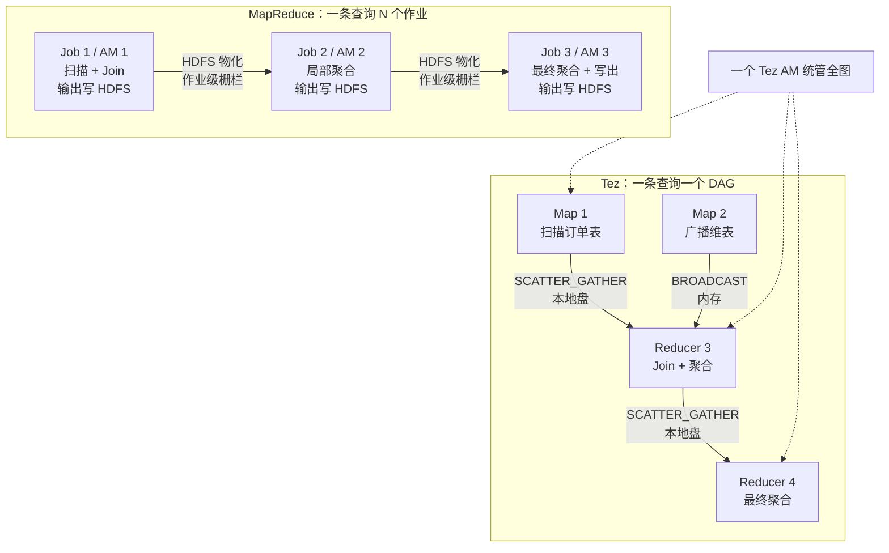
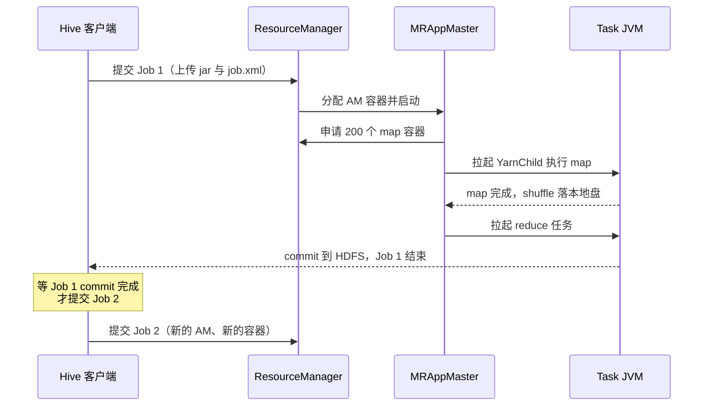
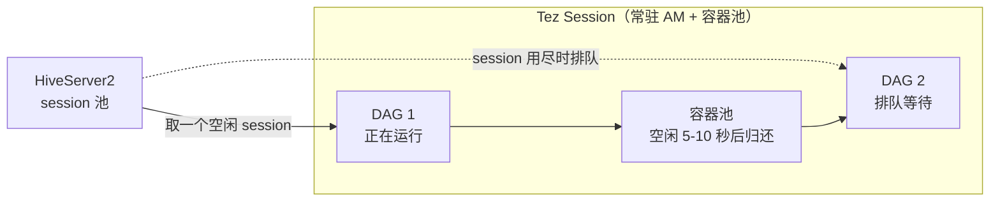
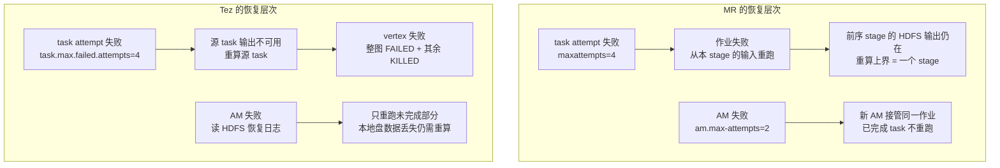
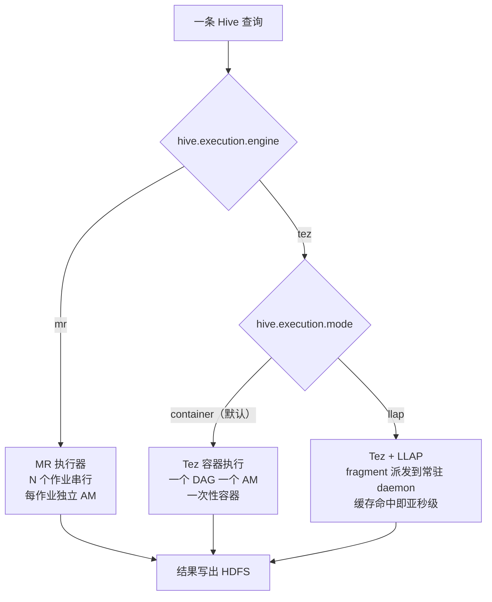

# 04 执行引擎对比：MapReduce vs Tez 的本质差异

**摘要：**

MapReduce 与 Tez 之间的差别，被引用得最多、被理解得最少。多数材料停在"Tez 是 DAG，MR 是两阶段，所以 Tez 快几倍"这一层，而把真正决定行为的部分留在了黑箱里：中间结果到底写到哪里、什么时候写、写的是不是可靠存储、失败之后从哪个点重算。本篇只围绕一个差别展开——MR 在每一次 stage 边界上都要把中间结果物化到 HDFS、并由一个新的 ApplicationMaster 接手下一段；Tez 把整条查询编成一张 DAG 交给一个 AM，中间结果留在本地盘上。由此推导出五个后果：延迟来自作业启动次数而非计算本身、中间数据的落盘点从 HDFS 变成本地盘、失败恢复的颗粒度从 job 变成 task attempt 与 DAG、调优旋钮从 `mapreduce.*` 整体迁移到 `tez.*` 与 `hive.tez.*`、倾斜治理从"加 reduce 数"变成"先把大表变小表"。文章同时交代 MR 为什么仍然存在、LLAP 的适用边界（它是 Tez 之上的常驻执行层，不是第三个引擎）、引擎选择的判据表，以及切引擎时最容易踩的五个坑。文中的参数默认值取自 Hive 4.0 与 Tez 的官方源码，凡涉及推算的数字都写明了假设前提，不作基准测试的结论使用。

---

## 第 1 章 一个差别，五个后果

### 1.1 从一条每天都要跑的 SQL 说起

笔者用一个贯穿全篇的例子：数仓里有一张按天分区的订单宽表 `dwd_order_wide`，还有一张几十万行的客户维表 `dim_customer`，每天凌晨要把前一天的订单按地区汇总成一张日报表。

```sql
INSERT OVERWRITE TABLE dws_region_daily PARTITION (dt = '${bizdate}')
SELECT c.region,
       count(1)      AS order_cnt,
       sum(o.amount) AS gmv
FROM dwd_order_wide o
JOIN dim_customer c ON o.cust_id = c.cust_id
WHERE o.dt = '${bizdate}'
  AND c.status = 'active'
GROUP BY c.region;
```

这条 SQL 不长，但它同时触发了三重计算：两张表要 join，join 之前要过滤，join 之后要按 key 重分布再聚合，最后写出。谁来做"重分布"、重分布的数据放在哪里、上一个环节与下一个环节之间要不要停下来等，这正是两种引擎分道扬镳的地方。

执行 `EXPLAIN` 就能看到分野：在 MR 上，输出是一串 `Stage-1`、`Stage-2`、`Stage-3`，每个 Stage 对应一个独立的 MapReduce 作业；在 Tez 上，输出是一组 `Map 1`、`Reducer 2`、`Reducer 3` 这样的 vertex，它们是同一张图上的节点。前者是**"一条查询 N 个作业"**，后者是**"一条查询一个 DAG"**——DAG 即有向无环图（Directed Acyclic Graph），这句话足以概括本篇要讲的全部内容。

### 1.2 本质差别只有一句

把上面那句话说得再准确一点：MapReduce 把每一次 stage 边界都做成一次完整的作业提交，边界上的数据必须**物化到可靠存储**（HDFS）、必须由一个新建的 ApplicationMaster 接管下一段计算；Tez 把这些边界收进同一张图、交给同一个 AM，边界上的数据只写在上游 task 所在节点的本地盘上，只在必要时才落 HDFS。

这句话里其实有三个可以独立拆开的动作：数据的落点（HDFS 还是本地盘）、调度权的归属（新 AM 还是同一个 AM）、以及等待的形态（作业级栅栏还是 vertex 依赖）。三者是同源的——正因为 MR 的调度单位是一个作业，所以它必须在作业边界上做一次"能交给下一任"的持久化；正因为 Tez 的调度单位是一张图，它才有资格把中间结果留在本地、把等待降级成图内的一条依赖边。

由此可以预见五个后果，本篇的中间五章就是逐项展开这五条：

1. 延迟的主要成分从"计算"变成了"作业启动与调度"，N 个 stage 就有 N 份固定开销；
2. 中间数据的落盘点从 HDFS 变成本地盘，副本数、网络放大、磁盘清理的对象全都变了；
3. 失败恢复的颗粒度从"整个 job 重跑"细化到"task attempt 重试、源 task 重算、DAG 恢复"；
4. 调优旋钮整体换了命名空间，`mapreduce.*` 上的很多经验在 Tez 上直接失效；
5. 倾斜治理的手段变了——不是因为有更好的开关，而是因为 Tez 能在运行时把"大表变小表"。

用一张图把两种形态摆在一起，差别会直观很多。



### 1.3 先纠正三个流传很广的误读

在展开后果之前，得先把三个常见的误读拆掉，否则后面每一条推论都会建立在错误的前提上。

第一个误读是"Tez 把中间结果放在内存里直传，所以快"。这句话不完全错，但它把"能力"当成了"现状"。翻开 Tez 的 `EdgeProperty` 源码，边上的数据生命周期由 `DataSourceType` 枚举描述，一共只有三个值：`PERSISTED`（数据被持久化，源 task 不运行时下游仍能读到，但如果数据不可用，源 task 会被重算）、`PERSISTED_RELIABLE`（可靠持久化，源码里明确标注尚未支持）、`EPHEMERAL`（数据仅在源 task 运行期间可用，要求下游与上游并发执行，标注为开发中）。Hive 在 Tez 上走的是 `PERSISTED`：数据写在上游 task 所在节点的本地盘，下游通过 shuffle 服务以 HTTP 拉取。真正的"边算边传、不落盘"属于 `EPHEMERAL` 加 `CONCURRENT` 调度那一套，到今天仍是 `@Unstable`。所以 Tez 省下的是 HDFS 的往返与副本，不是磁盘本身。

第二个误读是"MR 的中间结果都写 HDFS"。MR 的 map 输出本来就不进 HDFS，它 spill 到 `mapreduce.cluster.local.dir` 指定的本地盘，再由 reduce 通过 NodeManager 上的 ShuffleHandler 拉走，默认端口 13562。写 HDFS 的是每个作业的输出，也就是 stage 边界上的那一份数据。把这两个层次混为一谈，就会得出"MR 的 shuffle 比 Tez 多一次 HDFS 读写"这种量级完全不对的结论。

第三个误读是"Tez 的 AM 挂了整个 DAG 只能从头再来"。Tez 有一个默认开启的 DAG 恢复机制（`tez.dag.recovery.enabled`，默认 `true`），AM 失败重启后会从 HDFS 上的恢复日志里读回 DAG 的进度，已经完成且输出仍可获取的 vertex 不必重跑。它不是万能的——输出在本地盘上的 vertex 一旦所在节点丢失，仍然要重算源 task——但"毫无检查点"这个判断是不成立的。

> [!info] 本篇的边界
> Tez 自身的 DAG 调度、AM 与 YARN 的交互，属于 YARN 那一组文章的题目，本篇只用一句话带过并给出路由：Tez 的 DAG 是提交给 YARN 的一个 Application，AM 在内部按顶点依赖做调度，详见 [[大数据/Hadoop/Yarn/06 ApplicationMaster 机制——以 Spark on YARN 为例|ApplicationMaster 机制]]。而 Hive 编译器如何把 Operator 树切成 vertex、哪些算子会在什么条件下合并成一个 vertex，是 [[03 SQL 编译全链路：从 HQL 到 Operator Tree]] 的内容，本篇只讲结论。Tez 的具体调优手法（内存怎么算、慢 vertex 怎么查、倾斜怎么治）集中在 [[10 Tez 调优实战：DAG 诊断、内存配置与数据倾斜治理]]。

---

## 第 2 章 MR 的模型：作业边界就是物化边界

### 2.1 一个 MapReduce 作业的一生

要看懂 MR 的代价，得跟着一个作业从提交走到提交完成。

Hive 侧先把它编译好的 Operator 树翻译成一个 `Job` 对象：设置输入格式与分片、Mapper 与 Reducer 类、输出格式与输出目录、各类 `mapreduce.*` 参数，然后把作业描述（job.xml）、依赖的 jar 一起上传到 HDFS 的临时目录。提交动作最终落到 `ResourceManager` 的 `submitApplication`，此刻集群里还没有任何计算发生，只是排上了一个 Application 的号。

RM 挑一个节点，起一个 `MRAppMaster` 容器。AM 起来之后才真正开始要资源：按分片数申请 map 容器、按 reduce 数申请 reduce 容器，拿到容器后在 NodeManager 上拉起 `YarnChild` 进程执行 task。也就是说，一个作业从"提交"到"第一个 task 开始算"，中间隔着 AM 申请、AM 启动、容器申请、容器分配、JVM 启动、类加载六七个环节，任何一个环节排队，这段时间就归零产出。

map task 读分片、跑 Operator 树，输出先写进 `mapreduce.task.io.sort.mb`（默认 100MB）大小的环形缓冲，到 `mapreduce.map.sort.spill.percent`（默认 0.80）就开始溢写本地盘，溢写文件在后台按 `mapreduce.task.io.sort.factor`（默认 10）路归并。reduce 那头不等 map 全部完成——`mapreduce.job.reduce.slowstart.completedmaps` 默认 0.05，即 5% 的 map 完成后 reduce 就会被调度起来——但 reduce 的 shuffle 阶段必须等所有 map 的输出都可读才能收尾，这个"等"是结构性的。reduce 通过 HTTP 从各节点拉取自己那部分数据，并发度 `mapreduce.reduce.shuffle.parallelcopies` 默认 5，合并后进 reduce 函数。

最后是 commit：reduce 的输出先写到 HDFS 的 `_temporary` 目录，由 `FileOutputCommitter` 完成 rename，Hive 在表目录下用 `.hive-staging` 这个中间目录承接，成功后才挪进正式分区。至此一个作业结束，AM 退出，容器归还。

### 2.2 作业之间那条栅栏是谁立的

单看一个作业，上面这些机制都挺合理。问题出在"Hive 的一条 SQL 需要好几个这样的作业"。

Hive 的 MR 执行器把 stage 之间的依赖写在客户端：上一个作业 `waitForCompletion` 返回 `true`（意味着 commit 已经完成、输出已经可见），才构造并提交下一个作业。这条规则没有商量的余地，因为下一个作业的输入路径就是上一个作业的输出路径——数据没 commit，输入就不存在。

所以"必须等"**不是调优问题，而是模型问题**：MR 把"计算的先后"表达成了"作业的先后"，而作业之间唯一的通信媒介是文件系统。这条栅栏很像工厂的交接班——上一班必须把在制品清点入库、填好交接单，下一班才能接手，哪怕下一班要做的只是同一个零件上的下一道工序。想让 stage B 在 stage A 还没完全结束时就开始读 A 的部分输出，在 MR 里没有正规的表达方式。

这里有一处常被忽略的细节需要澄清：不相关的作业并不必然串行。Hive 有一个 `hive.exec.parallel`（默认 `false`），打开后同一查询中互不依赖的 stage 可以并发提交，并发上限由 `hive.exec.parallel.thread.number`（默认 8）控制。也就是说 MR 的形态是"有依赖必须等，无依赖可以并行"，而 Tez 的形态是"依赖写在图里，图自己决定谁能跑"。两者的区别不在于能不能并行，而在于并行的边界是由人写在 DAG 里，还是由编译器从作业拓扑里算出来。

### 2.3 物化到 HDFS 到底贵在哪

把 stage 边界的数据写进 HDFS，代价由四部分构成，且都随中间数据量线性增长。

其一是副本。默认三副本意味着写 1TB 中间数据，实际落盘 3TB，其中两份跨节点甚至跨机架传输。其二是写路径。HDFS 的写入是流水线式的：客户端把包发给第一个 DataNode，依次转发到第二、第三个，确认沿原路返回，这条链路的时延与节点负载都会反映在写吞吐上。其三是读回。下一个作业要把这份数据重新读一遍，而这个读取是完全多余的——如果没有 stage 边界，这份数据本可以直接流进下一个算子。其四是元数据与清理。每个 stage 边界产生一批文件与目录，NameNode 要多记一批 block，Hive 的清理线程要多扫一批临时目录，文件数多了之后小文件问题还会叠加上来。

这四笔账在单条 SQL 上不明显，在一天几万个作业的集群上就是集群吞吐的主要构成之一。

### 2.4 固定开销的算术

把固定开销单独拎出来算一遍，能看清 MR 在"多 stage 小数据"场景下的劣势。以下数字是基于公开默认值与常见集群形态的示例推算，不是某次基准测试的实测结果。

假设每个作业从提交到第一个 task 开始计算需要 5 至 15 秒（取决于队列排队、AM 容器是否立刻拿到、NodeManager 拉镜像与 jar 的速度），每个 task 的 JVM 冷启动与类加载需要 0.5 至 2 秒（hive-exec 及其依赖是数百 MB 级别的 jar 集合），一条 SQL 被切成 5 个作业，每个作业 200 个 task。

那么仅作业级固定开销就是 25 至 75 秒；task 级 JVM 开销是 1000 次乘以 0.5 至 2 秒，即 500 至 2000 秒的 CPU 时间，按 100 个容器并发摊薄后约 5 至 20 秒的墙钟时间。两项相加，一条本来只需要 100 秒有效计算的 SQL，墙钟时间会被推到 130 至 200 秒。stage 数越多，这个比例越难看：10 个 stage 意味着 50 至 150 秒的作业级开销，而它与你处理的数据量毫无关系。

这不是说 MR 慢，而是说 MR 的时间成本里有一块与数据量无关的"起步价"，多 stage 查询要为这个起步价付很多次。

把一个作业从提交到结束的时序画出来，固定开销落在哪几个环节一目了然。



---

## 第 3 章 Tez 的模型：把边界收进一张图

### 3.1 DAG、Vertex、Edge 的语义

Tez 的抽象只有四个词：DAG 是整张图，Vertex 是一组并行执行的任务，Edge 是两个 Vertex 之间的数据通道，Task 是 Vertex 内的执行单元。真正决定行为的是 **Edge**，而 Edge 不是一个"粗细"概念，它由三个正交的属性描述。

第一个属性是数据移动方式 `DataMovementType`：`ONE_TO_ONE` 表示上游第 i 个 task 的输出给下游第 i 个 task；`BROADCAST` 表示任一上游 task 的输出对全部下游 task 可见；`SCATTER_GATHER` 表示所有上游 task 的输出被打散，同一 key 落到同一个下游 task。第二个属性是数据生命周期 `DataSourceType`，也就是 1.3 节讲过的 `PERSISTED`、`PERSISTED_RELIABLE`、`EPHEMERAL`。第三个属性是调度方式 `SchedulingType`：`SEQUENTIAL` 表示下游要等上游开始或完成后才可调度，`CONCURRENT` 表示上下游必须并发运行（同样标注为开发中）。

把这三个属性与 Hive 的算子对上，就得到下面这张对照表。

| Tez 边属性 | Hive 里的典型来源 | 数据是否离开进程 | 典型代价 |
|---|---|---|---|
| `SCATTER_GATHER` + `PERSISTED` | 普通 join、`GROUP BY`、`ORDER BY`、SMB join 的重分布 | 写本地盘，再由下游 HTTP 拉取 | shuffle 写放大、本地盘 IO、网络传输 |
| `BROADCAST` + `PERSISTED` | map join（小表广播、动态分区裁剪后的维表） | 小表全量复制到每个下游 task，驻留堆内哈希表 | 下游内存压力；小表必须足够小 |
| `ONE_TO_ONE` + `PERSISTED` | union、无 shuffle 的投影与过滤串联 | 逐分区对应，通常可做本地优化 | 几乎无额外代价 |
| `CUSTOM` | SMB join 的哈希分桶对齐、需要自定义路由的算子 | 由插件决定 | 实现复杂，行为依赖插件 |

这张表解释了为什么"Tez 更快"不是无条件的：只有当一个查询里存在多次 `SCATTER_GATHER` 时，Tez 才有机会把本该写 HDFS 的中间结果降级成本地盘；如果一条查询从头到尾只有 `ONE_TO_ONE`，两种引擎都几乎没有 shuffle，Tez 的收益就只剩下省掉作业启动，而这部分收益在小查询上可能还抵不过 DAG 本身的提交开销。

### 3.2 Hive 怎么把 Operator 树切成 Vertex

Hive 编译器在生成物理计划之后，会按照算子之间的数据交换边界切分 vertex：需要重分布的地方（ReduceSinkOperator）成为边的位置，边之前的一段算子成为一个上游 vertex，边之后的一段成为下游 vertex。切出来的 vertex 命名很朴素，就是 `Map 1`、`Reducer 2` 这样的序号，前面的词反映它的输入形态。生产上排查 Tez 作业时，日志与 Tez UI 里看到的都是这个名字，譬如某份故障报告里失败的顶点写作 `Map 4`，处理的是订单事件表，这是定位问题的第一手线索。

同一个 vertex 内的算子共享一个 JVM、共享一份内存配置，算子之间通过内存里的行批次传递，不经过序列化落盘。这也是 Tez 在"一条链上连续多个过滤与投影"时比 MR 省的地方——MR 里这些算子如果跨了 stage 边界，就要各自落盘再读回。

### 3.3 vertex 之间的数据落在哪里

默认情况下，上游 vertex 的 task 把输出写到本地盘，位置在 NodeManager 的 `yarn.nodemanager.local-dirs` 下，由 Tez 的运行时管理生命周期；下游 task 通过 shuffle 服务按分区拉取。这条路径与 MR 的 shuffle 在物理上没有本质区别，有区别的是它的**归属**：MR 里 shuffle 数据属于"当前作业"，作业结束即失效；Tez 里 shuffle 数据属于"这条边"，只要源 task 的输出还有可能被读，它就得留着，因此 Tez 的清理逻辑与 DAG 的生命周期绑定，而不是与作业绑定。

有两种情况会绕开本地盘。一是广播边：小表的数据被复制到每个下游 task 的堆内哈希表，不落盘。二是动态分区裁剪（Dynamic Partition Pruning，DPP）生效时，大表的一侧在运行时被小表的过滤结果裁剪，很多分区根本不会被读，也就不会产生对应的 shuffle 数据。

### 3.4 收益的排序：省 AM 启动，还是省 HDFS 往返

很多材料把 Tez 的加速归因于 container 复用，笔者以为这个归因需要排个序。对一条多 stage 的生产 SQL 来说，收益从大到小大致是：省掉 N 减 1 次作业提交与 AM 生命周期（这一项直接砍掉前文算过的固定开销）、省掉 stage 边界上 HDFS 的写与读（这一项与中间数据量成正比）、省掉 task 反复启动 JVM 的类加载（这一项与 task 数成正比，且只在 session 复用时才显著）。

这个排序有实践含义：如果你的作业瓶颈在一条超长链的启动开销上，那么开 session、让容器与 AM 常驻就够了，不必去动 shuffle 参数；如果瓶颈在中间数据的读写量上，那才轮到分区裁剪、广播、SMB 这些手段。反过来，如果一条查询只有一个 vertex，前三项收益几乎为零，此时上 Tez 只是换了个执行框架。

### 3.5 一个 AM 一次只跑一个 DAG

Tez 的 session 是一个常驻的 AM，容器池挂在它下面。但一个 AM 在同一时刻只推进一个 DAG，DAG 之间是串行的。所以 HiveServer2 的并发能力并不取决于单个 session，而取决于 session 池的大小：`hive.server2.tez.default.queues` 列出要为哪些队列预启动 session（默认是空串，也就是说没有显式配置就没有预热的 session），`hive.server2.tez.sessions.per.default.queue` 决定每个队列预启动几个（默认 1）。这解释了生产上常见的现象——队列里配了 5 个 session，第 6 个用户提交的查询就要排队等 session 空闲，而集群资源其实还富余。

session、DAG 与容器池三者的接力关系，可以用一张图交代清楚。



---

## 第 4 章 后果一：延迟的成分变了

### 4.1 MR 的 N 次启动

在 MR 上，延迟里有一块**与数据量无关的成本**，它的大小等于"作业数乘以单次作业的启动代价"。启动代价包括：AM 容器的申请与排队、AM 的 JVM 启动与类加载、AM 向 RM 注册、按分片数申请容器、容器分配到 NodeManager、task 的 JVM 启动与 Hive 运行时的初始化（SerDe 实例化、Operator 树反序列化、UDF 类加载）。

其中 task 侧的 JVM 启动常常被低估。Hive 的算子树在 task 里是重新构造的，涉及大量反射与类加载；hive-exec 及其依赖体积很大，冷启动时页缓存不热，按经验量级，单个 task 从启动到开始处理数据常在零点几秒到数秒之间（量级判断）。Hadoop 早期提供过 `mapreduce.job.jvm.numtasks` 让一个 JVM 内连续跑多个 task，但默认值等于不复用，且它只能复用在同一个作业内，跨作业复用是不支持的——因为作业边界就是进程边界。

### 4.2 Tez 的启动成本被摊到了 session 上

Tez 的做法是把 AM 与容器池的生命周期从"作业"拉长到"session"。HiveServer2 会为配置好的队列预启动 session，默认 `hive.server2.tez.initialize.default.sessions` 为 `true`，`hive.server2.tez.sessions.per.default.queue` 为 1；session 本身有寿命，`hive.server2.tez.session.lifetime` 默认 162 小时，还带 3 小时的随机抖动，避免所有 session 在同一时刻集体重启。session 过期或 AM 挂掉之后，下一个查询要重新经历一次冷启动——这是很多人感觉"Tez 有时也不快"的原因，且往往与查询本身无关。

容器复用（Container Reuse）则由一组参数控制，其中最关键的是**空闲容器的保留窗口**：最小保留 5 秒、最大保留 10 秒（`tez.am.container.idle.release-timeout-min.millis` 与 `tez.am.container.idle.release-timeout-max.millis` 的默认值分别是 5000 与 10000，Tez 会在这两者之间取随机值作为过期时间，从而让空闲容器平滑释放；具体默认值以对应 Tez 版本为准）。这个十秒的窗口意味着：同一 session 上连续跑的两条查询，只要间隔不超过十秒，第二条就能直接复用第一条留下的容器。

| 参数 | 默认值 | 作用 | 调大的代价 | 调小的代价 |
|---|---|---|---|---|
| `tez.am.container.idle.release-timeout-min.millis` | `5000` | 空闲容器最短保留时间 | 复用率上升，但空闲资源占得更久 | 容器很快被收回，复用率下降 |
| `tez.am.container.idle.release-timeout-max.millis` | `10000` | 空闲容器最长保留时间，过期时间在 min 与 max 之间随机取值 | 空闲窗口变长，多租户下会挤压别人的资源 | 冷启动次数变多，短间隔查询吃亏 |
| `tez.am.session.min.held-containers` | `0` | 空闲 session 至少保留的容器数 | 下一批查询起跑更快，代价是长期占着资源 | 默认即 0，空闲时全部归还 |
| `hive.server2.tez.sessions.per.default.queue` | `1` | 每队列预启动的 session 数 | 并发上限提高，代价是每个 session 一个常驻 AM | 并发受限，查询排队等 session |
| `hive.server2.tez.session.lifetime` | `162h` | session 寿命，另加 3 小时随机抖动 | 冷启动频率下降，代价是 AM 长期驻留 | 配置变更生效更快，但冷启动更频繁 |

另外三个开关是布尔项，不适合用"调大调小"描述：`tez.am.container.reuse.enabled` 默认 `true`，关掉等于放弃 JVM 复用；`tez.am.container.reuse.rack-fallback.enabled` 默认 `true`，关掉会牺牲一部分复用率换取更严格的数据本地性；`tez.am.container.reuse.non-local-fallback.enabled` 默认 `false`，打开后复用率上升，但读 HDFS 走网络的比例跟着上升，扫描量大的作业要慎用。

### 4.3 反过来说：Tez 在什么情况下更慢

有两种情况 Tez 会输给 MR，且都不是配置问题。

第一种是单 vertex、无 shuffle 的查询。此时 Tez 的优势项全部不成立，剩下的只有"DAG 提交 + 从 session 池取 session + vertex 调度"这套流程的开销。如果 session 恰好不在，还要加上一次冷启动。

第二种是小查询。Hive 有一个与引擎无关的优化：`hive.fetch.task.conversion`（默认 `more`）会让"单表、无聚合、无 distinct、无 join"的查询直接走 fetch task，不进任何执行引擎。这条优化在很多简单查询上抹平了引擎差异，但也意味着"用 Tez 跑小查询"这件事本身没有太多意义——真正被 Tez 的启动开销伤害的是那些**刚好复杂到无法 fetch、又简单到只有一两个 stage** 的查询，这类查询在调度平台上占比往往不低。

### 4.4 延迟差的量化

把前面的算术列成表，可以看清延迟差是怎么随 stage 数放大的。下表全部为示例推算，参数取"每作业启动 5-15 秒、每 task JVM 冷启动 0.5-2 秒、有效计算时间相同"这一组假设，不代表任何具体集群的实测值。

| 查询形态 | stage / vertex 数 | MR 的作业级固定开销 | Tez（session 已热）的固定开销 | 差额的性质 |
|---|---|---|---|---|
| 单表过滤 + 写出 | 1 | 5-15 秒 | 3-10 秒 | Tez 略优，可能被 DAG 开销吃掉 |
| 两表 join + 聚合 | 3 | 15-45 秒 | 3-10 秒 | 差额 12-35 秒 |
| 五表 join + 两级聚合 | 6 | 30-90 秒 | 3-12 秒 | 差额 27-78 秒 |
| 十 stage 的宽表加工链 | 10 | 50-150 秒 | 3-15 秒 | 差额 47-135 秒 |
| 复杂窗口 + 多次重分布 | 12 | 60-180 秒 | 4-18 秒 | 差额 56-162 秒 |

表里能读出一个结论：**Tez 省下的是常数项，不是斜率**。当一条 SQL 的有效计算时间在小时级时，省掉的一两分钟并不改变结论；当有效计算时间只有一两分钟时，省掉的一两分钟就是全部。这也是为什么交互式场景对引擎切换的感知远比离线批处理强烈。

container 复用率同样可以推算一遍，用来说明"session 内复用"到底值多少。假设一个 session 上连续跑 30 条查询，每条需要 60 个容器，session 池保留 40 个空闲容器：不复用时需要 30 乘以 60 等于 1800 次容器启动；复用时需要 40 次预启动，加上每条查询超出池子的 20 个新容器共 600 次，容器启动次数降到 640 次，复用率约 64%（示例推算）。若把池子按峰值配到 60 个，启动次数降到 60 加少量波动，复用率可到 95% 以上，代价是空闲时也占着 60 个容器的资源。这条曲线说明 session 池的容量选择本质上是在"冷启动延迟"与"资源闲置"之间做取舍，不存在既省资源又零延迟的配置。

---

## 第 5 章 后果二：中间数据的落点变了

### 5.1 三个落盘点

Hive 查询里数据会经过三个层次的存储位置，把三者混为一谈是很多容量问题的根源。

最内层是内存缓冲：sort buffer、hash 表、行批次。它最快，但容量由容器内存硬性限制，超了要么溢写要么 OOM。中间层是本地盘：map 输出、shuffle 数据、溢写文件。它比 HDFS 快一个数量级（无副本、无 pipeline、无 NameNode 交互），但不可靠，节点一挂就没了。最外层是 HDFS：表数据、stage 边界物化、DAG 恢复日志、最终输出。它可靠但昂贵。

打个不精确的比方：本地盘是工位旁的草稿纸，写了就用、丢了也不心疼，只是得重算；HDFS 是档案馆，进馆要登记、要复印三份、要按编号上架，取用还得走流程。三者的差别不只是快慢，还有"错了之后怎么补"的代价。

MR 与 Tez 的差别不在于有没有这三个层次，而在于**哪一层的使用量被放大了**。MR 把每个 stage 边界升到最外层，Tez 把它压回中间层。

### 5.2 MR：每个 stage 边界一次 HDFS 往返

MR 的 stage 输出写到哪，取决于这个 stage 是不是最后一个。非最终的 stage（join 的中间结果、部分聚合的结果）写到 Hive 的 scratch 目录，默认在 `hive.exec.scratchdir` 即 `/tmp/hive` 下按用户与 queryId 分目录；最终的 stage 写到表的正式位置，中间经过 `.hive-staging` 目录再 commit。两者都在 HDFS 上，都吃副本、都吃 NameNode 元数据、都产生一批需要清理的文件。

这条路径的代价可以精确算：中间数据 1TB，三副本即 3TB 写入，加下游 1TB 读回，合计 4TB 的 HDFS 层面 IO；而如果引擎能把这份数据留在本地盘，同样的逻辑只需要 1TB 本地写加 1TB 本地读。四倍与两倍的差别，与磁盘吞吐无关，纯粹是模型带来的。

> [!warning] 关于副本的常见误算
> 三副本的成本常被算成"三倍磁盘占用"。实际影响更大：写入走的是跨节点流水线，网络传输量与副本数同阶；NameNode 要为每个 block 记三条位置信息；后续的 balance、快照、备份都会跟着放大。中间数据的特点是"写了就扔"，它承受三副本的成本却完全享受不到三副本的可靠性收益，这是 MR 物化模型最不划算的一笔。

### 5.3 Tez：vertex 输出留在本地盘

Tez 把 vertex 之间的数据写在本地盘，通过 shuffle 服务供下游拉取。这条数据在 `DataSourceType` 的语义里是 `PERSISTED`：源 task 不运行时下游仍能读到，但它**不是可靠存储**——如果某个节点的本地盘数据因节点故障、磁盘满、进程被杀而不可用，Tez 的处理方式是重算源 task，也就是把"数据丢了"翻译成"多做一遍计算"。

这个翻译很重要，它决定了两件事。一是 Tez 的失败恢复成本与"丢了多少中间数据"相关，而不是与"失败点在哪"相关。二是本地盘的容量与健康度成了 Tez 作业的硬约束：`yarn.nodemanager.local-dirs` 配了几个盘、单盘多大、清理策略是否及时，直接决定了大 shuffle 作业会不会因为盘满而失败。这一点在 MR 上不存在——MR 的中间数据在 HDFS 上，本地盘只承担 map 溢写这种短命文件。

另一面，Tez 也有绕开本地盘的手段。广播边把维表数据直接放进每个下游 task 的堆内哈希表，不产生 shuffle 文件；动态分区裁剪让大表的一部分分区根本不参与计算，等于从源头把 shuffle 数据量砍掉。这两者共同构成了"Tez 上中间数据比 MR 少"的真实原因——不是同样的数据换了个地方放，而是有些数据压根没被搬。

### 5.4 磁盘与网络放大的算术

用一个订单宽表 join 维表的典型日作业做示例推算。假设订单表当天分区压缩后 20TB，维表 200MB，join 之后参与聚合的中间结果是 4TB，聚合结果 200GB。

在 MR 上，join 作业的输出是那 4TB，写 HDFS 三副本即 12TB 落盘，聚合作业再读 4TB，聚合作业的输出 200GB 写三副本即 600GB，最终写出再搬一次。粗略合计 HDFS 层面写入约 12.6TB、读取约 4.2TB，网络侧的跨节点流量与副本数同阶。在 Tez 上，join 与聚合在同一个 DAG 里，4TB 中间结果写本地盘不复制，读回时部分可从本地或同机架拉取，HDFS 层面的写入只剩最终的 200GB 加恢复日志，读取只剩 20TB 的源数据。差异不在百分比，而在量级。

这里必须加一个限定：本地盘不是免费的。4TB 中间数据要在集群里找到足够多的空闲本地盘，且这些盘要能承受与其他租户作业的争抢。Tez 把 HDFS 的压力转成了本地盘与网络的压力，集群的瓶颈会随之从 NameNode 与 DataNode 迁移到 NodeManager 的磁盘与网卡上。

| 落盘点 | 可靠性 | 单位成本 | 容量风险 | 典型总量级 |
|---|---|---|---|---|
| 内存缓冲 | 无（进程结束即失） | 最高（内存最贵） | 容器 OOM、频繁 GC | GB 级 |
| 本地盘（Tez shuffle / MR spill） | 低（节点故障即失，需重算） | 中（无副本，但有清理与 IO 争抢） | 磁盘满、单盘热点、清理滞后 | TB 级 |
| HDFS（MR stage 输出） | 高（三副本） | 高（三副本 + pipeline + NameNode） | NameNode 压力、小文件 | 数十 TB 级 |

---

## 第 6 章 后果三：失败恢复的颗粒度变了

### 6.1 MR：task 重试之后的两次兜底

MR 的失败处理有明确的层次。最小单位是 task attempt：`mapreduce.map.maxattempts` 与 `mapreduce.reduce.maxattempts` 默认都是 4，即一个 task 连续失败四次才会被判死，届时整个作业失败。第二层是 AM：AM 自己挂掉时，RM 会按 `yarn.resourcemanager.am.max-attempts`（默认 2）重新拉起 AM，新 AM 依据作业历史恢复进度，已完成且输出仍可获取的 task 不必重跑——但如果那个节点连输出一起丢了，这部分要重算。这一层恢复只对同一个作业内的失败有效，不跨越作业边界。

第三层是作业之间。当第 3 个作业失败时，前两个作业的 HDFS 输出仍然在，重跑只需要从第 3 个作业开始。这个"从最近的 stage 边界重来"的能力，是物化模型少有的正面价值：**重算上界被 stage 边界截断**。一条 10 个 stage、跑 8 小时的链，最坏情况下只需要重跑最后一个 stage，而不是全部。

需要澄清的是，这不叫"job 级重试"——MR 没有作业级的自动重试机制。真正发生的是：作业失败之后，调度系统（或者人）决定从第 3 个 stage 重新提交，而前两个 stage 的物化结果让它不必从头再来。这个区别在故障复盘时很重要：MR 的恢复能力来自"物化点密"，不来自"重试机制强"。

### 6.2 Tez：attempt 重试、源 task 重算、DAG 恢复

Tez 的重试单位更细。task attempt 的失败上限由 `tez.am.task.max.failed.attempts` 控制，默认 4，与 MR 的语义接近；超过之后这个 task 失败，进而导致它所属的 vertex 失败。vertex 失败的处理不是"整个 DAG 从头再跑"，而是由 AM 判断：这一批 task 能否重试、依赖它的下游 vertex 是否要连带重跑。

真正体现差异的是**"源 task 重算"**这个机制。下游 vertex 要读上游某个 task 的输出，而那份输出是本地盘的 `PERSISTED` 数据，一旦不可用（节点挂、盘失效、数据被清理），Tez 不会让整个 DAG 失败，而是重新执行那个源 task，把它那份数据重新生成出来。代价是局部的、可度量的；收益是把"数据可靠性"这件本该由存储层负责的事，用"多算一遍"顶掉了。这个设计在磁盘便宜、CPU 相对空闲的集群上非常划算，在 CPU 已经打满的集群上则可能变成雪崩——重算本身要抢资源，而重算又会延缓其他作业。

vertex 失败的另一个后果是级联：一个 vertex 失败，整张 DAG 失败，其余 vertex 被 KILL。知识库里有一份真实案例，一条 Hive on Tez 作业因为 `Map 4` 顶点上自定义 UDF 的类加载问题抛 `AbstractMethodError`，最终呈现出 1 个 FAILED 顶点加 5 个 KILLED 顶点的形态（详见 [[Hive-Tez作业失败：自定义UDF与Hive版本不兼容导致AbstractMethodError]]）。从排障角度看，这个形态比 MR 更容易定位——失败顶点是唯一的，其余都是受害者；而 MR 的作业失败往往要在最后一个 stage 的日志里往回翻好几层。

第三层是 DAG 恢复。`tez.dag.recovery.enabled` 默认 `true`，AM 会把 DAG 的进度写入 HDFS 上的恢复日志（写入间隔由 `tez.dag.recovery.flush.interval.secs` 控制，默认 30 秒）。AM 崩溃重启后，它读回日志、恢复已完成 vertex 的状态，进而只重跑未完成的部分。这条机制的存在，使得"Tez 没有检查点"这个说法不成立；但它也确实不如 MR 的物化点可靠——恢复日志描述的是"进度"，不是"数据"，数据还在本地盘上，节点丢了照样要重算。

### 6.3 长作业上的分野

把三层恢复摆在一起，两种模型的分野就出来了。

MR 的恢复上界由 stage 边界决定：stage 越多，边界越密，最坏重算量越小，代价是每个边界都要付 HDFS 物化的钱。Tez 的恢复上界由"不可用数据的范围"决定：正常失败只需重跑若干 task，AM 崩溃加节点丢失则可能要把某个 vertex 的整个输入侧重算一遍，重算量取决于 DAG 的拓扑宽度而不是阶段数。

这解释了一个常见的经验判断：几个小时量级的超长批处理链，在 MR 上是"慢但稳"的，因为每一步都有物化兜底；在 Tez 上是"快但恢复贵"的，因为一旦真出事，重算的边界不好预估。反过来说，分钟级到十几分钟级的作业，MR 的物化开销占比过高，Tez 的快明显更值。

把两边的恢复层次并排画出来，重算边界的差别就清楚了。



| 失败类型 | MR 的处理 | Tez 的处理 | 重算量级的决定因素 |
|---|---|---|---|
| 单个 task 失败 | attempt 重试，最多 4 次 | attempt 重试，最多 4 次 | 单 task 的输入量 |
| 节点丢失 | 该节点上的 task 重跑，中间数据在 HDFS 不受影响 | 该节点上的 task 重跑，外加依赖其本地输出的下游源 task 重算 | 该节点承载的中间数据量 |
| AM 失败 | 新 AM 接管，进度不丢 | 读恢复日志，进度部分恢复 | 日志刷新间隔内的进度 |
| 整条查询失败 | 从失败 stage 重跑，前序物化保留 | 整图重跑（除非有外部编排） | 失败 stage 的位置 |

### 6.4 重试的放大效应

重试不是免费的，它在两个方向放大成本。一是资源方向：一次 task 重试意味着同一份输入被读两遍、同一段计算被做两遍，在已经饱和的集群上会挤占其他作业。二是数据方向：如果失败发生在 shuffle 之后的 reduce 侧，上游 map 的输出可能已经过期或被清理，重试时有概率触发上游重算，形成链式放大。

倾斜会把这两个方向都放大。一个倾斜的 vertex 里，某个 task 处理的数据是其他 task 的几十倍，它失败的概率更高、重试的代价更大、拖尾时间更长。Tez 在这种情况下还多一层风险：拖尾的 vertex 会挡住整张 DAG 的完成，而它上游的 vertex 只能干等，资源利用率跟着下降。

---

## 第 7 章 后果四：调优旋钮换了命名空间

### 7.1 MR 上的旋钮清单

MR 的调优经验集中在 `mapreduce.*` 与少量 `yarn.*` 上，核心是四组：内存（`mapreduce.map.memory.mb`、`mapreduce.reduce.memory.mb` 以及对应的 `java.opts`）、排序与溢写（`mapreduce.task.io.sort.mb`、`mapreduce.map.sort.spill.percent`、`mapreduce.task.io.sort.factor`）、shuffle（`mapreduce.reduce.shuffle.parallelcopies`、`mapreduce.job.reduce.slowstart.completedmaps`）、容错与推测（`mapreduce.map.maxattempts`、`mapreduce.reduce.maxattempts`、`mapreduce.map.speculative`）。

这一组参数在 MR 上的心智模型是"每个 task 一个 JVM，配置决定这个 JVM 用多少内存、能缓冲多少数据、能并发拉几个流"。它们与作业数无关，与 stage 数无关，只与单个 task 的行为有关。

### 7.2 Tez 上的三层旋钮

Tez 的旋钮分布在三个层次，**混淆层次是配置失效的头号原因**。

AM 层：`tez.am.resource.memory.mb` 默认 1024，决定 AM 容器大小；`tez.am.launch.cmd-opts` 决定 AM 的 JVM 参数；`tez.am.task.max.failed.attempts`、`tez.am.speculation.enabled`（默认 `false`）决定容错与推测；`tez.am.container.*` 决定容器复用与保留窗口。

容器层：`hive.tez.container.size` 默认 `-1`，表示沿用 YARN 的最小分配单位（`yarn.scheduler.minimum-allocation-mb`，默认 1024）；`hive.tez.container.max.java.heap.fraction` 默认 0.8，Hive 用它从容器大小推出 JVM 的 `-Xmx`；`hive.tez.java.opts` 默认 `null`，即由 Hive 自动生成，一旦手工指定 Xmx，就把这套自动推导架空。

vertex 层：`hive.tez.auto.reducer.parallelism` 默认 `false`，打开后 reduce 侧的并行度可以根据上游统计在运行时调整；`hive.tez.min.partition.factor` 默认 0.25、`hive.tez.max.partition.factor` 默认 2.0，构成并行度调整的上下界；`hive.tez.dynamic.partition.pruning` 默认 `true`；`hive.tez.dynamic.semijoin.reduction` 默认 `true`；`hive.tez.bucket.pruning` 默认 `true`。

把两边的参数对照起来，最常见的错误是把 MR 的键名原样搬到 Tez 集群上。

| MR 参数 | 在 Tez 上是否生效 | Tez 上对应的做法 | 误用的后果 |
|---|---|---|---|
| `mapreduce.map.memory.mb` / `reduce.memory.mb` | 否 | `hive.tez.container.size` 加堆比例推导 | 设了不生效，误以为调过内存 |
| `mapreduce.map.java.opts` / `reduce.java.opts` | 否 | `hive.tez.java.opts` | 同上，且可能覆盖自动推导 |
| `mapreduce.task.io.sort.mb` | 否 | Tez 的 shuffle 缓冲由运行时参数控制，以版本默认值为准 | 调了没有对应关系 |
| `mapreduce.reduce.shuffle.parallelcopies` | 否 | 由 Tez 的 shuffle 服务自动决定 | 无效 |
| `mapreduce.job.reduces` | 不可靠 | 并行度主要由 `hive.exec.reducers.*` 与 vertex 规则决定 | 设了未必生效，误以为已经固定了并行度 |
| `mapreduce.job.reduce.slowstart.completedmaps` | 否 | DAG 里由边依赖表达，不需要慢启动参数 | 无效 |
| `mapreduce.map.maxattempts` / `reduce.maxattempts` | 否 | `tez.am.task.max.failed.attempts`（默认 4） | 设了不生效 |
| `mapreduce.map.speculative` / `reduce.speculative` | 否 | `tez.am.speculation.enabled`（默认 `false`） | 以为开了推测，其实没有 |
| `yarn.app.mapreduce.am.resource.mb` | 否 | `tez.am.resource.memory.mb` | 设了不生效 |

### 7.3 container 复用的旋钮组合

容器复用的窗口参数在 4.2 节的表里列过，这里补两点实践上的注意。

一是复用的收益依赖 session 的连续性。批处理平台如果每条查询都新建 session（譬如每次 `hive -e` 起一个客户端），那么容器池刚建起来就随 session 结束而销毁，复用率接近零，调 `idle.release-timeout` 毫无意义。要让复用真正发生，客户端必须是长连接（Beeline 持续会话、JDBC 连接池、调度平台常驻的连接），或者走 HiveServer2 的 session 池。

二是复用的另一面是隔离性下降。同一个容器里先后跑不同查询的 task，前一查询留下的静态状态、类加载缓存、未释放的本地文件都可能影响后者。Hive 与 Tez 通过重新初始化运行时来保证隔离，但"容器复用导致的问题难查"是真实存在的排障经验——一个在 MR 上稳定的 UDF，换到复用的容器里可能暴露出静态变量的问题。

### 7.4 内存口径变了

MR 里内存要设两处：`mapreduce.map.memory.mb` 是向 YARN 申请的容器大小，`mapreduce.map.java.opts` 里的 `-Xmx` 是 JVM 堆大小，两者的比例由人自己把握，配错了就是"容器没满但 JVM OOM"或者"JVM 够用但被 YARN 杀掉"。

Tez 上 Hive 把这两步合成了一步：给一个容器大小，Hive 按 0.8 的比例推出堆大小，剩下的 0.2 留给 off-heap（shuffle 缓冲、JIT 代码缓存、元空间）。这个设计减少了配错的概率，但也带来一个新的坑：`hive.tez.container.size` 是容器级参数，一个查询里所有 vertex 的 task 都继承它，而实际上不同 vertex 的内存需求差别很大——广播维表的 vertex 需要大堆，写出结果的 vertex 只需要小堆。一刀切的结果是"按最重的 vertex 配，其他 vertex 全部浪费"，或者"按平均配，最重的 vertex 频繁 GC"。

### 7.5 反例：在 Tez 集群上用 MR 的调优经验

一个典型场景：运维发现 Tez 作业的 reduce 慢，于是把 `mapreduce.reduce.shuffle.parallelcopies` 从 5 调到 50，重启 HiveServer2，观察一周，毫无变化。原因是这个参数属于 MR 的 shuffle 客户端，Tez 的 shuffle 用的是自己的服务与并发模型，根本不会读这个键。

另一个场景更隐蔽：为了让"每个 reduce 处理的数据量均匀"，有人在 Tez 上手工 `set mapreduce.job.reduces=2000`。这个键在 Tez 路径上是否生效，取决于编译期计算并行度的规则；稳定能起作用的是 `hive.exec.reducers.bytes.per.reducer` 算出的初始并行度，以及 `hive.tez.auto.reducer.parallelism` 是否允许运行时再调。手工设的那个值被忽略，作业的并行度仍然由数据量与参数决定，而工程师以为自己已经"调过"了。

这类失效的根源在于：MR 的旋钮描述的是"进程行为"，Tez 的旋钮描述的是"图与容器"，两者不在同一个抽象层上。拿着 MR 的参数表去调 Tez，像拿着一台旧电视的遥控器去按新电视——按键手感一模一样，红外编码完全不同，屏幕不会有任何反应。迁移时的正确做法不是翻译键名，而是重新问一遍"我要控制的到底是哪一层"。

---

## 第 8 章 后果五：倾斜治理的路径变了

### 8.1 倾斜在两种引擎上的表现

倾斜的本质是"少数 key 的数据量远超其他 key"，它在两引擎上的表现形态不同。

MR 上倾斜通常表现为作业卡在 99%：map 全部完成，reduce 完成 95%，剩下几个 reduce 跑了一小时还没结束。日志里能看到 `Reduce 195/200` 这样的进度长时间不动。因为作业是一个整体，卡住的 reduce 会拖住整个作业的 commit，前序 stage 已经结束，集群资源被这几个任务低效占用。

Tez 上倾斜表现为某个 vertex 的 task 分布极度不均：一个 vertex 里 99% 的 task 在几分钟内完成，剩下的几个 task 跑了半小时。因为 vertex 之间是图上的依赖关系，上游已完成，下游在等这个 vertex，整张 DAG 的完成时间由最慢的那个 task 决定。差别在于：MR 的倾斜影响一个作业，Tez 的倾斜影响一张图，而一张图可能对应着多个下游 vertex 的等待。

### 8.2 MR 的手段

MR 上的倾斜治理是老三条。

第一条是加 reduce 数。`hive.exec.reducers.bytes.per.reducer` 默认 256,000,000 字节，即每个 reduce 处理 256MB 输入；`hive.exec.reducers.max` 默认 1009 是上限。加 reduce 能让单个 reduce 的数据量下降，但治标不治本——如果某个 key 占了总量的 30%，reduce 从 200 加到 2000，那个 key 仍然要落到一个 reduce 上，只是这个 reduce 的负载不变、其他 reduce 更空闲。

第二条是加盐，把热 key 拆成多个虚拟 key，聚合后再合并。这是真正能解决倾斜的办法，代价是 SQL 要改写，业务逻辑要跟着调整。

第三条是 skew join。`hive.optimize.skewjoin` 默认 `false`，打开后 Hive 在运行时检测超过 `hive.skewjoin.key`（默认 100000 行）的热 key，把它单独走一遍 map join 流程；`hive.optimize.skewjoin.compiletime` 默认也是 `false`，打开后 Hive 在编译期用元数据里的倾斜信息拆计划，但前提是统计信息里确实记了倾斜。两者通常要一起开，且都依赖统计信息的质量。

### 8.3 Tez 的手段

Tez 上的倾斜治理，表面上看多了几个开关，实质上多的是"运行时把大表变小表"的能力。

`hive.tez.dynamic.partition.pruning` 默认 `true`。它的作用是在运行时把小表的过滤结果当作一个过滤条件，下推到扫描大表的 task 上——原来需要把大表整个分区读进来再 join，现在只读命中的那部分。对"大表 join 小维表"这种典型场景，它能把参与 join 的数据量砍掉一个数量级。

`hive.tez.dynamic.semijoin.reduction` 默认 `true`，且依赖动态分区裁剪开启。它在运行时把维表的 key 集合做成一个过滤条件（半连接归约），在 map 侧就把大表里不匹配的行过滤掉，减少 shuffle 的数据量。这两项合起来，效果不是"让倾斜消失"，而是"让参与 shuffle 的数据变少"，倾斜的绝对量级跟着下降。

`hive.tez.auto.reducer.parallelism` 默认 `false`，打开后 reduce 侧的并行度可以根据上游 map 输出的统计在运行时调整。它能在数据量超出预期时自动扩容并行度，缓解"并行度按估算配小了"的问题，但对单 key 的热点无能为力。

### 8.4 一个需要纠正的说法

有一类材料把动态分区裁剪当成 Tez 的"倾斜治理开关"，这是把两件事混在了一起。动态分区裁剪解决的是**"读得太多"**，倾斜解决的是**"分得不均"**。前者是把整体的量降下来，后者是把局部的量摊平。一个极度倾斜的 join，即使开了动态分区裁剪，热 key 依然会落到单个 task 上；反过来，一个完全不倾斜的 join，动态分区裁剪照样有价值，因为它省的是 IO。

Tez 在倾斜上的真实优势在于另外两件事：一是运行时可以切换 join 策略，把"大表 join 小表"从 shuffle join 变成广播 join，从而彻底消除这个 join 的 shuffle；二是 vertex 级重算的代价比整作业重跑小，倾斜导致的 task 失败不必让整条链重来。

| 治理手段 | MR 是否可用 | Tez 是否可用 | 治的是什么 | 副作用 |
|---|---|---|---|---|
| 加 reduce / 加并行度 | 是 | 是（vertex 并行度） | 整体分布，不治单 key 热点 | 小文件、调度开销、资源浪费 |
| 加盐拆分热 key | 是 | 是 | 单 key 热点 | SQL 改写，两阶段聚合，结果需合并 |
| skew join（运行时） | 是 | 是 | 热 key 单独走 map join | 多一次作业或 vertex，统计信息依赖 |
| skew join（编译期） | 是 | 是 | 按元数据倾斜信息拆计划 | 依赖统计信息准确性 |
| 动态分区裁剪 | 否 | 是 | 减少大表读取量，间接降低倾斜量级 | 依赖小表足够小、过滤足够强 |
| 半连接归约 | 否 | 是 | 减少 shuffle 数据量 | 依赖 DPP，额外一次 key 收集 |
| 运行时 join 策略切换 | 否 | 是 | 把 shuffle join 变成广播 join | 小表必须能进内存 |

### 8.5 真正的治理逻辑没变

把手段列完，落点其实很朴素：倾斜治理的核心仍然是"识别热 key、拆分热 key、让计算围着数据走"，引擎能提供的是辅助——更少的无效 IO、更灵活的策略切换、更细的重试粒度。指望换引擎解决倾斜，等于指望换轮胎解决发动机过热。

反过来，引擎切换会改变倾斜的**暴露方式**。在 MR 上，倾斜表现为一个作业卡死，影响面清晰；在 Tez 上，倾斜表现为一张图的某个 vertex 拖尾，影响面是这张图及其下游。监控口径要跟着变：MR 看的是作业的 reduce 进度分布，Tez 看的是 vertex 内 task 的输入量分布，两者的判据不同。

---

## 第 9 章 MR 为什么还在，以及 LLAP 到底是什么

### 9.1 官方口径：默认引擎仍然是 MR

这件事常被误解。Hive 4.0 的 `HiveConf` 里，`hive.execution.engine` 的默认值仍然是 `mr`，合法取值只有 `mr` 与 `tez` 两项（Hive 4.0 的取值校验里已经没有 spark，Hive on Spark 这条路径在这一代被移除）。源码注释写得很直白：MR 因为历史原因仍是默认引擎，但它本身是一个历史引擎，在 Hive 2 系列中已被标记为弃用，可能在未进一步通知的情况下被移除。

这段注释值得逐字理解：**默认值是兼容性承诺，不是推荐值**；"可能被移除"是给下游发行版的信号。在实际的生产集群上，Hadoop 发行版通常会在 `hive-site.xml` 里把默认值改成 `tez`，所以"默认是 mr"这件事在源码层成立、在部署层不成立。判断一个集群到底用什么引擎，正确的方法不是查文档，而是 `set hive.execution.engine;` 看一眼当前会话的值，或者看 `EXPLAIN` 输出的是 `Stage-N` 还是 `Map N`。

### 9.2 三个还站得住的理由

MR 在今天仍有位置，理由不是"它还没被删"，而是三个具体场景。

其一是极小的查询与本地模式。`hive.exec.mode.local.auto` 默认 `false`，打开后当输入小于 `hive.exec.mode.local.auto.inputbytes.max`（默认 128MB）且文件数不超过 `hive.exec.mode.local.auto.input.files.max`（默认 4）时，Hive 会在本地单进程里跑 MR，不提交到 YARN。对于正在开发调试、反复试 SQL 的工程师，这条路径的往返延迟比申请一个 Tez session 低得多。

其二是兼容性，尤其是 UDF 与 SerDe 的类加载路径。知识库里的那份 Tez 故障报告就是一个好例子：一个用旧式 `extends UDF` 写的自定义函数，在 Tez 容器里抛 `AbstractMethodError`，根因指向容器实际加载的 hive-exec 版本与客户端不同。这类问题的模式很稳定——MR 与 Tez 的 task 容器在类路径构造、依赖 jar 的分发方式上并不相同，一个只在 MR 上验证过的 UDF jar，切到 Tez 上暴露问题属于常态而不是意外。所以"部分 UDF/SerDe 只在 MR 上测过"不是保守，而是很多团队真实的资产状态。

其三是排障的边界清晰。MR 的作业边界就是日志边界：一个作业一份 AM 日志、每个 task 一份容器日志、JobHistory 里一份作业历史，出问题沿着作业编号往回翻就行。Tez 的日志按 DAG 与 vertex 组织，一个 DAG 里几十个 vertex，跨 vertex 的因果链要靠 Tez UI 拼，对不熟悉的人门槛更高。运维团队的能力结构也是现实约束——会用 `yarn logs -applicationId` 的人远多于会读 Tez UI 的人。

### 9.3 LLAP 不是第三个引擎

LLAP（Live Long and Process）经常被列在"引擎三选一"里与 MR、Tez 并列，这个说法需要修正：LLAP 不是独立的执行引擎，它是 Tez 之上的一层常驻执行设施。启用方式是 `hive.execution.engine=tez` 加 `hive.execution.mode=llap`（`hive.execution.mode` 的默认值是 `container`，可选 `container` 与 `llap`）。也就是说，走 LLAP 的查询仍然是 Tez 查询，只是它的 fragment 不再申请一次性容器，而是被派发到常驻的 LLAP daemon 上执行。

LLAP 的组成部分有四块。daemon 是常驻进程，跑在 YARN 容器里，通过 YARN registry 或 `hive.llap.daemon.service.hosts` 被发现，它的容器大小由 `hive.llap.daemon.yarn.container.mb` 决定。executor 是 daemon 内的执行线程池，`hive.llap.daemon.num.executors` 默认 4，意味着一个 daemon 同时最多跑 4 个 fragment。cache 是 daemon 内的 ORC 数据与元数据缓存，`hive.llap.io.memory.size` 默认 1GB、`hive.llap.io.memory.mode` 默认 `cache`。调度侧则是由 Tez AM 内的 LLAP 调度服务把 fragment 派给合适的 daemon。

理解了这个结构，LLAP 的能力边界就清楚了：它**加速的是"读"，不是"算"**。命中缓存的 ORC 扫描可以做到毫秒级起跑，省掉的是容器申请、JVM 启动、数据从 HDFS 拉取这三段；但一旦查询需要做大规模 shuffle，reduce 侧仍然要回到普通容器里跑，因为 daemon 的 executor 数是固定的，不可能为一个查询临时扩出一千个并行度。

### 9.4 LLAP 的适用面：交互式，不是批处理

这条边界值得说透，因为把 LLAP 用在批处理上是常见的资源错配。

适合 LLAP 的场景有三个特征：查询模式重复（同一张宽表被反复用不同条件查，缓存能命中）、单查询数据量不大（几十 GB 以内，能在 daemon 的内存与 executor 数内完成）、对首字节延迟敏感（BI 工具、分析师手查、看板刷新）。此时 LLAP 的价值是把"每次查询都要重新申请资源、重新读盘"变成"资源常驻、数据已在内存"。

不适合 LLAP 的场景同样清楚：一次性的大批量 ETL（缓存永远不命中，还占着 daemon 的资源）、需要高并发的重 shuffle 作业（executor 数是硬上限，排队严重）、对成本敏感的离线任务（daemon 长期占用资源，闲时也在烧钱）。

还有一个容易被忽略的前提：LLAP 需要预热。daemon 刚起来时缓存是空的，第一次查询与没有 LLAP 时差别不大；只有在缓存被反复命中之后，收益才体现出来。所以"部署了 LLAP 但查询没变快"的常见原因不是配置错了，而是查询模式本身不具备复用性。

| 维度 | MR | Tez | LLAP（Tez + llap 模式） |
|---|---|---|---|
| 执行单元 | 每作业一个 AM，task 一次性容器 | 每 session 一个 AM，容器可复用 | 常驻 daemon，fragment 派发到 executor |
| 中间数据 | stage 边界写 HDFS | vertex 之间写本地盘 | 同 Tez；热点数据经缓存加速读取 |
| 启动开销 | 最高（每作业一次） | 低（session 内复用） | 最低（daemon 常驻，缓存预热的查询可到亚秒级起跑） |
| 资源形态 | 按作业弹性申请 | 按 session 保留容器池 | 固定池，长期占用 |
| 适用场景 | 超长批处理、兼容性兜底、本地调试 | 常规批处理、多 stage 加工 | 交互式查询、BI、重复模式的分析 |
| 主要风险 | 物化开销、作业数放大 | session 耗尽、本地盘压力 | 资源闲置、缓存不命中、并发上限 |

最后把三条执行路径的选择画成一张图，作为本章的位置感补充。



---

## 第 10 章 判据与切换的坑

### 10.1 引擎选择的判据

把前面九章压缩成一张表，按场景给判据。这张表的前提是集群同时具备 MR 与 Tez 能力，且 Tez 侧有可用的 session 池。

| 场景 | 首选 | 理由 | 需要确认的前提 |
|---|---|---|---|
| 常规离线批处理（分钟到小时级） | Tez | 多 stage 的作业启动开销与物化开销都被省掉 | session 池够用、本地盘容量充足 |
| 超长批处理链（数小时以上） | Tez，但要评估恢复成本 | 快是确定的；恢复代价取决于 DAG 宽度与本地盘可靠性 | 是否有编排层做失败重跑、节点是否稳定 |
| 交互式查询（BI、即席分析） | LLAP | 常驻 daemon 加缓存，起跑延迟最低 | 查询模式重复、数据量在 daemon 容量内 |
| 小查询（单表、无 shuffle） | 先看能否走 fetch task；否则 MR 或本地模式 | 引擎差异被 fetch 抹平，硬上 Tez 只是多一次 DAG 提交 | `hive.fetch.task.conversion` 是否生效 |
| 大表 join 小维表 | Tez | 动态分区裁剪加广播 join，能把 shuffle 彻底去掉 | 统计信息准确、小表能进内存 |
| 有 LLAP 集群且负载以交互为主 | LLAP 走交互，Tez 走批处理 | 两类负载对资源形态的要求相反，混跑会互相拖累 | 是否有队列隔离 |
| 依赖旧 UDF/SerDe、无法重新验证 | MR | 类加载路径已验证，避免迁移引入的隐性失败 | 该路径是否会被后续版本移除 |
| 需要精确控制每个 stage 的物化点 | MR | stage 边界即检查点，恢复边界清晰 | 能否接受物化开销 |

### 10.2 坑一：同一条 SQL 在两个引擎上结果可能不同

这是切引擎时最容易被低估的坑。多数情况下结果相同，但至少有四类差异是**结构性的**，不是 bug。

第一类是浮点聚合。`sum(double)`、`avg()` 这类计算不满足结合律，并行度不同意味着相加的顺序不同，结果的末位可能不同。MR 的 reduce 数由 `hive.exec.reducers.bytes.per.reducer` 与数据量决定，Tez 的 vertex 并行度由另一套逻辑决定，两者算出的并行度大概率不同，于是同一份数据在两引擎上跑出的 `gmv` 可能在最后几位上不一致。对账时如果做了精确比较，这种差异会被误判为数据错误。

第二类是无序的 `LIMIT`。`LIMIT 100` 不带 `ORDER BY` 时，返回哪 100 行取决于 task 的完成顺序与文件读取顺序，两个引擎的并行结构不同，取到的行自然可能不同。这不是引擎的缺陷，而是 SQL 本身没有定义顺序。

第三类是向量化路径。`hive.vectorized.execution.enabled` 默认 `true`，向量化执行在 Tez 上是生效的，在 MR 上不生效。向量化路径对类型转换、隐式 cast、某些函数的处理比行式路径更严格，结果是"在 MR 上静默通过并给出一个值，在 Tez 上报错"或者"给出不同的值"。切引擎后突然出现的一批类型错误，多半源于此。

第四类是优化规则不同。两个引擎各有独立的优化器规则集与执行顺序，常量传播、谓词下推、join 重排的时机都不一样。知识库那份 Tez 故障报告里就有一个相关细节：为规避 `GenericUDFBridge` 的问题，有人尝试关闭 `hive.optimize.constant.propagation`，但作业仍以相同错误失败——这说明优化规则与执行路径的耦合比想象中紧，靠关一个开关来对齐两个引擎的行为并不可靠。

### 10.3 坑二：内存口径是容器级

`hive.tez.container.size` 是**容器级参数**，一个查询内所有 vertex 共享；`mapreduce.map.memory.mb` 是 task 级参数，可以给 map 与 reduce 分别设。这个差别导致迁移时常见的两个错误：一是把 MR 的 map 内存值直接填进 Tez 的容器大小，忽略了容器里还要放 off-heap，结果 JVM 堆够用但容器被 YARN 杀掉；二是按最重的 vertex 配容器，导致轻量 vertex 大量浪费。

正确的做法是从最重的 vertex 出发倒推：先确定它的数据量与 join 形态需要多大堆，除以 0.8 得到容器大小，再看集群的 `yarn.scheduler.minimum-allocation-mb` 与队列上限是否允许。如果不同 vertex 的需求差异极大，那说明这条 SQL 本身需要拆分，而不是靠一个全局参数硬顶。

### 10.4 坑三：`hive.execution.engine` 是会话级

`hive.execution.engine` 可以在会话里 `SET`，改动只影响当前会话之后的查询。这个特性常被误用成"全局开关"：有人在 Beeline 里 `set` 了一下，发现"整个集群都变快了"，其实只是自己的会话变了；也有人改了 `hive-site.xml` 却没重启 HiveServer2，发现没生效。

更实际的问题是**切换的代价不对称**。会话从 MR 切到 Tez，第一次查询要拿一个 Tez session，可能要等几十秒（session 池为空时还要等 AM 启动）；会话从 Tez 切回 MR 则几乎瞬时，但之前占用的 Tez session 与容器池不会立刻归还，仍占着资源直到 session 空闲超时或过期。所以在同一个会话里来回切引擎，是一种既慢又费资源的操作，生产上应该按会话或按队列固定引擎，而不是按查询切。

另外要注意 HiveServer2 的配置白名单：`hive.server2.tez.sessions.restricted.configs` 可以限制查询级能改哪些配置，`hive.server2.tez.sessions.custom.queue.allowed` 控制是否允许把查询提交到自定义队列。多租户集群里，这两个参数决定了"用户能不能自己切引擎、自己换队列"，配错了要么放得太松（用户把作业全塞进交互队列），要么收得太死（调度平台的参数注入全部被拒）。

### 10.5 坑四与坑五：UDF 类加载与监控口径

UDF 的坑前面提过，这里补一条操作建议：迁移前把用到的 UDF jar 在 Tez 上跑一遍最小验证集，重点覆盖那些用旧式 `UDF` 接口、依赖 `GenericUDFBridge` 包装、以及打包时把 hive-exec 一起打进 fat jar 的情况。知识库那份报告的结论虽然是"根因尚未闭合"，但它至少证明了一件事：容器里实际加载的 hive-exec 版本，可能与客户端分析的版本不一致，而这种不一致在 MR 上不暴露。

监控口径的坑更琐碎。MR 的指标在 JobHistory 与 AM 日志里，关键项是 map/reduce 的进度、spill 次数、shuffle 字节数；Tez 的指标在 Tez UI 与 AM 日志里，关键项是 DAG 状态、vertex 状态、task 的输入输出记录数、GC 时间。两套指标的命名与聚合维度都不同，直接把 MR 的告警规则套到 Tez 上，结果通常是一片"无数据"而不是"正常"。切换引擎时，监控要先于业务切换完成改造，否则故障期间没有可看的指标。

### 10.6 迁移路径

如果一定要从 MR 迁到 Tez，笔者建议的顺序是这样：先在测试库上用同一批 SQL 双跑，比对行数与关键聚合值，把差异逐条归因（浮点、无序 limit、类型、规则）；再把 UDF 与 SerDe 的验证补上；然后按作业重要度分批切换，先切日志类与非核心报表，观察一周的失败率与耗时分布；最后处理那些在 Tez 上明显变慢的查询——它们通常要么 stage 太少（不值得上 Tez），要么倾斜严重（问题与引擎无关），要么内存口径没调对。

至于"到底该选哪个"，答案取决于集群的资源形态与团队的运维习惯，而不是某个基准数字。中间结果落不落盘，是一个模型选择；模型选择带来的五个后果，才是需要逐项算账的部分。算清楚这五笔账，选型就不需要争论了。

---

## 参考资料

1. [Apache Hive 4.0.0 源码：HiveConf.java](https://github.com/apache/hive/blob/rel/release-4.0.0/common/src/java/org/apache/hadoop/hive/conf/HiveConf.java)（`hive.execution.engine`、`hive.execution.mode`、`hive.tez.*` 等默认值的直接来源）
2. [Apache Tez 源码：TezConfiguration.java](https://github.com/apache/tez/blob/master/tez-api/src/main/java/org/apache/tez/dag/api/TezConfiguration.java)（容器复用、空闲释放窗口、task 失败次数的默认值）
3. [Apache Tez 源码：EdgeProperty.java](https://github.com/apache/tez/blob/master/tez-api/src/main/java/org/apache/tez/dag/api/EdgeProperty.java)（`DataMovementType`、`DataSourceType`、`SchedulingType` 三个枚举的语义）
4. [Apache Tez 官方站点](https://tez.apache.org/)（DAG 编程模型与用户指南）
5. [Hadoop MapReduce 默认参数：mapred-default.xml](https://github.com/apache/hadoop/blob/trunk/hadoop-mapreduce-project/hadoop-mapreduce-client/hadoop-mapreduce-client-core/src/main/resources/mapred-default.xml)
6. [Hadoop YARN 默认参数：yarn-default.xml](https://github.com/apache/hadoop/blob/trunk/hadoop-yarn-project/hadoop-yarn/hadoop-yarn-common/src/main/resources/yarn-default.xml)
7. [Hadoop MapReduce 官方教程](https://hadoop.apache.org/docs/current/hadoop-mapreduce-client/hadoop-mapreduce-client-core/MapReduceTutorial.html)
8. Dean J, Ghemawat S. [MapReduce: Simplified Data Processing on Large Clusters](https://static.googleusercontent.com/media/research.google.com/en//archive/mapreduce-osdi04.pdf). OSDI 2004
9. 本知识库：[[Hive-Tez作业失败：自定义UDF与Hive版本不兼容导致AbstractMethodError]]
10. 本知识库：[[大数据/Hadoop/Yarn/06 ApplicationMaster 机制——以 Spark on YARN 为例|ApplicationMaster 机制]]

---

> [!note] 思考题
> 1. Tez 的 `DataSourceType` 里，可靠持久化（`PERSISTED_RELIABLE`）至今标注为未支持，边算边传（`EPHEMERAL` 加并发调度）标注为开发中。如果这两项将来落地，Hive on Tez 的恢复语义会变成什么样，MR 的物化模型还有没有任何不可替代的场景？
> 2. 容器复用让 JVM 启动开销降了一个量级，但它同时让不同查询的 task 共享同一个进程。除了类加载缓存与静态变量，还有哪些状态会在复用中泄漏，如何在不放弃复用的前提下建立隔离？
> 3. 同一份数据、同一条 SQL，在 MR 与 Tez 上 `sum(double)` 的结果末位不同。业务方要求"两个引擎结果必须逐位一致"，这个需求合理吗，如果合理，代价是什么？
> 4. LLAP 的 executor 数是固定上限，这意味着它在高并发交互场景下会排队。面对"100 个分析师同时查"的负载，是应该扩 daemon 数量、加 session 池，还是限制并发并引导错峰？
> 5. 如果一个集群同时开着 MR、Tez 与 LLAP 三条路径，队列与资源池应该怎么划，才能避免批处理把交互式的 daemon 资源挤掉？