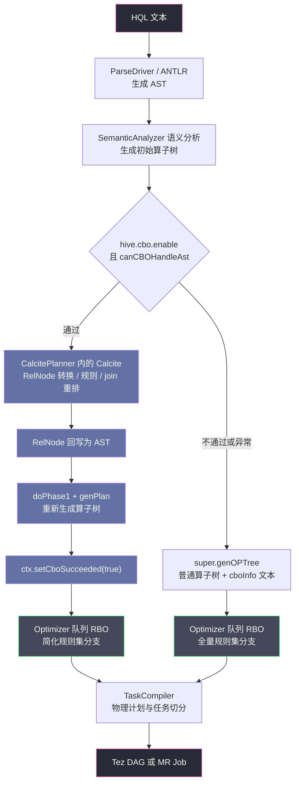
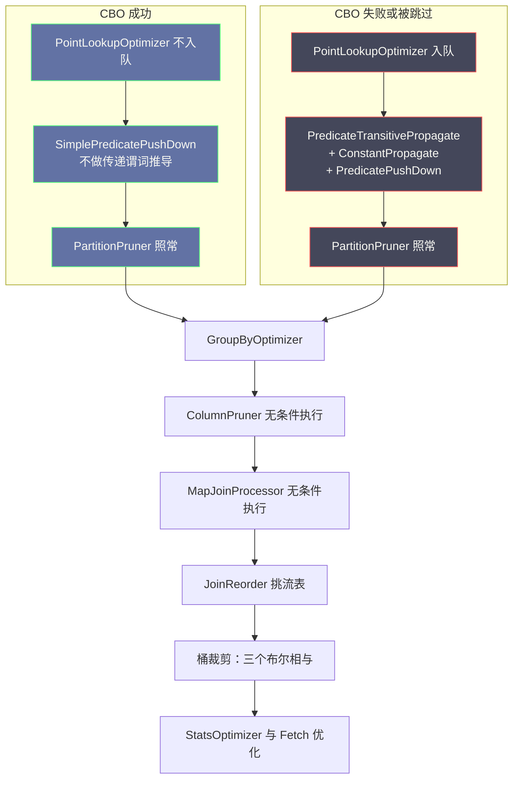
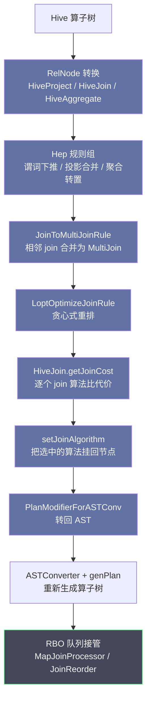
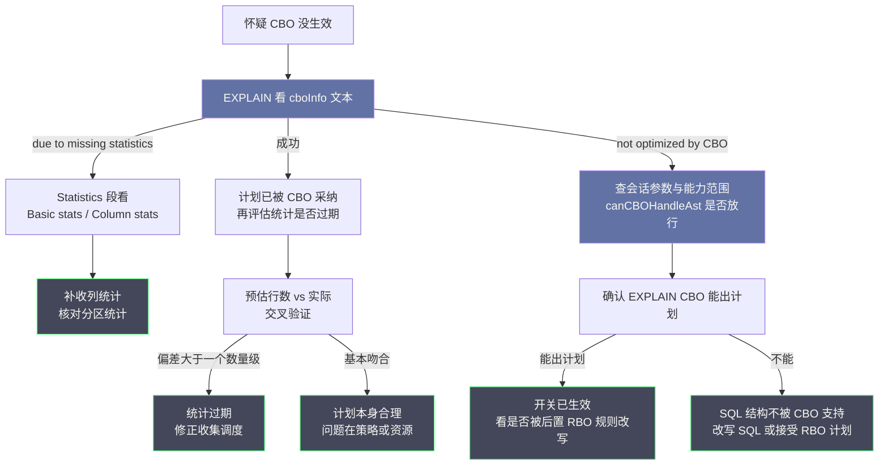
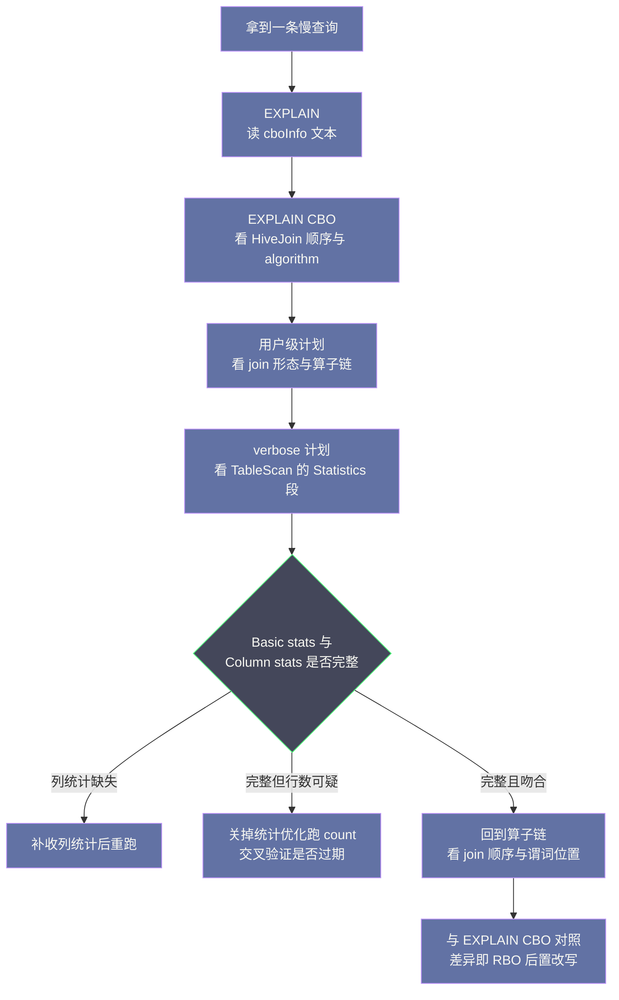

# 05 查询优化器：RBO 规则集与 CBO 代价模型

**摘要：**

Hive 的编译器里装着两套优化器，一套基于规则（RBO，`Optimizer` 里那串 `Transform`），一套基于代价（CBO，`CalcitePlanner` 里的 Calcite）。它们不是并列的两个选项，而是同一次编译里的前后两道工序：CBO 先把算子树翻译成关系代数、重排 join、挑定 join 算法，再把结果回写成 AST；RBO 接过这棵被改写过的树，继续做谓词下推、列裁剪、分区裁剪、map join 转换、桶裁剪这些物理层面的动作。两套优化器会互相影响甚至互相推翻——CBO 成功时 RBO 会切换成简化规则集，CBO 失败时 RBO 回到全量规则集，而 RBO 队尾的 `MapJoinProcessor` 与 `JoinReorder` 又能把 CBO 的裁决改掉。本文按源码顺序拆开这条链路：先看两套优化器的真实时序与冲突形态，再逐条看 RBO 变换队列里哪些规则会互相抵消，然后把 CBO 的输入、代价模型与 join 重排讲清，最后交付一份"`CBO 没生效`"的四成因排查表和 `EXPLAIN` 判读方法，并以三个反例说明为什么把开关全打开往往比默认配置更慢。文中的参数默认值与规则顺序以 Hive 4.0.x 的 `HiveConf` 与 `Optimizer` 源码为准，涉及 2.3、3.1 差异的地方单独标注。

---

## 第 1 章 两套优化器，与它们打架的三种形态

### 1.1 一条 SQL 与一组固定的表规模

为了让讨论有落点，后文始终围绕同一组表：`dwd_order_wide` 是订单宽表，按 `dt` 天分区，单个分区约 800 万行、40 列，日增一批；`dim_customer` 约 120 万行、`cust_id` 的值域约 90 万；`dim_shop` 约 3 万行。查询是一段典型的报表 SQL：

```sql
SELECT s.province, count(*) AS ord_cnt, sum(o.pay_amount) AS gmv
FROM dwd_order_wide o
JOIN dim_customer c ON o.cust_id = c.id
JOIN dim_shop s ON o.shop_id = s.id
WHERE o.dt BETWEEN '2026-11-01' AND '2026-11-07'
  AND c.region = '华东'
GROUP BY s.province;
```

这条 SQL 的逻辑结果只有一种，物理计划却可以有很多种：先扫宽表还是先过滤维表、`c.region = '华东'` 在 join 之前还是之后生效、宽表与两张维表的 join 顺序、维表是走广播还是走 shuffle。工程师在 `EXPLAIN` 里看到的最终计划，是两套优化器依次动手之后的结果，而这个结果会随统计信息的有无、几个布尔开关的取值上下摆动。理解摆动的来源，比记住某个"最优写法"更有价值。

### 1.2 真实时序：CBO 在前，RBO 在后

Hive 的编译入口是 `Driver.compile()`，它把活交给 `Compiler`，后者驱动 `SemanticAnalyzer.analyzeInternal()`。从 HQL 到 AST 再到算子树的完整链路归入 [[03 SQL 编译全链路：从 HQL 到 Operator Tree]]，本篇只需抓住一个类继承关系：`CalcitePlanner` 是 `SemanticAnalyzer` 的子类，它只覆写了一个方法——`genOPTree()`，而 CBO 就发生在这一次覆写里。

`CalcitePlanner.genOPTree()` 的判断顺序是这样的：先看 `hive.cbo.enable` 是否为真，再看 `canCBOHandleAst()` 是否认为这条 SQL 在 CBO 的能力范围内；两个条件都通过才真正进入 CBO 流程，否则直接调 `super.genOPTree()` 生成普通算子树。CBO 流程内部依次做四件事：`logicalPlan()` 把算子树翻译成 Calcite 的 `RelNode` 并跑一轮规则与 join 重排、`PlanModifierForASTConv` 把优化后的 `RelNode` 转回 AST、`doPhase1()` 重新走一遍语义阶段、`genPlan()` 从新 AST 重新生成算子树。默认返回路径就是这条"回写 AST"的路线，`hive.cbo.returnpath.hiveop` 默认 `false`；把它设成 `true` 才会走"直接把 Calcite 计划转成 Hive 算子 DAG"的另一条路。

CBO 成功之后，`CalcitePlanner` 会置 `ctx.setCboSucceeded(true)` 并写入一段 `cboInfo`。然后控制权回到 `SemanticAnalyzer.analyzeInternal()` 的第 7 步——`new Optimizer().initialize(conf); pCtx = optm.optimize();`，RBO 从这一步开始。

所以两套优化器的顺序是确定的：**CBO 先裁决，RBO 后执行**。这与很多文章里"先跑 RBO 再跑 CBO"的说法相反，把顺序记反了，后面所有的因果推理都会跟着错——你会以为 RBO 的错误 CBO 能补救，实际是 CBO 的判断被后面的 RBO 改写。



### 1.3 冲突的三种形态

两套优化器"打架"不是比喻，是源码里能读出来的三处硬连接。

**第一种是规则集切换。** `Optimizer.initialize()` 里几乎每条谓词类变换都带着 `pctx.getContext().isCboSucceeded()` 的判据。CBO 成功时，RBO 不再跑 `PredicateTransitivePropagate`、`ConstantPropagate`、`PredicatePushDown` 这一整套，改跑 `SimplePredicatePushDown` 加一个 `RedundantDynamicPruningConditionsRemoval`；`PointLookupOptimizer` 在 CBO 成功后干脆不加进队列。也就是说，同一条 SQL 在 CBO 成功与失败两种情况下，RBO 执行的规则集不是"差不多"，而是两套不同的队列。

**第二种是整体回落。** CBO 抛异常时，`genOPTree()` 的 catch 块会根据 `hive.cbo.fallback.strategy` 决定行为，这个参数默认是 `NEVER`——CBO 的错误是致命的，查询直接失败，而不是悄悄退化成 RBO 计划；设成 `CONSERVATIVE` 时，只有与子查询、视图无关的错误才回落到老优化器，设成 `ALWAYS` 则一律回落。另有一条例外路径藏在 join 重排内部：如果异常原因是缺列统计（`noColsMissingStats` 计数器大于零），`CalcitePlanner` 会打一行 `Missing column stats (see previous messages), skipping join reordering in CBO`，把计划原样返回并重新打开语义层的 join 合并，这条路径不抛异常。

**第三种是后置推翻。** RBO 队列尾部有几个变换会直接改掉 CBO 的结论：`MapJoinProcessor` 无条件入队，它按 `hive.auto.convert.join` 与文件大小阈值决定把普通 join 改成 map join，不看 CBO 选了什么算法；`JoinReorder` 在 `hive.reorder.nway.joins` 打开时重排单个 n-way join 内部的表序（源码注释写得很直白：`picks streamtable`）；`ReduceSinkDeDuplication` 会删掉重复的 shuffle 阶段，从而改变 join 的实际执行形态。CBO 在 Calcite 层辛苦比较出的代价最优解，可能被这三个变换在几十行之后改掉。

拿贯穿案例走一遍这条推翻链，会比抽象地讲更有体感。CBO 认为 `dim_customer` 过滤后约 17 万行、`dim_shop` 3 万行，两张都能放进内存，于是把 `dwd_order_wide` 作为流式侧、先与 `dim_customer` join，再与 `dim_shop` join，两个 join 都定为 map join；计划回写成 AST 之后，`MapJoinProcessor` 重新按文件大小判断广播侧，发现 `dim_customer` 那个分区的 ORC 文件有 60 MB，超过 `hive.auto.convert.join.noconditionaltask.size` 折算出的门槛，于是把第一个 join 改回 shuffle，而第二个 join 仍然保持 map join。最终 `EXPLAIN` 里是一个 shuffle join 套一个 map join，与 `EXPLAIN CBO` 里的两个 map join 完全不同。**两次判断用的是两套输入**：CBO 用统计推算的行数，RBO 用文件系统的字节数；两者在同一个编译过程里并存，谁在后面谁说了算。

### 1.4 为什么做成外挂式

这套双层结构不是设计上的疏漏，而是历史选择的结果。Hive 0.14 引入 CBO 时，官方的实施文档写得分阶段很清楚：Phase 1 只让 Calcite 负责 join 重排与 join 算法选择，Calcite 优化后的树转换回 Hive AST，然后"Hive 现有的一切优化继续在其上运行"；Phase 2 才引入直方图并扩大 Calcite 的职责；Phase 3 本来打算让 Calcite 直接生成优化后的 Hive 算子树。实际落地停在 Phase 1 加部分 Phase 2 的形态上，`hive.cbo.returnpath.hiveop` 这条"直接返回算子树"的路线至今默认关闭。

外挂式设计的收益是风险隔离：Calcite 只在它能处理的 SQL 子集上工作，遇到多目标插入、`EXCEPT`、`INTERSECT` 之外的陌生结构就交还给老路径，`canCBOHandleAst()` 就是这道闸门。代价是决策链被切成两段，CBO 的结论只是"建议"，后一段的规则可以不听。

为什么不能干脆让 CBO 通吃？Hive 0.14 那份 CBO 设计文档给过理由：Hive 把 SQL 优化成 AST 再生成物理算子树，**所有优化都作用在物理算子树上**，语义信息与算子树是分离的，很多下游优化依赖在生成阶段抽出的语义信息去查表；这个结构让"新增一种查询优化"变得困难，也让 Calcite 那种基于逻辑计划的工作方式没有落脚点。设计文档写的原话大意是：加入新的查询优化往往因为缺少合适的逻辑查询计划、以及语义信息与算子树分离而变得困难。今天看到的两层结构，是这条演进路线的残留形态。

| 维度 | RBO | CBO |
|---|---|---|
| 决策对象 | 算子树的形态：谓词位置、列集合、分区集合、join 是否转 map join | 优化后的 AST 子集：join 顺序、join 算法、部分聚合转置 |
| 依据 | 代数等价变换加固定阈值，不读统计 | 表级与列级统计、代价模型系数 |
| 生效阶段 | `SemanticAnalyzer` 第 7 步，CBO 之后 | `CalcitePlanner.genOPTree()`，RBO 之前 |
| 是否会被另一层改写 | 会被 CBO 的成败切换成不同规则集 | 会被后置的 map join 转换与 n-way 重排推翻 |
| 典型失效 | 阈值与真实分布不符、规则之间相与导致静默不生效 | 统计缺失或过期、代价系数与集群实际不符 |
| 可观测位置 | `EXPLAIN` 算子树的形态与 `Statistics` 段 | `EXPLAIN CBO`、`cboInfo` 警告文本、join 顺序 |

---

## 第 2 章 RBO：变换队列、开关与相互抵消

### 2.1 队列就是规则集

Hive 的 RBO 没有"规则匹配到不动点"那样复杂的框架，它就是一条 `List<Transform>`，`Optimizer.optimize()` 里一个 for 循环按顺序跑完。理解 RBO 的关键因此不是背规则名，而是记住队列顺序，以及每条变换前面那个 `if`。

```java
// Optimizer.initialize() 的裁剪版，顺序与判据均照源码
transformations.add(new HiveOpConverterPostProc());
if (POINT_LOOKUP && !pctx.getContext().isCboSucceeded())  transformations.add(new PointLookupOptimizer(min));
if (PARTITION_COLUMN_SEPARATOR)                            transformations.add(new PartitionColumnsSeparator());
if (PPD && !cboSucceeded) { PredicateTransitivePropagate; ConstantPropagate; SyntheticJoinPredicate; PredicatePushDown; }
else if (PPD && cboSucceeded) { SyntheticJoinPredicate; SimplePredicatePushDown; RedundantDynamicPruningConditionsRemoval; }
if (PPD) { PartitionPruner; PartitionConditionRemover; (ListBucketingPruner); }
if (OPT_GROUPBY || MAP_GROUPBY_SORTED)                     transformations.add(new GroupByOptimizer());
                                                           transformations.add(new ColumnPruner());   // 无条件
if (COUNT_DISTINCT && (isTez || intest))                   transformations.add(new CountDistinctRewriteProc());
if (SKEWJOIN_COMPILETIME && !isTez)                        transformations.add(new SkewJoinOptimizer());
                                                           transformations.add(new MapJoinProcessor()); // 无条件
if (BUCKET_MAPJOIN && !isTez)                              transformations.add(new BucketMapJoinOptimizer());
if (BUCKETMAPJOIN_SORTEDMERGE && !isTez)                   transformations.add(new SortedMergeBucketMapJoinOptimizer());
if (BUCKETING_SORTING)                                     transformations.add(new BucketingSortingReduceSinkOptimizer());
                                                           transformations.add(new UnionProcessor());
if (N_WAY_JOIN_REORDER)                                    transformations.add(new JoinReorder());
if (TEZ_BUCKET_PRUNING && PPD && INDEX_FILTER)             transformations.add(new FixedBucketPruningOptimizer(compat));
if (REDUCE_DEDUPLICATION && !isTez)                        transformations.add(new ReduceSinkDeDuplication());
...
if (COMPUTE_QUERY_USING_STATS)                             transformations.add(new StatsOptimizer());
                                                           transformations.add(new SimpleFetchOptimizer()); // 固定最后
```

队列的前半段分成两条互斥分支，后半段又汇成一条。把分支画出来，CBO 的影响范围就一目了然。



分叉只覆盖谓词这一小段，后面的分组、列裁剪、map join 转换、n-way 重排、桶裁剪、统计优化对两条路径都一样。**CBO 的权限边界就在这段分叉里**：它能决定 join 写成什么形态、谓词以什么形态交给扫描端，但它管不到列裁剪、管不到分区裁剪、也管不到后面那几个按文件大小与分桶性质做判断的物理规则。反过来，后面那几个规则可以改掉 CBO 交下来的 join 形态，因为它们在队列里排在后面。

这段代码值得逐行对照阅读，因为队列里藏着三类容易被忽略的事实：有些变换没有开关（`ColumnPruner` 无条件执行），有些变换被引擎类型拦掉（Tez 上 skew join 与 bucket map join 都不入队），有些变换要两个甚至三个布尔同时为真才会入队（桶裁剪）。调优时把某个开关打开却没看到效果，多半是因为它所在的变换根本没进队列，或者被前面的变换改了形态。

| 序号 | 变换 | 开关（默认值） | 作用 | CBO 成功后是否仍执行 |
|---|---|---|---|---|
| 1 | `PointLookupOptimizer` | `hive.optimize.point.lookup`（true） | 把同列多个 `OR` 改写成 `IN` | 否，队列里直接不加 |
| 2 | `PartitionColumnsSeparator` | `hive.optimize.partition.columns.separate`（true） | 从 `IN` 中提取分区列，便于裁剪 | 是 |
| 3 | `PredicateTransitivePropagate` | `hive.ppd.recognizetransivity`（true） | 由等值 join 条件传递复制谓词 | 否，换成简化分支 |
| 4 | `ConstantPropagate` | `hive.optimize.constant.propagation`（true） | 折叠常量表达式，制造分区裁剪机会 | 是，条件不同（见正文） |
| 5 | `PredicatePushDown` | `hive.optimize.ppd`（true） | 把过滤尽量推到扫描端 | 否，换成 `SimplePredicatePushDown` |
| 6 | `PartitionPruner` | 仅受 `hive.optimize.ppd` 控制 | 按分区谓词裁剪待扫分区 | 是 |
| 7 | `GroupByOptimizer` | `hive.optimize.groupby`（true）或 `hive.map.groupby.sorted`（false） | map 端预聚合、桶对齐 group by | 是 |
| 8 | `ColumnPruner` | 无开关 | 反向推导所需列集合 | 是 |
| 9 | `MapJoinProcessor` | `hive.auto.convert.join`（true） | 按文件大小把 join 改成 map join | 是，可推翻 CBO 的算法选择 |
| 10 | `JoinReorder` | `hive.reorder.nway.joins`（true） | 在单个 n-way join 内部挑流表 | 是，可推翻 CBO 的表序 |
| 11 | `FixedBucketPruningOptimizer` | `hive.tez.bucket.pruning`（true）且 `hive.optimize.ppd` 且 `hive.optimize.index.filter` | 按 ORC 内的桶号位图裁剪 split | 是 |
| 12 | `StatsOptimizer` | `hive.compute.query.using.stats`（true） | 用 HMS 统计直接回答 `count(*)`、`min`、`max` | 是 |

队列顺序本身也会产生确定性后果。`MapJoinProcessor` 排在 `BucketMapJoinOptimizer` 与 `SortedMergeBucketMapJoinOptimizer` 之前，意味着一个普通 join 会先被按文件大小尝试改成 map join，改成功之后，后面两个分桶相关的优化器面对的就是 map join 而不是原始 join，桶对齐能否被利用取决于它能否在 map join 的形态上继续推导。反过来，如果文件大小没有触发 map join 转换，分桶优化器才有机会把它推到 bucket map join 或 SMB join。**同一组表，改一下 `hive.auto.convert.join.noconditionaltask.size`，可能让一张分桶有序的维表从 SMB join 的候选变成普通 map join 的广播侧**，而后者在维表较大时会吃掉 mapper 的内存。这类连锁反应的判据只有一个：把 `EXPLAIN` 里的 join 算子名与表的分桶声明对起来看，对不上就是前面的变换先动手了。

### 2.2 谓词下推不是一个变换，是一族

把谓词下推当成"一条规则"是常见的简化，源码里它至少是四个变换的串联，而且 CBO 成功与失败走两套完全不同的组合。

未走 CBO 时的顺序是：`PredicateTransitivePropagate` 先沿着等值 join 条件把谓词复制到另一侧（`WHERE c.region = '华东'` 会让优化器推导出更多可用于裁剪的条件），接着 `ConstantPropagate` 折叠常量，`SyntheticJoinPredicate` 为没有 join 键的 join 合成谓词，最后才是 `PredicatePushDown` 真正下推。四个变换的顺序不能换：没有传递复制，下推只能推本表的谓词；没有常量折叠，`WHERE dt = date_sub(current_date(), 7)` 这种写法根本无法参与分区裁剪，因为裁剪需要 `dt = 常量` 的形态。

这里有一个容易被误解的细节：`current_date` 在 Hive 里被标注为 `deterministic = false, runtimeConstant = true`，意思是它在同一条查询内取值固定、可以折叠，但不保证跨查询一致。折叠逻辑用的判据 `isConsistentWithinQuery` 正是"确定函数或 runtime constant"的并集，所以 `date_sub(current_date(), 7)` 能被折成一个日期常量，从而进入分区裁剪；而 `rand()` 这类每次求值都变的函数既不满足确定性也不满足 runtime constant，永远不会被折叠。把"非确定性"一律当成"不可折叠"，会让工程师误以为按日期取数的写法必须先在调度层算好日期变量，实际上今天这条限制已经不存在了（这条能力的成熟有版本过程，较早版本的 `EXPLAIN` 里偶尔还能看到 `current_date()` 原样留在谓词中，分区裁剪随之失效）。

CBO 成功之后，这一组被换成 `SimplePredicatePushDown`，名字里的 simple 是准确的——它不做传递谓词推导，因为 Calcite 已经用 `HiveJoinPushTransitivePredicatesRule` 在关系代数层做过一次；它也不做常量折叠，因为常量已经在 Calcite 里折叠过。同时 `PointLookupOptimizer` 被跳过：CBO 若已把 `OR` 重写成等价形态并下推，再执行 `OR` 转 `IN` 就既无收益也无对象。这就是两套优化器互相抵消的第一个实例——CBO 成功反而让两条本来会跑的规则不再运行，若某条 SQL 恰好依赖 `OR` 转 `IN` 来减少扫描（`IN` 在分区裁剪与 ORC 谓词下推里都能被更有效地处理），CBO 成功后的计划可能不如 CBO 失败时的计划。

`ConstantPropagate` 的入队判据还有一处特别：它最多入队两次。第一次在谓词下推之前，第二次在 `PartitionPruner` 之后，源码注释说明了原因——分区裁剪会改写谓词形态，改完可能出现新的折叠机会。这个"跑两遍"的设计说明规则之间不只是抵消，也会互相生成机会，而机会的产生依赖顺序。

### 2.3 列裁剪与分区裁剪：两个被误传的参数

关于列裁剪，网上流传最广的两条说法是 `hive.optimize.cp=true` 启用列裁剪、`hive.optimize.pruner=true` 启用分区裁剪。这两个参数在 Hive 4.0 的 `HiveConf` 里根本不存在，翻 `Optimizer.initialize()` 也看不到任何判断——`ColumnPruner` 是直接 `transformations.add()` 进去的，`PartitionPruner` 只挂在 `hive.optimize.ppd` 这个大开关下面。`hive.optimize.cp` 确实存在过，Hive 0.10.0 的 `HiveConf` 里有 `HIVEOPTCP("hive.optimize.cp", true)`，注释就是 `column pruner`；到 0.13.0 已经查不到，此后一直没有回来。

这件事的实际影响是：把这两个参数写进会话配置或 `hive-site.xml`，Hive 不会报错，只是把它当成一个未被识别的变量忽略。调优者看到"改了参数计划没变化"，很容易据此得出"列裁剪没生效"的错误结论，转而去改 SQL，实际上列裁剪一直在生效，`SELECT *` 才是让它失效的原因。

分区裁剪的边界则在别处。它依赖谓词被折叠成"分区列等于常量"的形态，这也是 `ConstantPropagate` 与 `PartitionColumnsSeparator` 存在的理由；谓词若被包在自定义函数里、或写成跨表的 `OR`，裁剪就退化成分区列表的全量枚举，`EXPLAIN` 里表现为 `TableScan` 的分区数与全表一致。

> [!note] 一个被参数名前缀误导的例子
> `hive.optimize.ppd` 同时控制谓词下推与分区裁剪两条链路（后者是 `PartitionPruner` 与 `PartitionConditionRemover` 的入队条件）。把它关掉通常不是为了"省一次优化"，而是为了绕开某条下推错误导致的语义问题；代价是 `OR` 谓词、分区裁剪、list bucketing 裁剪全部一起失效，`EXPLAIN` 里 `TableScan` 的 `Partition` 列表会立刻变长。

### 2.4 GroupByOptimizer 与它的三个邻居

`GroupByOptimizer` 的入队条件是 `hive.optimize.groupby`（默认 true）或者 `hive.map.groupby.sorted`（默认 false）。前者让它有机会把聚合的 part 阶段推到 map 端并合并；后者针对的是"表的分桶与排序性质恰好与分组键一致"的场景，源码注释写明了它的收益与代价：group by 可以完全在 mapper 里做，但 mapper 数被文件数锁死——一个分区只有 3 个文件时，这个优化会把并行度压到 3。

围绕 group by 还有三个容易混淆的开关。`hive.groupby.skewindata`（默认 false）不是 `GroupByOptimizer` 的开关，它控制的是"两阶段聚合"——先按随机前缀打散、再二次聚合，用来对付热点分组键；`hive.optimize.correlation`（默认 false）是把相关子查询合并成一次 shuffle 的优化，队列里的入队条件明确要求 `hive.groupby.skewindata` 与 `hive.optimize.skewjoin.compiletime` 都为假且引擎不是 Tez，也就是说这三个倾斜治理手段在 RBO 队列里是互斥的，同时打开只会让相关性子查询优化静默退场。`hive.optimize.distinct.rewrite`（默认 true）则把 `COUNT(DISTINCT)` 改写成 `GROUP BY` 形态，与 `CountDistinctRewriteProc`（`hive.optimize.countdistinct`，默认 true，且只在 Tez 或测试模式下入队）走的是同一条思路的两个入口。

### 2.5 JoinReorder（RBO 版）：只挑流表

`JoinReorder` 这个名字极具误导性。CBO 里的 join 重排是"换顺序"，RBO 里的 `JoinReorder` 是"在已经定型的 n-way join 内部挑哪张表作为流式侧"。它的开关 `hive.reorder.nway.joins` 默认 true，源码注释只有一句：`Runs reordering of tables within single n-way join (i.e.: picks streamtable)`。

这条规则不读统计，依据是 join 的"大表策略"启发式：`hive.auto.convert.sortmerge.join.bigtable.selection.policy` 一类策略挑出最可能是大表的那个输入作为流式侧，其余表进内存做哈希。它与 `hive.merge.nway.joins`（默认 false）配套——后者把相邻的 join 合并成一个 n-way join，前者才能在这个合并后的 join 内部排序。两者都关掉时，join 顺序完全按 SQL 书写顺序，`MapJoinProcessor` 再按文件大小做局部改写。

所以"用 RBO 的 JoinReorder 替代 CBO"这条路走不通：它只在单个 join 内部起作用，跨 join 树的顺序它管不了，而这个顺序恰恰是报表 SQL 里代价差异最大的自由度。

### 2.6 桶裁剪：三个布尔相与

`FixedBucketPruningOptimizer` 的入队条件是三个开关同时为真：`hive.tez.bucket.pruning`（默认 true）、`hive.optimize.ppd`（默认 true）、`hive.optimize.index.filter`。前两个默认值都是 true，第三个在 Hive 3.1 里默认 `false`、在 Hive 4.0 里默认 `true`。同一个集群从 3.x 升级到 4.0，桶裁剪会从"静默不生效"变成"生效"，某些查询的输入 split 数会明显下降，另一些查询反而可能因为位图处理的开销略微变慢。

`hive.tez.bucket.pruning` 的官方描述写得很克制：`This needs predicates produced by hive.optimize.ppd and hive.optimize.index.filter`。三个布尔相与的设计在工程上常见，在运维上却是陷阱——排查"桶裁剪为什么没生效"时只看 `hive.tez.bucket.pruning` 会得出错误结论，真正卡住它的是那个看起来与桶毫无关系的 `hive.optimize.index.filter`。

### 2.7 SortedDistinct 那一族

Hive 没有一条叫 `SortedDistinct` 的独立规则，与它对应的是 `CountDistinctRewriteProc` 与 `hive.optimize.reducededuplication` 这一族能力，核心思路都是"利用已有的排序/分桶性质，省掉一次去重或 shuffle"。`CountDistinctRewriteProc` 把 `COUNT(DISTINCT a)` 拆成两阶段聚合，第一阶段按 `a` 做局部去重，第二阶段再计数；`ReduceSinkDeDuplication` 则识别出"子算子与父算子的 shuffle 键相同"的情形，把两次 shuffle 合成一次。后者的入队条件里除了 `hive.optimize.reducededuplication`（默认 true）还有 `!isTezExecEngine`——Tez 引擎下重复的 shuffle 由 Tez 的 DAG 优化自己处理，RBO 这条不再入队。

这两条规则收益的前提是"排序性质可以被复用"，而排序性质来自表的分桶与 `SORTED BY` 声明，属于物理数据组织的范畴，分区与分桶的代价权衡归入 [[07 分区与分桶：物理数据组织的核心机制]]。

### 2.8 四条"规则互相抵消"的实例

把上面的细节收拢成四个可直接对照的现象。

**其一，CBO 成功让 `OR` 转 `IN` 与传递谓词退场。** 前者的收益在分区裁剪与 ORC 谓词下推上，后者的收益在跨表谓词复制上。CBO 用关系代数层的能力替代了它们，但替代并不总是等价：Calcite 的 `HiveJoinPushTransitivePredicatesRule` 只推等值谓词，对 `>=`、`<=` 一类范围谓词无能为力，RBO 的 `PredicateTransitivePropagate` 在开启 `hive.ppd.recognize.column.equalities` 时能处理得更宽。

**其二，`hive.optimize.index.filter` 与桶裁剪、谓词下推三者相与。** 关掉它，桶裁剪失效，`hive.tez.bucket.pruning` 这个参数形同虚设，而 `EXPLAIN` 里看不出任何提示。

**其三，`ConstantPropagate` 跑两遍，中间隔着 `PartitionPruner`。** 人为关掉 `hive.optimize.constant.propagation` 会让第二次折叠消失，分区裁剪在"函数包裹常量"的写法上失效，而谓词下推本身仍然工作，于是症状表现为"分区裁剪没生效但谓词下推正常"，很容易被误判为元数据问题。

**其四，`SimplePredicatePushDown` 与完整 `PredicatePushDown` 的分工。** 前者不做传递复制，若 CBO 的传递谓词推导因为类型不匹配（`cust_id` 是 `BIGINT`、`id` 是 `STRING` 之类）而放弃，那么 CBO 成功的路径上就没有任何一层做这件事了。

这四个现象的共性在于：RBO 的开关不是线性叠加的收益，而是有依赖关系的入队条件，改一个布尔会改变另一个布尔的语义。

### 2.9 谓词下推的四条边界

下推不是无条件成立的代数变换，它有四条边界，每条都对应一类"写法把优化器带偏"的情形。

**外连接的 NULL 补全语义。** `LEFT JOIN` 的右表过滤条件写在 `WHERE` 里时，过滤发生在补 NULL 之后，等价于把外连接退化成内连接；写在 `ON` 里才是"先过滤右表再补 NULL"。优化器不会替用户猜意图，`PredicatePushDown` 对 `ON` 与 `WHERE` 里的谓词走不同路径，把该写在 `ON` 里的条件写进 `WHERE` 时，计划里会看到过滤被放到 join 之上，而结果集也已经变了。

**非确定性函数。** `rand()`、`uuid()` 这类每次求值都返回不同结果的函数既不能折叠也不能下推，否则一次采样会被算成多次。`WHERE rand() < 0.1` 这类写法在 Hive 里不会被折叠也不会被下推，`EXPLAIN` 里表现为 `Filter Operator` 停在 join 之上；`current_date` 与 `current_timestamp` 不属于这一类，它们被标注为 runtime constant，查询内取值固定，可以安全折叠。

**跨表 `OR`。** `AND (c.region = '华东' OR o.channel_id = 3)` 无法拆成两个单表的可下推谓词，整条条件只能停在 join 之后。它对分区裁剪的连带影响比看上去大：`dwd_order_wide` 的 `dt` 条件若与这条 `OR` 同处一个 `WHERE`，`PartitionPruner` 拿不到干净的"分区列等于常量"形态，裁剪退化为按分区列表逐项判断。

**类型不匹配。** 等值 join 两侧类型不一致（`BIGINT` 与 `STRING`、`INT` 与 `DECIMAL`）时，`PredicateTransitivePropagate` 会放弃传递，Calcite 的 `HiveJoinPushTransitivePredicatesRule` 也会放弃，两条路径同时失效。这类问题在 `EXPLAIN` 里没有显式提示，只能靠"谓词没有出现在该出现的扫描端"反推。

> [!warning] `WHERE` 与 `ON` 的差别不是风格问题
> 把右表的过滤条件从 `ON` 移到 `WHERE`，在 `LEFT JOIN` 上会直接改变结果集，而在 `INNER JOIN` 上只是让优化器少了一次下推机会。前者是正确性问题，后者是性能问题，两者在 `EXPLAIN` 里都可能表现为"过滤没下推"，所以看到下推缺失时第一件事是确认连接类型，第二件事才是查开关。

---

## 第 3 章 CBO：输入、代价模型与 join 重排

### 3.1 统计信息的两级存储

CBO 的决策质量几乎完全由统计信息决定，而 Hive 的统计信息存在 HMS 的两组表里。表级统计（`numRows`、`rawDataSize`、`totalSize`）落在 `TABLE_PARAMS` 与 `PARTITION_PARAMS` 的键值对中，由 `ANALYZE TABLE ... COMPUTE STATISTICS` 收集，加 `NOSCAN` 时只统计文件数与文件大小，不读数据内容。列级统计（`numDistincts`、`numNulls`、`minValue`、`maxValue`、`avgColLen`）落在 `TAB_COL_STATS` 与 `PART_COL_STATS`，由 `ANALYZE TABLE ... COMPUTE STATISTICS FOR COLUMNS` 收集，必须扫描数据。

这两级的代价差一两个数量级，收益差也大：表级统计决定 CBO 认为"这张表有多大"，列级统计决定它认为"这个谓词能筛掉多少行"。join 顺序与 join 算法选择对前者敏感，谓词选择性估算与聚合输出行数估算对后者敏感。`hive.analyze.stmt.collect.partlevel.stats`（默认 true）让"对分区表执行不带分区条件的 `FOR COLUMNS`"也会落到分区级，这在大分区表上是必要的，也是 `ANALYZE` 慢的主要原因。

```sql
-- 表级统计，只读文件元数据，代价低
ANALYZE TABLE dwd_order_wide PARTITION(dt='2026-11-19') COMPUTE STATISTICS;
-- 列级统计，扫描数据，代价高；只收 join 键与过滤列是常见的折中
ANALYZE TABLE dwd_order_wide PARTITION(dt='2026-11-19')
  COMPUTE STATISTICS FOR COLUMNS cust_id, shop_id, pay_amount;
```

### 3.2 自动收集的覆盖面边界

`hive.stats.autogather` 默认 true，作用范围是 `INSERT OVERWRITE` 之后更新基本统计；`hive.stats.column.autogather` 控制列级自动收集，这个默认值在两个版本之间变过：Hive 2.3 的 `HiveConf` 里是 `false`，Hive 3.1 与 4.0 是 `true`。这条版本差异值得留意——按 2.x 经验做容量规划的人会以为列统计必须手动收，而在 3.x/4.x 上写入路径已经自动收了列统计，只是收得不全。

自动收集的边界在"谁写的"。凡是经过 Hive 写入路径的数据，`INSERT` 结束时可以触发收集；绕过 Hive 的写入（`hdfs dfs -put` 后 `MSCK REPAIR`、Spark 直接写 ORC、Sqoop 直写目录）不会更新统计，分区被 `ADD PARTITION` 加进来时统计是空的。这是数仓里统计过期最常见的来源，比"忘了跑 `ANALYZE`"更隐蔽——调度里明明有 `ANALYZE` 任务，但它的执行时间早于数据落地。

### 3.3 统计缺失时 CBO 用什么代替

统计缺失不等于 CBO 停止工作。`RelOptHiveTable.getColStat()` 从会话配置读 `hive.stats.estimate`（默认 true）作为 `allowMissingStats`，为真时打印一条 `No Stats for db@table, Columns: ...` 的警告（是否输出到客户端还取决于 `hive.cbo.show.warnings`，默认 true），然后用一组启发式默认值估算；为假时直接抛 `RuntimeException`，让整个 CBO 失败。这条分支是"缺统计导致计划完全没被 CBO 优化"的最直接原因，也是 HIVE-30125 那次日志级别调整的背景——同一个缺失统计，在不同调用路径上可能是 WARN 也可能是 ERROR。

| 参数 | 默认值 | 统计缺失时的作用 |
|---|---|---|
| `hive.stats.estimate` | true | 缺统计时是否允许用估计值代替；设 false 会让 CBO 抛异常失败 |
| `hive.stats.ndv.estimate.percent` | 20 | 无 NDV 统计时，按行数的 20% 估为 distinct 数 |
| `hive.stats.num.nulls.estimate.percent` | 5 | 无空值统计时，按行数的 5% 估为空值 |
| `hive.stats.join.factor` | 1.1 | 无列统计时 join 输出行数的放大系数 |
| `hive.stats.deserialization.factor` | 10.0 | 无行数/数据量统计时，用文件大小乘此系数反推行数 |
| `hive.stats.filter.range.uniform` | true | 有 min/max 时按均匀分布缩放范围谓词的输出行数 |
| `hive.cbo.stats.correlated.multi.key.joins` | true | 多列 join 时假设列间相关，避免选择率被连乘压低 |

这些默认值决定了缺统计时 CBO 的"性格"：它倾向于把表估大（`deserialization.factor` 10 倍），把 NDV 估大（行数的 20%），于是 join 输出被估大、map join 被认为放不下，计划偏向保守的 shuffle join。保守不等于正确——`deserialization.factor` 面对高压缩比 ORC 时会严重高估行数，一个 200 MB 的 ORC 文件按 10 倍反推可能得到数千万行的估值，而实际只有几百万行，本该走 map join 的查询于是退化成 shuffle。

### 3.4 代价模型：从 HiveCostModel 到 costmodel 系数

Hive 的代价模型是 `HiveCostModel` 抽象类，代价估算的职责分在四个方法上：`getDefaultCost()`、`getAggregateCost()`、`getScanCost()` 与 `getJoinCost()`。join 与聚合的代价并不是两套独立的"模型类"，而是同一个抽象类上的方法，具体实现由引擎对应的子类给出；接口 `HiveCostModel.JoinAlgorithm` 描述单个 join 算法——它能判断自己在给定 join 上是否可执行（`isExecutable()`），也能算出自己的代价（`getCost()`）。`getJoinCost()` 的写法很能说明问题：它遍历所有可执行的 join 算法，逐个算代价，取最小的那个，然后 `join.setJoinAlgorithm(...)` 与 `join.setJoinCost(...)` 把结果挂回节点。join 算法因此不是一条规则的产物，而是代价比较的产物。

实现类有两个：`HiveDefaultCostModel` 服务 MapReduce 引擎，`HiveOnTezCostModel` 服务 Tez 引擎，两者都继承 `HiveCostModel`，`HiveVolcanoPlanner` 用 `HiveCost.FACTORY` 作为代价工厂。`hive.cbo.costmodel.extended`（默认 false）控制是否使用"CPU + IO + 基数"的扩展模型；官方描述是：不开启时"代价基于基数"，开启后基于 CPU、IO 与基数。

模型的系数以相对倍数形式写在配置里，这与官方设计文档里的假设一一对应（CPUc 为一次比较的耗时，其余变量以它为基准）：

| 参数 | 默认值 | 含义 | 调大的后果 | 调小的后果 |
|---|---|---|---|---|
| `hive.cbo.costmodel.cpu` | 0.000001 | 一次比较的代价 | 比较密集的聚合算法被相对看轻，倾向少比较的方案 | 比较代价被忽略，join 算法选择对 IO 更敏感 |
| `hive.cbo.costmodel.network` | 150.0 | 网络传一字节，以 CPU 代价为基准 | 更强烈地回避 shuffle，倾向 map join 与 SMB join | 广播被看作便宜，小表广播的收益被高估 |
| `hive.cbo.costmodel.local.fs.write` | 4.0 | 本地盘写一字节，以网络为基准 | 更强烈地回避落盘，倾向单阶段聚合 | 多阶段聚合被看作便宜 |
| `hive.cbo.costmodel.local.fs.read` | 4.0 | 本地盘读一字节，以网络为基准 | 同上，shuffle 读被看重 | 同上 |
| `hive.cbo.costmodel.hdfs.write` | 10.0 | HDFS 写一字节，以本地写为基准 | 中间结果落 HDFS 的方案被强烈回避 | 落盘被看作廉价，MR 多 job 链路的代价被低估 |
| `hive.cbo.costmodel.hdfs.read` | 1.5 | HDFS 读一字节，以本地读为基准 | 扫描代价被看重，倾向少扫的索引式方案 | 扫描被看作便宜，分区裁剪的收益被低估 |
| `hive.hash.table.inflation.factor` | 2.0 | 磁盘表示与内存哈希表的膨胀比 | map join 被更保守地判定为放不下 | map join 被过度乐观地选用 |

系数的单位是"相对值"而不是真实时间，这是设计上刻意的简化：设计文档明确说相对关系比绝对值更重要，假设包括"所有元组等长"、"忽略列式存储布局"、"CPU 代价只计一次比较"、"Tez 每个 vertex 是独立进程"。把 `hive.cbo.costmodel.network` 调大能让计划更少 shuffle，但代价模型不知道集群是万兆还是千兆、不知道数据本地性、不知道 Tez container 的复用，调参本质上是把自己的集群特征手工编码进模型。

代价模型判断"map join 是否装得下"时只用两样东西：估算的数据量与一个膨胀系数。`hive.hash.table.inflation.factor` 默认 2.0，官方描述是"磁盘表示与内存哈希表表示的预期膨胀比"；也就是说一张估算 200 MB 的广播侧，在模型里按 400 MB 占内存。这个系数与 RBO 的判定阈值是两回事，配置时经常被混为一谈：`hive.auto.convert.join.noconditionaltask.size` 默认 10000000 字节（10 MB），在 `noconditionaltask` 打开时决定"n 表 join 里 n-1 张表的大小之和小于该值就无条件转 map join"；`hive.mapjoin.smalltable.filesize` 默认 25000000 字节，只在 `noconditionaltask` 关闭时才作为判据。把 25 MB 当成"map join 永远的安全线"是常见误解——在默认配置下决定权在 10 MB 那个参数上。

### 3.5 基数估算的公式与均匀分布假设

代价模型的下游是基数估算，公式来自官方设计文档，落地在 Calcite 的元数据层。选择性的估算规则可以整理成下面几组：

- 等值谓词且一侧是字面量：`1 / V(R, a)`，即 NDV 的倒数；
- 等值谓词两侧都不是字面量：`1 / max(V(R, a), V(R, b))`；
- 范围谓词（小于、大于）：没有更好的信息时取 `1/3`，有 min/max 时按均匀分布缩放；
- 不等谓词：`(V(R, a) - 1) / V(R, a)`；
- `AND` 连接：各叶子选择性连乘；`OR` 连接：按行数容斥公式计算；
- join 选择性：`1 / max(V(R1, a), V(R2, b))`，多列 join 时各列的选择性连乘（`hive.cbo.stats.correlated.multi.key.joins` 为 true 时改按相关处理）。

用贯穿案例算一遍（示例推算）：`dwd_order_wide` 一个分区 800 万行，`dim_customer` 120 万行、`cust_id` 的 NDV 约 90 万。join 输出行数估为 `8000000 × 1200000 / 900000 ≈ 1067 万`。再叠加 `c.region = '华东'`，若 `region` 的 NDV 是 7，等值选择性是 `1/7 ≈ 14.3%`，CBO 于是认为维表过滤后剩 `1200000 × 0.143 ≈ 17 万` 行，join 输出降到约 152 万行。如果真实分布里华东占 45% 而不是 14.3%，估算偏差是 3.2 倍（示例推算），中间结果被低估三倍多——低估值会推动 CBO 选择"把中间的 join 结果作为广播侧"这类激进方案。

均匀分布假设是这套公式的根。Hive 的统计只有 NDV、min、max、空值数，没有直方图，官方设计文档里说得很明白：在没有直方图时，从 min、max 与 NDV 可以构造一个均匀分布直方图，估算就走这一条路径。数仓里的分区列、渠道列、活动 ID 几乎必然倾斜，均匀假设在这里失效，这也是 CBO 在倾斜维度上做不出好决策的结构性原因——它不是参数没调好，是输入里没有分布信息。

### 3.6 join 重排：Lopt 贪心而非穷举 DP

`CalcitePlanner` 里 join 重排的实现很具体：一个 `HepProgramBuilder` 组装出 `JoinToMultiJoinRule` 与 `LoptOptimizeJoinRule`，按 `HepMatchOrder.BOTTOM_UP` 执行。`JoinToMultiJoinRule` 把相邻的 join 合并成 Calcite 的 `MultiJoin` 节点，`LoptOptimizeJoinRule` 在这个多路 join 上做重排——Calcite 的 javadoc 对它的定义是"实现启发式计划器以确定最优 join 顺序"，不是对全部 join 树做穷举。同一次 CBO 内部因此有粒度不同的两种决策：顺序由启发式逐步推进，算法由 `HiveCostModel.getJoinCost()` 逐个比较后挂回节点。启发式的特点是已定的步骤不回退，某个接入顺序一旦选定，后续算法比较不会倒回来改变它。

穷举的规模可以算清楚（示例推算）：n 张表的 join 有 `n! · Catalan(n-1)` 种二叉树形态，n=5 时是 `120 × 14 = 1680`，n=10 时是 `3628800 × 4862 ≈ 176 亿`。这个量级下穷举不可行，Lopt 的贪心策略按"每一步选当前代价最小的表接入"推进，复杂度落在多项式级别，代价是可能错过全局最优。Spark 的做法不同：`spark.sql.cbo.joinReorder.dp.threshold`（默认 12）以内的表数用动态规划穷举，超过阈值退化为启发式。两边对规模的处理路径不一样，Hive 没有对应的 DP 阈值参数，`hive.cbo.join.reorder.*` 这样一组参数在 Hive 的 `HiveConf` 里并不存在，把 Spark 的参数名套到 Hive 上会找不到任何对应物。

重排的产物不是最终执行顺序，而是写回 AST 的形态。默认返回路径下，Calcite 的 `RelNode` 被 `PlanModifierForASTConv` 转成 AST，`ASTConverter` 把 join 算法以 hint 形式挂上去，`genPlan()` 从新 AST 重新生成算子树——join 顺序在这一步被固化，而 join 算法还要再经过 RBO 的 `MapJoinProcessor` 与 `JoinReorder` 一轮。



### 3.7 缺统计时 CBO 的退让路径

join 重排外面套着一层 try-catch，这是整条链路里最值得记住的细节之一：

```java
try {
  calciteOptimizedPlan = executeProgram(basePlan, program.build(), mdProvider, executorProvider);
} catch (Exception e) {
  if (noColsMissingStats.get() > 0) {
    LOG.warn("Missing column stats (see previous messages), skipping join reordering in CBO");
    noColsMissingStats.set(0);
    calciteOptimizedPlan = basePlan;      // 计划原样返回
    disableSemJoinReordering = false;      // 重新打开语义层 join 合并
  } else {
    throw e;
  }
}
```

三件事同时发生：join 重排被跳过、警告里点明原因是缺列统计、语义分析器的 join 合并顺序被重新允许。结果是这条 SQL 的 join 顺序回到书写顺序加启发式，而这恰恰是 RBO 的默认行为。CBO 在这条路径上不是"给了个次优计划"，而是"把决定权交还给了 RBO"——两套优化器的接力在此处换手，而换手的原因写在日志里，不在 `EXPLAIN` 里。

---

## 第 4 章 "CBO 没生效"的四个成因

"CBO 没生效"是数仓里最常见的诊断结论之一，也是误判率最高的一个。它至少有四类成因，判据与处置完全不同。

### 4.1 成因一：统计没收集

最直白的成因。`EXPLAIN` 的 `TableScan` 段里 `Basic stats: NONE` 或 `Column stats: NONE`，说明连基本统计都缺。此时 CBO 仍会尝试估算，但一旦某条依赖列统计的规则抛异常且 `noColsMissingStats` 大于零，join 重排就被跳过。

判据有三层：`EXPLAIN` 的 `Statistics` 段看 `Basic stats` 与 `Column stats` 两栏；`EXPLAIN CBO` 看是否返回了 Calcite 计划、报什么文本；HiveServer2 日志里搜 `No Stats for`、`Missing column stats`、`skipping join reordering in CBO`。处置是按需补收：对 join 键、过滤列、group by 列执行 `FOR COLUMNS`，只对齐当前查询真正用到的列，不要一次性给 40 列全收。

### 4.2 成因二：统计过期

比"没收集"更危险，因为 `EXPLAIN` 里显示 `Basic stats: COMPLETE`，看上去一切正常。统计是某一时刻的快照，分区表按天增量，昨天的 `ANALYZE` 对今天的分区无效；更隐蔽的是绕过 Hive 的写入路径——Spark 写 ORC 后 `MSCK REPAIR` 加分区，统计仍停留在旧值，而 `hive.compute.query.using.stats` 会让 `count(*)` 直接读那个旧值。

判断过期与否不能只看状态位，要交叉验证：把 `EXPLAIN` 里的预估行数与 `SHOW PARTITIONS` 看到的分区数、HDFS 上的目录大小、以及一次 `count(*)`（先关掉 `hive.compute.query.using.stats`）对照。三者不一致时，统计就是过期的。处置是让收集跟数据落地绑定在同一个调度依赖里，而不是各自独立跑。

> [!warning] 失效统计比没有统计更危险
> 没有统计时 CBO 用保守默认值，计划偏 shuffle、偏慢，但不会错。统计失效时 CBO 会用旧值当真值：一张实际 800 万行的分区若统计写着 8000 行，它会被判定为小表而进 map join，广播侧的真实数据量把容器内存打爆。Hive 4 的 LLAP 路径对此有兜底（哈希表内存超过 `hive.auto.convert.join.noconditionaltask.size × hive.hash.table.inflation.factor` 会杀任务而不是不重试），但兜底只是让失败更早发生，计划本身依然是错的。

### 4.3 成因三：会话级开关没传到

`hive.cbo.enable` 在 Hive 0.14 引入时默认 `false`，从 1.2 起默认 `true`，4.0 仍是 `true`（`HiveConf` 三个版本都能查到这一行）。也就是说在 4.0 集群上"CBO 没开"几乎不成立，默认就是开的；真正要查的是它有没有被跳过。这个参数是会话级参数，会被三件事遮蔽。其一是连接层：JDBC URL 里带的参数、连接池初始化时执行的 `SET`、以及 HS2 端 `hive-site.xml` 的默认值，三者的生效顺序取决于客户端调用方式，`beeline -e` 与 `beeline -f` 在会话初始化上的行为也不一致。其二是在编译期读取：一条 SQL 一旦进入编译，之后再 `SET` 不会改变它的计划，排查时必须确认 `SET` 在 SQL 之前执行、且落在同一个会话里。其三是 `canCBOHandleAst()` 的静默跳过——多目标插入、不支持的算子、某些视图与子查询组合会让 CBO 根本不启动，此时 `hive.cbo.enable` 是 true 但没有意义。

判据只有一个，看 `cboInfo`。CBO 成功时 `EXPLAIN` 里会有采纳 CBO 计划的信息；被跳过时文本是 `Plan not optimized by CBO.` 或 `Plan not optimized by CBO because the statement ...`；因缺统计失败时是 `Plan not optimized by CBO due to missing statistics. Please check log for more details.`。这三句话把成因二与成因三区分得很清楚——有 `due to missing statistics` 就往统计查，只有 `not optimized by CBO` 就往开关与能力范围查。

### 4.4 成因四：`hive.compute.query.using.stats` 的干扰

`Optimizer` 队列末尾的 `StatsOptimizer` 会在 `hive.compute.query.using.stats`（默认 true）打开时，把 `count(*)`、`count(col)`、`min`、`max` 这类查询直接改写成一个不扫数据的 fetch 任务，答案来自 HMS 的统计。这个优化的收益极大——一次全表 `count(*)` 从几分钟变成毫秒级，代价是统计一旦过期，查询结果是错的，而不是慢的。

对诊断的干扰在于它同时污染了两个观测量：`EXPLAIN` 里看不到 `TableScan`，会被误读为"计划被优化得很干净"；`count(*)` 的返回值会被当成数据量真值，而它其实只是统计的复述。要判断是否踩到这条，可以把 `hive.compute.query.using.stats` 临时设为 false 再跑一次同样的查询，两次结果不一致就说明统计与实际不符。与之相邻的 `hive.optimize.metadataonly`（默认 false）针对的是"查询不选任何列"的场景，语义相近但触发条件不同。

| 成因 | 典型症状 | 判据 | 处置 |
|---|---|---|---|
| 统计没收集 | join 顺序与书写顺序一致，走 shuffle | `Statistics` 段 `Basic stats: NONE` 或 `Column stats: NONE`；日志 `No Stats for` | 对 join 键与过滤列补 `FOR COLUMNS` |
| 统计过期 | `Basic stats: COMPLETE` 但预估行数与实际差一个数量级 | 预估行数与分区文件大小、`count(*)` 交叉验证不一致 | 收集与数据落地绑定到同一调度依赖 |
| 开关没传到 | `hive.cbo.enable=true` 但计划看不出被优化 | `cboInfo` 文本为 `Plan not optimized by CBO.`；`EXPLAIN CBO` 无 Calcite 计划 | 检查连接参数、`SET` 的顺序与会话、SQL 是否落在 CBO 能力范围外 |
| 统计干扰 | 结果错而不是慢，计划里无扫描 | 开关前后同一查询结果不同；`EXPLAIN` 无 `TableScan` | 诊断期间关掉 `hive.compute.query.using.stats`，修正统计后再打开 |



---

## 第 5 章 EXPLAIN 判读：三个位置与一条判定链

判读优化器的决策有三处必看的位置：`TableScan` 的 `Statistics` 段看输入估得准不准，`Join Operator` 的层次与算子名看算法选了哪个，`cboInfo` 与 `CBO PLAN:` 段看 CBO 到底有没有参与。三处看完，再用一条固定的顺序把结论串起来，就能把"计划为什么长这样"拆到可以下手改的程度。

### 5.1 两种输出形态

`hive.explain.user` 默认 true，官方描述是"以用户级别展示 EXPLAIN 结果"，且注明只对 Tez 生效。为 true 时看到的是精简的算子链加上每行的 `Statistics`；为 false 时是 verbose 形态，多出算子的内部结构与属性。诊断统计问题时两种形态都要用：verbose 看 `Statistics` 与 `Column stats` 的完整字段，用户级别看 join 的顺序与类型。

如果慢查询是事后才发现的，`hive.log.explain.output`（默认 false）可以让每次编译都把 `EXPLAIN EXTENDED` 的全文打进 INFO 日志，配套的 `hive.log.explain.output.include.extended`（默认 true）与 `hive.log.explain.output.to.console`（默认 false）控制详略与输出目标。打开它之后，事后比对"同一条 SQL 昨天与今天的计划差异"不再需要重新提交查询，代价是日志量显著上升，适合短期开启。

`EXPLAIN CBO` 是 Hive 4.0 新加的语法（HIVE-17503 / HIVE-21184），输出 Calcite 优化后的计划，可带 `COST` 或 `JOINCOST` 后缀，分别打印用 Calcite 默认代价模型算出的代价、以及 join 重排所用代价模型的代价。这条命令是判断"CBO 到底优化出了什么"最直接的入口，比起在算子树的形态上反推要可靠得多。

输出的形态是关系代数文本，与算子树的风格完全不同：

```text
HiveJoin(condition=[=($3, $7)], joinType=[inner], algorithm=[none], cost=[not available])
  HiveProject(...)
    HiveFilter(condition=[=($2, '华东')])
      HiveTableScan(table=[[default, dim_customer]], ...)
  HiveTableScan(table=[[default, dwd_order_wide]], ...)
```

`joinType` 是连接类型，`algorithm` 是 CBO 定下的 join 算法，`cost` 是代价。三者里 `algorithm=[none]` 值得注意：它意味着 CBO 并没有为这个 join 钉死算法，最终形态交给后面的 `MapJoinProcessor` 按文件大小决定——计划里出现 `algorithm=[none]` 时，`EXPLAIN CBO` 与最终算子树之间的差异就不算矛盾，因为 CBO 本来就没表态。

### 5.2 `TableScan` 的 `Statistics` 段

`TableScan` 那行下面的 `Statistics` 是判读的第一落点，形如：

```text
Statistics: Num rows: 8000000 Data size: 1200000000 Basic stats: COMPLETE Column stats: NONE
```

`Num rows` 与 `Data size` 是 CBO 与 RBO 共用的估算输入，`Basic stats` 说明表级统计是否完整，`Column stats` 说明列级统计是否可用。`COMPLETE`、`PARTIAL`、`NONE` 三个状态对应"可信"、"部分可信"、"只能启发式"三种情形。看到 `Column stats: NONE` 就应当预期 join 重排不会发生——不是可能不发生，而是缺列统计会让那层 try-catch 走进跳过分支。

这里有个容易忽略的点：`Num rows` 是估算，不是事实。它对 `ANALYZE` 的时机、对 `deserialization.factor`、对分区是否被裁剪都敏感。拿它跟 `count(*)` 对照时要先关掉 `hive.compute.query.using.stats`，否则是拿统计比统计。

### 5.3 `Join Operator` 的顺序与形态

join 的判读分两层。顺序层面看算子树的父子关系：`EXPLAIN` 是自底向上打印的，哪两个 `TableScan` 先进入同一个 `Join Operator`，就是先做的 join。宽表先与 3 万行的 `dim_shop` join，还是先与 120 万行且带过滤的 `dim_customer` join，中间结果的规模差一个数量级。

形态层面看算子名。出现 `Map Join Operator` 说明小表被广播，`Reduce Output Operator` 出现在 join 下方说明有 shuffle，`SMB Map Join Operator` 说明走的是分桶排序合并。这几种算子在 Hive 里的实现与选择判据归入 [[06 Join 深度解析：五种 Join 策略的实现机制]]，此处只需记住：join 算法的最终形态由 `MapJoinProcessor` 与 `CBO` 两处决定，`EXPLAIN` 显示的是两者叠加后的结果。

### 5.4 一个完整判读：订单宽表

拿贯穿案例走一遍。第一步看 `dwd_order_wide` 的 `TableScan`：分区是否被裁到 7 个，`Basic stats` 与 `Column stats` 是否 `COMPLETE`。第二步看 `dim_customer` 的 `TableScan` 下方是否有 `Filter Operator`，`c.region = '华东'` 是否在 join 之前生效；若它出现在 join 之上，说明谓词下推没起作用，先去查 `hive.optimize.ppd` 与 CBO 分支的选择性。第三步看 `EXPLAIN CBO` 里 `HiveJoin` 的顺序与 `algorithm` 字段，那里是 CBO 的原始裁决。第四步看最终算子树里 join 的形态与顺序，与第三步对照——两者不一致时，差异就是后置 RBO 规则改写出来的。第五步核对 `cboInfo`，确认 CBO 是否真的参与了这次编译。

这五步的价值在于把"CBO 说它想怎么做"与"RBO 实际做成了什么"分开看。多数"优化器不工作"的困惑，来自把两者当成了一件事。

| `EXPLAIN` 片段 | 含义 | 判据 |
|---|---|---|
| `Basic stats: COMPLETE` / `Column stats: NONE` | 表级统计齐全、列级缺失 | 列级缺失会触发 join 重排跳过 |
| `Num rows: N` | 估算行数 | 与关掉统计优化后的 `count(*)` 对照，差一个数量级即过期 |
| `Partition` 列表长度 | 实际裁剪到的分区数 | 与 `SHOW PARTITIONS` 对照 |
| `Map Join Operator` | 小表广播 | 广播侧真实大小应小于 `noconditionaltask.size` 折算后的内存容量 |
| `Reduce Output Operator` 在 join 下方 | 该 join 走 shuffle | 三表 join 里出现两处即两次 shuffle |
| `CBO PLAN:` 段 | Hive 4 的 CBO 计划输出 | 缺失说明 CBO 未参与本次编译 |
| `Plan not optimized by CBO due to missing statistics.` | CBO 因缺统计未生效 | 直接指向统计收集问题 |

### 5.5 判读顺序

把上面几个落点串成一条固定的判读链，可以避免在 `EXPLAIN` 输出里来回翻找。



顺序不能颠倒的原因是成本：`cboInfo` 与 `EXPLAIN CBO` 是两次轻量编译，统计段是顺带就看得到的产物，而反推 join 顺序需要把不同版本的配置逐一对比。先用便宜的判据排除大范围，再针对可疑点做贵实验，这条原则在优化器诊断上同样成立。

---

## 第 6 章 开关组合的陷阱与三个反例

### 6.1 全开的清单为什么危险

在 Hive 里"把优化开关全打开"是个有吸引力的直觉，源码给出的却是相反的图景。至少有三个开关在特定引擎或特定组合下会被直接拦掉：`hive.optimize.skewjoin.compiletime` 在 Tez 上入队前就被 `!isTezExecEngine` 拦住，同时打一行警告 `Skew join is currently not supported in tez! Disabling the skew join optimization.`；`hive.optimize.bucketmapjoin` 与 `hive.optimize.bucketmapjoin.sortedmerge` 同样只在非 Tez 入队；`hive.optimize.correlation` 的入队条件要求倾斜相关的两个开关都为假。打开一个被拦掉的开关不会让计划变差，只会让配置文件看起来更"完备"。

更麻烦的是那些会互相抵消的组合。`hive.optimize.ppd` 关掉会连带关掉分区裁剪、list bucketing 裁剪、桶裁剪三个下游；`hive.tez.bucket.pruning` 单独打开而 `hive.optimize.index.filter` 为假时，桶裁剪静默不生效；`hive.optimize.constant.propagation` 关掉会让分区裁剪在函数包裹常量的写法上失效。这些组合的共同点是：不报错、不警告、`EXPLAIN` 里没有直接提示，只有计划形态悄悄变化。

回落的边界也值得说清楚，因为它决定了故障的形态。`hive.cbo.fallback.strategy` 默认 `NEVER`，此时 CBO 内部的异常是致命的，查询直接报错而不是退化成慢计划；设成 `CONSERVATIVE` 时，与子查询、视图无关的错误会让整个查询以 `ReCompileException` 重新编译一次非 CBO 路径，用户侧只看到一次额外的编译耗时；设成 `ALWAYS` 则所有 CBO 错误都被吞掉。三种取值对应三种完全不同的现场表现——`NEVER` 下报错信息里通常带着 Calcite 的堆栈，`CONSERVATIVE` 与 `ALWAYS` 下错误只留在服务端日志里，客户端看到的是一个偏保守的计划。排查时先确认这个参数，再去翻日志，能省掉一轮误判。日志的落点是 HiveServer2 的 appender（`hive-log4j2.properties` 决定文件名，常见为 `hiveserver2.log` 或 `hive.log`），关键字是 `CBO failed`、`skipping join reordering in CBO`、`No Stats for`。

### 6.2 反例一：开了 CBO，从不 ANALYZE

最常见的配置。症状是 join 永远走 shuffle，或者偶尔走 map join 但偶发 OOM。机理可以推演：没有列统计，`region` 的选择性退化成 `1/3` 或按 `ndv.estimate.percent` 估出的值，维表过滤后的估算行数与真实值相差数倍；join 重排一旦因此抛异常就被跳过，join 顺序回到书写顺序，宽表先与未过滤的维表 join，中间结果比"先过滤再 join"大一个数量级（示例推算：800 万行与 120 万行在 `cust_id` 上 join，输出规模由 join 键分布决定，先过滤把维表压到十几万行量级，估算与真实的中间结果差距足以改变 join 算法选择）。

正确做法不是"收集所有列"，而是给 CBO 它真正需要的那几列：join 键、过滤列、group by 列。`ANALYZE ... FOR COLUMNS` 的代价与列数成正比，40 列全收是给自己制造一个每天跑不完的调度任务。

### 6.3 反例二：把 `hive.optimize.*` 全设 true

除了被引擎拦掉的几个，全开还会引入两类新问题。一类是规则与统计的对撞：`hive.optimize.filter.stats.reduction`（默认 false）会借助统计把过滤条件里的表达式直接折叠成常量，它对 `allowMissingStats` 的处理与普通路径不同（HIVE-30125 里提到这条规则内 `allowMissingStats` 恒为 false），在统计不全的表上会把原本的"警告"变成"异常"。另一类是规则与 UDF 的对撞：`hive.optimize.constant.propagation` 打开后，常量折叠会对自定义 UDF 做 `initializeAndFoldConstants`——老版本 UDF 若没有实现该方法，编译期就抛 `AbstractMethodError`，作业在提交前失败。本仓库记录过这类真实案例：[[用Beeline-EXPLAIN分析Hive常量折叠是否触发UDF兼容性问题]] 用 `EXPLAIN EXTENDED` 对比成功与失败两个分区的计划，定位到触发路径就是常量折叠。这类问题的处置不是关掉常量折叠，而是修 UDF 实现；但在定位阶段，`EXPLAIN EXTENDED` 加上逐条开关对比是最有效的手段。

### 6.4 反例三：用 RBO 的 `JoinReorder` 替代 CBO

把 `hive.reorder.nway.joins` 当成"join 重排"的开关，是名字带来的误解。它只在单个 n-way join 内部选流式侧，不改变跨 join 树的顺序；`hive.merge.nway.joins` 为假时，相邻 join 甚至不会被合并成 n-way，这条规则连作用对象都没有。对于订单宽表加两张维表这种"事实表 + 星型维表"的查询，真正决定性能的是"先过滤维表还是先 join 事实表"，而这个顺序由 CBO 或 SQL 书写顺序决定，`JoinReorder` 插不上手。

把希望寄托在它身上的后果是可预测的：join 顺序回到书写顺序，宽表先与第一张维表 join，中间结果规模取决于维表的过滤是否已经生效；若谓词下推把过滤推到了维表扫描，中间结果被压小，问题被掩盖；若过滤没推下去（比如谓词写在 `ON` 里且类型不匹配），中间结果就是 800 万行乘维表的放大，`EXPLAIN` 里表现为 `Reduce Output Operator` 后的估算行数暴涨。

### 6.5 量化：统计误差如何被 join 放大

统计本身的误差是有上限的。`hive.stats.ndv.error` 默认 20（百分比），意思是 HLL 估算 NDV 时允许 20% 的误差；`hive.stats.ndv.estimate.percent` 在无统计时直接按行数的 20% 估 NDV。单表单列的 20% 误差进到 join 估算里会被放大：join 输出行数是两表行数之积除以 NDV，两个估算值都带误差时，相对误差近似相加，三表 join 时近似累加三次（量级判断）。一个 20% 的 NDV 误差在 3 表 join 上可以变成 60% 的中间结果误差，足以让代价比较在两个 join 算法之间翻转。

这个放大效应解释了为什么"统计要准"在 Hive 里比在单机数据库里更紧迫。Spark 的 CBO 也依赖统计，但 Spark 表通常是 Parquet 且写入路径统一，`ANALYZE` 的覆盖面更容易做全；Hive 的数仓里混着 ORC、Parquet、文本格式、外部表、ACID 表，写入路径横跨 Hive、Spark、Sqoop 与手工上传，统计的新鲜度只能靠调度纪律来保证。这也是"Hive 的 CBO 比 Spark 更依赖手动 ANALYZE"这句话的实际含义——不是优化器能力差，是数据面的可控性差。

---

## 第 7 章 两套优化器的分工边界

把这篇的结论收拢成三条可分派的动作。

第一条，遇到"计划不好"先分清是哪一层的责任。`EXPLAIN CBO` 看 CBO 的裁决，算子树看 RBO 的落地，两者不一致的地方就是后置规则改写的位置；`cboInfo` 文本是这两层之间的接缝标签，它比计划形态更早、更直接地告诉你 CBO 有没有参与。把排查顺序定成 `cboInfo` → `Statistics` → `EXPLAIN CBO` → 算子树，比从算子树倒推要省一半时间。

第二条，CBO 的输入是统计，统计的准确性是工程问题不是参数问题。把 `ANALYZE` 挂到数据落地的依赖上，只收 join 键、过滤列、分组列；版本升级时留意默认值漂移（`hive.optimize.index.filter` 在 3.x 为假、4.0 为真，`hive.stats.column.autogather` 在 2.3 为假、3.x 起为真），默认值的变化会让同一份 SQL 在新版本上产生不同的计划。

第三条，RBO 的开关按依赖关系配置，不按收益直觉配置。桶裁剪要看三个布尔的相与，谓词下推关掉会连带关掉分区裁剪，倾斜治理的三个开关在队列里互斥。改之前先确认目标变换是否进了队列——`Optimizer.initialize()` 那几十行是所有调参的最终裁决者，参数名只是它的输入。

两套优化器共存这件事本身没有优劣可评，它是 Hive 从 MapReduce 时代一路演进留下的结构：Calcite 负责需要全局视野的决策，规则负责需要物理细节的决策，接缝处必然有互相改写。理解接缝的位置，比争论哪套优化器更强有用。

---

## 参考资料

1. [Apache Hive：Cost-based optimization in Hive（官方设计文档）](https://hive.apache.org/docs/latest/user/cost-based-optimization-in-hive/)
2. [Apache Hive：Configuration Properties](https://hive.apache.org/docs/latest/user/configuration-properties/)
3. [Apache Hive：LanguageManual Explain](https://hive.apache.org/docs/latest/language/languagemanual-explain)
4. [Apache Hive：Statistics and Data Mining](https://hive.apache.org/docs/latest/language/statisticsanddatamining)
5. [Apache Hive：Transitivity on Predicate Pushdown](https://hive.apache.org/docs/latest/user/transitivity-on-predicate-pushdown/)
6. [Hive 源码：`Optimizer.java`（RBO 变换队列）](https://github.com/apache/hive/blob/master/ql/src/java/org/apache/hadoop/hive/ql/optimizer/Optimizer.java)
7. [Hive 源码：`CalcitePlanner.java`（CBO 入口与回写路径）](https://github.com/apache/hive/blob/master/ql/src/java/org/apache/hadoop/hive/ql/parse/CalcitePlanner.java)
8. [Hive 源码：`RelOptHiveTable.java`（缺统计时的估算与异常）](https://github.com/apache/hive/blob/master/ql/src/java/org/apache/hadoop/hive/ql/optimizer/calcite/RelOptHiveTable.java)
9. [Hive 源码：`HiveConf.java`（参数默认值）](https://github.com/apache/hive/blob/master/common/src/java/org/apache/hadoop/hive/conf/HiveConf.java)
10. [Calcite API：`LoptOptimizeJoinRule`](https://calcite.apache.org/javadocAggregate/org/apache/calcite/rel/rules/LoptOptimizeJoinRule.html)
11. [HIVE-30125：缺列统计时的日志级别](https://issues.apache.org/jira/browse/HIVE-30125)
12. [Spark SQL Performance Tuning：CBO 与 join 重排阈值](https://spark.apache.org/docs/latest/sql-performance-tuning.html)

---

> [!note] 思考题
> 1. CBO 成功时 RBO 会切换成简化规则集，`SimplePredicatePushDown` 不再做传递谓词推导。如果一条 SQL 的 join 键存在隐式类型转换，CBO 的传递推导会放弃，RBO 的全量规则却可能救回来——这种"为了 CBO 成功反而丢失一条规则"的取舍，你会用开关去规避，还是改写 SQL？
> 2. `hive.stats.deserialization.factor` 的默认值 10 面对高压缩比 ORC 会严重高估行数，而调小它又会让未收集统计的表被低估。在没有直方图的前提下，这个系数能否按格式分表配置，代价是什么？
> 3. `JoinToMultiJoinRule` 加 `LoptOptimizeJoinRule` 是贪心重排，Spark 在阈值内用 DP 穷举。对 6 到 8 张表的星型查询，两者的计划差异在什么条件下才值得用改写 SQL 的方式补足？
> 4. `hive.compute.query.using.stats` 让 `count(*)` 走统计，统计过期时答案是错的而不是慢的。数据质量校验任务里是否应该默认关掉它，还是应该把"统计新鲜度"作为校验项本身？
> 5. 桶裁剪要 `hive.tez.bucket.pruning`、`hive.optimize.ppd`、`hive.optimize.index.filter` 三个开关同时为真，而第三个在 3.x 与 4.0 的默认值不同。跨版本升级时，如何系统性地找出这类"默认值漂移导致计划变化"的参数？