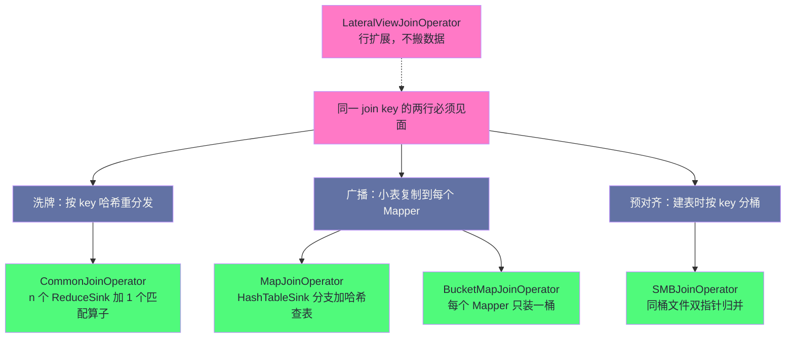
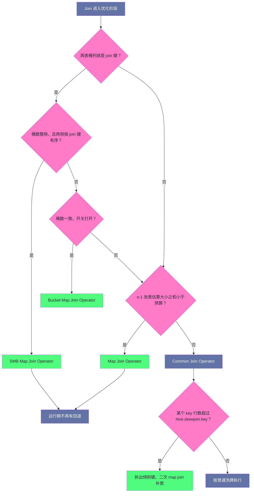
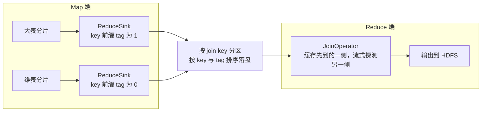
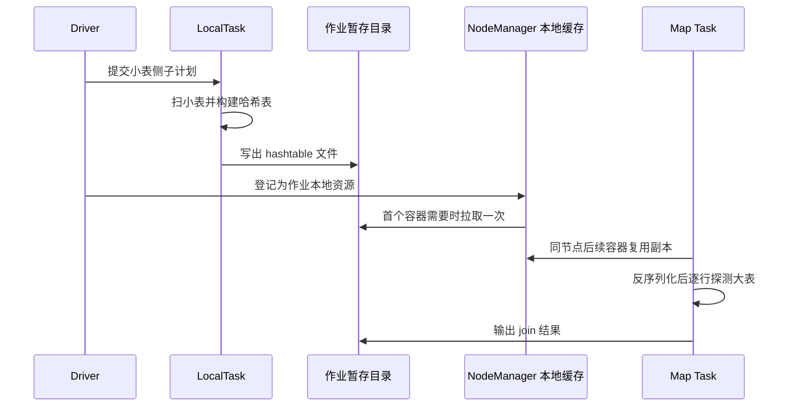
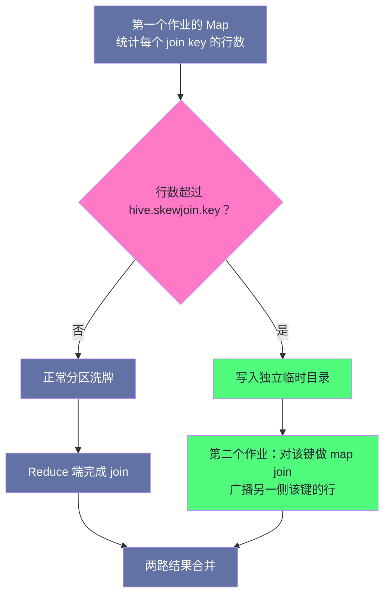
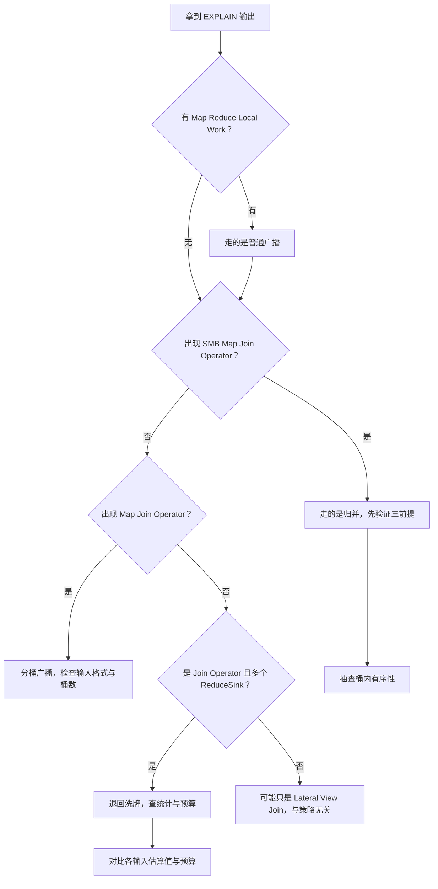

# 06 Join 深度解析：五种 Join 策略的实现机制

**摘要：**

Join 是 Hive 里唯一同时消耗网络、磁盘与内存的算子，也是"计划看起来没问题、跑起来慢十倍"最常见的来源。本文不把五种策略当成五个并列选项来讲，而是按编译器的判定顺序拆开：CommonJoinOperator 如何在 Reduce 端用一个匹配算子接住两侧 ReduceSink 的排序流，ReduceSink 的数量又如何成为诊断判据；MapJoinOperator 的 LOCAL TASK 如何一次构建哈希表、由 DistributedCache 按节点分发，以及本地构建内存超限之后计划如何降级；BucketMapJoinOperator 与 SMBJoinOperator 如何靠"分桶、桶数、排序"三个前提区分，LateralViewJoinOperator 为什么根本不是 Join。判据层面回答两个问题：`hive.auto.convert.join` 凭什么判断一张表"小"，统计信息缺失时它为什么一律退回 CommonJoin。随后处理倾斜：`hive.optimize.skewjoin` 的两阶段分流、阈值语义，以及 MR 与 Tez 上的形态差异。最后给出用 `EXPLAIN` 判定"它选错了"的四个观察点与四类反例。两个问题共用一套判据，而这套判据的输入比判据本身更值得审视——全文的落点正是一个分层判断：结构信息比统计信息可靠，统计信息比运行时反馈可靠，多数"选错"是拿后者的残缺数字覆盖了前者的确定结论。

---

## 第 1 章 分布式 Join 的三种数据搬运方式

单机数据库里讨论 join，讨论的是算法选择：嵌套循环、哈希、归并，三种都在一个进程的内存里完成，差别是常数级的。分布式系统里讨论 join，首先讨论的是数据搬运，因为同一个 join key 的两行数据可能隔着一百台机器，任何算法都得先让它们见上面。Hive 的五个 join 算子，本质上是三条搬运路径的实现，加上一个被名字误导的旁观者。

### 1.1 洗牌、广播、预对齐

**洗牌（Shuffle）**是把两张表都按 join key 的哈希重新分发，保证 key 相同的行落进同一个 Reducer，再由 Reducer 完成匹配。代价是两表参与 join 的列的全量网络传输与落盘，量级由数据量决定，与表的物理布局无关，因此它对任何大小的表都成立，也永远是最慢的那条路。

**广播（Broadcast）**是把小表复制到每个 Mapper 的内存里，大表原地不动。代价从"传输两份数据"变成"传输小表 × Mapper 数"，物理上被 DistributedCache 去重成"每台节点一份"，但内存开销是按 Mapper 计的，于是瓶颈从网络换成了堆。

**预对齐（Pre-partitioned）**是在建表时就按 join key 分桶，让相同 key 的行天然落在编号相同的桶文件里，运行时只需把对应的两个桶放在一起处理。代价被前移到写入期：每次写入都要按桶分发，桶数一旦定下，改动就要重写全表。

不妨设一个具体的核对场景。三间办公室要核对同一批客户名单：洗牌的做法是把名单按客户编号切成若干块分给各小组，每个小组只看自己那一块，切分本身要花分拣工时；广播的做法是把整份名单复印给每个工位，复印费按工位数计；预对齐则是当初立档时就按编号分段上架，核对时两组人各抽自己那一段对着念，谁都不用搬文件。三种做法都成立，区别只在于谁承担复印费、谁承担分拣工时、谁在立档时就付过账。分布式的 join 优化，全部工作就是在算这三笔账里哪一笔最便宜。

### 1.2 五个算子的真实身份

Hive 的 Operator 树里，五种与 join 相关的算子并不是同一层级的并列选项，它们的输入输出形态差别很大，`EXPLAIN` 里的名字也不一样。

- CommonJoinOperator 是 Reduce 端 join，它在计划里表现为"每个输入一个 ReduceSinkOperator，加一个匹配算子"。三表 join 就有三个 ReduceSink，每个 ReduceSink 负责一侧的序列化、分区与排序，匹配算子本身不产生 shuffle。
- MapJoinOperator 是编译期改写出来的：一侧子树被挂上 HashTableSinkOperator 作为构建端，另一侧保持 TableScan 直连，匹配在 Map 阶段完成，计划里没有 ReduceSink。
- BucketMapJoinOperator 是 MapJoinOperator 的分桶变体，区别在于每个 Mapper 只加载小表的一个桶，而不是全量。
- SMBJoinOperator 对应 Sort-Merge-Bucket，两侧同编号的桶文件直接做归并，既没有 shuffle，也没有哈希表，`EXPLAIN` 里有独立的名字。
- LateralViewJoinOperator 与 join 无关，它服务于 `LATERAL VIEW`，把 UDTF 展开出来的行与原始行并接，输入只有一路。

| 算子 | 数据搬运方式 | 是否产生 ReduceSink | EXPLAIN 中的样子 | 成立的结构性前提 |
|---|---|---|---|---|
| CommonJoinOperator | 两侧全量洗牌 | 是，每个输入一个 | Join Operator | 无 |
| MapJoinOperator | 小表广播 | 否 | Map Join Operator | 一侧足够小，且在本地构建得起来 |
| BucketMapJoinOperator | 小表按桶广播 | 否 | 与 Map Join 同名，靠 TableScan 的输入格式区分 | 两表桶列即 join 键，桶数一致 |
| SMBJoinOperator | 无搬运 | 否 | SMB Map Join Operator | 分桶、桶数一致、两侧按 join 键有序 |
| LateralViewJoinOperator | 不搬数据 | 否 | Lateral View Join Operator | 与 join 策略无关 |

这张表里最容易被误读的一格是 BucketMapJoinOperator 的 `EXPLAIN` 名字。它和普通 Map Join 在计划输出里显示为同一个算子名，差别藏在 `TableScan` 的输入格式上——分桶路径要求输入格式是 `BucketizedHiveInputFormat`，普通路径用的是 `CombineHiveInputFormat`。只看算子名判断"到底走没走分桶"，是排查时最常见的误判来源。

### 1.3 LateralViewJoinOperator 为什么不是 Join

`LATERAL VIEW explode(split(tags, ',')) t AS tag` 这类写法在语义分析阶段被改写成 UDTFOperator 加 LateralViewJoinOperator 两段：UDTFOperator 把一个数组或 map 列炸成多行，LateralViewJoinOperator 再把这些行与原始行按行号并接回去。整个过程没有 key 匹配，没有 shuffle，也没有"哪一侧先到"的问题，它的语义是行扩展而不是关系连接。

把它当成 join 的后果不是计划错了，而是判据错了。一个平均数组长度为 8 的列被展开后，行数变成 8 倍，下游 join 的输入量、Reducer 的负载、倾斜的严重程度全部同步放大，而 `hive.skewjoin.key` 是按绝对行数计阈值的，于是原本分布均匀的 key 在展开之后也会越过阈值，被误判成倾斜键，白白多出一个补救 job。判据上要分清：LateralViewJoinOperator 只改变行数，不改变计划选择；它出现在执行计划里，不代表 join 策略被优化过或者被降级过。

从搬运方式到算子落位的对应关系，可以画成一张单向图。



---

## 第 2 章 编译期的选择顺序

### 2.1 判定不是一棵自顶向下的树

很多人把 join 策略的选择想象成一棵判定树：先问小表够不够小，再问分桶对不对齐，逐层往下落。真实的 Hive 不是这样组织的。判定分散在两个阶段、若干条彼此独立的优化过程里：RBO 阶段有专门针对分桶表的改写过程，负责把 CommonJoin 换成 Bucket Map Join 或 SMB；CBO 阶段有 join 转换过程（`ConvertJoinMapJoin` 一类实现），负责在代价模型之上决策广播与重排；而 skew join 根本不在这个决策点里，它是在计划确定"必须洗牌"之后，对洗牌结果做事后补救的后置优化。

这意味着所谓"选择顺序"，不是编译器按顺序问你五个问题，而是几条改写规则的生效次序。规则之间不是互斥关系，是竞争关系：谁先把算子改写成自己的形态，后面的规则就没有机会了。次序上，分桶族排在广播族之前，原因有两个。

第一个原因是收益。广播族把搬运量从"两表全量"降到"小表全量 × Mapper 数"，分桶族再往下压一个数量级，把广播量降到 1/桶数，SMB 更是压到零。既然前提更强的路径收益更大，先试它是合理的。

第二个原因，也是更值得记住的一点，是信息依赖。分桶族判断的是 metastore 里的结构性元数据——桶列、桶数、排序列，这些信息在 `CREATE TABLE` 时就写死了，不依赖 `ANALYZE`，不会因为数据增长而失真；广播族判断的是"表有多大"，这个数字要么来自统计信息，要么来自文件字节数，两者都会过期、会缺失、会在增量写入后变得离谱。**判据的可靠性决定了策略的可预测性**，结构性判据永远比统计判据可信。

### 2.2 顺序与触发参数

| 优先级 | 策略 | 触发开关 | 判据 | 不满足时的去向 |
|---|---|---|---|---|
| 1 | SMB Join | `hive.auto.convert.sortmerge.join`、`hive.optimize.bucketmapjoin`、`hive.optimize.bucketmapjoin.sortedmerge` | 两表都分桶、桶数为整除关系、两侧都按 join 键有序 | 退到 Bucket Map Join |
| 2 | Bucket Map Join | `hive.optimize.bucketmapjoin` | 两表桶列即 join 键、桶数一致 | 退到广播族或 CommonJoin |
| 3 | Map Join（自动） | `hive.auto.convert.join`、`hive.auto.convert.join.noconditionaltask` | n-1 张小表的大小之和小于 `hive.auto.convert.join.noconditionaltask.size` | 退到 CommonJoin |
| 4 | Map Join（强制） | `/*+ MAPJOIN(t) */` 提示 | 人为指定，不看大小 | 无回退，直接执行或直接失败 |
| 5 | Common Join | 无 | 兜底，任意表都成立 | 无 |
| 后置 | Skew Join | `hive.optimize.skewjoin` | 某个 key 的行数超过 `hive.skewjoin.key` | 不启用，倾斜原样进 Reducer |

表格第 4 行值得单独说明。`/*+ MAPJOIN(b) */` 提示的语义是"不要判断了，就按广播执行"，它绕过了大小判据，同时也拆掉了 conditional task 那条运行时试探与回退的通道。用对了是救急，用错了就是把一个可以在编译期报错的问题挪到运行期，变成 Mapper 端的 `OutOfMemoryError` 加若干次重试。

### 2.3 `hive.auto.convert.join` 的判据链

这条链路是全部"该广播没广播"问题的源头，值得逐层拆开。第一层是总开关 `hive.auto.convert.join`，Hive 2 起默认开启，它决定优化器有没有资格做这个改写，而不是能不能做成。第二层是 `hive.auto.convert.join.noconditionaltask`，默认开启，语义是"直接改写，不要再生成一个 conditional task 去运行时试探"。关掉它会退回 Hive 0.11 时代的行为：先按普通 join 执行，同时用一个小 job 采样，确认小表真的装得下，再切到 map join，代价是多扫一遍数据、多一次作业启动。

第三层才是实质判据，也就是那张表到底算不算"小"。这里有两个数字经常被混用：`hive.mapjoin.smalltable.filesize` 默认 25000000 字节，约 25MB，它是老路径上"单张表文件多大算小表"的门槛；`hive.auto.convert.join.noconditionaltask.size` 默认 10000000 字节，约 10MB，它是 noconditionaltask 路径上的预算。

两者的语义差别比数字差别重要得多。前者看的是单表，后者看的是"n 路 join 里 n-1 张表加起来"，官方参数说明的措辞是"如果 n 路 join 中 n-1 张表或分区的大小之和小于该值，则直接转换为 map join"。也就是说 10MB 是一条**共享预算**，不是每张表各 10MB。一个五表 join 挂了四张小表，每张 4MB，加起来 16MB，超过预算，结果是整条链都不转 map join，而不是"转前三张"。这条语义解释了绝大多数"每张表都只有几 MB，为什么还是走 Common Join"的现场疑问。

还有一层容易被忽略的差异在大小从哪来。`hive.cbo.enable` 默认开启后，join 转换发生在 Calcite 代价模型的框架里，判断"小表多大"用的是统计信息估算出来的字节数，而不是 HDFS 上的文件字节数。文件大小只在老路径和统计信息缺失的兜底逻辑里起作用。估算值来自表的行数、列的平均长度、分区裁剪之后剩余的分区集合，任一环节缺失，估算就会退化成一个不可靠的数字，而判据对数字是照单全收的。

判据链的走向可以概括成下面这张图。



这张图有一个容易看漏的地方：SMB 与 Bucket Map Join 两支的箭头都指向"运行期不再有回退"。分桶族的计划一旦生成，运行时就只有两种结局——按分桶执行，或者因为桶文件缺失、数量对不上而报错，不存在悄悄退回 CommonJoin 的路径。这一点与广播族正好相反，广播族至少有本地构建失败这一条降级通道。

---

## 第 3 章 CommonJoinOperator：Reduce 端 join 的完整解剖

### 3.1 算子形态与两侧 ReduceSink

以两表内连接为例，`orders` 与 `customers` 在 `cust_id` 上等值连接，计划里出现的是两个 ReduceSinkOperator 和一个 JoinOperator，三个算子在同一个 MapReduce 作业里，ReduceSink 是 Map 侧的末端，JoinOperator 是 Reduce 侧的唯一入口。

两侧的 ReduceSink 各做三件事：把参与 join 的列序列化成 key 与 value，把 join key 的哈希作为分区号，把 key 做排序。key 的编码里有一个额外的前缀——**tag**，它是输入侧的身份编号，Map 端在输出时把 tag 拼进 key，于是排序结果里"同一个 join key 下的行按侧别聚集"这件事由框架保证，Reducer 不需要自己判断当前行来自哪张表。

tag 的大小关系还有实际影响：排序之后，tag 较小的一侧先到，JoinOperator 会先把这一侧的行缓存进内存，等另一侧的行流过来时逐行探测。缓存哪一侧、流式处理哪一侧，直接决定了内存峰值，而 `hive.join.cache.size`（默认 25000 行）约束的正是被缓存一侧的行数上限，超过之后由行容器落盘。

### 3.2 Reduce 端的匹配过程

Reducer 拿到的是按 `(join key, tag)` 排好序的流。它按 join key 分组处理：同一组内先到的行进内存容器，后到的行逐条与容器里的行做笛卡尔积式匹配，命中的组合直接输出。

```
以 cust_id=100 为例，Reducer 按序收到：
  tag=0  cust_id=100  name=Alice          ← customers 侧，先到，进缓存
  tag=1  cust_id=100  amount=50.00        ← orders 侧，流式探测
  tag=1  cust_id=100  amount=30.00        ← 同一 key 的第二条，继续探测

匹配输出：
  (Alice, 50.00)
  (Alice, 30.00)

处理完这个 key 之后，缓存被清空，进入下一个 join key；
一个 Reducer 可能处理几十万个 join key，缓存只服务于当前 key。
```

这里有一个常被忽略的事实：CommonJoinOperator 的内存占用不取决于表有多大，而取决于单个 join key 在缓存侧有多少行。表有一百亿行但每个客户只有三条订单，缓存区永远是小的；表只有一千万行但其中一个 key 占了八百万行，缓存区就会被这一个 key 撑爆。这正是倾斜与 OOM 的同一个根因。

### 3.3 为什么加 Reducer 解决不了倾斜

分区规则是 `hash(join_key) % reducer_count`，一个 join key 只会落进一个 Reducer，这一点与 Reducer 总数无关。把 Reducer 从 100 加到 1000，其余 key 被切得更碎，单个 Reducer 的平均负载下降，但那个热点 key 仍然完整地压在某个 Reducer 上，它的负载一条都不少。

于是出现典型的作业形态：100 个 Reducer 里 99 个在几分钟内跑完并闲置，最后一个跑了两个小时，作业总时长等于最大值而不是平均值。扩容在这里是无效动作，这也是倾斜必须由 Skew Join 或加盐这类改变 key 分布的手段来处理、而不能靠调并行度的原因。

shuffle 的数据流可以用一张图概括，注意 ReduceSink 有两个，而匹配算子只有一个。



### 3.4 代价与诊断信号

Common Join 的代价是两项相加：Map 端把参与列写到本地磁盘，Reduce 端把它们再读一遍，两笔都按参与列的字节数计，与行数无关而与列宽有关。`hive.exec.reducers.bytes.per.reducer` 默认 256MB，Reducer 数按 shuffle 数据量除以这个值估算，上限由 `hive.exec.reducers.max` 约束。

诊断上有一个直接信号：`EXPLAIN` 里数 ReduceSinkOperator 的个数。两表 join 出现两个、三表 join 出现三个是正常的；如果一次本该走广播的查询出现了两个 ReduceSink，说明计划退回了 CommonJoin，再往下就要问为什么没广播。反之，如果一个 join 之后还跟着聚合，ReduceSink 会更多，那时要按算子树的层级分辨哪个是 join 引起的、哪个是聚合引起的。

---

## 第 4 章 MapJoinOperator：LOCAL TASK 与广播的完整机制

### 4.1 编译期改写与两阶段执行

Map Join 的编译期改写是把一侧子树的输出接到 HashTableSinkOperator 上，另一侧直连 MapJoinOperator。执行分成两个物理上完全不同的阶段：本地构建，以及分布式探测。前一阶段发生在 Driver 进程里，不申请 YARN 容器；后一阶段是正常的 Map 任务，只不过每个 Mapper 在处理数据之前先从本地缓存里把哈希表装进堆。

**阶段一，本地任务（LOCAL TASK）**。Driver 用 `MapredLocalTask` 在 HiveServer2 的 JVM 里跑小表侧的子计划：扫小表、按 join key 建哈希表、把哈希表序列化成一个二进制文件。这个文件先落在本地临时目录，再由 Driver 上传到作业的暂存目录，最后作为作业资源登记进 DistributedCache。它构建的是"可被反复加载的二进制表"，不是一堆 Java 对象，这一点对后面的内存账影响很大。

```
本地任务的执行序列（示意）：
  1. 在 Driver 进程内初始化小表侧的 Operator 链
  2. 逐行读入、计算 join key、写入哈希表容器
  3. 每读入 hive.mapjoin.check.memory.rows 行（默认 100000）
     采样一次 JVM 堆使用率
  4. 堆使用率越过阈值时中止构建并抛出异常
  5. 未中止则把容器序列化为 hashtable 文件
  6. 上传暂存目录，登记为作业资源
```

**阶段二，分布式探测**。每个 Mapper 启动时向 NodeManager 取本地资源副本，反序列化哈希表到堆，然后逐行扫描大表分片：取 join key、在哈希表里查、命中则输出组合、未命中则按连接类型决定是否补空行。全程没有 shuffle，输出直接写 HDFS，所以 Map Join 的作业里 Reduce 数可以是零。

### 4.2 并行分发的真实含义

"广播"这个词容易让人以为是 Driver 把文件推给每一台机器，实际过程更接近印厂制版：版只做一次，之后每个印刷点各自领一份，而同一栋楼里的印刷点共用一份。物理上，哈希表被登记为作业的本地资源，每个 NodeManager 在第一个容器需要它时从 HDFS 拉一次并缓存，同一节点上后续启动的容器直接复用；只有第一次拉取产生跨机架流量，之后是本地磁盘读。这就是为什么广播的代价常被写成"小表大小 × 节点数"而不是"× Mapper 数"。

并行性体现在两头。构建端是串行的：`hive.exec.parallel` 默认关闭，一个查询里的几处 map join 通常串行构建，三次广播就是三段首尾相接的本地构建，每段都要扫一遍小表、建一次表、传一次文件。探测端是并行的：所有 Mapper 同时取本地副本、同时开始扫描，它们的启动时间被统一推迟了"一次资源下载 + 一次反序列化"的时长。

构建端串行这一点在小表多、查询短的场景里会很难看。一个交互式查询里挂了四张维表，每张 8MB，本地构建四段各花几秒，加上文件上传，作业还没提交就已经过去十几秒，用户感受到的是"这条 SQL 卡在编译阶段"。这一类延迟要靠在作业层面并行化（`hive.exec.parallel=true` 配合足够的并行度）或者把维表改成分桶表来消除，而不是调大任何与 join 相关的内存参数。

把两个阶段串起来，可以看到"构建一次、拉取多次"的时序结构。注意这里的拉取是节点级的：同一台 NodeManager 上启动的第二个容器不再访问暂存目录。



### 4.3 Tez 与 MR 上的形态差异

换成 Tez 之后，本地构建这一段没有任何变化，仍然是 Driver 在 HiveServer2 进程内跑一次小表侧子计划、产出一个哈希表文件；变的是分发方式与失败后的恢复代价。在 MapReduce 上，哈希表以作业资源的形式进入 DistributedCache，作业之间的资源不共享，同一查询里两处广播就是两份资源、两次登记。在 Tez 上，哈希表作为顶点的输入资源随 DAG 一起下发，map join 被切成独立的顶点，可以与上游扫描顶点并行准备；某个任务失败重跑时，只要所属节点已有缓存就不再重复拉取。

差异的工程含义在编译期与失败率两头。编译期上，Tez 的 DAG 只有一次提交，多段本地构建串行摊在 Driver 里，交互式查询的编译等待仍然存在，这一点与引擎无关。失败率上，Tez 的容器复用更充分、顶点级重试更细，第二道闸被撞破时作业整体失败的概率略低于 MR，但一旦某个顶点的任务集体 OOM，恢复代价更高，因为它不像 MapReduce 那样只是重跑一个作业。顶点怎么切、资源怎么下发，在不同版本之间有过调整，落地时以对应版本的实现为准。

### 4.4 内存核算与两道闸

Map Join 的内存风险有两道闸，分别守在不同阶段。第一道在本地构建期，由 `hive.mapjoin.localtask.max.memory.usage` 控制，默认 0.90，含义是本地任务的堆使用率不得超过九成；当 map join 后面紧跟 group by 时，Hive 改用 `hive.mapjoin.followby.gby.localtask.max.memory.usage`，默认 0.55，取一个更低的阈值，因为随后的聚合算子还要在同一批容器内存里占一份。第二道在探测期，Mapper 加载哈希表时由内存检查处理器按 `hive.mapjoin.check.memory.rows` 的行数间隔采样，超限抛异常，任务失败后按重试策略处理。

两道闸触发的后果完全不同。第一道触发时，本地任务中止，Driver 收到失败，在自动转换路径上可以退回 CommonJoin 重新出计划，作业能跑完、只是慢；在 `/*+ MAPJOIN */` 强制路径上则没有这条回退通道，查询直接失败。第二道触发时没有回退，因为它发生在已经分发的 Mapper 里，退不掉，只能让任务失败重试，若干次重试仍然撞在同一处，整个作业失败。这道闸的采样机制还有一个副作用：堆的可用空间受 GC 时序影响，同一份哈希表在两次重试里可能一次成功一次失败，现场看到的是"偶发失败"，排查时容易被误判成资源竞争。

内存核算的公式不复杂，难的是系数。

```
单表广播的堆占用 ≈ 文件字节 × 解码放大系数 × 容器系数

  解码放大系数：列式文件解码成行数据，常见 3-6 倍
  容器系数：字节容器（序列化行加哈希索引）约 1.2-2 倍，
            行对象容器（每行一组 Java 对象）可到 3-5 倍

  两条路合起来，字节容器下的综合倍数约 4-12 倍；
  行对象容器更高，但在 Hive 2 之后已不是默认路径。
```

按这个公式反推配置阈值：Mapper 堆上限为 `mapreduce.map.memory.mb` 的八成，若为 4GB 则堆约 3.2GB；同时有 N 处广播，每处要留一份哈希表，还要给聚合、序列化、读缓冲留余量；把可用部分除以放大系数，就得到文件大小的合理上限。取 4GB 堆、单个广播、系数取 4 作示例推算，可得约 200MB 的文件上限，比默认的 10MB 与 25MB 宽松得多——默认值之所以保守，是因为集群里 Mapper 往往并发多个容器、且查询里常有不止一处广播。这条推算给的是量级，不是可以直接抄到生产上的数字。

> [!warning] 一个被反复传播的错误系数
> 有些资料把"文件到堆"的倍数写成 20-40 倍，理由是"ORC 解压十倍、Java 对象头再翻两到四倍"。这个数字在 Hive 2 之后偏大：哈希表容器存的是序列化后的字节行，不是逐字段的 Java 对象，对象头开销主要在构建期出现、构建完成后就被序列化掉了。较可信的区间是字节容器下的 2-5 倍、行对象容器下的 6-10 倍。按 20 倍做容量规划会把阈值压到明显偏低，反过来助长"该广播不广播"。

广播相关的参数与调节方向可以列成一张表。

| 参数 | 默认值 | 作用 | 调大的代价 | 调小的代价 |
|---|---|---|---|---|
| `hive.auto.convert.join` | true | 是否允许自动改写为广播 | 开启后判据失准会把表错误地广播出去 | 关闭后大量本可广播的 join 退回洗牌 |
| `hive.auto.convert.join.noconditionaltask` | true | 是否跳过运行时试探直接改写 | 判据失准时直接踩空，作业失败 | 每次多一个采样作业，启动开销上升 |
| `hive.auto.convert.join.noconditionaltask.size` | 10000000 | n-1 张小表的合计预算 | 预算越松，越可能把装不下的表广播出去，Mapper 端 OOM 概率上升 | 越紧，多表 join 越容易整条链都不广播 |
| `hive.mapjoin.smalltable.filesize` | 25000000 | 老路径下单表大小门槛 | 同上的 OOM 风险 | 单表判小的机会变少 |
| `hive.mapjoin.localtask.max.memory.usage` | 0.90 | 本地构建期的堆使用上限 | 构建期更容易把 Driver 堆打满 | 更容易放弃构建、回退洗牌，编译期变慢 |
| `hive.mapjoin.followby.gby.localtask.max.memory.usage` | 0.55 | 后接聚合时的本地构建上限 | 后续聚合阶段内存压力上升 | 更多查询放弃广播 |
| `hive.mapjoin.check.memory.rows` | 100000 | 内存采样的行数间隔 | 检查变稀疏，超限发现得晚 | 检查频繁，构建期开销上升 |

### 4.5 动态分区裁剪与广播的协同

广播还有一个附带收益：小表被完整读进内存之后，它的值集合可以拿来裁剪大表的扫描范围。动态分区裁剪（Dynamic Partition Pruning）就是这条思路的推广——先跑维表侧，把命中的 join key 值收集成运行时过滤器，再把它推给事实表的 TableScan，只扫命中的分区。

```sql
-- 事实表按 date_key 分区，维表是被过滤的一侧
SELECT f.order_id, d.customer_name
FROM orders_fact f JOIN date_dim d ON f.date_key = d.date_key
WHERE d.year = 2026 AND d.month = 1 AND d.country = 'US';

-- 运行时顺序：
-- 1. 先扫 date_dim，得到命中的 date_key 集合（假定 31 个值）
-- 2. 把集合作为运行时过滤器下推到 orders_fact 的 TableScan
-- 3. 只打开 31 个分区，而不是全年 365 个
```

裁剪的价值在于它把广播的收益从"省掉 shuffle"扩展到"少读数据"，而少读数据是唯一不需要付内存代价的优化。分区与分桶的物理组织方式、以及运行时过滤器的下推路径，见 [[大数据/Hive/07 分区与分桶：物理数据组织的核心机制|分区与分桶的物理组织]]。

---

## 第 5 章 Bucket Map Join 与 SMB Join：三个前提的差别

### 5.1 分桶为什么能让广播变小

普通 Map Join 的浪费在于每个 Mapper 都要装全量小表。处理大表某个分片的 Mapper，其中出现的 join key 可能只覆盖小表的一小部分，剩下的哈希桶装了也用不上。分桶把这个"用不上"变成结构上的可预测：`hash(key) % 256` 相同的行落在同一个桶文件里，处理大表第 N 桶的 Mapper 只需要小表第 N 桶，广播量从"全量小表"降到"一桶"。

前提因此非常具体：两表的桶列必须就是 join 键，桶数必须一致。桶列与 join 键不一致时，哈希函数作用在不同的值上，桶编号对不上，整个对齐关系不成立；桶数不一致时，编号相同的桶里装的是不同的 key 集合，两边对齐的假设直接失效——不会报错，只会算错。所以桶数必须按"完全相同"来设计，不能指望整除关系能救场。

Bucket Map Join 不要求两侧排序，这是它与 SMB 的分水岭：它的探测方式仍是哈希查表，桶只是缩小了哈希表的体积，不需要数据有序。配置上除了 `hive.optimize.bucketmapjoin=true`，还要求输入格式为 `BucketizedHiveInputFormat`，否则 TableScan 会把桶文件当成普通文件读，一个 Mapper 处理多个桶，对齐关系失效。

```xml
<configuration>
  <property>
    <name>hive.optimize.bucketmapjoin</name>
    <value>true</value>
  </property>
  <property>
    <name>hive.input.format</name>
    <value>org.apache.hadoop.hive.ql.io.BucketizedHiveInputFormat</value>
  </property>
</configuration>
```

### 5.2 SMB Join 的三个前提，缺一不可

SMB（Sort-Merge-Bucket）把 join 换成有序序列的归并：两侧同编号的桶都已按 join 键排序，双指针从两个桶的开头同步推进，比较当前 key、推进较小的一方、相等则输出组合并推进。时间复杂度是两桶行数之和，内存只需缓存"同一个 key 在某一侧的多行"，与表的大小无关。

三个前提必须同时成立，缺任何一个都不是"性能差一点"，而是"结果错"或"根本没启用"。

- 两表都分桶，且桶列就是 join 键。只分桶不按 join 键分桶，桶编号与 key 的对应关系不成立。
- 桶数整除。官方文档的口径是两侧桶数相同；工程实现里存在大表桶数为小表整数倍的路径，但这条路径在边界情况下出现过错误结果，稳妥做法是保持一致。
- 两侧都按 join 键排序。SORTED BY 是元数据声明，Hive 不会在查询时校验数据是否真的有序。

第三个前提是最危险的一个，因为它失效时没有明显信号。建表语句写了 `SORTED BY (cust_id)`，元数据里就记下了排序列，优化器据此判定 SMB 可用并生成 SMB 计划；如果实际写入的数据没排序，归并过程会在两个递增序列上各走一遍，一旦错位就停止匹配，结果是静默漏行。这类问题的现场表现是"数字对不上但作业成功"，比报错难查得多。

```sql
-- 正确：写入时同时保证分桶与桶内有序
INSERT OVERWRITE TABLE orders_bucketed
SELECT cust_id, order_id, amount
FROM orders_raw
DISTRIBUTE BY cust_id   -- 相同 key 进同一桶
SORT BY cust_id;        -- 桶内按 key 有序

-- 危险：建表声明了 SORTED BY，写入却没有 SORT BY
-- Hive 不校验实际数据顺序，SMB 计划照常生成，结果可能静默漏行
```

SMB 的开关是三件套，缺一个都不生效，而且它们之间还有依赖关系。

```xml
<configuration>
  <property>
    <name>hive.auto.convert.sortmerge.join</name>
    <value>true</value>
  </property>
  <property>
    <name>hive.optimize.bucketmapjoin</name>
    <value>true</value>
  </property>
  <property>
    <name>hive.optimize.bucketmapjoin.sortedmerge</name>
    <value>true</value>
  </property>
  <property>
    <name>hive.enforce.sortmergebucketmapjoin</name>
    <value>false</value>
  </property>
</configuration>
```

注意 `hive.enforce.sortmergebucketmapjoin` 的语义：设为 false 时，条件不满足就安静回退到普通路径；设为 true 时，条件不满足直接报错。调试阶段把它打开，能让"为什么没走 SMB"从猜测变成明确的报错，这是排查这类问题最省时间的一个动作。另外 `hive.auto.convert.sortmerge.join.to.mapjoin` 决定大表侧是否也可以转成 map join，`hive.auto.convert.sortmerge.join.bigtable.selection.policy` 决定多表 join 里哪张表被当成大表，默认按平均分区大小选择。

### 5.3 两个策略的前提对照

| 前提 | Bucket Map Join | SMB Join |
|---|---|---|
| 桶列等于 join 键 | 必需 | 必需 |
| 桶数关系 | 必须一致 | 必须一致或整除，工程上按一致设计 |
| 桶内按 join 键有序 | 不要求 | 必需，且要保证数据真的有序 |
| 探测方式 | 哈希查表 | 双指针归并 |
| Map 端内存 | 小表一桶的哈希表 | 同 key 的多行缓存，通常远小于一桶 |
| 额外开关 | `hive.optimize.bucketmapjoin` | 三件套加输入格式 |
| 失效表现 | 退化为普通广播或洗牌 | 静默错误结果，或不启用 |
| 与事务表的关系 | 可用 | 与 ACID 分桶有序表冲突，需二选一 |

最后一行是一个真实的约束：Hive 的 ACID 表不支持"分桶且排序"的桶定义，写入时会报 `ACID_NO_SORTED_BUCKETS` 一类错误。也就是说，需要行级更新的事实表不可能同时拿到 SMB 的收益，设计时要在"可更新"与"可归并"之间选一个。这条约束常常在表设计的中后期才被发现，那时改造成本已经很高。

### 5.4 收益的量级判断

SMB 的收益可以算成两笔省下的字节和一笔省下的时间。省的字节是两侧参与 join 的列在 shuffle 阶段的写盘加读盘；省的时间是作业启动、排序、拉取的总和。以一张 500GB 的事实表连接一张 50GB 的维表为例，列裁剪之后实际参与 join 的列假定各占三成，shuffle 量约为 165GB，写一遍读一遍就是 330GB 的磁盘与网络流量，这是可以被完全消掉的。

时间收益不能按字节直接折算，因为作业里还有扫描、聚合、写结果这些 SMB 无法优化的部分。设洗牌加深的代价占端到端的一半，消掉它之后的加速比上限是两倍；这个比例在实际仓库里通常在四成到七成之间，对应 1.6 到 2.5 倍的加速。以上都是示例推算，用来给量级，不作为实测基准——真实倍数取决于列裁剪比例、文件格式、集群网络与磁盘配比。

Bucket Map Join 的收益则是另一条曲线：它不省 shuffle，它省的是广播量，收益倍数直接等于桶数（同一份小表，从全量变成一桶）。代价是当桶数过多、单桶过小时，Mapper 启动时打开大量小文件的开销会吃掉收益，这也是分桶数不宜盲目调大的原因。

桶数该定在多少，取决于两个相互挤压的约束。桶数越大，单桶越小，分桶广播的内存压力越低，代价是 Mapper 要打开的小文件变多、SMB 的归并粒度变细；桶数越小，单桶越大，分桶广播退化成普通广播，收益消失。一个可用的起点是让单桶体积落在一两百 MB 的量级：用目标表体积除以这个值得到桶数，再取最近的 2 的幂（64、128、256 之类），既便于两侧对齐，也便于整除。桶数是表契约的一部分，改一次就要重写全表，所以宁可建表时按两三年的增长预留一档，也不要在业务高峰期来回调整。

---

## 第 6 章 统计信息：判据的输入从哪来

### 6.1 两种大小口径

判据要比较"表的大小"和"预算"，可"表的大小"有好几个来源，它们给出的数字经常不一致。

第一种是文件字节数，来自 HDFS 的 `getFileStatus`，精确、永远可得，但它衡量的是压缩后的存储体积，与内存里的占用差着几倍，也完全不知道查询会裁剪掉多少列和分区。第二种是统计信息，来自 metastore 的行数字段与列级统计（NDV、最大值、平均值、空值数），CBO 用它估算裁剪之后实际要处理的数据量，这才是判据真正需要的东西。第三种是推断值，当统计信息缺失时由优化器按启发式规则给出，例如假设某个过滤条件的选择性是固定值。

`hive.stats.autogather` 默认开启，插入数据时自动收集基础统计，但它的作用范围有限：主要覆盖 `INSERT OVERWRITE` 这类整表替换，增量 `INSERT INTO` 之后统计不会同步更新。列级统计由 `hive.stats.column.autogather` 控制，配合 `ANALYZE TABLE ... COMPUTE STATISTICS FOR COLUMNS` 才能补齐。这意味着一个按天增量写入的事实表，元数据里的行数可能停在一个月前的水平，而判据会拿这个行数去估算大小。

### 6.2 统计缺失时为什么一律退回 CommonJoin

判据的实现里有一条保守规则：估算不出来，就不要冒险广播。这条规则本身是对的，因为广播失败的代价（Driver 本地构建崩掉、或 Mapper 批量 OOM）远高于洗牌慢一点。问题在于它没有区分"统计缺失"和"表确实不小"，两种情况在日志与 `EXPLAIN` 里的表现几乎一样——都是走了 CommonJoin，都没有告警。

于是"该广播没广播"的头号原因就落在统计信息上：维表没有 `ANALYZE`、分区表的统计只在大表侧收集、增量写入后统计过期、CBO 因为某个表达式类型问题直接放弃了估算，任何一种情况下判据的输入都是残缺的，而输出的结论却是确定的。

CBO 层面还有一层版本差异。Hive 长期以来的行为是：CBO 抛出无法处理的异常时，静默回退到旧优化器，查询能跑但计划可能很差。Hive 4.0 起把这一行为改为默认不回退（对应 HIVE-27831 的变更），CBO 的失败会直接暴露成查询失败，不再被静默吞掉。这对可观测性是好消息，对存量 SQL 是坏消息——那些靠静默回退跑了很多年的查询，升级后会直接报错，排查时需要按错误的表达式或类型去找，而不是去找 join 参数。

| 统计状态 | 判据看到的输入 | 典型结论 | 现场表现 |
|---|---|---|---|
| 表与列统计齐全且新鲜 | 裁剪后的估算字节数 | 小表判小，走广播 | 计划里有 Map Join Operator 与 Local Work |
| 只有表级统计 | 行数乘默认列宽 | 估算偏大，倾向不广播 | 计划退回 Common Join |
| 完全没有统计 | 启发式的默认值 | 一律按不安全处理 | 无论表多小都走 Common Join |
| 统计过期（增量写入后） | 落后的行数 | 忽大忽小，结论不稳定 | 同一 SQL 在不同日期计划不同 |
| 分区裁剪后统计缺失 | 只剩全表统计 | 估算远大于实际 | 明明只查一天，仍不广播 |

统计信息的治理要落到调度上，否则判据会持续在残缺的输入上运转。基础统计由 `ANALYZE TABLE ... COMPUTE STATISTICS` 收集，产出文件数、字节数与行数；列统计由 `ANALYZE TABLE ... COMPUTE STATISTICS FOR COLUMNS` 收集，对指定列做一次全表或分区级的计算，代价与列数、分区数成正比，在大表上不是随手能跑的动作。可行的做法是把它挂进 ETL 的收尾环节：维表在数据更新之后必跑列统计，事实表按分区跑、只跑当天新增的分区；再配一项巡检，把"元数据里行数缺失或长期未更新"的表列出来。统计缺失在查询侧只表现为"慢了一点"，没有任何报错，靠人肉发现不了。

### 6.3 预算共享造成的连锁失效

前面提到的预算共享，在统计信息不可靠时会被放大。五表 join 挂四张小表，只要其中一张的估算值虚高，合计预算就越线，整条链都不转 map join。此时把另外三张表的统计修好也没有用，因为越线的是那一张。

排查这类问题的正确顺序是先看合计再看单体：把 `EXPLAIN` 里各输入的大小估算抄下来相加，与预算对比，先判断是"合计越线"还是"单体判大"，再决定是补统计、拆查询，还是调整预算。直接去调参数通常是最差的选择，因为调参数解决的是症状，而越线的那个估算值会随着数据增长继续恶化。

---

## 第 7 章 倾斜与 Join

### 7.1 倾斜的三种形态

倾斜在 Hive 里不是一个现象，是三种。**键倾斜**是某个 join key 的行数远超其他键，属于数据分布问题；**分区倾斜**是某个分区的数据量远大于其他分区，属于写入与分区设计问题；**文件倾斜**是同一分区内文件大小差异过大，属于写入并发与小文件治理问题。

与 join 直接相关的是第一种。键倾斜的判据不是平均值，而是最大值与中位数的比值：一个 Reducer 处理的行数是中位数的十倍以上，基本可以确认；至于原因是业务热点（超级大客户、热门商品）、空值集中（未登录用户的 `user_id` 全为 NULL），还是维度表关联错了键，需要看 key 的取值分布来判断。

空值倾斜值得单独一提，因为它最容易被误判成业务热点。外连接时未匹配的行 join key 为 NULL，而 `hash(NULL)` 是一个确定值，所有 NULL 行都涌向同一个 Reducer；数据量上亿时，这个 Reducer 会成为一个纯粹由空值构成的热点。处理方式不是开 Skew Join，而是把 NULL 值在 join 之前随机化或者提前过滤，因为空值之间本来就不会匹配，把它们打散没有任何语义风险。

### 7.2 `hive.optimize.skewjoin` 的两阶段机制

Skew Join 的思路是把热点键从洗牌里摘出来，单独用 map join 处理。开启 `hive.optimize.skewjoin=true` 之后，作业被拆成两个阶段。

第一个阶段是正常的 Map 加 Reduce，但 Map 端多了一件事：统计每个 join key 输出的行数。超过 `hive.skewjoin.key`（默认 100000）的键被标记为倾斜键，它的行不进入正常的分区通道，而是写进一个独立的临时目录。其余行照常洗牌、照常由 Reducer 完成 join。第二个阶段针对每个倾斜键起一个 map-only 的子任务：把该键在另一侧的行作为小表广播进内存，与倾斜侧的行做 map join，产出与第一阶段的结果合并。

```
第一个作业：
  Map 端统计 key 频次 → 超过阈值的键写入临时目录
  其余行正常分区洗牌 → Reduce 端完成 join

第二个作业：
  对每个倾斜键起一个 map-only 任务
  小侧（该键在另一侧匹配的行）装进内存
  倾斜侧的行逐行探测 → 输出直接写结果

最终：两个作业的输出合并成一个结果集
```

这条路径的代价很明确：多一个作业、多一次落盘、临时目录占用额外空间，而且倾斜键越多、第二个作业的输入越碎。配置上还有两个参数控制第二个作业的形态，`hive.skewjoin.mapjoin.map.tasks`（默认 10000）限制它最多用多少个 Mapper，`hive.skewjoin.mapjoin.min.split`（默认 32MB）按最小分片切分，两者配合做细粒度控制——倾斜键的数据量很大时，切小一点能让第二个作业也并行起来。两个作业的分工可以画成下面这张图，注意分流发生在第一个作业的 Map 端，而不是 Reduce 端。



### 7.3 阈值是一个绝对行数

`hive.skewjoin.key` 的语义是"在 join 算子里看到超过这个行数的同一个键，就认为它是倾斜键"，单位是行数，不是比例，也与 Reducer 数无关。这个设计的后果是它必须跟着数据量一起调：集群的数据量三年翻十倍，阈值还在十万，于是几乎每个键都越线，第二个作业被拆成几万个细碎任务，作业比不加优化还慢；反过来数据量缩小或者分区裁剪掉了大部分数据，阈值相对过高，热点键判不出来，优化形同虚设。

合理的做法是按单个 Reducer 的目标处理行数来反推：如果单个 Reducer 处理一千万行是舒适区，那么阈值取一到两百万行比较合适，既不误判、也不会漏掉真正会拖垮作业的热点。多表 join 时阈值按算子分别生效，一个查询里有三处 join，就可能触发三处分流。

还有一个语义限制需要注意：这个优化主要对内连接成立。外连接时倾斜侧的行必须全部保留，拆解之后"哪些行该补空"变得难以界定，Hive 会放弃该优化。所以外连接上的倾斜要靠加盐或提前过滤来解决，不能指望开关。

### 7.4 MR 与 Tez 上的行为差异

在 MapReduce 引擎上，两阶段就是两个独立的作业，中间隔着一次 HDFS 写入与读取，倾斜键的数据被完整落盘再读回。在 Tez 上，同一个逻辑被表达成一个 DAG，分流、二次 map join、结果合并都在一个 DAG 里完成，中间数据可以留在内存或本地磁盘，少了一次分布式文件系统的往返，作业启动的开销也从两次减为一次。DAG 与资源调度层面的差异见 [[大数据/Hive/04 执行引擎对比：MapReduce vs Tez 的本质差异|MR 与 Tez 的本质差异]]。

Tez 上还有一条编译期路径：`hive.optimize.skewjoin.compiletime`，它不做运行时统计，而是直接读 metastore 里 `SKEWED BY ... ON (...) STORED AS DIRECTORIES` 声明的倾斜值，在编译期就把计划切开，把倾斜值的目录与常规目录分开扫描。前提是表的倾斜值是已知且稳定的，例如按省份分区、某几个省份天然占大头；倾斜值会变的场景不适用，这时仍要回到运行时统计。

| 手段 | 适用前提 | 主要代价 | 失效场景 |
|---|---|---|---|
| `hive.optimize.skewjoin` | 内连接、热点键行数超阈值 | 多一个作业、一次额外落盘 | 外连接、热点键动态变化 |
| `hive.optimize.skewjoin.compiletime` | 倾斜值已在建表时声明 | 依赖元数据准确性 | 倾斜值变化、未声明 |
| 手工加盐 | 热点键可枚举 | SQL 变复杂、另一侧要扩副本 | 热点键集合频繁变化 |
| 空值随机化或提前过滤 | 倾斜源是 NULL | 需要改写 SQL | 倾斜来自真实业务值 |
| 增大 Reducer 数 | 无 | 无收益 | 键倾斜，一个键仍落一个 Reducer |

---

## 第 8 章 用 EXPLAIN 判断"它选错了"

### 8.1 四个观察点

判断一个 join 走的是哪条路径，不需要读源码，也不需要猜参数，`EXPLAIN` 里有四个稳定的观察点。

**第一，算子名**。 `Join Operator` 是 CommonJoin，`Map Join Operator` 是广播族（普通广播或分桶广播），`SMB Map Join Operator` 是归并族，`Lateral View Join Operator` 与 join 策略无关。名字是最直接的证据，但它分不出普通广播与分桶广播，也看不出"为什么没走别的"。

**第二，Local Work 段**。 广播族的计划里有一段 `Map Reduce Local Work`，列出在 Driver 本地执行的小表侧子计划；没有这一段，就说明没有本地构建，也就没有广播。这是区分"计划要广播"和"计划真的要广播"的关键——有些计划里出现 `Map Join Operator` 却没有 `Local Work`，那是因为它走的是分桶路径，桶文件由 Mapper 直接读数，不需要本地构建哈希表。

**第三，ReduceSink 数量**。 每个 ReduceSink 代表一次洗牌，数量与期望不符就是回退或额外 shuffle 的信号。两表 join 期望零个 ReduceSink（广播）却出现两个（CommonJoin），说明判据认为小表不小。

```
示意性的计划片段（非真实作业输出）：

  Map Join Operator                       ← 广播族
    condition map:
         Inner Join 0 to 1
    Local Work:                           ← 有本地构建，说明是普通广播
      Map Reduce Local Work
        Alias -> MAPJOIN_TABLE[1]
          TableScan ...

  SMB Map Join Operator                   ← 归并族，无 Local Work
    condition map:
         Inner Join 0 to 1
    Path -> Alias:
      hdfs://.../orders/bucket_00007
      hdfs://.../customers/bucket_00007   ← 只列同编号的桶

  Join Operator                           ← CommonJoin
    condition map:
         Inner Join 0 to 1
    ← 上游有两个 ReduceSinkOperator，各占一个输入
```

还有第四类证据，就是计划里的统计段，它最容易被跳过。每个 `TableScan` 与 join 算子都会输出估算行数，如果某个扫描的估算值是负数、或者明显违背常识（一张日志表估算出几百行），说明统计缺失或已经失真，此时后面写了什么 join 参数都不可信。判断顺序应当反过来：先看统计段可不可信，再看算子名。输入不可信时，算子名只说明编译器做了保守选择，不说明数据真的不适合广播。这些字段的呈现形式在不同版本之间有差异，`EXPLAIN` 与 `EXPLAIN FORMATTED` 的输出格式也不一样，读的时候以对应版本的输出为准。

### 8.2 从症状到判据

排查时从症状出发比从头看计划高效。下面这张表按现场最常见的五类症状给出判据与处置。

| 症状 | EXPLAIN 里的证据 | 根因方向 | 处置 |
|---|---|---|---|
| 维表只有几 MB，却走了 Common Join | 两个 ReduceSink，无 Map Join Operator | 统计信息缺失或过期，判据输入残缺 | 对维表执行 `ANALYZE TABLE ... COMPUTE STATISTICS` |
| 五表 join 里四张小表一张都没广播 | 合计估算值大于预算 | 预算共享，被一张表拖累 | 拆分查询或修正虚高的那份统计 |
| 出现 Map Join 但每个 Mapper 都很慢 | 有 Local Work，输入格式是 `BucketizedHiveInputFormat` | 分桶广播，单桶过大或桶数过少 | 提高桶数、检查桶列是否为 join 键 |
| 作业成功但结果行数偏少 | 出现 SMB Map Join Operator | 数据未真正按 join 键有序 | 重写数据，保证 `SORT BY` 生效 |
| 少数 Mapper 处理时间极长 | Map 输入分片大小不均 | 文件倾斜，不是键倾斜 | 合并小文件、控制写入并发 |

第四行的处置要强调一句：一旦确认走的是 SMB 而结果有问题，第一件要做的事不是调参数，而是抽查数据是否真的有序。可以取某个桶文件读前一千行，看 join 键是否单调不减；不单调就说明写入路径没有执行 `SORT BY`，或者写入时用了别的分发方式覆盖了排序。

### 8.3 四类反例

**反例一**：分桶表没排序，却期望 SMB。 建表时写了 `CLUSTERED BY ... SORTED BY ...`，写入用 `INSERT INTO ... SELECT` 而没有 `DISTRIBUTE BY ... SORT BY ...`。元数据里排序列齐全，优化器认为 SMB 可用，计划也生成了 SMB Map Join Operator，但数据无序，归并在第一次错位时就停止配对，结果是静默漏行。判据是取桶文件抽查单调性；处置是重写数据，或者在表设计阶段就把写入模板固定下来。

**反例二**：开着 `hive.auto.convert.join` 却从不 ANALYZE。 开关是开的，但 CBO 拿不到统计，估算退化成启发式默认值，判据一律保守处理，所有 join 都走 CommonJoin。现场表现为"参数明明都开了，计划里就是没有 Map Join"，而调大 `noconditionaltask.size` 也不见效——因为问题在输入，不在门槛。判据是看 `EXPLAIN` 里的统计段是否为空或明显失真；处置是补统计并建立定期 ANALYZE 的调度。

**反例三**：小表超过广播阈值，却硬要 map join。 做法是把 `hive.auto.convert.join.noconditionaltask.size` 调到几百 MB，或者直接加 `/*+ MAPJOIN(t) */` 提示。前者会让本不该广播的表被广播，Mapper 端批量 OOM；后者绕过判据且拆掉回退通道，失败时连降级都没有。判据是看 Mapper 的堆使用曲线与失败重试次数；处置是回到分桶路线——同样的数据量，分桶广播只装一桶，内存压力差一个数量级。

**反例四**：把桶数整除当成桶数相同。 一侧 512 桶、一侧 256 桶，希望靠整除关系跑 SMB。理论上存在映射关系，但实现路径在边界情况下出过静默错误（HIVE-27357 一类的缺陷记录），而且一旦中间某次写入的桶数变了，映射关系就整体错位。判据是 `DESCRIBE FORMATTED` 里两表的 `Num Buckets` 是否一致；处置是统一桶数，把桶数当成表的契约来管理。

### 8.4 诊断路径

把上面的观察点串起来，可以得到一条从拿到 `EXPLAIN` 到定位根因的路径。



这条路径的价值在于它把"感觉不对"变成了可执行的检查序列，每一格都有明确的证据来源。需要提醒的是，`EXPLAIN` 与 `EXPLAIN EXTENDED` 给出的信息量不同，前者有算子树与统计摘要，后者才有完整的表达式与列信息；判断统计是否缺失时用 `EXPLAIN` 就够，判断某个过滤条件为什么没下推时才需要 `EXPLAIN EXTENDED`。

---

## 第 9 章 判据的边界与取舍

五种策略的差别，最终落在三笔账上：洗牌付的是网络与磁盘，广播付的是 Mapper 的堆，预对齐付的是写入时的纪律。三笔账没有哪一笔更便宜，只有哪一笔在当前场景里更付得起。

判据本身也分层。最可靠的一层是结构信息，桶列、桶数、排序列写在 metastore 里，不随数据增长而失真；中间一层是统计信息，它准确时能让判据做对决定，缺失或过期时会把判据带偏，而且失效时没有告警；最不可靠的一层是运行时反馈，本地构建的失败、Mapper 的 OOM、倾斜的阈值，这些信号出现时计划已经执行了一半。所谓"join 选错"，绝大多数情形是拿低可靠性的信息去覆盖高可靠性的结构——明明有分桶表可用，却因为统计说这张表不够小，退到了洗牌。

反过来说，分桶也有它付不起的场合。写入纪律要求每次写入都按桶分发、按序排列，桶数一旦定下就要重写才能改，ACID 表还不支持分桶有序的桶定义。对于一次性分析、临时查询、写入模式频繁变化的表，把这些成本前移是不划算的，此时接受 CommonJoin 的洗牌代价，或者靠广播解决维表，反而是更合适的选择。

至于广播的阈值，它本质上是一个用内存换网络的汇率。汇率随集群的堆配置、并发度、文件格式而变，默认值取的是一个普适但保守的汇率，具体到某个集群，值得按前面那套核算方法重新算一遍，而不是照抄。

分区与分桶的物理组织细节，包括桶文件的命名、分桶哈希算法、分区裁剪的静态与动态实现，见 [[大数据/Hive/07 分区与分桶：物理数据组织的核心机制|分区与分桶]]；join 顺序的重排与代价模型如何影响多表连接的计划形态，见 [[大数据/Hive/05 查询优化器：RBO 规则集与 CBO 代价模型|RBO 规则集与 CBO 代价模型]]；倾斜的治理手段与 Tez 上的参数调优，见 [[大数据/Hive/10 Tez 调优实战：DAG 诊断、内存配置与数据倾斜治理|Tez 调优实战]]。

---

## 参考资料

1. [LanguageManual JoinOptimization（Hive Wiki）](https://cwiki.apache.org/confluence/display/Hive/LanguageManual+JoinOptimization)
2. [Configuration Properties（Hive Wiki）](https://cwiki.apache.org/confluence/display/Hive/Configuration+Properties)
3. [LanguageManual DDL BucketedTables（Hive Wiki）](https://cwiki.apache.org/confluence/display/Hive/LanguageManual+DDL+BucketedTables)
4. [HIVE-27357 Map-side SMB Join returns incorrect result when 2 tables have different bucket size](https://issues.apache.org/jira/browse/HIVE-27357)
5. [HIVE-17684 HoS memory issues with MapJoinMemoryExhaustionHandler](https://issues.apache.org/jira/browse/HIVE-17684)
6. [HIVE-27831 Set hive.cbo.fallback.strategy to NEVER by default](https://issues.apache.org/jira/browse/HIVE-27831)
7. [HiveConf.java（Apache Hive 源码，参数默认值以对应版本为准）](https://github.com/apache/hive/blob/master/common/src/java/org/apache/hadoop/hive/conf/HiveConf.java)

---

> [!note] 思考题
> 1. 判据在统计信息缺失时一律退回 CommonJoin，这个保守策略的收益是把风险留在了编译期。如果换成一个更激进的策略——先按广播执行、Mapper 端装不下再回退，代价会出现在哪几个环节？
> 2. 分桶把成本前移到写入期，换来运行时零搬运。若一张表每天增量写入三次、查询每天两百次，这笔前移是否划算取决于什么量？请给出你自己的估算口径。
> 3. `hive.skewjoin.key` 用绝对行数作阈值，与 Reducer 数无关。如果把它改成"单个键占该 Reducer 输入行数的比例"，会解决哪些现有问题，又会引入哪些新问题？
> 4. SMB 的第三个前提是"数据真的有序"，而 Hive 不校验。如果要在一个已有仓库里审计所有分桶有序表是否名副其实，你会怎么设计这项检查的抽样方案？
> 5. Bucket Map Join 与 SMB 都要求桶数一致，而桶数一旦定下就要重写全表才能改。在数据量每年翻倍的仓库里，这个不可变性意味着什么，有没有绕开的办法？