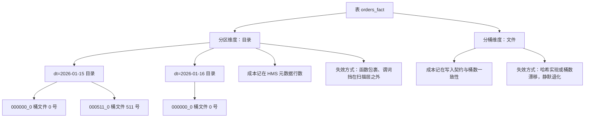
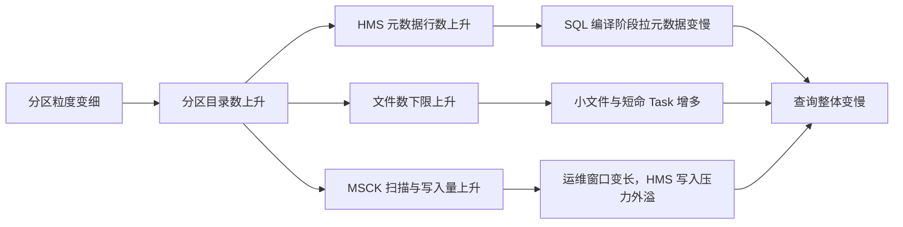
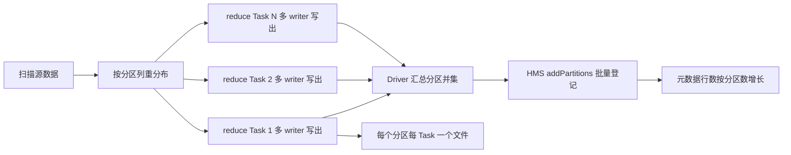
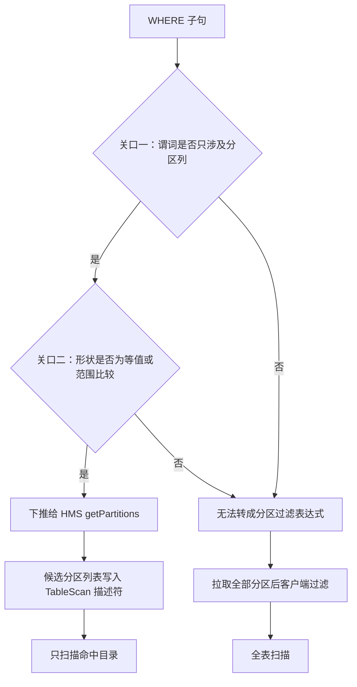
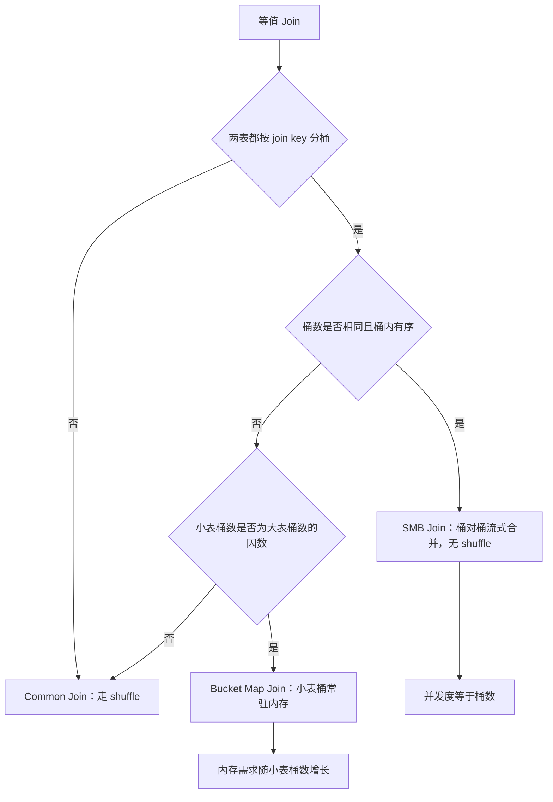
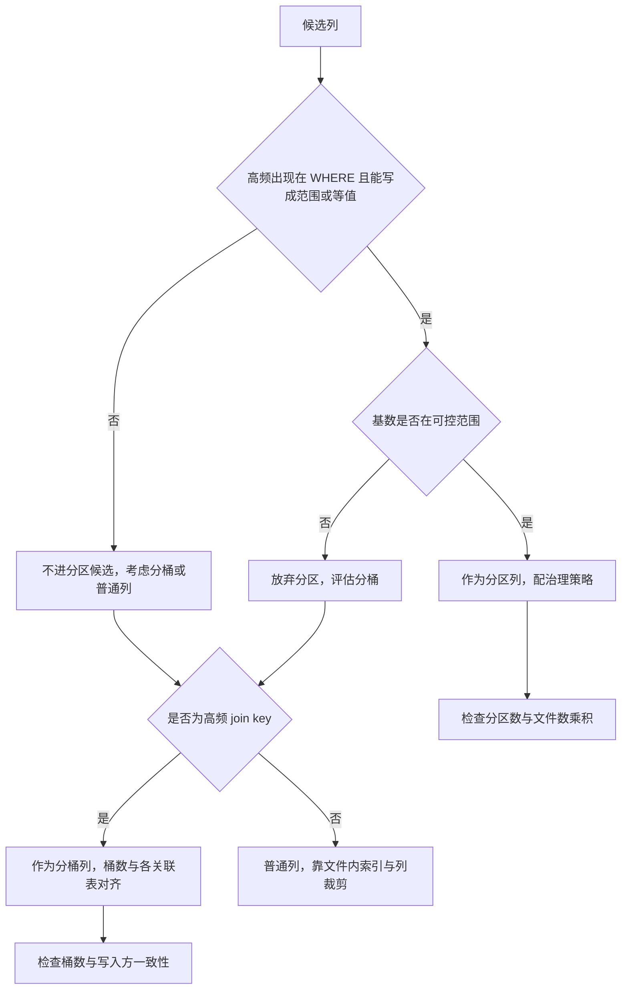

# 07 分区与分桶：物理数据组织的核心机制

**摘要：**

分区（Partition）与分桶（Bucket）在 Hive 的建表语句里挨得很近，一个写在 `PARTITIONED BY`，一个写在 `CLUSTERED BY`，都读作"把数据切开"，于是很多表设计把它们当成同一件事的粗细两档。这种误解在单表测试里不会显形，等分区数冲到十万量级、或者分桶表的写入方从 Hive 换成别的引擎，代价才会以元数据膨胀、编译超时、Join 静默退化三种完全不同的面貌浮现。本篇先把两者的承载介质分开：分区是目录，分桶是文件；再顺着这条分界去看各自的代价与失效条件——分区的三笔账记在 Hive Metastore（HMS）的元数据行数、HDFS 上的小文件、`MSCK REPAIR TABLE` 的目录扫描成本上；分桶的代价记在一份随时可能被破坏的写入契约上，契约破了不会有任何报错。全文用一张订单宽表（按 `dt` 分区）与一张客户维表（按 `cust_id` 分桶）的 join 场景贯穿，回答两个问题：一条查询的分区裁剪在什么条件下失效、判据看 `EXPLAIN` 的哪一段；同一张表上分区与分桶如何取舍、动态分区全开时文件数为什么会爆炸。文末给出一张选择判据表和一版上线前可执行的检查清单。

---

## 第 1 章 两个正交维度：目录承载分区，文件承载分桶

### 1.1 一个设问

不妨先做一个设问：一张按天分区、又按用户分桶的订单表，当查询条件里同时出现 `dt = '2026-01-15'` 和 `cust_id = 42` 时，这两个条件各自省掉了哪一部分 I/O？

答案是它们省掉的东西根本不在同一个层面。`dt` 的谓词被翻译成路径前缀，让 TableScan 只去列举 `dt=2026-01-15` 这一个目录；`cust_id` 的谓词如果被采纳，则在文件边界上做减法，只读第 42 号桶那一个文件。前者是元数据层的裁剪，后者是文件层的裁剪，而后者是否生效还取决于执行引擎与一个默认值的开关。把两者混为一谈，后果不是"用错了某一种，性能差一点"，而是预算记错了科目——分区设计失手会压垮 HMS，分桶设计失手会让优化器悄悄放弃一个本该生效的 Join 策略，两者都不会在结果正确性上给提示。

笔者在真实集群里见过更隐蔽的形态：一张表既按天分区又按用户分桶，表定义看起来完美，但每天的写入任务里混进了两个不同引擎的作业，于是同一张表里既有按 Hive 哈希排布的文件，也有按另一种哈希排布的文件，元数据上写着 512 个桶，物理上却有一半文件不符合这个约定。查询照常出结果，只是每一次 SMB Join 都退化成 Common Join，而退化是无声的。

### 1.2 分区：把谓词写进路径

分区的实现朴素得近乎粗暴——分区列的值直接成为目录名。一张按 `dt`、`region` 双分区的订单宽表，在 HDFS 上就是一棵以 `列名=值` 命名的目录树：

```
hdfs:///warehouse/ods.db/orders_fact/
├── dt=2026-01-14/
│   ├── region=US/000000_0.orc
│   ├── region=EU/000000_0.orc
│   └── region=ASIA/000000_0.orc
├── dt=2026-01-15/
│   ├── region=US/000000_0.orc
│   └── region=EU/000000_0.orc
└── dt=2026-01-16/
    └── ...
```

这棵树带来一个容易被忽略的事实：分区列的值不在数据文件内部。上例的 ORC 文件里只有业务列（`order_id`、`cust_id`、`amount` 这些），`dt` 与 `region` 的数据并不存在于文件之中，读取时由 TableScan 从目录名解析出这两个值，再以虚拟列的方式补到每一行上。由此派生三条性质：

- 分区列不占数据文件的存储空间，也不进入 ORC 的列统计，凡是"文件内谓词下推"的手段（min/max 索引、布隆过滤器）都作用不到分区列上，它靠的是目录名这一个字符串；
- 分区列的过滤只能落在"值相等或值域比较"上，因为实现里它就是一个字符串前缀匹配，函数、拼接、类型转换都会让编译器失去把谓词映射成路径的能力；
- 分区在 HMS 里是一等对象：每个分区有一行 `PARTITIONS` 记录、一组 `PARTITION_KEY_VALS` 记录指向具体的分区值、一行 `SDS` 记录指向存储位置。它能被 `ALTER TABLE` 增删改，能被 `EXCHANGE PARTITION` 在表之间搬运，能单独带统计信息。

第三条性质是分区与分桶最本质的差别所在。分区是 HMS 认识的东西，所以它的代价记在数据库里；分桶不是 HMS 认识的东西，它只在表级元数据里留下三个字段——桶数列、桶数、排序列——HMS 从不逐桶登记。元数据如何把这些记录落进关系库、`getPartitions` 在大表上又如何分批返回，[[02 Hive Metastore 深度解析：元数据体系与 HMS 高可用|HMS 元数据体系]] 有完整拆解，本篇只沿着"分区数变多之后，这条链路哪里先断"这条线走。

### 1.3 分桶：把哈希写进文件名

分桶换了一种切法。它不改变目录，而是在同一目录内把数据按某列的哈希值分到固定数量的文件里，每个文件对应一个桶：

```sql
CREATE TABLE customers_bucketed (
    cust_id    BIGINT,
    cust_name  STRING,
    city       STRING
)
CLUSTERED BY (cust_id) SORTED BY (cust_id) INTO 128 BUCKETS
STORED AS ORC;
```

布局如下，文件名前缀即桶号：

```
hdfs:///warehouse/ods.db/customers_bucketed/
├── 000000_0        ← cust_id 哈希落在 0 号桶的行
├── 000001_0
├── ...
└── 000127_0
```

与分区相反，分桶列是文件里真实存在的列，它参与列统计、参与谓词下推，也因此会占存储。分桶真正贡献的东西只有两件：一是让"同一个 key 的行必然在同一个文件里"成为表级承诺，二是让"第 k 号桶"这个粒度可以被定位。前者是 SMB Join（Sort-Merge-Bucket Join）无 shuffle 的前提，后者是桶级采样与桶裁剪的基础，这两件事后面各有小节展开。

请注意桶号只由三个量决定：分桶列的哈希值、桶数、以及复合键的合并顺序。三个量里任何一个在写入侧与读取侧不一致，物理布局就与元数据宣称的布局错位。分桶没有可回滚的元数据对象，错位无法通过 DDL 修复，只能重写数据。

### 1.4 叠加之后仍是两个维度

分区与分桶可以同时出现在一张表上，形成"目录 × 文件"的二维组织：

```sql
CREATE TABLE orders_fact (
    order_id  BIGINT,
    cust_id   BIGINT,
    amount    DECIMAL(18, 2),
    channel   STRING
)
PARTITIONED BY (dt STRING)
CLUSTERED BY (cust_id) SORTED BY (cust_id) INTO 512 BUCKETS
STORED AS ORC;
```

物理布局随之变成两层的笛卡尔积：`dt=` 决定一级目录，`cust_id` 的哈希决定目录内的文件名。这两个维度的正交性在于：加一个分区维度不会改变桶数，改桶数也不会影响分区目录；但它们对文件总数的贡献是相乘而非相加，这正是后文动态分区事故的算术基础——每个分区目录里都要各自摆满它那一份桶文件。

下面这张图把两个维度的承载物、作用层次与失效方式并置，后文各章可以随时回到它。



### 1.5 先把语义差异列清楚

在往下讲代价之前，值得把两个维度放在同一张表里对照一遍。表里的每一行在后面都会再展开，这张表的作用是先建立起"它们不是粗细两档，而是两种机制"的印象。

| 对照维度 | 分区 | 分桶 |
|---|---|---|
| 承载介质 | HDFS 目录名 | Hive 表目录内的文件名 |
| 切分依据 | 分区列的取值，相等即同目录 | 分桶列哈希值对桶数取余 |
| 元数据形态 | HMS 中每个分区一条记录，是一等对象 | 仅表级记录桶数列、桶数、排序列，不逐桶登记 |
| 裁剪粒度 | 整个目录 | 单个文件（需桶裁剪开启） |
| 可被 DDL 修复 | 可以，ADD/DROP/EXCHANGE/RENAME | 不能，只能重写数据 |
| 主要成本 | 元数据行数、小文件、MSCK 扫描 | 写入契约的一致性、桶数规划 |
| 主要收益 | 分区裁剪，收益随数据量线性放大 | SMB Join、桶级采样、桶裁剪 |
| 典型失效 | 谓词无法映射成路径 | 哈希实现或桶数在读写两侧不一致 |

## 第 2 章 分区的三笔账

分区从来不是免费的。它把"一次大文件扫描"换成了"若干次小目录扫描"，省下的是读侧 I/O，付出的是三笔分散在不同系统里的成本：HMS 的元数据行数、HDFS 上的小文件、以及元数据与目录不一致时的修复开销。三笔账都不会出现在单条查询的耗时里，所以它们最容易被忽略。

### 2.1 第一笔：元数据行数

分区数首先是一场数据库的容量问题。每新增一个分区，HMS 的关系库里至少要多出三类记录：`PARTITIONS` 表一行，记录分区标识与所属表；`PARTITION_KEY_VALS` 表每个分区列一行，记录这个分区的具体取值；`SDS` 表一行，记录存储描述符与位置。一个双分区表每新增一个分区，大致是三到五行；一百万分区就是三到五百万行，加上索引与外键，这个量级已经超过很多中小型 HMS 后端数据库的单表舒适区。

行数本身还不致命，致命的是这些行会被整批读出来。Hive 的编译阶段需要知道"有哪些分区"，语义分析器会把 `WHERE` 里能转成表达式的那部分分区谓词，交给 HMS 的 `getPartitions` 系列接口做一次带过滤的查询；过滤器能下推到元数据层的前提是谓词只涉及分区列、且形状是等值与范围比较的组合。一旦谓词被函数包裹，编译器就只能退化成"把该表全部分区拉回来，在客户端逐个判断"，于是百万级分区对象要在 HMS 侧做对象装配、序列化，在客户端侧反序列化、遍历，这一段开销全部记在 SQL 编译时间里，用户看到的现象是"语句还没开始跑，就已经卡了半分钟"。

> [!warning] 分区数的经验阈值
> 单表分区数上一万时，`SHOW PARTITIONS`、`DESCRIBE FORMATTED` 这类 DDL 会开始有可感知的停顿；到十万量级，编译期拉取元数据的耗时通常已经与查询本身的数据量不在一个数量级。这个阈值的具体位置取决于 HMS 后端、`getPartitions` 的批大小与分区过滤是否下推，**按自己集群实测**，不要照搬他人数字。

### 2.2 第二笔：小文件

第二笔账更直观：每个分区目录里至少要有一个文件。即使当天的订单只有几百行、压缩后不足 1MB，它也会占掉一个 HDFS 文件、一个 inode、一个 NameNode 内存对象，以及读取时的一个 split、一个 Task 的启动开销。分区粒度翻十倍，文件数的最低下限就翻十倍，而文件大小按同一比例缩小。

小文件的问题不在于存储浪费，而在于比例失调：一个 5MB 的文件如果按 128MB 的块大小组织，它的读取时间主要花在申请容器、初始化 JVM、打开文件、读取 footer 上，真正读数据的部分可以忽略。分区越细，这种"启动成本大于计算成本"的 Task 占比越高，集群的调度队列被一堆短命任务塞满，吞吐反而下降。HDFS 侧对文件与块、inode 的计量方式决定了小文件的元数据开销上限，[[大数据/Hadoop/HDFS/00 专栏导览|HDFS]] 那一系列里有更细的推导，这里只需要记住一条换算关系：分区数与每分区文件数的乘积，就是这张表在 NameNode 上的文件对象总数。

### 2.3 第三笔：MSCK REPAIR 的扫描成本

当分区是通过 Hive 之外的路径产生的——上游作业直接 `hadoop fs -put` 落地、跨集群同步工具拷贝目录、外部系统按自己的节奏写文件——HMS 不会知道这些目录的存在，`SELECT` 也查不到它们的数据，因为查询的分区列表来自元数据而不是目录列举。这时要用 `MSCK REPAIR TABLE` 做一次对账：

```sql
-- 默认行为等价于 ADD PARTITIONS：把 HDFS 上有、HMS 里没有的分区补登记
MSCK REPAIR TABLE orders_fact;

-- 同时补齐与清理，等价于 ADD + DROP（Hive 4.0 的完整语法还提供 ADD/DROP/SYNC 子句）
MSCK REPAIR TABLE orders_fact SYNC PARTITIONS;
```

这条命令的成本结构值得拆开看，因为它常常被当成一条轻量的运维语句随手执行：

1. **目录列举**：从表根目录开始递归 `listStatus`，每个分区目录一次或多次 NameNode RPC；分区数越多，RPC 次数与往返延迟越是主导项；
2. **分区值解析与校验**：把 `dt=2026-01-15` 这样的目录名还原成类型化的分区值。Hive 1.3 起，遇到分区值里含不允许的字符会直接抛异常，可以用 `hive.msck.path.validation` 设为 `skip` 跳过或 `ignore` 强行登记；
3. **与 HMS 现存分区对账**：把目录枚举结果与元数据里的分区集合求差，得到待补与待删的集合；
4. **批量写元数据**：逐批调用 `addPartitions`/`dropPartitions`。未跟踪的分区很多时，一次性完成会撑爆客户端或 HMS 的堆，`hive.msck.repair.batch.size`（Hive 2.2.0 引入）就是为此准备的，默认值 0 表示不分批；
5. **清理与失效**：分区变动会让相关表的统计信息、缓存计划、以及依赖该表的物化视图失效，后续查询要重新走一遍编译。

把这五步加起来，一次 `MSCK` 的耗时与分区数近似线性甚至超线性增长。**示例推算**：一个有一万个分区的表，目录列举加上万次 RPC、元数据写入上万行，在常规集群上通常要几十秒到几分钟；分区数上到十万，同样的流程会进入十分钟到小时级，而且这段时间里 HMS 的写入压力会波及其他表。

Hive 4.0 给了一条不同的路：给表加上 `discover.partitions=true` 的表属性后，HMS 以远端服务模式运行时会有后台任务（`PartitionManagementTask`）按 `metastore.partition.management.task.frequency`（默认 300 秒）周期性扫描这类表，替它们执行同步语义的 REPAIR，配合 `partition.retention.period` 还能按分区创建时间自动清理过期分区（HIVE-20707）。这条路把"人工执行一条重命令"变成了"后台持续的小步对账"，仍然是同一笔开销，但被摊平了，不再阻塞业务。

### 2.4 三笔账的乘积关系

三笔账之间不是并列关系，它们被同一个自变量驱动：分区粒度。粒度变细，目录数上升，元数据行数、文件数、`MSCK` 的扫描量同时上升；而能换来裁剪收益的查询条件并没有因此变多。下图把这条传导链画出来。



把三笔账与粒度放进一张表，可以更直观地看出"按分钟分区"这类设计为什么不可行。下表的文件数按"每分区至少一个文件"计，实际值通常更高；耗时一列均为示例推算的量级判断，不是基准数据。

| 分区粒度 | 三年分区数 | 文件数下限 | HMS 记录量级 | 单次 MSCK 耗时量级 |
|---|---|---|---|---|
| 按天（`dt`） | 约 1.1 千 | 1.1 千 | 数千行 | 秒级 |
| 按小时（`dt` + `hour`） | 约 2.6 万 | 2.6 万 | 十万行量级 | 数十秒到数分钟 |
| 按分钟（`dt` + `hour` + `minute`） | 约 158 万 | 158 万 | 数百万行 | 小时级，且大概率失败 |
| 按用户 ID（千万级基数） | 千万级起 | 千万级起 | 千万行起 | 不可完成 |

一句话概括这张表：分区的粒度过一道线之后，所有成本都按乘法增长，而收益是零——没有哪条查询会因为多了一层 `minute=` 目录而少读一个文件。

## 第 3 章 动态分区：写入侧的便利与失控

### 3.1 两种写入姿态

静态分区写入把分区值写死在 SQL 里，一条 `INSERT` 只落一个分区，分区值在编译期就确定；动态分区写入让分区值来自数据本身，一条 `INSERT` 可以同时落一批分区。后者是 ETL 的默认写法，因为它把"按天回刷"和"按天增量"统一成了一个模板。

```sql
-- 静态：目标分区在语句中确定，一件写入只碰一个分区
INSERT OVERWRITE TABLE orders_fact PARTITION(dt='2026-01-15')
SELECT order_id, cust_id, amount, channel
FROM orders_staging
WHERE dt = '2026-01-15';

-- 动态：分区值由 SELECT 输出列的最后一列提供
SET hive.exec.dynamic.partition = true;
SET hive.exec.dynamic.partition.mode = nonstrict;
INSERT OVERWRITE TABLE orders_fact PARTITION(dt)
SELECT order_id, cust_id, amount, channel, dt
FROM orders_staging;
```

`hive.exec.dynamic.partition.mode` 的两个取值划定了风险边界：`strict`（默认）要求语句中至少保留一个静态分区，用意是防止一条手滑的 `INSERT OVERWRITE` 把全表分区一次覆盖掉；`nonstrict` 允许全部动态。很多团队为了让调度模板统一，长期把模式设成 `nonstrict`，代价是失去了这道保险，而保险的对象恰恰是本节要讲的那个失控场景。

### 3.2 写入路径上发生了什么

动态分区的执行机制决定了文件数。编译器知道目标表的每个分区都要一整套桶文件（如果同时分桶），因此会在写入路径上插入一个按分区列（以及分桶列）分布的重分布算子——在 Tez 上就是最后一个 reduce vertex 的边，在 MapReduce 时代则是 `DISTRIBUTE BY` 或自动插入的 ReduceSink。它的作用是把同一个分区值的行集中到同一个 Task 上，这样每个 Task 只需要为自己见到的分区各开一个 writer。

单个 reduce Task 的内部逻辑大致如下：遍历输入行，按行里的分区列值查一张"分区值到 writer"的映射表，命中则直接写，未命中则创建目录、打开一个新文件、缓存 writer；输入结束时依次关闭所有 writer，flush 缓冲、写文件尾，并向 Driver 汇报"本 Task 产出过哪些分区"。所有 Task 完成后，Driver 汇总出一个并集，一次性调用 HMS 的 `addPartitions` 登记。下图把这条链路上的三个成本点标了出来。



### 3.3 文件数等于分区数乘写入者数

把上面的机制抽象成一个公式：

```
一次动态分区写入的文件数 ≈ 分区数 × 参与写出的 reduce Task 数
（实际值取决于分区键在各 Task 间的分布，上界即乘积，下界为分区数）
```

这个乘法关系不是理论推导，而是机制的直接后果：每个 reduce Task 对每个它见过的分区都要各开一个文件，两个 Task 见过同一个分区就会产出两个文件，文件名用 `_copy_` 后缀或不同前缀区分。于是分区数与并行度这两个"各自看起来都合理"的参数，一相乘就失控。

**示例推算**：按天分区、回刷三年数据的一次作业，分区数约 1.1 千；Tez 依据数据量自动规划出 200 个 reduce Task；分区键在 Task 间大致均匀分布。结果是约 22 万个文件，平均每个文件只有几 MB。如果这张表同时还按 `cust_id` 分了 512 个桶，文件数上限还要再乘 512，直接进入亿级，作业大概率在写入阶段因文件数保护或 NameNode 压力失败。同一份数据，如果改成分区级回溯——每次只处理一个 `dt`、`INSERT OVERWRITE` 一个静态分区——文件数就退化成分区内的桶数（或 1），相差三个数量级。

### 3.4 比文件数更难查的：分区值漂移

文件数爆炸至少会在作业失败时暴露。另一类动态分区事故是静默的：分区值的字符串形态在写入侧不统一，同一个逻辑分区被写成多个目录。

```sql
-- 分区列声明为 STRING，但上游给的是 DATE 或带时区的 TIMESTAMP
-- 同一逻辑日期可能落成以下任一形态：
-- dt=2026-01-15    dt=2026-1-15    dt=2026-01-15 00:00:00    dt=2026-01-15T00:00:00
```

后果是双向的：写入侧每次回刷都可能新造一个"看起来是新分区"的目录；读取侧 `WHERE dt = '2026-01-15'` 只能命中其中一个，其余目录里的数据既不会被扫到，也不会报错，业务方看到的是"某些天的数据缺了一部分"。这类问题通常要等对账口径对不上时才被发现，而修复成本很高——需要先枚举出所有变体、用 `ALTER TABLE ... PARTITION ... RENAME TO PARTITION` 归一化分区值（官方文档明确把这个用法列为分区重命名的一个用途），再重跑写入任务。

`hive.typecheck.on.insert`（默认开启）会在写入时按列类型做校验与转换，能挡住一部分明显不合法的值，但它挡不住"合法但形态不同"的字符串；分区列声明成 `STRING` 时，`'2026-1-15'` 与 `'2026-01-15'` 都是合法的字符串。真正的防线在写入侧：分区列一律用零填充固定宽度的字符串（`yyyy-MM-dd`），并在落地前用类型转换把上游的 `DATE`/`TIMESTAMP` 显式格式化，而不是依赖隐式转换。

另一类空洞来自 NULL：动态分区列取值为 NULL 时，行会被写进名为 `__HIVE_DEFAULT_PARTITION__` 的特殊分区（名字由 `hive.exec.default.partition.name` 决定）。这个目录不对应任何真实的等值条件，普通查询不会命中它，而带 `dt IS NULL` 的查询也不必然按预期走到它上面，于是这批行变成了"存在于表里但查不出来"的数据。处置方式只有在写入前把 NULL 替换成有业务含义的哨兵值，或者干脆让写入失败。

### 3.5 保护参数与它们的代价

Hive 提供了一组数量保护，用来在失控时把作业打停。这些参数的价值不在于"设得越大越好"，而在于它们是唯一能在事故发生时把损失限制在作业级别的机制。

| 参数 | 默认值 | 作用 | 调大的代价 | 调小的代价 |
|---|---|---|---|---|
| `hive.exec.dynamic.partition` | `true` | 开关动态分区写入 | — | 关闭后所有写入必须静态分区，调度模板要改造 |
| `hive.exec.dynamic.partition.mode` | `strict` | 是否允许全动态写入 | 设为 `nonstrict` 后失去误覆盖全表的保险 | 保留 `strict` 则要求模板里至少写一个静态分区，灵活性下降 |
| `hive.exec.max.dynamic.partitions` | `1000` | 单次写入允许创建的分区总数 | 阈值调大等于放弃最后一道闸门，事故会以 OOM 或 HMS 超时形式出现 | 阈值偏小会打断正常的跨月回刷作业 |
| `hive.exec.max.dynamic.partitions.pernode` | `100` | 每个节点允许创建的分区数 | 调大后单个 Task 打开的文件句柄增多，长尾 Task 更慢 | 调小后分区分布稍不均就会误报 |
| `hive.exec.max.created.files` | `100000` | 整个作业允许创建的文件总数 | 调大到百万级会让 NameNode 承受大量并发创建 | 调小会打断分桶表的大批量重写 |
| `hive.optimize.sort.dynamic.partition.threshold` | `0` | 是否先按分区列全局排序再写，减少同时打开的 writer 数 | 强制开启（置 1）会引入一次额外排序，写吞吐下降 | 关闭（置 -1）后 reducer 堆内存压力与打开文件数上升，文件总数不变 |
| `hive.msck.repair.batch.size` | `0` | MSCK 内部批量处理规模 | 调大后单批元数据写入更重，HMS 抖动明显 | 调小后 RPC 轮次增多，总耗时上升 |

关于 `hive.optimize.sort.dynamic.partition.threshold` 这一行要补一句版本差异：`hive.optimize.sort.dynamic.partition` 这个老参数在 Hive 4.0 已被移除（HIVE-25320），由 `hive.optimize.sort.dynamic.partition.threshold` 接管，取值 -1/0/1 分别表示关闭、按代价决策、强制开启，也接受正整数作为 writer 数阈值。这类"同一个开关换了名字和语义"的迁移，是跨版本拷贝配置时最常见的踩坑点，以对应版本文档为准。

这些参数终究只是止血带。控制文件数的根本手段在写入策略上：一次写入只碰一个静态分区，把"跨分区并行"换成"跨分区串行、分区内并行"，文件数就从乘积退回单项。

## 第 4 章 分区裁剪的失效条件与判据

### 4.1 裁剪发生在编译链的哪一步

分区裁剪不是执行期的优化，而是编译期的一次元数据查询：解析（Parse）得到语法树，语义分析（SemanticAnalyzer）把 `WHERE` 里涉及分区列的谓词抽出来，转成能交给 HMS 的过滤表达式，取回候选分区列表，写进 TableScan 算子的描述符里；之后优化器（Optimizer）在算子树上做谓词下推与代价估算，任务编译（TaskCompiler）把带分区列表的 TableScan 变成物理计划。执行阶段再没有"裁剪"这个动作，它只是老老实实读描述符里列出的那些目录。

这条链路决定了失效的形态：只要谓词没能变成分区列表，后面所有环节都不会**补救**。下图标出三个关口，谓词在任何一个关口掉队，都会退化成全表扫描。



### 4.2 失效一：分区列上的函数与隐式转换

最常见的失效来自把分区列包进函数：

```sql
-- 失效：分区列被函数包裹，无法映射成路径
SELECT COUNT(*) FROM orders_fact
WHERE YEAR(dt) = 2026 AND MONTH(dt) = 1;

-- 生效：谓词两侧都是可直接比较的值
SELECT COUNT(*) FROM orders_fact
WHERE dt >= '2026-01-01' AND dt < '2026-02-01';
```

第一句的语义没错，结果也对，但它把"从目录名里取一个字符串比大小"降级成了"把每一行的分区值取出来做函数运算"。分区列在这里退化成一个普通列，TableScan 描述符里不会有分区列表，执行期要扫全部目录。

隐式转换是同一类问题的变体，且更难识别。分区列声明为 `STRING` 而比较值是 `DATE` 时，`dt = date'2026-01-15'` 会触发类型转换，至于转换发生在哪一侧、能否被常量折叠消除，取决于版本与谓词形状；分区列声明为 `INT` 而比较值写成 `'20260115'` 的字符串时，同样存在一个隐式的字符串到整数转换。这类写法在测试环境常常正常，因为测试数据的分区数少，全扫也只要几秒；上了生产才表现为"这条报表要跑一小时"。

常量折叠在这里帮了一部分忙：`WHERE dt = date_sub(current_date, 1)` 的右值在编译期就能算成一个常量，裁剪照常生效；但 `WHERE dt = date_format(create_time, 'yyyy-MM-dd')` 的右值依赖行数据，无法折叠，等于对分区列做了逐行比较。判断标准很简单：等号另一侧是否在编译期就折叠成**常量**。

### 4.3 失效二：谓词被挡在 TableScan 之外

第二种失效发生在查询块的结构上。谓词下推（Predicate Pushdown）会把过滤尽量推向数据源，但它不是无条件的重写，遇到某些算子形态会被挡住：

```sql
-- 外层过滤，内层有 LIMIT：下推被 LIMIT 截断语义挡住
SELECT * FROM (
    SELECT * FROM orders_fact ORDER BY amount DESC LIMIT 1000
) t
WHERE t.dt = '2026-01-15';

-- 聚合后再过滤：dt 已经不是行级谓词
SELECT * FROM (
    SELECT dt, channel, SUM(amount) AS amt
    FROM orders_fact
    GROUP BY dt, channel
) t
WHERE t.dt = '2026-01-15';
```

第一句的语义要求"先按全表排序取前 1000 行，再过滤其中属于某天的行"，与"先过滤再取前 1000 行"不等价，优化器不能擅自下推；第二句的 `dt` 虽然出现在输出列里，但它是聚合的分组键，过滤发生在聚合之后，裁剪需要在聚合前完成才有意义——是否能下推取决于优化器是否识别出分组键上的等价谓词，这在不同版本上表现不一致。

还有一类更隐蔽的结构问题是跨列的析取：

```sql
-- OR 的两侧分别涉及分区列与非分区列，整个表达式无法转成分区过滤
SELECT * FROM orders_fact
WHERE dt = '2026-01-15' OR channel = 'APP';
```

分区裁剪的过滤器只能由分区列上的条件组合而成，一旦 `OR` 的一侧引入了非分区列，整个析取式都不能下推，`dt` 那半边的裁剪能力也随之失效。改写方式是把范围收窄：

```sql
SELECT * FROM orders_fact WHERE dt = '2026-01-15'
UNION ALL
SELECT * FROM orders_fact WHERE channel = 'APP' AND dt <> '2026-01-15';
```

### 4.4 失效三：写入侧造成的类型与格式漂移

第三种失效不在查询里，而在表里。前面 3.4 节讲过的分区值形态漂移，在读取侧的表现就是"裁剪命中了一个不完整的集合"：`WHERE dt = '2026-01-15'` 精确命中了标准格式的目录，而 `dt=2026-1-15` 那个目录里的数据被完整漏掉，且没有任何告警。这种"裁剪生效但结果不全"比"裁剪失效但结果正确"危险得多，因为性能问题会被监控发现，数据缺失往往要等对账。

同类问题还包括分区列类型变更：先建表时分区列是 `STRING`，后来有人用 `ALTER TABLE ... PARTITION COLUMN` 改成 `INT`（部分版本支持），或者干脆重建了一张同名新表，历史目录里的值与元数据里的类型不再一致，比较时的隐式转换会让部分目录永远匹配不上。

### 4.5 运行时的那一半：动态分区裁剪

编译期裁剪处理的是"谓词里有常量"的情形。当分区条件的值来自另一张表时，编译期根本不知道要读哪些目录，这类查询要依靠运行时裁剪（Dynamic Partition Pruning，DPP）：先把维表侧的过滤算完，得到一个分区值集合，再把这个集合作为运行时过滤器注入事实表的 TableScan，让它在真正扫描开始前丢掉不命中的目录。

```sql
-- 事实表按 dt 分区；维表只有几百行，但它的过滤条件要到运行期才能算出日期集合
SELECT f.order_id, SUM(f.amount)
FROM orders_fact f
JOIN dt_dim d ON f.dt = d.date_key
WHERE d.year = 2026 AND d.quarter = 1;
```

这条语句在编译期无法知道 `d.year = 2026 AND d.quarter = 1` 会选出多少个日期，于是计划里保留两段执行：先扫维表得到一组 `date_key`，再把这些值通过 Tez 的运行时事件通道发给事实表所在的 vertex，由它在 DAG 调度阶段裁剪输入分片。它能成立的前提是 join 的等值条件落在事实表的分区列上——`ON f.dt = d.date_key` 恰好满足；若写成 `ON f.dt = date_format(d.some_ts, 'yyyy-MM-dd')`，注入的就不是分区值而是表达式结果，裁剪不会发生。

运行时裁剪不是免费的兜底，它有明确的放弃条件：注入的分区值集合过大时，事件体积超过阈值，整个裁剪会被放弃，宁可全扫也不让计划被撑爆。`hive.tez.dynamic.partition.pruning` 自 Hive 2.3 起就存在且默认为开启，配套的 `hive.tez.dynamic.partition.pruning.max.event.size`（默认 1MB）与 `max.data.size`（默认 100MB）就是这两道阈值，`hive.tez.dynamic.semijoin.reduction` 也依赖它才能在半连接阶段先做一轮过滤。收益与"维表过滤后的选择性"直接相关：维表过滤结果动辄上万个日期值时，它反而会退化成一次额外的全量扫描加一次被放弃的裁剪。

### 4.6 判据：EXPLAIN 看哪一段

判断裁剪是否生效，不需要跑查询，看 `EXPLAIN` 的输出即可，抓手有三个：

```sql
EXPLAIN
SELECT SUM(amount) FROM orders_fact
WHERE dt = '2026-01-15' AND cust_id = 42;
```

- **TableScan 的 `Partition` 段**：这是最直接的判据。裁剪生效时，这一段会列出被选中的分区规范（`dt=2026-01-15`），以及实际的分区数量；裁剪失效时，这一段要么缺失，要么列出全部分区或者一个 `<>` 形式的排除式，分区数量与总分区数相同。
- **过滤算子的位置**：裁剪生效时，谓词体现在 TableScan 描述符里；失效时，通常会在 TableScan 之上多出一个 `Filter Operator`，谓词在那里逐行计算。看到"TableScan 之上还有 Filter 且过滤条件含分区列"，基本可以判定裁剪没有下沉。
- **分区裁剪表达式**：`EXPLAIN EXTENDED` 会展开算子的内部细节，分区描述符里能看到形如 `dt = '2026-01-15'` 的表达式；如果是全表扫描，这里往往是一个恒真条件或者干脆没有表达式。

`EXPLAIN DEPENDENCY` 可以进一步确认输入源：它列出这次查询真正会读的路径与分区，裁剪生效时路径里只出现命中的目录，一眼就能看出读了几个分区。

### 4.7 失效写法与改写方式

| 失效写法 | `EXPLAIN` 现象 | 改写方式 |
|---|---|---|
| `WHERE YEAR(dt) = 2026` | TableScan 无分区列表，上方多出 Filter | 改成 `dt >= '2026-01-01' AND dt < '2027-01-01'` |
| `WHERE dt = date_format(create_time,'yyyy-MM-dd')` | 谓词含 UDF，无法转表达式 | 把右侧改为编译期常量，或先落一张小表再 join |
| `WHERE dt = date'2026-01-15'` 而分区列是 `STRING` | 视版本可能不裁剪或只裁剪部分 | 显式写成字符串常量，两侧类型对齐 |
| `WHERE dt = 'x' OR channel = 'APP'` | 谓词含非分区列，整体不下推 | 拆成两支 `UNION ALL`，各自带分区条件 |
| 子查询内 `ORDER BY ... LIMIT` 外层再过滤 | 谓词停在子查询之外 | 把过滤条件移进子查询，或去掉 `LIMIT` 改窗口函数 |
| 聚合或窗口之后过滤分区列 | 过滤在聚合算子之上 | 把分区条件放进聚合前的 `WHERE` |
| 分区值格式不一致（`2026-1-15`） | 裁剪命中但分区数偏少 | 用 `RENAME TO PARTITION` 归一化后重写 |

## 第 5 章 分桶：哈希、前提与真实收益

### 5.1 桶号怎么算出来

分桶的全部价值建立在一个可复现的函数上：桶号 = 分桶列哈希值对桶数取余。Hive 把这个过程实现在 `ObjectInspectorUtils.getBucketNumber` 里，逻辑分三步——先算每个分桶列的字段哈希，复合键按 `hash = 31 * hash + fieldHash` 逐列合并，最后取 `(hash & Integer.MAX_VALUE) % bucketCount`。取掩码是为了让负哈希也落进合法区间，这一点在跨引擎校验桶布局时经常被忽略。

字段哈希的算法随大版本变化，这是本篇最需要强调的版本敏感点。笔者核对过两份源码：Hive 2.3.x 的 `getBucketHashCode` 用的是类型化 `hashCode`，其中 `BIGINT` 折叠成高低 32 位异或 `(int)((a >>> 32) ^ a)`，`STRING` 按 UTF-8 字节做 `r = r * 31 + byte[i]`，`FLOAT`/`DOUBLE` 用 IEEE 754 位模式；从 Hive 3.x 起，`getBucketHashCode` 改成了对每种类型调用 `Murmur3.hash32`，再按同样的 `31 * hash + fieldHash` 合并。两组实现的桶号在多数数据上不同。

推论很硬：同一张分桶表，用 Hive 2.x 写入的历史文件与用 Hive 3.x 之后写入的文件，**桶布局可能并不一致**；跨引擎更不保证一致，Spark 写 Hive 分桶表时另有一套哈希实现，社区后来提供了 `hive_hash` 之类的函数以复现 Hive 的语义，但两边必须在写入路径上显式对齐，否则"元数据说 512 桶、物理上按另一套规则分布"的错位就此产生。

### 5.2 写入前提：一个已经过时的"必须打开"

网上流传最广的一条分桶规则是"写入分桶表时必须 `SET hive.enforce.bucketing = true`"。这句话在 Hive 0.x/1.x 上成立，在那个年代还必须配合 `hive.enforce.sorting = true` 才能保证桶内有序，并且要手动把 reducer 数设成桶数，或者依赖该开关自动设置。但从 Hive 2.x 起，HIVE-12331 移除了这两个参数，写入路径不再提供"不强制"的选项，编译器会无条件在分桶列上插入重分布算子，桶数即 reducer 数；参数本身在很多发行版里仍能被设置，只是不再产生效果。

这个版本差异带来两个实际后果。其一，按旧文档写的脚本里那句 `SET hive.enforce.bucketing = true` 已经是安慰剂，真正的风险转移到了别处——写入方是谁、写的是什么引擎、桶数在写入前后是否被改过。其二，既然强制由编译器完成，语句里再手写 `DISTRIBUTE BY`/`CLUSTER BY` 就是多余的，某些形状下还会与编译器插入的重分布算子叠加成两次 shuffle；是否存在重复，看 `EXPLAIN` 里 `ReduceSinkOperator` 的个数即可确认。

与之配套的还有一个容易踩的开关：`hive.optimize.bucketingsorting`（默认开启）会在源表与目标表的分桶键、桶数、排序列完全一致时，省掉那次用于强制分桶的 reducer，直接搬运文件。它省的是 shuffle，前提是"完全一致"，一旦桶数不同就会退回常规写入路径。

### 5.3 桶数一致性与 Join 策略

分桶被设计出来，最主要的用途是让等值 join 免掉 shuffle。当两张表按同一个 join key 分桶、且桶数相同、桶内又有序时，第 k 号桶的 join 结果只可能来自两张表的第 k 号桶，于是可以把桶两两配对，在 Map 端流式合并，这就是 SMB Join。桶数成整数倍关系时，退一步可以走桶级 Map Join：小表的每个桶装进内存后能被大表的多个桶复用。两条路径的判定条件可以用一张图概括，至于优化器在什么条件下选哪一种、执行期又如何在 Map 端合并，[[06 Join 深度解析：五种 Join 策略的实现机制|Join 策略]] 一篇里已有展开，这里只保留与桶数一致性有关的那部分判据。



两个前提都容易在运维中悄悄失效。桶数可以在 `ALTER TABLE` 里改，改完之后已有文件的物理布局不会自动重排，于是同一张表里"旧数据按 256 桶、新数据按 512 桶"的状态可以合法存在；桶内有序依赖 `SORTED BY` 与写入路径，任何绕过编译器的写入（外部工具直写文件、`LOAD DATA`）都会破坏它。真实收益因此不是"建了分桶表就有"，而是"建了分桶表且每一次写入都守住了约定才有"。判定是否退化，仍看 `EXPLAIN`：SMB Join 的计划里不会出现针对大表的 shuffle 边，退化后的 Common Join 会出现。

### 5.4 桶级采样

`TABLESAMPLE(BUCKET x OUT OF y)` 是分桶的第二个用途，它读取的是整桶而不是随机行：

```sql
-- 从 512 桶的表里取 1/16 的数据：y 必须是桶数的因数或倍数
SELECT * FROM orders_fact TABLESAMPLE(BUCKET 3 OUT OF 32) s;
```

语义上有两点必须讲清。取样单位是整个桶文件，因此采样结果的分布特性完全由分桶列的哈希分布决定：分桶列分布均匀，样本在分桶列维度上就有代表性；样本在别的列上是否均匀，没有任何保证。y 与桶数之间要求存在整除关系：y 取桶数的因数时，每个样本覆盖桶数除以 y 个桶；y 取桶数的倍数时，样本覆盖的是全部桶按比例的切分，语义不如因数情形直观。两种情形下采样单位都是桶文件，不存在跨桶的随机打散；不满足整除关系时结果不符合直觉，官方文档要求 y 必须是桶数的倍数或因数。

因此桶级采样适合做"快速探查、近似估算"，不适合做"可加总的分母"。两次不同参数的采样结果不能相加，也不能用来推算全量指标——这一点与按行随机采样（`TABLESAMPLE` 的百分比形式）有本质区别。

### 5.5 真实收益的边界

分桶能带来的收益只有三类，超出这个范围的说法都需要打问号。

第一类是 SMB Join 与桶级 Map Join，收益是大头，前提最苛刻：两表同键分桶、桶数成整除关系、桶内有序、写入路径统一。第二类是桶级采样，适合探查与估算。第三类是桶裁剪：当 `WHERE` 里对分桶列有等值谓词时，执行引擎可以只读命中桶的 split，而不必扫描全部分桶文件。

第三类收益的开关状态要单独说明，因为它的默认值在版本间变化过。当前 Hive 主干里 `hive.tez.bucket.pruning` 默认为 `true`，含义是"把分桶列上的过滤谓词转成桶位图，只保留命中的 split"，并且依赖 `hive.optimize.ppd` 之类的谓词下推先产生可用的谓词；同一份配置里还有 `hive.tez.bucket.pruning.compat`（默认 `true`），用来兼容历史上负哈希导致的错位写入，代价是某些情况下扫描量翻倍。而在此前的版本里这个开关默认关闭（笔者核对过 2.3.10 与 3.1.3 的默认值均为 `false`），分桶列上的过滤扫描的仍是全部分桶文件。

由此可以回答一个常被问错的问题：**分桶不是索引**，它不会自动把 `WHERE bucket_col = x` 变成一次查找。分桶没有二级索引、没有键值映射，桶号只能定位到一个文件，不能定位到文件内的行。它最多把"读 N 个文件"降成"读 1 个文件"，而这个降级还要看引擎与开关；文件内部仍然要顺序扫描（除非列式格式的 min/max 或布隆过滤器再帮一把）。把分桶当作点查加速手段，等于在写入端付出固定成本，去换一份取决于版本与开关的不确定收益。

### 5.6 分桶相关参数

| 参数 | 默认值 | 作用 | 调大/调小的代价 |
|---|---|---|---|
| `hive.enforce.bucketing` | Hive 0.x/1.x 为 `false`，2.x 起移除 | 写入时是否强制分桶 | 在 2.x 之后已无实际作用，设置它只会造成"以为在控制"的错觉 |
| `hive.enforce.sorting` | 同上，2.x 起移除 | 写入时是否强制桶内有序 | 同上；桶内有序现在只能靠 `SORTED BY` 与统一写入路径保证 |
| `hive.optimize.bucketingsorting` | `true` | 源表目标表布局一致时省掉强制分桶的 shuffle | 设为 `false` 会无条件多一次 shuffle；保持 `true` 时要小心"看起来一致实际不一致" |
| `hive.convert.join.bucket.mapjoin.tez` | `true` | Tez 上允许自动转桶级 Map Join | 关闭后只能显式 hint，易退化为 Common Join |
| `hive.tez.bucket.pruning` | 当前主干为 `true` | 把分桶列谓词转成桶位图裁剪 split | 关闭后分桶列过滤扫全部分桶文件；开启时需注意兼容开关带来的扫描翻倍 |
| `hive.optimize.bucketmapjoin` | `false` | 是否尝试桶级 Map Join | 开启后优化器会尝试该策略，桶数不成整除关系时仍会退回 |
| `hive.optimize.bucketmapjoin.sortedmerge` | `false` | 是否尝试 SMB Join | 开启条件更苛刻，桶布局略有偏差即退化且无提示 |

## 第 6 章 分区还是分桶：选择判据

### 6.1 判据表

把前面各章的结论收敛成一张表，这是本篇的主要产物。判据的行是"你在设计时能问出口的问题"，列是两种机制。

| 判据 | 分区 | 分桶 |
|---|---|---|
| 该列是否高频出现在 `WHERE` 的过滤条件里 | 必要条件，且要能写成等值或范围比较 | 不是必要条件，分桶不负责常规过滤 |
| 该列的基数 | 低基数（数十到数千宜，上万需谨慎） | 中高基数，且远大于桶数 |
| 是否作为 join key | 与 join 无关 | 是核心判据，只有 join key 值得分桶 |
| 查询是否只需要其中一部分 | 目录级裁剪，收益与数据量线性 | 文件级裁剪，需引擎与开关支持 |
| 是否接受元数据成本 | 每分区一条记录，十万级需治理 | 仅表级三个字段，元数据成本近乎为零 |
| 是否接受文件成本 | 每分区至少一个文件 | 每分区至少桶数个文件，二者相乘 |
| 是否接受写入侧约束 | 分区值必须在写入时确定且格式统一 | 桶数与哈希实现必须在所有写入方之间统一 |
| 出错后的修复方式 | DDL 可修，`MSCK` 可对账 | 只能重写数据，且退化无告警 |
| 典型收益场景 | 按时间回刷、按天增量、按业务域拆分 | SMB Join、桶级采样、桶裁剪 |

### 6.2 决策顺序

实际设计时，两者不是并列选项，而是有先后的。先判断"要不要分区"，再判断"要不要分桶"，顺序反了容易把高基数列塞进分区位。



### 6.3 组合设计：贯穿案例

回到贯穿案例。订单宽表按天分区、按 `cust_id` 分桶，客户维表按 `cust_id` 分桶，两者的桶数取成整除关系：

```sql
-- 事实表：按天分区做时间裁剪，按 cust_id 分桶为 SMB Join 做准备
CREATE TABLE orders_fact (
    order_id BIGINT, cust_id BIGINT, amount DECIMAL(18,2), channel STRING
)
PARTITIONED BY (dt STRING)
CLUSTERED BY (cust_id) SORTED BY (cust_id) INTO 512 BUCKETS
STORED AS ORC;

-- 维表：桶数取事实表的因数，走桶级 Map Join；取相同桶数则走 SMB Join
CREATE TABLE customers_dim (
    cust_id BIGINT, cust_name STRING, city STRING
)
CLUSTERED BY (cust_id) SORTED BY (cust_id) INTO 128 BUCKETS
STORED AS ORC;
```

这个组合里，两个维度各自服务不同的查询形态：按时间范围的报表靠 `dt` 的分区裁剪把扫描限定在几天之内，按客户维度的关联靠 `cust_id` 的分桶把 join 的 shuffle 消掉。两处收益彼此独立，也都不是免费的——前者的成本是每天一个分区目录加若干桶文件，后者的成本是每次写入都必须守住 512 桶与桶内有序。

如果这张事实表的分区数按天累积、桶数又设得偏大，文件总数会按"天数 × 桶数"增长，此时需要反过来压低桶数，或者接受部分分区的小文件。这条权衡没有通解：桶数决定 join 的并发度与单桶文件大小，分区数决定裁剪粒度与元数据规模，两者共同决定文件数。

### 6.4 写入侧的并发与文件数

分区与分桶同时存在时，一次写入要同时满足两个约束，文件数是两个约束的交集：

```
单个分区内的文件数 = 该分区的桶数（写入路径合规时）
全表文件数 = 分区数 × 桶数
一次动态分区写入新增文件数 ≤ 分区数 × 参与写出的 reduce Task 数 × 桶数
```

最后一行是三次相乘，也是前文那个失控公式在分桶表上的完整形态。控制它只有三条路：把动态分区改成"一次一个静态分区"的写法；把桶数压到与单分区数据量匹配的量级（按单桶目标大小反推，而不是拍一个 2 的幂次）；在输出后使用合并机制减少小文件——MapReduce 输出有 `hive.merge.mapfiles` 系列参数，Tez 输出对应 `hive.merge.tezfiles`，默认是否开启在不同版本与发行版上不一致，以对应版本文档为准。

## 第 7 章 反例与故障形态

### 7.1 反例一：把高基数列做成分区

第一个反例是最常见的：用 `user_id`、`order_id`、毫秒时间戳这类高基数列做分区。

```sql
-- 反面示例
CREATE TABLE user_events (
    event_type STRING, payload STRING
)
PARTITIONED BY (user_id BIGINT);   -- 千万级基数
```

从"裁剪"的角度看它似乎有理：按用户查询时只命中一个目录，I/O 极小。但代价按前文的乘法展开：目录数等于用户数，HMS 里是千万级分区记录，`getPartitions` 成为一条走不完的查询，`SHOW PARTITIONS`、备份、跨集群同步全部失去可用性；并且每次按用户查询都要先拉一遍分区元数据，省下的 I/O 又被编译时间吃掉。正确做法是把 `user_id` 留给分桶（若它是 join key），或作为普通列交给文件内的列统计与索引，ORC 与 Parquet 在文件级提供的 min/max 与布隆过滤器能在不引入元数据成本的前提下做块级跳过，[[08 ORC 与 Parquet：列式存储格式的内部结构与选型|列式格式]] 一篇对此有展开。

这个反例的教训不是"高基数列不能用"，而是"高基数列不能占用分区的元数据位"。分区花的是 HMS 的记账能力，这份能力应当留给真正需要在元数据层被枚举的维度。

### 7.2 反例二：动态分区全开又没有闸门

第二个反例是运维事故的常客。作业模板里长期 `SET hive.exec.dynamic.partition.mode=nonstrict`，同时把 `hive.exec.max.dynamic.partitions` 调到十万以避免回刷作业被打断，某天上游数据出现异常，分区列里混进了一个本不该出现的字段（譬如把 `cust_id` 拼进了 `dt`），一次写入试图创建数百万个分区。

失败形态有两种，都很难看。第一种是作业在写入阶段被打停，报错信息形如"创建的动态分区数超过上限"，此时已写出的目录与已登记的分区处于半成品状态，需要人工清理；第二种是分区数在上限之内但文件数已经失控，NameNode 的 RPC 队列被打满，同一集群上其他作业大面积超时——事故的影响面从一张表扩散到一个集群。

闸门的正确用法是"两层"：`hive.exec.max.dynamic.partitions` 保持在业务真实分区数的数倍以内（按天回刷的表，几千足够），另一层是写入前对分区列做基数校验——先 `SELECT COUNT(DISTINCT dt)` 看看这次要写多少分区，超过预期就让作业失败，把判断留在数据质量环节而不是等 Hive 报错。

### 7.3 反例三：分桶表的写入方不统一

第三个反例最安静。表定义里写着 512 桶，历史上由 Hive 作业写入；后来为了提速，一部分回刷任务迁到了 Spark，写入时没有对齐分桶语义；再后来有人用 `LOAD DATA` 直接搬文件进桶目录，被 `hive.strict.checks.bucketing`（默认开启，禁止向分桶表 LOAD）挡住，于是改成了外部工具直写。

三种写入路径的哈希实现不同，桶内的实际分布就与元数据宣称的布局不一致。后果不是查询报错，而是每一次 SMB Join 都退化成 Common Join，join 阶段照旧 shuffle，性能回到"没用分桶"的水平，而表定义看起来毫无问题。排查这类问题要横向比对：抽样看几个桶文件的 `cust_id` 取值范围，若某个桶里出现了明显不该属于它的区间，就说明布局已经错位；更直接的办法是对同一份数据在两条写入路径下分别算桶号，比对差异。

修复只有一条路：统一写入路径，重写整表。分桶的元数据是不可信的自我声明，它不像分区那样能被 HMS 校验。

### 7.4 反例四：分区值形态漂移

第四个反例在 3.4 与 4.4 节已经铺开，这里只补它的运维表现：某天的报表数字比前一天少了一个数量级，下游对账发现"源表没有那天的数据"，而 `SHOW PARTITIONS` 里明明有 `dt=2026-1-15`。这类问题的排查顺序应当是：先 `SHOW PARTITIONS` 看分区值的形态是否只有一种、再看 `EXPLAIN DEPENDENCY` 确认查询实际读的目录、最后回到写入侧的 SQL 看分区列是怎么生成的。

### 7.5 症状速查

| 症状 | 判据与命令 | 可能的根因 | 处置 |
|---|---|---|---|
| 语句未开始执行就卡住数十秒 | HS2 日志中语义分析阶段耗时；`SHOW PARTITIONS` 同样慢 | 分区数过大，或分区谓词无法下推导致拉全量 | 收窄查询条件写法，治理分区总量 |
| 查询慢但结果正确 | `EXPLAIN` 中 TableScan 无分区列表，上方有 Filter | 分区列被函数包裹、隐式转换、跨列 `OR` | 改写为范围比较或拆分 `UNION ALL` |
| 结果少了一个时间段 | `SHOW PARTITIONS` 出现多种格式；`EXPLAIN DEPENDENCY` 只命中一种目录 | 分区值形态漂移 | `RENAME TO PARTITION` 归一化后重写 |
| 分桶表 join 仍然 shuffle | `EXPLAIN` 出现针对大表的 shuffle 边 | 桶数不一致、桶内无序、写入路径混乱 | 统一写入路径，按对齐的桶数重写 |
| 写入作业报分区数超限 | 报错信息中的分区计数 | 动态分区失控，分区列基数异常 | 先核对 `COUNT(DISTINCT 分区列)`，再调写入策略 |
| 集群 NameNode RPC 延迟整体上升 | NameNode 文件对象数趋势；单表目录数 | 某个分区表文件数爆炸 | 定位表、压缩桶数、合并小文件 |

## 第 8 章 落地：一版可执行的检查清单

### 8.1 设计阶段问四个问题

在写 `CREATE TABLE` 之前，四个问题能挡掉大部分设计错误。

第一问：这张表上真实跑的查询，`WHERE` 里出现频率最高的三列是什么，它们能否写成等值或范围比较？只有能写成这两种形状的列才有资格进入分区候选。第二问：候选列的基数是多少，乘上三年会变成多少？把乘积与 HMS 的舒适区对照，超过十万就直接放弃分区。第三问：这张表参与哪些等值 join，join key 是否稳定？稳定的 join key 才值得分桶，且要把两张表的桶数一起定下来。第四问：写入方有几个，分别是什么引擎？超过一个写入方时，分桶的代价会显著上升，需要把写入路径收敛到一处。

### 8.2 上线前看三项 `EXPLAIN`

表建好之后、把任务放上调度之前，用三条 `EXPLAIN` 把设计验证一遍。

其一，取一条典型查询，看 TableScan 的 `Partition` 段是否只列出预期分区；如果列出全部，说明谓词写法或类型有问题。其二，看 `ReduceSinkOperator` 的数量与位置：写入分桶表时应当只出现编译器插入的那一次重分布，出现两次说明语句里的 `DISTRIBUTE BY`/`CLUSTER BY` 与自动插入叠加了。其三，用 `EXPLAIN DEPENDENCY` 核对实际读取路径，确认目录层级与分区数符合设计预期，这一步能同时发现分区值形态问题。

### 8.3 运维期看三件事

表上线之后，三件事需要常态监控：分区总量（按表统计，设置增长速率告警而不只是绝对值告警）、单分区文件数（识别动态分区写入造成的小文件堆积）、元数据与目录的一致性（对比 `SHOW PARTITIONS` 与目录列举，或依赖 Hive 4.0 的 `discover.partitions` 机制自动对账）。

历史分区的清理同样属于这三件事的一部分：按保留期执行 `ALTER TABLE ... DROP IF EXISTS PARTITION (dt < '...')` 时，要注意它删的是元数据加数据，且删除动作本身是一批元数据写操作，几千个分区一次性删除会引起 HMS 抖动，通常需要分批执行；Hive 4.0 的 `partition.retention.period` 把这件事交给了 HMS 的后台线程，按分区创建时间判断过期，对按天滚动增长的用例更省心。

这些事情有一个共同点：它们都发生在查询之外，不会体现在任何一条慢查询的耗时里。把分区与分桶的治理放进数据平台的例行巡检，比事后追一条慢了十倍的报表更有效。

### 8.4 结语

回看这一路，分区与分桶的分野可以浓缩成一句话：分区是把切分写进元数据，分桶是把切分写进约定。写进元数据的那一半，人和外部系统都看得见，代价以行数的形式记在 HMS 的账上，出错可以用 DDL 修；写进约定的那一半，谁也看不见，代价以一致性的形式记在写入路径上，出错只能重写数据。两者的收益都不在"表定义正确"的那一刻兑现，而在"每一次写入都守住形状"的长期里兑现。

因此选择从来不是"哪个更快"，而是"你愿意把复杂性放在哪一侧"。数据量随时间增长的仓库，把时间维度放到分区上几乎是必然；join 频繁且 key 稳定的宽表，把 key 放到分桶上收益明确；两者叠加时，文件数的乘法关系决定了桶数与分区粒度必须一起规划，而不能各自拍板。这也是分布式数据组织反复出现的那条规律：复杂性不会消失，只会转移到某个还没被监控覆盖的地方。

---

## 参考资料

1. [Apache Hive Language Manual DDL（分区、桶表、MSCK REPAIR TABLE、Discover Partitions）](https://hive.apache.org/docs/latest/language/languagemanual-ddl/)
2. [Apache Hive Language Manual DDL — Bucketed Tables](https://cwiki.apache.org/confluence/display/Hive/LanguageManual+DDL+BucketedTables)
3. [Apache Hive — Dynamic Partitions](https://cwiki.apache.org/confluence/display/Hive/DynamicPartitions)
4. [Apache Hive — Configuration Properties（动态分区、MSCK、分桶开关的默认值与版本说明）](https://cwiki.apache.org/confluence/display/Hive/Configuration+Properties)
5. [Apache Hive 4.0 主要变更概述](https://hive.apache.org/docs/latest/overview-of-major-changes/)
6. [HiveConf.java（配置项默认值来源）](https://github.com/apache/hive/blob/master/common/src/java/org/apache/hadoop/hive/conf/HiveConf.java)
7. [ObjectInspectorUtils.java（分桶哈希与桶号计算实现）](https://github.com/apache/hive/blob/master/serde/src/java/org/apache/hadoop/hive/serde2/objectinspector/ObjectInspectorUtils.java)
8. [HIVE-12331：移除 hive.enforce.bucketing 与 hive.enforce.sorting](https://issues.apache.org/jira/browse/HIVE-12331)
9. [HIVE-20707：discover.partitions 与分区保留策略](https://issues.apache.org/jira/browse/HIVE-20707)

---

> [!note] 思考题
> 1. 一张按天分区、按 `cust_id` 分 512 桶的事实表，某天写入时分区列上出现了一个 NULL 值，这批行会落到哪个目录，后续按日期范围查询时它们是否可见？如果想把这些行捞出来，应该怎么写查询？
> 2. 同样的查询 `WHERE dt = '2026-01-15'`，在分区列声明为 `STRING` 与声明为 `INT` 的两种表上，谓词能否被下推？隐式类型转换会把失效点推到链路的哪一步，`EXPLAIN` 里能看出什么差别？
> 3. 一张 512 桶的表，历史数据由 Hive 2.x 时代的作业写入，近期回刷任务迁到 Hive 4.x。如果不重写历史数据就做 SMB Join，会遇到什么问题？有没有办法在不重写全表的前提下验证桶布局是否已经错位？
> 4. 动态分区写入的文件数是分区数与写入者数的乘积。若业务要求每天回刷三年数据，你会选择"一次全量动态写入"还是"按分区循环覆盖"，两种方案在调度耗时、文件数、HMS 压力三个维度上如何权衡？
> 5. 桶级采样 `TABLESAMPLE(BUCKET x OUT OF y)` 与按百分比随机采样，各自适合回答什么问题？如果一张分桶表的分桶列本身分布极不均匀，桶级采样的结论会在哪个维度上失真？