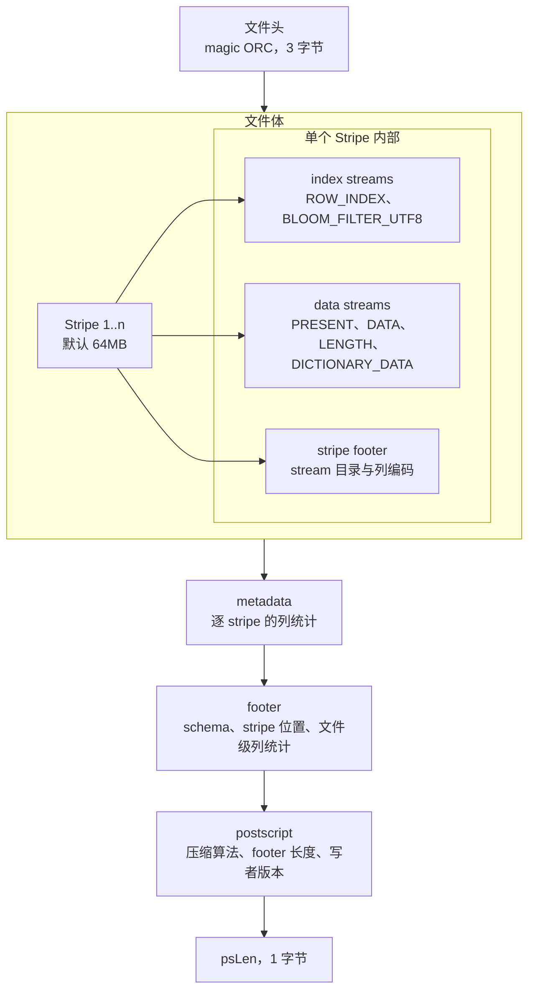
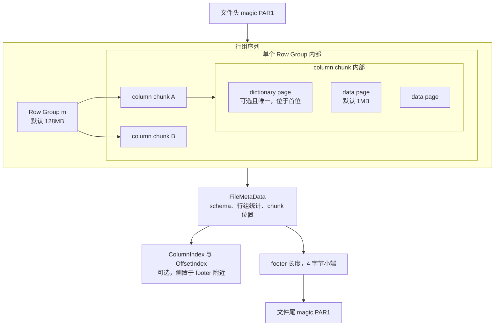
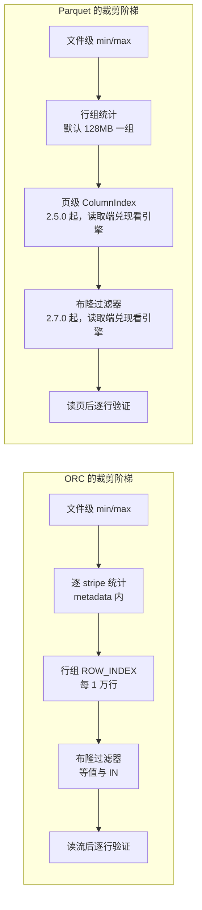
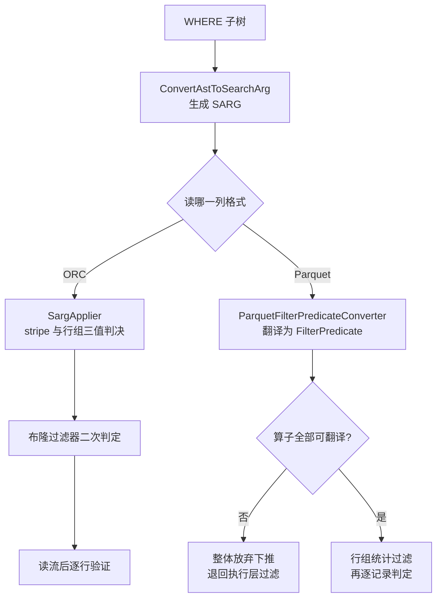
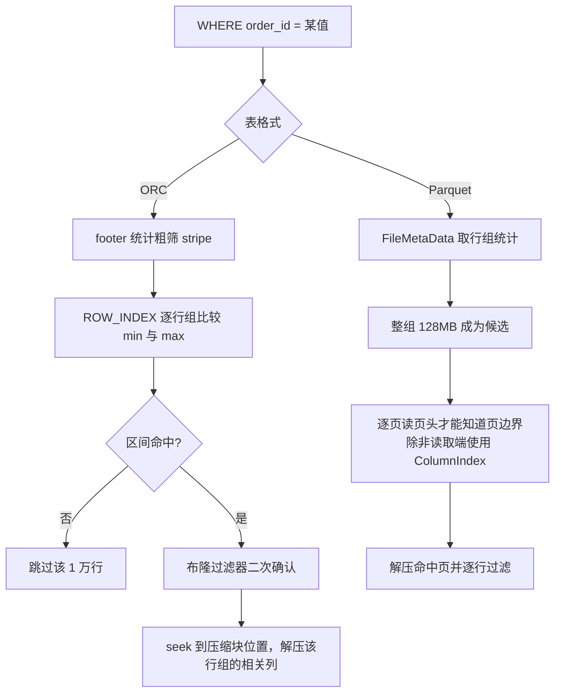
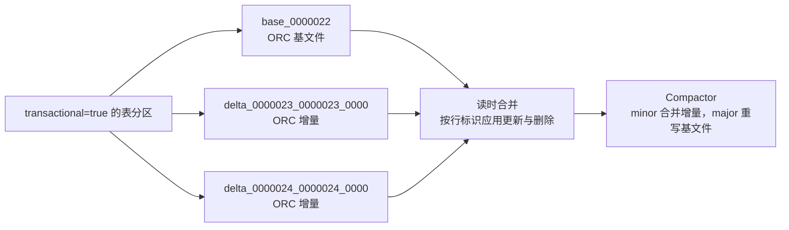

# 08 ORC 与 Parquet：列式存储格式的内部结构与选型

**摘要：**

列式存储把"只读需要的列"变成可能，但真正让 Hive 的扫描从"读整张表"缩到"读几个数据块"的，是格式内部那套分组结构加统计索引。ORC 与 Parquet 都建立在同一批洞见上，却把分组、索引、元数据摆放做成了两套不同的层次：ORC 是 file → stripe → 行组索引 → stream，索引与数据同处一个 stripe，Bloom filter 是它的原生能力；Parquet 是 file → row group → column chunk → page，统计随 footer 集中存放，page 级索引直到 parquet-format 2.5 才补进规范。本文按层对照这两种结构，然后回答一个更实际的问题：选错格式究竟会让哪几类查询变慢、让哪几类工作根本做不了。结论并不在"哪个格式更快"上，宽表选列的收益两边都有，全表聚合的差异来自引擎与开关；真正的疼点集中在点查与高基数等值过滤、完整 ACID、以及多引擎互换这三处，而这三处恰好可以由"谁是主要读写方"直接判断，不必依赖基准测试。结构差异还解释了一件常被忽略的事：格式里的统计服务于读侧裁剪，HMS 里的统计服务于优化器估算，两者混为一谈会让迁移与调优同时走偏。文中给出按场景落地的判断表、写入参数的量级取法，以及七个被低估的反例。

---

## 第 1 章 列式存储的两个红利，以及它没解决的那部分

### 1.1 行式布局的浪费从哪里来

关系型数据库与早期 HDFS 上的文本表都按行存放数据：一行的所有列在字节流里连续排列，读完一行正好凑齐一条记录。这种布局为事务型负载而生，插入一行只写一段连续区域，按主键取一行只读一段连续区域。分析型查询的读写模式和它几乎相反——一次扫描几十亿行，每行只用到其中少数几列。

```sql
-- 订单宽表 120 列，看板只关心成交额与退款额
SELECT dt, SUM(pay_amount), SUM(refund_amount)
FROM dwd_order_detail
WHERE dt BETWEEN '2026-11-01' AND '2026-11-07'
GROUP BY dt;
```

行式布局下，读 `dt`、`pay_amount`、`refund_amount` 三列必须把 120 列一起搬进内存再丢弃。假设这三列占行宽的百分之三，那么百分之九十七的 I/O 花在了随即被丢掉的数据上。列存把这个比例倒了过来：同一种列值连续存放，读三列就只碰三列的字节。这是第一个红利，**列裁剪**（column pruning）。

第二个红利来自压缩。行内各列类型交错，整型旁边是字符串、字符串旁边是小数，通用压缩算法看不到可复用的模式；同一列的值类型一致、语义相近、重复率高，先按类型做专用编码再套通用压缩，压缩比可以显著提升。编码、压缩叠在一起，既省存储也省 I/O——磁盘上少读的字节，就是查询时少传的字节。

### 1.2 只有列裁剪还不够：RCFile 的教训

Hive 在 ORC 之前用的是 RCFile。RCFile 已经做到了"按列分组存放"，但它把每一列当成一段无语义的二进制块：没有类型信息，没有统计，没有索引，压缩只能整体套一层通用算法。后果是读一列仍然要把整段列数据解压完，判断不了"这一段里根本没有我要的值"。

真正把列存推向工程可用的，是**分组加统计**这套组合：把行按批切成块，块内按列存，并为每个块记录每列的极值、空值计数。查询时先看极小代价的统计元数据，判断某块是否可能命中，不命中就整块跳过，连解压都省掉。这个动作在存储层内部完成，与 Hive 的谓词下推（predicate pushdown）配合，构成了本文反复出现的"裁剪阶梯"。

> [!info] 三个层次别混在一起
> 格式（file format）定义数据怎么切块、元数据放哪里、哪些结构可选；编码（encoding）定义一列的值怎么变成字节，譬如字典编码、游程编码、位打包；压缩（compression）是套在编码结果外面的通用算法，譬如 ZLIB、SNAPPY、ZSTD。选型时把三者混为一谈，就会出现"换了压缩算法却发现查询没变快"这类误判——压缩只影响 I/O 与 CPU 的交换比，能不能跳过数据块由格式与索引决定。

### 1.3 贯穿案例与判断口径

后文统一用同一张表推进：`dwd_order_detail`，按 `dt` 天分区，120 列，日增约 8000 万行，另有 `order_id`、`user_id`、`device_id` 等高基数列，`status`、`pay_channel` 等低基数列，以及若干 `map<string,string>` 形式的扩展属性。围绕它有五种典型访问：

1. 看板聚合：按天扫少量列，过滤条件是分区键。
2. 客诉点查：`WHERE order_id = ?`，一次一行。
3. 风控等值：`WHERE device_id IN (...)`，非排序列，选择性高。
4. 每日修正：对当天数据做 `UPDATE` 或 `MERGE`，改几千行。
5. 跨引擎共享：Spark 做特征加工，Trino 做即席查询。

这五种访问对格式的要求差别很大，后文会把它们逐一放到两种格式的结构上验证。笔者把判断口径收成一条：不要问"哪个格式快"，要问"这条查询能不能在读到数据之前就把不需要的数据排除掉，由哪一层的元数据来排除"。能回答这个问题的结构，才是对这条查询有价值的结构。

---

## 第 2 章 ORC：从文件尾读起的分层结构

### 2.1 起源与设计目标

ORC（Optimized Row Columnar）在 Hive 0.11 随 HIVE-3874 进入代码库，规范第一版的定位与 Hive 0.12 绑定。它要解决的是 RCFile 的三个缺陷：没有轻量索引、没有类型相关的编码、复杂类型支持不全。ORC 的设计目标写得很直白：更高的压缩率、可用的谓词下推、只读所需列的投影读取，再加上一个常被忽略的工程目标——把读取与写入的内存占用控制在可预期的范围内。

这个"内存可控"的目标决定了 ORC 的很多形状。它不是等整个文件写完再组织元数据，而是边写边产出 stripe，每个 stripe 自包含，读完一个 stripe 就能释放相应的缓冲。

### 2.2 文件尾：postscript、footer、metadata

ORC 的读取是从文件末尾倒着开始的。文件最后是一个字节的 postscript 长度（psLen），它前面是 postscript 本体，再往前依次是 footer 与 metadata。读者先读末尾 16KB 左右，希望连 footer 带 postscript 一次拿全；从 psLen 得知 postscript 的边界，解析出压缩算法、footer 的压缩后长度、写者版本，再解压 footer 拿到 stripe 列表与文件级列统计。



这个倒序设计常被误解成"读元数据要额外 seek"。实际上 postscript 永不压缩，长度不超过 256 字节，footer 与 metadata 各是一次顺序读；相比每次查询都要打开大量文件、逐个读元数据，这点开销在 split 生成阶段就被摊平了，Hive 还提供 `hive.orc.splits.include.file.footer` 与 Metastore 侧 footer 缓存（`hive.orc.splits.ms.footer.cache.enabled`，默认关闭）来进一步减少重复读。

> [!note] 文档里那个 250MB 是历史残留
> Hive 官方 wiki 的 ORC 页面在同一页里出现了两个默认 stripe 大小：正文写"默认 250MB"，属性表写 67,108,864 字节。以属性表与 ORC 的 `OrcConf.STRIPE_SIZE` 为准，现代默认值是 64MB；250MB 来自早期版本的 256MB 默认值，两者都不是今天的行为。这类"同页自相矛盾"的文档细节，是把参数写进规范文档时必须先核实的原因。

### 2.3 stripe：自包含的读单元

stripe 是 ORC 的读单元，也是任务切分的天然边界：一个 stripe 只包含完整的行，行不会跨 stripe。默认 64MB（`orc.stripe.size`），且写入器会按 `orc.block.padding`（默认 true）把 stripe 对齐到 HDFS 块边界，必要时插入更小的 stripe，避免一个 stripe 跨两个块、引发远端读。

一个 stripe 内部按顺序放三样东西：index streams、data streams、stripe footer。index streams 在前，因为顺序扫描时默认不需要读它们，只有谓词下推或按行定位时才加载；data streams 按列分开放置，同列的 PRESENT（非空位图）、DATA（值）、LENGTH（变长长度）、DICTIONARY_DATA（字典原文）各成一条流，流的具体位置由 stripe footer 的目录唯一确定。

按列分流的直接收益是：读一列时只碰这一列对应的几条流，而且每条流都是可跳过的压缩块序列（默认块 256KB，`orc.compress.size`），跳过不需要的块不必解压前文的块。

### 2.4 row group 索引：一万行一条

ORC 的索引粒度是**行组**（row group），默认每 10,000 行一条索引项（`orc.row.index.stride`，下限 1000）。每个 stripe 内的每个原始类型列都有一条 ROW_INDEX 流，流里按行组顺序存放该组的列统计（min、max、sum、空值情况）与定位信息。

定位信息是三个数：压缩块在流中的起始位置、块内已解压的字节偏移、以及该位置之前已消费的 RLE 值个数。三者合起来让读者能直接跳到某个行组的第一个值，而不必从头解压。这是 ORC 在粗粒度 stripe 内仍能做细粒度跳读的关键，也是"ORC 适合点查"这一说法的技术根据。

需要强调的是，ORC 的索引只用于选择 stripe 与行组，不用来回答查询本身。统计说"这一组不可能命中"，就跳过；统计说"可能命中"，仍然要读出数据逐行验证。索引的价值是减少读，不是替代读。

### 2.5 统计的三层，以及 hasNull

ORC 的统计其实有三处：文件级（footer 里的每列聚合统计）、stripe 级（metadata 里逐 stripe 的列统计）、行组级（ROW_INDEX 里的每条索引项）。三层各有分工——文件级用于最粗的过滤与优化器估算，stripe 级用于在 split 生成阶段整段排除，行组级用于读取时的行内跳读。

统计字段按类型而变：整型存 min、max、sum；浮点存 min、max、sum；字符串存 min、max 与长度和；布尔存 true 与 false 的计数；decimal 与 date 各有对应结构。从 Hive 1.1.0 起还有 **`hasNull`** 标记，让 `IS NULL` 这类谓词可以只看一位就判断整组是否可能含空值——这一点在 `NOT NULL` 约束不严格的数仓里非常实用，很多"某个字段有没有漏填"的排查查询因此不必读数据。

### 2.6 Bloom filter 索引：补上 min/max 的盲区

min/max 只对有序或近似有序的列有效。`order_id` 递增写入，每组的极值区间很窄，等值查询能一刀切掉大部分；但 `device_id` 是哈希串，随机分布，每组的 min/max 区间几乎覆盖全值域，统计等于失效。

ORC 的补丁是**布隆过滤器**（Bloom filter）索引，从 Hive 1.2.0 起提供。写入时对 `orc.bloom.filter.columns` 列出的列，逐行组构建一个位数组；读取时先过 min/max，再对候选行组查布隆过滤器，说"不存在"就整组跳过。位数组与行组索引交错存放在 stripe 头部的 index streams 里，一次顺序读就能把两者一起取回。

```sql
CREATE TABLE dwd_order_detail (...)
STORED AS ORC
TBLPROPERTIES (
  'orc.compress' = 'ZLIB',
  'orc.bloom.filter.columns' = 'device_id,user_id',
  'orc.bloom.filter.fpp' = '0.01'
);
```

参数名值得单独记一笔：是 `orc.bloom.filter.columns` 与 `orc.bloom.filter.fpp`，不是某些资料里写的 `hive.orc.bloom.filter.columns` 或 `orc.bloom.filter.false.positive.probability`。写错名字不会报错，只会**静默地不建索引**——这是格式类参数最常见的失效方式。

布隆过滤器的代价要算清楚：假阳性率设得越低，位数组越大，stripe 头部的 index streams 越膨胀，写入时的哈希计算也越多。`orc.bloom.filter.fpp` 在 ORC 库里的默认值是 0.01，而 Hive 文档的 ORC 属性表里写的是 0.05，两处口径不一致；实践上取 0.01 到 0.05 之间，代价是文件体积增加约百分之一到百分之几（量级判断，随列基数与行组密度变化）。

---

## 第 3 章 Parquet：从 Dremel 继承的分层结构

### 3.1 起源与设计取舍

Parquet 与 ORC 几乎同期，2013 年由 Twitter 与 Cloudera 推动，目标写得很清楚：让整个 Hadoop 生态的任何框架都能用上压缩良好的列式存储。它的两个设计源头决定了形态——一是 Google 的 Dremel 论文，用重复层次（repetition level）与定义层次（definition level）编码嵌套结构；二是"**格式与实现分离**"，parquet-format 只定义 Thrift 元数据与文件布局，parquet-java、parquet-cpp 等各自实现。

这个分离带来了 ORC 没有的生态广度：Spark、Trino、Impala、Drill、Flink、Arrow 都有自己的 Parquet 读写实现。代价是格式能力与读取能力之间出现了时间差——规范里有的结构，未必每个引擎都兑现，这一点在后面讲 page 索引时会变得很关键。

### 3.2 文件布局：一段数据加一段总目录

把文件摊开来看，结构只有三段：行组序列、文件元数据，以及结尾的四字节长度与再次出现的魔数。



文件开头是 `PAR1`，随后是逐行组、逐列的 column chunk，最后是 FileMetaData、四字节的元数据长度、以及再次出现的 `PAR1`。File Metadata 用 Thrift 紧凑协议序列化，写完数据再回填，以支持单遍写入。

读取必须先读尾部：定位元数据、拿到每个 column chunk 的偏移与长度，再按需读列。这与 ORC 的倒序读没有本质区别，真正的差异在于元数据的组织粒度——Parquet 把行组统计全部集中在 footer，读一次拿全；ORC 把行组索引留在 stripe 里，读哪个 stripe 才读哪段的索引。

### 3.3 三层单位：行组、列块、页

行组（row group）是 Parquet 的并行与统计单位，默认 128MB（`parquet.block.size`）。一个行组包含该组所有行的所有列，每个列一个 column chunk，且 chunk 在文件内连续。行组大小直接决定统计的筛选粒度：一组越大，被 min/max 整组排除的概率越低。

列块（column chunk）是 I/O 单位。读某一列时按偏移直接读该列的 chunk，与其他列无关，这是列裁剪在文件格式层的落点。

页（page）是编码与压缩的最小单位，默认 1MB（`parquet.page.size`），同一列块里页首尾相接。页分两类：数据页承载实际值（经过编码与压缩），字典页承载字典编码的字典表，一个列块最多一个字典页且必须放在最前。

数据页有两个版本。默认写者版本是 PARQUET_1_0（`parquet.writer.version`），页头里带页级统计；第二个版本把定义层次与重复层次拆到值数据之前，读端可以先按层次判断哪些值存在，再决定是否需要解压值区。这个细节在老版本兼容上有意义：读端实现不完整时，新旧页版本的混读会暴露问题。

> [!note] 页的压缩算法不是逐页可配
> 有一类说法是"Parquet 的不同 Page 可以用不同压缩算法"。准确的说法是压缩算法可按列配置（`parquet.compression#列名`），同一列的所有页跟随该列的 codec；页级独立的 codec 并不在格式能力内。把列级能力说成页级，会让调优时做出无效动作。

### 3.4 统计的两级，以及 page 索引补的那一刀

Parquet 的统计原本只有两级：列块级（写在 ColumnMetaData 里，按行组）与页级（写在 DataPageHeader 里）。问题在于页级统计的位置——它在页头里，读者要判断某一页能否跳过，必须先读到那一页的页头，而读页头往往意味着已经把该列的大部分字节读了一遍。这个结构让页级统计在实践中接近于无用。

parquet-format 2.5.0（2018 年，PARQUET-1201）补上了 **page 索引**：把每页的极值边界整理成 ColumnIndex，把每页的偏移整理成 OffsetIndex，两者与行组分离、放在 footer 附近。这样选择性扫描可以先读索引、再决定读哪几页，点查与窄范围扫描才真正有了"只读一页"的可能。规范里同时提醒，写 ColumnIndex 时不必再写页级统计，后者只为兼容老读者而保留。

这就是"Parquet 的 page 级统计较新"的准确含义：不是没有，而是位置不对，直到 2.5.0 才被搬到能被廉价读取的地方，而读取端兑现这套索引又晚了一步。

### 3.5 布隆过滤器与嵌套编码

parquet-format 2.7.0（2019 年，PARQUET-41）加入了布隆过滤器，按列开启，语义与 ORC 的同类结构相似：在行组统计之后再做一次"一定不存在"的判定，用于高基数非排序列。

嵌套结构是 Parquet 的传统强项。Dremel 的重复层次与定义层次用一个整数序列同时表达"这一层是否重复"与"这一层是否存在"，把任意深度的 JSON 式结构压平成列。ORC 用 struct、list、map 三种容器类型表达嵌套，能力覆盖常见结构，但在极深、极不规则的半结构化数据上，Dremel 编码的表达更紧凑。

---

## 第 4 章 逐层对照：五级裁剪，以及它们各自的尽头

把两种格式放在同一张表上逐层对齐，差异就变得清楚了。注意 ORC 的"行组"不是存储容器，而是索引粒度；Parquet 的"页"在列块之内，两者在这一层上错位了半级。

| 层次 | ORC | Parquet |
|---|---|---|
| 顶层容器 | stripe，默认 64MB，自包含 | row group，默认 128MB，统计集中 |
| 组内单位 | stream，按列分流（PRESENT、DATA、LENGTH 等） | column chunk，按列一份；chunk 内分页 |
| 最细单位 | 行组索引项，默认 1 万行一条 | page，默认 1MB |
| 元数据位置 | postscript、footer、metadata 在文件尾；行组索引在 stripe 头部，与数据同区 | FileMetaData 在文件尾；ColumnIndex 与 OffsetIndex 侧置于 footer 附近 |
| 统计粒度 | 文件级、stripe 级、行组级 | 文件级、列块级、页级（2.5.0 起可用索引） |
| 等值加速结构 | 布隆过滤器索引，Hive 1.2.0 起 | 布隆过滤器，parquet-format 2.7.0 起 |
| 任务切分 | 以 stripe 为界，stripe 不可再切 | 以行组为界，行组不可再切 |
| 写出并行 | 每个写任务产出一个文件，多个 stripe | 每个写任务产出一个文件，多个行组 |

### 4.1 五种两者都支持的裁剪

先说共同点，避免把格式差异当成性能差异的来源。下列**五种裁剪**在两种格式上都成立，只要引擎把参数打开、谓词能构造成存储层可用的形式：

1. 分区裁剪：靠 Metastore 的目录结构，与格式无关，见 [[07 分区与分桶：物理数据组织的核心机制]]。
2. 文件级统计裁剪：两种格式的 footer 都有整文件列统计。
3. 组级统计裁剪：ORC 走行组索引，Parquet 走行组统计。
4. 列裁剪与投影下推：读哪几列只读哪几列，这是列存最基本的红利。
5. 字典型编码带来的压缩收益：低基数列两边都会自动选字典编码。

因此"宽表只查少数列"这类查询，在两种格式之间的差别通常落在引擎实现与开关上，不在格式上。把这类查询的慢归因于格式，多半是找错了方向。

### 4.2 三种一方明显更强的地方

真正拉开差距的是下面三处，也是选型时该盯的地方：



第一处是行组粒度。ORC 一条索引覆盖一万行，Parquet 一个行组默认 128MB；在 1 亿行、压缩后 5GB 的宽表上，前者有上万个行组，后者只有几十个，覆盖行数差两个数量级左右（示例推算）。在按时间或单调键写入的数据上，前者能切出更窄的候选集。

第二处是布隆过滤器的可用性。两者都有，但 ORC 的索引与数据同区、索引读取路径成熟，Hive 读侧长期在用；Parquet 的布隆过滤器进规范较晚，且其生效完全取决于读取端实现，Hive 的 Parquet 读取路径以行组统计为主。

第三处是**索引位置**决定"能不能不读数据就排除"。ORC 的行组索引在 stripe 头部，读该 stripe 的列数据时顺路取回，不额外多读；Parquet 的 page 索引在 footer 附近，只有读取端主动使用才产生收益，否则退回行组粒度。

### 4.3 两者都做不到的事

清单同样重要，因为它解释了为什么有些查询怎么换格式都不快：

- 非排序列的等值过滤，若没建布隆过滤器，只能靠 min/max，随机分布的列上等于没有裁剪。
- `LIKE '%关键词%'` 这类中间或后缀匹配，两种格式都没有可用的索引结构，只能全扫。
- 跨列相关性过滤（`WHERE a > b`）无法用列内统计表达，譬如判断下单时间是否早于支付时间。
- 统计被污染或截断时（写入时值域越界、字符串极值被截短），裁剪可能失效甚至出错，格式层没有自校验。

理解了这四条边界，就不会在"格式选型"上寻找本该由分区设计、排序写入或数据模型解决的问题。

---

## 第 5 章 谓词下推的两套实现：SearchArgument 与 FilterPredicate

### 5.1 同源的入口：一条 SARG 的诞生

Hive 把 `WHERE` 子树翻译成存储层可用的结构，只做一次。`ConvertAstToSearchArg` 遍历过滤表达式，把比较运算、逻辑运算、常量折叠的结果整理成搜索参数（SearchArgument，下称 SARG），由表达式树与叶子列表组成：表达式树上是 AND、OR、NOT 三种连接，叶子是某一个列上的一个谓词。

SARG 的算子集合是**固定的七种**：`EQUALS`、`NULL_SAFE_EQUALS`、`LESS_THAN`、`LESS_THAN_EQUALS`、`IN`、`BETWEEN`、`IS_NULL`。`>` 与 `>=` 不进这个集合，它们在翻译阶段被交换操作数变成 `<` 与 `<=`；`!=` 也不进，它被表达成 `NOT(EQUALS(...))`，由读端的三值逻辑取反。`LIKE` 从头到尾不在集合里。

这个设计意味着格式能拿到的信息是有上限的：能表达"某列的取值落在某区间、等于某值、属于某集合、是否为空"，表达不了"匹配某模式"，譬如 `LIKE` 这类模式匹配。所以两种格式在谓词能力上的差异，不在算子集合，而在"用什么样的元数据去兑现这些算子"。

### 5.2 ORC 侧：三值判决与布隆过滤器接力

ORC 的读端拿到 SARG 后，分两步用。第一步用 stripe 级统计与行组索引做粗筛，判决结果是三值的组合：命中、不命中、可能命中。`YES` 表示整组都满足，`NO` 表示整组都不满足，`YES_NO` 之类的组合表示需要读数据才能定论；`NOT` 节点把这些值按三值逻辑取反。第二步只对"可能命中"的行组读数据，逐行验证。

这个流程里有两个工程细节值得记住。一是 `IN` 与 `BETWEEN` 在判定时要拆成等值与区间的组合，列表越长，粗筛成本越高；二是布隆过滤器作为第二道筛子，只在 min/max 判为"可能命中"之后才查，不会替代 min/max。两道筛子的顺序是成本决定的：min/max 是几个整数比较，布隆过滤器要读位数组并算哈希。

SARG 本身有缓存，`hive.io.sarg.cache.max.weight.mb` 默认 10MB，避免在 split 生成与任务执行之间反复构造与反序列化同一个过滤条件。这种看起来不起眼的参数，在被切成上千个 split 的宽表扫描上，影响的是作业启动的前置开销。

### 5.3 Parquet 侧：翻译成 FilterPredicate

Hive 读 Parquet 时走的是另一条路：把 SARG 翻译成 parquet-mr 的 `FilterPredicate`，再交给 `FilterCompat` 在行组层与记录层分别过滤。翻译由 `ParquetFilterPredicateConverter` 负责，落到 `LeafFilterFactory` 里按列类型选一个构造器，数值、布尔、二进制各有一套。

每套构造器支持的算子基本相同：`EQUALS`、`NULL_SAFE_EQUALS`、`LESS_THAN`、`LESS_THAN_EQUALS`、`IS_NULL`；`IN` 与 `BETWEEN` 在多字面量入口展开成等值与区间的或与且。遇到没有对应 case 的算子，构造器抛异常，转换器整体放弃，结果是这条 SARG 完全不参与下推，过滤退回执行层——查询结果仍然正确，只是白读了一批数据。



这条链路上还有一个容易踩的坑：日志里若出现 `The conversion to Parquet FilterPredicate is not supported for ...`，说明某个谓词类型在翻译时出局，官方提示的处置是关掉 `hive.optimize.index.filter` 或 `hive.optimize.ppd` 让查询恢复——也就是说，遇到这类报错时，下推不仅没帮忙，还挡了路。知道这个报错归属哪一端，排查时就不会往数据上找问题。

### 5.4 开关的版本差异：一个被低估的变量

存储层过滤不是默认全开的。三个开关决定它是否生效：`hive.optimize.ppd`（谓词下推总闸，默认 true）、`hive.optimize.ppd.storage`（是否把谓词推给存储处理器，默认 true）、`hive.optimize.index.filter`（是否自动使用索引，描述原文是"whether to enable automatic use of indexes"）。

第三个开关的默认值在版本之间**翻转过**：Hive 3.1 的源码里它是 false，Hive 4 的源码里它是 true（具体以对应版本的 `HiveConf` 为准）。这意味着一套从 Hive 3 升级到 Hive 4 的集群，存储层索引过滤会从关闭变成开启，同一个 SQL 的读放大可能一夜之间变小，也可能因为某些统计不准的表而变慢。跨版本迁移时把它当成一个需要显式确认的行为变更，比事后归因要省力得多。

| 谓词形态 | ORC 读端（Hive） | Parquet 读端（Hive） |
|---|---|---|
| `=` 常数 | 行组 min/max，加布隆过滤器 | 行组统计，加布隆过滤器（读端兑现有限） |
| `<`、`<=`、`>`、`>=` | 行组 min/max | 行组统计 |
| `IN` 列表 | 逐值对 min/max 与布隆过滤器判定，列表越长成本越高 | 展开为等值再用 or 组合，列表越长谓词树越深 |
| `BETWEEN` | 行组 min/max 区间 | 行组统计区间 |
| `IS NULL`、`IS NOT NULL` | 依赖 `hasNull` 标记 | 依赖行组空值统计 |
| `!=` 常数 | 表达为 NOT(EQUALS)，粗筛能力有限，多数情况靠读后过滤 | 翻译为取反谓词，以逐记录过滤为主，行组统计帮助有限 |
| `LIKE 'abc%'` | 不在 SARG 内部，不下推 | 不在 SARG 内部，不下推 |
| `LIKE '%abc%'` | 不下推 | 不下推 |

表里最后两行值得再强调一次：前缀匹配的裁剪是引擎自己的扩展，不属于格式能力。Spark 的 Parquet 读取器有 `parquetFilterPushDownStringStartWith` 这类开关，能把前缀匹配额外转成范围谓词；Hive 没有等价物。把引擎差异写成格式差异，会导致在 Hive 里为 `LIKE` 换格式这种无效动作。

---

## 第 6 章 编码与压缩：两层叠加，与字典的退化

### 6.1 ORC 的编码选择

ORC 的整型列用 RLE v2，按数据形态在四种模式间自动选择：短重复序列用 SHORT_REPEAT，定宽随机序列用 DIRECT 位打包，少量离群值用 PATCHED_BASE 单独打补丁，单调递增递减序列用 DELTA 只存首值与差值。这四种模式是按"值序列的形状"分类的，不是按列名或业务含义分类，所以同一列在不同批发数据上可能换模式，压缩效果也随之浮动。

字符串列分直接编码与字典编码两种。字典编码把唯一值排好序放进 DICTIONARY_DATA，行数据里只留字典下标，下标序列再用 RLE 压缩。字典按 UTF-8 字节序排序不是为了省空间，而是为了让 min/max 判定与排序一致——排序后的字典让"某值是否落在区间内"可以直接用下标比较。

布尔与二进制各有对应流；变长类型用 LENGTH 流记长度；`PRESENT` 流记录每个值是否为空，全非空时整条流省略。这些流的组合决定了"读一列到底要读哪几条流"，也是列裁剪在字节层面的具体落点。

### 6.2 字典什么时候会退化

字典编码不是永远划算。唯一值数量接近行数时，字典表本身就和原始数据一样大，下标还多占空间，压缩比反而下降。ORC 用三个阀判断退化和退出：

- `orc.dictionary.key.threshold`，默认 **0.8**。唯一键数超过非空行数的这个比例，关闭字典编码。
- `orc.dictionary.max.size.bytes`，默认 0，即不按字节数限制；设成正数后字典总量超过阈值就关闭。
- `orc.dictionary.early.check`，默认 true。判定发生在写完第一个行组索引跨度（默认一万行）之后，不是写完整个 stripe 再回头改，判定结果此后不再变化。

Parquet 侧的逻辑不同：字典在列块内构建，字典页大小受 `parquet.dictionary.page.size`（默认 1MB）限制，字典膨胀到装不下时，后续页回退为 PLAIN 编码，一个列块内可能出现前半段字典编码、后半段明文的混合状态。`parquet.enable.dictionary` 可以整体关掉字典，用于已确认字典不划算的列。

两种退化机制的区别有实践含义。ORC 的判定是"**整列一次性决定**"，阈值明确、结果可预期；Parquet 的判定是"逐列块、甚至逐页滚动回退"，同一列在不同行组上可能用不同编码，压缩比更不稳定，也解释了为什么 Parquet 文件在同一张表的不同批次之间体积差异会比较大。

| 维度 | ORC | Parquet |
|---|---|---|
| 整型编码 | RLE v2 四模式（短重复、定宽、补丁基、差值） | PLAIN、RLE、DELTA_BINARY_PACKED |
| 字符串编码 | 直接编码或字典编码，字典按字节序排序 | PLAIN、字典编码、DELTA_BYTE_ARRAY、DELTA_LENGTH_BYTE_ARRAY |
| 浮点 | 直接存储（IEEE 754 布局） | PLAIN、BYTE_STREAM_SPLIT（利于压缩） |
| 字典退化判据 | 唯一键比例阈值、字典字节上限，整列一次性判定 | 字典页大小上限，列块内滚动回退 |
| 空值表达 | 独立 PRESENT 位图流 | 定义层次中的空值层次 |
| 布尔 | 按位打包后跑游程编码 | PLAIN 位打包、RLE |

### 6.3 压缩：位置不同，取舍相同

ORC 把压缩做在流的分块上，默认每 256KB 一个块（`orc.compress.size`），每块前面有 3 字节头，记录压缩后长度与"是否原文存储"标志。原文存储标志是为不可压缩数据准备的：压完比原文大就直接存原文，避免负收益。块级独立压缩带来一个直接好处，读者可以从任意块头开始解压，不必解前面的块——这正是行组索引里的定位信息能够生效的前提。

Parquet 把压缩做在页上，一页一个压缩单元。压缩算法可按列配置，因此一张表里"字符串列用 ZSTD、整型列用 SNAPPY"是可行的，只需在表属性里按列指定 codec。

压缩算法的选择本身没有太多新鲜结论，真正的坑在默认值上。

| 场景 | ORC 实际默认 | Parquet 实际默认 |
|---|---|---|
| Hive 建表未显式指定 | ZLIB（`hive.exec.orc.default.compress` 覆盖） | 取决于写入路径：parquet-java 的写入器默认 **UNCOMPRESSED** |
| ORC 库自身默认 | ZSTD（`OrcConf.COMPRESS` 已改） | 不适用 |
| Spark 写入 | 由 Spark 侧参数决定 | SNAPPY（`spark.sql.parquet.compression.codec`） |
| 改造建议 | 显式写进表属性，不依赖会话默认 | 显式设 `parquet.compression`，不要假设"Parquet 自带 Snappy" |

"Parquet 默认 Snappy"这句话在 Hive 写入路径上是不成立的。parquet-java 取 codec 的顺序是：先看 `parquet.compression`，没有就看 Hadoop 的输出压缩配置，两者都没有就落到 UNCOMPRESSED；Hive 只在表属性里存在 `parquet.compression` 时才显式设置它，而 `hive.exec.compress.output` 默认是 false，于是链路的终点是不压缩。只有 Spark 那条路径默认 Snappy。于是一张由 Hive 写入、被 Spark 读取的 Parquet 表，可能一直是不压缩的，而所有人都在文档里读到"默认 Snappy"。

### 6.4 压缩比的量级估算

编码与压缩是两层叠加的，先靠编码把数据形态压扁，再靠通用算法收尾。笔者在下面给出的一组数字是示例推算，用来建立量级感，不是基准测试结果。

假设 `dwd_order_detail` 一天 8000 万行，原始文本折算每行约 400 字节，即约 32GB。`status` 列 6 个取值，字典编码后下标约 3 位，加字典表与位图开销，落在几十 MB 量级；`order_id` 单调递增，DELTA 编码后每值约 3 到 4 字节，再套 ZLIB 可再降一截；`device_id` 是随机哈希串，字典失效，直接编码后基本等于原始长度，压缩只能靠通用算法。整表综合压缩比落在 8:1 到 15:1 之间，属于合理区间；如果某天的文件体积突然翻倍，大概率是高基数列的字典判定翻转或压缩参数被覆盖，而不是数据量真的翻倍。

> [!warning] 压缩参数被覆盖的三种典型路径
> 表属性（`TBLPROPERTIES`）优先于会话配置，会话配置优先于 `hive-site.xml`；`ALTER TABLE ... SET TBLPROPERTIES` 只影响此后写入的文件，已有文件不会重写；不同引擎写同一张表时各用各的默认值。三条路径叠加，就是"同一张表里一半文件压缩、一半不压缩"的由来。

---

## 第 7 章 选错格式，疼在哪几次查询

到这里可以把结构差异换算成查询体验了。下面几类查询按疼感的来源排列，判断依据是第 4 章那张裁剪阶梯表：越往下走，需要读取端兑现的元数据越新、越依赖引擎实现。

### 7.1 疼感最弱：宽表选列与全表聚合

120 列宽表只读 5 列，两种格式都只读这 5 列的字节，压缩比也在同一量级。这类查询的耗时差异主要来自三处：是否开了向量化执行、split 数是否合理、聚合是否被下推。Hive 4 的 `hive.vectorized.execution.enabled` 默认为 true，很多"为提速而打开向量化"的调优动作在新版本上其实是空操作。

真正值得看的指标是扫描字节数而非格式。同一查询在两种格式上的扫描字节数如果相差不到一档，格式就不是瓶颈，调参也不会有量级变化。

### 7.2 疼感中等：点查与窄范围

点查是最能放大行组粒度差异的场景。假设表有 1 亿行、压缩后 5GB，`WHERE order_id = ?`：

- ORC：行组索引每 1 万行一条，候选集是一万行量级，再经布隆过滤器确认后可跳过大部分行组，最终读到的列数据在几百 KB 量级。
- Parquet：行组默认 128MB，整表约 40 个行组，命中一个行组就要读这个行组里该列的全部页，量级在几 MB 到几十 MB。page 索引本可以把粒度压到 1MB 一页，但前提是读取端使用 ColumnIndex，而 Hive 的 Parquet 读取路径以行组统计为主。

上面的行数、体积都是示例推算，比例关系比绝对值更重要：**行组粒度**差两个数量级上下，点查读放大的差距也在同一量级。两条读取路径的差别，摊开来看比读文字更直观。



顺着这条链路还能看清一件事：为点查优化，最有性价比的动作往往不是换格式，而是让点查键成为分区键或分桶键，把候选集从"一个行组"压到"一个桶文件"。格式层的行组粒度再细，也比不过物理上根本不打开那个文件。

### 7.3 疼感明确：高基数非排序列的等值过滤

风控查询 `WHERE device_id IN (...)` 是这类。`device_id` 随机分布，min/max 失效，没有布隆过滤器时只能整组读。

ORC 的解法在写入期：把列加进 `orc.bloom.filter.columns`，按行组建位数组。选择性高的等值查询能跳过绝大多数行组，代价是文件体积增加百分之一到几（量级判断）、写入侧多一次哈希计算。

Parquet 在格式层有布隆过滤器（2.7.0 起），但要让它在 Hive 里生效，需要写入端写、读取端用，两个条件都要满足。Hive 的 Parquet 读取路径长期以行组统计为主，指望它替你做布隆过滤多半会落空。这不是"Parquet 没有"，而是"你的读取路径没有用上"——两者的处置完全不同：前者要换格式，后者要么升级引擎、要么把过滤列前置到分区或排序列。

> [!info] 排序写入比换格式更便宜
> 在 `order_id` 这类单调键上，两种格式的 min/max 都有效；把写入按过滤键排序（`SORT BY` 或分区内排序），等价于把统计的区间压窄。代价是写入多一次排序，收益是此后每次扫描都少读一批行组。在既有表上做这件事，通常比换格式重写全量数据便宜。

### 7.4 疼感结构性：需要 UPDATE 或 MERGE

这一类不是快慢问题，是能不能做的问题。Hive 的完整 ACID（`UPDATE`、`DELETE`、`MERGE`）只支持 **ORC**，表属性 `transactional=true`，且该属性一旦设置不能回退为 false。底层不是"改文件里的某一行"，而是用 base 文件加 delta 目录的方式做多版本：



为什么必须是 ORC？行级更新需要一个稳定的行标识（原始事务号、桶号、行号），写入端必须能在文件里定位并标记行，读取端必须能按这个标识合并基文件与增量。这套机制在 ORC 的写入器与读端被完整实现过，Parquet 没有对应的集成。表还必须分桶（新版本对分桶约束有所放宽，以对应版本文档为准），外部表不能做 ACID 表，非 ACID 会话不能读写 ACID 表，`LOAD DATA` 不支持事务表——这些限制叠在一起，实务上的含义是：如果你的管道里有改行的需求，譬如每日修正、缓慢变化维、合规删除，它天然指向 ORC。

一个例外要标清楚：insert-only 事务表（`transactional_properties=insert_only`）对格式的限制宽松得多，只追加不改行的场景可以用其他格式；但只要涉及改行，格式就回到 ORC。具体版本对格式的放宽范围不同，以对应版本文档为准。

### 7.5 疼感生态性：多引擎共享与湖仓

同一份数据被 Hive、Spark、Trino、Flink 同时访问时，格式选择变成了**生态问题**。Parquet 是跨引擎的事实标准：Spark 的读取器与向量化实现最完整，Trino 与 Impala 的 Parquet 路径成熟多年，Iceberg、Delta Lake、Hudi 的表格式默认以 Parquet 落盘。

Hive 这一侧的倾向正好相反。LLAP 的原生 I/O 以 ORC 为主，Parquet 的原生读取开关 `hive.llap.io.parquet.native.enabled` 默认关闭；Hive 的向量化读、谓词下推、ACID 都在 ORC 上打磨得最久。这不是技术优劣，是投入方向。

schema 演化的处理也随格式分野：ORC 有 `orc.force.positional.evolution` 这类按位置对齐的开关，Parquet 侧 Hive 提供 `parquet.column.index.access` 控制按名称还是按序号定位列。加列、改名、重排在不同格式与不同引擎组合下行为不一，跨引擎共享数据时，"列名对齐"这件事必须显式约定。

### 7.6 疼感隐蔽：嵌套与半结构化

扩展属性列 `ext map<string,string>` 是这类。两种格式都能存，但都能做到"读一个 key 仍要读整列"——列内没有二级索引，map 的键不是独立列。Parquet 的 Dremel 编码在深层嵌套上的压缩效率通常更好，ORC 的容器类型表达直观但记录级的开销更大。真正的优化手段是把高频过滤的键提升为顶层列，而不是在格式之间挑。

### 7.7 疼感被误判：小文件与元数据

小文件多的表，格式差异会被元数据读取放大。Parquet 的 footer 尺寸随行组数与列数增长，行组越多、列越多，footer 越大，而且必须读完整个 footer 才能定位任何一个行组；ORC 的尾部第一次读固定是末尾 16KB，footer 与 postscript 通常能在这一次读完，之后还能靠 metadata 里的 stripe 统计先做整段排除。两者的元数据都随"组数乘列数"增长，差别在于读取顺序与能否提前排除。

更常见的误判在另一头：为了"减少文件数"把 stripe 调到 256MB，而单文件只有 500MB，结果是整文件只有一两个 stripe，split 无法再切，一个任务吃掉整个文件，并发度塌陷。8.3 节那张参数表会给这组参数的取法。

| 查询模式 | ORC 表现 | Parquet 表现 | 疼点归属 |
|---|---|---|---|
| 宽表选少量列 | 列裁剪生效 | 列裁剪生效 | 引擎与开关，不是格式 |
| 全表聚合 | 与 Parquet 同量级 | 与 ORC 同量级 | 向量化与 split 数 |
| 点查、窄范围 | 行组粒度 1 万行，可跳读 | 行组 128MB，page 索引看读取端 | 格式与读取端共同决定 |
| 高基数等值 | 布隆过滤器可用 | 需读写两端都兑现 | 读取端实现 |
| UPDATE、MERGE | 完整 ACID | 不支持完整 ACID | 格式硬约束 |
| 多引擎共享 | 需转换或双写 | 生态默认 | 生态，不是性能 |
| 深层嵌套 | 容器类型表达 | Dremel 编码更紧凑 | 数据模型 |

---

## 第 8 章 判断表与落地参数

### 8.1 按场景选格式

把前面几章的结构差异收成一张可执行的表。判断顺序建议从上往下：先看有没有写侧硬约束（ACID、外部表），再看主要读取方是谁，最后看查询形态是否需要更细的组级过滤。前两条是硬约束，第三条只是倾向。

| 场景 | 推荐 | 理由 |
|---|---|---|
| 有 `UPDATE`、`DELETE`、`MERGE` 的表 | ORC，且 `transactional=true` | 完整 ACID 只支持 ORC，Parquet 没有对应的写入器集成 |
| Hive 与 LLAP 主导、批批写入的明细宽表 | ORC | Hive 的向量化读、谓词下推、原生 I/O 都在 ORC 上打磨最久 |
| 同一份数据要供 Spark、Trino、Flink 读 | Parquet | 跨引擎实现最全，湖仓表格式默认以 Parquet 落盘 |
| Iceberg、Delta Lake、Hudi 表 | Parquet | 表格式的默认与优化路径都指向 Parquet |
| 点查密集、按单调键过滤 | ORC，并把点查键做成分区或分桶键 | 行组粒度一万行，配合 seek 可跳读；分区/分桶比格式更有效 |
| 高基数非排序列等值过滤 | ORC，并显式配置布隆过滤器列 | 布隆过滤器在 Hive 读取路径上兑现度最高 |
| 深层嵌套、半结构化事件 | Parquet | Dremel 编码对深层嵌套更紧凑 |
| 冷数据归档、以存储成本为先 | 两种都行，显式选 ZSTD 或 ZLIB | 压缩率优先，格式差异在归档读模式下不显著 |
| 流式小批写入、需要读一致性 | ORC 加事务表或 insert-only 表 | 增量文件合并与快照读只在事务表上成立 |
| 已有 Parquet 生态、只想在 Hive 里查询 | 保持 Parquet，Hive 侧显式设压缩 | 改格式要重写全量，收益通常不抵迁移成本 |

这张表里没有"哪个更快"的条目，因为那取决于查询形态与开关。若一定要给一句概括：写在 Hive、改在 Hive、点查多的表偏 ORC；要被多个引擎读、要进湖仓的表偏 Parquet。

### 8.2 两张建表模板

```sql
-- 模板一：Hive 主导的明细宽表，含点查列与修正需求
CREATE TABLE dwd_order_detail (
  order_id      string,
  user_id       string,
  device_id     string,
  status        string,
  pay_channel   string,
  pay_amount    decimal(18,2),
  refund_amount decimal(18,2),
  ext           map<string,string>
)
PARTITIONED BY (dt string)
CLUSTERED BY (order_id) INTO 64 BUCKETS
STORED AS ORC
TBLPROPERTIES (
  'orc.compress' = 'ZLIB',                 -- 不依赖会话默认，写死在表上
  'orc.stripe.size' = '134217728',         -- 128MB，单文件需大于 1GB 才值得
  'orc.row.index.stride' = '10000',        -- 与默认一致，点查想更细可降到 5000
  'orc.bloom.filter.columns' = 'device_id',-- 只给真正用于等值过滤的列
  'orc.bloom.filter.fpp' = '0.01'
);
```

```sql
-- 模板二：跨引擎共享的事实表，Hive 侧只读不写
CREATE TABLE dwd_traffic_fact (...)
PARTITIONED BY (dt string)
STORED AS PARQUET
TBLPROPERTIES (
  'parquet.compression' = 'SNAPPY',        -- Hive 写入时必设，否则可能落成不压缩
  'parquet.block.size' = '134217728',      -- 与 HDFS 块同量级
  'parquet.page.size' = '1048576'
);
```

两个模板的差别不在语法，在"默认值由谁负责"。ORC 在 Hive 里有站得住的默认值，写死在表属性上是为了防止会话级覆盖；Parquet 的压缩不由格式决定，表属性没写 `parquet.compression`、会话又没开 Hadoop 输出压缩时，写出来的文件就是不压缩的。

### 8.3 参数取法

| 参数 | 默认值 | 调大的代价 | 调小的代价 |
|---|---|---|---|
| `orc.stripe.size` | 64MB | stripe 变大，行组索引条目变多，点查候选集变大；文件小的时候 split 无法切分 | stripe 变多，footer 与流目录变多，小文件的元数据开销上升 |
| `orc.row.index.stride` | 10000 | 索引条目变少，行内跳读粒度变粗 | 索引条目变多，stripe 头部膨胀，读索引本身变慢 |
| `orc.bloom.filter.fpp` | 0.01（ORC 库） | 假阳性升高，跳过率下降 | 位数组变大，文件体积与写入 CPU 上升 |
| `orc.compress.size` | 256KB | 压缩率略升，单块内存占用上升，块内跳读变粗 | 压缩率下降，块头开销占比上升 |
| `parquet.block.size` | 128MB | 行组变大，行组数减少，组级跳过变粗 | 行组变多，footer 变大，并行度上升但元数据变重 |
| `parquet.page.size` | 1MB | 页变大，点查读放大上升，页头开销下降 | 页变多，页头与索引开销上升，顺序扫描效率下降 |
| `parquet.dictionary.page.size` | 1MB | 字典能装下更多唯一值，字典页膨胀 | 字典提前回退明文，压缩比下降 |

选取原则只有一条：让"过滤发生的那一层"与"任务切分的那一层"对齐。点查多的表把行组压小、索引加快；全表扫描为主的表把 stripe 与行组放大，减少切分与元数据开销。两端都想要的表，通常是**分区设计**没做好。

### 8.4 写入侧的三件小事

第一，小文件合并要开着。`hive.merge.orcfile.stripe.level` 默认 true，合并发生在 stripe 层，不解码数据；`ALTER TABLE ... CONCATENATE` 同样在 stripe 层合并，这两条路径都比"读出来再写一遍"便宜。

第二，有序写入比格式调参更划算。按过滤键做分区内排序，min/max 区间收窄，两种格式的组级过滤都会变准。这件事对 ORC 尤其明显，因为它的行组粒度本来就细。

第三，别在写入期做格式混搭。同一个分区里混放两种格式的文件，读端按表或分区的格式声明去解析，结果可能是解析错误，也可能是静默读出空值——后者更危险。

### 8.5 迁移的三条铁律

`ALTER TABLE t SET FILEFORMAT PARQUET` **只改元数据**，不重写任何数据文件。在已有 ORC 文件的表上执行它，接下来的读取会按 Parquet 解析 ORC 文件，轻则报错，重则读出脏数据。正确做法是新建目标格式的表，用 `INSERT OVERWRITE` 写入，校验行数与列值，再走改名切换。

迁移伴随统计信息失效。表级、分区级基本统计由写入自动采集（`hive.stats.autogather`），列级统计由 `hive.stats.column.autogather` 在新版本默认开启，两者都不等于"格式里的统计"。格式 footer 里的 min/max 服务读侧裁剪，HMS 里 CBO 用的列统计服务优化器估算，这是两套东西，迁移后该重算的仍要重算，见 [[05 查询优化器：RBO 规则集与 CBO 代价模型]]。

迁移之后要验证裁剪真的生效，而不是只看文件变小：用 `hive --orcfiledump --rowindex` 看行组极值分布，用 `EXPLAIN` 看 TableScan 上是否带上了 `predicate`，比对迁移前后的扫描字节数。指标口径对了，调参才有意义。

---

## 第 9 章 反例与边界

### 9.1 反例一：同一张表混用两种格式

最常见的起因是历史分区用 ORC，新分区改用 Parquet 写入，而表级或分区级的格式声明只改了一半。Hive 读哪种格式，取决于元数据里记录的存储描述：表级与分区级不一致时，全表扫描、按分区查询、以及 `DESCRIBE FORMATTED` 的排查看到的可能不是同一套东西，最坏的情况是读端按声明去解析实际格式不同的文件，得到异常或空结果。

判据：同一张表的 `DESCRIBE FORMATTED` 显示格式为 A，而 `hive --orcfiledump` 或 `parquet-tools meta` 能读出 B 格式的文件结构；分区目录下文件后缀混杂（`.orc` 与 `.parquet` 并存）。

处置：先确认数据文件真实格式，再统一元数据声明与文件，最后重跑校验查询；混用期间不要在该表上做 ACID 操作。

### 9.2 反例二：压缩被关掉而没人发现

`orc.compress` 设成 NONE 的路径有三条：建表时图快随手写 `'orc.compress'='NONE'`、会话里 `SET hive.exec.orc.default.compress=NONE`、以及从测试环境复制的建表语句带过来的表属性。三种情况都不会报错，只会在文件体积上体现——通常比同类表大三到五倍，扫描 I/O 同比上升。

判据：同类表同数据量的文件体积对比、`orcfiledump` 输出里的压缩算法字段。

处置：改表属性只影响新文件，历史数据要么重写，要么接受体积差异；把压缩写进建表模板，避免依赖会话默认。

### 9.3 反例三：为点查优化，却选了 Parquet 又指望 page 索引

很多资料在 Parquet 与点查之间建立了错误联想：Parquet 有 page，page 比行组细，所以点查更快。结构上没错，链路断在读取端——Hive 的 Parquet 读取以行组统计为主，ColumnIndex 是否被使用取决于引擎版本与实现，默认路径上并不兑现。于是"page 更细"这件事在 Hive 里不产生收益，点查读放大仍然是一个行组。

判据：`EXPLAIN` 显示扫描量按行组估算，实际读取字节数接近行组大小；同数据量下与 ORC 表的点查扫描字节数相差一个量级。

处置：点查密集的表换 ORC，或把点查键做成分区、分桶键；若必须保留 Parquet，接受行组粒度并把行组调小，用空间与元数据开销换取粒度。

### 9.4 反例四：stripe 调到 256MB，split 却切不开

把 stripe 调到 256MB 的动机通常是"减少 stripe 数、降低元数据开销"，在 TB 级单文件上成立。但如果文件实际只有 500MB，一个文件只有不到两个 stripe，而 split 以 stripe 为界，于是一个任务吃掉整个文件，并发度由文件数决定。在 1000 个 500MB 文件的表上，并发上限会从按 split 大小切出的几千个 split，掉到每个文件一两个。

判据：`EXPLAIN` 或作业详情里的 split 数远小于预期；单任务读取量远高于配置的 split 大小。

处置：stripe 大小要与单文件大小匹配，单文件不超过 stripe 的两三倍时不要放大 stripe；更根本的做法是控制文件数，让每个文件落在 1GB 到 2GB 量级。

### 9.5 反例五：布隆过滤器加得太宽

宽表 50 列全加进 `orc.bloom.filter.columns`，动机是"让所有等值查询都快"。结果是每列的每个行组都要建位数组，stripe 头部膨胀，写入侧哈希开销上升，文件体积可能增加两位数百分比，而真正用于过滤的只有其中两三列。

判据：加列前后文件体积对比、stripe 头部 index streams 占比、写入耗时变化。

处置：只给"高频、等值、高基数、非排序"的列建布隆过滤器，其余靠 min/max 与分区设计。

### 9.6 反例六：高基数列当低基数用

把 `device_id`、`session_id` 这类列当作字典编码的受益者，期待压缩比提升。实际是字典表接近原始数据规模，下标额外占空间，ORC 在阈值处关掉字典、Parquet 在字典页装满后回退明文，压缩比反而低于不建字典、直接套通用压缩。这类列的正确优化方向是编码之外的：不建字典、加布隆过滤器、或把前缀拆成可排序的列。

### 9.7 反例七：在 Parquet 表上做 ACID，或在外部表上开事务

前者会在建表或首次写入时失败，失败信息指向格式不支持；后者是外部表的变更不受 compactor 控制，事务语义无法保证。两种情况的共同根源是把"格式选型"当成审美问题，而它其实是能力边界问题。

| 反例 | 症状 | 判据 | 处置 |
|---|---|---|---|
| 同表混用两种格式 | 查询报格式异常或结果为空 | 元数据格式与文件真实格式不一致 | 统一文件与声明，重跑校验 |
| 压缩被关掉 | 文件体积是同类的数倍 | 体积对比、dump 出压缩字段 | 修正表属性并重写历史数据 |
| 用 Parquet 做点查 | 点查扫描量等于一个行组 | 扫描字节数与行组大小接近 | 换 ORC 或改分区键 |
| stripe 过大 | split 数远低于预期 | 单任务读取量大于 split 配置 | 匹配 stripe 与文件大小 |
| 布隆列太宽 | 文件膨胀、写入变慢 | 加列前后体积与耗时 | 只保留高频等值列 |
| 高基数列用字典 | 压缩比低于预期 | 字典体积接近数据体积 | 关字典、改过滤手段 |
| Parquet 上开 ACID | 建表或写入失败 | 报格式不支持 | 换 ORC 事务表 |

---

## 第 10 章 权衡的落点

两种格式的分层结构，本质是对同一个问题的两种答法：把"跳过不需要的数据"这件事，交给与数据同区的行组索引，还是交给集中在文件尾的统计与旁置索引。ORC 选了前者，换来更细的裁剪粒度与更自然的布隆过滤器位置，代价是索引随数据分散、读取端必须理解 stripe 内部布局；Parquet 选了后者，换来实现简单与生态广泛，代价是细粒度裁剪依赖格式的新增结构与引擎的兑现程度。

这个取舍**没有高下**。笔者把判断落在两句话上：写在 Hive 里、需要改行、点查与高基数等值多的表，ORC 的结构更贴；要被多个引擎读、要进湖仓、嵌套结构深的表，Parquet 的生态更贴。两者之间的性能差距，在正确的分区与排序写入面前通常小于**配置错误**带来的差距——把 `hive.optimize.index.filter` 的版本默认值、压缩是否真的开着、行组粒度与文件大小是否匹配这三件事做对，收益往往超过换格式。

格式之下的问题不在格式里。分区与分桶决定了"打不打开这个文件"，见 [[07 分区与分桶：物理数据组织的核心机制]]；统计信息决定了优化器信不信你，见 [[05 查询优化器：RBO 规则集与 CBO 代价模型]]；扫描异常、作业失败、读取变慢时怎么定位，见 [[12 故障排查手册：从 HS2 无响应到 Tez 作业失败的系统诊断]]。格式选型是这些之上的一个决策，不是一个可以替代它们的决策。

---

## 参考资料

1. [Apache ORC Specification v1](https://orc.apache.org/specification/ORCv1/)：文件尾、stripe、row index、布隆过滤器索引与 RLE v2 的规范定义
2. [Apache ORC: OrcConf.java](https://github.com/apache/orc/blob/main/java/core/src/java/org/apache/orc/OrcConf.java)：`orc.stripe.size`、`orc.row.index.stride`、`orc.dictionary.key.threshold`、`orc.bloom.filter.fpp` 等默认值
3. [Hive wiki：LanguageManual ORC](https://cwiki.apache.org/confluence/display/Hive/LanguageManual+ORC)：ORC 表属性表与历史背景
4. [Hive wiki：Parquet](https://cwiki.apache.org/confluence/display/Hive/Parquet)：Parquet 在 Hive 中的支持演进与类型限制
5. [Hive Transactions](https://cwiki.apache.org/confluence/display/Hive/Hive+Transactions)：ACID 表属性、base 与 delta 目录、compactor 与格式限制
6. [Hive HiveConf.java](https://github.com/apache/hive/blob/master/common/src/java/org/apache/hadoop/hive/conf/HiveConf.java)：`hive.optimize.index.filter`、`hive.vectorized.execution.enabled`、`hive.llap.io.parquet.native.enabled` 等默认值
7. [Hive ConvertAstToSearchArg.java](https://github.com/apache/hive/blob/master/ql/src/java/org/apache/hadoop/hive/ql/io/sarg/ConvertAstToSearchArg.java)：`WHERE` 子树到 SARG 的翻译过程
8. [Hive PredicateLeaf.java](https://github.com/apache/hive/blob/master/storage-api/src/java/org/apache/hadoop/hive/ql/io/sarg/PredicateLeaf.java)：SARG 的七种算子定义
9. [Hive ParquetFilterPredicateConverter.java](https://github.com/apache/hive/blob/master/ql/src/java/org/apache/hadoop/hive/ql/io/parquet/read/ParquetFilterPredicateConverter.java) 与 [LeafFilterFactory.java](https://github.com/apache/hive/blob/master/ql/src/java/org/apache/hadoop/hive/ql/io/parquet/LeafFilterFactory.java)：Parquet 侧谓词翻译与算子支持范围
10. [parquet-format README](https://github.com/apache/parquet-format)：文件布局、行组、列块、页的定义与建议尺寸
11. [parquet-format PageIndex.md](https://github.com/apache/parquet-format/blob/master/PageIndex.md)：ColumnIndex 与 OffsetIndex 的设计动机与布局
12. [parquet-java ParquetOutputFormat.java](https://github.com/apache/parquet-java/blob/master/parquet-hadoop/src/main/java/org/apache/parquet/hadoop/ParquetOutputFormat.java) 与 [ParquetProperties.java](https://github.com/apache/parquet-java/blob/master/parquet-column/src/main/java/org/apache/parquet/column/ParquetProperties.java)：`parquet.block.size`、`parquet.page.size`、写者版本与压缩默认值
13. [Dremel: Interactive Analysis of Web-Scale Datasets](https://research.google/pubs/pub36632/)：重复层次与定义层次的原始论文
14. [[00 专栏导览]]（本知识库）：Hive 专栏的阅读顺序与本篇定位

---

> [!note] 思考题
> 1. ORC 的行组索引只在 1 万行这一粒度上有条目，如果一张表按 `user_id` 哈希写入、查询却总是按 `user_id` 等值过滤，此时行组索引与布隆过滤器分别能贡献多少？你会先改写入顺序还是先加索引？
> 2. Parquet 的 page 索引把页边界搬到了 footer 附近，理论上点查只读一页。什么条件下读取端会主动放弃这套索引，放弃之后系统还能从哪里拿回一部分过滤能力？
> 3. 一张表既要在 Hive 里做每日修正，又要在 Spark 里做特征加工。在不引入湖仓表格式的前提下，有哪些可落地的组合方案，各自的代价落在哪一侧？
> 4. `orc.stripe.size` 从 64MB 调到 256MB，在一张每天新增 200GB、单文件约 1.5GB 的表上会改变哪些量？如果同时把 `orc.row.index.stride` 从 10000 调到 5000，收益与代价如何抵消？
> 5. 同一份数据分别用 ORC 与 Parquet 写入，文件体积相差 30%。在动手改格式之前，你会用哪几个命令或指标确认差异来自编码、压缩还是数据分布？