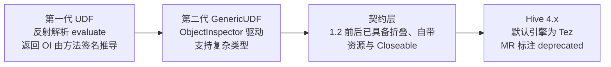
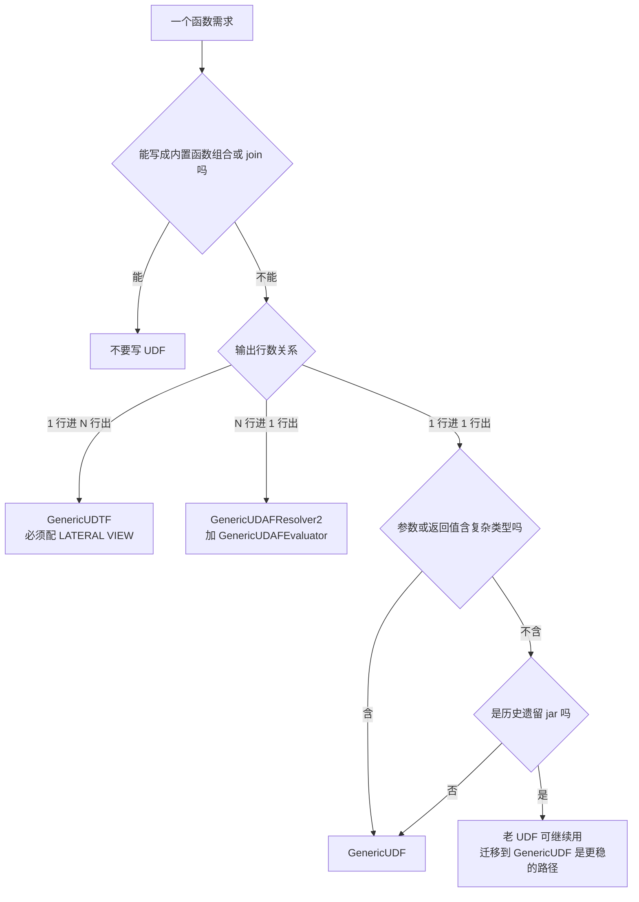
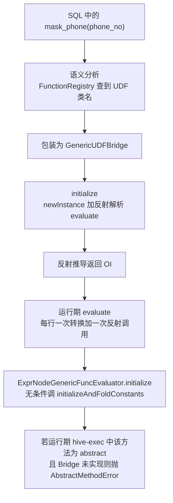
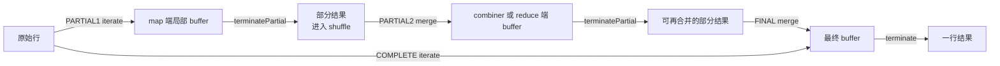
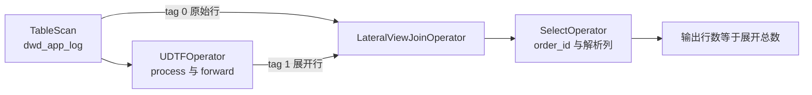
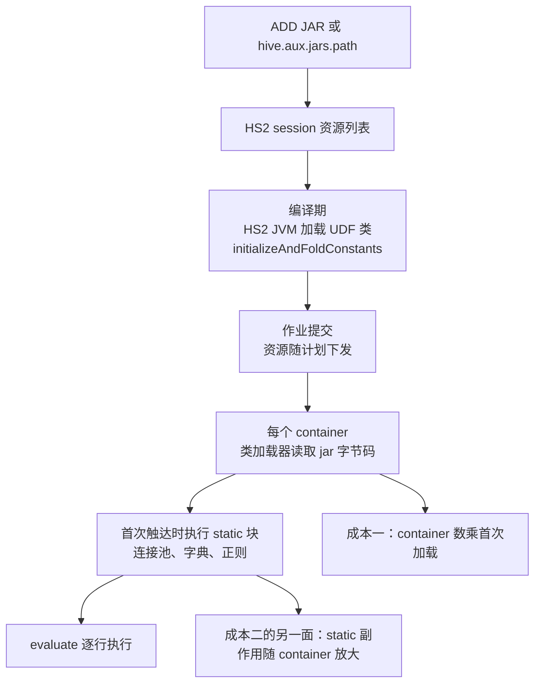

# 09 UDF 开发体系：GenericUDF、UDAF 与 UDTF 全解

**摘要：**

用户自定义函数（User-Defined Function，UDF）是 Hive 唯一能扩展 SQL 表达力的口子，也是生产上最容易被当成"写个 Java 方法挂上去"的东西。本文要回答两个问题。第一个是选型：给定一个函数需求，该用只处理基本类型的 `UDF`、ObjectInspector（对象检查器）驱动的 `GenericUDF`、带状态机的 `GenericUDAFEvaluator`，还是必须配 `LATERAL VIEW` 使用的 `GenericUDTF`？判据不是"哪种接口更省事"，而是输入输出的行数关系、是否需要复杂类型、以及这段逻辑能不能被内置函数或 join 替代。第二个是代价：一个 UDF 真正让系统付账的地方有四笔——jar 要分发到每个 task 的类加载器、每行数据要跨过一次 ObjectInspector 与 Writable 的序列化边界、编译期的 hive-exec 与运行期容器里的 hive-exec 必须是同一份、以及它作为优化器黑盒让谓词只能停在扫描算子而进不了 ORC 的 SearchArgument。四笔账分别用源码位置、异常形态与本知识库的两起真实故障（Tez 容器 `AbstractMethodError`、Beeline EXPLAIN 常量折叠对照）来落定，并顺带纠正几条流传很广的说法：Apache Hive 并没有 `SimpleGenericUDF` 这个类，自动类型推导其实属于老接口的行为，UDF 也不阻断列裁剪。落点是一句判断：写 UDF 之前先确认它值不值得成为优化器的黑盒。

---

## 第 1 章 一行数据能变成几行

### 1.1 三个需求与三种行数关系

贯穿全文的是一张订单宽表 `dwd_order_wide`，按 `dt` 天分区，单个分区约 800 万行、40 列，另有一张按天写入的应用日志表 `dwd_app_log`，`raw_log` 字段里是压成一行的用户行为日志。业务方提了三个需求：手机号脱敏（`13812345678` 变成 `138****5678`）、按省份算客单价的中位数、把日志里的一次会话拆成多条事件记录。三个需求在 SQL 里都写作函数调用，但框架看到的行数关系完全不同。

第一种是**一对一**：一行进去一行出来，`mask_phone(phone_no)` 属于这种，它的输出行序与输入行序严格一致，可以放在 SELECT 列表里任意位置，也可以在 WHERE 里当谓词用。第二种是**多对一**：`median(pay_amount)` 把一组行的值压成一个值，必须与 `GROUP BY` 或全表聚合绑在一起，输出行数由分组键决定而不是由输入行数决定。第三种是**一对多**：`parse_log(raw_log)` 一行日志可能解析出三行、三十行或者零行，输出行数完全由数据内容决定，框架既不知道上限也不知道下界。

行数关系不是描述性的分类，而是编译期必须拿到的契约。Hive 在语义分析阶段要把每个表达式映射成 `ExprNodeDesc`，再往下切成算子：一对一的函数落在 `SelectOperator` 的表达式列表里，多对一的函数落在 `GroupByOperator` 的聚合描述里，一对多的函数必须落在一个专门的 `UDTFOperator` 上，并且由 `LateralViewJoinOperator` 把展开出来的行与原始行重新拼回去。三种落点对应三种内存与 shuffle 行为，框架不能等到运行时再猜。下面这张表把四类函数（标量函数占其中两代接口）摆在一起看：

| 类型 | 输入到输出 | Java 接口 | 在计划中的落点 | 典型内置 | 注册后的调用形态 |
|---|---|---|---|---|---|
| 标量函数（老接口） | 1 行到 1 行 | `org.apache.hadoop.hive.ql.exec.UDF` | `SelectOperator` 表达式 | 历史内置，多数已换成 Generic 实现 | 运行时被包装成 `GenericUDFBridge` |
| 标量函数（新接口） | 1 行到 1 行 | `GenericUDF` | `SelectOperator` 表达式 | `GenericUDFConcat`、`GenericUDFMaskShowLastN` | 直接作为 `GenericUDF` 实例求值 |
| 聚合函数 | N 行到 1 行 | `GenericUDAFResolver2` + `GenericUDAFEvaluator` | `GroupByOperator`（含 map 端预聚合） | `count`、`sum`、`percentile_approx` | 每个分组一个 `AggregationBuffer` |
| 表生成函数 | 1 行到 N 行 | `GenericUDTF` | `UDTFOperator` + `LateralViewJoinOperator` | `explode`、`posexplode`、`inline` | `forward` 逐行吐出，必须配 `LATERAL VIEW` |

### 1.2 框架为什么必须在编译期知道答案

Hive 的类型系统建在 `TypeInfo` 上，而表达式树的每个节点在编译期就要有确定的类型，否则后续的隐式转换、比较运算、分区裁剪、join 键匹配全都无从谈起。UDF 的输出类型不能靠"跑一遍看看返回什么"来确定，所以 `GenericUDF.initialize` 被设计成一个**在编译期就会被调用的方法**：它接收实参的 ObjectInspector 数组，返回输出的 ObjectInspector。源码里这条路径很清楚，语义分析阶段构造函数表达式时，`ExprNodeGenericFuncDesc.newInstance` 会直接调用 `genericUDF.initializeAndFoldConstants(childrenOIs)` 并把返回的 OI 当作节点类型，见 `ql/src/java/org/apache/hadoop/hive/ql/plan/ExprNodeGenericFuncDesc.java` 的 `newInstance` 方法。

这个设计带来第一个反直觉的后果：**UDF 的代码在编译期就在 HiveServer2 的 JVM 里跑过一次**。参数全是常量的函数会被折叠，折叠的含义就是拿常量去调 `evaluate`，把结果包成 `ConstantObjectInspector`；参数含列的函数走 `initialize` 但不折叠，可 `initialize` 里的静态块、连接池、正则编译照样执行。于是"UDF 只在执行器上跑"这个假设从一开始就不成立：HS2 里那份类加载与副作用，与 container 里那份是两套东西。

第二个后果与错误定位有关。因为初始化发生在编译期，很多 UDF 的类型错误会在 `EXPLAIN` 阶段就抛出来，报错信息形如 `UDFArgumentTypeException: ... expected string`，位置指向 SQL 的那一行；而运行期才暴露的问题——比如容器里加载的 hive-exec 与编译期不是同一份——报错则离 SQL 很远，通常只剩一句 `Map operator initialization failed`。两类错误的取证方式完全不同，混在一起会浪费大量时间。

### 1.3 三代接口：两代官方接口与一次契约增厚

UDF 接口的演进常被讲成"三代 API"，但把版本与源码摊开看，真实形态是两代官方接口加一次持续的契约增厚。



第一代是 `org.apache.hadoop.hive.ql.exec.UDF`。它只要求实现一个或多个名为 `evaluate` 的方法，方法签名直接写 Java 类型或 Writable 类型，Hive 用 `UDFMethodResolver` 按实参类型反射选出合适的那一个，返回类型由方法的泛型返回类型反射推导。它的边界很硬：只处理基本类型，`array`、`map`、`struct` 传不进来；返回类型推导依赖反射，精度、decimal 这类元信息会丢失，源码里就有一段针对 `HiveDecimalWritable` 的特判兜底。Hive 4 的源码树里这个类仍保留在 `udf` 模块（`udf/src/java/org/apache/hadoop/hive/ql/exec/UDF.java`），但已经标注 `@Deprecated`，注释写明"新 UDF 应当继承 `GenericUDF`"。

第二代是 `GenericUDF`，把类型系统显式交还给开发者：`initialize` 收 OI、还 OI，`evaluate` 收 `DeferredObject` 数组、还一个由 OI 描述的对象，`getDisplayString` 负责在 `EXPLAIN` 里显示可读文本。复杂类型、参数个数可变、输出类型依赖入参类型这些老接口做不到的事，在它这里都成了自然结果。代价是样板变多：参数校验、OI 缓存、返回值包装都要手写，几十行代码里真正做业务逻辑的可能只有三行。

第三代并没有新类，也不是某次版本发布带出来的新钩子。Hive 1.2.2 的 javadoc 里 `GenericUDF` 的声明就是 `implements Closeable`，`initializeAndFoldConstants`、`getRequiredJars`、`getRequiredFiles`、`configure(MapredContext)` 这些方法当时已经齐备，说明所谓的"契约增厚"在 1.2 前后就已经定型，后续版本只在这同一个抽象类上做维护。三方对照一遍能看清权重：老接口提供"自动类型推导"（反射读 `evaluate` 返回类型），新接口提供显式类型声明与复杂类型支持，折叠、自带资源与关闭是附在 `GenericUDF` 上的三个钩子。它们不是三套接口，而是两代接口加一层契约。真正决定"选哪代"的，是另外两个变量：输出类型能否在编译期静态声明、以及是否需要处理复杂类型。

### 1.4 「SimpleGenericUDF」考据：一个不存在的类

中文技术圈流传一种说法：Hive 1.2 起提供了 `SimpleGenericUDF`，能自动推导类型，是"第三代最省事"的写法。这个类在 Apache Hive 的发布版里并不存在。可以核对两处：一是各版本的 javadoc `allclasses` 索引，1.2.2、2.3.9、3.1.3、4.0.1、4.1.0 以及 master 的 `org.apache.hadoop.hive.ql.udf.generic` 包里都没有 `SimpleGenericUDF`；二是源码树，`ql/src/java/org/apache/hadoop/hive/ql/udf/generic/` 下只有 `GenericUDF` 与一批内置实现，`AbstractGenericUDFReflect` 是内置函数复用的内部基类，并不对外承诺。

这个误会大概来自两件事。其一是"自动类型推导"确实存在，但它属于**老接口**：`GenericUDFBridge.initialize` 用 `ObjectInspectorFactory.getReflectionObjectInspector(udfMethod.getGenericReturnType(), ObjectInspectorOptions.JAVA)` 从 `evaluate` 的返回类型反射出输出 OI，这才是"不用手写 OI"的来源，而它恰恰是 1.0 代的行为。其二是不少人会自建一个名为 `SimpleGenericUDF` 的基类，把参数校验与 OI 推导模板化，代码贴到博客里就成了"Hive 的新接口"。把社区封装当官方 API，是这类考据最容易踩的坑。

要"少写样板"，现实做法只有两条。要么写一个项目内部的 `AbstractGenericUDF`，在 `initialize` 里统一做参数个数与类别校验，把子类的业务方法用泛型约束住；要么退回老接口，接受它只支持基本类型、且要被 `GenericUDFBridge` 包装的事实。两条都有代价，没有免费的第三代。

### 1.5 选择判据

判据可以压成三步，顺序不能颠倒。先看能不能不写：逻辑能用内置函数组合或 join 表达时，UDF 一定不是首选，这一点在第 7 章展开。再看行数关系：输出多行只能 UDTF，多行输入一行输出只能 UDAF，一对一才轮到标量接口。最后看类型与可优化性：参数或返回值含复杂类型时必须 `GenericUDF`；只处理基本类型、且这段代码属于历史遗留时，老 `UDF` 可以继续跑，但不该作为新代码的起点。



---

## 第 2 章 老接口 UDF：反射的便利与三重代价

### 2.1 evaluate 的解析过程

老接口的核心约定只有一句话：写一个名为 `evaluate` 的方法，签名自定。`UDF` 基类的默认实现返回一个 `DefaultUDFMethodResolver`，解析时拿实参的 `TypeInfo` 列表去匹配所有 `evaluate` 重载，选出参数可兼容的那一个。方法名拼错（写成 `evalute`）、返回值声明为 `void`、参数用 Java 原始类型导致 NULL 传进来直接 NPE，这三个错误在开发期极常见，且都不会在编译期被发现。

解析完成后，Hive 并不会直接调用这个类。语义分析阶段它被包装成 `GenericUDFBridge`：`initialize` 里先 `newInstance` 出真正的 UDF 对象，再解析 `evaluate` 方法、构建入参转换器 `ConversionHelper`，最后用反射从方法返回类型推导输出 OI；`evaluate` 每行做一次"取实参、转换、反射调用、包回 Hive 对象"。下面这张图把这条链路画全，同时标出第 6 章要讲的 `AbstractMethodError` 落在哪一环：



### 2.2 三次转换

每处理一行，Bridge 至少做三次转换：`DeferredObject.get()` 把惰性对象实体化；`ConversionHelper.convertIfNecessary` 把 Hive 对象转成 `evaluate` 声明的类型，`Text` 与 `String` 之间来回、`IntWritable` 拆箱成 `int`；返回值再按输出 OI 的描述交回框架。反射调用本身是一次虚方法查找加参数数组打包，单次开销不大，但乘以行数之后，它构成了一条**每行固定成本**。

这条固定成本决定了老接口的适用面：处理小表、低频函数、或逻辑本身极重的场景（比如一次调用里做一次复杂计算），转换与反射被算法开销淹没；处理大表上的轻量转换（大小写、截断、简单算术），固定成本就是主要开销。第 7 章会用一个算术示例把它折算成时间。

### 2.3 一个实例、一个 JVM

`UDF` 的类注释写着一句容易被忽略的话：这个类每个 JVM 只会实例化一次，并且不会被并发调用。这句话纠正了一个流行误解——"向量化模式下同一个 UDF 实例会被多线程同时调用"。事实是，向量化路径根本不走这个实例：不可向量化的自定义函数在向量化查询里由 `VectorUDFAdaptor` 包装，适配器逐行读取列向量、调用 `GenericUDF.evaluate`、再把结果写回列向量，调用始终在同一个线程里串行发生。真正会跨查询共享的是 `static` 字段，而那是另一类问题，第 9 章单独说。

### 2.4 老接口还能不能写

能跑，但不该作为起点。原因不在性能，而在兼容性：老接口依赖 `GenericUDFBridge` 这层包装，包装类是实现细节，它的方法集合会随版本变化。本知识库记录的那起 Tez 作业失败，报告给出的最优假设就落在这层包装上：`ParsePhoneNo extends UDF`，运行期被 Bridge 包装，而容器里那份 hive-exec 中 `GenericUDF.initializeAndFoldConstants` 是抽象方法、Bridge 没有实现，于是 JVM 抛出 `AbstractMethodError`；报告同时标明了根因尚未最终闭合，待确认项集中在容器实际加载的 hive-exec 版本上。完整现场见 [[Hive-Tez作业失败：自定义UDF与Hive版本不兼容导致AbstractMethodError]]，第 6 章从版本耦合的角度重新拆一遍。

迁移的写法有一处细节值得记：新代码继承 `GenericUDF` 时**不必**手写 `initializeAndFoldConstants`，Hive 1.2 起的父类已经提供了带折叠逻辑的默认实现，覆写反而可能把折叠关掉。只有当目标运行时的 hive-exec 里这个方法是抽象的（即那起故障的版本形态），才需要显式实现并转发给 `initialize`，那是针对特定版本的补丁而不是通用规范。

---

## 第 3 章 GenericUDF：把类型系统交给 ObjectInspector

### 3.1 三个方法与两次初始化

`GenericUDF` 的契约由三个抽象方法构成。`initialize` 在实例初始化时调用一次，负责校验参数个数与类型、缓存需要的 OI、返回输出 OI；`evaluate` 每行调用一次，返回一个对象；`getDisplayString` 只影响 `EXPLAIN` 的可读性。除此之外还有四个可选钩子：`configure` 拿作业配置、`close` 释放资源、`getRequiredJars` 与 `getRequiredFiles` 声明自带资源、`initializeAndFoldConstants` 控制折叠。

"调用一次"要按 JVM 分开算：编译期在 HS2 里由 `ExprNodeGenericFuncDesc.newInstance` 调一次，执行期在每个 task 的 `ExprNodeGenericFuncEvaluator.initialize` 里再调一次。两次调用发生在两个 JVM、两份类加载器里，彼此不共享状态。把连接池、缓存、计数器写在 `initialize` 里，等于在每个 task 里各建一份；写在 `static` 里，等于在 HS2 与每个 task 里各建一份且互不释放。这两种写法都是第 6 章成本与第 9 章反例的源头。

### 3.2 ObjectInspector 的五个类别与 DeferredObject

`ObjectInspector.Category` 有五个取值：`PRIMITIVE`、`LIST`、`MAP`、`STRUCT`、`UNION`。前四个覆盖了 Hive 的全部列类型，`UNION` 少见但确实存在。OI 的职责是"在不复制数据的前提下描述对象长什么样"，因此同一个逻辑值可以有多种 OI：`javaStringObjectInspector` 描述的是 Java `String`，`writableStringObjectInspector` 描述的是 Hadoop `Text`。`initialize` 返回哪一种，`evaluate` 就必须返回哪一种，否则轻则 `ClassCastException`，重则被下游静默解释成乱码。

`evaluate` 的入参是 `DeferredObject` 数组而不是值数组，这层间接是为了支持短路与延迟求值：`if(cond, a, b)` 这类函数只在需要时才调用 `arguments[i].get()`，未被选中的分支不付求值成本。写自定义函数时若把每个参数都无条件 `get()` 一遍，等于放弃了这层优化；对昂贵参数（子查询结果、复杂表达式）来说，这个差别不小。

### 3.3 返回值的复用约定

Hive 允许 `evaluate` 返回一个在 `initialize` 里预先创建、在每次调用中被覆写的对象，这是官方推荐的做法，目的是避免每行 `new Text()` 带来的 GC 压力。它的安全性建立在一条隐含前提上：下游在本行处理完之前就把值消费掉。绝大多数算子满足这个前提，但有两类例外——需要跨行保留值的聚合缓冲（`collect_list`、`collect_set`、窗口缓冲），以及把对象塞进容器后延迟读取的自定义 UDAF。遇到这两类下游，复用对象会让容器里装满同一个实例的引用，最终得到一串相同的值。稳妥做法是让函数返回新对象，或者在下游用 `ObjectInspectorUtils.copyToStandardObject` 做一次拷贝，代价是每行一次分配。

### 3.4 自带资源与关闭

`getRequiredJars` 与 `getRequiredFiles` 是 Hive 里少见的"函数自己声明依赖"的机制：返回非空数组时，`ExprNodeGenericFuncDesc.newInstance` 会把它们注册成当前 session 的资源，省掉手工 `ADD JAR`。副作用藏在折叠逻辑里——父类的 `initializeAndFoldConstants` 一旦发现 `getRequiredFiles()` 或 `getRequiredJars()` 非空就直接返回、不做折叠，理由是"外部资源在编译期未必可用"。换句话说，自带资源与常量折叠不可兼得。

`close()` 的调用时机比想象中窄。`GenericUDF` 的注释只承诺它"在 MapRedTask 运行时被调用"，HS2 编译期创建的那个实例不在承诺范围内。把 Redis 连接池、文件句柄、HTTP 客户端放在 UDF 里，而依赖 `close()` 兜底，是在赌调用路径；本知识库的 [[HiveServer2 Redis UDF 文件描述符泄漏故障报告]] 就是赌输的现场，第 9 章会用类加载与实例化时机重新解释它的根因。

### 3.5 一个完整的标量函数

下面这个 `mask_phone` 把前面几条约定落到代码里：参数校验、OI 缓存、NULL 处理、返回值与 OI 的类型匹配、确定性标注。它比"能跑"的版本多做了三件事——拒绝非字符串参数、对长度不足的号码原样返回、把 `@UDFType(deterministic = true)` 写上，让优化器知道它可以安全参与常量折叠与公共子表达式消除。

```java
@Description(name = "mask_phone",
    value = "_FUNC_(phone) - 手机号中间四位脱敏，13812345678 变成 138****5678")
@UDFType(deterministic = true)
public class MaskPhoneUDF extends GenericUDF {

    // 返回 OI 声明的是 javaString，因此 evaluate 返回 String 而不是 Text
    private StringObjectInspector phoneOI;

    @Override
    public ObjectInspector initialize(ObjectInspector[] arguments) throws UDFArgumentException {
        if (arguments.length != 1) {
            throw new UDFArgumentLengthException("mask_phone 需要且仅需要 1 个参数");
        }
        if (arguments[0].getCategory() != ObjectInspector.Category.PRIMITIVE
            || ((PrimitiveObjectInspector) arguments[0]).getPrimitiveCategory()
               != PrimitiveObjectInspector.PrimitiveCategory.STRING) {
            throw new UDFArgumentTypeException(0,
                "mask_phone 的参数必须是 STRING，实际是 " + arguments[0].getTypeName());
        }
        // 缓存 OI，避免每行重复做类型转换
        this.phoneOI = (StringObjectInspector) arguments[0];
        return PrimitiveObjectInspectorFactory.javaStringObjectInspector;
    }

    @Override
    public Object evaluate(DeferredObject[] arguments) throws HiveException {
        String phone = phoneOI.getPrimitiveJavaObject(arguments[0].get());
        if (phone == null) {
            return null;                       // Hive 的惯例：输入 NULL 输出 NULL
        }
        if (phone.length() != 11) {
            return phone;                      // 非 11 位不做脱敏，避免越界与误伤
        }
        return phone.substring(0, 3) + "****" + phone.substring(7);
    }

    @Override
    public String getDisplayString(String[] children) {
        return "mask_phone(" + children[0] + ")";
    }
}
```

代码里有一个刻意的选择：返回的是新 `String` 而不是复用的 `Text`。手机号脱敏通常出现在宽表的投影里，下游可能是 `collect_list`、也可能是窗口函数，复用对象的风险大于省下的那点分配。如果确认下游只有 `SelectOperator` 与 `FilterOperator`，可以改成 `writableStringObjectInspector` 并复用同一个 `Text` 实例，除了返回类型之外不需要改任何东西。

### 3.6 少写样板的现实做法

真要降低样板量，可控的做法是写一个内部基类：构造时接收参数个数与期望的 `PrimitiveCategory`，把 `initialize` 里的校验统一掉，把 `getDisplayString` 默认实现成"函数名加括号"，子类只实现业务方法。这种做法不改变 Hive 的契约，也不会引入版本风险，但要求团队自己维护这份基类并保证它与集群 hive-exec 版本同步编译。它与第 1 章里那个不存在的 `SimpleGenericUDF` 的区别在于：一个是项目自己的抽象，一个是宣传中的官方能力。

---

## 第 4 章 UDAF：状态机、两阶段与有界内存

### 4.1 为什么一个聚合需要四种 Mode

聚合函数的输入是多行、输出是一行，中间必须有一个地方累积状态，这个地方就是 `AggregationBuffer`。Hive 的聚合不是"把数据全扔给一个 reducer 再算"，而是分两阶段：map 端先对本地数据做部分聚合，只把部分结果送进 shuffle，reduce 端再合并。这套机制要成立，函数必须能被拆成"局部聚合"与"合并局部结果"两个动作，于是有了四种执行模式。



`PARTIAL1` 从原始行到部分结果，调用序列是 `iterate` 然后 `terminatePartial`；`PARTIAL2` 从部分结果到部分结果，是 `merge` 再 `terminatePartial`；`FINAL` 从部分结果到最终结果，是 `merge` 再 `terminate`；`COMPLETE` 不 shuffle，直接 `iterate` 再 `terminate`。框架里有一个默认的 `aggregate()` 方法，按当前 Mode 把调用分派到 `iterate` 或 `merge`，自定义 evaluator 覆写 `aggregate` 时要记得保留这套分派，否则 `PARTIAL2` 场景会走错分支。

| Mode | 输入 | 调用序列 | 输出用途 |
|---|---|---|---|
| `PARTIAL1` | 原始行 | `iterate` 到 `terminatePartial` | 部分结果，交给 shuffle |
| `PARTIAL2` | 部分结果 | `merge` 到 `terminatePartial` | 再合并后的部分结果 |
| `FINAL` | 部分结果 | `merge` 到 `terminate` | 最终聚合值 |
| `COMPLETE` | 原始行 | `iterate` 到 `terminate` | 无 shuffle 的单阶段结果 |

### 4.2 AggregationBuffer 的契约

每个分组一个 buffer，`getNewAggregationBuffer` 创建、`reset` 复用、`iterate` 累积、`terminate` 收尾。buffer 的生命周期由框架管理，不要在里面缓存外部资源或者依赖 `finalize`。`init(Mode, ObjectInspector[])` 的入参在两种 Mode 下含义不同：`PARTIAL1` 与 `COMPLETE` 收到的是原始列的 OI，`PARTIAL2` 与 `FINAL` 收到的是 `terminatePartial` 产出的部分结果的 OI。同一个 evaluator 会被框架以不同 Mode 初始化多次，因此 `init` 里必须按 Mode 分支缓存不同的 OI，不能假设只有一套。

这条约定最常见的破坏方式是"在 `init` 里无条件把 `parameters[0]` 强转成输入列 OI"，结果在 reduce 端拿到的是部分结果 OI，抛 `ClassCastException`。症状很隐蔽：map 端全绿、reduce 端全红，报错信息指向 `init`，而真正的错在 Mode 分支缺失。

### 4.3 terminatePartial 能返回什么

`terminatePartial` 的返回值要经过序列化写进 shuffle，因此它必须能被 Hive 的类型系统表达：基本类型的 Writable 或 Java 包装、`List`、`Map`，以及由 OI 描述的组合。返回一个自定义的 `Serializable` 类是不行的，框架没有对应的 OI 去描述它，即便 Java 序列化能过，Hive 的序列化器也不认。返回值的 OI 必须与 `init` 在 `PARTIAL1`/`PARTIAL2` 分支声明的输出 OI 一致，否则 reduce 端 `merge` 时按错误的 OI 解读数据，得到的是垃圾值而不是异常——这是比 OOM 更难查的一类错误。

### 4.4 精确中位数的内存算术

内置函数里没有精确中位数，`percentile_approx` 是近似算法，所以自写一个 `median` 是 UDAF 的经典练习。它的 buffer 必须保存分组内的全部数值，因为中位数不可增量。代码结构与老版本一致，但有两处值得按工程标准修正：`terminate` 里排序要基于副本，以免缓冲被重复使用时把已排序状态当作原始状态；`merge` 里读取部分结果必须走 `partialOI` 而不是直接强转类型。

```java
@Description(name = "median", value = "_FUNC_(col) - 精确中位数")
@UDFType(deterministic = true)
public class MedianUDAF extends AbstractGenericUDAFResolver {

    @Override
    public GenericUDAFEvaluator getEvaluator(TypeInfo[] parameters) throws SemanticException {
        if (parameters.length != 1) {
            throw new UDFArgumentTypeException(parameters.length - 1, "median 只接受 1 个参数");
        }
        switch (((PrimitiveTypeInfo) parameters[0]).getPrimitiveCategory()) {
            case DOUBLE: case FLOAT: case LONG: case INT: case SHORT: case BYTE:
                return new MedianEvaluator();
            default:
                throw new UDFArgumentTypeException(0, "median 只支持数值类型");
        }
    }

    static class MedianBuffer implements AggregationBuffer {
        final List<Double> values = new ArrayList<>();
    }

    public static class MedianEvaluator extends GenericUDAFEvaluator {

        private PrimitiveObjectInspector inputOI;
        private StandardListObjectInspector partialOI;

        @Override
        public ObjectInspector init(Mode mode, ObjectInspector[] parameters) throws HiveException {
            super.init(mode, parameters);
            if (mode == Mode.PARTIAL1 || mode == Mode.COMPLETE) {
                inputOI = (PrimitiveObjectInspector) parameters[0];
            } else {
                partialOI = (StandardListObjectInspector) parameters[0];
            }
            if (mode == Mode.PARTIAL1 || mode == Mode.PARTIAL2) {
                // 部分结果必须是 Hive 能表达的类型：Double 列表
                return ObjectInspectorFactory.getStandardListObjectInspector(
                    PrimitiveObjectInspectorFactory.javaDoubleObjectInspector);
            }
            return PrimitiveObjectInspectorFactory.javaDoubleObjectInspector;
        }

        @Override
        public AggregationBuffer getNewAggregationBuffer() {
            return new MedianBuffer();
        }

        @Override
        public void reset(AggregationBuffer agg) {
            ((MedianBuffer) agg).values.clear();
        }

        @Override
        public void iterate(AggregationBuffer agg, Object[] parameters) throws HiveException {
            if (parameters[0] == null) {
                return;
            }
            ((MedianBuffer) agg).values.add(
                PrimitiveObjectInspectorUtils.getDouble(parameters[0], inputOI));
        }

        @Override
        public Object terminatePartial(AggregationBuffer agg) {
            return new ArrayList<>(((MedianBuffer) agg).values);
        }

        @Override
        public void merge(AggregationBuffer agg, Object partial) throws HiveException {
            if (partial == null) {
                return;
            }
            for (Object item : partialOI.getList(partial)) {
                ((MedianBuffer) agg).values.add((Double) item);
            }
        }

        @Override
        public Object terminate(AggregationBuffer agg) {
            List<Double> copy = new ArrayList<>(((MedianBuffer) agg).values);
            if (copy.isEmpty()) {
                return null;
            }
            Collections.sort(copy);
            int size = copy.size();
            return size % 2 == 1
                ? copy.get(size / 2)
                : (copy.get(size / 2 - 1) + copy.get(size / 2)) / 2.0;
        }
    }
}
```

内存账要算清。`Double` 对象在 64 位 JVM 上约 16 到 24 字节（对象头 12 到 16 字节、8 字节 `double`，按 8 字节对齐），`ArrayList` 里每个元素另有一个引用约 8 字节，合计约 24 到 32 字节一个值。若某个分组有 1 亿行，buffer 本身就要 3.2 GB 量级，`terminate` 里的副本再翻一倍——这是示例推算，实际占用还受压缩指针与 GC 头影响。这一条决定了精确中位数的适用面上限：单分组百万行以内尚可，上亿行必须换 `percentile_approx`。

### 4.5 增量聚合的边界

两阶段聚合成立的前提是函数可结合（associative）且可交换（commutative）：`sum`、`min`、`max`、`count` 满足，部分结果与部分结果的合并顺序不影响最终值；`count(distinct)` 不满足，Hive 用 HyperLogLog 的 `approx_count_distinct` 绕开；精确中位数不满足，因为它依赖全局有序。判断自定义 UDAF 能不能从两阶段中获益，只需问一句：把两个部分结果合并，结果是否与把两批数据合在一起重算一致？答否，就该考虑近似算法，或者接受单阶段聚合的 shuffle 成本。

窗口函数是另一条路径。`GenericUDAFEvaluator` 还提供了 `getWindowingEvaluator` 与窗口聚合相关方法，让聚合可以在滑动窗口上增量计算；但自定义 UDAF 默认沿用全量重算，窗口越大代价越高。把 `sum` 之类可增量的函数自己实现成 UDAF 并用于窗口，通常比内置的窗口实现慢，这是"能写"与"该写"的差别。

### 4.6 旧 UDAF 与注册入口

旧接口 `org.apache.hadoop.hive.ql.exec.UDAF` 加内部类 `UDAFEvaluator` 的写法，Hive 4 里仍在 `udf` 模块中，但标注了 `@Deprecated`，注释直接建议实现 `GenericUDAFResolver2` 或继承 `AbstractGenericUDAFResolver`。两代接口的分界不在"有没有两阶段"：旧 `UDAFEvaluator` 这个接口本身只声明了 `init()`，`aggregate`、`terminatePartial`、`merge` 都是靠反射按方法名约定的，所以旧接口同样有两阶段聚合；真正的分界在类型系统——旧接口拿不到参数的 `ObjectInspector`，也就无法处理复杂类型，无法精确声明部分结果的类型，反射调用还带来每行一次固定开销。新代码的入口统一是 `AbstractGenericUDAFResolver`（内部桥接 `GenericUDAFResolver2`），参数校验写在 `getEvaluator` 里，业务写在 evaluator 里，五个抽象方法把两阶段的调用序列固定下来，不再依赖方法名约定。

---

## 第 5 章 UDTF：行数放大与 LATERAL VIEW

### 5.1 三条错误信息说明语法约束

UDTF 最容易被记住的规矩是"不能出现在 SELECT 的其他列旁边，除非用 `LATERAL VIEW`"。这条规矩在源码里对应三条错误信息（`common/src/java/org/apache/hadoop/hive/ql/ErrorMsg.java`）：`UDTF_MULTIPLE_EXPR` 说 SELECT 里只能有一个表达式是 UDTF；`UDTF_INVALID_LOCATION` 说 UDTF 不能出现在 SELECT 之外，也不能嵌套在表达式里；`UDTF_LATERAL_VIEW` 说存在 LATERAL VIEW 时 SELECT 里不能再出现 UDTF。三条合起来，含义是清楚的：一个 UDTF 一旦执行，输出行数就与输入行数脱钩，SELECT 里其他列如果按原行号对齐就会错位，框架只能禁止这种写法。

```sql
-- 会被拒绝：UDTF 与其他列并列
SELECT order_id, parse_log(raw_log) FROM dwd_app_log;

-- 正确：LATERAL VIEW 把展开结果与原行拼回
SELECT l.order_id, p.ts, p.level, p.message
FROM dwd_app_log l
LATERAL VIEW parse_log(l.raw_log) p AS ts, level, message;
```

### 5.2 LATERAL VIEW 的算子结构

`LATERAL VIEW` 在计划里不是语法糖，而是两个算子：`UDTFOperator` 负责调用 `process` 与接收 `forward`，`LateralViewJoinOperator` 负责把 UDTF 的输出（tag 1）与原始行（tag 0）按行拼接。多个 `LATERAL VIEW` 会形成链式结构，后一个可以引用前面展开出来的列，这也解释了为什么它们的执行顺序就是书写顺序。



### 5.3 forward 的同步语义

`GenericUDTF.forward(Object)` 的实现只有一行：`collector.collect(o)`。`collector` 由 `UDTFOperator` 注入，`collect` 直接推进下游算子链，处理完这一行才返回。因此"在 `process` 里建一个复用的 `Object[]`、每轮覆写后 `forward`"是安全的：下游在 `forward` 返回前就消费完了。这条安全性有两个边界：一是在 `process` 里把对象存进静态集合或成员变量跨行保留，二是下游算子自身缓存引用，两者都会让复用变成串数据。

`initialize` 必须返回 `StructObjectInspector`，它的字段就是 UDTF 的输出列，字段名与 `AS` 后面别名的个数必须匹配，不匹配会报 `UDTF_ALIAS_MISMATCH`。Hive 0.12 起别名可以省略，此时框架直接沿用 struct 的字段名；同一个版本引入的 `LATERAL VIEW OUTER` 则解决"UDTF 不输出任何行时原始行被丢掉"的问题——`explode` 一个空数组会让整行消失，加 `OUTER` 之后原行保留、展开列补 NULL。

### 5.4 一个日志解析 UDTF

```java
@Description(name = "parse_log", value = "_FUNC_(log_line) - 一行日志解析为多条记录")
public class ParseLogUDTF extends GenericUDTF {

    private StringObjectInspector logOI;
    // 复用数组，forward 是同步下推，下一轮覆写之前下游已经消费完
    private final Object[] forwardObj = new Object[3];

    @Override
    public StructObjectInspector initialize(ObjectInspector[] argOIs) throws UDFArgumentException {
        if (argOIs.length != 1) {
            throw new UDFArgumentException("parse_log 需要 1 个 STRING 参数");
        }
        logOI = (StringObjectInspector) argOIs[0];
        List<String> names = Arrays.asList("ts", "level", "message");
        List<ObjectInspector> ois = Arrays.asList(
            PrimitiveObjectInspectorFactory.javaStringObjectInspector,
            PrimitiveObjectInspectorFactory.javaStringObjectInspector,
            PrimitiveObjectInspectorFactory.javaStringObjectInspector);
        return ObjectInspectorFactory.getStandardStructObjectInspector(names, ois);
    }

    @Override
    public void process(Object[] args) throws HiveException {
        String log = logOI.getPrimitiveJavaObject(args[0]);
        if (log == null) {
            return;                       // 不 forward 即零行输出，调用方需要用 OUTER 兜底
        }
        for (String line : log.split("\n")) {
            String[] parts = line.split("\\|", 3);
            if (parts.length != 3) {
                continue;                 // 格式不合法跳过，不让一条坏日志带崩整个 task
            }
            forwardObj[0] = parts[0];
            forwardObj[1] = parts[1];
            forwardObj[2] = parts[2];
            forward(forwardObj);
        }
    }

    @Override
    public void close() throws HiveException {
        // 释放 UDTF 持有的外部资源；没有资源时保持空实现
    }
}
```

### 5.5 行数放大的代价

UDTF 的成本与输入行数不成正比，而与**输出行数**成正比。一个数组列有 10 万元素时，`explode` 会把一行变成 10 万行，`LateralViewJoinOperator` 要为每一行复制一份原始行的列，下游 `SelectOperator`、`FilterOperator` 与 shuffle 都要处理这 10 万行。MapTask 的输出缓冲、下游的 `ReduceSink` 序列化、以及目标表的写入，全部按输出行数计费。日志解析场景里一条会话日志拆出几十条记录属于正常，拆出几十万条通常意味着上游应该先做聚合或过滤，而不是把放大动作放进 UDTF。

---

## 第 6 章 四个隐性成本

### 6.1 成本一：JVM 加载与 jar 分发

`ADD JAR` 是 session 级操作。它把 jar 的 URI 加进当前 HiveServer2 session 的资源列表，只对这条连接后续的语句生效；换一条连接、换一个 HS2 实例，都要重新加。要让所有 session 都带上，只能改服务端配置 `hive.aux.jars.path`，代价是每个 HS2 实例都得配同一份路径、同一份文件，配置漂移会让同一个函数在不同实例上行为不同。Hive 另有一个 `hive.reloadable.aux.jars.path`，配合 `RELOAD` 命令可以在不重启 HS2 的前提下刷新插件 jar，这是升级 UDF 时少数不必滚动重启的路径。

资源进入 session 之后，还要跟着作业走到每个 task。MapReduce 引擎把 jar 列表塞进 `tmpjars`，由每个 task 的 JVM 在启动时把它们挂到 classpath；Tez 引擎把资源作为 DAG 的本地化资源分发到每个 container，由 container 里的类加载器加载。两种方式的结果一样：**每个 container 都要为这个 UDF 类做一次字节码读取、验证、链接与静态初始化**。成本不线性于 jar 的大小，而线性于 container 数量乘以首次触达的类数量；一个 1 万 container 的作业，每个 container 首次加载一个 jar 的固定开销在几十毫秒量级（量级判断），按 CPU 时间累计就是分钟级，墙钟上则表现为整个作业的启动阶段被拉长——因为 container 是并行启动的，这笔账不会简单相加，但会均匀地摊到每个 container 的 headroom 里。jar 越大、依赖越深，这条成本越明显。



### 6.2 成本二：序列化边界

Hive 的行式执行把数据在"Writable 或 Lazy 对象"与"Java 对象"之间来回搬。UDF 的每个参数都要经过 `ObjectInspector` 解引用：`getPrimitiveJavaObject` 会把 `Text` 转成 `String`、把 `IntWritable` 拆箱成 `int`；返回值再按输出 OI 的描述包回 Hive 对象。基本类型是一次装箱加一次 OI 调用，复杂类型则是嵌套解引用：一个 `array<string>` 参数调一次 `getList`，再对每个元素调一次元素 OI，`LazyBinaryArray` 与 `OrcList` 这类惰性对象在被读取时才真正解析。只取一个元素却把整个集合解析一遍，是 UDF 里最常见的一处浪费。

这条边界在向量化模式下不会消失，只是换了形态。Hive 的 `VectorUDFAdaptor` 让不可向量化的自定义函数仍然留在向量化算子链里，代价是适配器逐行从列向量里取标量、调 `GenericUDF.evaluate`、再把结果写回列向量。整条链的批量框架保住了，但每个值仍要过一遍 OI 与 writer 转换，无法获得内置函数那种"直接在列向量上做批量运算"的收益。计划里出现 `VectorUDFAdaptor`，就是这条成本的可见证据。

```java
// 反例：为了取一个字段，把整个 map 参数解引用了一遍
Map<?, ?> all = mapOI.getMap(arguments[0].get());
Object only = all.get(key);       // 触发了全部条目的解析

// 更省的做法是用 MapObjectInspector 的按需读取能力，或者让上游投影出这一列
```

### 6.3 成本三：版本耦合

UDF 的 jar 编译时依赖 hive-exec 的类，运行时要与容器里那份 hive-exec 的类对上。这两份可以是不同版本：编译时用的是开发机或 CI 上的 `hive-exec`，运行时用的是集群分发的 hive-exec；在 Tez 上还多一层——容器里的 hive-exec 由 HS2 上传到 HDFS 的目录（`hive.jar.directory`）决定，未必等于 bigtop 或发行版目录里的那份。版本不一致时，症状是 `AbstractMethodError`、`NoSuchMethodError`、`IncompatibleClassChangeError` 这类链接期异常，报错位置在 `Map operator initialization failed` 的 `Caused by` 链末端，离"版本"这个词很远。

本知识库的 [[Hive-Tez作业失败：自定义UDF与Hive版本不兼容导致AbstractMethodError]] 给了一份完整现场：`msns.parse_phone_no` 的实现类 `ParsePhoneNo` 继承旧接口 `UDF`，运行期被 `GenericUDFBridge` 包装，报告的最优假设是容器里那份 hive-exec 的 `GenericUDF.initializeAndFoldConstants` 为抽象方法而 `Bridge` 未实现，于是 `ExprNodeGenericFuncEvaluator.initialize` 一调用就抛 `AbstractMethodError`。这份报告里有两条已经确认的判断值得记住：一是 `jar tf` 未见 `org/apache/hadoop/hive` 前缀，排除了把 hive-exec 打进去的双版本冲突；二是关闭 `hive.optimize.constant.propagation` 并不能绕开，因为源码里 `ExprNodeGenericFuncEvaluator.initialize` 是**无条件**调用 `initializeAndFoldConstants` 的，它属于算子初始化的标准路径，不属于优化路径。报告把剩余的不确定项留在"容器实际加载的是哪份 hive-exec"上，这正是版本耦合成本的形态：能定位到类与方法的层级，却定不到版本号，除非把容器里的 jar 取出来用 `javap` 看。

| 异常 | 含义 | 与 UDF 相关的常见成因 |
|---|---|---|
| `AbstractMethodError` | 运行期类未实现某个抽象方法 | 编译期与运行期 hive-exec 版本不一致；旧接口包装类未实现新钩子 |
| `NoSuchMethodError` | 运行期找不到某方法 | UDF 编译依赖的方法在新版本被改名或移除 |
| `ClassNotFoundException` | 类不存在 | jar 未分发、`ADD JAR` 路径错、永久函数资源 URI 失效 |
| `IncompatibleClassChangeError` | 类的结构发生不兼容变化 | 接口变抽象类、字段变静态等签名变更 |
| `ClassCastException`（OI 相关） | 返回值与声明的 OI 不匹配 | 声明 `javaStringObjectInspector` 却返回 `Text` |

### 6.4 成本四：不可优化

"UDF 阻断优化"这句话需要拆开看，四件事的结论并不一样。

常量折叠并不被阻断，但门槛很高。父类的 `initializeAndFoldConstants` 只在四个条件同时满足时折叠：所有实参都是 `ConstantObjectInspector`、`getRequiredFiles()` 与 `getRequiredJars()` 都为空、`FunctionRegistry.isConsistentWithinQuery(this)` 为真、输出 OI 支持常量。参数含列的函数不满足第一条，自带资源的函数不满足第二条，标了 `@UDFType(deterministic = false)` 的函数不满足第三条。所以"把 UDF 当黑盒"更准确的说法是：**它只在参数全是字面量时被当作可计算的白盒，其余时候都是黑盒**。折叠发生在编译链路的哪一段、规则如何排序，见 [[03 SQL 编译全链路：从 HQL 到 Operator Tree]]；这套机制的副作用在第 9 章展开——折叠意味着编译期真的执行 `evaluate`。

谓词下推只能停在扫描算子的上层。一个含 UDF 的过滤条件可以下推到 `TableScan`，由扫描算子逐行求值，从而在 join 之前把行数降下来；但它不会被翻译成 ORC 的 `SearchArgument` 或 Parquet 的 `FilterPredicate`，因为存储层的下推只认简单的列比较与逻辑组合。结果是 IO 一点没少：该读的 stripe、该解的页照样读，只是读完更早地把行丢掉。分区裁剪的损失更隐蔽：自定义 UDF 出现在分区谓词里时，走服务端 `getPartitionsByExpr` 的裁剪路径失效，`PartitionPruner` 会退回客户端逐个分区求值（源码里 `hasUserFunctions` 的分类就是这条分叉），分区表小时无感，百万分区的表上就是一次全量元数据拉取加本地求值。

列裁剪**不会**被阻断，这一点与流行说法相反。`ExprNodeGenericFuncDesc.getCols()` 会递归收集子表达式的列引用，列裁剪规则据此决定扫描哪些列，UDF 出现在表达式里不影响它识别列。真正受影响的是 CBO：优化器不知道 UDF 输出的基数、选择率与值域，只能套默认值估算，join 顺序与 join 算法的选择因此可能偏离最优。这部分机制见 [[05 查询优化器：RBO 规则集与 CBO 代价模型]]。

最后是可见性。`EXPLAIN` 里 UDF 是否出现、出现在哪个算子的表达式列表里，决定了它是被下推还是留在原处；要看清这一点需要 `EXPLAIN EXTENDED`，而常量折叠是否发生，则要看参数位置显示的是列引用还是字面量。本知识库的 [[用Beeline-EXPLAIN分析Hive常量折叠是否触发UDF兼容性问题]] 给了一套可复用的对照方法：同一段 SQL 用两个分区各跑一次 `EXPLAIN EXTENDED`，比较 `parse_phone_no(content1:string)` 与 `parse_phone_no('字面量':string)` 两种形态，再用 `hive.optimize.constant.propagation` 开关做一次执行对照。那次的结论是"关闭开关后仍然失败"，从而把常量折叠从根因候选里排除，指向运行期 hive-exec 版本。

### 6.5 四个成本叠加的位置

四笔账不在同一个时刻发生：jar 分发与类加载在作业提交与 container 启动时，序列化边界在每一行上，版本耦合在算子初始化时，不可优化在编译与优化阶段。把一条 SQL 的生命周期按这两个 JVM 切开，就能看出为什么同一个 UDF 在不同集群、不同引擎上的表现差异很大。编译期一侧，HS2 的 JVM 先加载 UDF 类、跑一次 `initialize`，参数全常量时还会真的执行 `evaluate`；同一时刻优化器只能把它当黑盒，谓词与统计都停在外围。执行期一侧，每个 container 重新加载同一个类、重新执行 `static` 初始化、在算子初始化时再走一遍折叠钩子，然后逐行走序列化边界。两处加载、两处初始化、一处逐行成本，构成了同一个函数在四个方向上的账；其中任何一处版本对不上，表现就是编译通过而运行失败。

### 6.6 成本清单

| 成本 | 触发条件 | 典型症状 | 判据 | 缓解手段 |
|---|---|---|---|---|
| JVM 加载与 jar 分发 | 大作业、jar 大、依赖多、container 多 | 作业启动慢、container 首次 task 明显偏慢 | 对比任务启动时间与 container 数 | 精简 jar、拆小函数、避免 static 侧初始化、`hive.aux.jars.path` 统一 |
| 序列化边界 | 每行每参数、复杂类型、向量化查询 | CPU 高而 IO 正常、`VectorUDFAdaptor` 出现在计划里 | `EXPLAIN VECTORIZATION` 与 profile | 用内置函数、减少复杂类型解引用、保持向量化 |
| 版本耦合 | 自建 jar、跨集群、升级期 | `AbstractMethodError`、`NoSuchMethodError` | `javap` 对比编译期与容器 hive-exec | 用集群版本编译、CI 校验、灰度、锁定版本矩阵 |
| 不可优化 | 参数含列、需要谓词裁剪与 CBO | 扫描量不降、join 计划异常、折叠结果错 | `EXPLAIN EXTENDED` 看参数形态 | 优先内置函数、把过滤写成简单列比较、正确标注确定性 |

---

## 第 7 章 UDF 还是内置函数

### 7.1 六个判据

判断"这件事该不该写成 UDF"，可以按六个维度过一遍：能不能被 CBO 估算、能不能参与谓词下推、能不能向量化、有没有版本耦合、谁维护、复用面有多大。内置函数在前四项上天然占优；UDF 要在后两项上找到理由，前提是这段逻辑确实无法用 SQL 表达、且复用面足够大，否则它只是一份由团队自己背着的技术债。

| 维度 | 内置函数 | 自定义 UDF | 结论 |
|---|---|---|---|
| CBO 估算 | 有选择率与代价模型 | 黑盒，套默认值 | 过滤与 join 键尽量用内置 |
| 谓词下推 | 可进存储层 SARG | 只到扫描算子 | 需要减少 IO 时用内置 |
| 向量化 | 列向量批量执行 | 逐行适配 | 大表投影优先内置 |
| 版本耦合 | 跟随集群 | 需自行对齐 hive-exec | UDF 要纳入版本矩阵 |
| 维护责任 | 社区 | 团队 | 长期看 UDF 是负债 |
| 复用面 | 全集群 | 注册范围内 | 唯一可能胜出的维度 |

### 7.2 内置函数已经覆盖的那些活

很多"必须写 UDF"的判断，其实是对函数库不熟。手机号脱敏在 Hive 2.1 起有内置的掩码函数族：`mask`、`mask_first_n`、`mask_last_n`、`mask_show_first_n`、`mask_show_last_n`、`mask_hash`，`mask_show_last_n(phone_no, 4)` 就能实现"保留后四位"，`mask_hash` 能给出稳定的哈希掩码。JSON 有 `get_json_object` 与 `json_tuple`，正则提取有 `regexp_extract`，日期换算有 `from_unixtime`、`unix_timestamp`、`date_format`，聚合的近似分位有 `percentile_approx`，去重计数有 `approx_count_distinct`，表生成有 `explode`、`posexplode`、`inline`、`stack`，加解密有 `aes_encrypt`、`aes_decrypt` 与 `base64`。这些函数覆盖了清洗与统计里绝大多数转换需求，其中常用的一批有专门的向量化实现，也能被优化器理解。

### 7.3 必须自己写的三类

第一类是业务语义。费率计算、会员等级映射、风控标记载在业务规则里，SQL 表达不了或者表达出来无法维护，这类逻辑适合写成 UDF，但更适合写成维表 join——如果规则能以表格形式维护，join 的正确性与可维护性都优于把规则硬编码进 jar。第二类是外部字典查询。很多团队第一反应是写一个查 Redis 或 HTTP 接口的 UDF，这是第 9 章要重点拆的反例：它把网络 IO 塞进了每行执行路径，把外部系统的可用性耦合进了 SQL，还让编译期的常量折叠可能真的发起网络请求。第三类是协议解析。UBT、protobuf、自定义二进制日志这类格式，SQL 无法表达，UDTF 或 UDF 是合理选择，但要把解析器做成纯函数、不在 `process` 里做 IO。

### 7.4 差距的量级

内置函数与等价 UDF 的差距不在算法复杂度，而在每行的固定开销。按行模式估算，一次 UDF 调用的固定成本大致落在 0.1 到 0.3 微秒量级（量级判断，随 JVM、对象大小、OI 嵌套深度变化）；一亿行乘以 0.2 微秒是 20 秒，十亿行是 200 秒。同一段逻辑用内置函数，走的是列向量上的批量运算，固定开销被摊到一批 1024 行上，量级上可以低一个数量级（同为量级判断）。这个换算解释了一个经验规律：小表上用 UDF 几乎无感，日增十亿行的宽表上把内置函数换成 UDF，任务时长会出现肉眼可见的抬升。

---

## 第 8 章 注册、升级与调试

### 8.1 临时函数与永久函数

注册方式只有两类，区别不在语法糖，而在元数据写到哪里、以及谁能看见。临时函数只写进当前 session 的内存，session 结束即失效，jar 必须由 `ADD JAR` 带进来；永久函数把类名与资源 URI 写进 Hive Metastore，任何 session 解析到它时自动加载对应资源，不需要 `ADD JAR`。

| 维度 | 临时函数 | 永久函数 |
|---|---|---|
| 语句 | `CREATE TEMPORARY FUNCTION` | `CREATE FUNCTION ... USING JAR` |
| 作用域 | 当前 session | 整个 HMS 命名空间 |
| 元数据 | session 内存 | HMS 的 `FUNCS` 与 `FUNC_RU` 表 |
| jar 来源 | `ADD JAR` 的 session 资源 | 元数据里记录的 HDFS URI |
| 典型场景 | 调试、一次性任务、灰度验证 | 稳定的公共函数 |
| 升级方式 | 重新 `ADD JAR` 加注册 | `DROP` 再 `CREATE`，换 jar 路径 |

```sql
-- 临时函数：只在当前连接有效
ADD JAR hdfs:///user/hive/jars/my-udf-1.0.jar;
CREATE TEMPORARY FUNCTION mask_phone AS 'com.example.udf.MaskPhoneUDF';

-- 永久函数：写进 HMS，所有 session 可见
CREATE FUNCTION dw.mask_phone AS 'com.example.udf.MaskPhoneUDF'
USING JAR 'hdfs:///user/hive/jars/my-udf-1.0.jar';

-- 查看函数指向的资源，排障时先用这条
DESCRIBE FUNCTION EXTENDED dw.mask_phone;
```

### 8.2 永久函数的元数据事实

永久函数的类名与资源 URI 存在 HMS 的 `FUNCS` 与 `FUNC_RU` 两张表里（Hive 4 的 metastore 映射见 `standalone-metastore/metastore-server/src/main/resources/package.jdo` 中 `MFunction` 的 `FUNCS` 与 `resourceUris`）。函数第一次被解析时，`Registry.registerPermanentFunction` 从 HMS 取回类名与资源，注册进 session 注册表并加载类。这条链路解释了三个现象：一是永久函数不需要 `ADD JAR`；二是函数"指向哪个 jar"是元数据事实，改文件内容不会改变指向；三是权限模型里创建永久函数属于 DDL，与创建临时函数的权限要求不同，授权策略要分开设计。

### 8.3 升级流程与它的真实约束

升级的约束来自 JVM 的类加载语义：同一个类加载器里，一个类只会被加载一次，同名类不会被后来的 jar 覆盖。HiveServer2 是长驻进程，编译期加载过的 UDF 类会留在会话或查询的类加载器里；此时即便把 HDFS 上的 jar 覆盖成新版本，已经在跑的 HS2 进程也不会重新读取。所以"覆盖旧 jar"不是危险，而是**无效**——旧 session 继续用旧类，新 session 可能因为缓存继续用旧类，最终出现"升级了但没生效"或"部分实例生效"的分裂状态。

可靠流程是换路径而不是覆盖：新 jar 传到新路径，`DROP FUNCTION` 旧注册，用新路径重新 `CREATE FUNCTION`，然后让在途 session 自然过期或滚动重启 HS2。若集群配置了 `hive.reloadable.aux.jars.path`，可以改用 `RELOAD` 让 HS2 刷新插件 jar，省掉重启，但要求 jar 在该配置路径下而不是 `ADD JAR` 进来的。灰度阶段可以把新版本先注册成临时函数，在一条连接上对比新旧结果，再切换永久函数。

### 8.4 依赖冲突与 JDK

UDF 的依赖冲突分两类。一类是 UDF 私有依赖与 Hive 自带依赖的版本冲突，典型如 Guava：UDF 编译时依赖某个较新的版本，集群 hive-exec 里是另一个版本，双亲委派会让父加载器优先，运行时实际用的是集群版本，于是调新 API 时抛 `NoSuchMethodError`。这类冲突可以用 Maven Shade 的 relocate 解决：把私有依赖的包名改到自己的命名空间下，classloader 里就是两个不同名的类，不再互相遮蔽。

```xml
<relocation>
  <pattern>com.google.common</pattern>
  <shadedPattern>com.example.udf.shaded.guava</shadedPattern>
</relocation>
```

另一类是 hive-exec 本身，它必须由集群提供，不能打进 UDF jar。把 hive-exec 一起打进去，等于在 jar 里塞了一份与集群版本不同的 `GenericUDF`，运行时究竟加载哪一份取决于类加载器顺序，结果是行为不确定——这正是版本耦合成本最难查的形态。JDK 版本是同一类问题的另一面：用高版本 JDK 编译出的 class 文件，在低版本 JRE 上会直接报 `UnsupportedClassVersionError`；UDF 的编译 JDK 要与集群运行时对齐，这一点要写进 CI 的构建矩阵，而不是靠发布时口头确认。

### 8.5 EXPLAIN 判读

`EXPLAIN` 看三件事。第一，UDF 出现在哪个算子的表达式里：出现在 `Select Operator` 的 `expressions` 里说明它没有被提前折叠，出现在 `Filter Operator` 里说明谓词还在，被下推到 `TableScan` 之上说明过滤位置已经靠前。第二，参数显示的是列引用还是字面量：`mask_phone(phone_no:string)` 是列引用，`mask_phone('13812345678':string)` 是折叠后的常量。第三，`EXPLAIN VECTORIZATION` 的输出里有没有 `VectorUDFAdaptor`，有则说明该算子仍在向量化链里但按行适配，没有则说明要么被向量化实现覆盖，要么整条链退出了向量化。

`EXPLAIN FORMATTED` 还能看到 `TableScan` 的过滤条件描述。含 UDF 的条件不会以存储层谓词的形式出现，这可以直接用来验证"谓词只到扫描层"的判断。要看函数指向的资源，用 `DESCRIBE FUNCTION EXTENDED`；要看 jar 是否真的分发，去任务的 classpath 或 container 的本地化目录里找文件名，而不是在 HS2 的 `ADD JAR` 记录里找。

### 8.6 本地调试与单元测试

小数据调试的加速手段是本地模式。`hive.exec.mode.local.auto` 默认为 `false`，置为 `true` 后，只要输入字节数小于 `hive.exec.mode.local.auto.inputbytes.max`（默认 128 MB）且输入文件数少于 `hive.exec.mode.local.auto.input.files.max`（默认 4），Hive 就把作业放进 HS2 进程内的本地执行器，省掉 YARN 排队与 container 启动。这条开关的适用范围要说清：源码里只有 MapReduce 的 `MapRedTask` 使用它，Tez 任务不会因为打开它而走本地模式，所以在以 Tez 为默认引擎的 Hive 4 上，它基本帮不上忙。调大的代价是把更多数据拉进 HS2 的 JVM，可能引发堆压力；调小的代价是回到完整的作业提交路径。

真正可靠的调试方式是单元测试：直接 `new` 一个 UDF，手工构造 `ObjectInspector` 数组，用 `DeferredJavaObject` 包参数，断言输出。这条路不需要集群、不受类加载影响，能在 CI 里跑，也能把"返回值与 OI 是否匹配"这类问题在发布前拦住。

| 参数 | 默认值 | 作用 | 调大的代价 | 调小的代价 |
|---|---|---|---|---|
| `hive.aux.jars.path` | 空 | 让所有 session 自动带插件 jar | 每个 session 都多加载，jar 冲突面变大 | 每个连接都要手工 `ADD JAR` |
| `hive.reloadable.aux.jars.path` | 空 | 支持 `RELOAD` 刷新插件 jar | 配置漂移时不同实例行为不一致 | 升级必须滚动重启 |
| `hive.exec.mode.local.auto` | `false` | MapReduce 小作业本地执行 | 小作业占用 HS2 的 CPU 与堆 | 每次调试都要排队等 container |
| `hive.exec.mode.local.auto.inputbytes.max` | 128 MB | 本地模式的输入上限 | 大输入进 HS2 JVM，易 OOM | 稍大的调试数据就退回集群 |
| `hive.optimize.constant.propagation` | `true` | 启用常量传播与折叠 | 编译期执行 UDF，副作用落在 HS2 | 失去常量折叠收益，且不影响 `initializeAndFoldConstants` 的调用 |
| `hive.vectorized.execution.enabled` | `true` | 启用向量化执行 | UDF 走适配器逐行，收益打折 | 所有算子退回行模式，整体变慢 |

---

## 第 9 章 反例与边界

### 9.1 用 UDF 做内置函数的活

把 `mask_phone` 这类函数写成 UDF，而不是用 `mask_show_last_n`，代价是三层叠加：失去向量化、失去优化器理解、背上版本耦合。它不会立刻出错，但会在某次集群升级后变成 `AbstractMethodError`，或者在某个大促的宽表任务里把时长拉长一截。判断这类反例的方法很简单：写 UDF 之前先 `SHOW FUNCTIONS` 与 `DESCRIBE FUNCTION`，确认内置库里真的没有等价物。

### 9.2 ADD JAR 之后忘记注册

`ADD JAR` 只把 jar 放进 session 资源，并不会让函数名存在。少了 `CREATE TEMPORARY FUNCTION`，SQL 会报 `SemanticException: Invalid function`；反过来，注册了同名函数但 jar 换过路径而临时函数没重建，行为会按旧类走。这两类问题的判据都在 `DESCRIBE FUNCTION EXTENDED` 的输出里：看类名与 jar 路径是否与预期一致，比反复重跑 SQL 有效。

### 9.3 UDF 里的 IO

最危险的一类反例是在 `evaluate` 里访问外部系统。把 Redis 客户端、HTTP 调用、维表查询放进 UDF，等于把外部系统的延迟与可用性绑进 SQL 的每一行，同时把 UDF 变成非确定性函数，却常常忘了标注 `@UDFType(deterministic = false)`，于是常量折叠会在编译期真的发起一次查询，把结果固化成常量。

[[HiveServer2 Redis UDF 文件描述符泄漏故障报告]] 记录的现场更隐蔽：连接池被写成 UDF 的实例变量（而非静态共享），在 `initialize` 里创建、默认最小空闲连接不为零，而常量折叠在 HS2 里反复实例化临时 UDF 对象，每个对象建一个池；实例求值完就被丢弃，池里的 TCP 连接却没有释放，泄漏全部落在 HS2 的 JVM 里，最终耗尽进程的 fd 上限。从第 3 章的机制看，这条泄漏的根因有两层：一是 `initialize` 在编译期也会执行，二是 `close()` 的调用时机只承诺覆盖 MapRedTask 运行期，编译期创建的实例不在承诺范围内（报告也把"依赖 GC 关闭"列为缺陷之一）。把 IO 放进 UDF 同时踩中两层，等于把资源生命周期交给一个不保证调用的钩子。

### 9.4 静态状态与确定性标注

`static` 字段在 UDF 里是跨行、跨查询、跨 task 共享的。用它做缓存，会遇到三个问题：缓存键没有清理导致内存持续增长；同一个类的不同注册名共享状态；常量折叠与多实例并存时读到不一致的值。确定性标注是同一件事的另一面：随机数、当前时间、外部查询的 UDF 必须标 `deterministic = false`，否则优化器会把它当纯函数，做常量折叠与公共子表达式消除，最终整个查询用同一个值。这两个问题都不会报错，只会给出错误的结果。

### 9.5 UDTF 的行数爆炸

`explode` 一个十万元素的数组会把一行变成十万行，`LateralViewJoinOperator` 要为每行复制原始列，下游的 shuffle 与写入都按十万行计费。这类反例的判据是输出行数而不是输入行数：先 `SELECT sum(size(tags))` 估一下展开后的总量，再决定是否在展开前做过滤或聚合。另一个常见错误是 `process` 里对 null 直接返回，导致整行消失，调用方却没有用 `LATERAL VIEW OUTER` 兜底。

### 9.6 反例清单

| 反例 | 后果 | 判据 | 正确做法 |
|---|---|---|---|
| 用 UDF 做脱敏、JSON、日期转换 | 失去向量化与优化器理解 | 内置库有等价函数 | 改用内置函数 |
| 只 `ADD JAR` 不注册 | `Invalid function` | `DESCRIBE FUNCTION EXTENDED` 无输出 | 补 `CREATE TEMPORARY FUNCTION` |
| UDF 里查 Redis 或 HTTP | 延迟与可用性耦合进 SQL、fd 泄漏 | task 慢且外部系统抖动相关 | 改成维表 join 或预先落表 |
| `static` 缓存无上限 | 内存增长、结果不一致 | 长时间运行后 HS2 堆上涨 | 不缓存，或有界加清理 |
| 非确定性函数漏标 | 常量折叠出错误结果 | 结果与逐行执行不一致 | 标 `deterministic = false` |
| UDTF 展开百万级数组 | 行数爆炸、下游 OOM | 输出行数与输入不成比例 | 展开前过滤或聚合 |
| 把 hive-exec 打进 UDF jar | 版本行为不确定 | jar 里出现 `org/apache/hadoop/hive` | hive-exec 设为 provided |

---

## 第 10 章 把 UDF 当接口契约管理

### 10.1 三个决策顺序

回到最初的问题：给定一个函数需求，先问"能不能不写"，再问"行数关系是什么"，最后问"类型与可优化性是否值得"。第一问决定要不要引入黑盒，第二问决定接口族，第三问决定实现细节。顺序颠倒的典型后果是：先写了一个 `GenericUDF`，再发现它其实是聚合语义，最后用 `collect_list` 加排序勉强凑出结果，性能与正确性都受损。

### 10.2 治理清单

UDF 一旦进入生产，它就是一个跨版本、跨引擎、跨团队的接口契约。可执行的管理动作不多，但每一条都能挡住一类事故：一个 jar 一个版本号，绝不覆盖旧路径；发布前用**集群当前**的 hive-exec 版本编译，CI 里做一次 `javap` 检查确认关键方法存在；登记版本矩阵（hive-exec 版本、JDK 版本、UDF 版本、目标引擎）；上线前用小分区跑 `EXPLAIN EXTENDED` 与 `EXPLAIN VECTORIZATION`，确认没有折叠副作用、没有意外的行模式回退；观察上线后 task 的 CPU 与时长变化，UDF 引入的抬升通常在首次全量跑批时就能看出来。

还有一条容易被忽略的纪律：把"这个 UDF 会被编译期执行"写进开发规范。任何在 `evaluate` 里做 IO、写日志、改全局状态的行为，都会在 HS2 里发生一次，而 HS2 是共享进程，它的 fd、堆与线程池属于整个集群的入口。让 UDF 保持纯函数、保持幂等、把资源声明成 `getRequiredJars` 而不是藏在 `static` 块里，是成本最低的一层防御。

如果说这四条成本有一条共同的根源，那就是复杂性不会消失，只会转移：写 UDF 省下的是 SQL 表达力的麻烦，转移出去的是类加载、序列化、版本与优化器这四份账单。判断一个 UDF 值不值得写，本质上是在判断这四份账单由谁付、什么时候付、付得起付不起。在这个意义上，最难的部分从来不是 `evaluate` 里那几行业务代码，而是决定要不要让优化器从此看不见这段逻辑。

---

## 参考资料

1. [Hive Operators and User-Defined Functions (UDFs)](https://hive.apache.org/docs/latest/language/languagemanual-udf/)（官方文档，含内置函数与 UDTF 列表）
2. [Lateral View Syntax](https://hive.apache.org/docs/latest/language/languagemanual-lateralview/)（官方文档，`LATERAL VIEW` 与 `OUTER` 语义）
3. [Hive Plugins](https://cwiki.apache.org/confluence/display/Hive/HivePlugins)（`ADD JAR`、`CREATE FUNCTION` 与 UDF 类型说明）
4. [GenericUDF.java](https://github.com/apache/hive/blob/master/ql/src/java/org/apache/hadoop/hive/ql/udf/generic/GenericUDF.java)（`initialize`、`initializeAndFoldConstants`、`getRequiredJars` 的默认实现）
5. [GenericUDFBridge.java](https://github.com/apache/hive/blob/master/ql/src/java/org/apache/hadoop/hive/ql/udf/generic/GenericUDFBridge.java)（旧接口包装、反射解析与转换器）
6. [GenericUDAFEvaluator.java](https://github.com/apache/hive/blob/master/ql/src/java/org/apache/hadoop/hive/ql/udf/generic/GenericUDAFEvaluator.java)（`Mode` 枚举、`aggregate` 分派、窗口扩展）
7. [GenericUDTF.java](https://github.com/apache/hive/blob/master/ql/src/java/org/apache/hadoop/hive/ql/udf/generic/GenericUDTF.java)（`process`、`forward`、`close` 契约）
8. [ExprNodeGenericFuncDesc.java](https://github.com/apache/hive/blob/master/ql/src/java/org/apache/hadoop/hive/ql/plan/ExprNodeGenericFuncDesc.java)（编译期 `initializeAndFoldConstants` 与自带资源注册）
9. [ExprNodeGenericFuncEvaluator.java](https://github.com/apache/hive/blob/master/ql/src/java/org/apache/hadoop/hive/ql/exec/ExprNodeGenericFuncEvaluator.java)（运行期无条件调用折叠钩子的位置）
10. [HiveConf.java](https://github.com/apache/hive/blob/master/common/src/java/org/apache/hadoop/hive/conf/HiveConf.java)（`hive.aux.jars.path`、`hive.exec.mode.local.auto`、向量化与常量传播的默认值）
11. [VectorUDFAdaptor.java](https://github.com/apache/hive/blob/master/ql/src/java/org/apache/hadoop/hive/ql/exec/vector/udf/VectorUDFAdaptor.java)（自定义函数在向量化链中的逐行适配）
12. [[Hive-Tez作业失败：自定义UDF与Hive版本不兼容导致AbstractMethodError]]（本知识库，版本耦合的真实案例）
13. [[用Beeline-EXPLAIN分析Hive常量折叠是否触发UDF兼容性问题]]（本知识库，`EXPLAIN` 对照与开关实验方法）
14. [[HiveServer2 Redis UDF 文件描述符泄漏故障报告]]（本知识库，UDF 内 IO 与实例化时机的真实案例）

---

> [!note] 思考题
> 1. 一个函数在编译期会被 `initializeAndFoldConstants` 调用、在运行期会被 `ExprNodeGenericFuncEvaluator.initialize` 再调用一次，这两次调用分处 HS2 与 container 两个 JVM。如果某个 UDF 的行为依赖静态状态，这两次调用会产生什么可观测的差异？
> 2. 常量折叠只在参数全为常量时发生，而带 `getRequiredJars()` 的 UDF 被显式排除在折叠之外。这个设计是为了保护什么？如果要求一个自带资源的 UDF 也能折叠，会破坏哪条前提？
> 3. 精确中位数的 buffer 必须保存全部分组的原始值，而 `percentile_approx` 用有界的 q-digest 换取近似。在数据倾斜导致单分组上亿行的场景里，如何在"精确"与"有界内存"之间做可解释的取舍？
> 4. `LATERAL VIEW` 把 UDTF 的输出与原行重新拼接，展开十万行就要复制十万份原始列。如果业务真的需要这种放大，能否通过调整算子顺序（先过滤、先聚合、或改写成两次查询）把成本从 UDTF 内部挪出去？
> 5. 版本矩阵要求 UDF 用集群的 hive-exec 编译，但同一个 jar 可能要在多个集群版本上运行。除了多版本分别构建之外，还有哪些手段可以让一个 UDF jar 对 hive-exec 的版本依赖变浅，代价分别是什么？