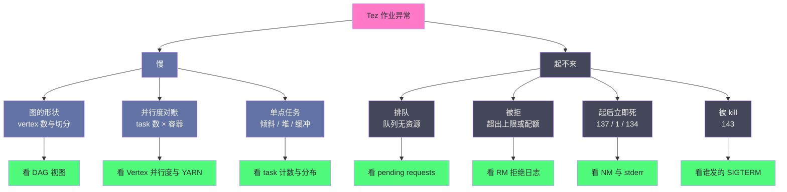
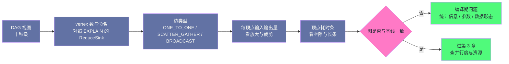
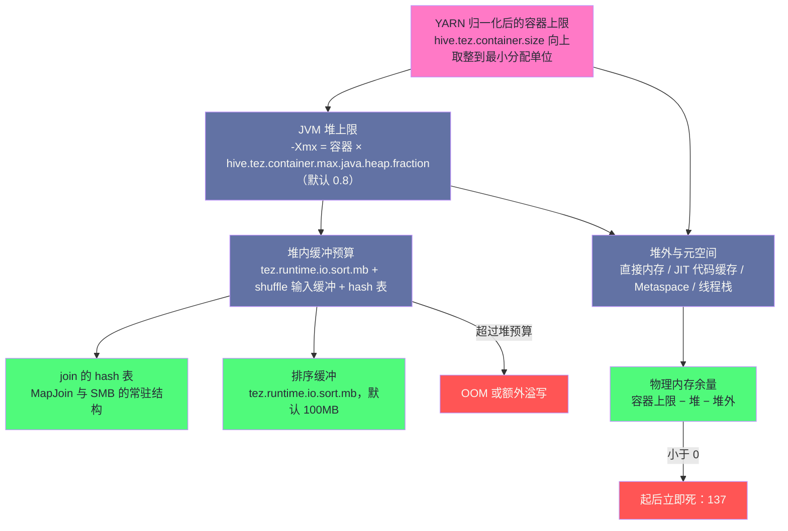
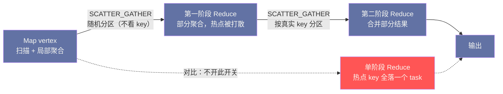
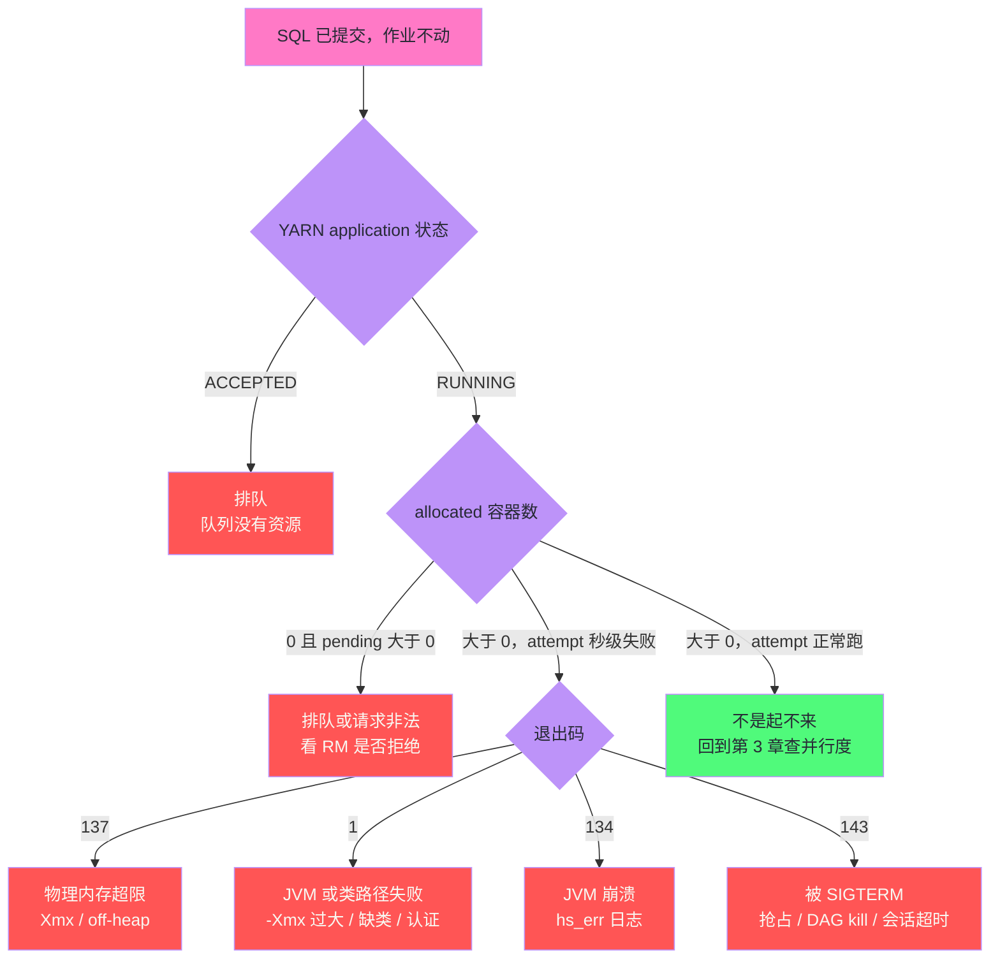

# 10 Tez 调优实战：DAG 诊断、内存配置与数据倾斜治理

**摘要：**

一条 Hive SQL 在 Tez 上跑得慢，"慢"这个判断本身几乎不成立，慢的总是这张图的某个具体部位。本篇把 Tez 上的慢拆成三个可以分别证伪的问题：图的形状对不对（vertex 数与切分位置）、图的并行度与集群资源对不对账（task 数 × 容器大小能否被队列装下）、单个 task 是不是被数据分布或内存压住（倾斜、堆不足、缓冲溢出）。诊断顺序按证据成本从低到高排——先看 vertex 数，再看并行度，最后才下钻到单 vertex 与单 task。内存配置是这一路里最容易配错的一段，因为它不是一个开关而是三层包含关系：`hive.tez.container.size` 决定容器物理上限，`hive.tez.java.opts` 的 `-Xmx` 必须留在上限之内并为 off-heap 与元空间留出余量，`tez.runtime.io.sort.mb` 又必须落在堆预算里且与堆内其他缓冲分食同一块空间。本篇给出这三层的配比、算例与三条典型反例。倾斜治理一章区分 GroupBy 两阶段聚合、Skew Join 与 `tez.grouping.*` 三件不同的事，并说明它们各自的失效条件。容器的失败被单独拎成一条正交轴：排队、被拒、起后立即死、被 kill 退出 143，四种形态各有各的证据位置与判据。文中参数默认值取自 Hive 4.0 与 Tez 0.10.2 的源码，凡涉推算的数字都标明了假设前提，不作基准结论使用。

---

## 第 1 章 三种慢，一条失败轴

### 1.1 先把"慢"拆成三个可以分别证伪的问题

作业慢是一个结论，不是一个证据。要把它变成可操作的问题，得先问清楚慢在哪个层次上：是这张图本身切得不对，是这张图该有的并发没有拿到，还是某一个 task 单独被数据与内存压住了。

这三个层次对应三种完全不同的处置：图切得碎，改的是编译期与统计信息，靠调内存没用；并发拿不到，改的是队列容量与容器粒度，靠加内存只会更糟，因为容器越大、能同时起的越少；单点被压住，才轮到倾斜治理与内存参数。三者混在一起判断，就会出现那种熟悉的场景——把容器从 8GB 调到 16GB，重启 HiveServer2，作业还是慢，于是归因于"集群忙"。集群可能确实忙，但那只是三个问题之外的另一条轴。

这条正交的轴是**容器起不来**。起不来和作业慢不是同一件事：慢是算完了但花得久，起不来是根本没开始算。把两者混在同一个判断里，最常见的错误是把一个排队中的作业当成数据倾斜去治理——Tez UI 上那个 vertex 的 task 数确实很少，进度确实不动，但它不是被数据压住，而是压根没有容器可分。

先给一张全景图，把四个问题域摆在一起。



### 1.2 为什么顺序必须是"vertex 数 → 并行度 → 单 vertex"

诊断顺序不该按知识的熟悉程度排，而该按取证的代价排。

看 vertex 数只要打开 Tez UI 的 DAG 页面，一眼扫过拓扑，几秒钟，不需要登录任何节点。看并行度要对照 YARN 队列的实际分配，多开一个页面，还要理解"申请数"与"分配数"的差别，一两分钟。下钻到单个 vertex 的 task 分布，要排序、要算分位数，五分钟。再往下到单个 task 的堆栈与 NodeManager 日志，要拿 container id 去 `yarn logs` 捞，十分钟起。把顺序倒过来，最常见的代价是花半小时分析一个 task 的 GC 日志，最后发现整个 vertex 只有三个 task，问题是并行度算错了。

这套顺序还有一层结构上的理由：三个层次是包含关系，外层不对，内层的指标就没有解释力。一个 vertex 只有 3 个 task 时，讨论这 3 个 task 的 inputRecords 分布毫无意义，样本量不够，倾斜判据全部失效；一个 reduce vertex 的并行度配成 40，而实际 shuffle 量是估算的十倍时，每个 task 都会显得"数据多、GC 高"，扩堆只是把溢写推迟，真正的修法是提高并行度或修统计信息。

### 1.3 一个贯穿全篇的例子

沿用订单宽表这条链路：`dwd_order_wide` 按天分区，`dim_customer` 是几十万行的维表，每天凌晨生成地区日报。

```sql
INSERT OVERWRITE TABLE dws_region_daily PARTITION (dt = '${bizdate}')
SELECT c.region,
       count(1)      AS order_cnt,
       sum(o.amount) AS gmv
FROM dwd_order_wide o
JOIN dim_customer c ON o.cust_id = c.cust_id
WHERE o.dt = '${bizdate}'
  AND c.status = 'active'
GROUP BY c.region;
```

这条 SQL 在 Tez 上会编成一张四五个 vertex 的图：扫订单表、广播维表、join 加局部聚合、最终聚合写出。设想某一天它从二十分钟变成两个小时，运维面对的是同一张 SQL、同一个集群、同一套参数，变化只发生在数据与资源上。三种可能的剧本，恰好对应三种判据。

第一种剧本是图的形状变了。前一天有人对 `dwd_order_wide` 做了全量重写，统计信息没有跟上，CBO 拿到的是过期行数，join 从广播回退成 shuffle join，图上多出一个 reduce vertex 和一次洗牌。判据在 DAG 视图：**vertex 数比平时多**，且新增的 vertex 是 `Reducer` 而不是 `Map`。第二种剧本是资源被别的作业占走。判据在 YARN：队列的 pending requests 长期大于零，Tez 侧 task 总数没变，但同时在跑的容器数只有往常的四分之一。第三种剧本是数据里出了一个超级大客户，`cust_id` 的某几个值占了当天三成订单。判据在 vertex 的 task 分布：绝大多数 task 在几分钟内完成，两三个 task 跑了一小时。

三个剧本的修法互不通用，而它们在"作业慢"这个描述下长得一模一样。这就是为什么本篇坚持先分类再下钻。

### 1.4 三句流行判断的边界

第一句是"Tez 慢就是内存不够"。内存不足有它固定的证据形态，不是所有慢都长这样：堆不足表现为 GC 时间占比高、`ADDITIONAL_SPILL_COUNT`（因内存不足产生的额外溢写）非零；容器不足表现为 task 大量 pending；而计划形态问题在内存指标上完全干净——一个只有三个 task 的 vertex，GC 占比可以是零，照样慢。把内存当万能解释，代价是每次调参都在赌。

第二句是"容器起不来就是内存给小了"。起不来至少四种形态，只有"起后立即死"里的内存超限一类与"给小了"直接相关，而且更常见的原因是给小了上限（`yarn.scheduler.maximum-allocation-mb`）而不是给容器本身。排队与配额拒绝跟容器大小无关，反而是容器配得越大越容易排队。

第三句是"加并行度就能快"。并行度受队列资源约束，也受 task 粒度约束：把 split 从 256MB 切到 16MB，task 数涨十六倍，固定开销与 shuffle 扇出一起涨，作业可能更慢。并行度解决的是"总吞吐装不下"，不是"单个 task 太慢"。

> [!info] 本篇的边界
> Tez 与 MR 在模型上的差异、以及为什么 Tez 省下的是作业启动与 HDFS 往返，见 [[大数据/Hive/04 执行引擎对比：MapReduce vs Tez 的本质差异|MR 与 Tez 的本质差异]]；本篇只处理"Hive 在 Tez 上怎么把它跑好"。Join 策略与倾斜的两阶段机制见 [[大数据/Hive/06 Join 深度解析：五种 Join 策略的实现机制|Join 深度解析]]。HS2 无响应、HMS 慢、作业失败的完整排查流程见 [[大数据/Hive/12 故障排查手册：从 HS2 无响应到 Tez 作业失败的系统诊断|故障排查手册]]。文中出现的失败案例，真实复盘在 SRE 那一列，例如 [[SRE/故障排查与复盘/Hive-Tez作业失败：自定义UDF与Hive版本不兼容导致AbstractMethodError|Tez 作业 AbstractMethodError 复盘]]。

---

## 第 2 章 先看图：vertex 的数量与形状

### 2.1 入口在哪，以及看不到时该怀疑什么

Tez 的 DAG 视图不在 HiveServer2 上，而在 Tez UI 里。路径是 YARN ResourceManager 的 Application 列表找到对应 application，从 Tracking URL 跳过去，或者直接打开 Tez UI 按 application id 查。YARN 页面本身只提供一个跳转链接，真正的图、vertex、task 数据都是 Tez UI 从 YARN 的 Timeline Service（ATS，或 Hadoop 3 上的 ATSv2）读出来的。

这条数据链路决定了"看不到图"该怎么判断。Tez UI 空白、或者有 application 没有 DAG，原因通常在历史数据侧而不在作业侧：ATS 没开、`tez.tez-ui.history-url.base` 没配对、历史日志服务写不进去。这时不要怀疑作业，去查 Tez 与 YARN 的历史服务配置。兜底办法是打开 `hive.tez.exec.print.summary`（默认关闭），HS2 日志会打印 DAG 摘要，含 vertex 列表与耗时，足以判断图的形状；`hive.tez.exec.inplace.progress`（默认开启）则决定日志进度是原地刷新还是逐行追加。

### 2.2 DAG 视图上真正值得读的四样东西

第一样是 vertex 的数量与命名。Tez 的 vertex 名沿用 MR 的语感，`Map 1`、`Reducer 2`，编号是编译器分配的顺序，不代表依赖深度。数量本身不说明好坏，要和 `EXPLAIN` 对起来看：`EXPLAIN` 里的每个 `ReduceSinkOperator` 都意味着一次洗牌，也意味着图的切分点；一个 `MapJoinOperator` 的广播边则不产生切分。

第二样是边的类型。Tez 的边分三类：`ONE_TO_ONE`（上游第 i 个 task 对应下游第 i 个 task，不重分布）、`SCATTER_GATHER`（按分区函数重分布，即 shuffle）、`BROADCAST`（上游只有一份输出，被下游所有 task 读取，即广播）。判断"是不是发生了不该有的洗牌"，看的就是哪条边是 `SCATTER_GATHER`；判断"广播有没有生效"，看对应的边是不是 `BROADCAST`，以及上游那个 vertex 是不是只有一个 task。

第三样是每个 vertex 的输入输出字节。DAG 视图上每个 vertex 都有累计的输入/输出量，两个相邻 vertex 的输出与输入应当大致相等（差一个压缩比），如果下游输入显著大于上游输出，说明有多个上游汇入或者有放大；如果上游输出很大而下游输入很小，可能是动态分区裁剪在起作用，也可能是分区裁剪让它只读了一部分。

第四样是顶点耗时条。Tez UI 的 DAG 视图用横向条表示各 vertex 的起止时间，这个条比任何单点数字都直观：如果所有顶点都是短的、中间有大段空隙，问题在资源等待；如果某个顶点特别长，问题在那个 vertex 内部。

把这四样的读法整理成一张表，比逐条记参数更实用。

| DAG 视图上的信号 | 说明什么 | 下一步看哪里 |
|---|---|---|
| vertex 数明显多于 `EXPLAIN` 里的 `ReduceSink` 数 | 多路输出、union 分支或子查询各自成图，属正常但代价高 | 看是否存在可合并的分支 |
| 出现意料之外的 `SCATTER_GATHER` 边 | join 从广播回退成洗牌，常见于统计信息过期 | `EXPLAIN` 里的 `Map Join Operator` 与 `Local Work` 段 |
| 广播 vertex 的 task 数大于 1 | 广播源不是单 task，或边不是 `BROADCAST` | 该 vertex 的并行度与边类型 |
| 顶点条之间有大段空白 | 等容器，不是算得慢 | YARN 的 pending requests |
| 某个顶点条远长于其他 | 该 vertex 内部的 task 分布或内存有问题 | 该 vertex 的 task 直方图与计数 |
| 下游输入量远小于上游输出量 | 动态分区裁剪或分区裁剪生效，通常是好事 | 若与预期不符，查裁剪条件 |
| 每个 vertex 只有一两个 task | 图切得太碎，调度开销占主导 | 并行度与 split 规划 |

### 2.3 vertex 数由什么决定

一个 vertex 的边界在 Hive 编译期就定下来了，不是运行时决定的。`TezCompiler` 从 Operator 树生成 DAG，**切分点是洗牌**：遇到 `ReduceSinkOperator` 就划一条边，边两侧各成一个 vertex；map 侧的算子链能合并进同一个 vertex 的都会被合并，所以一个 vertex 里可能同时有过滤、投影、部分聚合三件事。

由此可以推出几条稳定的判据。vertex 数大致等于"洗牌次数 + 分支数"再加一，同一条 SQL 两次运行的 vertex 数应当一致，除非统计信息、参数或者数据形态变了——这条判据在排障时非常有用：图变了，说明问题在编译期；图没变，问题在运行期。多路输出（一条 SQL 里多个 `INSERT`、或者 `UNION ALL` 的各个分支）会各自成图，顶点数按分支数翻倍；`LateralView`、窗口函数会额外引入洗牌，也就额外引入顶点。

顶点切得碎不碎，本质上是"把工序分到几个工位"的问题。工位分得细，每个工位只做一件事，上下料（容器启动、task 调度、边界数据落盘）的次数就多；工位分得粗，上下料少了，但一个工位要同时摊开多种工具（hash 表、排序缓冲、聚合状态），内存压力全压在同一个 task 上。Tez 的编译器默认偏"粗"，把能合并的都合并，因为省下的上下料是实打实的；代价是单 vertex 的资源需求变高，一旦内存配得不够，就是整条链一起慢。

### 2.4 两种异常的图形状

一种是太碎。典型场景是嵌套子查询多、`UNION ALL` 分支多、或者有人为了"并行"把一个聚合拆成好几步落中间表。碎图的特征很好认：vertex 数在十个以上，每个 vertex 的 task 数只有个位数到几十，顶点条之间频繁出现等待。它的代价不在计算，而在固定开销的累加：每个 vertex 都要等上游完成、重新申请容器、重新初始化 task 运行时。容器复用能缓解一部分，缓解不了"必须等"。

另一种是太粗。一个 vertex 同时承担 join 与聚合，意味着这个 task 的堆上要同时放 join 的 hash 表/排序缓冲和聚合的 hash 表，两个结构互相挤占。此时单看 GC 看不出问题——堆够大时 GC 很干净，但 `ADDITIONAL_SPILL_COUNT` 会上升，因为排序缓冲被挤小了。粗图的内存需求是两个结构的和，配容器要按和来配，不能按其中较大的那个。



---

## 第 3 章 再看并行度：图与资源的对账

### 3.1 并行度的三个来源

一个 vertex 的 task 数不是单一参数决定的，它有三个来源，互相覆盖。

map 侧来自输入分片数。分片数由输入格式与分片策略决定，在 Tez 上又叠加了一层 Tez 自己的 grouping：分片可以被合并成更大的 `TezGroupedSplit`，目标大小由 `tez.grouping.max-size`（默认 1GB）与 `tez.grouping.min-size`（默认 16MB）约束。这一层是否生效，取决于 `hive.tez.input.format` 用的是哪个输入格式，第 6 章会展开。

reduce 侧来自估算，**估算是会错的**。Hive 按 `hive.exec.reducers.bytes.per.reducer`（默认 256,000,000 字节，注意是十进制 256MB 而不是 256MiB）除上游数据量算出一个初始并行度，上限受 `hive.exec.reducers.max`（默认 1009）约束。这个估算的输入是编译期的统计信息，统计过期就直接算错。

运行时还有一次调整机会。`hive.tez.auto.reducer.parallelism` 默认关闭，打开后由 Tez 的 `ShuffleVertexManager` 根据上游实际输出的统计在运行时增减 reduce task 数，调整幅度被 `hive.tez.min.partition.factor`（默认 0.25）与 `hive.tez.max.partition.factor`（默认 2.0）框住，也就是说最多缩到估算值的四分之一、最多涨到两倍。它解决的是"估算偏了"，解决不了"估算偏了十倍"，也解决不了单 key 热点。

### 3.2 资源对账：并行度乘容器，能不能装进队列

并行度本身不是指标，**并行度 × 容器大小**与队列可用资源的关系才是。一次对账要算四个上限，取最小值：队列可用内存除以容器大小、队列可用 vcore 除以每容器 vcore、队列允许的 AM 资源比例之外剩下给 task 的部分、以及单用户的资源上限（Capacity Scheduler 的 `user-limit-factor`）。Tez 还有一层隐性约束：同一个 session 池里的多个 AM 本身也占容器，AM 越多，留给 task 的越少，这也是 `yarn.scheduler.capacity.maximum-am-resource-percent`（默认 0.1，即队列资源的十分之一）存在的意义。

举一个算例，全部数字为示例推算。设某队列给 Hive 的保障资源是 3,276,800MB（3.2TB）与 800 vcore，单个 task 容器 8192MB、1 vcore，那么内存侧最多 400 个并发容器，vcore 侧 800 个，取小值 400。若某条 SQL 的 reduce 并行度按估算配到 1000，则同时只能跑 400 个，其余 600 个排队，作业总时长由梯次推进决定，额外耗时量级约为（task 数 / 并发数 − 1）乘单 task 时长——这是一条量级判断，实际受 task 完成顺序影响，不是精确公式。反过来，如果把容器从 8192 提到 16384 以求"每个 task 更宽裕"，并发上限掉到 200，同样的 1000 个 task 要排五轮，单 task 变快的那一点远补不回来。

### 3.3 并行度高不等于快

并行度有两个反向代价，容易被忽略。

其一是固定开销被放大。每个 task 都有初始化、类加载、计数器上报、输出提交的成本，在 Tez 上单 task 的固定开销比 MR 小（容器可复用、免 AM 重启），但不是零。task 数从 200 涨到 2000，固定开销的总量涨十倍，若单 task 处理的数据只有几十 MB，固定开销可能占到 task 时长的一半。

其二是 shuffle 扇出变大。reduce 侧并行度越高，每个 map task 要产出的分区数越多，map 端的排序缓冲要同时维护更多分区，溢写次数上升；reduce 侧则要向上千个 map 输出发起 fetch，连接数、超时、失败重试的概率都跟着上升。`tez.runtime.shuffle.parallel.copies`（默认 20）与 fetch 失败上限（`tez.runtime.shuffle.fetch.failures.limit`，默认 5）就是为这个场景准备的旋钮，但调它们只是让高扇出跑得不那么难看。

| 并行度异常的表现 | 证据位置 | 常见根因 | 处置方向 |
|---|---|---|---|
| map vertex 的 task 数接近小文件数 | Tez UI 的 vertex 详情 | 未启用分片合并，小文件各自成片 | 换 `CombineHiveInputFormat` 并调 grouping |
| map vertex 的 task 数远大于小文件数 | 同上 | 分片大小配得过小，或 grouping 上下限被压得太低 | 抬 `tez.grouping.max-size` |
| reduce vertex 的 task 数远小于估算 | Tez UI 与 `EXPLAIN` 对比 | 统计信息过期，上游数据量被低估 | `ANALYZE` 补统计，或开自动并行度 |
| reduce vertex 的 task 数被打到上限 | 同上 | 上游数据量被高估，撞到 `hive.exec.reducers.max` | 补统计；必要时抬上限并评估 shuffle 成本 |
| 并行度够但同时在跑的容器少 | YARN 的 pending requests | 队列容量、AM 占比、单用户上限 | 降并发或扩队列，不要加大容器 |
| 并行度与容器都对，仍慢 | 进入下一章 | 单 task 内部的数据与内存问题 | 查 task 分布与计数 |

### 3.4 并行度与容器的耦合

并行度和容器大小是一对**反向的旋钮**，必须一起调。容器大，单 task 更宽裕但并发变低；容器小，并发高但单 task 频繁 GC 与溢写。判断该往哪边调，看两个指标就够了：如果 task 的 GC 占比高且 `ADDITIONAL_SPILL_COUNT` 非零，说明单 task 吃得不够，应加大容器；如果 task 的 GC 干净但队列长期 pending，说明容器粒度太粗，应在保证不 GC 的前提下压小容器、提高并发。

这里有一处容易被忽略的算术：容器大小会被 YARN 按 `yarn.scheduler.minimum-allocation-mb`（常见 1024MB）向上归一化。设 `hive.tez.container.size` 为 6000，YARN 实际分配 6144，而 Hive 推导的 `-Xmx` 按 6000 算，看似浪费了 144MB，实际是安全的——余量比预期更大。反过来，8192 恰好是 1024 的整数倍，没有余量白送，此时若 `-Xmx` 也写成 8g，容器一起就会被判物理内存超限，即第 8 章的"起后立即死"。

---

## 第 4 章 最后看单点：records、CPU 与堆

### 4.1 vertex 页面上的三列

进到某个 vertex，页面上最该看的是三列：每个 task 的输入记录数、输出记录数、以及耗时。Tez UI 会把这些按 task 排列，排序之后分布就出来了。分布比均值有信息量得多，因为**倾斜的定义是长尾**，不是平均值高。

三列之外，task 维度的计数器才是真正的证据。Tez 的 `TaskCounter` 里有一组为诊断而生的项，读法如下。

`INPUT_RECORDS_PROCESSED` 与 `OUTPUT_RECORDS` 给出量。前者是 Mapper 输入或无序输入实际处理的记录数，后者是输出记录数。两者之比异常放大（UDTF 除外）意味着中间结果爆炸，通常来自笛卡尔式的 join 条件写错或者 `LATERAL VIEW` 展开倍数过大；比值异常缩小则可能是过滤条件比预期更狠，或者读取的分区少了。

`WALL_CLOCK_MILLISECONDS` 与 `CPU_MILLISECONDS` 给出时间构成。前者是 task 从初始化到结束的墙钟时间，后者是实际占用 CPU 的时间。两者差距大，说明 task 大部分时间在等 I/O 或等上游，扩容堆没有意义；两者接近且都很大，说明是 CPU 密集，往算法与表达式上找。

`PHYSICAL_MEMORY_BYTES` 与 `COMMITTED_HEAP_BYTES` 给出内存构成。前者是进程实际占用的物理内存（含堆外），后者是 JVM 已提交的堆。两者的差就是堆外开销：直接内存、JIT 代码缓存、元空间、线程栈。这个差接近容器上限减去堆的那部分余量时，说明 off-heap 正在吃掉预留空间，容器很快就会因为"物理内存超限"被杀——而 JVM 自己的 GC 日志会显示堆还很空，这是个非常有欺骗性的状态。

`GC_TIME_MILLIS` 给出 GC 成本。它的绝对值要除以墙钟时间才有意义，占比超过一成就要注意，超过两成基本可以确认堆不足或对象分配速率过高。

`ADDITIONAL_SPILL_COUNT` 与 `ADDITIONAL_SPILLS_BYTES_WRITTEN` 给出"因内存不足多写的溢写"，这是比 GC 占比更直接的判据。GC 占比受堆大小、GC 算法、对象存活率三重影响：堆大而对象短命时 GC 可以很低，但排序缓冲是独立配置的、不随堆自动变大；堆小也可能因为数据量小而不产生一次溢写。只有**额外溢写**才说明缓冲确实不够用。排序缓冲被挤小、join 的 hash 表挤占内存、多个输出同时开工，都会让这两个值上升。

`SHUFFLE_BYTES_TO_MEM` 与 `SHUFFLE_BYTES_TO_DISK` 给出 fetch 的落点。前者是直接进内存的洗牌数据，后者是落盘的。落盘比例高说明 fetch 缓冲不够，而 Tez 的 fetch 缓冲上限由 `tez.runtime.shuffle.memory.limit.percent`（默认 0.25，即堆的四分之一）控制，它与排序缓冲同处一个堆。

`NUM_FAILED_SHUFFLE_INPUTS` 与 `NUM_SHUFFLED_INPUTS` 给出取数健康度。前者非零意味着有 fetch 失败重试，少量是网络抖动，持续增长则要怀疑某个上游节点的本地盘或 shuffle 服务有问题。

### 4.2 三个分布判据

判据一是**最大值与中位数的比值**。把一个 vertex 的所有 task 按 `INPUT_RECORDS_PROCESSED` 排序，取最大值除以中位数，超过十可以认定存在长尾。用中位数而不是平均值，是因为倾斜本身会把平均值拉高，用平均值做分母会把倾斜"平均掉"。

判据二是头部占比。取前 1% 的 task 的输入量之和除以全 vertex 输入量，超过三成说明少数 task 承担了大部分工作。这条判据对"多个热点 key"比第一条更敏感：十个 task 各占 3%，最大值与中位数之比可能只有五，但头部占比已经到了三成。

判据三是输出与输入的比值分布。如果某些 task 的输出量远超其输入量，而另一些正常，那不是倾斜，是数据放大——通常来自 join 条件的扇出，或者聚合键的基数在局部异常。这两种问题的处置完全不同：倾斜要打散，放大要修逻辑。

以上阈值均为示例推算，来自经验口径而非基准测试：十倍的比值与三成的头部占比是"值得下钻"的门槛，不是"必须治理"的门槛。真正的门槛还要看绝对量——一个只有 20 个 task 的 vertex，长尾再严重也只影响几分钟。

### 4.3 CPU 时间的另一半：执行模式的退化

有一种慢既不在数据分布上，也不在内存上，而在执行模式。向量化执行把算子从"一次一行"改成"一次一批"，收益来自减少虚函数调用与利用 SIMD；当某些条件不满足时，Hive 会把算子回退成行式执行（Row 模式），而且这个回退是静默的，日志里没有告警。

在 Tez 上判断这件事，靠 `EXPLAIN VECTORIZATION`：输出里每个算子会标 `EXEC_MODE`，`VECTORIZED` 是向量化，`ROW` 是回退，并且会附上回退原因。常见的回退源有三类：自定义 UDF（尤其继承旧接口 `org.apache.hadoop.hive.ql.exec.UDF` 的实现）、复杂类型（ARRAY/MAP/STRUCT 上的操作）、以及部分不支持的表达式。前两类在生产里最常见，因为业务逻辑天然长在 UDF 里。

这条线索与 Tez 的容器问题会互相伪装。UDF 触发回退时，task 的 CPU 时间上升、GC 正常、溢写正常，看起来"什么都不缺就是慢"；真正的原因是每一行都在走行式路径。反过来，UDF 的类加载问题会让 task 直接失败——[[SRE/故障排查与复盘/Hive-Tez作业失败：自定义UDF与Hive版本不兼容导致AbstractMethodError|一次真实的 Map 4 失败复盘]]记录的正是这类失败：自定义 UDF 用了旧接口，在 task 里抛 `AbstractMethodError`，整个 DAG 级联失败。失败与变慢同源不同果：失败看 stderr 的异常类名，变慢看 `EXPLAIN VECTORIZATION` 的 `EXEC_MODE`。

需要说清的是，向量化是执行层的开关，与引擎无关：MR 上同样有向量化，Tez 上也不因为引擎换了就自动生效。所以它不是 Tez 特有的问题，而是"Hive 在 Tez 上慢"这个题目里必须排除的一个变量——把它排除掉，剩下的才归因到图、资源与数据。

---

## 第 5 章 三层内存与它们的算术

### 5.1 三层是包含关系，不是三个开关

Tez 的内存配置之所以容易配错，是因为它看起来像三个并列的参数，实际是**一条推导链**：



链条的方向是**单向**的：容器上限决定堆上限，堆上限决定堆内缓冲的总预算，堆外的余量由容器上限减堆得到。任何一层配错，都会在下一层以另一种症状出现。把这三层当成三个独立开关去调，最常见的后果是"调了缓冲，容器起不来"，或者"加了容器，性能没变"。

用房子的比喻最贴切：容器面积是建筑面积，`-Xmx` 是套内面积，排序缓冲与 hash 表是家具，堆外与元空间是承重墙和管道井。建筑面积给得再大，套内面积的比例定死了，家具塞不下还是塞不下；反过来，把套内面积顶到建筑面积的百分之百，管道井没地方走，房子直接验收不合格——这就是容器起不来的几何解释。

### 5.2 第一层：`hive.tez.container.size`

这个参数的语义是"单个 task 容器的物理内存上限"，默认值 `-1`，表示不指定，由 Hive 取 YARN 的最小分配单位（`yarn.scheduler.minimum-allocation-mb`，常见 1024MB）作为容器大小。它的作用范围是**一次查询里的所有 vertex**，这是它最重要的性质，也是它最大的局限。

一刀切带来两个方向的浪费：按最重的 vertex 配（广播维表 join 的那个），其他 vertex 全部超配，并发被容器大小压下去；按平均配，最重的 vertex 频繁 GC 与溢写，长尾拖住整张图。Hive 在 Tez 上没有按 vertex 单独配容器内存的正式参数，所以现实中只有两条路：要么承认一刀切、按最重 vertex 配并接受并发下降，要么把重活从这条查询里拆出去（落中间表、换 join 策略）。

还有一处语义需要澄清：Tez 自己也有 `tez.task.resource.memory.mb`（默认 1024），语义同样是 task 容器内存。在 Hive 的提交路径上，`hive.tez.container.size` 为正数时会写进 Tez 的 task 资源请求，两个键同时出现且取值不同时，以哪边为准取决于版本与提交路径，排障时不要靠猜——去 Tez UI 看 task 实际拿到的容器大小，那才是最终事实。

### 5.3 第二层：`hive.tez.java.opts`

这个参数默认是空的。为空时，Hive/Tez 会按容器大小乘堆比例自动补一个 `-Xmx`；比例由 `hive.tez.container.max.java.heap.fraction` 控制，默认 0.8。一旦手工写了 `-Xmx`，这套自动推导就被架空，容器大小与堆大小从此由人自己保证匹配——这正是大量"容器起不来"事故的来源。

Tez 侧的源码注释写得很直白：建议不要在启动参数里写 `-Xmx` 或 `-Xms`，让 Tez 自己算，因为它知道实际分配到的容器大小。这句话背后有一个容易忽略的细节：自动推导的堆比例不是恒定的 0.8。Tez 的 `tez.container.max.java.heap.fraction` 默认 0.8，但把它设为 `-1` 时，Tez 会对小于 4GB 的容器用 0.7、更大的容器用 0.8。也就是说小容器天生留了更多余量，因为小容器里固定开销（元空间、代码缓存、线程栈）占比更高。

手工写 `-Xmx` 也不是没有道理，它有三个正当用途：追加 GC 参数、加 OOM 时的堆转储、限制元空间。这三件事不需要写 `-Xmx` 也能做。合理的写法是只加后缀参数，把 `-Xmx` 留给自动推导：

```xml
<!-- 只追加诊断与 GC 参数，不写 -Xmx，让 Hive 按容器大小推导 -->
<property>
  <name>hive.tez.java.opts</name>
  <value>-XX:+HeapDumpOnOutOfMemoryError -XX:HeapDumpPath=/tmp/tez-hd -XX:MaxMetaspaceSize=512m</value>
</property>
```

这里还要纠正一个流传很广的说法：Tez 上"必须用 G1"。Tez 0.10.2 的默认启动参数是 `-XX:+UseParallelGC` 加一组 GC 日志开关（JDK 8 与 JDK 9 各一套），并不是 G1。G1 在大堆、低延迟场景有优势，但它的收益依赖堆大小与对象分配模式，在没有实测的情况下换 GC 只是换了一个未知数。

### 5.4 第三层：`tez.runtime.io.sort.mb`

这个参数是 Tez 运行时的排序缓冲大小，单位 MB，默认 100。它不叫 `hive.tez.*`，因为它是 Tez runtime 的键，作用于 shuffle 写出的排序环节：map 端把记录按分区排序再写出去，排序缓冲就是这块内存。`tez.runtime.sort.spill.percent`（默认 0.8）决定缓冲用到八成时开始溢写。

它的上限受三重约束。

第一重是堆预算。缓冲要从 `-Xmx` 里分，而堆里同时住着 shuffle 输入缓冲（上限为堆的 `tez.runtime.shuffle.memory.limit.percent`，默认 0.25）、join 的 hash 表、聚合的 hash 表、以及算子对象本身。缓冲设成堆的一半，等于把所有其他结构挤到另一半里，溢写与 OOM 会轮流出现。

第二重是单条 Java 数组的长度上限。排序缓冲在实现上是按块分配的字节数组，单块接近 2GB 时就会触到数组长度上限，表现为 task 初始化阶段直接失败。所以即便堆有 30GB，把 `io.sort.mb` 设成 4096 也不是一个好主意——它既没必要（排序缓冲的收益在几百 MB 之后就趋于平缓），又踩在实现边界上。

第三重是分配时机。Tez 的排序器有一个参数 `tez.runtime.pipelined.sorter.lazy-allocate.memory`，默认 `false`，含义是**不懒分配**——task 一启动就把 `io.sort.mb` 声明的内存整块占掉，而不是用到才申请。这个默认值解释了为什么把 `io.sort.mb` 调大之后，作业会从"能跑但慢"变成"起不来"：它不是慢慢吃内存，而是一进门就把行李全铺开。多个输出并存时更明显，一个 task 有两个 `ReduceSink` 输出，就有两份排序缓冲同时存在。

### 5.5 三层的算术与算例

把上面三层串起来，一组可用的配比是：容器 8192MB、堆 0.8 倍即 6553MB（手写 `-Xmx6g` 是 6144MB，相当于 0.75 倍，也在合理区间）、排序缓冲 1024MB、shuffle 输入上限 0.25×6553≈1638MB、hash 表按 join 侧小表的实际内存估算。堆内预算的占用上限建议控制在堆的七成左右，剩下的三成留给对象分配、临时结构与 GC 的浮动空间。

以 8192 容器、6553 堆为例做一次完整的示例推算：排序缓冲 1024MB，两个输出并存时 2048MB；shuffle 输入上限 1638MB；两者相加 3686MB，占堆的 56%，剩下的 43%（约 2860MB）要容纳 hash 表、算子对象与临时数据。如果这条查询里有 MapJoin，小表的 hash 表很容易占掉 2GB 以上，预算立刻见底——这时候正确的动作不是加 `io.sort.mb`，而是要么加大容器，要么换掉 MapJoin。

反过来算一次错误配置：8192 容器、手写 `-Xmx8192m`、`io.sort.mb` 设 2048。堆已经等于容器上限，off-heap 与元空间只能去挤"不存在的余量"；task 启动时排序器整块占掉 2GB，加上 shuffle 输入与算子对象，JVM 很快被 YARN 的物理内存监控判定超限，退出码 137。这个案例的每一层都"看起来合理"——容器 8GB、堆 8GB、缓冲 2GB 都不是离谱的数字，错在层与层之间没有留缝。

| 参数 | Hive 4.0 / Tez 0.10.2 默认值 | 作用域 | 调大的代价 | 调小的代价 |
|---|---|---|---|---|
| `hive.tez.container.size` | `-1`（取 YARN 最小分配单位） | 一次查询的所有 vertex | 并发容器数下降，排队加剧，碎片化申请更容易失败 | 单 task 频繁 GC 与溢写，长尾变长 |
| `hive.tez.java.opts` | 空（自动推导 `-Xmx`） | 所有 task 的 JVM | 手写 `-Xmx` 会架空自动推导，易与容器上限失配 | 过小则频繁 GC，元空间不足则类加载失败 |
| `hive.tez.container.max.java.heap.fraction` | `0.8` | 堆占容器的比例 | off-heap 余量被压缩，容易物理内存超限 | 堆变小，缓冲与 hash 表空间紧张 |
| `tez.runtime.io.sort.mb` | `100` | 每个排序输出的缓冲 | 挤占 hash 表与 shuffle 输入；过大触数组上限或 OOM | 溢写次数上升，磁盘写放大，task 变慢 |
| `tez.runtime.sort.spill.percent` | `0.8` | 排序缓冲的溢写水位 | 写入前占用更多内存，峰值更高 | 溢写更频繁，磁盘压力更大 |
| `tez.runtime.shuffle.memory.limit.percent` | `0.25` | 洗牌输入可用的堆比例 | 挤占排序缓冲与算子内存 | fetch 数据更多落盘，`SHUFFLE_BYTES_TO_DISK` 上升 |

---

## 第 6 章 倾斜：四个开关各自的边界

### 6.1 倾斜的三种形态在 Tez 上长什么样

倾斜在 Hive 里不是一个现象，是三个。键倾斜是某个 join key 或 group by key 的行数远超其他键；文件倾斜是同一分区内文件大小差异过大；分区倾斜是某个分区的数据量远大于其他分区。三者都表现为长尾，但发生在不同的 vertex 上。

键倾斜发生在 reduce 类 vertex：上游 map 全部完成，reduce 的 task 完成比例卡在 95% 以上，剩下几个 task 的 `INPUT_RECORDS_PROCESSED` 是中位数的几十倍。文件倾斜发生在 map 类 vertex：少数 task 的 `INPUT_RECORDS_PROCESSED` 很大而其余很小，且 task 数与文件数相当接近。分区倾斜则表现为某些天的 DAG 整体变慢，慢在扫描，不在聚合。判据不同，处置也就不同——把文件倾斜当键倾斜去开 Skew Join，是白开。

### 6.2 GroupBy 倾斜：`hive.groupby.skewindata`

这个开关默认关闭。打开后，`GROUP BY` 会被拆成两阶段聚合：第一阶段按随机分区把数据打散到下游，每个下游 task 做**部分聚合**，输出的是"键 + 部分结果"；第二阶段再按真实键重分布，对部分结果做最终合并。热点键在第一阶段被拆到多个 task 上，第二阶段每个 task 拿到的是已经缩小过的部分结果，长尾因此被摊平。



它的边界有三条，都需要事先想清楚。

第一，它**不判断是否倾斜**，只要打开就一律两阶段。这意味着一条完全不倾斜的聚合查询，也要多付一次洗牌与一个 vertex 的代价。在 Tez 上这个代价比 MR 小（不新增作业、中间数据不落 HDFS），但仍是一次真实的 Shuffle 放大。

第二，它要求聚合函数可分解。`sum`、`count`、`min`、`max` 这类天然可合并；`avg` 需要拆成 sum 与 count；而 `collect_list`、`collect_set`、以及顺序敏感的自定义 UDAF，两阶段合并会改变语义或直接不生效。用 `count(distinct)` 时还要注意，Hive 对去重聚合走的是另一条路径，两阶段聚合并不等于把 distinct 变成可合并。

第三，它治的是"键分布不均"，治不了"单键绝对量大到无法拆分"。如果一个键占了三成数据，第一阶段把它打散到 400 个 task，每个 task 仍要处理相当于总数据千分之零点七五的量，第二阶段合并时这个键又会回到单个 task。此时真正的解法是加盐或改写 SQL，而不是继续加并行度。

### 6.3 Join 倾斜：`hive.optimize.skewjoin`

这个开关默认关闭，机制在 MR 上被讲得很多，在 Tez 上要讲清的是形态差异。MR 上它是两个作业：第一个作业在 map 端统计键频次，超过阈值的键写入独立目录，其余行正常洗牌；第二个作业对每个倾斜键做 map join，广播另一侧的行，最后两路结果合并。Tez 上同一套逻辑被表达在同一张 DAG 里：分流、二次 map join、合并都在图内完成，中间数据留在本地盘，少一次 HDFS 往返，也少一次作业启动。

阈值是**绝对行数**，`hive.skewjoin.key` 默认 100000。这个设计意味着它必须跟着数据量一起调：数据量三年翻十倍、阈值还在十万，几乎每个键都越线，第二个阶段被拆成几万个细碎 task，比不加优化还慢；反过来数据量缩小，阈值相对过高，热点判不出来。合理的做法是按单 task 目标处理行数反推，若单 task 处理一千万行是舒适区，阈值取一到两百万行比较合适——这是示例推算，取决于单行宽度与算子复杂度。

它的边界同样明确：只对**内连接**成立。外连接时倾斜侧的行必须全部保留，拆解之后"哪些行该补空"难以界定，Hive 会放弃这个优化；倾斜值已知且稳定时，可以走编译期路径 `hive.optimize.skewjoin.compiletime`，直接读建表时用 `SKEWED BY ... ON (...)` 声明的倾斜值来切计划。这两条路径的前提、代价与失效场景，[[大数据/Hive/06 Join 深度解析：五种 Join 策略的实现机制|Join 深度解析]]里有逐项对照，这里不再重复。

### 6.4 `tez.grouping.*`：治的是分片不均，不是键倾斜

`tez.grouping.max-size`（默认 1GB）与 `tez.grouping.min-size`（默认 16MB）控制 Tez 把输入分片合并成多大。它影响的是 map 侧并行度，**与键分布毫无关系**，把 grouping 当倾斜开关是最常见的误用。

它的生效还有一个前提：输入格式要支持分片合并。Hive 的 `hive.tez.input.format` 默认是 `org.apache.hadoop.hive.ql.io.HiveInputFormat`，不启用合并，小文件各自成片，此时 grouping 基本不产生效果；换成 `org.apache.hadoop.hive.ql.io.CombineHiveInputFormat` 之后，小文件才会被合并进更大的 `TezGroupedSplit`。很多人把 `tez.grouping.max-size` 从 1GB 调到 256MB，观察不到任何变化，原因是输入格式那一层没开。判断有没有生效，看 Tez UI 里 map vertex 的 task 数：它应当明显小于小文件数，而不是与之相当。

给一个示例推算：某分区 100 个，每个分区 500 个文件，平均 2MB，总数据约 100GB。小文件各自成片，map task 数约 5 万。设每个 task 的固定开销（容器分配、task 初始化、输出提交）为 1.5 秒，则固定开销总量是 7.5 万秒 CPU 时间，摊到 400 个并发容器上约 3 分钟墙钟——看起来不多，但这是在数据只有 100GB 的前提下，等于白烧了三分钟，而且 5 万个 task 对 AM 的调度与计数器都是压力。把分片目标定到 256MB 后，task 数降到约 400，固定开销总量降到十分钟之一以下。这个算例里的 1.5 秒是假设值，实际取决于容器是否需要启动新 JVM。

| 倾斜类型 | 判据位置 | Tez 上的主要手段 | 边界与失效条件 |
|---|---|---|---|
| 键倾斜（聚合） | reduce vertex 的 task 分布 | `hive.groupby.skewindata` 两阶段聚合、SQL 加盐 | 不可分解的聚合、单键绝对量过大、多付一次洗牌 |
| 键倾斜（内连接） | reduce vertex 的 task 分布 | `hive.optimize.skewjoin`、编译期 skewjoin、广播小表 | 外连接失效、阈值需随数据量调整、依赖统计质量 |
| 文件倾斜 | map vertex 的 task 分布 | `CombineHiveInputFormat` 加 `tez.grouping.*`、合并小文件 | 只影响分片粒度，不改变键分布；需输入格式配合 |
| 分区倾斜 | DAG 整体随分区波动 | 分区设计、动态分区写入控制 | 属于表设计问题，运行期参数无法修 |
| 空值倾斜 | join key 为 NULL 的行集中 | join 前过滤或随机化 NULL | 内连接可安全过滤，外连接语义受约束 |
| 并行度不足导致的"假倾斜" | 所有 task 都慢且分布均匀 | 抬并行度或加资源 | 与倾斜的判据相反：分布均匀，不是长尾 |

---

## 第 7 章 Tez 特有的四件事

### 7.1 容器复用：省的是启动，不是计算

Tez 的容器复用由 `tez.am.container.reuse.enabled` 控制。这个键在 Tez 0.10.2 的 `TezConfiguration` 里默认是 `true`，允许一个容器在完成任务后不被释放，直接跑下一个 task；不少集群会在 `tez-site.xml` 里显式关掉它，所以判断时必须以实际配置为准。复用窗口由两个参数框定：`tez.am.container.idle.release-timeout-min.millis`（默认 5000）与 `tez.am.container.idle.release-timeout-max.millis`（默认 10000），空闲容器在这两个值之间随机到期释放，形成一个渐次的收缩，而不是到点一起放掉。

复用的收益是**省掉 task 的 JVM 启动与类加载**。量级判断：单次 task 的启动加类加载在 1-3 秒之间（取决于依赖 jar 数量与磁盘），一个 500 task 的 DAG 若不复用，固定开销总量是 500 到 1500 秒 CPU 时间，摊到 100 个并发容器上约 5 到 15 秒墙钟。这个数字在长作业里不显眼，但在交互式查询与大量中短作业的场景里，它是那几秒"为什么比 Presto 慢"的主要来源。反过来，如果客户端每次查询都新建 session（`hive -e` 那种用法），容器池刚建起来就随 session 结束销毁，复用率接近零，调窗口参数毫无意义。

复用的代价有两面。一面是隔离性下降：同一个容器先后跑不同查询的 task，前一个查询留下的类加载缓存、静态变量、未释放的本地文件都会影响后者，这类问题在 MR 上很少见，在复用容器里以"偶发、不可复现"的形态出现。另一面是本地化被牺牲：`tez.am.container.reuse.rack-fallback.enabled` 默认 `true`，`tez.am.container.reuse.non-local-fallback.enabled` 默认 `false`，为了追求复用把后者打开，读 HDFS 的流量就会跨机架，数据量大的作业反而变慢。判断复用是否生效，看 AM 日志的复用记录，以及 `FALLOW_SLOTS_MILLIS_TASKS`（空闲槽位时间）与 `DATA_LOCAL_TASKS`、`RACK_LOCAL_TASKS` 的比例。

### 7.2 抢占：Tez 内部的与 YARN 的不是一件事

Tez 自己有一套抢占机制，键名是 `tez.am.preemption.percentage`（默认 10）、`tez.am.preemption.heartbeats-between-preemptions`（默认 3）、`tez.am.preemption.max.wait-time-ms`（默认 60000）。它的作用范围只在**同一张 DAG 内部**：当某些 task 拿不到资源、而 DAG 内别的 task 占着容器时，AM 会按比例抢占自己的低优先级 task，把容器让给更关键的顶点。把 `percentage` 设为 0 等于关掉这套机制。它不需要一个 `tez.am.preemption.enabled` 开关，设成 0 就是关闭——很多人会去找一个不存在的 enable 键。

真正让作业"莫名被杀"的通常是另一套：YARN ResourceManager 的队列抢占（Capacity Scheduler 的 `yarn.resourcemanager.monitor.capacity.preemption.*` 一组参数），它跨队列生效，被抢占的容器收到的信号是 SIGTERM，退出码 143。两者的判据完全不同：Tez 内部抢占留下的是 AM 日志里的顶点优先级调整与 task 的 KILLED 记录，YARN 抢占留下的是 RM 日志里的抢占语句与容器诊断信息。把它们混为一谈，就会出现"调了 `tez.am.preemption.percentage` 却治不了被抢占"的困惑。

| 维度 | Tez 内部抢占 | YARN 队列抢占 |
|---|---|---|
| 作用范围 | 同一张 DAG 内 | 跨队列、跨应用 |
| 触发条件 | 顶点之间资源竞争、请求长时间不满足 | 队列超 `maximum-capacity`、资源不足时的回收 |
| 关键参数 | `tez.am.preemption.percentage` 等三项 | `yarn.resourcemanager.monitor.capacity.preemption.*` |
| 观测位置 | Tez UI 的 task KILLED、AM 日志 | RM 日志、容器诊断、退出码 143 |
| 关闭方式 | `percentage` 设为 0 | 关闭队列抢占策略（需集群级变更） |
| 常见误判 | 以为能治跨队列被抢 | 以为调 Tez 参数能避免 |

### 7.3 AM 内存：最容易被忽略的一层

`tez.am.resource.memory.mb` 默认 1024，决定 ApplicationMaster 容器的大小；AM 的 JVM 参数由 `tez.am.launch.cmd-opts` 控制，默认值里不带 `-Xmx`，由 Tez 按容器大小与堆比例推导。AM 干活的内容与 task 容器完全不同：它维护所有 vertex 与 task attempt 的状态机、聚合所有 task 的计数器、处理心跳与事件队列、决策调度。task 数越多、DAG 越大，AM 的堆压力越大。

它的失败有两种形态。轻的一种是 AM 的 GC 时间变长、调度变慢，表现为 DAG 的总耗时里有一部分不在任何 vertex 的耗时条内，Tez UI 上看起来"图都跑完了但作业没结束"。这一形态有直接的计数器判据：`DAGCounter` 里的 `AM_GC_TIME_MILLIS` 与 `AM_CPU_MILLISECONDS`，前者占比高就是 AM 堆不足。重的一种是 AM 容器被 YARN 判定物理内存超限而杀，整个 application 失败，YARN 会按 `yarn.resourcemanager.am.max-attempts`（默认 2）重试，重试仍失败则作业彻底失败；如果开了 DAG 恢复（`tez.dag.recovery.enabled` 默认 `true`），重启后的 AM 能从恢复日志里读回进度，已完成且输出仍可获取的顶点不必重跑。

配多大合适，没有公式，只有量级判断：几百个顶点、数千个 task 的 DAG，4GB 的 AM 通常够用；上万 task 的 DAG，AM 内存与查询的 `tez.counters.max`（默认 1200，限制 DAG 级计数器的键数）都要一并考虑，超限的计数器会被丢弃，Tez UI 上表现为某些计数器缺失——这本身就是一个 AM 侧压力的信号。AM 内存加到 8GB 时，记得同步确认 AM 的 `-Xmx` 没有超过容器上限，否则 AM 起不来，整个作业在提交阶段就失败。

### 7.4 小文件与 split 爆炸

小文件在 Tez 上的代价与 MR 上不同。MR 上它是 map task 数与作业启动的问题；Tez 上它是并行度、容器复用与 AM 压力三件事的叠加：map vertex 的 task 数等于分片数，小文件各自成片时分片数接近文件数，于是 task 数随文件数线性上涨；容器复用省掉 JVM 启动，省不掉 task 的初始化、调度与输出提交；AM 还要为每个 task attempt 维护状态与计数器。

小文件的来源在 Hive 里几乎是固定的：动态分区写入时每个分区每个 reducer 产生一个文件、频繁的小批量写入、历史遗留的 `INSERT` 碎片。治理分两侧：写入侧靠合并（`hive.merge.mapfiles` 一类参数或定期合并作业），读取侧靠分片合并（`CombineHiveInputFormat` 加 `tez.grouping.*`）。读取侧合并不改数据只改分片，见效快但解决不了存储层的小文件；写入侧是治本，代价是调度与额外的读写。

判断小文件是否已经成为瓶颈，看一个比值就够了：map vertex 的 task 数除以输入文件数，接近一是没合并，明显小于一是合并生效。再看平均分片大小，如果它远小于 `tez.grouping.max-size`，说明上限没有起作用，要么是输入格式不对，要么是 `hive.tez.input.format` 的取值与预期不符。

---

## 第 8 章 容器起不来的四种判据

### 8.1 四个形态先分开

容器起不来有四种形态，处置完全不同，而它们在"作业卡住"这个描述下无法区分。判定树按观测位置展开：先看 application 的状态（ACCEPTED 还是 RUNNING），再看有没有容器被分配（allocated 是否为 0），再看容器有没有跑起来（attempt 是否产生 counter），最后看退出码。



### 8.2 排队：没有资源，也没有错误

排队的判据是"申请存在、分配为零、没有任何异常"。YARN 页面上 application 处于 ACCEPTED，或者处于 RUNNING 但容器的 allocated 数远小于 pending 数；Tez 侧所有 vertex 的 task 都在等待，没有任何 attempt 产生。

排队的原因按概率排：队列容量被占满（最常见的时段性原因）、单用户上限（`user-limit-factor`）、AM 占满了 `maximum-am-resource-percent`（默认 0.1，即队列资源的十分之一给 AM，session 池开得多时很容易满）、以及容器请求过大造成的碎片化——队列里还剩 6GB 空闲，但分散在三个节点上各 2GB，而 task 要一个 8GB 的容器，就永远分配不出来。最后这一条在容器配大之后特别常见，判据是队列的总空闲资源大于请求、但 pending 一直不降。

处置方向是降容器、降并发、错峰，或者在队列侧扩容。加内存是最差的选择，因为它同时降低并发上限。

### 8.3 被拒：请求本身非法

被拒与排队的区别是"不是等不到，而是要不到"。典型证据是 RM 日志或 AM 日志里的资源请求异常，例如请求内存超过集群或队列的上限，或者请求的 vcore 超过上限，或者提交到了不存在的队列。这类请求永远不会被满足，application 会一直挂着或被直接判失败。

上限有三层，逐层检查：集群级的 `yarn.scheduler.maximum-allocation-mb`（常见 8192，很多集群从未改过）、队列级的 `maximum-allocation-mb`、以及队列的 `maximum-capacity`（按比例限制）。Tez 的 AM 内存也走同一套上限，AM 请求 4096 会被 2048 的队列上限拒掉，而 task 容器大小反而在限额之内——这种"AM 被拒"的表现是整个 application 起不来，与 task 无关，容易被误判成 HiveServer2 的问题。

被拒的另一个来源是队列名。Hive 的 session 池把 AM 提交到 `hive.server2.tez.default.queues` 配置的队列，如果队列名拼错或者队列被删，提交直接失败。判据在 HS2 日志里，错误信息会明确写出队列不可用。

### 8.4 起后立即死：看退出码，也看活了多久

"起后立即死"是最容易误诊的一类，因为它同时包含"JVM 根本没起来"和"起来了但被外部杀掉"两种机制完全不同的事故。区分它们的第一个证据是存活时长：JVM 没起来，attempt 的生命周期在一秒到几秒之间，且通常没有产生任何计数器；JVM 起来了，attempt 能活几十秒到几分钟，会产生计数器、有内存曲线，然后被杀。

退出码是第二个证据。137 是 SIGKILL，来自 YARN 的内存监控（物理内存超限）或外部强杀；1 是进程自己退出，通常是 JVM 启动失败或应用异常；134 是 SIGABRT，JVM 崩溃或 native 层 OOM，一定伴随 `hs_err_pid` 文件；143 是 SIGTERM，是被要求退出，属于下一节的范畴。

按证据与根因整理成矩阵，比记参数快得多。

| 退出码与关键字 | 判据 | 根因 | 处置 |
|---|---|---|---|
| 137，`exceeding physical memory limits` | 容器实际物理内存超过上限 | `-Xmx` 贴满容器、堆外或直接内存超预期、UDF 泄漏 | 压低 `-Xmx` 留出余量；查堆外；修 UDF |
| 1，`Could not reserve enough space` | JVM 无法预留堆 | `-Xmx` 超过节点可用物理内存 | 降低 `-Xmx`，确认容器与节点容量 |
| 1，`Invalid maximum heap size` | 参数非法 | `-Xmx` 写法错误或与容器语义冲突 | 修正 `hive.tez.java.opts` |
| 1，`ClassNotFoundException` / `NoClassDefFoundError` | 类路径缺失 | UDF jar 未分发、`tez.lib.uris` 配错、依赖冲突 | 补 jar、核对本地化资源、查版本冲突 |
| 1，`GSS initiate failed` / token 相关 | 认证失败 | keytab 过期、token 未续、KDC 不可达 | 查 Kerberos 与 token 续期，见 [[SRE/故障排查与复盘/HiveServer2 Kerberos 认证故障深度分析报告|Kerberos 认证故障复盘]] |
| 1，`No space left on device` | 本地盘满 | 溢写目录、日志目录或容器本地目录打满 | 清盘；换 `yarn.nodemanager.local-dirs` |
| 134，`hs_err_pid` | JVM 崩溃 | native 库冲突、直接内存耗尽、内核问题 | 读 hs_err；排查 UDF 的 native 调用 |
| 143，`Container killed on request` | 收到 SIGTERM | 抢占、DAG 被 kill、会话超时、上游重算 | 见下一节 |

这张表里最值得记的是第一行与第四行。前者解释了为什么"堆刚好等于容器"必然出事：JVM 的堆之外还有元空间、代码缓存、直接内存、线程栈，这些加起来是几百 MB 的量级，`-Xmx` 贴满上限时它们只能去挤物理内存的红线。后者解释了为什么"昨天还能跑的 UDF 今天挂了"——类路径与版本的问题不会自己出现，通常是换了 Tez 版本、换了 Hive 版本、或者换了 jar 的打包方式。SRE 那一列的 [[SRE/故障排查与复盘/Hive-Tez作业失败：自定义UDF与Hive版本不兼容导致AbstractMethodError|AbstractMethodError 复盘]]与 [[SRE/故障排查与复盘/HiveServer2 Redis UDF 文件描述符泄漏故障报告|Redis UDF 文件描述符泄漏报告]]是两个互补的样本：前者是类的不兼容（加载期失败），后者是资源的泄漏（运行期把进程拖垮）。

### 8.5 退出码 143：谁发的 SIGTERM

143 的含义是进程收到 SIGTERM 并按信号退出，即 128 加 15。它是一个**结果码**，不是根因。要定位根因，得回答"谁发的信号"，而集群里有四个可能的发送方。

第一个是 Tez AM。用户执行 `KILL QUERY`、会话超时（`tez.session.am.dag.submit.timeout.secs` 一类超时）、或者某个 task 的失败次数超过 `tez.am.task.max.failed.attempts`（默认 4）导致 DAG 放弃，AM 都会主动杀容器。判据是 AM 日志里的 kill 语句与 Tez UI 里 DAG 的最终状态（KILLED 而不是 FAILED）。

第二个是 YARN ResourceManager 的抢占。队列超限时 RM 回收容器，容器诊断里会写明被抢占。判据是 RM 日志的抢占记录与容器诊断信息，这类被杀通常集中在同一时段、集中于某个队列。

第三个是 NodeManager。节点失联、磁盘故障、或者本地化资源失败时，NM 会清理容器。判据是 NM 日志与"节点不健康"的记录。

第四个是上游失败引发的连锁。Tez 的 task 输出留在本地盘，如果某个上游 task 的输出不可读（节点丢、盘坏），下游的 fetch 失败，AM 会杀掉相关的 attempt 并重算源 task，这时候看到的 143 是"被牵连"而不是"根因"。判据是 `NUM_FAILED_SHUFFLE_INPUTS` 是否先于 143 出现。

把这四种来源与判据整理成一张表，是本章的核心产物之一。

| 起不来的形态 | 关键证据 | 需要的上下文 | 典型根因 |
|---|---|---|---|
| 排队 | allocated 为 0、pending 大于 0、无异常 | 队列 usedCapacity、AM 占比 | 容量不足、单用户上限、请求碎片化 |
| 被拒 | RM 或 AM 的资源请求异常 | 三层 allocation 上限、队列名 | 请求超过上限、队列不存在 |
| 起后立即死（JVM 未起） | 退出码 1、无计数器、存活数秒 | stderr 的 JVM 报错 | `-Xmx` 过大、参数非法、类缺失、认证 |
| 起后立即死（被 YARN 杀） | 退出码 137、有计数器、物理内存逼近上限 | NM 的内存监控日志 | 堆外超预期、UDF 泄漏、`-Xmx` 贴满 |
| 被 kill | 退出码 143 | AM 日志、RM 抢占记录、NM 日志 | 用户 kill、超时、抢占、上游重算 |
| JVM 崩溃 | 退出码 134、`hs_err_pid` | native 栈与直接内存 | native 库、直接内存耗尽 |

---

## 第 9 章 从症状到判据

前面几章是按机制组织的，排查时人手里拿的是症状。这一章把两者对上，做成一张可以贴在工位上的表。表里的"首看"是取证成本最低的那一项，不一定是根因所在。

| 症状 | 首看 | 判据 | 大概率根因 | 处置方向 |
|---|---|---|---|---|
| 整条 DAG 慢，各 vertex 耗时均匀 | YARN 的 pending 与 allocated | 并行度够但容器拿不满 | 队列资源不足或容器过大 | 降容器粒度、错峰、扩队列 |
| 某个 vertex 的 task 长尾 | 该 vertex 的 task 输入分布 | 最大值/中位数大于十，或头部占比超三成 | 键倾斜、文件倾斜或空值集中 | 按第 6 章分型处置 |
| 所有 task 的 GC 占比都高 | `GC_TIME_MILLIS` / 墙钟 | 占比超过一成到两成 | 堆不足 | 加容器并同步看堆比例 |
| GC 正常但磁盘写量大 | `ADDITIONAL_SPILL_COUNT` | 非零且持续增长 | 排序缓冲不足或被 hash 表挤占 | 调 `io.sort.mb` 或换 join 策略 |
| 洗牌阶段特别慢 | `SHUFFLE_BYTES_TO_DISK` 占比 | 落盘比例高 | fetch 缓冲不足或本地盘慢 | 调 fetch 比例、查磁盘 |
| map task 数接近小文件数 | vertex 的 task 数 | 比值接近一 | 未合并分片 | 换输入格式并调 grouping |
| 每个 vertex 只有一两个 task | DAG 视图 | 顶点多、task 少 | 图切得太碎 | 合并分支、减少中间落表 |
| 作业提交后毫无动静 | application 状态 | ACCEPTED 或 allocated 为零 | 排队或被拒 | 第 8 章四种判据 |
| task 秒级失败 | attempt 的退出码 | 1 或 137 | 类路径、JVM 参数、内存 | 按退出码矩阵处置 |
| 容器反复启停 | 同一 task 的多次 attempt | 每次都被 143 | 抢占、超时或上游重算 | 区分四种 SIGTERM 来源 |
| DAG 都跑完了作业不结束 | `AM_GC_TIME_MILLIS` | AM 的 GC 占比高 | AM 内存不足 | 加 AM 容器、压低 task 数 |
| 结果正确但比 MR 还慢 | DAG 视图与 `EXPLAIN` | 顶点多、洗牌多、task 碎 | 图形态不适合 Tez 的收益模型 | 看 04 篇的切换判据 |

使用这张表有三条原则。第一，**先用时间轴再下钻**：顶点耗时条能在一屏内回答"慢在哪个阶段"，比任何聚合指标都快。第二，比较要在同一条 DAG 内做，不要跨作业比绝对耗时——数据量、负载、并发都不同，比值与分布才有可比性。第三，把判据写成可复现的查询或脚本，固定下来才会在下一次事故里省时间。

---

## 第 10 章 反例与边界

### 10.1 六个反例

第一个反例是把 `tez.runtime.io.sort.mb` 一路调到超过堆。缓冲不是越大越好，它从堆里分，且排序器默认不懒分配、启动即整块占用；调到 2GB 以上既可能挤掉 hash 表，也可能触到单数组长度上限。合理的上限是堆的四分之一到三分之一，且不要超过 2047MB。

第二个反例是容器大小与 `-Xmx` 之间不留 overhead。8192 的容器配 `-Xmx8192m` 是必死配置，堆外的元空间与直接内存没有容身之处。留 20% 是常见口径，更准确的说法是**留够固定开销**：元空间、代码缓存、线程栈、直接内存加起来是几百 MB 的量级，堆越小占比越高，小容器要留更多比例。

第三个反例是拿 MR 的参数调 Tez。`mapreduce.map.memory.mb`、`mapreduce.map.java.opts`、`mapreduce.job.reduces`、`mapreduce.map.speculative` 在 Tez 路径上都不生效，设了只会让人误以为调过了。更隐蔽的是 `mapreduce.input.fileinputformat.split.maxsize`：它在 MR 上控制分片，在 Tez 上要换成 `tez.grouping.*` 并配合输入格式。判断参数是否生效，只能看 Tez UI 里 task 与容器的实际情况，不能看配置文件里写了什么。

第四个反例是把加内存当倾斜的解药。倾斜是数据分布问题，加内存只把每次溢写推迟一点，长尾 task 依然要处理那个热点键的全部数据。更糟的是容器变大之后并发下降，同样的热点在更少的容器上跑，总时长可能更长。

第五个反例是开了 `hive.optimize.skewjoin` 却不调阈值。默认 100000 行在中小数据量上合适，在十亿行量级上会让几乎每个键都越线，第二个阶段被拆成大量细碎 task，作业比不开还慢。

第六个反例是把复用窗口开成"永不释放"，即把 `tez.am.container.idle.release-timeout-max.millis` 设得很大甚至设成 -1。源码注释对 -1 的评价是"不推荐"：空闲容器长期占着队列资源，别的作业开始排队，而复用的收益只在这条查询还有 task 要跑时存在。窗口应当是覆盖同一次查询内部 task 间隙的小值，不是一个"越多越好"的数。

### 10.2 边界：哪些说法只对某个版本成立

版本口径必须交代清楚，因为这一列的参数默认值在 Hive 2.x、3.x、4.x 之间有过变化。本篇默认值以 Hive 4.0 与 Tez 0.10.2 为准；`hive.tez.container.size`、`hive.tez.java.opts`、`hive.tez.container.max.java.heap.fraction`、`tez.runtime.io.sort.mb` 这几个键在三代之间语义稳定，默认值基本未变，但 `hive.tez.input.format` 的默认值与 ATS/ATSv2 的版本组合会直接影响 Tez UI 能不能看到图，这部分以集群实际版本为准。

有一条边界值得单独说：LLAP 不是 Tez 的替代品，也不是第三个引擎。它是常驻在 YARN 上的执行层，走的是 Tez 的 DAG 模型但不为每次查询起容器，适用于交互式短查询；把 LLAP 的参数与 Tez 的调优混用，会得到互相矛盾的效果。这条差异在 04 篇里有展开。

### 10.3 调优的边界在哪里

Tez 调优能改的是资源匹配与执行效率，改不了三件事：数据分布、表设计、SQL 语义。分区设计糟糕的表，容器从 8GB 调到 16GB 只是让每次扫描更贵；热点键占三成的 join，并行度翻倍只是让 399 个 task 更快地等那 1 个；写出笛卡尔积的 SQL，调什么参数都在放大错误。

调优的终点不是"参数调到最优"，而是"确认瓶颈不在自己能改的那一层"：确认之后，剩下的工作要么交给数据治理（合并小文件、补统计信息、重设计分区），要么交给业务方（改 SQL、拆热点键）。

---

## 小结

Tez 上的"慢"要拆成三个层次分别证伪：图的形状决定了下限，并行度与资源的对账决定了能否达到这个下限，单 task 的数据分布与内存决定了上限。诊断顺序按取证成本排——DAG 视图看顶点数与边类型，YARN 与 vertex 页看并行度与分配，task 计数与分布看单点。这条顺序的价值在于它能在十分钟内排除掉大部分错误假设，而不是让人一头扎进某个 task 的 GC 日志。

内存的三层是一条单向推导链：容器上限决定堆上限，堆上限决定堆内缓冲预算，堆外余量由容器上限减堆得到。三层里任何一层"看起来合理"的配置，与其他层组合之后都可能是致命的——8192 的容器配 8g 的堆就是典型。判断内存问题，先看额外溢写与洗牌落盘，再看 GC 占比，最后才看堆是否够大，这个顺序比反过来更少误判。

倾斜、复用、抢占、AM 内存各有各的开关与边界，共同的教训是：开关的名字不代表它的作用域。`tez.grouping.*` 不改键分布，`tez.am.preemption.*` 只在自己 DAG 内生效，`hive.optimize.skewjoin` 只对内连接成立；把作用域搞错，调与不调没有区别。

容器起不来是另一条轴，四种形态各有稳定的判据位置：排队看 pending 与 allocated，被拒看资源请求异常，起后立即死看退出码与存活时长，143 看谁发的 SIGTERM。把这四种判据与慢的三层判据分成两栏，排障时就不会再把一个排队中的作业当成数据倾斜去治。

---

## 参考资料

1. Apache Tez 0.10.2 `TezConfiguration.java`（容器复用、抢占、task 资源、AM 内存等默认值）：https://github.com/apache/tez/blob/rel/release-0.10.2/tez-api/src/main/java/org/apache/tez/dag/api/TezConfiguration.java
2. Apache Tez 0.10.2 `TezRuntimeConfiguration.java`（`tez.runtime.io.sort.mb`、spill 比例、shuffle 缓冲等）：https://github.com/apache/tez/blob/rel/release-0.10.2/tez-runtime-library/src/main/java/org/apache/tez/runtime/library/api/TezRuntimeConfiguration.java
3. Apache Tez 0.10.2 `TaskCounter.java`（task 级计数器语义，`DAGCounter.java` 在同目录）：https://github.com/apache/tez/blob/rel/release-0.10.2/tez-api/src/main/java/org/apache/tez/common/counters/TaskCounter.java
4. Apache Hive 4.0 `HiveConf.java`（`hive.tez.*` 与倾斜相关参数的默认值）：https://github.com/apache/hive/blob/branch-4.0/common/src/java/org/apache/hadoop/hive/conf/HiveConf.java
5. Apache Hadoop Capacity Scheduler 文档（队列容量、`maximum-allocation-mb`、AM 资源比例、抢占）：https://hadoop.apache.org/docs/current/hadoop-yarn/hadoop-yarn-site/CapacityScheduler.html
6. Azure HDInsight 的 Hive 调优文档（`tez.grouping.min-size` 与 `max-size` 的默认值与调整口径）：https://learn.microsoft.com/en-us/azure/hdinsight/hadoop/apache-hadoop-hive-performance-optimization
7. Apache Tez 项目站点（版本与部署形态）：https://tez.apache.org/

---

> [!note] 思考题
> 1. 一个 reduce vertex 的并行度按 `hive.exec.reducers.bytes.per.reducer` 算出来是 200，实际 shuffle 量是该估算的三倍，那么自动并行度（`hive.tez.max.partition.factor` 为 2.0）最多能把 task 数拉到多少，剩余的缺口应该由什么来补？
> 2. 如果容器的 `-Xmx` 刚好等于容器大小，作业会在哪个阶段、以什么退出码失败，为什么 JVM 的 GC 日志会显示堆还有空闲？
> 3. `tez.runtime.io.sort.mb` 与 `tez.runtime.shuffle.memory.limit.percent` 争的是同一块堆，给定一个 16GB 容器、一个含 MapJoin 的查询，你会先定哪一个，为什么？
> 4. 一个内连接作业的倾斜键已知且稳定，另一种是每天的热点键都在变，这两种情况分别应该走编译期 skewjoin 还是运行时 skewjoin，判断依据是什么？
> 5. 同一张 DAG 在两天里的顶点数从 5 变成 9，但 SQL 没改，你会优先怀疑统计信息、参数还是数据形态，如何用一次 `EXPLAIN` 把三者区分开？