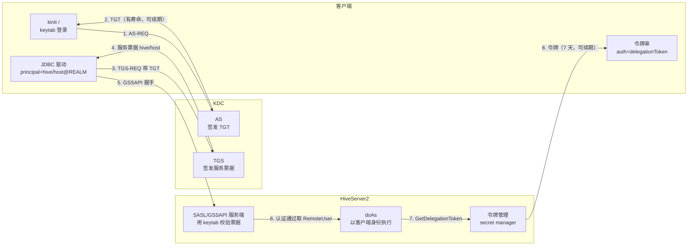
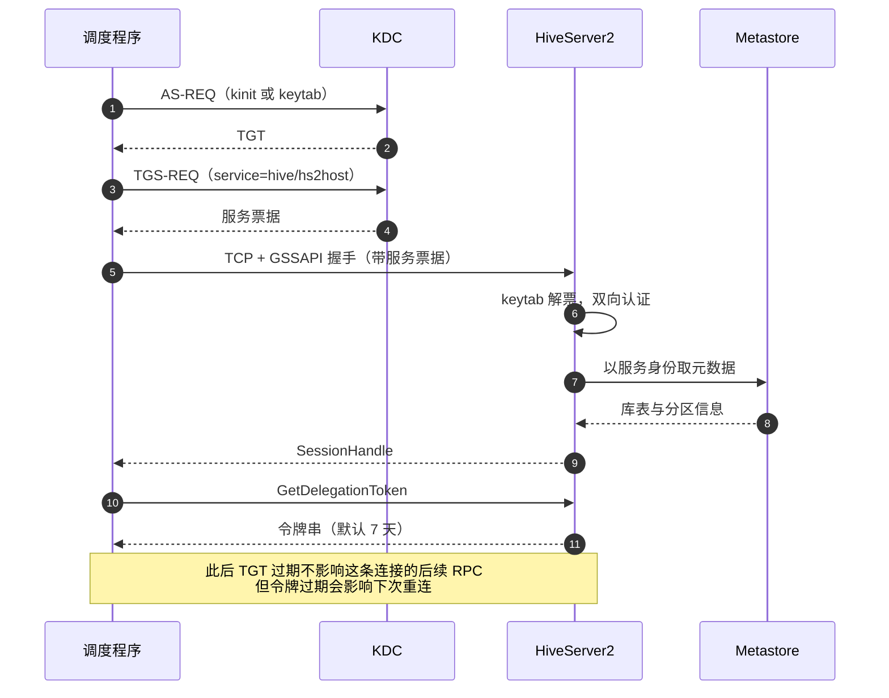
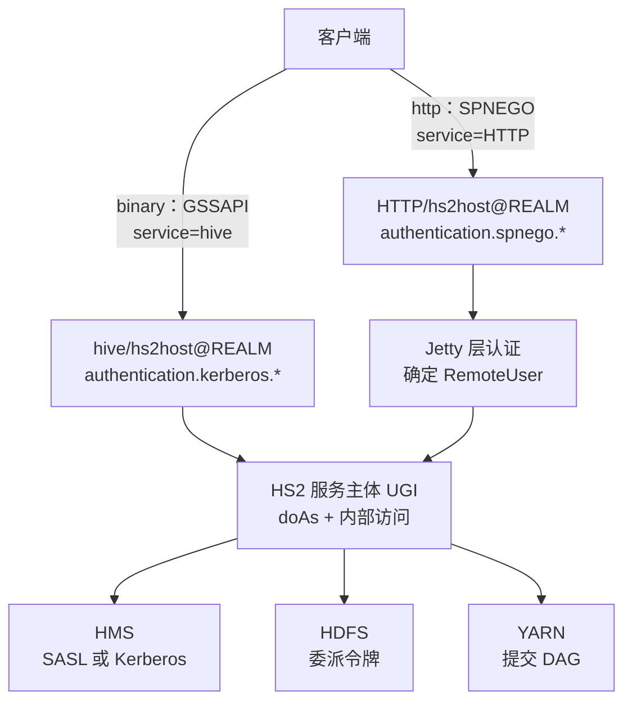
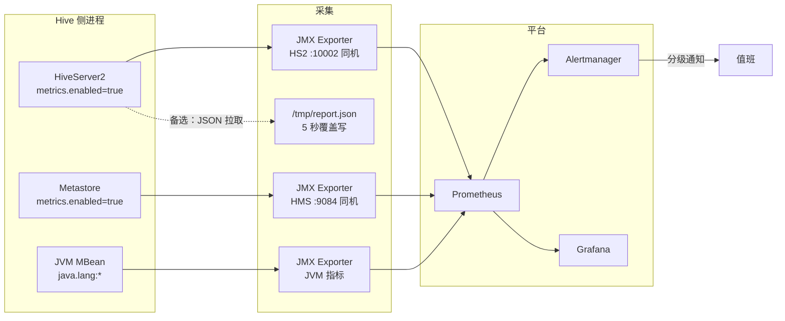

# 11 生产运维：Kerberos 认证、连接池与监控体系

**摘要：**

Hive 的生产事故里有两类问题反复出现，并且总能从"局部报错"升级成"整条数据链路停摆"：一类是 Kerberos 认证在某个时刻全线失败，前一天还好好的集群突然拒绝所有客户端；另一类是连接池在扩容、加实例、换驱动之后开始大面积超时，而服务端看起来并不忙。这两件事的难点都不在配置项数量，而在它们各自维护着一份不容易被看见的账本——Kerberos 的账本是四张凭证的有效期，连接池的账本是线程数与连接数必须是同一份资源。本文沿一条 JDBC 请求的完整生命周期展开：先拆开 `kinit` 拿 TGT、客户端取 Service Ticket、HS2 校验、再到委派令牌的四层链路，把四者的寿命与续期关系逐项对齐；再逐个分析 Hive 上特有的四个坑——长查询的 token 过期、`hive` 与 `HTTP` 两个 principal 的分工、JDBC URL 少写 `principal=` 之后的降级、`_HOST` 与 keytab 的绑定关系；随后把连接池的四个参数与服务端线程数合成一道容量算式，并给出连接失效三种形态的判据；最后落到监控与审计，说明为什么默认配置下的 HS2 几乎没有可观测性，以及该把哪几个指标配成告警。文中配置默认值以 Hive 4.0.1 源码与 Hadoop 3.3.6 为准，与 Hive 2.x 的差异单独标注。

---

## 第 1 章 两份账本

### 1.1 一条宽表链路的早高峰

如果说编译与执行决定了 Hive 还能做什么，那么认证与连接决定了它还能不能被用上。这两种失败在监控上都表现为"连不上"，成因却分属两个互不相干的系统。

设想一个再普通不过的离线仓库：订单宽表按天分区，每天凌晨四点开始有一批任务往 `dt=昨天` 的分区里写数据，写入前要跟商品维表、门店维表做两次 join。链路上有四个消费者——BI 看板每十分钟刷新一次指标，调度平台在早高峰并发跑两百多个下游任务，两个数据服务把结果写进 MySQL 供线上接口查询，外加几个分析师的即席查询。为了省下建连开销，每个消费者都用了连接池：BI 工具配 20 条，调度平台配 50 条，数据服务各配 20 条，分析师客户端配 5 条。

这套配置在集群只有一个 HS2 实例、线程数还是默认 500 的时候毫无问题。问题总在三个变化之后出现：加了一个 HS2 实例并用 ZooKeeper 做发现、把 `hive.server2.thrift.max.worker.threads` 从 500 调到 200 控制内存、或者某个下游把池子从 20 调到 100。三种变化各自都不算错，叠在一起却会产生"连接被拒但 CPU 不高""查询报 Invalid session 但服务没重启""认证失败只发生在五点零几分"这些很难自证的现场。

### 1.2 认证与连接是两个层次的信任

把报错按层次切开，会看到两件几乎不相干的事。认证解决的是"你是谁"，它的判据在建立连接的那几毫秒里：客户端能不能从 KDC 拿到服务票据，HS2 能不能用 keytab 解出票据里的会话密钥，双方能不能就一个 SASL 上下文达成一致。连接解决的是"能不能排上队"，它的判据在连接的整个存活期里：一条连接占着一个线程、一个会话、一份堆内存，排不上队的时候客户端看到的是拒绝、超时或断开。

这两层之所以在同一条 Hive 链路上互相纠缠，是因为它们共享同一个进程入口。HS2 既是认证的服务端，也是线程池的宿主；Kerberos 的凭证过期会让新连接全部失败，线程池饱和会让老连接全部失效，而客户端看到的错误信息高度相似，都是"连不上"。于是最常见的误判发生了：把认证问题当容量问题去扩池子，把容量问题当认证问题去重导 keytab。

### 1.3 两份账本各自记什么

**Kerberos 的账本记时间。** 一次会话背后至少有四张凭证在同时计时：KDC 签发的 TGT、客户端为 HS2 申请的服务票据、HS2 自己的服务 TGT、以及 HS2 签发给你后续重连用的委派令牌。四者的寿命由三套配置分别决定，续期由三套不同的机制驱动，任何一张过期都会在某个时刻把请求挡在门外，但挡住的位置和报错完全不同。

**连接池的账本记数量。** 池的 `maxActive` 是一份客户端承诺，HS2 的 `max.worker.threads` 是一份服务端供给，两份账本只有在"池总量不超过线程总量"这个不等式成立时才对得上。池并不感知线程边界：它借给应用的第 101 条连接照样能在本地 TCP 栈上建立，然后被服务端在握手阶段关掉，或者干脆卡在 accept 队列里等超时。

---

## 第 2 章 认证链路的四张票

### 2.1 从 kinit 说起

Kerberos 出自 1980 年代 MIT 的 Athena 项目，设计目标是在不可信网络上证明身份而不传输密码，这套模型四十年没有大改：客户端先从 KDC 的 AS（Authentication Service）拿到票据授予票据（Ticket Granting Ticket，TGT），再用 TGT 向 TGS（Ticket Granting Service）换指定服务的票据，最后拿着服务票据去访问服务。复杂度全部来自 Hadoop 生态对这套模型的三次改造：把登录态搬进 JVM（UGI 与 Subject）、把票据换成可以转交的令牌（Delegation Token）、以及在同一个进程里同时扮演客户端与服务端（HS2 既要验客户端，又要以服务身份访问 HMS 和 HDFS）。

第一步永远是 TGT。交互式登录时，`kinit` 用你的密码向 AS 换一张 TGT，写进票据缓存（默认 `/tmp/krb5cc_<uid>`）；服务进程没有密码，用 keytab 里的长效密钥做同一件事，Hadoop 把它封装成 `UserGroupInformation.loginUserFromKeytab(principal, keytab)`。这张 TGT 里包含会话密钥、有效期、可续期截止时间，以及一堆标志位，后面所有事情都围绕这几个字段展开。

TGT 的寿命不是 Java 决定的，是 KDC 决定的。MIT KDC 的 `kdc.conf` 里 `max_life` 与 `max_renewable_life` 给出上限，客户端的 `krb5.conf` 用 `ticket_lifetime`、`renew_lifetime` 请求一个不超过上限的值；企业里更常见的是 Active Directory，域策略默认把用户票据定为 10 小时、可续期 7 天。所谓"TGT 默认 24 小时"或"默认 10 小时"都不算错，错在把它当常数——同一个集群里，服务账号、普通账号、跨域信任账号的票据寿命可以完全不同。

### 2.2 客户端去换服务票据

拿到 TGT 之后，客户端要访问 HS2，必须换一张针对 HS2 的服务票据（Service Ticket，简称 ST）。这一步的关键是服务名（service principal）写什么，而它由传输模式决定：

- 二进制模式（`hive.server2.transport.mode=binary`，Thrift 端口默认 10000）走 SASL/GSSAPI，服务名是配置项 `hive.server2.authentication.kerberos.principal` 的主干部分，惯例写作 `hive/_HOST@REALM`，展开后是 `hive/hs2host.example.com@EXAMPLE.COM`。
- HTTP 模式（`transport.mode=http`，端口默认 10001）走 SPNEGO，服务名由 `hive.server2.authentication.spnego.principal` 决定，惯例写作 `HTTP/_HOST@REALM`。

客户端在 JDBC URL 里写的 `principal=hive/hs2host.example.com@EXAMPLE.COM`，就是告诉驱动"我要向哪个服务名申请票据"。Kerberos 的服务票据是绑服务名的：KDC 只会在自己库里存在该 principal 时才签发，HS2 也只会用能解出这张票的 keytab 来应答。名字错一个字符，错的不只是配置项，而是整条信任链的落点。

### 2.3 HS2 侧怎么验

HS2 收到连接后，由 `HiveAuthFactory` 构造的 SASL 服务端完成 GSSAPI 握手。它用 keytab 解出客户端票据里的会话密钥，验证客户端确实持有 TGT，并在此过程中完成双向认证——客户端也确认对面真的是 `hive/hs2host` 那个服务，而不是中间人。握手成功后，`saslServer.getRemoteUser()` 给出客户端身份，后续每个 RPC 都通过 `doAs` 以这个身份执行，这就是 `hive.server2.enable.doAs=true`（默认值）的实际含义。

值得强调的是，**SASL 上下文一旦建立，后续 RPC 不再回 KDC**。一条 JDBC 连接跑到第十个小时，客户端的 TGT 已经过期，这条连接上的查询照样能提交、能取结果，因为认证发生在建连那一瞬间，后面靠的是 SASL 会话密钥。这个事实推翻了两个流行的运维结论：一是"连接池的 `maxLifetime` 必须小于 TGT 有效期，否则连接里的 Kerberos 上下文会过期"——SASL 会话不存在"上下文过期"这回事；二是"TGT 续期成功，所有连接就都安全"——反过来说也不成立，因为 HS2 进程自己的 TGT 过期时，客户端连接完全正常，出错的是 HS2 去 HMS 取元数据那一步。

### 2.4 委派令牌补上了最后一段

如果只有 TGT 和 ST，Hive 的分布式执行根本跑不起来。一条 `INSERT ... SELECT` 提交到 YARN 之后，真正读 HDFS 的是 NodeManager 上 Container 里的任务进程，这些进程既没有 keytab，也没有用户的票据缓存，更不可能在容器里向 KDC 做交互式登录。HS2 的解法是在提交作业之前，以自己的服务身份替用户申请一组**委派令牌（Delegation Token）**——一种带签名的、有过期时间的、可以随作业配置传递的访问凭证，任务进程拿着它直接访问 HDFS 和 HMS，全程不碰 KDC。

Hive 生态里同时存在三种委派令牌，名字相似、签发者不同、彼此不能替代：

| 令牌 | 签发者 | 默认寿命 | 续期间隔 | 用途 |
|---|---|---|---|---|
| HDFS 委派令牌 | NameNode | 7 天（`dfs.namenode.delegation.token.max-lifetime`） | 24 小时（`.renew-interval`） | Container 读写 HDFS |
| Metastore 委派令牌 | HMS | 7 天（`metastore.cluster.delegation.token.max-lifetime`） | 1 天（`.renew-interval`） | 无 TGT 时访问元数据 |
| HS2 客户端令牌 | HS2 自己 | 与上者同一套 secret manager，默认同为 7 天 | 同上 | 客户端长期重连 HS2 |

第三行最容易被忽略。HS2 通过 Thrift 的 `GetDelegationToken` 接口签发一个服务名为 `hiveserver2ClientToken` 的令牌（`HiveAuthConstants.HS2_CLIENT_TOKEN`），客户端可以用它代替 Kerberos 来连接 HS2，URL 写作 `jdbc:hive2://host:10000/default;auth=delegationToken;delegationToken=<令牌串>`。这个令牌只在 Kerberos 认证下签发，非 Kerberos 场景请求它会直接收到 `Delegation token only supported over kerberos authentication`。

> [!info] 令牌不是"另一个 TGT"
> TGT 证明"我是谁"，由 KDC 签发，HS2 无法伪造；委派令牌证明"我被授权代表某人做某几件事"，由服务自己签发、自己校验。所以 TGT 过期后令牌仍然有效，令牌被吊销后 TGT 依然能换新令牌——两者是并行的两套信任，不存在包含关系。

### 2.5 四张票在一次请求里的取用顺序

把上面四张凭证放进同一条链路，会看到一次请求里的取票顺序与责任边界。



这张图要读出两个结论。其一，客户端与 KDC 的交互只发生在连接建立前，之后链路上再没有 KDC 的参与，所以"KDC 不可用"影响的不是存量连接，而是新连接、新作业提交，以及 HS2 自己的续期。其二，HS2 对 HMS 与 HDFS 的访问用的是它自己的服务身份加令牌，客户端身份在 `doAs` 里作为代理用户传递，这条路径上客户端 TGT 的有效性从始至终不参与。

### 2.6 一次连接的四段握手

把前面几步落到一次 JDBC 连接的建立过程，可以更清楚地看到哪一段失败对应哪一类报错。



四段的分工是：KDC 段（客户端有没有票）、SASL 段（服务名与 keytab 对不对得上）、HS2 与 HMS 之间（服务身份是否有效）、业务段（会话与令牌）。最常见的排错弯路是拿着第二段的报错去查第三段的配置，因为 `GSS initiate failed` 既可能是客户端自己没票，也可能是 HS2 替它取票时失败了。

---

## 第 3 章 长查询撞上凭证的有效期

### 3.1 三个各自计时的寿命

一条跑十二个小时的宽表回溯作业，身上挂着三个互不相干的计时器。

第一个是客户端的 TGT，寿命由 KDC 决定，AD 域典型值 10 小时、可续期到 7 天。它只影响两件事：新建连接（驱动要拿服务票据），以及客户端进程自身重新向 KDC 换票；已经建立的 SASL 会话不受影响。

第二个是 HS2 进程自己的服务 TGT，同样由 KDC 决定。它决定 HS2 能不能继续以服务身份去 HMS 取元数据、去 HDFS 申请令牌、向 YARN 提交新作业。这个计时器的危险在于它对客户端完全不可见：客户端连接一切正常，`SELECT` 却开始返回元数据异常。

第三个是作业上下文里的委派令牌，默认 7 天上限、按天续期，它决定已提交到 YARN 的 DAG 还能不能读写 HDFS。这个计时器通常不是瓶颈，但它划出了"作业可以重试多久"的隐含边界。

### 3.2 UGI 的续期并不像传说中那样自动

关于 TGT 续期，流传最广的说法是"Hadoop 每隔 TGT 有效期的 80% 自动 renew 一次"，这句话在源码里只对了一半。`UserGroupInformation` 确实有一个刷新点计算，逻辑是把票据起点加上有效期窗口的 80%（`TICKET_RENEW_WINDOW = 0.80`），但触发这个刷新的是一个**可选的**后台线程，而它受 `hadoop.kerberos.keytab.login.autorenewal.enabled` 控制，这个开关的默认值是 `false`。

默认关闭时，UGI 走的是惰性重登：每次有 RPC 需要凭证时，`checkTGTAndReloginFromKeytab()` 判断当前票据是否已经接近过期，接近了就用 keytab 重新登录一次。这条路在"业务流量持续不断"的服务上工作良好，因为每次 RPC 都是一次检查机会；它对"长时间静默之后突然要提交作业"的进程很不友好，因为静默期间没有任何人触发检查，等到需要凭证时才发现票据已经过期，而 `hadoop.kerberos.min.seconds.before.relogin`（默认 60 秒）还会拦掉过于频繁的重登请求。

打开 `hadoop.kerberos.keytab.login.autorenewal.enabled` 之后，UGI 才会为 keytab 登录的进程起一个名为 `TGT Renewer for <principal>` 的守护线程，在有效期 80% 处做一次完整的 keytab 重登。这个线程是个单点：它退出之后不会再被创建，日志里留下的是 `TGT is destroyed. Aborting renew thread for ...` 这样的告警，而进程本身还活得好好的。

> [!warning] 续期失败不会立刻报错
> 无论是惰性重登失败还是续期线程死亡，凭证都还有残余寿命。假设 TGT 是 10 小时、续期线程在第 4 小时死掉，那么真正的故障爆发点在第 10 小时——中间有 6 小时窗口，监控上一切正常。这就是为什么 Kerberos 故障总在"变更之后的某天凌晨"出现，而不是变更当下。

### 3.3 四张票的续期责任人对不上

把每张票的续期责任人列出来，会看到一张权责错位的表：客户端 TGT 的续期在客户端进程（`kinit` 或 UGI 重登）；HS2 服务 TGT 的续期在 HS2 进程；HDFS 令牌的续期责任在提交作业的 HS2；HS2 客户端令牌的续期责任在客户端应用。

| 凭证 | 谁负责续期 | 触发方式 | 续期失败后多久爆发 |
|---|---|---|---|
| 客户端 TGT | 客户端进程 | UGI 重登 / 外部 `kinit` 定时任务 | 票据剩余寿命耗尽时 |
| HS2 服务 TGT | HS2 进程 | keytab 自动重登（默认关闭）/ 惰性重登 | 同上，且影响所有新提交 |
| HDFS 委派令牌 | HS2 或客户端 | 提交前续期，作业侧不续期 | 令牌上限耗尽（默认 7 天） |
| HS2 客户端令牌 | 客户端应用 | 显式调用 `RenewDelegationToken` | 令牌寿命耗尽，仅影响重连 |

这张表解释了为什么"重启 HS2 之后认证故障消失"是一种危险的伪修复：重启会重新做一次 keytab 登录，把 HS2 服务 TGT 重置到一个满寿命状态，故障窗口被推迟一个 TGT 寿命。真正的问题——续期线程为什么会死、惰性重登为什么没生效——一点都没解决。

### 3.4 令牌续期要自己写

Hive 的客户端令牌不会自动续期。JDBC 驱动只在显式调用时转发 `RenewDelegationToken`，而大多数连接池、调度框架都没有实现这条路。于是"用令牌替代 Kerberos 做长期连接"的方案，实际寿命等于令牌寿命，默认 7 天，第 8 天开始重连全部失败。

如果确实要用令牌，需要三件事同时到位：应用侧起一个定时任务，在令牌寿命过半时调用续期接口，并用新令牌替换连接池里的连接；HS2 侧的令牌 GC 周期要小于续期周期（默认 15 分钟扫描一次过期令牌，正常配置下不会误删）；HMS 与 HS2 共用同一套令牌存储与签名（`hive.metastore.token.signature`），否则 HS2 签发的令牌到 HMS 侧不被认可。

### 3.5 示例推算：最长查询能开多久

把三个计时器换算成"最长可接受查询时长"，可以做一次量级推算。假设 KDC 给服务账号的 TGT 是 10 小时、可续期 7 天，HS2 打开了 keytab 自动重登，客户端用 Kerberos 建连、不开令牌续期。

```text
示例推算（量级判断，非基准测试）：
  建连时刻要求：客户端 TGT 剩余寿命 > 0
  HS2 服务 TGT：每 8 小时（10h × 0.8）重登一次
    若某次重登失败（KDC 抖动、keytab 被替换、线程已死）
    故障点在最后一次成功重登 + 10 小时处
  已提交作业的 HDFS 令牌：7 天上限，按天续期
    单作业最长可挂 7 天（不含重试）

  结论：长查询能否活过 10 小时，取决于 HS2 的续期链路是否健康，
        而不是取决于客户端连接是否还活着；
        超过 7 天的作业必须拆分或缩短，令牌决定了硬上限。
```

如果客户端用令牌建连，"最长查询"就与 TGT 无关，只与令牌寿命和 HS2 进程健康有关——这也是大型离线平台偏爱令牌模式的原因：把 KDC 从关键路径上摘出去。代价是签发、续期、吊销、存储都要自己管，任何一环漏掉，故障形态会从"认证失败"变成"连接被拒"，难度并不更低。

### 3.6 边界：令牌不是万能钥匙

令牌只解决"认证"，不解决"授权"与"提交时刻"。一条用令牌连上的会话，执行 `INSERT` 时仍然要由 HS2 以用户身份去 HDFS 申请新的写入令牌、向 YARN 提交 DAG，这两个动作都需要 HS2 的服务 TGT 有效。所以"客户端完全令牌化"并不能把 KDC 从链路里彻底移除，它只是把 KDC 的影响范围从"每次建连"缩小到"每次提交"。

还有一层容易忽略的边界：`doAs` 为 true 时，HS2 内的代理用户 UGI 也要能访问 HDFS 与 HMS，这部分权限来自用户身份与 Ranger 之类的授权组件，令牌只证明身份不授予权限。把令牌当成"免授权的通行证"，会在第一次遇到权限拒绝时把方向彻底带偏。

---

## 第 4 章 两个 principal：谁握手，谁干活

### 4.1 一个进程，两个身份

Hive 在 Kerberos 上最容易配错的，不是 realm 大小写，也不是 keytab 路径，而是搞混 HS2 用哪个 principal 对外、用哪个 principal 对内。默认的二进制模式只需要一个 `hive` principal，HTTP 模式则需要两个——`HTTP` 负责和客户端握手，`hive` 负责 HS2 自己的所有内部访问。

配置项的位置把这件事说得更清楚。对外握手的身份由 `hive.server2.authentication.kerberos.principal` 与对应的 keytab 决定；HTTP 模式下额外需要 `hive.server2.authentication.spnego.principal` 与 `hive.server2.authentication.spnego.keytab`。启动时 `CLIService.init` 会先用 keytab 做一次 `loginFromKeytab` 建立服务 UGI，再尝试用 SPNEGO 的 principal 与 keytab 建立 `httpUGI`，后者缺失时只打一行 info 日志（`SPNego httpUGI not created`），不会阻止进程启动。

### 4.2 两个身份各自负责什么



图里两条进入路径的汇合点就是问题的根源：无论客户端走哪条路进来，HS2 内部干活用的永远是 `hive` 那个服务主体。对外握手的是门迎，进到后厨炒菜的还是同一个厨师——门迎换了制服，不代表厨师换了人。HTTP 模式只把 `HTTP` 用在最外层握手，握手之后所有 `doAs`、所有对 HMS 与 HDFS 的访问，都换成 `hive` 身份。所以"只配了 SPNEGO 就以为配好了 Kerberos"的集群，症状会是外层认证通过、进程也能起来，但任何需要元数据的查询都失败。

### 4.3 两个 principal 的组合与各自的死法

把两个 principal 的配置状态两两组合，可以得到一张症状差异明显的矩阵。

| `hive` principal | `HTTP` principal | 传输模式 | 现场症状 |
|---|---|---|---|
| 已配 | 未配 | binary | 正常工作 |
| 已配 | 未配 | http | 连接阶段 SPNEGO 失败，客户端报 `GSS initiate failed` 或 401 |
| 未配 | 已配 | binary | HS2 启动即失败，日志 `HiveServer2 Kerberos principal or keytab is not correctly configured` |
| 未配 | 已配 | http | 连接能建立（SPNEGO 通过），查询阶段报元数据异常，HMS 侧日志出现 `GSS initiate failed` |
| 已配 | 已配 | http | 正常工作，两个身份各司其职 |

第四行就是"认证通过但连接失败"的准确含义：客户端与 Jetty 之间的 SPNEGO 握手是成功的，客户端甚至能拿到 `SessionHandle`；失败发生在 HS2 内部——它要先做一次 `loginFromKeytab`，`hive` principal 缺失时 `CLIService.init` 直接抛 `ServiceException`，进程根本起不来。如果进程能起来而查询失败，说明 `hive` 的 keytab 存在但不可用（过期、kvno 不同步、principal 名字与 keytab 条目不一致），症状会推迟到第一次访问 HMS。

### 4.4 判据：先看哪一份日志

排查两个 principal 的错配，顺序比技巧重要。先看 HS2 进程有没有起来：没起来就直接 `grep` 启动日志里的 `Kerberos principal or keytab is not correctly configured` 与 `SPNego httpUGI`。再看客户端失败在哪一段：连接阶段的失败必然伴随 `GSS initiate failed`、`Checksum failed`、`Server not found in Kerberos database` 这类 SASL 层报错；查询阶段的失败则是 `MetaException`、`TTransportException` 指向 9083、或 `Client cannot authenticate via:[TOKEN, KERBEROS]`。

还有一个组合值得单独点出：`hive.server2.authentication` 是 `KERBEROS`，而 `hive.metastore.sasl.enabled` 保持默认 `false`。HS2 对客户端要求 Kerberos，对 HMS 却走不认证的通道，链路的强度由最弱一环决定——谁能直连 9083，谁就绕过了认证。

### 4.5 principal 名字的三处默认值不一样

Hive 的 principal 默认值本身就是一组陷阱。以 Hive 4.0.1 的 `HiveConf` 为准：`hive.server2.authentication.kerberos.principal` 的默认值是**空字符串**，必须显式配置；`hive.server2.authentication.spnego.principal` 的默认值同样是空；而 `hive.metastore.kerberos.principal` 的默认值是 `hive-metastore/_HOST@EXAMPLE.COM`。

这意味着从 HMS 的配置里抄一行到 HS2，或者反过来，都会得到一个"看起来有值"的错误命名。抄错之后的报错是 `Server not found in Kerberos database`，而 KDC 侧明明能看到 `hive/host` 这个 principal 存在——因为客户端申请的是 `hive-metastore/host`，名字对不上。遇到这个报错，第一个要核对的不是 keytab，而是"我要访问的服务名到底是哪个"。

---

## 第 5 章 少写一个 principal，认证就退化成明文

### 5.1 驱动的分支只有四条

Hive JDBC 驱动解析 URL 时会产出一组参数，其中真正决定认证分流的是四个：`auth`（认证类型）、`principal`（Kerberos 服务名）、`delegationToken`（令牌串）、`user`/`password`（明文凭证）。`HiveConnection.createBinaryTransport` 的判断顺序是：`auth=noSasl` 走裸 socket；`auth=delegationToken` 走 DIGEST 令牌通道；带 `principal` 走 GSSAPI；以上都不满足，就走 PLAIN——用 `user` 和 `password` 做 SASL PLAIN 认证。

关键点在于**没有"默认 Kerberos"**。URL 里不写 `auth`、也不写 `principal` 时，驱动不会去猜你想用 Kerberos，而是老老实实发出一份 PLAIN 凭证。服务端只挂了 GSSAPI 的 SASL 定义（`auth=KERBEROS` 且没开 LDAP/PAM/CUSTOM 时，`getAuthTransFactory` 只注册 GSSAPI），收到 PLAIN 请求就在握手阶段拒绝连接。

于是现场出现一个极具误导性的组合：客户端连的是 Kerberos 集群，报错却和 Kerberos 毫无关系——`Could not create secure connection to jdbc:hive2://...: Peer indicated failure`，HS2 日志里是 `Unsupported mechanism type PLAIN` 之类的话术（措辞随 Thrift 版本略有差异）。运维看到"不是 Kerberos 报错"，往往会去查网络、查防火墙、查端口，绕一大圈才回到 URL 少了一个分号。

### 5.2 URL 参数的语义与写错的后果

| 参数 | 作用 | 不写会怎样 | 写错的典型报错 |
|---|---|---|---|
| `principal` | 指定 HS2 服务名，触发 GSSAPI | 退化成 PLAIN，握手被拒 | `Peer indicated failure` |
| `auth=delegationToken` | 用令牌代替 Kerberos | 驱动不进令牌通道，回落到 GSSAPI 或 PLAIN | 令牌串缺失时报 `Invalid token` |
| `delegationToken` | 令牌串本体 | 空值被当成无凭证 | `Invalid token` |
| `saslQop` | 认证后的加密强度（`auth`/`auth-int`/`auth-conf`） | 服务端默认 `auth`，只认证不加密 | 双方取值不一致时协商失败 |
| `kerberosAuthType=fromSubject` | 复用进程内已登录的 Subject | 驱动自己去找票据缓存 | `The Subject is not set` |
| `serviceDiscoveryMode=zooKeeper` | 从 ZK 取活跃实例列表 | 直连固定 host，实例漂移时失败 | 连到已下线的实例 |

`principal` 的写法还有一个细节：驱动要求它是三段式（`服务名/主机名@REALM`），`KerberosSaslHelper` 里会按 `[/@]` 切分并校验段数，少于三段直接抛 `Kerberos principal should have 3 parts`。写成 `principal=hive@EXAMPLE.COM` 这种省略主机名的形式，报错发生在拼装 SASL 传输之前，和 KDC 无关。

### 5.3 一个可复制的连接串

生产上最稳的写法是把全部认证要素写全，不依赖任何默认值：

```text
jdbc:hive2://hs2-1.example.com:10000/warehouse;
  principal=hive/hs2-1.example.com@EXAMPLE.COM;
  saslQop=auth-conf;
  hive.server2.proxy.user=etl_app
```

分号与参数之间不能有空格，实际使用时拼成一行。`saslQop=auth-conf` 打开传输加密，代价是 CPU 开销上升，适合跨机房或不可信网段；同机房内网可以退回 `auth`（只认证不加密），把带宽与 CPU 让给数据传输。`hive.server2.proxy.user` 只在服务端允许用户替换（`hive.server2.allow.user.substitution=true`，默认开启）时生效，用来让一个服务账号代理多个业务身份，这也是数据平台常见的落地方式。

### 5.4 fromSubject 模式适合谁

`kerberosAuthType=fromSubject` 是给"进程里已经有登录态"的场景准备的：应用自己通过 JAAS 登录并持有 Subject，驱动直接复用，不再去票据缓存里找。代价是 Subject 的生命周期完全由应用管理，登录失效时驱动只会抛 `The Subject is not set`，不会帮你重登。

这条路径适合两类应用：长期运行的服务（如常驻的数据网关）用 keytab 登录一次，所有连接共享同一个 Subject，免去每条连接读票据缓存；以及嵌在 Hadoop 客户端进程里的组件（如已持有 UGI 的 Spark Driver），复用现有 Subject 可以避免两个登录态互相覆盖。短命的批处理任务不需要它。

### 5.5 ZooKeeper 发现模式下的 principal

HS2 多实例部署时，JDBC URL 通常写成 `jdbc:hive2://zk1:2181,zk2:2181,zk3:2181/;serviceDiscoveryMode=zooKeeper;zooKeeperNamespace=hiveserver2;principal=hive/_HOST@EXAMPLE.COM` 的形式，让驱动从 ZooKeeper 里取活跃实例。这里有一个很容易踩的细节：`principal` 里的 `_HOST` 会被替换成**实际连上的那台主机**，而不是 URL 里写的 ZooKeeper 地址。所以带发现的连接串里写 `_HOST` 是对的，前提是三台 HS2 的 principal 都遵循同一套命名规则（都用 `_HOST` 生成），否则驱动会拿着 A 主机的名字去连 B 主机。如果各实例的主机名不规范（有过短名、有过大小写混用），最稳妥的写法是每台实例分别暴露一个固定域名的连接串，让上层按域名分流，而不是靠 `_HOST` 自动替换。

---

## 第 6 章 `_HOST` 与 keytab 的三角绑定

### 6.1 `_HOST` 在服务端被替换成什么

`_HOST` 不是 Hive 的语法，是 Hadoop `SecurityUtil.getServerPrincipal(principalConfig, hostname)` 的占位符处理：当 principal 的第二段恰好是 `_HOST` 时，用传入的 hostname 替换。HS2 调用这个方法时传的 hostname 是字符串 `0.0.0.0`，而 `replacePattern` 对 `0.0.0.0` 有特殊处理——它认为这代表"用本机名字"，于是调用 `getLocalHostName()` 取本机的规范主机名（canonical hostname），并把结果**转成小写**再拼回 principal。

这一个函数里藏了三个约束。第一，`_HOST` 展开依赖本机的反向解析：如果 DNS 把 IP 反解成短名 `hs2-1`，principal 就变成 `hive/hs2-1@REALM`；如果反解成 `hs2-1.example.com`，就变成 `hive/hs2-1.example.com@REALM`。第二，最终结果被强制小写，keytab 里若存的是 `hive/HS2-1.example.com@REALM`，查找就会失败——Kerberos principal 在 MIT KDC 里是大小写敏感的。第三，`getLocalHostName()` 支持通过 `hadoop.security.dns.interface` 与 `hadoop.security.dns.nameserver` 指定解析用的网卡与 DNS 服务器，多网卡机器上不指定，可能解析出一个不该对外暴露的地址。

> [!warning] `_HOST` 配得好，keytab 也得对得上
> 许多人把 `principal=hive/_HOST@REALM` 当成"万能写法"，却忽略了它展开后的字符串必须与 keytab 里的条目逐字符一致。启动期报 `Unable to obtain password from user` 或 `Failed to find any Kerberos key`，绝大多数不是 keytab 文件权限问题，而是展开后的名字压根不在 keytab 里。

### 6.2 keytab 里到底该有什么

keytab 是 principal 与长期密钥的映射表，`klist -kte` 能列出其中所有条目及其 kvno、加密类型。一次正确的绑定要满足四个条件：条目名与展开后的 principal 完全一致（含大小写）；kvno 与 KDC 侧当前版本一致（改过密码就必须重新导出 keytab）；加密类型包含 JVM 支持的算法（`aes256-cts` 需要 JCE 无限制策略，JDK 8u161 之后默认开启）；文件权限仅服务账号可读（`0400` 或 `0440`，属主为 HS2 运行用户）。

第三点常被忽略却极难排查。KDC 改了服务账号密码、重新导出了 keytab，但某个节点的旧 keytab 没有同步，现象是"大部分节点正常，个别节点重启后起不来"，报错是 `Cannot find key of appropriate type to decrypt AP-REP` 或 `Pre-authentication information was invalid`。这类错误看上去像加密算法问题，实际上是 kvno 与密钥不同步，把该节点的 keytab 重新分发即可。

### 6.3 三类错配的判据

| 形态 | 现象 | 判据 | 处置 |
|---|---|---|---|
| 大小写不一致 | HS2 起不来，报 `Failed to find any Kerberos key` | `klist -kte` 的条目名含大写，而日志里 principal 是小写 | 用完全一致的规范名重导 keytab |
| 短名 / 长名不一致 | 部分节点正常、部分节点认证失败 | 各节点 `hostname -f` 输出不一致，或反向解析结果与正向不一致 | 统一 FQDN，或在 `hadoop.security.dns.*` 指定解析接口 |
| kvno 过期 | 重启后立即失败，或运行中周期性出现 `AP-REP` 解密错误 | `klist -kte` 的 kvno 小于 KDC 侧当前 kvno | 重新分发 keytab 并滚动重启 |

三类的共同点是"本地就能查清"，不需要动 KDC 也不需要抓包：`klist -kte` 看 keytab 条目，`hostname -f` 与 `getent hosts` 看名字解析，两条命令就能把 90% 的 `_HOST` 问题定位完。

### 6.4 客户端 URL 里的 `_HOST` 是另一回事

需要把服务端与客户端的 `_HOST` 语义分开。客户端侧的 `_HOST` 由 `SecurityUtil.getServerPrincipal(principalConfig, host)` 处理，传入的 host 是 JDBC URL 里的主机名（ZooKeeper 发现模式下是实际选中的实例地址），不是本机名。所以：

- 客户端写 `principal=hive/_HOST@REALM`、URL 写 `jdbc:hive2://hs2-1:10000`，等价于 `principal=hive/hs2-1@REALM`；如果 HS2 的 principal 用的是 FQDN，这一条就换不到票。
- 客户端写死 `principal=hive/hs2-1.example.com@REALM` 而 URL 用 ZK 发现、实际连到 `hs2-2`，KDC 会签发出 `hive/hs2-1.example.com` 的票据，HS2-2 用自己的 keytab 解不开，握手失败。

结论很朴素：**客户端写的服务名必须是"我要连的那台机器上 HS2 的 principal"**，`_HOST` 只是在 URL 主机名与 principal 主机名恰好同源时才方便。集群规模小、命名规范，写死 FQDN 最直白；规模大、实例会漂移，就让每台实例的域名与 principal 严格对齐，再让发现机制去选。

### 6.5 一次协作式校验清单

把服务端与客户端两侧的检查合成一份可以照着跑的清单，能在故障发生时把范围快速收窄：

```text
服务端（每台 HS2 节点）：
  1. hostname -f 与 getent hosts <ip> 是否一致、是否为 FQDN
  2. klist -kte <keytab> 里是否存在 hive/<小写FQDN>@REALM，kvno 与 KDC 一致
  3. 启动日志 grep "loginUserFromKeytab\|Kerberos principal or keytab"
  4. jps 找到 HS2 后，用 klist -e 看进程票据缓存（若使用 kerberos 登录）

客户端（每台应用节点）：
  1. URL 的 principal 与目标实例 principal 是否一致
  2. klist 是否有未过期的 TGT，realm 是否一致
  3. /etc/krb5.conf 的 default_realm 与 dns_lookup_kdc 是否与集群一致
  4. 用 beeline 同样参数连一次，排除连接池与驱动版本因素
```

最后一条常被跳过：`validationQuery`、驱动版本、JDBC 属性透传都会改变认证行为，用 beeline 直连可以切掉中间层，把问题锁定在"认证本身"还是"连接管理"。

---

## 第 7 章 一份真实故障的形态

### 7.1 三段式的时间线

知识库里那份 [[HiveServer2 Kerberos 认证故障深度分析报告]] 记录了一次典型的 Kerberos 全线失败，形态可以抽象成三段，比具体时间点更有复用价值。

第一段是潜伏。HS2 进程内部负责续期的线程在某次异常后退出，日志里留下 `TGT is destroyed. Aborting renew thread` 这样的告警，随后归于安静。此时进程仍在服务，客户端连接正常，监控面板上没有任何红色——因为票据还有残余寿命，所有需要认证的动作都还能成功。

第二段是爆发。早高峰到来，大量离线任务同时打开会话，每个会话都要向 HMS 取元数据、申请令牌，而 HS2 的服务身份已经不可用，这些请求统一失败；失败又被重试机制延后几轮才暴露出来。

第三段是雪崩。HS2 的编译与元数据访问共用若干串行点，失败的重试占住这些点，线程池被"等重试"的请求填满，新连接开始被拒。故障从"认证失败"扩散为"服务不可用"，现场表现和容量打满几乎一样。

### 7.2 为什么故障会延迟爆发

这段形态里最该记住的规律：**Kerberos 故障的爆炸半径由票据的剩余寿命决定，而不是由故障原因决定**。续期线程在第 4 小时死亡，TGT 在第 10 小时过期，中间的 6 小时是"看起来健康"的窗口。窗口内做任何重启、扩池、换连接串的处置都不会暴露问题，窗口之后所有处置都会被误判为无效。

同样的道理也解释了"为什么 HDFS 还活着、HMS 先死"。HDFS 客户端手里长时间有效的是委派令牌，不需要回 KDC；HMS 的访问要经过 HS2 的服务身份，每一次都可能触发认证。于是同一时刻，读数据还能读，查元数据已经不行，现场表现为"有的查询成功有的失败"，这把排查方向引向"数据倾斜"或"SQL 写错了"是很自然的事。

### 7.3 HS2 为什么是放大器

认证失败本身是可控的：一个会话失败、重试、报错。HS2 把它放大成全局故障，靠的是两个结构特点：一是元数据访问与查询编译共用进程内的串行点，失败重试会让串行点排队；二是客户端与驱动普遍带自动重试，重试在服务端看来就是请求量翻倍。两者叠加，一条本可以只影响新连接的认证故障，最后把所有线程都拖进了 `BLOCKED`。

### 7.4 从形态到判据

把这段形态翻译成可执行的判据，只有四条：HS2 日志里是否出现过续期线程退出或 `Login failure` 字样；KDC 日志或审计里是否有一段时间没有来自该 HS2 的 `TGS_REQ`；故障是否集中在"新会话/新提交"而不是"存量查询"；重启 HS2 后是否立即恢复。四条全部为是，基本可以判定故障在凭证续期链路，而不是在连接池、HMS 或网络。至于具体的 JDK 行为差异、代码路径篡改、锁竞争细节，属于那份报告的主题，本文不重复其证据链。系统化的排查顺序放在 [[12 故障排查手册：从 HS2 无响应到 Tez 作业失败的系统诊断]] 里。

---

## 第 8 章 连接池的四个参数与一份容量总账

### 8.1 为什么 Hive 的连接必须池化

建一条 Hive JDBC 连接的成本，比建一条 MySQL 连接高出一个数量级。TCP 握手与 Thrift 握手都在毫秒级，真正贵的是后面两段：GSSAPI 握手要访问 KDC 换服务票据（内网往返加 KDC 处理，典型 50 到 500 毫秒），`OpenSession` 要在 HS2 里创建会话、复制配置、初始化 Driver 与 Hive 客户端（典型 50 到 500 毫秒）。两项相加，一条新连接接近半秒到一秒。

对每秒几十次查询的调度平台来说，这个开销无法承受，所以连接池是必需品。但池化之后，连接的"身份"从一个瞬时动作变成了一个长期占用：一条连接在 HS2 侧占一个 handler 线程、一个 `HiveSessionImpl`、一个 `SessionState`、一份堆内存。**池里的每一个连接格都是一个服务端资源槽位**，这条等价关系是后面所有容量问题的基础。

### 8.2 服务端：一连接一线程

HS2 的二进制传输用 `TThreadPoolServer`，构造参数在 `ThriftBinaryCLIService.initServer` 里写得很直白：`ThreadPoolExecutor(minWorkerThreads, maxWorkerThreads, workerKeepAliveTime, TimeUnit.SECONDS, new SynchronousQueue<>())`，`minWorkerThreads` 来自 `hive.server2.thrift.min.worker.threads`（默认 5），`maxWorkerThreads` 来自 `hive.server2.thrift.max.worker.threads`（默认 500），空闲线程存活 60 秒（`hive.server2.thrift.worker.keepalive.time`）。

这里最关键的是队列类型：`SynchronousQueue` 意味着**没有排队**。所有线程都在忙时，新连接不会进队列等，而是直接被拒绝，Thrift 在日志里写下 `ThreadPool is saturated with incoming requests. Closing latest connection.` 并关闭这条连接。这条日志是判断"线程被打满"最硬的证据，比任何客户端报错都可靠。

HTTP 模式的结构不同但结论相同：Jetty 的 `QueuedThreadPool` 用同一对 min/max 参数，连接器把 accept 队列长度设成 `maxWorkerThreads`，超出之后新连接在操作系统层面被丢弃。两种模式的区别只在于"拒绝发生在哪一层"——二进制在应用层明确拒绝并打日志，HTTP 在队列满之后表现为连接超时或 RST。

HS2 的线程模型在 [[01 HiveServer2 架构深度解析：从 Thrift 到 Session 生命周期|HiveServer2 架构]] 里拆解过，这里只留一条与池相关的结论：线程数不是可无限上调的数字，它同时是连接数上限和内存占用的乘数。

### 8.3 客户端：四个参数与它们真正的含义

不同池实现的参数名不一样，语义可以对齐成四项。以 HikariCP 与 Druid 为例：

| 语义 | HikariCP | Druid | 作用 | 调大的代价 | 调小的代价 |
|---|---|---|---|---|---|
| 最大连接数 | `maximumPoolSize` | `maxActive` | 池可同时持有的连接上限 | 挤压 HS2 线程，触发拒绝 | 并发查询排队，`maxWait` 超时 |
| 最小空闲数 | `minimumIdle` | `minIdle` | 常驻空闲连接数 | 长期占用服务端会话与内存 | 流量突增时批量建连，延迟尖刺 |
| 获取超时 | `connectionTimeout` | `maxWait` | 从池里拿不到连接时的等待上限 | 客户端线程被长时间挂住，雪崩 | 高峰期大量超时失败，需要重试 |
| 最大存活 | `maxLifetime` | `phyTimeoutMillis` | 连接的最长生命周期 | 连接长期漂移、会话与实例不匹配 | 频繁重建连接，放大认证开销 |

`maxLifetime` 经常被赋予过重的使命，比如"必须小于 TGT 有效期，否则连接里的 Kerberos 上下文会过期"。前面已经论证过，SASL 会话不依赖 TGT 续期，所以这个理由不成立。它真正的作用是控制**会话与实例的绑定时间**：HS2 多实例部署时，一条活过几个小时的连接始终钉在最初那台实例上，而实例可能已经重启、被摘除、或者正在被滚动升级；把 `maxLifetime` 压到十几分钟到半小时，等于让连接定期重新走一次负载均衡，代价是每批重建都要付一次 GSSAPI 与 `OpenSession` 的开销。

### 8.4 容量算式：集群总容量

连接容量的算法只有一行，但需要把三个乘数都摆出来：

```text
集群总连接容量 = HS2 实例数 × hive.server2.thrift.max.worker.threads
可用预算      = 集群总容量 × 安全系数（0.6 ~ 0.7）

示例（量级判断）：
  3 个 HS2 实例 × 200 线程 = 600 条连接容量
  安全系数取 0.7 → 所有客户端池总和不超过 420

  若 BI 20 + 调度 50 + 数据服务 2×20 + 分析师 5×5 = 135
  剩余 285 条可供新业务接入，扩池前先看这个余量
```

安全系数不是保险，它对应两类真实占用：一是长查询占住线程后无法复用，二是空闲连接不会立刻释放，池的 `minIdle` 常驻部分要算在总账里。把 600 条全部承诺给客户端，等于假设每条连接都能在需要时立刻腾出来。

### 8.5 池比线程大之后发生什么

假设五个应用各配 200 条连接，合计 1000，而 HS2 是 3 实例 × 200 线程 = 600。表面看只是"高峰期部分连接被拒"，实际发生的是三段正反馈。

第一段：连接被拒后，客户端池的重试策略（`connectionTimeout`、驱动的 `retries`）会立刻发起新连接。服务端看到的连接请求速率不降反升。第二段：被拒绝的连接在客户端池里表现为"借出失败"，业务线程被挂住，上游超时重试，一次查询变成两次、三次。第三段：活下来的 600 条连接里，有相当一部分是空闲连接，占着线程和会话；真正要跑长查询的请求反而拿不到线程，只能继续排队。

这就是为什么"扩池"这个动作在 Hive 上经常是负优化。正确的顺序是：先看 `ThreadPool is saturated` 是"执行占住"还是"等锁占住"，是"长查询"还是"空闲连接"，再看池总量与服务端总量是否对得上，最后才考虑调参。

### 8.6 服务端也能设限

Hive 4 提供了三个服务端连接配额，默认全部为 0（不限制）：`hive.server2.limit.connections.per.user`、`hive.server2.limit.connections.per.ipaddress`、`hive.server2.limit.connections.per.user.ipaddress`。它们由 `SessionManager` 在打开会话时检查，超限时抛出的错误信息非常明确，譬如 `Connection limit per user reached (user: etl_app limit: 50)`。

这条错误信息把"谁把池子撑爆了"直接写在报错里。per-user 配额设成低于池总量，既能强制业务方把池配小，也能防住"某个应用独占所有线程"。代价是同一个服务账号被多个应用共享时会互相挤占，需要按应用拆分账号，或改用 `hive.server2.proxy.user` 代理多个身份。

### 8.7 超时次序：谁先回收

连接两侧各有空闲超时，配置次序决定了故障形态。HS2 的会话空闲超时是 `hive.server2.idle.session.timeout`（Hive 4.0.1 默认 4 小时，Hive 2.x 默认 7 天），检查周期是 `hive.server2.session.check.interval`（Hive 4.0.1 为 15 分钟，Hive 2.x 为 6 小时）；客户端池的空闲回收通常是分钟级。健康的次序是**客户端先回收、服务端后回收**，这样不会出现"服务端已经把会话关了、客户端还以为连接可用"的窗口。

反过来配，就会出现经典死连接：池认为连接可用，取出来执行 SQL，服务端回 `Invalid SessionHandle`，池这时才知道连接坏了，把它销毁并重建，业务侧看到一次莫名其妙的失败。Hive 2.x 之所以在这件事上更"宽容"，是因为 7 天的空闲超时几乎不会触发；Hive 4 把默认值收到 4 小时之后，同样的客户端配置在下午就会开始出现零星失败。

---

## 第 9 章 连接失效的三种形态

### 9.1 Connection reset：被服务端踢掉

`Connection reset by peer` 的含义是"连接建立过，对端主动发了 RST"。在 Hive 场景下有三个来源：线程池饱和时 Thrift 关闭最新连接；HS2 因为会话超时或心跳失败主动关闭；中间网络设备（防火墙、负载均衡）清理了空闲长连接。

区分它们的证据各不相同。线程池饱和会在 HS2 日志留下 `ThreadPool is saturated with incoming requests`，时间点与客户端报错严格对齐；会话超时会伴随 `deleteContext` 打印的 `Client connection bound to <handle> unexpectedly closed: closing this Hive session to release its resources`；中间设备清理则表现为"两端日志都没有记录，只有客户端报错"，而且往往呈固定周期（比如每 30 分钟一次），因为清理是按空闲计时器触发的。

### 9.2 Invalid session：会话过期或漂移

`Invalid SessionHandle` 的语义很精确：拿到的会话 ID 在**当前这个 HS2 实例**的内存里不存在。它有两个成因，一个是时间（会话被 idle 超时回收），一个是空间（连接漂移到了另一台实例）。

两个成因的判据也不同。时间成因看客户端两次使用连接的间隔：如果大于 `hive.server2.idle.session.timeout`，几乎可以确定。空间成因看实例归属：客户端从 A 实例漂到 B 实例，B 的 `SessionManager.handleToSession` 里没有这个 ID，会话里的临时表、`SET` 覆盖、注册的临时函数全部消失。后者在多实例加负载均衡的环境里更常见，也更难解释——业务方会问"为什么昨天好好的临时表今天就没了"，答案是它已经不在同一台机器上了。

### 9.3 Connection refused：没有人接电话

`Connection refused` 是 TCP 层的拒绝：目标端口没有监听者，或者 accept 队列已满且内核按策略回 RST。它和前面两种的本质区别是**连接从未建立**，所以客户端连 SASL 阶段都到不了。

在 Hive 上它对应四类现场：HS2 进程崩溃或正在重启（端口消失）；HS2 监听在错误的网卡或端口（配置写错）；accept 队列打满（HTTP 模式把队列长度设成 `maxWorkerThreads`，线程池耗尽后队列也会满）；防火墙明确 REJECT。前三类都能在服务端找到证据（进程不存在、`ss -lntp` 看不到端口、`ThreadPool is saturated`），第四类只能在客户端侧用 `telnet`/`nc` 验证。

把这些形态收成一张判据表，排障时按行对照即可。

| 形态 | 典型报错 | 连接是否建立 | 服务端证据 | 处置方向 |
|---|---|---|---|---|
| Connection reset | `Connection reset by peer`、`TSocket read 0 bytes` | 是 | `ThreadPool is saturated` 或 `unexpectedly closed` | 找占线程的长查询；核对池总量；调线程数或加实例 |
| Invalid session | `Invalid SessionHandle`、`Invalid OperationHandle` | 是 | 无，属正常回收或实例漂移 | 缩短客户端空闲超时；实现会话重建；避免依赖临时表 |
| Connection refused | `Connection refused`、`Could not open client transport` | 否 | 端口未监听、进程不存在、队列满 | 恢复进程；核对监听地址；降低并发建连速率 |

三种形态的共同误区是"加大重试"。`Connection refused` 重试有意义（进程恢复后能连上）；`Connection reset` 重试会放大饱和；`Invalid session` 重试永远不会成功，因为会话状态不会自己回来，必须重建会话。

### 9.4 连接泄漏：从观察到定位

连接泄漏在 Hive 上比在 MySQL 上更危险，因为泄漏的不是一条轻量连接，而是一个线程加一个会话。判定方法很直接：池的活跃连接数长期贴着上限、`open_connections` 与 `hs2_open_sessions` 只涨不落、应用侧没有对应的并发峰值。HikariCP 的 `leakDetectionThreshold` 能在借出超过阈值未归还时打印堆栈，把泄漏点定位到具体代码行。

另一种泄漏在服务端：UDF 或外部客户端在会话里创建了连接、文件描述符却没关闭，句柄越积越多，最终 `Too many open files`。[[HiveServer2 Redis UDF 文件描述符泄漏故障报告]] 记录的就是这种形态，它的判据不是连接数而是进程 fd 数。

### 9.5 反例：maxActive=100 与 50 线程

一个数据服务平台把池配成 `maxActive=100`，理由是"HS2 有 500 个线程，100 条连接不算多"。但它连的是一个专用的 HS2 实例组，为了控制内存，运维早就把 `max.worker.threads` 调成了 50。结果是：池能建出 100 条连接，但服务端只有 50 个线程，多出来的 50 条在建立时被 `SynchronousQueue` 拒绝；应用侧看到的是"每隔一会儿有一条连接失败，重试就好了"，于是这个现象被当成"网络抖动"存在了半年。

半年后业务量翻倍，失败的连接数不再是零星而是成片，池开始反复重建连接，每次重建都要付 Kerberos 与 `OpenSession` 的成本，HS2 的 CPU 被握手吃满，查询延迟整体上浮。这时候再调大线程数，等于拿内存换一个已经被池撑大的需求，恶性循环。

配平的判据是三个数放在同一张检查表里：服务端线程数、池的 `maxActive`、所有应用池的总和。前两个是单点约束，第三个是全局约束。

---

## 第 10 章 监控体系：从默认关闭开始

### 10.1 默认配置下几乎没有可观测性

Hive 的指标开关默认是关的。Hive 4.0.1 里 `hive.server2.metrics.enabled` 的默认值为 `false`，`hive.metastore.metrics.enabled` 同样是 `false`。开关关闭时，`HiveServer2.init` 根本不会初始化 `MetricsFactory`，`SessionManager` 里那些 `metrics != null` 的分支全部走空，`ThriftBinaryCLIService` 里对 `open_connections` 的计数也不会发生。

这解释了一个常见的困惑：集群接了 Prometheus、Grafana 面板也画好了，但 HS2 的连接数、会话数、操作数永远是零或者根本没有序列。不是采集器写错了，是服务端压根没产出。JVM 层的指标是例外——堆、GC、线程数由 JDK 自带的 `java.lang:*` MBean 暴露，不依赖 Hive 的开关，所以"有 JVM 数据、没有 Hive 数据"这个组合本身就是开关没开的信号。

### 10.2 指标从哪里出来

打开开关后，数据链路是：`MetricsFactory.init(conf)` 按 `hive.service.metrics.class` 加载实现（默认 `CodahaleMetrics`），后者按 `hive.service.metrics.codahale.reporter.classes` 装配 reporter，默认是 `JsonFileMetricsReporter` 加 `JmxMetricsReporter`。前者每 5 秒把全量指标覆盖写入 `hive.service.metrics.file.location`（默认 `/tmp/report.json`），后者注册到 JMX，供 JMX Exporter 之类的采集器读取。

这两个默认值里各有一个坑。JSON 文件的默认路径 `/tmp/report.json` 与 HMS 的 `metastore.metrics.file.location` 默认值完全相同，HS2 与 HMS 部署在同一台机器时，两个进程会互相覆盖同一个文件，读到的是"最后一次写入者的快照"。JMX 侧则要注意指标类型：`open_connections` 在服务端是以计数器语义维护的（连接建立时加一、关闭时减一），映射到 Prometheus 时若当成 counter 处理，`rate()` 得到的是净变化率而不是连接增长速率，告警会彻底失真。

### 10.3 HS2 的指标清单

| 指标 | 类型 | 含义 | 判据与告警建议 |
|---|---|---|---|
| `open_connections` | 计数（净值） | 当前打开的连接数 | 贴近 `max.worker.threads` 时告警，说明线程将被占满 |
| `cumulative_connection_count` | 累计计数 | 进程启动以来的连接总数 | 短时陡增说明重连风暴，配合 reset 一起看 |
| `hs2_open_sessions` | Gauge | 当前存活会话数 | 长期不落说明会话泄漏或空闲池过大 |
| `hs2_active_sessions` | Gauge | 有操作在跑的会话数 | 与 open 的比值反映池的真实利用率 |
| `hs2_abandoned_sessions` | 计数 | 被异常放弃的会话数 | 非零增长说明客户端断开未清理，需排查网络与客户端 |
| `open_operations` | 计数（净值） | 当前挂着的操作数 | 远超并发查询数说明句柄未关闭 |
| `exec_async_pool_size` / `exec_async_queue_size` | Gauge | 后台池线程数与队列长度 | 队列持续为正说明异步提交速率超供给 |
| `waiting_compile_ops` | Gauge | 等待编译的查询数 | 持续为正说明编译串行点成为瓶颈 |
| `hs2_submitted_queries` / `hs2_compiling_queries` / `hs2_executing_queries` | Gauge | 查询生命周期各阶段计数 | 三者比例反映"排队在建连、编译还是执行" |
| `hs2_failed_queries` / `hs2_succeeded_queries` | 累计计数 | 成功与失败查询数 | 失败率突增是第一优先级的业务信号 |
| `api_<Method>` / `active_calls_<Method>` | 计数 | 各 Thrift 方法的调用量与并发 | 用来定位"是哪个接口在被打爆" |
| `hive_mapred_tasks` / `hive_tez_tasks` | 累计计数 | 提交出去的任务数 | 与 YARN 侧作业数对齐，发现提交失败 |

`api_` 系列是排查时最有用的细粒度数据。HS2 被打爆时，`api_ExecuteStatement` 的曲线会先起，`api_GetTables`、`api_GetPartitions` 随后跟上；而如果只有 `api_GetTables` 在涨，说明问题在上游的元数据枚举，不在查询执行。

### 10.4 HMS 与 Tez 的观测点

HMS 的指标结构与 HS2 同源，但关注点不同：它没有线程池饱和这种"服务端拒绝"的形态，压力全部体现在 RPC 延迟与数据库连接上。可用的名字包括 `api_<method>`、`active_calls_<method>`、`total_api_calls`、`open_connections`、`num_locks` 与 `oldest_lock_age_in_sec`（锁等待）、`directsql_errors`（绕过 DataNucleus 的直连 SQL 报错）、`total_count_tables` / `total_count_partitions` / `total_count_dbs`（元数据规模）、`num_open_transactions` 与 `total_num_timed_out_transactions`（事务）。

HMS 的容量与元数据模型在 [[02 Hive Metastore 深度解析：元数据体系与 HMS 高可用]] 里有完整展开，这里只给两条判据：`oldest_lock_age_in_sec` 持续上升说明有长事务或锁泄漏；`api_get_partitions` 的调用量突然放大，通常是某张分区数极多的表被全量列举，问题在表设计不在 HMS。

Tez 的观测走另一条路。AM 是 YARN 上的一个 ApplicationMaster，它把 DAG 的生命周期与计数器写到 Application Timeline Server，Tez UI 与 ATS 的查询接口读的是同一份记录。从 Hive 侧看，值得盯的是 `hive_tez_tasks`（提交量）、DAG 的提交到完成时长分布、以及 vertex 级别的输入输出记录数；从 AM 侧看，container 申请与释放的差值反映资源等待，task attempt 的连续失败反映数据倾斜或节点问题。字段名在不同 Tez 版本之间有差异，具体以所部署版本写在 ATS 里的记录为准，不要把某个版本的字段名硬编码进告警规则。

### 10.5 采集链路



链路本身没有难点，难点在采什么：把 JVM 面板当主面板是通病，GC 曲线很漂亮，连接被拒与查询失败率却一个都没有。

### 10.6 告警分级

告警设计的原则是让每一条告警都对应一个明确的处置动作，分不清处置动作的指标应该进面板而不是进告警。阈值要拍在比值上而不是绝对数上：3×200 与 1×500 的集群，同一个"会话数 150"含义完全不同。也不要把服务端视角与客户端视角混为一谈——`open_connections` 是真实占用，池活跃数是客户端自以为的占用，两者在连接泄漏与半开连接时会分叉，这张分叉图本身就是最有价值的信号。

| 级别 | 信号 | 判据 | 处置 |
|---|---|---|---|
| P1 | HS2 进程不可达 | `up{job="hive-hs2"} == 0` 持续 1 分钟 | 看进程、端口、GC 日志；确认是否 OOM |
| P1 | 连接占满线程 | `open_connections` 与 `hive.server2.thrift.max.worker.threads` 的比值 > 0.9 且持续 5 分钟 | 找占线程的长查询；启用 per-user 配额；评估加实例 |
| P1 | 查询失败率突增 | `rate(hs2_failed_queries[5m])` 超过基线三倍 | 先分类报错：认证、会话、资源、SQL |
| P1 | TGT 续期异常 | 外部巡检脚本发现进程票据距过期小于 2 小时 | 重导 keytab 并滚动重启；查 KDC 可达性 |
| P2 | 编译排队 | `waiting_compile_ops > 0` 持续 10 分钟 | 评估并行编译与 SQL 复杂度 |
| P2 | 后台池积压 | `exec_async_queue_size` 持续为正 | 降低异步提交速率 |
| P2 | 老年代高位 | 老年代使用率 > 85% 持续 5 分钟 | 查会话泄漏与结果集；准备滚动重启 |
| P3 | 重连风暴 | `increase(cumulative_connection_count[5m])` 异常 | 查网络、池配置、中间设备空闲超时 |
| P3 | HMS 锁等待 | `oldest_lock_age_in_sec` 持续上升 | 查长事务与并发 DDL |

TGT 续期那条告警需要外部巡检实现，因为票据状态不在 Hive 的指标体系里。可行的做法是用 `klist` 读 HS2 进程的票据缓存（或通过 `hive.server2.authentication.kerberos.principal` 对应的 keytab 试登录一次），把"距过期时间"变成一个可采集的数值。这个脚本的价值远高于任何一块面板，因为它是唯一能在故障爆发前几小时发出信号的探针。

---

## 第 11 章 慢查询、审计与脱敏

### 11.1 operation log：默认就有的查询日志

`hive.server2.logging.operation.enabled` 默认是 `true`，HS2 会为每个操作在本地磁盘写一份日志，根目录是 `hive.server2.logging.operation.log.location`，默认落在 `${java.io.tmpdir}/${user.name}/operation_logs` 下，按用户与会话分目录。日志级别由 `hive.server2.logging.operation.level` 控制，默认 `EXECUTION`，可选 `NONE`、`EXECUTION`、`PERFORMANCE`、`VERBOSE`；`PERFORMANCE` 会额外记录各阶段耗时，`VERBOSE` 记录最全。

这份日志有三个容易被忽略的属性：它是**本地文件**，不落 HDFS 也不进数据库，实例重启后目录还在但会话关联断了；它有清理机制，取消的查询在 `hive.server2.operation.log.cleanup.delay`（默认 300 秒）后清理，log4j appender 的空闲存活时间由 `hive.server2.operation.log.purgePolicy.timeToLive`（默认 60 秒）控制；它默认不保留历史，`hive.server2.historic.operation.log.enabled` 为 `false`，打开后才在查询信息被清出缓存之前保留日志，清理周期 15 分钟，单次抓取上限 4MB。

对慢查询分析来说，`PERFORMANCE` 级别加上 historic 保留是最小可用配置。前者给出编译、提交、执行、取数各阶段的耗时，后者保证查询结束后还能回看日志——否则客户端一断开，日志可能已经被清理。

### 11.2 审计的三种落点

第一种是 HS2 的 operation log 与查询历史。HS2 WebUI（默认 10002 端口）的查询历史页面能按用户、按状态筛选最近的查询，数据来自内存里的 `QueryInfo` 缓存，进程重启即丢。要长期留存只能靠 operation log 落盘加外部采集。

第二种是 HMS 的事件监听。`hive.metastore.event.listeners` 默认为空，配置后可以把 DDL 事件（建表、删表、加分区）发到通知日志或外部系统。元数据变更的审计基本都从这里走，因为它是唯一能拿到"谁在什么时候改了哪张表"的官方入口。

第三种是授权组件：Ranger 之类在 HS2 与 HMS 插件层记录访问决策，粒度到列与行，回答"被允许访问什么"。

### 11.3 脱敏：入口只有一个，而且范围有限

需要先纠正一个在配置手册里流传的说法：Hive 4.0.1 与 4.1.0 的 `HiveConf` 里并没有名为 `hive.query.redaction` 的配置项。真正存在的入口是 `hive.exec.query.redactor.hooks`，它接受一组继承自 `org.apache.hadoop.hive.ql.hooks.Redactor` 的类，`Redactor.redactQuery(String)` 的注释把作用域写得很清楚——在查询被放进 `job.xml` 之前改写它，避免敏感信息暴露给能看作业配置的管理员。

这个范围很重要：它保护的是作业配置里的查询文本（Tez/MR 的 UI、ATS 记录、`job.xml`），不保护 HS2 的 operation log，也不保护 HS2 自身的运行日志。operation log 里出现完整 SQL 是设计使然，它本来就是给"查看执行日志"用的。要降低敏感信息落盘的风险，实际可行的手段是三条：把 operation log 级别压到 `EXECUTION`（不打印 `VERBOSE` 级别的细节）、控制日志目录的权限与留存周期、在采集管道上做正则脱敏（譬如把 `id_card='\d+'` 之类替换成占位符）。

```text
排查顺序（慢查询）：
  1. HS2 WebUI 查询历史 → 按耗时排序，拿到 queryId 与用户
  2. operation log（PERFORMANCE 级别）→ 看阶段耗时分布
  3. EXPLAIN / EXPLAIN ANALYZE → 看计划与运行时统计
  4. Tez UI / ATS → 看 vertex 级倾斜与 container 等待
  5. HS2 指标（waiting_compile_ops / exec_async_queue_size）→ 排除排队因素
```

这条顺序的意义在于从"业务视角的慢"逐步收敛到"机制视角的慢"：前两步只说慢在哪，第三步才说为什么慢，第四步才定位到执行引擎的资源，第五步排除服务端排队。跳过前三步直接看 DAG，会在一条因为等编译锁而慢了二十分钟的查询上分析数据倾斜，方向从一开始就偏了。

---

## 第 12 章 反例与量化边界

### 12.1 反例一：长任务不处理令牌

一个跨天回溯任务用 `auth=delegationToken` 建连，理由是"这样不用管 Kerberos"。上线后稳定运行了一周，第八天开始所有重连失败，报 `Invalid token`。原因是令牌寿命默认 7 天，而调度框架的重连逻辑只负责重试，不负责续期。

这类故障的隐蔽性在于它只在需要新建连接时暴露：一条已经建立的连接可以继续跑，直到它因为网络或空闲被回收；回收之后再连就失败。现场看起来像"偶发连接问题"，实际是令牌的生命周期到了。处置方向是把令牌当成有寿命的凭证来管理——应用侧定时续期并替换池内连接，或者干脆回到 Kerberos 模式，让 UGI 的重登机制承担续期责任。

### 12.2 反例二：不看连接数

另一个集群的连接数在半年里从 200 缓慢涨到 480，没人注意到，因为没有任何面板画过 `open_connections`，也没有人把 480 与 `max.worker.threads=500` 联系起来。期间唯一的信号是客户端偶尔报 `Connection reset`，被归因为"网络抖动"。

真正的原因是池的空闲回收失效：某个客户端把 `minimumIdle` 设成了 50，又没有配 `idleTimeout`，50 条连接长期常驻，另外几个应用各自效仿。直到某个早高峰，活跃查询把剩下的 20 个线程也占满，服务端开始批量关闭新连接，故障才被当成"容量问题"立项。如果一开始就把 `open_connections / max.worker.threads` 画成曲线并设阈值，这条曲线会在半年前就给出信号。

### 12.3 反例三：把开关当默认开

第三个反例更基础：监控平台接好了、Grafana 面板也做了，唯独没人验证过 HS2 到底有没有吐指标。`hive.server2.metrics.enabled` 默认 `false`，一次滚动升级把 `hive-site.xml` 换成官方模板，开关就悄悄回到关闭状态；JVM 曲线照常跳动，因为那套指标不依赖 Hive 开关，"监控正常"的错觉一直维持到下一次故障。

这个反例的教训不是"记得开开关"，而是要把"指标存在性"本身纳入巡检：一条 `absent(open_connections)` 的告警规则，比任何阈值规则都更早发现问题。

### 12.4 示例推算：连接数与内存

池配多大，最终会体现在 HS2 的堆上。按 500 条连接的上限做一次量级推算：线程栈按 `-Xss 1m` 计约 500MB 地址空间（Linux 下是虚拟内存，提交量取决于实际使用深度）；每条连接的 Thrift 缓冲、SASL 上下文与协议对象合计按 0.3 至 1MB 计，约 150 至 500MB；每个打开会话的 `SessionState`（配置副本、会话目录、Hive 客户端、执行引擎会话状态）按 1 至 3MB 计，500 个会话就是 0.5 至 1.5GB。

```text
示例推算（量级判断，非基准测试）：
  线程栈     500 × 1MB               ≈ 0.5 GB（虚拟地址空间）
  连接缓冲   500 × (0.3 ~ 1MB)       ≈ 0.15 ~ 0.5 GB
  会话状态   500 × (1 ~ 3MB)         ≈ 0.5 ~ 1.5 GB
  合计                               ≈ 1.15 ~ 2.5 GB（常驻）

  若 HS2 堆配 8GB：
    连接与会话吃掉三成上下，剩余给编译、结果集、UDF 缓存
  若把线程数从 500 调到 2000：
    仅栈与连接缓冲就可能翻到 1.4 GB 以上，会话数也会同步上升
```

笔者更愿意把这组数字看成一份预算表而不是一份基准数据。它给出的边界是：**线程数不是"越多越好"的旋钮，它与堆预算直接对冲**。堆要留给编译期的临时对象、结果集批次与 UDF，给连接层吃太多，换来的只是"能接纳更多空闲连接"，而不是"能跑更多查询"。真正决定并发查询数的是 YARN 的容器供给与编译并发，连接数只是入口的宽度。

### 12.5 边界：什么时候不必上 Kerberos

把安全做满是有成本的：keytab 分发、principal 命名规范、KDC 高可用、客户端 URL 改造、令牌生命周期管理，每一项都要人力。单机开发环境、隔离网段里的临时集群、只服务内部批处理的小规模部署，简单认证加网络隔离在风险收益上可能更优。

判据不是"数据敏不敏感"，而是"能不能被未授权主体触达"。一个只监听 `127.0.0.1`、只允许本机调度进程访问的 HS2，加 Kerberos 的边际收益很低；一个开了 10000 端口、允许办公网直连、上面跑着全公司指标的集群，省掉 Kerberos 等于把整库读写权限挂在了内网。这条边界与连接池的边界是同一条：**任何"共享入口"都必须先解决身份与配额，否则共享本身就是风险**。

---

## 结语

Kerberos 与连接池之所以在 Hive 上特别容易出事，是因为它们各自维护着一份不容易被"当时"看见的账本，而 Hive 又把这两份账本放进了同一个进程入口。

认证的账本是时间。TGT、服务票据、HS2 服务 TGT、委派令牌四者寿命不同、续期责任人不同、失效位置不同，其中任何一张过期都会把请求挡在门外，而故障的爆发点总是比故障原因晚几个小时甚至几天。连接池的账本是数量。池的 `maxActive`、HS2 的线程数、所有应用池的总和必须是同一份资源的三次记账，任何一次记账对不上，症状都会伪装成网络问题或容量问题。

两份账本之间还有一个共同的放大器：默认配置。指标默认关闭，`principal` 默认缺失就退化成明文，超时默认值在 Hive 2 与 Hive 4 之间差了一个数量级，续期线程默认不启动。默认值单独看都合理，组合起来就是一条"看起来在跑、实际没有任何保护"的链路。

能做的取舍并不神秘：把凭证当成有寿命的资源来运维，把连接当成服务端资源槽位来规划，把"指标是否存在"当成巡检的第一项。这三件事都不需要改代码，只需要在每次扩容、每次升级、每次换驱动之后，重新对一遍两份账本。

---

## 参考资料

1. Apache Hive 4.0.1 `HiveConf`（本文所有 `hive.*` 默认值来源）：[HiveConf.java](https://github.com/apache/hive/blob/rel/release-4.0.1/common/src/java/org/apache/hadoop/hive/conf/HiveConf.java)
2. Apache Hive 4.0.1 `HiveAuthFactory`（keytab 登录、SPNEGO 登录、令牌签发）：[HiveAuthFactory.java](https://github.com/apache/hive/blob/rel/release-4.0.1/service/src/java/org/apache/hive/service/auth/HiveAuthFactory.java)
3. Apache Hive 4.0.1 `ThriftBinaryCLIService`（handler 线程池、`open_connections` 计数、连接异常关闭日志）：[ThriftBinaryCLIService.java](https://github.com/apache/hive/blob/rel/release-4.0.1/service/src/java/org/apache/hive/service/cli/thrift/ThriftBinaryCLIService.java)
4. Apache Hive 4.0.1 `ThriftHttpCLIService`（Jetty 线程池、accept 队列、serviceUGI 与 httpUGI）：[ThriftHttpCLIService.java](https://github.com/apache/hive/blob/rel/release-4.0.1/service/src/java/org/apache/hive/service/cli/thrift/ThriftHttpCLIService.java)
5. Apache Hive 4.0.1 `SessionManager`（会话指标注册、连接配额、operation log 根目录）：[SessionManager.java](https://github.com/apache/hive/blob/rel/release-4.0.1/service/src/java/org/apache/hive/service/cli/session/SessionManager.java)
6. Apache Hive 4.0.1 JDBC 驱动（认证分支、URL 参数解析）：[HiveConnection.java](https://github.com/apache/hive/blob/rel/release-4.0.1/jdbc/src/java/org/apache/hive/jdbc/HiveConnection.java)、[Utils.java](https://github.com/apache/hive/blob/rel/release-4.0.1/jdbc/src/java/org/apache/hive/jdbc/Utils.java)
7. Apache Hive 4.0.1 `MetastoreConf`（令牌寿命与续期、HMS 指标开关与 reporter）：[MetastoreConf.java](https://github.com/apache/hive/blob/rel/release-4.0.1/standalone-metastore/metastore-common/src/main/java/org/apache/hadoop/hive/metastore/conf/MetastoreConf.java)
8. Apache Hadoop 3.3.6 `SecurityUtil`（`_HOST` 替换规则、`0.0.0.0` 特例、主机名小写）：[SecurityUtil.java](https://github.com/apache/hadoop/blob/rel/release-3.3.6/hadoop-common-project/hadoop-common/src/main/java/org/apache/hadoop/security/SecurityUtil.java)
9. Apache Hadoop 3.3.6 `UserGroupInformation`（80% 续期窗口、keytab 自动重登开关）：[UserGroupInformation.java](https://github.com/apache/hadoop/blob/rel/release-3.3.6/hadoop-common-project/hadoop-common/src/main/java/org/apache/hadoop/security/UserGroupInformation.java)
10. Apache Hadoop 3.3.6 `hdfs-default.xml`（HDFS 委派令牌寿命与续期间隔）：[hdfs-default.xml](https://github.com/apache/hadoop/blob/rel/release-3.3.6/hadoop-hdfs-project/hadoop-hdfs/src/main/resources/hdfs-default.xml)
11. Hadoop 官方文档：Hadoop in Secure Mode：[SecureMode](https://hadoop.apache.org/docs/stable/hadoop-project-dist/hadoop-common/SecureMode.html)
12. MIT Kerberos 文档：`krb5.conf`（`ticket_lifetime`、`renew_lifetime` 与 KDC 上限的关系）：[krb5.conf](https://web.mit.edu/kerberos/krb5-latest/doc/admin/conf_files/krb5_conf.html)
13. HikariCP 配置说明（`maximumPoolSize`、`minimumIdle`、`maxLifetime`、`leakDetectionThreshold`）：[HikariCP](https://github.com/brettwooldridge/HikariCP)
14. Apache Hive Wiki：Setting Up HiveServer2（认证模式与传输模式说明）：[HiveServer2](https://cwiki.apache.org/confluence/display/Hive/Setting+Up+HiveServer2)
15. Apache Tez 文档（AM 与 DAG 观测）：[Apache Tez](https://tez.apache.org/)

---

> [!note] 思考题
> 1. 如果一条 JDBC 连接在建立后不再回 KDC，那么"连接池的 `maxLifetime` 必须小于 TGT 有效期"这一经验规则，真正应该在什么场景下成立、在什么场景下是误用？
> 2. 假设你的 HS2 用 HTTP 模式（SPNEGO + `hive` 双 principal），客户端能连上但所有查询都报元数据异常，你会按什么顺序检查两份 keytab 与两处 principal 配置？
> 3. 一个应用的池配 50、HS2 三个实例各 100 线程，业务侧仍偶发 `Connection reset`。在不加实例、不调线程数的前提下，列出三种可以立刻降低故障率的改动，并说明各自的代价。
> 4. 令牌模式把 KDC 从客户端关键路径上摘掉了，但它把哪些责任转移给了应用？如果一个平台要求"作业必须能连续跑 30 天"，你会怎么设计凭证方案？
> 5. HS2 的 `open_connections` 在服务端是"建立加一、关闭减一"的计数语义。把它映射到 Prometheus 时，你会选 gauge 还是 counter？两种选择分别会让哪些告警表达式失效？