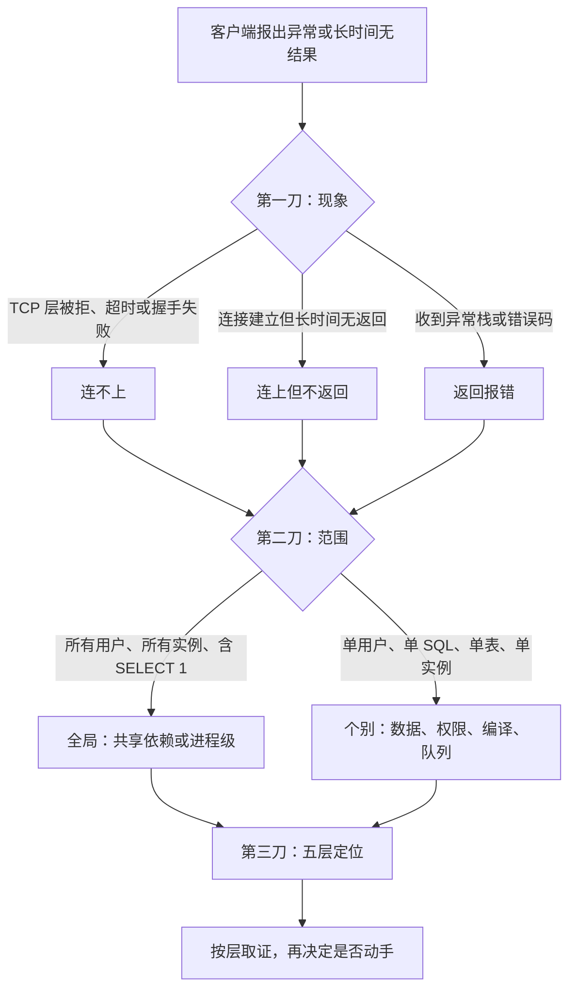
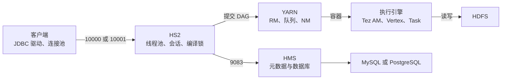
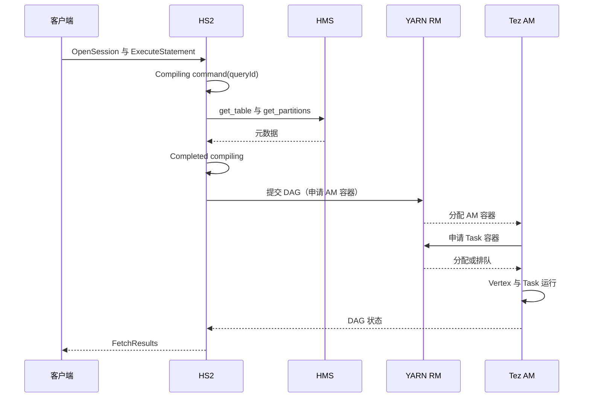
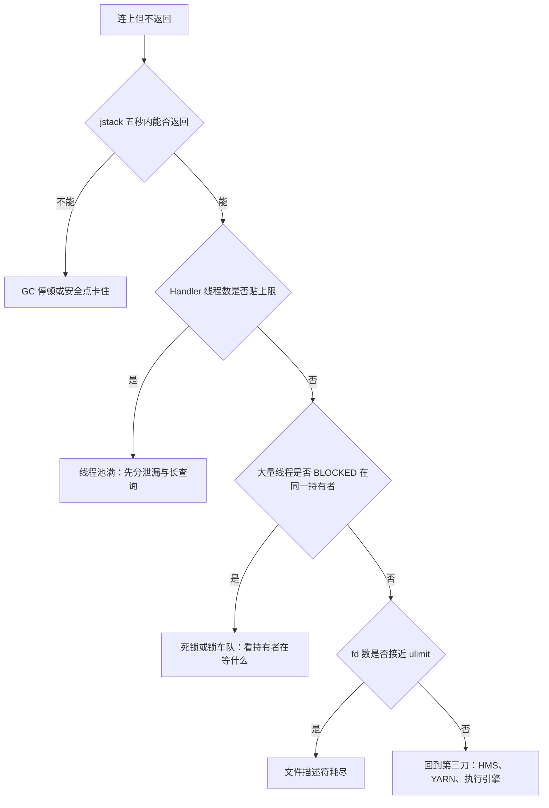
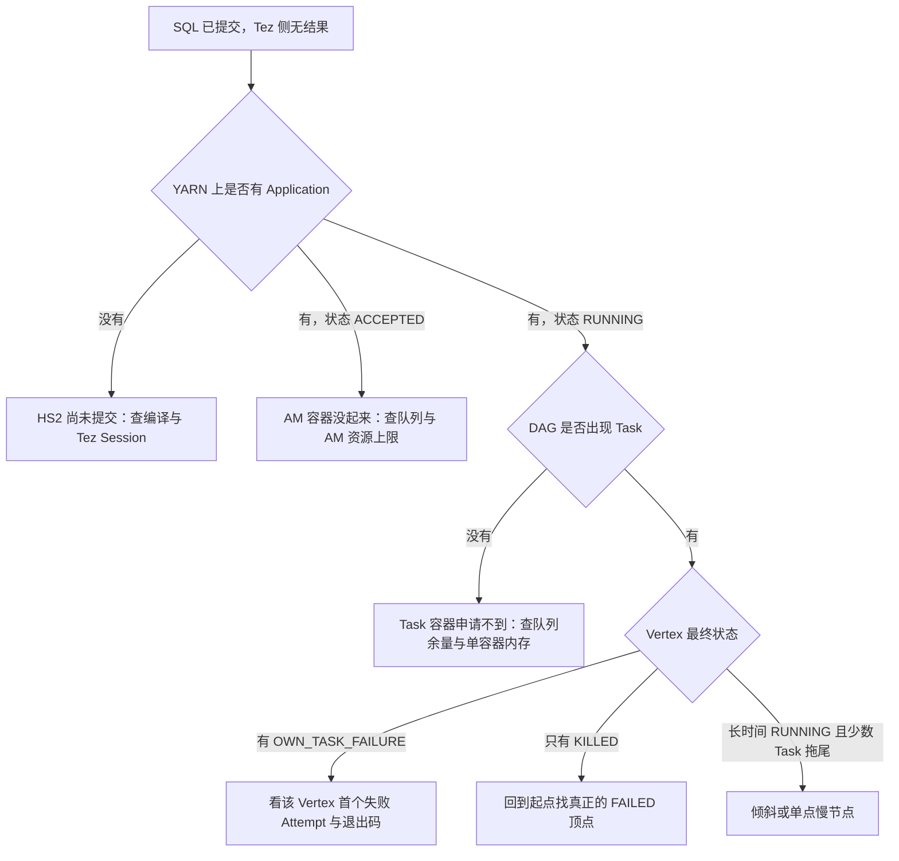

# 12 故障排查手册：从 HS2 无响应到 Tez 作业失败的系统诊断

**摘要：**

一条 SQL 卡住的时候，客户端、HiveServer2、Metastore、YARN、Tez 五个位置都可能留下异常，先看哪一个，决定了后面半小时是收敛还是发散。讲 Hive 故障的材料大多给清单——线程池满、Full GC、HMS 慢、容器 OOM、数据倾斜——列完，到了现场仍不知道从哪条开始试。这篇文章反过来写，先给一套不可颠倒的判定顺序：把"连不上、连上但不返回、返回报错"作为第一刀，把"全局还是个别"作为第二刀，把"五层定位"作为第三刀；每一刀都给出判据，以及顺序颠倒会改掉哪一份证据。顺序之后是三类场景的完整路径：HS2 无响应的四条成因与一条边界之外的第五种、查询报错的四种异常路由、Tez 失败的三层结构，最后收在日志对照表、取证清单与三个反例上。判据只有一条选择标准：能在三十秒内用只读命令取到，并且能同时说明"是这一层"与"不是这一层"；判断的顺序比判断的结论更值钱，因为顺序决定证据还在不在。全文以 Hive 4.0.1 源码默认值为口径，版本敏感的默认值在正文标注并给出差异。

---

## 第 1 章 先定顺序，再谈原因

设想一个不需要虚构的场景：监控告诉你某条 Hive SQL 跑了四十分钟没有结果。你手上只有客户端的报错、一条 queryId、若干台可登录的节点。翻 YARN、grep HS2 日志、把 HS2 重启，三种动作都会产生结果，但只有一种让后续判断更容易，另外两种让现场更难读——排障最稀缺的资源不是工具，而是**没有被操作改动过的证据**。

故障清单回答"有哪些可能"，判定顺序回答"先看哪一个"。清单是全集，全集没有优先级；现场需要的是一个能在几分钟内把候选集从十几种压到一两种的序列。经验丰富的人看起来"猜得准"，多数时候不是清单更长，而是顺序更稳：先确认现象属于哪一类，再确认影响范围，最后才钻进某一层。

### 1.1 清单为什么在现场失效

第一种失效，是把互斥的判据并列。线程池耗尽与 Full GC 停顿都会让新连接"没有响应"，判据却互斥：前者 `jstack` 能秒出、线程数贴着上限；后者 `jstack` 打不出来。两条并列写进清单，遇到现象仍要在两者间猜；判据放进顺序里才有排除力。

第二种失效，是只列故障、不列排除项。能用的判据必须同时回答两件事：看到什么说明是这一层，看到什么说明不是这一层。`SELECT 1` 正常而业务 SQL 报错，指向 HMS；连 `SELECT 1` 都排队，指向 HS2 自己的编译锁或线程。缺了反证的清单只能用来事后解释，不能当场收敛。

第三种失效，是不告诉你什么时候停。排障的终点是一个能解释全部症状、且能被一条只读命令证实的根因，不是一个可疑项；清单没有收敛条件，排查很容易变成漫游，查到第三个可疑项时已经忘了第一个为什么被排除。

### 1.2 三刀：现象、范围、分层

第一刀看现象，把故障分成三类：连不上、连上但不返回、返回报错。它决定接下来是查网络与认证、查阻塞与停顿，还是查异常栈与错误码；三类现象的证据形态完全不同，混着查必然浪费时间。

第二刀看范围，把故障分成全局与个别：全局是所有用户、所有实例、甚至最简查询都受影响；个别是只有某个用户、某条 SQL、某张表、某个实例出问题。这一刀决定能不能重启止损，也决定取证范围是**共享依赖**还是单条链路。

第三刀看层次，在客户端、HS2、HMS、YARN、执行引擎五层里定位。这一刀才进入具体的技术判断，前两刀的作用是让候选集足够小。三刀的顺序不能换：先分层再分范围，会在只有一个人失败时重启整个 HS2；先分范围再分现象，会把所有"没返回"都当成资源不足，漏掉认证失败这种 TCP 能通、却死在 SASL 阶段的情况。把这三刀画成图，分支最终汇到同一张分层图上。

### 1.3 顺序颠倒会改掉哪些证据

第一种是把范围问题当层问题。只有某个业务方的作业失败，工程师按"HS2 无响应"的直觉重启了 HS2。重启之后，那个用户的会话、他持有的锁、他所在线程的栈全部消失，"是不是只有他失败"这个问题从此无法回答；重启还会让现象暂时消失，故障被记成"已重启恢复"，根因被一起埋掉。仓库里那起 `AbstractMethodError` 的案例，关键判据恰恰是"只有这个用户的作业失败"，先重启就没了。

第二种是把现象问题当层问题。Kerberos 票据失效时，TCP 连接是通的，失败发生在 SASL 握手阶段，客户端看到 `GSSException` 或 `Peer indicated failure: GSS initiate failed`；把它当成"连接数满了"去调大线程上限，错误形态不会变，还会收获一次重启和一段被截断的日志窗口。认证的证据在票据与 KDC 侧。

第三种是把编译期问题当执行期问题。`EXPLAIN` 能把计划打出来，只说明编译走到了物理计划，不能说明容器里能跑。UDF 的实例化、类加载、版本兼容都发生在执行阶段，`AbstractMethodError` 在 `EXPLAIN` 里看不到。先跑 `EXPLAIN` 就断言"编译没问题，去查 YARN"，等于把方向从版本与类路径拨到资源与调度。

### 1.4 证据有半衰期

三种形态的共同点是：证据过期之前没被取下来。不同证据的存活时间差别很大，这个差别直接决定取证顺序。

线程栈的寿命以秒计：一次重试、一次超时、一次重连，锁的持有者就换人了。文件描述符表以分钟计，重启一次就归零。GC 历史按轮转策略保留，但进程一重启，历史与当前堆的对应关系就断了。容器日志的寿命取决于聚合与清理策略，Tez 的 DAG 页面在 Timeline Server 上也有保留期限。

这条性质给出一条很朴素的纪律：**先留现场，再动手**。留现场不需要停机，几条只读命令就够——`jstack` 打两份、`jstat` 打一组、数一下 fd、拷出 HS2 与 HMS 的日志时间窗、存下 Tez UI 的 DAG 页面。这套动作三十秒可以完成，而它保住的，往往是后面几小时里唯一能证伪假设的证据。

---

## 第 2 章 五层定位与分界判据

Hive 的技术栈可以切得很细：Thrift 层、会话层、编译层、元数据库、调度器、容器、DAG、Vertex、Task，再往下还有 HDFS 与操作系统。切得越细，判据越不可操作——很难用一条命令回答"问题在会话层还是编译层"。所以这里只保留五层，每层对应一个可以登录、取证、处置的对象。

五层依次是：客户端（连接、认证、驱动）、HS2（线程、会话、编译）、Metastore（元数据、数据库）、YARN（资源、队列）、执行引擎（Tez 的 Vertex 与 Task、MR 的 Task）。HDFS 与操作系统不单列，它们的故障几乎总是以别的形态出现：DataNode 异常让容器以特定退出码死掉，磁盘打满让 NM 把节点标成不健康，权限问题以 HDFS 异常栈落在 Task 日志里。并进执行引擎与 YARN 的证据链，判据反而更直接。五层与各自证据锚点的关系如图。

### 2.1 客户端层：连接、认证、驱动

这一层的判据在客户端手里，最容易被跳过，因为它"看起来不是服务端的问题"。三个子问题要分开：TCP 能否到达端口、认证能否通过、驱动与服务端能否对话。

TCP 的判据是计时而不是返回值。`nc -vz -w 3 host 10000` 一秒内返回拒绝，说明有设备回了 RST，端口没有监听或被防火墙拒绝；三秒超时，说明 SYN 没有回应，问题在网络路径、安全组或负载均衡。认证的判据是票据：`klist -e` 看有效期，`kinit -kt` 能否换票，客户端与 KDC 的时间偏差是否超过允许窗口。驱动的判据是版本对话：Hive 4 上老驱动可能在第一次 RPC 时报 `TApplicationException` 或 `NoSuchMethodError`，换同版本 Beeline 就能证伪。

这一层最重要的反证是"换一个客户端"：同一个账号、同一台机器用 Beeline 发 `select 1`，Beeline 正常而应用失败，问题在应用的驱动、连接池或票据获取方式；两者都失败，再往外看网络。

### 2.2 HS2 层：线程、会话、编译

HS2 层的入口判据是 queryId。请求真正到达 HS2 之后，日志里会出现 `Compiling command(queryId=...): <SQL>`，编译结束时出现 `Completed compiling command(queryId=...); Time taken: N seconds`。有 `Compiling` 没有 `Completed`，说明卡在编译；两行都有但客户端没拿到结果，说明卡在提交、执行或取结果；两行都没有，说明请求没到 HS2，回去查客户端、负载均衡与 ZooKeeper。

第二组判据是线程与指标。Thrift 服务端是**一连接一线程**，线程名以 `HiveServer2-Handler-Pool` 开头，上限由 `hive.server2.thrift.max.worker.threads` 决定（Hive 4.0.1 默认 500，以对应版本文档为准）。线程池满时，新连接在 accept 之后被立刻关闭，客户端看到的是"连上又断"。指标侧看 `OPEN_CONNECTIONS` 是否贴顶、`WAITING_COMPILE_OPS` 是否持续为正、`EXEC_ASYNC_QUEUE_SIZE` 是否到顶；开关 `hive.server2.metrics.enabled` 默认关闭，没打开过的集群只能靠日志推断。会话回收的默认值在版本之间差别很大：`hive.server2.session.check.interval` 在 Hive 3.1.3 是 6 小时、4.0.1 收到 15 分钟，`hive.server2.idle.session.timeout` 从 7 天收到 4 小时；排查会话回收前先核对版本。

这一层能排除自己的反证是"同一查询在另一个实例上正常"：只有一台出问题，多半在这台的进程状态；所有实例同时出问题，优先怀疑共享依赖。

### 2.3 Metastore 层：元数据与数据库

入口判据是"错误是否发生在需要元数据的位置"。`SELECT 1` 不需要表元数据，`SHOW DATABASES` 与 `DESCRIBE db.tbl` 需要，业务 SQL 在编译期至少需要一次 `get_table` 与一次分区裁剪。`SELECT 1` 正常而业务 SQL 报 `MetaException`，问题在 HMS 或其数据库；`SELECT 1` 也排队，HMS 大概率是受害者。

第一手证据在 HMS 日志与元数据库。HMS 日志里搜 `MetaException`、`TTransportException`、`RetryingMetaStoreClient`；元数据库侧用 `SHOW PROCESSLIST`、`SHOW ENGINE INNODB STATUS` 看长事务与锁等待。重试是有限度的：`hive.hmshandler.retry.attempts` 默认 10 次、间隔 2 秒，一次调用最坏在客户端侧耗掉二十秒量级；客户端等了四十秒才报错，基本就是**重试链**走完了。

量级判据也值得记住：`get_table` 是毫秒到几十毫秒，`get_partitions` 随分区数线性增长，百万分区的表可以做到秒级甚至因消息大小上限而失败；单次 `getPartitions` 的 P99 超过 2 秒，就已经进入需要治理的区间。

### 2.4 YARN 层：资源与队列

入口判据是"提交是否成功、容器是否分配"。HS2 把 DAG 交给 Tez 后，YARN 上出现一个 Application，状态从 `ACCEPTED` 走到 `RUNNING`。一直是 `ACCEPTED`，说明 AM 容器没拿到，问题在队列容量、AM 资源上限或 ACL；`RUNNING` 但 Task 数为零，说明 AM 活着但 Task 容器申请不到，问题在队列余量或单容器内存超上限。

证据在 RM 与 NM。RM 日志搜 `waiting for AM container`、`Container allocated`、`preempt`、`UNHEALTHY`；NM 日志搜 `running beyond physical memory limits`、`Exit code is`、`localization`；队列侧看 `usedCapacity` 是否接近 100%、`pendingContainers` 是否持续为正。两个默认值特别容易咬人：`yarn.scheduler.maximum-allocation-mb` 默认 8192，超过这个数的请求永远不会被满足；`yarn.scheduler.capacity.maximum-am-resource-percent` 默认 0.1，队列被普通容器占满之后 AM 就挤不进去。

能排除自己的反证是"容器已经分配并且启动成功"。`yarn container -list` 能看到目标容器处于运行态，资源层就过关了，后面再出问题属于引擎内部。

### 2.5 执行引擎层：Tez 的 Vertex 与 Task

入口判据是"DAG 是否已经出现 Task"：看 Tez AM 日志、Tez UI 的 DAG 与 Vertex 状态、容器退出码。Vertex 的失败类型本身就是判据：`OWN_TASK_FAILURE` 是这个 Vertex 自己的 Task 失败，是真正的起点；`OTHER_VERTEX_FAILURE` 是被别的 Vertex 连累的受害者。一张 DAG 里通常只有少数几个起点，其余 FAILED 与 KILLED 都是级联。

第二组判据是退出码与计数器。137 是被 SIGKILL（最常见于物理内存超限），143 是被 SIGTERM（预占、超时、外部 kill），1 是程序异常退出，负数是 YARN 框架侧的特殊状态（含义以 `ContainerExitStatus` 为准）。计数器看 `GC_TIME_MILLIS` 占比、`INPUT_RECORDS_PROCESSED` 的分布、`NUM_FAILED_TASKS`，读法见 [[10 Tez 调优实战：DAG 诊断、内存配置与数据倾斜治理]]。

能排除自己的反证是"DAG 根本没提交"。HS2 日志没有提交记录、YARN 上没有对应 Application，说明问题还在 HS2 的编译或 Tez Session 申请阶段，钻引擎日志是白费力气。

### 2.6 分界判据总表

把五层的入口、证据与反证并排放，判据之间的关系比单看一条都清楚；表里的耗时是**量级判断**，不是性能基准。

| 层 | 进入这一层的信号 | 第一手证据 | 能排除这一层的反证 | 典型耗时（量级判断） |
|---|---|---|---|---|
| 客户端 | 建连、认证、驱动握手阶段就失败 | 客户端异常栈、`klist -e`、`nc` 计时 | 同账号换 Beeline 正常 | 同机房建连 1ms 级；跨网 10ms 到秒级 |
| HS2 | 连接已建立，queryId 已生成 | `hive-server2.log` 的 queryId 锚点、jstack、`OPEN_CONNECTIONS` | 日志里没有该 queryId | 编译 0.1 秒到数十秒；会话建立数十毫秒 |
| HMS | 编译期需要元数据，报 `MetaException` | HMS 日志、元数据库 `PROCESSLIST`、`getPartitions` 延迟 | `SELECT 1` 正常而业务 SQL 报错 | `get_table` 毫秒级；全量分区秒级 |
| YARN | DAG 已提交，等待容器 | RM 日志、队列指标、pending 容器数 | 容器已分配且运行中 | AM 启动数秒到数十秒；容器分配秒级到分钟级 |
| 执行引擎 | 容器已启动，DAG 出现 Task | Tez AM 日志、Vertex 状态、容器退出码 | DAG 未提交，YARN 无 Application | Task 数秒到小时级；DAG 按业务 SLA 计 |

### 2.7 层与层之间的投影

五层不是并列的五个盒子，而是一条客户端链：HS2 是 HMS 的客户端，也是 YARN 的客户端，还是执行引擎的客户端。这意味着"HS2 慢"经常是下游慢的**投影**，方向可以从线程栈读出来：停在 `socketRead0` 且对端是 HMS 或 YARN，说明它在等下游；停在 `ReentrantLock.lock` 或 `CompileLock.tryAcquire`，说明它在等本进程内的锁；停在用户代码或 GC 相关帧，说明它在自己算。同一个"慢"字，三种栈指向三层。

把五层想成医院的几个窗口：挂号、检验、药房、手术、病房。病人抱怨"等了一天"，你要看的是单据上的时间戳，而不是每个窗口都排一遍队。单据在这套系统里就是 queryId 与容器 ID，时间戳就是日志行首的时间。

---

## 第 3 章 第一刀：三类现象怎么分

现象分类看起来最没有技术含量，实际最容易出错，因为客户端的措辞经常骗人：`Could not open client transport` 既可能是端口没开，也可能是认证失败，还可能是线程池满了之后服务端把连接关掉。同一个字符串对应三种根因，所以分类不能看措辞，要看失败发生在哪一段。

### 3.1 连不上：四种失败点

第一种是端口没有监听。进程死了、启动失败或绑定地址不对，内核直接回 RST。判据很干脆：`ss -lntp | grep 10000` 看不到监听，`nc -vz` 立刻返回拒绝，HS2 日志能看到启动阶段的异常（keytab 读不到、端口被占用、ZooKeeper 注册失败）。处置方向是看启动日志。

第二种是 SYN 没有回应。端口在监听，但包到不了，或者回来的路不通。判据是 `nc` 计时超时、同网段其他端口可达、HS2 的 Web UI 端口（默认 10002）同样不可达；Web UI 可达而 Thrift 端口不可达，问题更可能在中间设备对特定端口的策略上，最常见的是安全组、iptables、负载均衡把实例摘掉了。

第三种是 TCP 通了但认证失败。三次握手完成，TLS 或 SASL 阶段失败，客户端拿到 `GSSException: No valid credentials provided`、`LoginException`、`Peer indicated failure: GSS initiate failed` 之类的错误。判据在票据侧：`klist -e` 看 TGT 是否过期、是否可续期，`kinit -kt` 能否换票，时间偏差是否过大，keytab 权限是否只对服务账号可读。连接已经建起来，"网络不通"的假设在这一类里是错的。

第四种是握手之后立刻断开。特征是 `nc -z` 显示成功、客户端随即收到 `Connection reset` 或 EOF。原因通常有两个：线程池已到上限，新连接在 accept 之后被拒绝；或者协议版本对不上，服务端解析第一个请求时就关闭连接。前者的判据是 `ThreadPool is saturated with incoming requests` 与 `OPEN_CONNECTIONS` 贴顶，后者要对比驱动与服务端版本。

四种失败像四种打不通的电话：空号、无人接听、接通后听不懂方言、刚说一句就被挂断。区分它们靠的不是措辞，而是失败发生在第几段。`nc -z` 成功不代表服务可用，它只证明三次握手完成；能一次判断"服务是否可对话"的动作，是用与业务相同的客户端发一条 `SELECT 1`。

### 3.2 连上但不返回：queryId 是分水岭

连接建立之后没有返回，可能是服务端在算，也可能是服务端在等，还可能是服务端根本没收到。区分这三者的最小代价动作，是拿 queryId 去 grep HS2 日志。

有 `Compiling command` 而没有对应的 `Completed compiling command`，说明卡在编译，此时要看它在等什么：等**编译锁**时 `WAITING_COMPILE_OPS` 持续为正、线程栈停在锁上；等 HMS 时线程栈停在 `socketRead0`、HMS 日志有慢 RPC；CBO 计算时线程在本地跑，CPU 有占用，HMS 与 YARN 都很安静。

有 `Completed compiling` 但没有提交记录，说明卡在提交阶段：Tez Session 申请不到、YARN 队列拒绝，或客户端配置的队列不存在；此时 YARN 上要么没有 Application，要么长期停在 `ACCEPTED`。两行都有、DAG 也在跑，但客户端不返回，说明卡在取结果或执行阶段：取结果的判据是操作句柄是否有效、`FetchResults` 是否在报 `Invalid OperationHandle`；执行阶段的判据在 Tez UI 的 Vertex 进度上。

一行都没有，说明请求没到 HS2。证据在客户端、负载均衡、ZooKeeper 注册上：HS2 多实例时客户端通过 ZooKeeper 发现实例，注册节点异常会让客户端连到一个已经不在的地址；负载均衡把连接转到没有 HS2 的节点，表现也是"连上了但没人应"。

### 3.3 返回报错：看"多久之后报"和"报什么"

报错类故障信息量最大，也最容易误读，因为客户端拿到的异常栈经常是包装过的。两个维度最有用：报错延迟，以及异常类型或错误码。

时间维度把报错分成三档。秒级报错基本是编译期或参数问题：语法、表不存在、列不存在、权限不足、函数签名不匹配。十几秒到一两分钟报错，多半是元数据或资源问题：重试链走完、YARN 申请超时、Tez Session 建立失败。几分钟到几小时才报错，通常是执行期超时、容器被杀或作业自己失败。

异常类型与错误码给出方向。SQLState 的 `08` 类对应连接与链路，`42` 类对应语法与权限；Hive 自己的错误码里，`10001` 是表不存在（SQLState `42S02`），`10308` 是编译锁等待超时，`40000` 是泛化错误。`SemanticException` 出现在语义分析，`MetaException` 来自 HMS，`OutOfMemoryError` 要看是哪个 JVM 抛的，`AbstractMethodError` 属于运行期类加载。这些异常分别对应不同的层，第 7 章逐条给出路由。

### 3.4 三类混判的典型形态

第一种混判是把认证失败当成连接数满。两者的措辞都可能是"连不上"，但认证失败时线程池往往很空，`OPEN_CONNECTIONS` 也不高；按连接数满处置、调大上限、重启 HS2，错误照旧，票据失效的证据还被推出时间窗。

第二种混判是把线程池满当成网络问题。线程池满时服务端在内核层完成了握手，`ping`、`nc -z`、`telnet` 都显示成功，只有发请求时才断；此时查交换机、查安全组，方向完全错了。判据是饱和告警与 `OPEN_CONNECTIONS`，不是网络连通性。

第三种混判是把"返回报错"当成"连不上"。客户端拿到 `MetaException`，说明连接、认证、RPC 全走通了，错误发生在业务逻辑里；按"连不上"去查网络，等于把已排除的层又查一遍。三类现象的分界不是措辞，而是失败发生在第几段。

| 现象 | 失败发生在哪一段 | 关键判据 | 常见误判 |
|---|---|---|---|
| RST 拒绝 | TCP 握手之前 | 端口无监听、`nc` 立即拒绝 | 误判为认证失败 |
| SYN 超时 | TCP 握手之前 | `nc` 计时超时、Web UI 同端口不可达 | 误判为服务端过载 |
| 认证失败 | 握手之后、SASL 阶段 | `GSSException`、`klist` 过期、keytab 权限 | 误判为连接数满 |
| 连上即断 | 握手之后、首个请求前 | 线程池饱和告警、`OPEN_CONNECTIONS` 贴顶 | 误判为网络抖动 |
| 连上不返回 | 请求已进入服务端 | queryId 有无、线程栈停在哪 | 误判为客户端卡死 |
| 返回报错 | 请求已走完一段链路 | 异常类、错误码、报错耗时 | 误判为连接问题 |

---

## 第 4 章 第二刀：全局还是个别

现象分类之后，第二个问题不是"哪一层"，而是"影响面有多大"。答案直接决定能不能重启：全局故障重启可能止血，个别故障重启只会销毁证据。

### 4.1 最小对照实验矩阵

判断范围不需要复杂工具，需要的是控制变量：同一时间段内依次改变一个变量，看结果是否跟着变。

| 变的量 | 做法 | 结果指向 |
|---|---|---|
| 客户端 | 同一账号换 Beeline，与业务应用对比 | 只有应用失败：驱动、连接池、票据获取方式 |
| 机器 | 同账号换一台同网段机器 | 只有某台失败：本机 DNS、网络策略、票据缓存 |
| 用户 | 换一个业务账号执行同一条 SQL | 只有某用户失败：权限、队列映射、UDF 注册、票据 |
| SQL | `SELECT 1`、`SHOW DATABASES`、业务 SQL 三级递进 | 最简查询也失败：HS2 或共享依赖；只有业务 SQL 失败：编译、元数据、数据 |
| 实例 | 连另一台 HS2 执行同一条 SQL | 只有单实例失败：该进程的线程、堆、fd、锁 |
| 队列 | 换一个 YARN 队列提交 | 只有某队列失败：容量、配额、ACL、AM 资源上限 |
| 时间 | 与半小时前、昨天同时间对比 | 突发且持续：变更或容量；周期性：调度高峰 |

这张矩阵的价值在于它有停止条件：某个变量的变化能稳定复现或消除故障，范围就确定了。

### 4.2 全局故障的判据

全局故障的特征是"与具体业务无关的失败"。`SELECT 1` 失败、所有用户同时失败、所有实例同时失败、新连接全部被拒，四个信号出现一个，就查共享依赖：KDC、DNS、ZooKeeper、HMS 与元数据库、YARN 队列、HDFS 安全模式。

取证顺序应该从最外层共享依赖往里走。全局故障里 HS2 通常是受害者：KDC 不可用让所有认证失败，HMS 不可用让需要元数据的查询失败，YARN 队列满让所有作业排队；先查 HS2 的线程池，大概率只看到"线程都停在等下游"这个中间现象。

### 4.3 个别故障的判据

个别故障的特征是"能定位到一个具体对象"：一个用户、一条 SQL、一张表、一个 UDF、一台实例。这类故障最常见的根因不在资源，而在数据与配置：某个 UDF 的 jar 与集群版本不兼容、某张表分区数爆炸拖慢编译、某个用户没有队列权限、某个分区文件损坏、某台实例的 keytab 过期。

取证范围应收窄到这一条链路，不要把集群指标都拉一遍。只有一条 SQL 失败，取证对象是这条 SQL 的编译日志与执行计划；只有一张表失败，取证对象是这张表的元数据与文件；只有一个用户失败，取证对象是这个用户的票据、权限与函数注册。

### 4.4 范围判断错了会怎样

把全局故障当个别，最常见的后果是反复重启单实例。KDC 挂了的时候，重启 HS2 不会让认证恢复，只会让"仍然失败"被误读成"重启没用，再重启一次"；几次之后，日志混进多轮重启记录，最初的时间线再也拼不出来。

把个别故障当全局，后果更重。只有一个用户的作业失败时重启整个 HS2，会打断其他所有正在跑的查询；重启之后故障用户重新连上来，问题可能因为缓存或会话重建暂时消失，于是被记成"已恢复"。仓库里那份 Kerberos 认证故障报告的时间线之所以可贵，正是因为它保留了完整的阶段划分：TGT 续期线程先崩、认证失败在海量会话涌入时放大、最后演变成线程池耗尽与锁车队。如果第一时间重启，这三个阶段会被压缩成"HS2 挂了"，根因也就无从谈起。

### 4.5 范围与止损的取舍

范围判断的另一个用途，是决定能不能先止损。全局故障且根因在外部依赖时，止损手段是切流与降级：切到另一个可用域、暂停非关键调度、临时放宽队列配额。个别故障时，止损手段是隔离：把失败用户或队列单独摘出去，让其余业务继续跑，同时保留现场。

这条取舍没有通用答案，但有一条判据：故障还在扩散（失败率上升、线程堆积、队列恶化）时先止损再取证；故障稳定在坏状态（固定几个用户失败、固定一条 SQL 失败）时先取证再止损。扩散中的故障每等一分钟都在产生新证据，稳定中的故障每等一分钟只是多一条重复日志。

---

## 第 5 章 第三刀：分层靠时间轴对齐

五层定位的难点不在判据本身，而在每条判据都有自己的时钟；真正能把它们对齐的，是**时间锚**。客户端的超时、HS2 的日志、HMS 的 RPC、YARN 的调度、Tez 的 Task 状态，各自记录各自的时刻，不先对齐到一条时间轴上，判据之间就无法互相印证。

### 5.1 一条查询的六个时间锚

一次正常的 Hive 查询至少有六个可观测时刻：发出请求、HS2 生成 queryId 并开始编译、编译完成、DAG 提交、AM 启动并调度、第一个 Task 启动、查询结束。相邻两点相减得到一段耗时，哪段明显超量级，问题就落在哪一层。

| 时间锚 | 证据位置 | 正常量级（量级判断） | 超时指向 |
|---|---|---|---|
| 请求发出到 HS2 接收 | 客户端时间戳、HS2 `Compiling command` 时间 | 同机房毫秒级 | 客户端、网络、负载均衡 |
| 开始编译到编译完成 | 同一 queryId 的 `Compiling` 与 `Completed compiling` | 简单查询 0.1 到 1 秒；复杂查询数秒到数十秒 | 编译锁、HMS、CBO |
| 编译完成到 DAG 提交 | `Completed compiling` 与 YARN Application 创建时间 | 秒级；Tez Session 冷启动可到数十秒 | Tez Session、队列、AM 资源 |
| DAG 提交到 AM 启动 | YARN 状态变化、AM 日志首行 | 数秒到数十秒 | 队列容量、AM 资源上限、本地化 |
| AM 启动到首个 Task | AM 日志的容器分配记录、Tez UI 的 Task 启动时间 | 数秒到一分钟 | 队列余量、单容器内存上限、节点可用性 |
| 首个 Task 到查询结束 | Tez UI 的 Vertex 时间线 | 按业务 SLA 计 | 数据量、倾斜、Shuffle、GC |

时间轴对齐之后，"慢"会变成具体问题：慢在哪一段。只拿客户端报错时间做判断会失真：客户端报的是自己的超时时刻，可能比服务端真正失败早或晚几分钟。

### 5.2 用 queryId 与容器 ID 串证据

queryId 是 HS2 侧的串联键。同一条查询在 HS2 日志里的所有行都带这个 ID，操作日志（operation log）也按 queryId 组织，客户端从异常信息里通常能拿到它。拿到 queryId，`grep` 一次就能把编译起点、编译终点、提交动作、异常栈按时间排好。

容器 ID 是执行侧的串联键。Tez UI 上的失败 Attempt 会给出容器 ID，NM 日志、`yarn logs`、容器退出码都挂在这个 ID 上。把容器 ID 与 queryId 对上，才能把"客户端看到的报错"与"容器里真正发生的事"接起来；多租户集群里尤其重要，同一节点可能同时跑着几十个应用的容器。

### 5.3 时间轴上的三种伪影

第一种是日志聚合延迟。YARN 的容器日志要等容器结束后才聚合，本身有分钟级延迟；HS2 与 HMS 的日志是本地写，几乎实时。拿报错时间与聚合日志对齐，很容易得出"服务端晚了几分钟才反应"的错误结论。

第二种是时钟偏差。节点间没有严格 NTP 同步时，几秒到几十秒的偏差足以让因果顺序颠倒；排查跨节点问题先确认各节点时间，否则可能把"AM 先失败、Task 后失败"读成相反的顺序。第三种是客户端超时先于服务端失败：客户端第十秒超时放弃，服务端第六十秒才记录容器被杀，两个时间戳差一分钟，不知道客户端有超时就以为服务端卡了一分钟。把这条链路按时序画出来，各段耗时的归属就清楚了。

---

## 第 6 章 HS2 无响应的四条路径

HS2 无响应是"同一表象、多种根因"的典型：四条路径加一条边界之外的第五种，客户端感受几乎一样——连上了、提交了、没有返回，取证方式却完全不同，判据之间也互相排斥。

### 6.1 线程池满：一连接一线程的代价

HS2 的 Thrift 服务端用线程池实现**一连接一线程**：最小 5 个、最大 500 个（Hive 4.0.1），工作队列是 `SynchronousQueue`，没有排队缓冲——第 501 个连接不会等待，而是被直接拒绝。客户端看到的不是"连接超时"，而是"连上又断"：握手由内核完成，服务端 accept 之后拒绝执行，连接随即关闭。

判据有三条。线程侧：`HiveServer2-Handler-Pool` 开头的线程数贴着上限，每个线程的栈都在做实际工作。指标侧：`OPEN_CONNECTIONS` 贴顶，`CUMULATIVE_CONNECTION_COUNT` 快于查询量增长。日志侧：`ThreadPool is saturated with incoming requests`。

线程池满要分两种，处置完全不同。**连接泄漏**是客户端开了太多连接却不释放，线程栈长期停在 `socketRead0`；**长查询占满**是线程都在干活，只是每条都很慢。前者查客户端池子配置与回收策略，后者查查询为什么慢；反过来治，把上限从 500 调到 2000，前者放大泄漏规模，后者把线程栈内存翻几倍。

### 6.2 长查询占满：编译锁与被忽略的串行点

HS2 里有一个比线程池更隐蔽的串行点：**编译锁**。Hive 4.0.1 的 `CompileLockFactory` 默认返回一把进程级公平 `ReentrantLock`，只要 `hive.driver.parallel.compilation` 保持默认 false，同一进程内所有会话的编译就是串行的。更麻烦的是等待策略：`hive.server2.compile.lock.timeout` 默认 0 秒，无限等待，请求一直挂着，直到前一个编译结束或客户端放弃。

判据非常清晰。日志侧：多个 queryId 的 `Compiling command` 挤在一起，只有最早那条出现 `Completed compiling command`。线程侧：大量线程停在 `ReentrantLock.lock` 或 `CompileLock.tryAcquire`，只有一个线程在跑语义分析或 CBO。指标侧：`WAITING_COMPILE_OPS` 持续为正。行为侧：连 `SELECT 1` 都排队，这是区分编译锁与 HMS 慢的关键，因为 `SELECT 1` 不访问表元数据。

常被忽略的细节：编译慢不等于编译锁排队。复杂 SQL 的 CBO 可以合法地跑几十秒，这期间它一直持有编译锁；所以判据要成对看——单条查询的编译耗时是否合理，等待队列是否在增长。只看一个，会把"SQL 太复杂"误判成"锁有问题"。

### 6.3 GC 停顿：进程还在，世界停了

Full GC 造成的停顿在客户端看来是"连上了但不返回"，在网络层看来一切正常：内核仍在 accept，TCP 连接仍然建立，只是 JVM 里的线程全停在安全点，没有应用层响应。

最有辨识度的判据是 `jstack` 打不出来。`jstack` 依赖 JVM 的 attach 机制，attach 需要进入安全点，长时间 STW 期间安全点无法完成，`jstack` 会挂住或超时。`jstack` 等十秒还没输出、HS2 日志停在某个时刻不再增长，基本可判定进程处在长停顿；这一条比看 GC 日志更快，不需要提前开启 GC 日志。

补充判据是 `jstat -gcutil <pid> 1000 10`：看 `FGC` 是否在十秒内增长、`FGCT` 的斜率、老年代使用率。G1 的日志（`-Xlog:gc*`）给出每次停顿的时长，几百毫秒正常，几秒到几十秒足以让客户端超时。停顿期间日志是空白的；把客户端报错时间与日志最后一行时间对比，区间重合就能确认。

### 6.4 死锁与锁车队：活着的进程，死掉的吞吐

Java 级死锁在 jstack 里会直接给出结论：`Found one Java-level deadlock`，下面列出互相等待的线程与锁。

更常见的是**锁车队**（lock convoy）：没有环，jstack 不报死锁，但吞吐为零，所有线程都在等同一把锁，而持锁者反复失败、反复重试、每次重试前还睡一会儿。仓库里那起 Kerberos 认证故障就是这种形态：TGT 续期线程先崩溃，HS2 处理会话时需要对 HMS 做认证，失败后进入重试逻辑，而重试在全局锁里休眠，于是一个线程持锁睡眠、其余排队，形成"一个接一个掉进同一个坑"的接力；线程转储里数百个线程 `BLOCKED` 在同一持有者上，持有者的栈停在 `getDelegationTokenFromMetaStore` 之类的重试路径里。

判据组合是：大量 `BLOCKED`、没有死锁环、持锁者栈里有 `Thread.sleep` 或 `RetryingMetaStoreClient`、下游日志（HMS 的 SASL 失败、KDC 请求停止）能解释"为什么重试一直失败"。只看大量 BLOCKED 就断言死锁，会漏掉根因在认证侧。

### 6.5 边界之外的第五种：文件描述符耗尽

文件描述符耗尽是 HS2 无响应的第五种形态，不在"线程、编译、GC、锁"四类里，却经常被误判成前四类。判据很直接：`ls /proc/<pid>/fd | wc -l` 接近 `ulimit -n`，`lsof -p <pid>` 同量级，日志出现 `Too many open files`，`ss -s` 显示大量 socket 处于 CLOSE_WAIT 或 ESTABLISHED。线程数、GC、`jstack` 可能全正常，这三条"正常"恰好是它与前四种的分界。

仓库里那份 Redis UDF 文件描述符泄漏报告给出的量级值得记住：每个 UDF 实例创建一个连接池，池子最小空闲 5 个连接，编译期反复实例化 UDF，泄漏的连接池到数百个量级，累计 FD 三万以上，而系统上限是六万五千左右。这类泄漏隐蔽在渐进性上：前几天 FD 从几百涨到几千，一切正常，接近上限的那一刻所有新连接同时失败。判据不是"FD 数是否高"，而是"FD 数的斜率是否持续为正且没有回落"。

### 6.6 五条路径的判据对照

五条路径的判据互斥，可做成现场对照表；"处置方向"只给方向，因为处置前还有取证。

| 路径 | jstack 看什么 | 指标特征 | 日志关键字 | 处置方向 |
|---|---|---|---|---|
| 线程池满 | Handler 线程数贴上限；栈分两类：`socketRead0`（泄漏）或真实计算（长查询） | `OPEN_CONNECTIONS` 贴顶 | `ThreadPool is saturated` | 泄漏查客户端池；长查询查慢因；扩上限是最后手段 |
| 编译锁排队 | 大量线程停在 `ReentrantLock.lock` 或 `CompileLock.tryAcquire`；仅一个线程在编译 | `WAITING_COMPILE_OPS` 持续为正 | 多条 `Compiling` 只有一条 `Completed` | 找占锁 queryId；评估并行编译；设编译锁超时 |
| GC 停顿 | `jstack` 挂住或超时；若能打出，线程多停在安全点附近 | `FGC` 增长、老年代高位 | HS2 日志出现时间空白 | 查堆与泄漏；调 GC；不要先调大客户端超时 |
| 死锁与锁车队 | 有死锁环，或大量 `BLOCKED` 同一持有者，持有者在 sleep 或重试 | 吞吐归零 | HMS 侧 SASL 或认证失败 | 先修持锁者等待的下游，再谈重启 |
| fd 耗尽 | 线程数与 GC 均正常 | fd 数量贴 `ulimit` | `Too many open files` | 定位泄漏源；临时提高 ulimit |

五条判据有一个共同前提：进程还活着。一旦重启，线程栈、fd 表、锁持有者、GC 历史同时消失，五条路径全部退化成"重启后恢复"这句无法验证的结论。判定顺序如图。

---

## 第 7 章 查询报错的路由

报错类故障的分诊目标不是"修好它"，而是"把它送到正确的层"。Hive 的异常类型已经给出相当明确的路由信息，只要不被客户端的包装栈骗过去。

### 7.1 SemanticException：编译期，路由到编译链

`SemanticException` 出现在语义分析阶段，典型形态是表不存在、列不存在、类型不匹配、聚合用法错误、分区列引用错误。判据是"报得快"：秒级返回，没有 DAG 提交，日志里只有 `Compiling command` 没有 `Completed compiling`，栈里能看到 `SemanticAnalyzer` 或 `CalcitePlanner` 的帧。错误码多在 `10xxx` 段，例如 `10001` 表不存在，SQLState 为 `42S02`。

处置不在运维侧，而在 SQL 与元数据侧：确认表名与库名、列名与大小写、分区列有没有被当成普通列、函数签名与参数类型是否匹配；编译链机制见 [[03 SQL 编译全链路：从 HQL 到 Operator Tree]]。要区分的是语法错误：`ParseException` 错误码通常是 `40000`，栈里出现 `ParseDriver`，这类错误连语义分析都没进。

### 7.2 MetaException：元数据，路由到 HMS

`MetaException` 来自 HMS，可能被 HS2 包装后返回。判据是"错误发生在需要元数据的位置"：`SELECT 1` 正常，`SHOW DATABASES` 或业务 SQL 失败；HS2 日志里有 `MetaException`、指向 9083 的 `TTransportException`、或 `RetryingMetaStoreClient` 的重试记录；HMS 日志有对应失败栈。

处置方向在 HMS 与元数据库：分区数是否失控、连接池是否耗尽、是否有长事务持锁。元数据模型与高可用见 [[02 Hive Metastore 深度解析：元数据体系与 HMS 高可用]]。容易误判的是缓存不一致：数据库里的元数据已改，HMS 返回的还是旧对象，报错看起来像"表不存在"，重试或换实例又正常；判据是"换实例后现象消失"与"数据库里查得到"。

### 7.3 OutOfMemoryError：先确认是哪个 JVM

客户端看到 `OutOfMemoryError` 时，常以为"客户端内存不够"，但这个错误有四个可能出处：HS2、HMS、Tez AM、Task 容器。出处不同，处置完全不同。

判据是"异常出现在哪里"。HS2 的 OOM 在 HS2 日志里留下同样的栈，进程可能随后退出或被 OOM Killer 杀掉；客户端拿到的只是服务端返回的异常文本。HMS 的 OOM 在 HMS 日志里。AM 的 OOM 表现为 YARN 应用失败、AM 退出码异常，Tez UI 上可能连 DAG 都没建立。Task 的 OOM 通常不是 Java 层的 `OutOfMemoryError`，而是容器被 YARN 按物理内存上限杀掉，退出码 137，NM 日志有 `running beyond physical memory limits`。

这个区分决定优化方向：HS2 的 OOM 查会话与结果集占用、查 Metaspace 是否被 UDF 类加载撑爆；Task 的 OOM 查 Container 内存与 `-Xmx` 的比例、查 Map Join 哈希表大小、查倾斜导致的单 Task 内存爆炸。把 Task 的内存问题当 HS2 的堆问题去调，只会把两个进程一起拖垮。

### 7.4 AbstractMethodError：运行期，路由到类加载与版本

`AbstractMethodError` 是运行期错误：JVM 试图调用一个抽象方法，但实际加载的类没有实现它。它几乎总是版本或类路径问题：编译依赖的 Hive 版本与容器里加载的不一致，或 UDF 的 jar 与集群 `hive-exec` 不匹配。

判据有三条。第一，`EXPLAIN` 能过、执行失败，因为 `EXPLAIN` 不实例化 UDF，也不加载容器里的类。第二，只有使用特定 jar 或特定函数的作业失败，其他作业正常。第三，异常栈的 `Caused by` 末端是 `AbstractMethodError`，且往往出现在算子初始化阶段，例如 `MapRecordProcessor.init` 或 `ExprNodeGenericFuncEvaluator.initialize`。

仓库里那起 Tez 作业失败的报告完整呈现了这个形态：`Map 4` 顶点报 `OWN_TASK_FAILURE`，其余五个顶点是 `OTHER_VERTEX_FAILURE` 的级联 KILL；失败只发生在使用某个 UDF jar 的用户作业上，关掉常量传播参数后仍然以同样的错误失败；`javap` 显示实现类继承的是旧式 `UDF`，而运行期调用的是 `GenericUDF` 的新方法。这组证据把方向从"常量折叠优化"纠正到了"容器里的 `hive-exec` 版本与 jar 的兼容性"，UDF 的类型体系与类加载边界见 [[09 UDF 开发体系：GenericUDF、UDAF 与 UDTF 全解]]。

### 7.5 报错路由表

| 异常或错误码 | 出现阶段 | 最小判据 | 路由 |
|---|---|---|---|
| `SemanticException`、`10001`、`42S02` | 语义分析 | 秒级报错、无 DAG、栈含 `SemanticAnalyzer` | 编译链与 SQL 本身，见 [[03 SQL 编译全链路：从 HQL 到 Operator Tree]] |
| `ParseException`、`40000` | 解析 | 栈含 `ParseDriver`、语法位置明确 | SQL 语法 |
| `MetaException`、`TTransportException` | 编译期取元数据 | `SELECT 1` 正常、HMS 日志有失败与重试 | HMS 与元数据库，见 [[02 Hive Metastore 深度解析：元数据体系与 HMS 高可用]] |
| `OutOfMemoryError: Java heap space` | 编译或执行 | 同段栈出现在哪个进程的日志里 | HS2 查会话与结果集；容器查内存配置，见 [[10 Tez 调优实战：DAG 诊断、内存配置与数据倾斜治理]] |
| 容器退出码 137、`running beyond physical memory` | Task 执行 | NM 日志、容器退出码 | 容器内存与倾斜 |
| `AbstractMethodError`、`NoSuchMethodError` | 算子初始化 | `EXPLAIN` 通过、仅特定 jar 失败、`Caused by` 末端明确 | UDF 与类加载，见 [[09 UDF 开发体系：GenericUDF、UDAF 与 UDTF 全解]] |

---

## 第 8 章 Tez 作业失败的三条路径

把 HS2 与 HMS 都排除之后，问题落到执行引擎。Tez 的失败可以切成三层：容器起不来、Vertex 失败、DAG 重试耗尽。三层的证据位置不同，处置也不同，混在一起看只会得到"作业失败了"这个没有信息量的结论。

### 8.1 第一层：容器起不来

要先分清 AM 容器还是 Task 容器。AM 起不来时，Application 停在 `ACCEPTED`，RM 日志出现等待 AM 容器的记录，Tez UI 上连 DAG 都没有。Task 容器起不来时，Application 是 `RUNNING`，AM 活着、DAG 已初始化，但所有 Vertex 的 Task 数都是零，AM 日志反复出现等待容器的记录。

AM 起不来常见三个原因：队列被普通容器占满，`maximum-am-resource-percent`（默认 0.1）决定 AM 的资源上限；队列 ACL 不允许该用户提交；没有满足节点标签或可用资源的节点。Task 起不来也是三个：队列余量不足、单容器请求超过 `yarn.scheduler.maximum-allocation-mb`（默认 8192）、节点本地化失败或磁盘不健康。

判据在三处：`yarn application -status` 看状态与诊断，`yarn container -list` 看容器是否创建，RM 与 NM 日志看分配与拒绝。有一条很实用：容器请求的内存超过调度器最大分配额度时，YARN 不报"资源不足"，而是让请求一直挂着，因为它在调度器看来是非法请求，永远不会被匹配；看到"队列有空余但容器不分配"，先核对请求的内存量。

### 8.2 第二层：Vertex 失败

第一条判据是失败类型：**OWN_TASK_FAILURE** 是真正的起点，**OTHER_VERTEX_FAILURE** 是受害者。一张 DAG 里通常只有少数几个起点，先找它们，再看第一个失败 Attempt，而不是从最后一条日志往前翻。

第二条判据是退出码。137 是 SIGKILL，最常见于物理内存超限，NM 日志有 `running beyond physical memory limits` 与 `Container killed on request`；143 是 SIGTERM，常见于预占、超时、外部 kill；1 是程序异常退出，栈里有具体 Java 异常；负数是 YARN 框架侧状态，含义看 `ContainerExitStatus`。同一 Vertex 里不同 Task 的退出码可能不同，先统计分布再看占比最大的那类。

第三条判据是级联方向与计数。Vertex 失败会触发整张 DAG 失败，其余 Vertex 被 KILL，这是设计而不是异常；如果一张 DAG 里有五个 KILLED、一个 FAILED，不要把五个 KILLED 都当成独立故障去查，它们只是同一个起点的回声。仓库里那起 `AbstractMethodError` 的案例就是 1 个 FAILED 加 5 个 KILLED，真正的信息只在那个 FAILED 顶点里。

### 8.3 第三层：DAG 重试耗尽

Tez 的重试有多个层次，混淆会导致错误归因。Task 级别的重试由 `tez.am.task.max.failed.attempts` 控制，默认 4，被杀掉的 Attempt 不计入失败次数；Application 级别的重试由 `tez.am.max.app.attempts` 控制，默认 2；DAG 级别的恢复由 `tez.dag.recovery.enabled`（默认开启）与恢复日志的刷新间隔控制，它解决的是 AM 崩溃后的进度恢复，不是"重跑整个 DAG"。

"重试耗尽"的典型形态是同一个 Task、同一个输入分片、同一个异常反复失败四次，然后 Vertex 失败、DAG 失败。这种失败通常不是资源问题，而是数据或代码问题：一条"毒数据"让 UDF 抛异常、一种特殊字符让解析失败、一个损坏的 ORC 文件让读取失败。重试对它没有意义，每次读到的还是同一条记录。

判据是重复性：在 AM 日志里找到同一个 Task 的多个 Attempt，比较栈与输入分片，完全一致基本可以确认是**确定性失败**。处置方向不是调大重试，而是定位那条记录：从 Task 日志找输入分片与偏移，回源表过滤或修复；问题在 UDF 就按第 7 章查类加载与版本。

重试的代价值得算一笔账。假设一个 DAG 有 200 个 Task，其中一个因为毒数据必然失败，每次重试都要重新申请容器、读输入分片、初始化算子，一次 Attempt 的固定开销按二十秒到一分钟量级估算，四次就是几分钟；如果它在多个 Vertex 里重复出现，开销成倍放大。更糟的是失败 Task 一直占着队列配额，其他作业的容器申请被推迟。这是示例推算：重试是恢复机制，不是容错机制。

### 8.4 三条路径的判据对照

| 路径 | 现场现象 | 关键判据 | 证据位置 | 处置方向 |
|---|---|---|---|---|
| AM 容器起不来 | Application 停在 `ACCEPTED`，无 DAG | 队列容量、AM 资源上限、ACL | RM 日志、`yarn application -status` | 调队列或等待；核对 AM 资源占比 |
| Task 容器起不来 | Application `RUNNING`，DAG 无 Task | 队列余量、单容器内存是否超上限 | AM 日志、RM 日志 | 核对容器内存与调度器上限 |
| Vertex 失败 | 一个 `OWN_TASK_FAILURE` 加若干 `KILLED` | 退出码分布、首个失败 Attempt 的 `Caused by` | AM 日志、NM 日志、`yarn logs` | 按退出码分流：内存、异常、被杀 |
| DAG 重试耗尽 | 同一 Task 反复失败后 DAG 失败 | 多次 Attempt 的栈与输入分片一致 | AM 日志、Task 日志 | 定位毒数据或代码缺陷 |

判定顺序比逐条翻日志快得多：先看 YARN 上有没有 Application，再看状态，再看 DAG 有没有 Task，最后看 Vertex 的失败类型；这与第 1 章的三刀同构，只是观测对象换成了 YARN 与 Tez。判定路径如图。

---

## 第 9 章 该看哪个日志

排查到第三刀之后，基本就是在对的日志里搜对的关键字。难点不是命令，而是知道每个日志能回答什么、不能回答什么。

Hive 的日志文件名由 log4j2 的 `hive.log.file` 决定，Apache 默认 `hive.log`，发行版通常拆成 HS2 的 `hive-server2.log` 与 HMS 的 `hive-metastore.log`；目录由 `HIVE_LOG_DIR` 决定，发行版通常落在 `/var/log/hive`。HS2 还有按查询组织的操作日志：`hive.server2.logging.operation.enabled` 默认开启，目录默认 `${java.io.tmpdir}/${user.name}/operation_logs`，默认级别 `EXECUTION` 只记录任务完成，要看更细的细节需在会话里调到 `VERBOSE`。

YARN 侧的日志分三层：RM 与 NM 的守护进程日志（`yarn-<user>-resourcemanager-<host>.log`、`yarn-<user>-nodemanager-<host>.log`，目录由 `HADOOP_LOG_DIR` 或 `YARN_LOG_DIR` 决定）、容器本地日志（`${yarn.nodemanager.log-dirs}/application_*/container_*/` 下的 `syslog`、`stderr`、`stdout`）、聚合日志（`yarn logs -applicationId`）。容器日志聚合有延迟，作业刚失败时可能还查不到。

| 日志 | 路径规律 | 关键关键字 | 能回答什么 | 不能回答什么 |
|---|---|---|---|---|
| HS2 主日志 | `HIVE_LOG_DIR/hive-server2.log`（Apache 默认为 `hive.log`） | `Compiling command`、`Completed compiling`、`ThreadPool is saturated`、`Too many open files` | 查询是否到达 HS2、卡在编译还是执行、线程与 fd 是否异常 | 容器内部为什么失败；YARN 为什么没给资源 |
| HS2 操作日志 | `${java.io.tmpdir}/${user}/operation_logs` | queryId、执行阶段耗时 | 单条查询的分段耗时与执行细节（级别够高时） | 系统级资源状态 |
| HMS 日志 | `HIVE_LOG_DIR/hive-metastore.log` | `MetaException`、`RetryingMetaStoreClient`、`TTransportException` | 元数据 RPC 是否失败、重试是否发生、HMS 是否健康 | 客户端为什么超时（可能只是客户端先放弃） |
| Tez AM 日志 | YARN 容器日志，AM 容器通常以 `_000001` 结尾，或从 Tez UI 的 AM 链接进入 | `DAGAppMaster`、`Vertex`、`TaskAttempt`、`OWN_TASK_FAILURE`、`Caused by` | DAG 与 Vertex 的失败结构、Task 重试与退出码 | 调度器为什么排队（在 RM 侧） |
| YARN RM 日志 | `YARN_LOG_DIR/yarn-<user>-resourcemanager-<host>.log` | `waiting for AM container`、`Container allocated`、`preempt`、`UNHEALTHY`、`LOST` | Application 与容器的分配、预占、节点状态 | 容器里发生了什么（在容器日志里） |
| YARN NM 日志 | `YARN_LOG_DIR/yarn-<user>-nodemanager-<host>.log` | `running beyond physical memory limits`、`Exit code is`、`localization` | 容器为什么被杀、本地化是否失败 | 作业级失败结构（在 AM 侧） |
| 容器日志 | `yarn.nodemanager.log-dirs` 下的 `syslog`、`stderr`、`stdout`，或聚合后的 `yarn logs` | Java 异常栈、`Exit code`、输入分片信息 | Task 里的真实异常、UDF 抛错、数据问题 | AM 为什么调度失败 |

检索有几个省时间的习惯：先按客户端报错时间前后各取三十分钟，别从日志开头翻，跨时区集群先换算到同一时区；再先 grep queryId 或容器 ID、后 grep 关键字；最后对同一现象在两处求证，例如"HS2 说编译完成、YARN 说没有 Application"，两处矛盾本身就指向提交阶段的故障。

还有一条容易被忽略：日志缺失本身也是判据。HS2 日志没有某个 queryId，说明请求没到 HS2；AM 日志没产生，说明 AM 没起来；NM 日志没有目标容器，说明容器没落到这台节点；操作日志为空，可能是级别不够，也可能已被清理。把"没有"当证据，要先确认日志级别、轮转与聚合策略，否则会把"没记录"误判成"没发生"。

---

## 第 10 章 取证纪律：先留现场，再动手

排障现场最贵的不是工具，是时间窗口。同样的 jstack，故障发生三十秒内能看到锁的持有者，重启之后只能看到一堆新线程。取证纪律的核心只有一句：**取证先于处置**。

### 10.1 取证清单

这份清单全是只读操作，一两分钟可以跑完，命令按实际部署调整。

- [ ] 线程转储：`jstack <pid>` 连续两份，间隔十到三十秒，看持有者是否变化
- [ ] 线程计数：按 `HiveServer2-Handler-Pool`、`HiveServer2-Background-Pool` 前缀统计，对比上限
- [ ] 阻塞链：从转储里提取 `BLOCKED` 与 `waiting to lock`，找出持有者与等待者
- [ ] 内存与 GC：`jstat -gcutil <pid> 1000 10`，记录 `FGC`、`FGCT`、老年代使用率
- [ ] 堆与 Metaspace：`jcmd <pid> GC.heap_info`，确认堆上限、已用与 Metaspace 用量
- [ ] 文件描述符：`ls /proc/<pid>/fd | wc -l`、`cat /proc/<pid>/limits`、`lsof -p <pid> | wc -l`
- [ ] 连接状态：`ss -s`、`ss -lntp`，按端口统计 ESTABLISHED 与 CLOSE_WAIT
- [ ] 系统负载：`uptime`、`vmstat 1 5`、`iostat -x 1 3`，确认是否 Swap、是否 I/O 饱和
- [ ] 日志留存：把 HS2、HMS 日志按时间窗拷出来，不要只 grep 不保存
- [ ] 指标快照：JMX 的 `OPEN_CONNECTIONS`、`OPEN_OPERATIONS`、`WAITING_COMPILE_OPS`、`EXEC_ASYNC_QUEUE_SIZE`
- [ ] 作业现场：YARN Application 状态、容器列表、Tez UI 的 DAG 与失败 Vertex
- [ ] 元数据库与票据：`SHOW PROCESSLIST`、锁等待、`klist -e`、节点时间与最近的发布记录

### 10.2 为什么不能先重启

重启是最有效的止损手段，也是最彻底的证据销毁手段：线程栈与锁的持有关系、fd 表、堆布局与泄漏对象、GC 历史、ZooKeeper 临时节点、Tez Session 与容器复用状态，以及客户端重连后的新会话，一次抹掉。

| 动作 | 销毁的证据 | 什么条件下可以接受 |
|---|---|---|
| 重启 HS2 | 线程栈、fd 表、堆内对象、会话与操作状态、锁持有者 | 已取完 jstack 与指标快照，且故障在扩散 |
| 重启 HMS | HMS 的线程与连接状态、缓存内容、数据库连接 | 已确认 HMS 是受害者而非元凶，且元数据库已取快照 |
| kill 单个查询 | 该查询的线程栈与执行状态 | 已拿到 queryId 与线程栈，且它正在阻塞其他查询 |
| 调大超时 | 原有的快速失败信号，故障从"报错"变"挂起" | 只为止损，且已记录调整前后的行为差异 |
| 重跑作业 | 失败 Attempt 的容器日志、DAG 的失败结构 | 已归档 `yarn logs` 与 Tez UI 页面 |

### 10.3 止损与取证的顺序

两者不是对立的，顺序取决于故障是否还在扩散。扩散中的故障先做无害止损再取证：多实例时把流量从问题实例摘掉，让它继续"活着"；单实例时先花三十秒取完线程栈与指标再重启。稳定的故障先取证再处置，它不会因为多等十分钟而恶化。

有一种情况要特殊处理：进程僵死到 `jstack` 都打不出来。可以尝试 `kill -3 <pid>`（SIGQUIT），JVM 会把线程栈打到标准输出或日志；但进程处在长时间 STW 中时，这个信号也要等安全点，同样可能打不出来。打不出来这个事实本身就是"GC 停顿"的强证据，记下来再重启，比反复尝试更有价值。取证与止损的顺序如图。

---

## 第 11 章 三个反例

反例的价值不在于"不要这么做"，而在于说清楚"这么做为什么会让你失去判断能力"。下面三个反例在值班现场出现的频率很高，每一个都对应一种被误用的直觉。

### 11.1 反例一：先重启再看日志

重启的诱惑在于它经常"有效"：连接重建、缓存清空、瞬时资源释放，故障现象会暂时消失。问题在于这种有效是假性的：它把"故障是否复发"当成唯一依据，而复发往往要等到下一个业务高峰，中间隔几小时，变更记录、监控曲线、日志时间窗全部错位。

更直接的代价是证据销毁。线程池满与编译锁排队在重启后无法区分，因为证据都是线程栈与锁持有者；fd 泄漏归零，斜率中断，泄漏源无法反推；GC 历史随进程结束而消失。重启之后只剩日志里没被轮转掉的行，而日志记录的是"发生过什么"，不记录"现在卡在哪"。

正确的做法是把重启当成最后一步：先取完证据再决定；多实例时优先摘流量，让问题实例保持存活。

### 11.2 反例二：按"常见故障清单"逐条试

清单式排查把"可能性"当成了"顺序"。一条 SQL 卡住，清单上列着线程池满、Full GC、编译锁、HMS 慢、YARN 队列满、数据倾斜、容器 OOM、UDF 异常，逐条试意味着至少八次状态变更：jstack、jstat、连数据库、开 UI、跑 SQL。每做一次，系统状态与日志都变一次，最后既不知道故障是什么，也不知道哪次操作引入了新现象。

判据的设计初衷就是避免这种漫游：线程池满与 GC 停顿互斥（jstack 能否打出），编译锁与 HMS 慢互斥（`SELECT 1` 是否排队），容器 OOM 与 UDF 异常互斥（退出码 137 还是 Java 栈）。先用互斥判据把候选集砍到一两个，再验证剩下的一两个；清单是候选集，不是执行顺序。

### 11.3 反例三：不加区分地调大所有超时

超时是**止损阀**，不是修复手段。把 socket 超时、HMS 超时、查询超时、编译锁超时一起调大，表面上"错误变少了"，实际上是把快速失败改成长时间挂起：客户端占着连接等，线程占着池子等，队列里堆着请求；用户看到"系统变慢了"，监控看到"延迟上升但错误率下降"，故障从显性变成隐性。

| 配置 | 调大的收益 | 调大的代价 | 调小的代价 |
|---|---|---|---|
| 客户端 socket 超时 | 慢查询不容易被客户端先放弃 | 客户端占住连接更久，失败发现更晚 | 网络抖动时误杀正常查询 |
| `hive.metastore.client.socket.timeout`（默认 600 秒） | HMS 长 RPC 不容易超时 | HMS 故障时 HS2 线程被拖住更久 | 大分区表的正常 RPC 可能被误判超时 |
| `hive.server2.compile.lock.timeout`（默认 0，即无限等） | 复杂 SQL 不会因等锁失败 | 一条病态编译可以卡住整个进程的编译 | 高并发时正常查询被拒绝 |
| 查询超时 | 长作业不被误杀 | 倾斜或慢节点导致的挂起持续更久 | 正常长作业被误杀 |

判据是调整前后的行为差异：调大超时之后，错误率下降但 P99 延迟同步上升，说明只是把失败推迟了，根因没动。要修的是让失败可预期——给每类操作设一个与业务 SLA 匹配的上限，让客户端超时略大于服务端超时，让失败发生在能定位的位置。

---

## 第 12 章 量级、路由与收口

### 12.1 各层的耗时与阈值

下面这张表把上述判据收成量级参考。数字都是量级判断，回答"这个延迟是否已经离谱"，不是性能基准；不同硬件与并发下会差一个数量级。

| 层 | 观测项 | 正常量级 | 需要介入的量级 |
|---|---|---|---|
| 客户端 | TCP 建连 | 同机房毫秒级，跨网十毫秒到百毫秒 | 秒级超时说明路径或端口有问题 |
| 客户端 | 认证握手 | 十毫秒到百毫秒 | 秒级说明 KDC 慢或票据异常 |
| HS2 | 会话建立 | 数十毫秒 | 秒级说明线程或认证在排队 |
| HS2 | 简单查询编译 | 百毫秒级 | 秒级说明编译锁或 HMS 异常 |
| HS2 | 复杂查询编译 | 秒级到数十秒 | 分钟级说明 CBO 或元数据失控 |
| HS2 | 编译锁等待 | 通常为零 | 持续为正数分钟即需干预 |
| HMS | `get_table` | 毫秒到数十毫秒 | 百毫秒以上说明数据库或连接池紧张 |
| HMS | `get_partitions` | 毫秒到秒级 | 秒级以上或报消息超限说明分区失控 |
| YARN | AM 启动 | 数秒到数十秒 | 分钟级说明队列或镜像本地化有问题 |
| YARN | Task 容器分配 | 秒级到一分钟 | 数分钟说明队列余量不足或请求非法 |
| 执行引擎 | Task 执行 | 按数据量，秒级到分钟级 | 单 Task 数据量是中位数十倍以上说明倾斜 |
| 执行引擎 | GC 占比 | 低于百分之五 | 高于百分之二十说明容器内存不足 |

### 12.2 十分钟分诊流程

把这套顺序压成可执行的动作：第一分钟确认现象属于哪一类，第二到三分钟做最小对照实验定范围，第三到五分钟按五层取第一手证据，第五到八分钟用互斥判据收敛到一到两个假设，第八到十分钟决定止损还是继续取证。预算不是硬性规定，但能防止在某一层里无限深挖。

常见偏差是过早进入执行引擎。Tez 日志信息量大、界面友好，很容易让人一上来就钻 DAG；但 DAG 根本没提交时，钻进去只能看到空白。分诊流程强制先回答"提交了吗、容器起来了吗"。

### 12.3 路由

| 问题 | 需要的机制与判据 | 篇目 |
|---|---|---|
| 连接、会话、线程、编译锁的边界 | Thrift 模型、Session 生命周期、编译串行点 | [[01 HiveServer2 架构深度解析：从 Thrift 到 Session 生命周期]] |
| 元数据模型、分区代价、HMS 高可用 | 三层存储模型、`get_partitions` 语义、缓存一致性 | [[02 Hive Metastore 深度解析：元数据体系与 HMS 高可用]] |
| 编译期错误的定位与 EXPLAIN 读法 | 解析、语义分析、算子树、物理编译 | [[03 SQL 编译全链路：从 HQL 到 Operator Tree]] |
| 执行引擎的模型差异与恢复层次 | MR 与 Tez 的边界、重算与恢复 | [[04 执行引擎对比：MapReduce vs Tez 的本质差异]] |
| 优化器与 Join 策略导致的计划异常 | RBO 规则、CBO 统计、Join 选择 | [[05 查询优化器：RBO 规则集与 CBO 代价模型]] |
| UDF 类加载与版本兼容 | GenericUDF 体系、类加载隔离 | [[09 UDF 开发体系：GenericUDF、UDAF 与 UDTF 全解]] |
| Tez 内存、倾斜、向量化的调优 | Container 三层内存、倾斜治理、Counter 读法 | [[10 Tez 调优实战：DAG 诊断、内存配置与数据倾斜治理]] |
| Kerberos、连接池、监控与告警 | TGT 续期、Delegation Token、JMX 指标 | [[11 生产运维：Kerberos 认证、连接池与监控体系]] |

### 12.4 收口

这套顺序的落点不是"记住十二种故障"，而是承认瓶颈在证据，不在知识。知道有哪几种故障只能让事后解释更好；知道先看哪里、什么判据能排除什么，才能在现场收敛候选集。顺序不可颠倒，是因为每一步操作都在改写下一步的证据——重启改掉线程栈，调参改掉行为基线，重跑改掉失败现场。

这也意味着没有一套对所有集群都最优的顺序。短查询为主的集群，瓶颈更可能在连接与编译锁；长批处理为主的集群，更可能在容器内存与倾斜；多租户集群，范围判断比分层判断更重要。判据通用，权重局部。

---

## 小结

HS2 无响应与 Tez 作业失败看起来是两类故障，拆开之后是同一套判定结构：先分现象，再分范围，最后分层。五层之间的分界判据不是"哪个组件更可疑"，而是"哪条只读命令能排除它"。取证先于处置，不是因为流程洁癖，而是因为证据有半衰期。这三句话比任何一张故障清单都更接近现场真正需要的东西。

## 参考资料

1. Apache Hive 4.0.1 `Compiler`（编译日志锚点与编译中断）：[GitHub](https://github.com/apache/hive/blob/rel/release-4.0.1/ql/src/java/org/apache/hadoop/hive/ql/Compiler.java)
2. Apache Hive 4.0.1 `Driver` 与 `CompileLockFactory`（编译锁与 `WAITING_COMPILE_OPS` 指标）：[Driver](https://github.com/apache/hive/blob/rel/release-4.0.1/ql/src/java/org/apache/hadoop/hive/ql/Driver.java)、[CompileLockFactory](https://github.com/apache/hive/blob/rel/release-4.0.1/ql/src/java/org/apache/hadoop/hive/ql/lock/CompileLockFactory.java)
3. Apache Hive 4.0.1 `ThriftBinaryCLIService`（Handler 线程池与 `SynchronousQueue`）：[GitHub](https://github.com/apache/hive/blob/rel/release-4.0.1/service/src/java/org/apache/hive/service/cli/thrift/ThriftBinaryCLIService.java)
4. Apache Hive 4.0.1 `HiveMetaStore`（HMS 的 Thrift 线程池与最小/最大线程数）：[GitHub](https://github.com/apache/hive/blob/rel/release-4.0.1/standalone-metastore/metastore-server/src/main/java/org/apache/hadoop/hive/metastore/HiveMetaStore.java)
5. Apache Hive 4.0.1 `HiveConf`（本文默认值来源：线程数、超时、重试等）：[GitHub](https://github.com/apache/hive/blob/rel/release-4.0.1/common/src/java/org/apache/hadoop/hive/conf/HiveConf.java)
6. Apache Hive 4.0.1 `ErrorMsg`（`COMPILE_LOCK_TIMED_OUT` 为 10308，`INVALID_TABLE` 为 10001）：[GitHub](https://github.com/apache/hive/blob/rel/release-4.0.1/common/src/java/org/apache/hadoop/hive/ql/ErrorMsg.java)
7. Apache Hive 4.0.1 日志配置（log4j2 appender 与 `hive.log.dir`、`hive.log.file`）：[GitHub](https://github.com/apache/hive/blob/rel/release-4.0.1/data/conf/hive-log4j2.properties)
8. Apache Tez 0.10.2 `TezConfiguration`（`tez.am.task.max.failed.attempts` 默认 4、`tez.am.max.app.attempts` 默认 2）：[GitHub](https://github.com/apache/tez/blob/rel/release-0.10.2/tez-api/src/main/java/org/apache/tez/dag/api/TezConfiguration.java)
9. Apache Hadoop 3.3.6 `yarn-default.xml`（`yarn.scheduler.maximum-allocation-mb` 默认 8192 等）：[GitHub](https://github.com/apache/hadoop/blob/rel/release-3.3.6/hadoop-yarn-project/hadoop-yarn/hadoop-yarn-common/src/main/resources/yarn-default.xml)
10. Apache Hadoop 3.3.6 `capacity-scheduler.xml`（`maximum-am-resource-percent` 默认 0.1）：[GitHub](https://github.com/apache/hadoop/blob/rel/release-3.3.6/hadoop-yarn-project/hadoop-yarn/hadoop-yarn-server/hadoop-yarn-server-resourcemanager/conf/capacity-scheduler.xml)
11. Apache Hadoop `ContainerExitStatus`（容器退出状态的框架侧含义）：[API 文档](http://apache.github.io/hadoop/api/org/apache/hadoop/yarn/api/records/ContainerExitStatus.html)
12. Apache Thrift `TThreadPoolServer`（一连接一线程与线程池饱和时的拒绝行为）：[GitHub](https://github.com/apache/thrift/blob/master/lib/java/src/main/java/org/apache/thrift/server/TThreadPoolServer.java)
13. Hive 官方 Wiki：Troubleshooting、HiveServer2 Metrics、Configuration Properties：[Troubleshooting](https://cwiki.apache.org/confluence/display/Hive/Troubleshooting)、[HiveServer2 Metrics](https://cwiki.apache.org/confluence/display/Hive/HiveServer2+Metrics)、[Configuration Properties](https://cwiki.apache.org/confluence/display/Hive/Configuration+Properties)
14. 本知识库真实案例：[[HiveServer2 Kerberos 认证故障深度分析报告]]、[[HiveServer2 Redis UDF 文件描述符泄漏故障报告]]、[[Hive-Tez作业失败：自定义UDF与Hive版本不兼容导致AbstractMethodError]]、[[用Beeline-EXPLAIN分析Hive常量折叠是否触发UDF兼容性问题]]

---

> [!note] 思考题
> 1. 线程池满与编译锁排队都表现为"连上不返回"，判据却互斥。如果集群同时打开 `hive.driver.parallel.compilation` 与连接池扩容，这两条判据的边界会怎么变化？
> 2. 文件描述符泄漏与线程池满在客户端看来都是"连不上"，一条是资源表耗尽、一条是执行槽耗尽，设计一个只读实验，用三条命令在三十秒内区分两者。
> 3. 为什么"先重启再看日志"会改变证据的性质，而不只是减少证据的数量？请从线程状态、GC 历史、ZooKeeper 临时节点三个角度说明。
> 4. Tez 的重试层次有 Task、Application 与 DAG 恢复三种。如果一个 Task 因为毒数据必然失败，调大哪一层的重试次数最没有意义，为什么？
> 5. 时间轴对齐依赖 queryId 与容器 ID，但客户端超时可能早于服务端失败。设计一种方法，在没有精确 NTP 同步的集群里仍然能判断"谁先失败"。