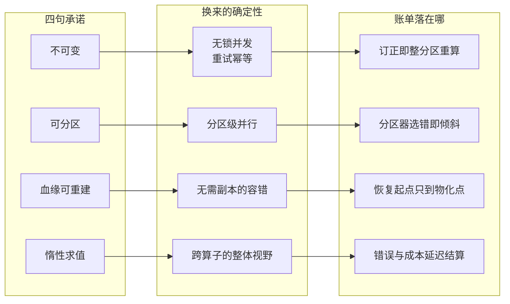
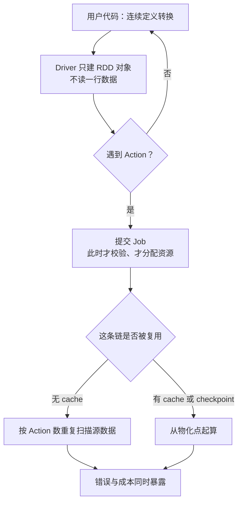
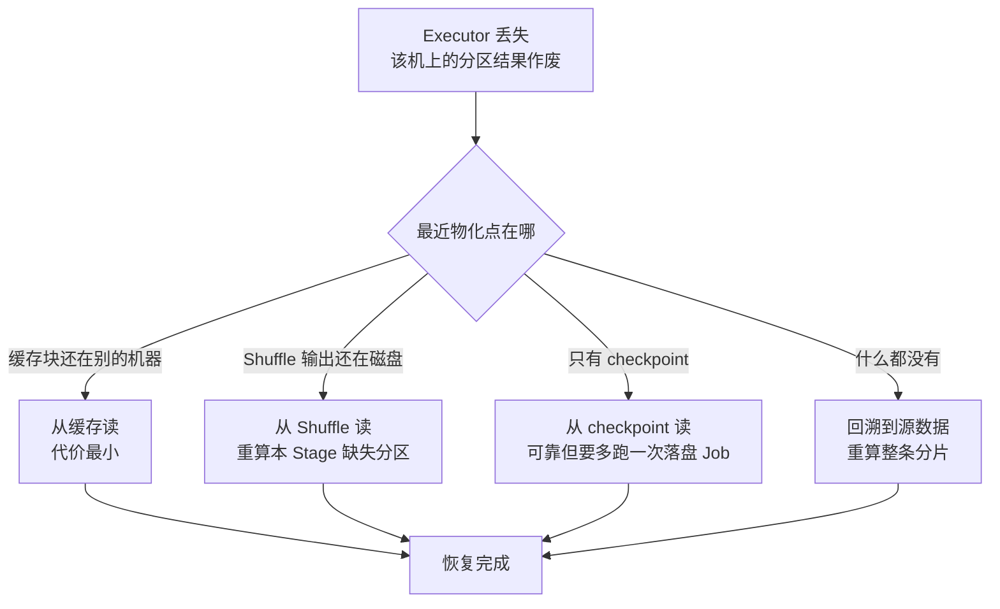
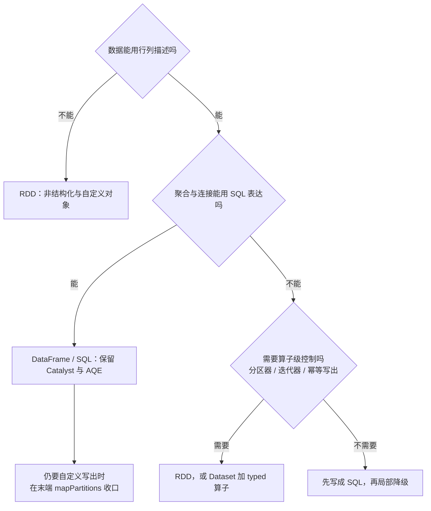
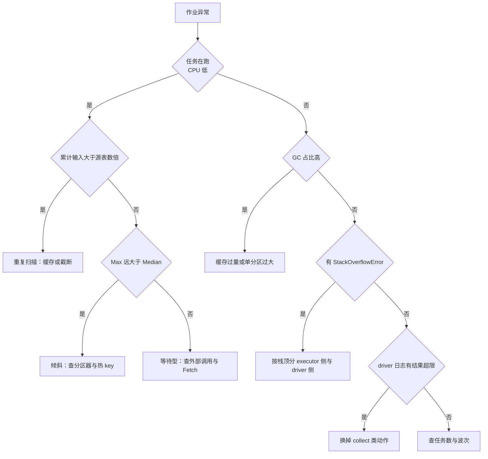

# 01 什么是 RDD：从数据流到工作集，分布式计算的代际变革与抽象本质

**摘要：**

RDD 常被当成过气的入门概念来讲：五个属性、惰性求值、宽窄依赖，讲完就翻页。但对一个每天跑两千个作业的集群来说，要回答的不是它怎么实现，而是一个用 RDD 写的作业在什么条件下开始变慢、变贵、变得难以判断。本文不谈源码，谈判据：把不可变、可分区、血缘可重建、惰性求值这四句承诺逐条对上兑现成本，再看它们在监控、日志与 Spark UI 上留下什么指纹。

行文沿三条线走。第一条是账本：四句承诺各买到了什么、各付了什么，其中血缘那栏的流行说法需要改写。第二条是边界：什么时候 RDD 是唯一可用的抽象，什么时候它只是把一个可交给优化器的查询退化成没人能改写的函数链，以及 `collect()` 为何是一条不能随手越过的线。第三条是现场：作业慢而 CPU 低、GC 时间偏高、`StackOverflowError`、Driver OOM、任务数爆炸这五种形态各自的判据与处置顺序，最后落到一张带代价列的参数表与三组反例。机制推导留给内核系列，本文只处理它在真实作业里的表现。

文章口径为 Spark 4.3.0（2026-10-30，默认 Scala 2.13）；参数默认值以对应版本文档为准，凡标注「示例推算」的数字只用于表达量级与方向，不可当作基准。

---

## 第 1 章 一条跑了四小时的作业，问题不在算力

凌晨两点的那条告警来自一个跑了四小时的作业：输入是前一天 2.4 TB 的曝光日志，输出是素材维度的曝光归因，中间还有一次按广告主分组的去重。集群三百个节点、一千二百个可用核，CPU 利用率平均百分之十二，GC 占任务时间百分之四，Shuffle 落盘一点一 TB，最后二十分钟只有一个任务在跑，把四十分钟能收尾的 Stage 拖成了长尾。值班的人先按倾斜处理，分区数翻倍，没变；再按存储慢处理，换了个存储桶，还是没变。

这段现场值得先记住一个反直觉的事实：作业慢，未必是机器不够，也未必是代码写得烂，更多时候是抽象选错了层。同月同集群，同类报表用 SQL 重写一遍，输入输出一样，四十分钟跑完。差别不在算力，在于 RDD 交出去的东西引擎动不了，SQL 交出去的可以。

### 1.1 四句承诺是一份合同

回到抽象本身。RDD 对外只承诺四件事：它不可修改；它可以按分区切开，各分区独立算；它记着自己的来路，丢了能照原路重算；它不在定义时执行，等到 Action 才动。这四句不是四个特性，而是一份合同：每一句都替用户省掉了一类麻烦，同时把另一类麻烦写进了合同的背面。

合同的背面就是运维要付的钱。不可变省掉了锁与一致性协议，代价是订正只能**整分区重算**；可分区省掉了全局协调，代价是分区器一错就把数据堆到一个 task 上；血缘可重建省掉了副本，代价是恢复起点只能落在最近的**物化点**；惰性求值省掉了多余的扫描，代价是错误与成本都推到 action 才**结算**。四条承诺对应四种失效形态，也对应 UI 上四个不同的页面。

这张图要从左往右读：承诺本身没有问题，问题出在中间那栏的收益与右边那栏的成本并不总在同一本账上结算，而运维能观测到的永远只有右边。判断一个 RDD 作业是否健康，就是判断这四笔账有没有在错误的地方超支。

| 承诺 | 兑现物 | 代价 | 现场指纹 |
| :--- | :--- | :--- | :--- |
| 不可变 | 无锁、重试幂等、可推测执行 | 订正与回填必须整分区重算 | 逻辑里出现「更新旧值」需求时整条链变贵 |
| 可分区 | 分区级并行，任务粒度可调 | 分区器与分区数决定倾斜与否 | Stages 页 Max 与 Median 差一个量级 |
| 血缘可重建 | 不复制数据也能容错 | 恢复只能从最近物化点起算 | 丢失 Executor 后父 Stage 整段重跑 |
| 惰性求值 | 看到全局才决定怎么跑 | 报错与成本都推到 action | Jobs 页同一 Stage 被重复触发 |

### 1.2 不可变：省掉的是锁，付出的是重算粒度

不可变的直接收益，是把并发问题从根上消掉了：没有写，就没有竞争，也就不需要任何一致性协议，同一个 RDD 的多个分区可以放心地撒到不同机器上，重试与推测执行都天然幂等。代价不在架构图上，而在分区粒度上。

一份数据一旦不能就地修改，任何一次订正都要产出一个新的 RDD，而新 RDD 的最小生成单位是一个分区。于是「改一条记录」等价于「重算它所在的分区」，分区切得越大这笔钱越贵：一个 1 GB 的分区意味着改一条记录要重新解析一 GB 原始数据。这也是 RDD 擅长 append-only 加工（日志清洗、特征生成、一次性归因）、却在需要反复订正的宽表上表现糟糕的原因——不是慢，而是抽象不匹配。

这里有一道缝。`RDD.cache()` 的默认存储级别是 `MEMORY_ONLY`，存的是反序列化后的对象引用，不是冻结的副本；下游遍历时若改了对象字段，缓存就被就地污染。不可变是 RDD 的契约，不是 JVM 对象的物理属性，缓存只是把结果挂在了**货架**上。机制见 [[大数据/Spark/读书笔记-spark内核/04_存储与容错机制/3. Spark_数据缓存机制|数据缓存机制]] 第 9 章，本篇只留判据：缓存对象会被下游改写的作业，要么换 `MEMORY_ONLY_SER`（与对象脱钩），要么在 `mapPartitions` 里做防御性拷贝。

### 1.3 可分区：并行度的单位，也是成本的单位

分区是并行度的物理单位：一个 Stage 有多少分区，调度器就发多少个 task，同时能跑多少取决于**槽位**（核数除以 `spark.task.cpus`，默认 1）。这条链上没有魔法，分区数即任务数，任务数除以槽位是波次，波次乘单任务耗时是 Stage 时长。

可分区省掉的是全局协调，代价集中在分区器上。`reduceByKey`、`groupByKey`、`join` 都要按 key 重新分布数据，规则由分区器给：`HashPartitioner` 用 `key.hashCode % numPartitions`，实现简单、可复现，但热 key 一定挤进同一个分区，倾斜由此而来；`RangePartitioner` 先采样再切边界，分区之间有序、体量大致均匀，代价是构造期要跑一个采样 Job，边界估偏时两端会同时失真。

分区器选错的代价不是慢一点，而是一个 task 承担不成比例的字节数。判断在 Stages 页的 Summary Metrics：Max 与 Median 差一个量级以上、且 Shuffle Read Size 同步偏大的那一行，就是**倾斜**的证据；若只是 Max 偏大而读入量正常，多半是执行端的问题（GC、外部调用），别急着改分区数。

### 1.4 血缘可重建：容错的账单记在物化点上

血缘（Lineage）的承诺是「不复制数据也能恢复」，它的记账口径却常被写错成「链越长恢复越慢」。更准确的说法是：恢复成本等于丢失分区到最近一次物化点之间的那段计算，与 DAG 有多少节点关系不大。物化点只有三类——Shuffle 写出的文件、缓存的块、checkpoint 的副本；三者之外，一切现算。

这条口径带来两个运维判断。其一，换机器之后作业能接着跑，靠的不是血缘短，而是 Shuffle 输出还在（见 [[大数据/Spark/读书笔记-spark内核/03_调度与执行机制/5. Spark_DAGScheduler_Stage划分|Stage 划分]] 的分区级重提）。其二，链长只在「没有物化点」时才与恢复成本直接挂钩：一条从源数据直通到底、中间不落盘的链，丢一个分区就要从 HDFS 重读并重算整条分片。四级失败的判据与逐级上升的恢复动作见 [[大数据/Spark/读书笔记-spark内核/04_存储与容错机制/4. Spark容错机制与Runtime生命周期|容错机制与 Runtime 生命周期]]；本文只取它的结论：越靠上的失败越贵，决定「有多贵」的是物化点的位置，不是失败的类型。

### 1.5 惰性求值：结算被推到 action

惰性求值换来的是整体视野：在 action 之前，引擎至少知道这条链上要做什么，可以合并算子、可以提前终止（`take` 只算够用的分区）、可以把 filter 推到 scan 附近（SQL 层还能推到存储层）。RDD 层拿到的视野比 DataFrame 少得多，因为它的节点里装的是 JVM 闭包而不是可读的表达式树，这一点在 [[大数据/Spark/读书笔记-spark内核/01_核心概念与基础/2. Spark的灵魂_深入理解RDD与DataSet|RDD 与 Dataset 的抽象对比]] 里讲过。

代价有两个，二者都落在运维身上。第一个是错误延迟：类型错误、空指针、维度不匹配，全部推到 action 触发的瞬间才爆，一个跑了四十分钟的准备阶段可能在第 41 分钟才告诉你第一行数据解析不了。第二个是成本延迟：一条链被两个 action 触发就整条算两遍，除非中间有 cache 或 checkpoint。判断重复扫描不需要读代码，只看 Jobs 页里同一个 Stage Id 是否在多个 Job 下出现，以及 Stages 页里所有 `input size` 加起来是不是远大于源表大小。

### 1.6 本篇不重讲的那部分

机制的归属要说清楚，免得重复读。五个属性在源码层的形态、`compute` 的迭代器契约、依赖对象为什么在宽依赖处截断、分区器的复用判据，见 [[大数据/Spark/读书笔记-spark内核/01_核心概念与基础/5. Spark_RDD内部机制深度解析|RDD 内部机制：五要素契约]]；两套描述的差异、Encoder 与序列化三代、UDF 为什么是悬崖，见 [[大数据/Spark/读书笔记-spark内核/01_核心概念与基础/2. Spark的灵魂_深入理解RDD与DataSet|RDD 与 Dataset 的抽象对比]]；Task 失败、Executor 丢失、Stage 重提、Job 失败四级恢复的动作序列，见 [[大数据/Spark/读书笔记-spark内核/04_存储与容错机制/4. Spark容错机制与Runtime生命周期|容错机制与 Runtime 生命周期]]。

本篇要补的是这三处都没有回答的问题：同样的机制，为什么在一个作业里表现为「慢」，在另一个作业里表现为「贵」，在第三个作业里表现为「不可解释」。

---

## 第 2 章 血缘的账：链长与恢复慢不是同一件事

关于血缘，流传最广的一句是「链太长会导致恢复极慢」，于是很多人的处置动作是「加 checkpoint」。这个动作有一半是对的，但理由常常是错的，而错误的理由会把 checkpoint 加在错误的位置上。

### 2.1 融合管线里，链长按记录收费

同一个 Stage 内的窄依赖链会被融合成一条流水线：`map` 的 `compute` 拿到父 RDD 的迭代器，包一层函数再返回，一条记录从磁盘读进来、穿过所有包装层、直接产出结果，中间不落集合。它的成本结构是**每记录乘以层数**，层数越多，单条记录耗时线性上升。

这个量级在多数作业里不致命。一层包装大约是一次虚调用加一次迭代器 `next()`，量级判断在几十纳秒；即便链深两百层、单分区两百万条记录，多出来的固定开销也在「秒」的量级（示例推算），而一条记录真正的成本是解析、反序列化与业务计算，通常是这个数的十倍以上。链长极少是作业慢十倍的原因。

随链长明显变化的是另外三件事：每层包装让 JIT 的内联决策更保守，长链尾部的热点代码更容易落在解释执行上；血缘越深，driver 端每次 action 重建对象图、序列化 task 闭包的体积越大；以及栈深，第 5 章单独讲。

### 2.2 恢复按「分区 × 物化点」记账

恢复的记账单位既不是节点数也不是 Stage 数，而是**分区数乘以到物化点的距离**。丢一个 executor，它手上的 Shuffle 输出全部作废，下游 Stage 的对应分区必须重算；重算从父 Stage 的输入起，那份输入要么来自更上游的 Shuffle 输出，要么来自 HDFS，前者只需重算缺失分区，后者要从源数据重读。

这张图解释了一个常见误判：作业反复丢 executor 却很快恢复，往往不是血缘短，而是上游有 Shuffle 输出兜着；反过来，一条只有窄依赖、读 HDFS 的短链，丢一次 executor 也可能重算几分钟，因为它连一个可用的物化点都没有。判断恢复能力，先数物化点，再谈链长。

### 2.3 三个真正的放大器

第一个放大器是重复触发。一个 RDD 被 N 个 action 使用且没有缓存，整条链就被完整读 N 次，成本是 N 乘以全链，比链长本身贵一个量级。指纹很清晰：Jobs 页同一个 Stage 反复出现，Stages 页累计 input size 是源表大小的数倍。处置只有一条，在被复用的分叉点上缓存，而不是每个中间步骤都缓存。

第二个放大器是宽依赖截断。恢复粒度到 Stage 为止：一个 Stage 有二十个父 Stage，丢一个 executor 就要把缺失的父 Stage 分区逐个重算，而这些父 Stage 又各自依赖更上游的输出。Stage 越多，一次失败的传导面越大，这才是 Stage 数与恢复时间正相关的真实原因，见 [[大数据/Spark/读书笔记-spark内核/03_调度与执行机制/5. Spark_DAGScheduler_Stage划分|Stage 划分]] 第 7 章的重提顺序。

第三个放大器是迭代器嵌套深度。它不放大成本，却会把作业直接打成 `StackOverflowError`，第 5 章单讲。

### 2.4 一张按链深排的账

把上述三笔账放在一起，可以给出一条粗略的判断线：链深在几十层以内，链长不是问题；上百层时要开始关注 task 闭包的体积与栈深；上千层时问题的性质已经从「慢」变成「可能直接失败」，处置动作也从调参变成截断。

| 链深（同一 Stage 内） | 每记录额外包装调用 | 单分区额外开销（示例推算） | 恢复一次丢失分区 | 风险等级 |
| :--- | :--- | :--- | :--- | :--- |
| 20 层 | 20 次 | 数秒以内 | 重跑一个分区的流水线 | 无 |
| 100 层 | 100 次 | 十秒量级 | 同上，但闭包体积明显变大 | 关注 |
| 500 层 | 500 次 | 分钟量级 | 同上，栈深接近警戒 | 需要截断 |
| 2000 层 | 2000 次 | 数分钟量级 | 大概率栈溢出，恢复即失败 | 必须重构 |

表里的假设是单分区两百万条记录、每层包装几十纳秒，只用于排序，不用于估算绝对耗时。它想传达的结论是一条反直觉的：链长主要影响**稳态吞吐**与稳定性，物化点位置才影响**恢复时间**；两者被混为一谈时，checkpoint 会加在最不需要它的地方。

---

## 第 3 章 什么时候它是答案，什么时候它是负债

RDD 的定位今天已不难回答：它是执行层的通用汇编，能表达一切，但不再是最优表达。难的是判断手上这一份计算该停在哪一层。笔者的习惯是先问两句：这份数据能不能用「行加列」描述，这次计算能不能用「选择、过滤、聚合、连接」描述。两问都答「能」，用 RDD 就是主动放弃优化器。

### 3.1 四种该用 RDD 的场合

第一种是数据本身没有行列结构。文本、二进制、图像小块、图结构、序列事件，要进 DataFrame 得先硬造一套 schema 与 Encoder，造出来的列往往只是「一个装着 byte 数组的列」，结构化 API 的好处（列裁剪、谓词下推、代码生成）都无从谈起。日志解析、非结构化抽取、自定义格式读入，是 RDD 的主场。

第二种是需要算子级的物理控制。`mapPartitions` 把一个分区的迭代器交给用户，批大小、连接池、批量写出与事务边界都由自己定；`mapPartitionsWithIndex` 还知道分区编号，可以据此生成文件名；`TaskContext` 能拿到重试次数与 attempt id，用来做幂等写入。这些能力在 DataFrame 层要么不可表达，要么退化成 UDF 而丢掉优化器的视野。

第三种是需要精确指定分区器。上下游两个 RDD 用同一个 `Partitioner` 对象时，`join` 与 `cogroup` 可以跳过 Shuffle，直接把对应分区配对计算。反复 join 同一批维表的场景里，先 `partitionBy` 一次、后面每次 join 都省一次 Shuffle，这种收益在结构化 API 里只能靠 AQE 间接获得，无法手工钉死。

第四种是库与框架的开发。给别人的作业提供一层算子 API，或者实现一个需要逐分区控制生命周期的算法，只能在 RDD 层做。

### 3.2 三种不该用的场合

第一种是能用 SQL 表达的聚合与连接。RDD 层的 `groupByKey` 是一次纯 Shuffle 加全量物化，没有 map 端预聚合；`reduceByKey` 有预聚合，但不参与 AQE 的分区合并与倾斜处理；`join` 的 Shuffle 策略由代码写死，SQL 层却能在运行时看统计信息换策略。机制差异在 [[大数据/Spark/读书笔记-spark内核/01_核心概念与基础/2. Spark的灵魂_深入理解RDD与DataSet|RDD 与 Dataset 的抽象对比]] 第 3 章有推导，落到判据上只有一句：一个作业里八成以上的算子是 `groupBy` 与 `join`，RDD 就是选错了工具。

第二种是需要列裁剪与谓词下推的宽表加工。Parquet 表八十列、这次只用五列，SQL 层只读这五列的字节；RDD 层 `sc.textFile` 读到的是整行整块，过滤发生在读完之后。扫描字节数的差距在大宽表上常是数倍到十几倍（量级判断）。

第三种是需要看见数据分布的作业。AQE 在运行时能合并小分区、拆开倾斜的 join、动态抬高 broadcast 阈值；RDD 的 DAG 在提交时就**定型**，之后不再改。用 RDD 跑一个分布未知的 join，等于自愿放弃全部自适应能力。

### 3.3 collect() 是一条边界

`collect()` 把分布式结果拉回 driver 内存，是「分布式到单点」的唯一常规出口，也是 RDD 作业里最容易被当成普通算子用的一条线。越过它的代价有三层：结果物化在 driver 堆上，driver 是单点，堆不够就是 Driver OOM；结果经 RPC 回传，受 `spark.driver.maxResultSize`（默认 1 GB）与单条消息上限（`spark.rpc.message.maxSize`，默认 128 MB）两道限制；回传串行，所有 task 的产出在 driver 侧排队拼装，Stage 尾部表现为「卡住」而不是报错。

判断这条线该不该越，问一个问题：后续处理是否需要随机访问全部结果。只是求标量，`reduce`、`aggregate`、`count` 都不必把结果拉回来；只要前若干条，`take(n)` 会逐分区试探而不是先全拉再截断；要写到外部系统，`foreachPartition` 让每个 executor 自己写，driver 只收汇总；只有确实要在 driver 上做一次全局决策（譬如算出分桶边界再做第二遍扫描）时，才需要一个受控大小的 `collect`。`toLocalIterator` 是这条边界上的折中：一次只拉一个分区，用时间换内存。

### 3.4 一张判据表与一棵决策树

| 判据 | RDD | DataFrame / SQL | 判断要点 |
| :--- | :--- | :--- | :--- |
| 优化器 | 无，闭包不可改写 | Catalyst 加 AQE | 算子里有 filter 与 join 就该偏向右侧 |
| 列裁剪与下推 | 做不到 | 做到存储层 | 宽表读少量列时差距最大 |
| 倾斜处理 | 靠人选分区器与加盐 | AQE 运行时拆分 | 分布未知时右侧更稳 |
| 类型安全 | Scala 编译期 | Dataset 有，DataFrame 无 | 复杂业务对象用 Dataset 更安全 |
| 算子级控制 | 迭代器、分区号、TaskContext | 需退化成 UDF | 需要自己管连接与批量写出时左侧唯一 |
| 报错时机 | 全部推到 action | 分析期即可报错 | 长链路调试成本差别明显 |
| 失败形态 | 栈溢出、Driver OOM、任务爆炸 | 多为计划期或 Shuffle 期报错 | 决定排查入口完全不同 |

---

## 第 4 章 五个隐性成本

上一章回答「该不该用」，这一章回答「钱花在哪」。五个成本里有三个能找到配置旋钮，两个完全没有，只能靠代码结构解决。

### 4.1 序列化：两个默认值的代价

`spark.serializer` 的默认值仍是 `org.apache.spark.serializer.JavaSerializer`。Java 序列化写出的是对象图：类名、字段名、句柄表、引用关系一并写出，体积大、CPU 高，但对任意实现了 `Serializable` 的类都能工作，不需要注册，也不会因为类演进而突然失败。Kryo 用**注册表**把类换成一两个字节的标识，体积通常小到 Java 的几分之一（量级判断），解析也快，代价是自定义类型都要注册、`spark.kryoserializer.buffer.max` 有上限（默认 64 MB，超出直接抛 Buffer overflow）、类结构变更时可能反序列化出脏数据。

容易踩错的是作用范围。`spark.serializer` 管 Shuffle 编码与缓存块序列化，闭包（task 下发的函数对象）走的是固定的 Java 序列化通道，不受它支配。换成 Kryo 之后，Shuffle 写盘量下降、缓存块变小都在预期内，但 `Task not serializable` 一个都不会少。换与不换属于团队级决策，收益取决于对象形状。

| 维度 | Java 序列化 | Kryo | 判断要点 |
| :--- | :--- | :--- | :--- |
| 体积 | 基准 | 通常为其几分之一 | 缓存与 Shuffle 字节数直接受它影响 |
| 速度 | 基准 | 更快，但差距随对象形状漂移 | 小对象多、字符串多时收益明显 |
| 兼容性 | 任意可序列化类 | 需注册，类演进要谨慎 | 长期演进的 POJO 用 Kryo 要留版本策略 |
| 失败形态 | NotSerializableException | Buffer overflow、注册缺失 | 报错文案不同，排查入口也不同 |
| 闭包 | 始终使用 | 不适用 | 换序列化器不解决闭包问题 |

### 4.2 Shuffle：RDD 层没有 AQE

RDD 的 Shuffle 在提交时就定型：分区数、分区器、聚合方式都由代码与配置决定，运行时不再调整。`spark.sql.adaptive.enabled` 默认为 true，却只作用于 SQL 与 DataFrame 计划，对 `ShuffledRDD` 无效。同一个 join，SQL 里可能被 AQE 转成广播或拆分倾斜分区，RDD 里只能照写死的策略跑。

分区数的来源值得记一笔：`reduceByKey` 一类算子没有显式指定时走 `defaultPartitioner`，先看上游是否已有分区器（有则沿用分区数最大者），再看 `spark.default.parallelism` 是否被显式设置过；`repartition(n)` 是完整 Shuffle，`coalesce(n)` 默认只合并分区、不 Shuffle，两者在「减少分区」上代价完全不同。Shuffle 层自身的阈值见 Shuffle 专栏，本篇只留一条判据：Shuffle 字节数有下降空间时，先怀疑分区数与聚合方式，而不是先怀疑网络。

### 4.3 cache：内存账与 GC 账

缓存的两笔账要分开算。第一笔是内存：`MEMORY_ONLY` 存反序列化对象，堆上占用等于对象头、字段与引用之和，一个逻辑上 200 GB 的中间结果，按对象膨胀三倍估算就要 600 GB 堆来装（示例推算），storage 区占满后执行内存被挤压，Spill 随之增加。第二笔是 GC：缓存对象是**长寿对象**，一路晋升进老年代，堆越满、晋升越多，混合回收越频繁，单次停顿也越长。

两笔账的观测位置是 Executors 页的 GC Time 与 Storage 页的 Memory Used：GC 占任务时间超过一成、storage 长期贴顶，基本可以确认缓存过量；storage 很空而 GC 依然高，问题在单分区过大或对象膨胀。缓存该不该加只有一条判据：这个中间结果是否被两个以上 action 复用、且重算代价明显高于缓存它的内存代价。两个条件缺一，缓存就是纯支出。

### 4.4 collect：单点与上限

`collect` 的成本有三份：driver 堆占用、RPC 回传带宽、结果拼装期间的串行等待。`spark.driver.maxResultSize` 默认 1 GB，统计的是一个 action 跨所有分区结果字节数的累计值，超出时作业中止并给出「结果总量超过上限」的措辞；接近上限时还有一层不显眼的作用——driver 限制继续接收结果，表现为 Stage 尾部的 task 不再被派发，UI 上像卡死。把上限调大不是办法，它只是把一次可诊断的失败换成一次不可诊断的 OOM。

### 4.5 分区数：任务数的乘法器

每个 task 都有**固定开销**：闭包反序列化、任务初始化、结果序列化与回传、driver 侧记账，量级在毫秒。分区过多时，这笔开销乘以任务数，会盖过真正的计算时间；driver 端的 task 元信息与 UI 记录（`spark.ui.retainedTasks` 默认十万条）也随之成为负担，一个百万 task 的 Stage 在 UI 上根本翻不完。分区过少时，波次不足，核在空转。

两个方向的判断都在 Stages 页：总 task 数除以槽位数得到波次，再看 Task Duration 中位数。中位数低于一百毫秒而波次远大于一，是分区过细；中位数远高于一分钟而波次只有个位数，是分区过粗或存在倾斜。

| 成本 | 观测位置 | 典型触发 | 常被误判为 |
| :--- | :--- | :--- | :--- |
| 血缘链长 | `rdd.toDebugString` 的缩进层数 | 循环生成的算子链、大量 `union` | 数据量大 |
| Shuffle 不可谈判 | Stages 页 Shuffle Read / Write | RDD 层 join 与 groupBy | 网络慢 |
| cache 内存与 GC | Executors 页 GC Time、Storage 页 Memory Used | 无差别缓存、`MEMORY_ONLY` 存大对象 | 集群内存不足 |
| collect 单点 | driver 日志的结果超限提示 | 汇总大结果、`countByKey` | 数据倾斜 |
| 分区数 | Stages 页 task 总数与中位耗时 | 小文件多、`parallelize` 分区给太大 | 调度器慢 |

---

## 第 5 章 症状到判据：五个现场

这一章是全文的骨架。五种形态在值班时经常混在一起，判据的作用不是给出答案，而是先把不相干的分支砍掉——尤其是把「RDD 这一层」的问题与「Shuffle 层」「内存层」「调度层」的问题分开。

### 5.1 作业慢而 CPU 低

先看三个地方：Executors 页的 CPU 利用率（或集群监控里的容器 CPU）、Stages 页的 input size 累计值、Jobs 页的 Stage 重复情况。判据有三条，互相排斥。

第一，累计 input size 明显大于源表大小、且同一 Stage Id 在多个 Job 下出现，说明这条链被**重复扫描**，属于惰性求值那笔账没结清，处置是在被复用的分叉点缓存或 `checkpoint`。第二，Max 与 Median 差一个量级以上且 Shuffle Read Size 同步偏大，是倾斜，去分区器那一层处理。第三，Executor Computing Time 高而 CPU 低、`Fetch Wait Time` 占比高，问题在 Shuffle 读端；`Scheduler Delay` 高则在调度与资源，都不在本篇范围内。

还有一个容易漏的分支：外部调用。RDD 里调维表查询、调 HTTP 接口、写外部库，task 时间全花在等待上，UI 上同样是 task 长、CPU 低，与血缘毫无关系。判据是 task 耗时分布很窄（不是长尾），且加并发不改善。

### 5.2 GC 时间长

先分清进程级与任务级。UI 的 GC Time 是进程级采样，多个 task 并发时不能归因到单个任务，只能判断「这个 executor 的堆是不是被压得太满」。判据两步：GC 占任务时间超过一成且 storage 长期贴顶，是缓存过量；GC 高但 storage 空，是单分区过大或对象膨胀（譬如解析出巨型 map、把整行文本切成大量小字符串）。

处置顺序有讲究：先减少缓存（`unpersist` 及时释放，或只保留最贵的那一个物化点），再考虑把 `MEMORY_ONLY` 换成 `MEMORY_ONLY_SER`（用 CPU 换内存），最后才动分区字节数与 JVM 参数。先调 G1 参数往往只是把停顿摊平，没解决堆被什么占满。

### 5.3 StackOverflowError

这个失败有两种位置，处置完全不同。位置一在 executor：task 失败日志里的栈顶是重复的 `RDD.iterator` 与 `MapPartitionsRDD.compute` 帧，成因是迭代器嵌套太深，链上每一层都保存一个包装迭代器，记录穿透时逐层调用。位置二在 driver：栈顶是 `ObjectOutputStream` 的递归写或 `DAGScheduler` 的遍历帧，成因是 task 闭包与血缘对象图太深，序列化时不收敛。

判据是栈顶的类名，不是报错文案。处置上，executor 侧用「合并相邻 `map`」（`map(f).map(g)` 改成 `map(f andThen g)`）、`localCheckpoint` 或 `checkpoint` 截断血缘来治；driver 侧多半来自 `union` 分支过多或用户对象图（深层链表、嵌套 JSON）过深，要么减分支，要么在进入 RDD 前把对象压平。提高线程栈（`-Xss`）能压住症状，不改变深度，数据量一变还会复发。

### 5.4 Driver OOM

先看日志出现在哪个进程。executor 的 OOM 打在 executor 的 stderr 里，常伴随 `SparkOutOfMemoryError` 或容器被杀；driver 的 OOM 打在 driver 日志里，前面往往先有一条结果超限的提示。日志里出现「结果总量超过 `spark.driver.maxResultSize`」，说明是 `collect` 一类动作在往回拉大结果；上限曾被调大而日志里直接是 `java.lang.OutOfMemoryError: Java heap space`，就是拉回来的结果把 driver 堆撑爆了。

处置不是调 `-Xmx`。先把动作换掉：算标量用 `reduce` 与 `aggregate`，要落盘的用写出，需要顺序处理的用 `toLocalIterator`，只看几眼的用 `take`。确实要在 driver 上做全局决策时，才用流式结构（边读边算）替代一次性物化。

### 5.5 任务数爆炸

判据是**波次**与中位耗时的组合。总 task 数除以槽位数得到波次，中位 task 耗时低于一百毫秒、波次又远大于一，即为分区过细。合并分区用 `coalesce`（不 Shuffle，代价是上游并行度下降），重排分布用 `repartition`（全 Shuffle，代价是一次完整的网络与磁盘往返）。

另一类「任务数爆炸」根本不是分区问题：一个 Stage 的 task 数不多，但它在 DAG 里被重复提交几十次（每次 action 一次），总任务数同样爆炸，要治的是重复触发。两者在 UI 上的区别很直接：前者的 task 集中在少数 Stage，后者分散在许多同名的 Stage attempt 里。

| 症状 | 首看位置 | 判据 | 不属于本层的长相 | 处置方向 |
| :--- | :--- | :--- | :--- | :--- |
| 慢而 CPU 低 | Stages 页 input size、Jobs 页重复 Stage | 累计输入大于源表数倍 | Fetch Wait 高属 Shuffle 层，Scheduler Delay 高属调度层 | 缓存或截断复用链 |
| GC 时间长 | Executors 页 GC Time、Storage 页 Memory Used | GC 占比过一成且 storage 贴顶 | storage 空而 GC 高属单分区过大 | 减少缓存、换序列化存储级别 |
| StackOverflowError | 失败 task 的异常栈顶 | 栈顶是重复的 RDD 迭代器帧 | 栈顶在 ObjectOutputStream 属对象图 | 合并算子、截断血缘、压平对象 |
| Driver OOM | driver 日志与结果超限提示 | 存在 collect 类动作 | 无 collect 却 OOM 属广播过大 | 换动作、流式处理结果 |
| 任务数爆炸 | Stages 页 task 总数与中位耗时 | 波次远大于一且中位低于百毫秒 | 分散在同名 Stage attempt 的属重复触发 | coalesce 或 repartition |

---

## 第 6 章 参数与阈值：动哪个旋钮，付哪笔钱

参数表容易写，难的是把「调大」与「调小」的代价写清楚。下表只收与 RDD 这条线直接相关的旋钮，每行都注明两侧代价，因为没有哪个旋钮只朝一个方向生效。

### 6.1 一张带代价列的参数表

| 参数 | 默认值 | 决定什么 | 调大的代价 | 调小的代价 |
| :--- | :--- | :--- | :--- | :--- |
| `spark.serializer` | JavaSerializer | Shuffle 与缓存块的编码方式 | 换 Kryo 需注册、类演进风险、Buffer overflow | 不换：体积与 CPU 双高 |
| `spark.kryoserializer.buffer.max` | 64m | 单次 Kryo 序列化的缓冲上限 | 单 task 内存峰值上升，易挤占执行内存 | 大对象直接抛 Buffer overflow |
| `spark.default.parallelism` | 未设置时按部署模式推导 | 无上游分区器时的 Shuffle 分区数 | 任务数膨胀，调度与常驻开销上升 | 并行度不足，核在空转 |
| `spark.driver.maxResultSize` | 1g | 一个 action 跨分区结果的累计上限 | Driver 堆压力上升，可诊断的失败变成 OOM | 正常的汇总动作过早失败 |
| `spark.memory.storageFraction` | 0.5 | 统一内存池中存储区的保底线 | 执行内存被挤，Spill 增多 | 缓存更易被驱逐，命中率下降 |
| `spark.rdd.compress` | true | 序列化 RDD 分区是否压缩 | 压得更省带宽与磁盘，但要付 CPU | 省 CPU，但占更多内存与网络 |
| `spark.task.maxFailures` | 4 | 单 task 的失败预算 | 掩盖数据问题，故障时间被拉长 | 一次抖动即失败，重试不足 |
| `spark.ui.retainedTasks` | 100000 | UI 保留的 task 明细条数 | Driver 堆占用上升，UI 变慢 | 超大 Stage 的明细丢失，事后无法归因 |

### 6.2 三个不该动的旋钮

第一是 `spark.driver.maxResultSize`。它本质是一道**保险**，把「结果太大」从一次不可解释的 OOM 变成一条可读的报错。调大只有在「已确认结果总量无法在调用侧削减、且 driver 堆确有余量」时成立，其余情况下调大等于把保险丝换成铜丝。

第二是 `spark.task.maxFailures`。调大它不提高稳定性，只会把一个确定会失败的数据问题（脏数据解析异常、确定性空指针）重试更多遍，把失败时间从几分钟拉成几十分钟，让真正的原因更难被发现。

第三是 `spark.default.parallelism` 的一刀切调大。它只在没有上游分区器时生效，上游有分区器就被覆盖；调到几千，对分区数已经上万的作业毫无作用，对读 HDFS 的作业则只增加任务数。

### 6.3 cache 与 checkpoint 的分界

缓存不截断血缘，只是把结果从传送带上取下来放在货架上，货架空了照样回溯；checkpoint 才真正截断血缘，把数据写进可靠存储，代价是额外一次 Job 与一份 IO。`localCheckpoint` 介于两者之间：立即截断血缘，不落可靠存储，executor 大规模丢失时仍失效。

选择判据是「这份数据会不会被 executor 或机器级别的失败打掉」。只在一个 Job 内多次复用，用 cache；跨 Job 复用且重算极贵，或链深已影响稳定性，用 checkpoint；只想让 DAG 变浅、能接受 executor 级失效，用 localCheckpoint。三者混用没问题，但要知道各自把成本记在哪个账户上。

---

## 第 7 章 反例与边界

### 7.1 用 RDD 做本该 SQL 的聚合

最常见的反例，是把一条本该写成 `select ... group by ...` 的报表写成 RDD：`map` 出 `(key, value)`、`reduceByKey` 求和、再来一次 `groupByKey` 拼明细。功能上没错，成本上丢了三件事：filter 无法下推到扫描、`groupByKey` 没有 map 端预聚合、分区数写死在代码里。同一个需求在 SQL 层往往一行就够，还能按统计信息调整策略。

判据不需要读代码：如果产出能被一条 SQL 描述，又没有用到 RDD 独有的能力（自定义对象、迭代器控制、精确分区器），它就应当被改写。

### 7.2 无脑 cache 全部中间结果

第二个反例的动机是「缓存能加速」，于是从读入到输出每个 RDD 都 `cache()`。后果是 storage 被填满，块之间互相驱逐，命中率在低位抖动，既享受不到缓存收益，又承担了写入与 GC 成本。证据在 Storage 页：Fraction Cached 长期徘徊在中间值、驱逐日志频繁、GC 时间同步上升。

正确做法与缓存总量无关，与**复用结构**有关：只缓存被两个以上 action 复用、且重算代价高的那个点，其余中间结果随时可弃。

### 7.3 用 collect 汇总大结果

第三个反例是把 `collect()` 当成汇总手段：把所有分区的结果拉到 driver，再用 Scala 集合做 `sum`、`groupBy`、`sortBy`。这份运算本该在 executor 侧完成，拉回来等于把分布式聚合退化成单机聚合，同时把 driver 变成整个作业的容量瓶颈。数据量翻一倍，作业从「跑得慢」变成「直接失败」，而失败位置与真正瓶颈毫无关系。

### 7.4 RDD 仍然不可替代的位置

反例讲完，边界也要讲清楚。RDD 在四类地方仍不可替代：数据没有行列结构（二进制、文本、自定义格式）；需要逐分区控制生命周期与写出语义（事务性提交、每分区一个文件、幂等写入）；需要在算子级钉死分区器以省掉后续 Shuffle；以及作为库作者的扩展点。共同点是「需要控制物理执行」，而结构化 API 的前提恰恰是不让你控制。

---

## 第 8 章 落点

把 RDD 理解成**执行层的通用汇编**比较贴切：它能表达一切，也能让任何一段计算跑起来，但用它写业务逻辑，等于放弃编译器与优化器，把每条指令自己排一遍。四句承诺构成的合同没有失效，失效的是很多人对合同背面的估计——以为不可变只是「不能改」，以为血缘只是「能重算」，以为惰性只是「晚点跑」。

判据可以压成三句。能用行列描述、能用 SQL 表达的计算交给结构化 API，RDD 只保留在需要物理控制的末端；RDD 作业的慢先分四类（重复扫描、倾斜、等待、过长链），再谈参数，顺序颠倒会把调参变成试错；`collect` 是边界不是算子，跨过去之前先想清楚后续要不要随机访问全部结果。

机制与判据的分工再说一句：机制回答「它为什么这样工作」，判据回答「它现在这样工作意味着什么」。前者能在文档与源码里查到，后者只能从指标与日志里读出来，而读法需要一份把症状与账本对应起来的清单——本文给了五条，剩下的靠每个团队自己的作业谱去补。

---

## 参考资料

- Zaharia, M., et al. "Resilient Distributed Datasets: A Fault-Tolerant Abstraction for In-Memory Cluster Computing." NSDI 2012. <https://www.usenix.org/system/files/conference/nsdi12/nsdi12-final138.pdf>
- Apache Spark 4.3.0 Documentation: RDD Programming Guide（`cache`、`persist`、`checkpoint` 与序列化相关章节）. <https://spark.apache.org/docs/latest/rdd-programming-guide.html>
- Apache Spark 4.3.0 Documentation: Tuning Spark. <https://spark.apache.org/docs/latest/tuning.html>
- Apache Spark 4.3.0 Documentation: Configuration（`spark.serializer`、`spark.driver.maxResultSize`、`spark.memory.storageFraction`、`spark.default.parallelism` 等默认值以此为准）. <https://spark.apache.org/docs/latest/configuration.html>
- Apache Spark 4.3.0 Documentation: Spark SQL Performance Tuning（AQE 的作用范围，用于界定它为何不作用于 RDD DAG）. <https://spark.apache.org/docs/latest/sql-performance-tuning.html>

---

> [!note] 思考题
> 1. 你手上的 RDD 作业里，能改写成 SQL 的部分占多少？改写之后失去的那部分控制权，是否真的被用到了？
> 2. 如果一条链被三个 action 复用、且中间结果约 300 GB，你会选 cache、checkpoint 还是重构代码，依据是什么？
> 3. 一个作业稳定复现 `StackOverflowError`，加 `-Xss` 之后消失，这算解决了吗？下一次它会在什么条件下复发？
> 4. 把 `spark.driver.maxResultSize` 调到 8 GB 之后作业不再报错但偶尔整进程消失，这两件事之间是什么关系？
> 5. 你们的作业里，分区数是由数据量推导的，还是由配置默认值决定的？后者在数据量翻倍时会先出现什么症状？