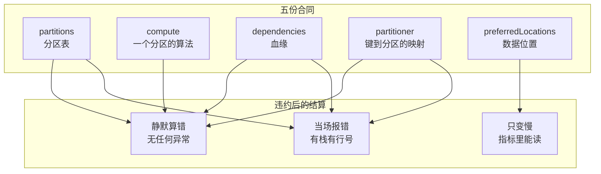
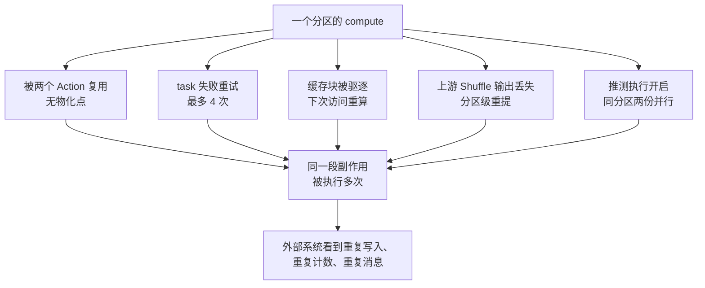
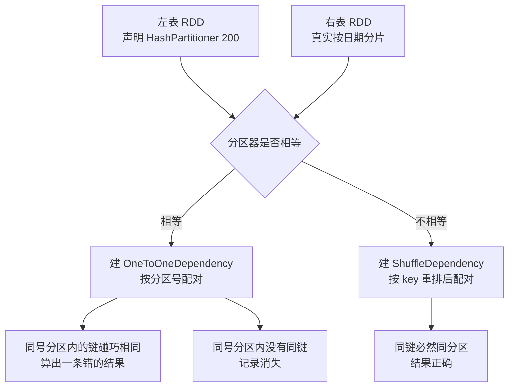
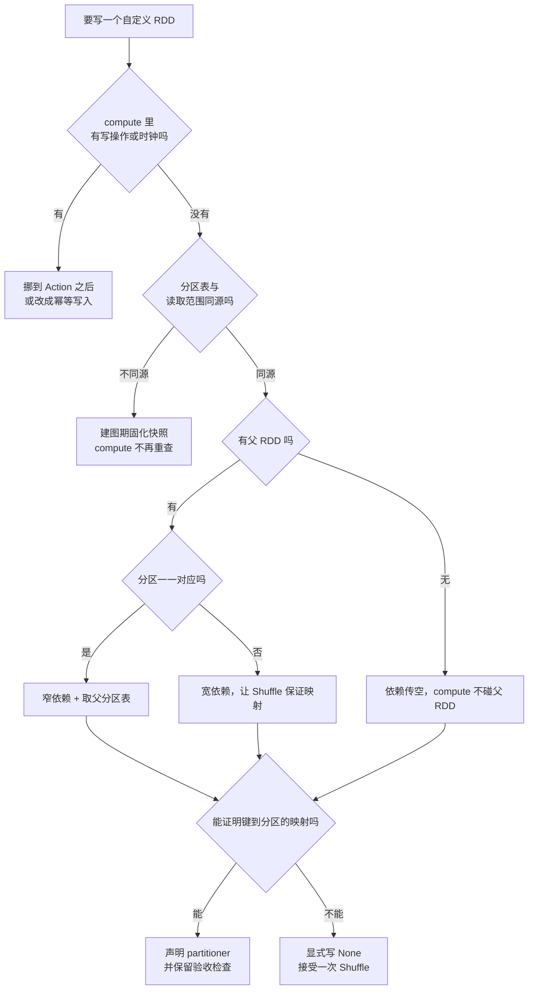
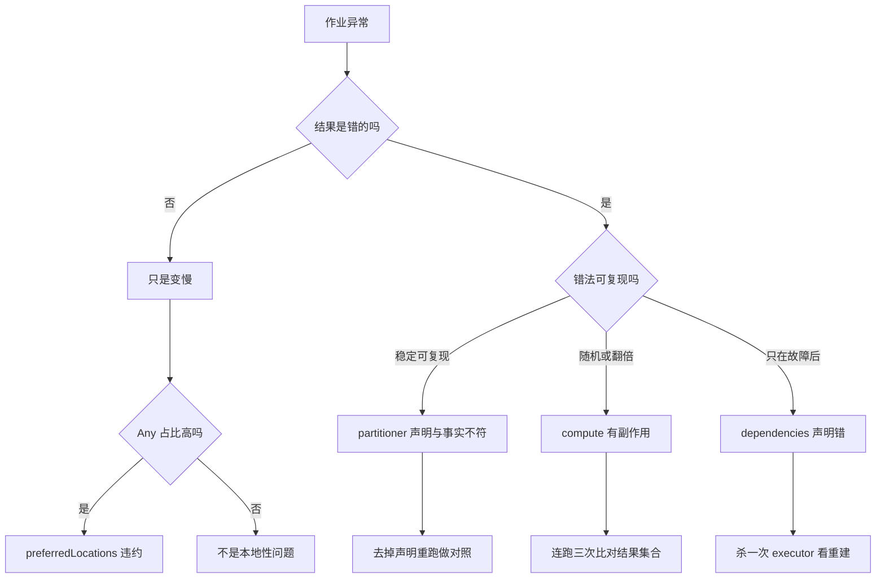

# 02 RDD 的五大核心属性：深入剖析分布式对象的灵魂接口

**摘要：**

RDD 的五个属性（`partitions`、`compute`、`dependencies`、`partitioner`、`preferredLocations`）通常以接口清单的形状出现在教程里：每个方法该返回什么，写完就翻页。缺的是另一半——返回错了会怎样。本文把这五个属性当成五份可以违约的合同，逐条算清它保证了什么、违约之后 Spark 能不能察觉、症状落在哪个页面，以及该往哪一层去救。

三种结算方式决定了排查入口。违约后立刻报错的（分区下标不连续、union 分区数不符、shuffle 取数失败）最便宜，日志会指出位置；只变慢的（本地性全空）次之，指标里还能读出来；全程不报错、只让你算错的（`partitioner` 与事实不符、`compute` 有副作用、依赖声明缺一半）最贵，因为它把排查成本从工具转移给了人。

全文的交付物是自定义 RDD 的五项自查，以及一组可执行的验证手段：怎么用一次重跑证明 `compute` 不可复现，怎么用一次去掉声明的对照证明 `partitioner` 是假的，怎么用杀 executor 的方式把依赖错误提前暴露。机制推导留给内核系列，本文只处理违约的代价与判据。

版本口径为 Spark 4.3.0（2026-10-30，Scala 2.13），参数默认值以该版本文档为准。

---

## 第 1 章 五个属性是可以违约的合同

一个接自研存储的曝光清洗作业，换掉读取器之后产出比上一版少了百分之二点六，监控全绿，日志干净，Spark UI 上没有失败的 Stage。值班的人先怀疑上游埋点，再怀疑去重口径，两天之后问题落在自定义 RDD 的一行声明上：它按日期目录分片，却把 `partitioner` 写成了 `Some(new HashPartitioner(200))`，下游那次 `join` 于是跳过了 Shuffle，两张表按分区号直接配对，配不上的记录安静地消失。

这类事故的形状值得先记住：它不报错、不告警、也不留异常栈。RDD 的五个属性在多数文章里以接口清单出现：每个方法该返回什么。清单回答「该返回什么」，不回答「返回错了会怎样」，而 Spark 在运行期几乎不做校验，唯一一处硬校验是分区下标必须与数组位置一致，其余四个属性的正确性全靠实现者自觉。

### 1.1 违约的三种结算方式

**报错、变慢、静默算错**，是三种结算方式，也是三条完全不同的排查入口。

报错是最好的一种。分区数组下标不连续会被基类拦下，`union` 两个分区数不同的 RDD 会当场抛异常，依赖声明漏掉 Shuffle 父节点会在取数阶段炸掉一个 task；这类失败有栈、有行号、有 attempt 记录，处置路径最短。

变慢是第二种，只体现在指标里。`preferredLocations` 返回空序列，代码一行不改、结果完全正确，只是每个 task 都从远端读输入，痕迹留在本地性等级的分布与偏低的 CPU 利用率上。

静默算错是第三种，也是最贵的一种。分区器声称的布局与数据真实布局不符，下游会按错误的假设跳过一次重排，两侧分区号对上就合并、对不上就丢，全链路没有一个地方觉得异常；判据只能从结果里取——与一份可信的对照比对，或者把声明去掉看结果变不变。

| 属性 | 违约金标准 | Spark 能察觉吗 | 结算方式 | 影响面 |
| :--- | :--- | :--- | :--- | :--- |
| `partitions` | 数量与 `compute` 的读取窗口不符 | 部分（下标校验、0 分区不校验） | 并行度错、重复读或漏读 | 性能与正确性 |
| `compute` | 有副作用、不可复现 | 不能 | 重算时副作用被执行多次 | 外部系统的正确性 |
| `dependencies` | 少声明或类型声明错 | 部分（取数阶段才暴露） | 容错时重算错误的数据 | 正确性，且在失败后才显形 |
| `partitioner` | 声称的布局与事实不符 | 不能 | 跳过 Shuffle 后静默错配 | 正确性，全程无异常 |
| `preferredLocations` | 缺失、为空、编码不识别 | 不能 | 本地性退化，全部远程读 | 只有性能 |



这张图要从上往下看结算通道：一个属性往往有两条通道，落在哪一条取决于违约的形态，而不是属性的名字。`partitions` 数量合法但窗口错位走静默通道，`dependencies` 少声明一个 Shuffle 父节点走报错通道。

### 1.2 缺省值站在安全一侧

五个属性的默认值全是「保守且正确」的答案：分区器默认 `None`，位置信息默认 `Nil`，依赖默认取构造参数（传空就是无父）。它们共同的含义是「我没有可提供的优化线索，请按最保守的方式处理」——调度器于是退回全量 Shuffle、退回任意节点、退回显式的血缘声明。

只要不去覆盖，正确性就有兜底，代价只是性能。所有静默错都来自一次显式覆盖：手写的 `partitioner` 字段、手传的 `preservesPartitioning`、手写的 `getDependencies` 与 `getPartitions`。这也解释了事故为什么集中在自定义 RDD 上——公开算子由 Spark 自己维护，被覆盖的永远是第三方读取器与包装器。

---

## 第 2 章 partitions：错一个数，错掉整条并行度

`getPartitions` 返回的数组决定三件事：Stage 发多少个 task、每个 task 承担多少数据、以及 `compute` 会被交到哪些 `split` 手里。第三件最容易被忘掉——分区表不只是给调度器看的统计数字，它是 `compute` 的入参来源，两边必须描述同一份东西。

### 2.1 数量错的四种形态

第一种是返回空数组。这时 Stage 合法、能提交、能成功，只是 task 数为零，作业跑完产出空结果，日志里没有一条异常。

第二种是与父 RDD 的数量不一致，却仍然声明了 `OneToOneDependency`。窄依赖的语义是父子分区按同一下标对应，父 RDD 只有三百个分区而子 RDD 声明了五百个，多出来的两百个 task 取父分区时会越界；子比父少，父的后半段永远不被读。前者报错，后者静默漏读。

第三种是分区表随着外部状态变化。典型写法是在 `getPartitions` 里按当前时间算窗口，或者按目录里此刻的文件列表切片。分区表只在第一次被访问时求值一次，之后一直命中缓存，而 `compute` 读的是执行那一刻的目录内容：规划期与执行期看到两份不同的数据，错位就发生在这段时间差里。

第四种是数量合法但切分口径与 `compute` 不一致。按字节偏移切分的读取器，规划时用「文件大小除以一百二十八兆」算分区数，`compute` 里却用「分区号乘以固定块大小」定位起止偏移，最后一块的边界必然对不齐，尾部数据要么被读两遍，要么整段漏掉；这类错在小文件上测不出来，只有最后一块有偏差。

### 2.2 稳定性的准确含义

「`getPartitions` 必须稳定」常被误读成「每次调用要返回相同结果」。基类只调用它一次，结果缓存在 RDD 对象上，所以真正的要求是另一句话：分区表与实际被读取的数据，必须来自**同一时刻的同一份快照**。

文件型数据源的做法是正例：切分发生在规划期，文件列表在这一刻冻结，之后目录里新增的文件进不了本次计算，也不会把某一段数据算两遍。这个「冻结」让分区表与 `compute` 有了共同的基准点。

自定义 RDD 反过来做就会踩坑：在 `getPartitions` 里查一次数据库拿分片列表，`compute` 里再查一次按分片号取数据，两次查询之间分片被重新平衡过，取到的就是别人的分片。判据是数据在特定时间点之后出现重复或缺失，而在低峰期完全复现不出来。

| 形态 | 结果可见性 | 首看位置 | 判据 |
| :--- | :--- | :--- | :--- |
| 返回空数组 | 空产出，无异常 | Stages 页该 Stage 的 task 数 | 成功的 Stage 挂零个 task |
| 与父数量不一致 | 报错或漏读 | 失败 task 的异常栈、输入字节数 | 越界异常，或 input size 小于源数据 |
| 依赖外部状态 | 时好时坏 | 重跑同一作业的结果差异 | 低峰期正常、高峰期异常 |
| 切分口径错位 | 尾部重复或缺失 | 输入字节总数与源文件大小 | 累计 input size 不等于源数据总量 |

最后一行是这张表里最实用的判据：Stages 页的累计 input size 与源数据总量对不上，说明分区表描述的范围与实际读取的范围不一致，偏差量就是错位的那一段。

---

## 第 3 章 compute：副作用会在每一次重算里复利

`compute` 的签名只承诺返回一个迭代器，没有任何地方承诺它只被调用一次。这个签名里藏着自定义 RDD 最常见的一类事故：把「写外部系统」放进了 `compute`。

### 3.1 重算是常态，不是异常路径

一个分区的 `compute` 在作业生命周期里被触发几次，取决于五条路径。第一条是多个 Action，同一条链被两个 Action 使用且中间没有物化，整条链就从头算两遍。第二条是 task 重试，`spark.task.maxFailures` 默认给四次预算。第三条是缓存被驱逐，`MEMORY_ONLY` 下块被挤掉之后下一次访问重新走 `compute`，而用户侧通常以为「已经缓存过了」。第四条是上游失败，Shuffle 输出取不到会触发父 Stage 的分区级重提（粒度见 [[大数据/Spark/读书笔记-spark内核/03_调度与执行机制/5. Spark_DAGScheduler_Stage划分|Stage 划分]] 第 7 章），重算范围由分区账本裁剪。第五条是推测执行，同一分区的两份副本同时跑，慢的那份被 kill 之前可能已经写完了前半段。

五条路径都不需要用户写错什么，它们全是 Spark 正常运转的一部分。其中四条的开关默认是开的（重试、驱逐、失败重提、多 Action），只有推测执行默认关闭，`spark.speculation` 需要显式打开。



把这张图竖起来看，它其实是一句话：`compute` 被设计成**可重放（replayable）的纯函数**，框架的重算机制全部建立在这个前提上，而副作用破坏的正是这个前提。

### 3.2 重复率的量级

用一个具体作业估一下。两千个分区、日更一次、被两个 Action 使用，当天有百分之三的 task 触发了重试、百分之十的分区因缓存驱逐重算过一次，那么每个分区的平均执行次数是二乘以一点一三，约二点二六次，不带去重的写入端会看到百分之一百二十六的行数（示例推算，只用于表达量级）。这个比例与作业大小无关，只与重试率和驱逐率有关，在大作业上更吓人，在小作业上则容易被当成偶发。

比行数更麻烦的是不可复现。`compute` 里读了当前时间、随机数、或者外部可变配置时，两次执行会得到不同结果，推测执行的两份副本各算各的，赢的那份决定最终值——作业跑三次可能给出三个答案，而三次都「成功」。

### 3.3 accumulator 的官方口径

共享计数是最常被塞进 `compute` 的东西，Spark 对此有明确说法：动作（Action）内部对累加器的更新，每个 task 只会生效一次，被重启的 task 不会重复累加；但在转换（Transformation）内部，如果 task 或 Stage 被重新执行，同一个 task 的更新可能被应用多次。这条口吻很克制，落到工程上就是一句：**数处理量可以，数写入量不行**。

把累加器当度量放大器，方向反而对：同一作业两次运行，累加器的值差得越多，说明这条链被重算得越厉害；语义细节见 [[大数据/Spark/读书笔记-spark内核/06_性能调优实战/4. Spark核心优化_Broadcast与Accumulator|共享变量]] 第 5 章。

### 3.4 副作用的正确落点

写外部系统不该放在 `compute` 里，理由与「该不该写」无关，只与「写了能不能撤」有关：框架重算分区时不会撤销上一次的写入。落法有三种。

第一种是把写动作移出 DAG，放到 Action 之后或 `foreachPartition` 里，让每个分区只由一次显式的执行负责。第二种是把写入做成幂等，用主键加 upsert、或者用「分区号加批次号」作为去重键，使重复执行覆盖同一行而不是追加新行。第三种是让写入携带 attempt 信息，`TaskContext` 能拿到 task 的重试次数，把 attempt 拼进主键，重复执行就变成可识别的多版本，事后按最新的 attempt 折叠。

| 路径 | 默认是否发生 | 对副作用的放大 | 观测位置 |
| :--- | :--- | :--- | :--- |
| 多 Action 复用 | 是 | 按 Action 数线性放大 | Jobs 页同一 Stage 多次出现 |
| task 重试 | 是，预算 4 次 | 按失败 task 数放大 | 失败 task 的 attempt 明细 |
| 缓存驱逐后重算 | 是 | 按驱逐比例放大 | Storage 页块的驱逐记录 |
| 上游 Shuffle 丢失 | 是 | 按重提分区数放大 | 重提的 Stage 与 task 数 |
| 推测执行 | 默认否 | 每分区最多两份 | Stages 页的 speculative 标记 |

### 3.5 判据

看三处。第一处是可复现性：同一作业连跑三次，输出是否一致，不一致就说明链上有不可复现的输入。第二处是外部系统的写入端：主键冲突率、重复消息数只要有一个跟着 task 重试次数同步上升，就能定性。第三处是 Stages 页的 attempt 分布：attempt 数明显多于 1 而父链上有副作用，那批数据就是重复写入的高危批次。

---

## 第 4 章 dependencies：声明错，容错会重算错的东西

依赖声明在多数时候没有存在感，因为它只在两个时刻被真正使用：划分 Stage 的时候，以及某个分区丢失需要重建的时候。前者在作业一开始，后者在出事之后；这解释了依赖错误为什么在本地小数据上永远测不出来——它要等到失败才显形。

### 4.1 少声明：父链在血缘图上不存在

自定义 RDD 在 `compute` 里直接调用父 RDD 的 `iterator`，构造时却把依赖传成了空，这是最常见的一种。此时 DAGScheduler 眼里这个 RDD 没有父节点，父 Stage 不会被创建，父 RDD 的 Shuffle 输出从来没有人写过；task 跑到 executor 上才试图读那份不存在的输出，报错落在取数阶段，栈里看不出是依赖漏了，只看得出「取不到某个 shuffle 块」。

如果父 RDD 是一条直读 HDFS 的窄链，情况会更麻烦：task 在 executor 上把父链算了出来，作业能跑通，结果也对，但血缘在 driver 侧断了一截。此时丢一个 executor，这个分区找不到重建路径，重试只会重复失败，最后整个 Stage 熔断。同一份代码在「父是 Shuffle 结果」与「父是文件读取」两种上下文里，一个当场报错、一个跑得很好，是依赖声明错误最典型的出场方式。

### 4.2 类型错：窄依赖声明得比事实窄

声明成 `OneToOneDependency` 而 `compute` 实际读了父 RDD 的多个分区，后果只在重算时兑现：父分区丢失后，调度器认为只需重算对应的那一个，而子分区其实还需要另外几个，重建出来的分区少数据——不报错，因为读取器本来就只读到什么算什么。反过来，把一次纯分区内变换声明成宽依赖，代价是多一次 Stage 与一次完整的 Shuffle 往返，正确但昂贵。

依赖声明还有一个不直观的副作用：它决定 checkpoint 之后血缘能不能被截断。检查点物化完成时会改写依赖表，把父链整体换成指向检查点 RDD 的窄依赖；原本的声明就是错的，被替换掉的也是错的，截断之后原始血缘一并消失，问题永久不可回溯。检查点改哪些字段、什么时候改，见 [[大数据/Spark/读书笔记-spark内核/01_核心概念与基础/5. Spark_RDD内部机制深度解析|RDD 内部机制]] 第 7 章；这里只提醒一句：**依赖表被 checkpoint 覆盖之后，声明错误的证据就没有了**。

### 4.3 一条判据与一种手工验证

判据是「只有失败时才对不上」：作业平时结果稳定，一旦有 executor 被回收、机器重启或集群滚动变更，输出就变了或者开始取数失败，此时该怀疑依赖声明而不是存储层。

验证的办法是主动制造一次失败：在小规模测试集群上杀掉承载某个分区的 executor，或者删掉某个 Shuffle 输出，看作业是重算出了正确结果还是失败。

| 违约形态 | 是否报错 | 首次暴露时机 | 判据 |
| :--- | :--- | :--- | :--- |
| 依赖传空但 `compute` 用父 RDD | 父是 Shuffle 时报错，父是窄链时静默 | 取数阶段或机器故障后 | 作业只在失败重算后结果异常 |
| 窄依赖声明得比事实窄 | 不报错 | 分区重建时 | 重算出的分区行数少于首轮 |
| 宽依赖声明得过宽 | 不报错 | 立即 | 多一次 Shuffle，结果正确 |
| 依赖数量与 `compute` 使用的不一致 | 视情况 | `toDebugString` 可见 | 缩进层级与实际读取不符 |

---

## 第 5 章 partitioner：最危险的一类，因为它不出声

`partitioner` 是五个属性里唯一一个「声明即优化」的字段。它的值是 `Some` 时，下游会据它做两件事：把与它相等的两个 RDD 之间的 `join`、`cogroup`、`union` 判定为窄依赖，跳过重排；以及在合并时按分区号直接配对。两件事都以「声明为真」为前提，而 Spark 无法验证它为真。

### 5.1 跳过 Shuffle 之后的配对规则

两个 RDD 的分区器相等，`join` 生成的聚合 RDD 就会对两侧都用 `OneToOneDependency`，按同一分区号把两侧记录取出来做笛卡尔积。这条路径成立的条件很硬：相同的键必须已经落在两侧相同的分区号上。条件成立时它是巨大的收益，一次完整的网络与磁盘往返被省掉；条件不成立时它是静默的错误，两侧各取各的分区，键对不上的记录消失，键碰巧对上的记录被算成一条。

`union` 是另一条传播路径。两个分区器相等、分区数也相等的 RDD 做 `union`，得到的联合 RDD（`PartitionerAwareUnionRDD`）会保留分区器，每个分区的内容是两侧对应分区的拼接；只有分区数不一致时它才抛异常。数量对得上就能过，分布对不对没有人查——一次错误的声明会被 `union` 原样带到下游，再被下一次 `join` 兑现成错误的合并。



这张图里右边那条路是 Spark 的兜底：只要声明不相等，它就老老实实重排一次。危险的是左边那条，每一步都是合法代码，只有数据位置是假的。

### 5.2 四种真实形态

第一种是数据按别的维度分片，声明却写成哈希。按日期目录、按 Kafka 分区、按文件分片读进来的 RDD，天然不满足「同键同分区」，此时把 `partitioner` 写成 `Some(HashPartitioner(n))`，等于给下游发了一个错误的许可。前面那个少产百分之二点六的作业就是这一种。

第二种是分区数不符。声明 `HashPartitioner(200)` 而实际交出三百个分区，`union` 时会抛「两个 RDD 的分区数不同」，属于报错型；`join` 则一侧按两百个分区建图、另一侧按两百个取数，取不到的部分成了越界或者静默的空。

第三种是把父 RDD 的分区器直接交出去。包装型 RDD 里写一行 `override val partitioner = firstParent.partitioner` 看上去很自然，前提却是「本 RDD 没有改变键到分区的映射」。只要 `compute` 里做过重排、过滤掉了一些键、或者把键换了形状，这行声明就是假的。

第四种是 `preservesPartitioning` 传错。它是 `mapPartitions` 一族的第二个参数，语义是「我保证输出仍按父 RDD 的分区器分布」，不是一个性能开关。函数体里改了键却仍然传 `true`，下游就会按错误的分区假设建立窄依赖。

| 声称的布局 | 数据真实布局 | 下游行为 | 结果 |
| :--- | :--- | :--- | :--- |
| `HashPartitioner(n)` | 按哈希分布 | 跳过 Shuffle，按分区号配对 | 正确 |
| `HashPartitioner(n)` | 按日期或文件分片 | 跳过 Shuffle，按分区号配对 | 静默错配，记录丢失或串号 |
| 父 RDD 的分区器 | 已重排或已换键 | 跳过 Shuffle | 静默错配 |
| `None` | 任何分布 | 全量 Shuffle | 正确但多一次重排 |
| `HashPartitioner(n)` | 分区数与声明不符 | `union` 抛异常、`join` 越界 | 报错 |

表里第四行是缺省值那一行，也是唯一一行「无论数据长什么样都不会错」的配置。这解释了为什么正确做法是把声明当作性能优化而不是功能描述：**证明不了分布，就不要声明**。

### 5.3 双向的坑：equals 也会违约

分区器参与相等比较，而比较用的是 `equals`。自定义分区器不重写 `equals` 时，两个语义相同的实例永远不相等，所有本可跳过的 Shuffle 都老老实实发生——安全，但白白付出代价。反过来更危险：重写了 `equals` 却**只比较分区数**，两个分区规则完全不同的分区器被判为相等，下游于是按「同键同分区」的假设建立窄依赖，数据错配。

这条坑把违约的方向补全了：前面几种是「声称有布局而实际没有」，这一种是「两个不同的布局被声称是同一个」。后果一样，验证方式也一样——去掉声明做一次对照。

### 5.4 怎么验一条声明是不是真的

最省事的办法是把它卸掉重跑一遍：把自定义 RDD 的 `partitioner` 临时改成 `None`，让下游被迫做一次 Shuffle。结果与原来不同，说明声明是假的；结果完全相同，说明声明至少在这一批数据上诚实——但这只是必要条件，换一批数据还要再验。

更直接的验证是把声明与数据位置对撞一次：

```scala
// 用声明的分区器反算每条键应该在的分区，与它实际所在的分区对比
val p = rdd.partitioner.get
val misplaced = rdd.mapPartitionsWithIndex { (idx, iter) =>
  iter.filter { case (k, _) => p.getPartition(k) != idx }
      .map { case (k, _) => (idx, p.getPartition(k)) }
}.take(10)
// 返回空序列说明声明与事实一致；返回非空说明这条 RDD 的分区器是假的
```

这段检查只该放在验收环节：它要遍历一遍数据，代价与一次 Action 相当。

---

## 第 6 章 preferredLocations：唯一一笔纯性能的账

五个属性里，只有这个属性的违约不影响正确性。也正因如此它最容易被跳过：结果没错，作业能跑完，谁会去看本地性。

### 6.1 三种违约金形态

第一种是返回空。基类默认就是 `Nil`，不覆盖它，调度器就把每个 task 当成没有偏好，派到有空闲槽位的地方。第二种是返回了错的标识。位置信息是一串字符串，调度器要把它识别成主机名或者缓存位置的编码形式才能用来匹配候选槽位；写成一个自造编号或者一个已下线的主机名，它不报错，只是永远匹配不上。第三种最隐蔽：`getPreferredLocations` 本身写得贵——里面查一次外部系统，而它在 Stage 提交时对每个分区各调一次、串行发生在 driver 上，于是作业卡在「提交阶段」，UI 上表现为 Job 已提交、task 迟迟不出现。

位置信息是调度期的高频接口，必须廉价，机制的推导见 [[大数据/Spark/读书笔记-spark内核/01_核心概念与基础/5. Spark_RDD内部机制深度解析|RDD 内部机制]] 第 5 章。这里只补违约的账单：一次十毫秒的外部查询乘以两千个分区，就是二十秒的纯等待，还没发出第一个 task（示例推算）。

### 6.2 退化的账单记在互联上，不在 task 上

本地性退化常被误判成「task 变慢」，真实情况要分两层看。单个 task 从远端读一百二十八兆，在万兆网卡上花的时间可能比从本地一块慢盘上读还少，所以「变慢」往往看不出来。成本其实在集群层面：远端读占用网卡与集群互联，本地读只占本地磁盘控制器；一台机器上并发三十个 task，全部远端读时共享同一块网卡，全部本地读时共享多块磁盘的带宽。

按量级估一次。一个 Stage 的输入一千吉字节、每分区一百二十八兆，约八千个分区，若本地性全空，等于把一千吉字节整体搬过一遍互联（示例推算）。三百节点、万兆网卡按单机一吉字节每秒计，平均每节点分担三点三吉字节，纯传输时间几秒；但跨机架的汇聚口通常只有下行带宽的几分之一，一旦流量跨架，就与其它两千个日作业争抢，排队会把几秒放大到几十秒。本地性差的作业常常「自己不算慢，但把邻居拖慢了」，原因在这里。

### 6.3 等与不等

Spark 的调度不是「必须本地」，而是「先等一会，等不到就降级」。`spark.locality.wait` 默认三秒，超时后从进程内本地降到节点本地，再超时降到机架本地，最后降到任意节点。这个参数是纯权衡：等得久命中率高，代价是每个波次先空转三秒；等得短 task 起得快，代价是互联流量上升。

| 参数 | 默认值 | 决定什么 | 调大的代价 | 调小的代价 |
| :--- | :--- | :--- | :--- | :--- |
| `spark.locality.wait` | 3s | 每级本地性的等待上限 | 每个波次先空转，短 task 的 Stage 反而变慢 | 大量 task 以任意节点运行，互联压力上升 |
| `spark.locality.wait.node` | 继承上一项 | 等待节点本地的上限 | 同上，且更容易受单机资源抖动影响 | 机架内远程读增多 |
| `spark.locality.wait.rack` | 继承上一项 | 等待机架本地的上限 | 等待几乎必然超时，纯损耗 | 跨机架流量上升 |
| `spark.task.maxFailures` | 4 | 单 task 重试预算 | 掩盖数据问题，故障时间被拉长 | 一次抖动即失败 |
| `spark.speculation` | false | 是否开启推测执行 | 有副作用时重复执行翻倍 | 长尾 task 拖住 Stage 尾部 |

### 6.4 判据

看三处。第一处是 Stages 页的本地性等级分布：`Any` 与 `Rack local` 的占比明显高于 `Node local`，说明偏好没有生效。第二处是参数实验：把 `spark.locality.wait` 调大，若 `Any` 的占比不降，说明位置信息本来就是空的，等待只是浪费——**调大等待而不降占比，等于证明偏好从来没给过**。第三处是输入耗时的构成：`Shuffle Read` 为零而输入时间偏长，通常就是远端读文件，与 Shuffle 层无关。

---

## 第 7 章 自定义 RDD 的五个检查项

前面五章各说了一种违约，这一章把它们收成一张可以照着写的清单，排序按违约后果的严重程度，不按属性在基类里的顺序。

### 7.1 检查项一：compute 是纯函数

判据不是「有没有 Write 关键字」，而是「同一个 split 连算两次，结果集合是否相同」。这条要在验收时真的跑：同一 RDD 上做两次 `collect` 转集合比较，连跑三轮，任何一轮不同就说明链上有不可复现的输入。时间、随机数、外部可变配置、以及任何写操作，都属于这一类。

### 7.2 检查项二：partitions 与 compute 同源同刻

分区表可以在规划期算，也可以在第一次访问时算，但它与实际读取的数据必须来自同一份快照。允许的写法是「列一次目录、查一次元数据、把结果固化成 `Partition` 对象」；不允许的是「每次按当前时间算窗口」「在 `compute` 里重新查一次分片列表」。判断标准很朴素：把两次调用的时间差拉大（跑一个要几分钟的作业），结果还对不对。

### 7.3 检查项三：driver 侧不做重活

`getPartitions` 每个 RDD 对象调一次，`getPreferredLocations` 每个分区在 Stage 提交时调一次，两个接口都在 driver 上串行执行。一次列目录可以接受，逐分区块查库不行；把位置信息在建图期算好、存进 `Partition` 对象里，让调度期只做字段读取，是这类 RDD 的标准写法。

### 7.4 检查项四：分区数与父 RDD 的关系必须三选一

要么一一对应（窄依赖、分区表直接取父 RDD 的、`compute` 只读对应父分区），要么重排（声明宽依赖，让 Shuffle 保证映射），要么彻底独立（无父 RDD，`compute` 不碰任何父 RDD）。三者之外没有第四种合法形态，混着写就会落到「声明是窄的、行为是宽的」这种状态，而它只在失败重算时才咬人。

### 7.5 检查项五：不对自己证明不了的布局做声明

`partitioner` 与 `preservesPartitioning` 是同一件事的两个入口，规则只有一条：能证明「键到分区号的映射与声明一致」就声明，证明不了就写 `None` 并接受一次 Shuffle。包装型 RDD 的安全写法是显式写 `override val partitioner = None`，把「我不声明」变成一处显式的决定，而不是继承一个来得容易的父分区器。

### 7.6 一份骨架与一张清单

下面这个包装型 RDD 把五项检查都落在代码里：

```scala
// 一对一透传：分区表来自父 RDD，compute 只读对应父分区，不声称任何布局
class RenamedEventRDD(parent: RDD[Event]) extends RDD[Event](parent) {
  // 分区表直接取父 RDD 的，保证与 compute 读取的范围同源
  override protected def getPartitions: Array[Partition] = firstParent[Event].partitions

  // 纯函数：只改 value 的字段，不读时间、不写外部系统
  override def compute(split: Partition, ctx: TaskContext): Iterator[Event] =
    firstParent[Event].iterator(split, ctx).map(_.renamed)

  // 显式声明：改了 value 的形状但没有动键，仍不声称布局
  override val partitioner: Option[Partitioner] = None
}
```

读数据的源 RDD 则把重活挪到建图期：

```scala
class DirLogRDD(sc: SparkContext, dir: Path) extends RDD[Event](sc, Nil) {
  // 建图期列一次目录，把文件与位置一起固化成 Partition
  override protected def getPartitions: Array[Partition] = {
    val statuses = dir.getFileSystem(sc.hadoopConfiguration).listStatus(dir)
    statuses.zipWithIndex.map { case (st, i) => LogPartition(i, st) }
  }

  override def compute(split: Partition, ctx: TaskContext): Iterator[Event] = {
    val p = split.asInstanceOf[LogPartition]
    openAndParse(p)   // 纯函数：无写入、无时钟、无外部状态
  }

  // 调度期只读字段，不做远程调用
  override def getPreferredLocations(split: Partition): Seq[String] =
    split.asInstanceOf[LogPartition].hosts

  override val partitioner: Option[Partitioner] = None
}
```



| 检查项 | 违约症状 | 怎么验 | 验证成本 |
| :--- | :--- | :--- | :--- |
| `compute` 纯函数 | 重跑结果不同、外部系统重复写入 | 同一 RDD 两次 `collect` 转集合比较，三轮 | 一次作业时长 |
| 分区表同源同刻 | 尾部数据重复或缺失 | 累计 input size 与源数据总量比对 | 一次作业时长 |
| driver 侧不做重活 | 提交阶段卡住、task 迟迟不出现 | 看 Job 提交到首个 task 的间隔 | 看一次 UI |
| 分区数与父 RDD 关系 | 越界异常或漏读 | 杀 executor 后重跑，看结果是否一致 | 一次小规模故障演练 |
| 布局声明诚实 | 结果稳定地少一个比例 | 去掉声明重跑，比对结果 | 一次作业时长 |

---

## 第 8 章 症状到判据

四种症状在值班时经常被混为一谈，判据的价值在于先把不相干的分支砍掉。

结果不确定，先查 `compute` 的纯度。判据是同一作业三次运行给出三个答案，且每次运行内部自洽——不是随机丢数据，而是整体口径不同；如果一条链的结果由执行次数决定，那么所有与执行次数相关的旋钮都会影响结果。

结果错但不报错，先查 `partitioner`，再查 `dependencies`。区分点在错法：**分区器错是确定性的少，依赖错是故障之后的错**。前者稳定地少一个可复现的比例，验证方式是去掉声明重跑；后者平时对、出过故障之后错，验证方式是杀一次 executor。

数据翻倍或重复写入，先查副作用。判据是重复量与被重算的 task 数同步变化，而不是与数据量同步变化：两者一起翻倍更像上游重复投递，数据量不变而重复量随失败次数上升才是 `compute` 里的副作用。

变慢且 CPU 低，先分本地性与等待。`Shuffle Read` 占比高是 Shuffle 层的事，`Scheduler Delay` 高是调度层的事，两者都不在本文范围；只有 `Shuffle Read` 为零、输入读取偏长、本地性里 `Any` 占比高，才是 `preferredLocations` 的问题。

| 症状 | 首看位置 | 判据 | 容易误判成 |
| :--- | :--- | :--- | :--- |
| 结果不确定 | 同一作业三次运行的输出 | 每次都自洽但互不相同 | 数据本身在变 |
| 结果稳定地少一截 | 与可信版本的比对 | 缺口比例可复现 | 上游埋点丢失 |
| 故障后结果变化 | 失败重算前后的产物 | 只在重算后出现差异 | 存储层损坏 |
| 数据重复 | 写入端的主键冲突率 | 重复量随失败次数增长 | 上游重复投递 |
| 慢而 CPU 低 | Stages 页本地性分布 | `Any` 占比高且调参不降 | Shuffle 取数慢 |



---

## 第 9 章 反例与边界

三个反例都来自真实事故，每一处都很像正确的写法。

第一个是在 `compute` 里读外部可变状态。读一张维表、读一个开关、读一次配置中心，从正确性上看都没问题，问题在于它们让 `compute` 不再是同一份输入的确定函数：两次执行读到不同的维表版本，推测执行的两份副本就各算各的；维表在作业运行期间更新，前半段与后半段用的就是两套口径。正确做法是把这类状态在作业开始时取一次、广播下去，让它在整个作业生命周期里保持同一份值。

第二个是包装型 RDD 直接把父分区器交出去。`override val partitioner = firstParent.partitioner` 在很多教程里出现过，前提被省略了：本 RDD 没有改变键到分区的映射。只要包装逻辑做了重排、过滤或键变换，这行就是假的；更稳妥的写法是显式写 `None`，把省下的那一次 Shuffle 换成一次不会错的选择。

第三个是在 `getPartitions` 里查库。它看起来只是一次元数据查询，代价被「每个 RDD 只调一次」掩盖；但按天分区的作业一天里会构造几百个这样的 RDD，几百次串行 RPC 全落在 driver 的建图阶段，表现为提交后迟迟不出 task。正确做法是一次批量查询拿全分片，再在内存里切分。

边界也要说清楚。自定义 RDD 不是坏习惯，它在三类场合仍不可替代：数据本身没有行列结构（二进制协议、自定义格式、图像块）；需要在分区内控制生命周期（连接池、批量写出、事务边界）；作为库作者对外提供算子。三类的共同点是「需要控制物理执行」，而结构化 API 的设计前提恰恰是不让使用者控制它，两套描述的差异见 [[大数据/Spark/读书笔记-spark内核/01_核心概念与基础/2. Spark的灵魂_深入理解RDD与DataSet|RDD 与 Dataset 的抽象对比]]。抽象选层的完整判断见 [[大数据/Spark/Spark-RDD核心原理解析/01 什么是 RDD：从数据流到工作集，分布式计算的代际变革与抽象本质|RDD 的定位与四句承诺]]。

这三个反例指向同一条结论：五个属性里没有一处运行时校验能替代实现者的诚实，因为校验要比对「声明的布局」与「数据的实际位置」，而比对本身就是一次全量扫描。框架不做，就只能由验收环节做——用一次重跑、一次去声明对照、一次杀进程，把三份最容易违约的合同钉成可断言的事实。

---

## 第 10 章 落点

把五个属性放回执行链上看，它们是一份可见性递减的契约。`partitions` 与 `dependencies` 的错误大多会留下异常或异常的 task 数，属于工具能抓的范围；`compute` 的错误只在结果里显形，工具最多告诉你「这个 Stage 重算过三次」；`partitioner` 的错误连重算次数都不异常，因为一切都在正常路径上，只是配对的人错了。

由此得到三句判据。第一句，能证明的布局才声明，证明不了就写 `None`，一次额外的 Shuffle 永远比一份错误的合并便宜。第二句，`compute` 必须是同一份输入的确定函数，写操作要挪到 DAG 之外或者做成幂等。第三句，依赖声明要在验收阶段用一次人为失败验一遍，别等线上第一次机器重启替你验。

**五份合同的违约成本极不对称**：遵守的成本是几行显式的 `None`、一次额外的 Shuffle、一次杀进程；违约的成本是两天的排查、一份少算百分之二点六的报表，以及一个「我们以为它算对了」的季度结论。哪一边更划算，不需要讨论。

---

## 参考资料

- Zaharia, M., Chowdhury, M., Das, T., et al. "Resilient Distributed Datasets: A Fault-Tolerant Abstraction for In-Memory Cluster Computing." NSDI 2012. <https://www.usenix.org/system/files/conference/nsdi12/nsdi12-final138.pdf>
- Apache Spark 4.3.0 Documentation: RDD Programming Guide（Resiliency 与 Accumulators 两节，累加器更新语义以此为准）. <https://spark.apache.org/docs/latest/rdd-programming-guide.html>
- Apache Spark 4.3.0 Documentation: Tuning Spark（本地性等待与并行度推导）. <https://spark.apache.org/docs/latest/tuning.html>
- Apache Spark 4.3.0 Documentation: Configuration（上述参数的默认值）. <https://spark.apache.org/docs/latest/configuration.html>
- Apache Spark 源码（4.3.0）：`core/src/main/scala/org/apache/spark/rdd/RDD.scala`，`partitions` 的惰性求值与下标校验、`getPreferredLocations` 缺省值。 <https://github.com/apache/spark/blob/v4.3.0/core/src/main/scala/org/apache/spark/rdd/RDD.scala>
- Apache Spark 源码（4.3.0）：`core/src/main/scala/org/apache/spark/Partitioner.scala` 与 `rdd/MapPartitionsRDD.scala`，`preservesPartitioning` 的分区器继承与 `Partitioner` 的相等比较。 <https://github.com/apache/spark/blob/v4.3.0/core/src/main/scala/org/apache/spark/Partitioner.scala>
- Apache Spark 源码（4.3.0）：`core/src/main/scala/org/apache/spark/rdd/CoGroupedRDD.scala` 与 `rdd/PartitionerAwareUnionRDD.scala`，按分区器相等选择窄依赖的判定、联合 RDD 对分区数的校验。 <https://github.com/apache/spark/blob/v4.3.0/core/src/main/scala/org/apache/spark/rdd/CoGroupedRDD.scala>

---

> [!note] 思考题
> 1. 你手上有没有一个「声称自己已分区」的自定义 RDD？把它临时改成 `None` 重跑一次，结果会变吗？
> 2. 一份数据每天被两个 Action 使用，`compute` 里恰好有一次幂等写入，这算安全吗？它的安全性依赖哪个前提？
> 3. 为什么 `union` 只校验两个 RDD 的分区数是否相同，而不校验数据是否真的落在对应分区？这条校验如果要加上，代价是什么？
> 4. 推测执行默认关闭，如果一个集群为了治长尾打开了它，哪些代码会立刻从「偶尔重复」变成「稳定重复」？
> 5. 你的验收清单里，有没有一项是「杀掉一个 executor 再跑一遍」？如果没有，依赖声明的错误要靠什么才会被发现？