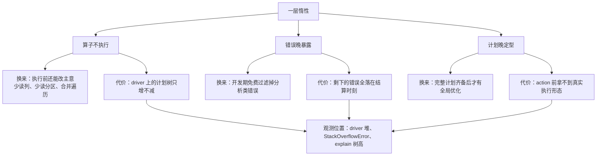
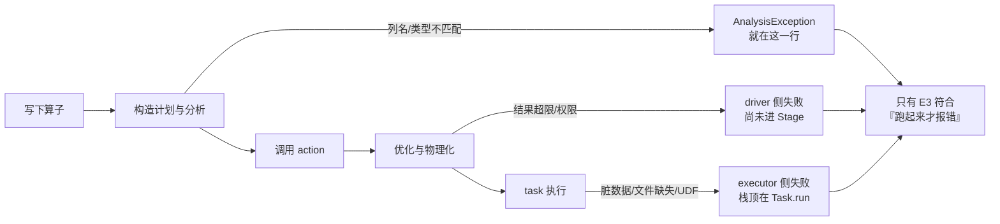
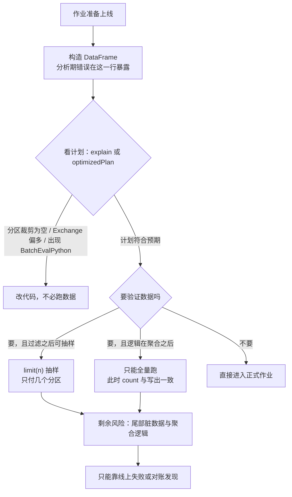
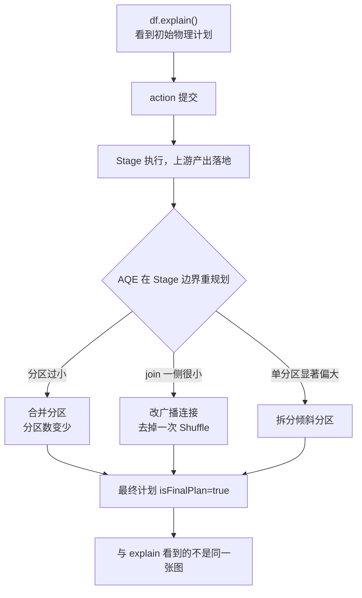
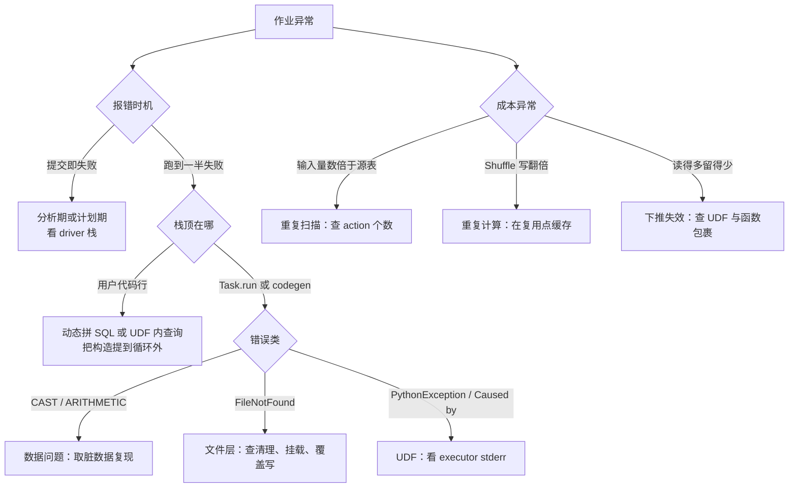

# 03 算子转换逻辑：惰性求值与 DAG 构建的底层机制

**摘要：**

惰性求值通常被当作一条抽象层性质来讲：转换不执行，动作才执行，讲完就翻页。但对一个每天两千个作业、三百个节点的集群来说，这条性质真正的分量在另外一面——它决定了错误在哪一刻暴露、计划在哪一刻定型、同一份数据会被读几遍。本文不谈源码，谈判据：把所谓"三层惰性"逐层拆开，把"报错延迟"这个流行说法校正到它真正成立的那三类错误上，再给出四道预检工事各自的边界：构造即分析、`explain`、`queryExecution`、`limit(n)` 抽样，并说明为什么第四道之后仍有一层必须靠真读。随后处理惰性与优化器的关系（全局视野是推迟执行的技术理由）、两个最贵的陷阱（重复计算与把 `count()` 当预检）、以及不可变性与链式调用造成的两处误判。四类延迟错误的形态——字段名、类型、路径、UDF——各自对应不同的首见位置与处置入口，混为一谈最容易把排查方向指错。全篇落到一张症状判据表、一张带代价列的参数表和四组反例上；机制推导留给内核系列。

---

## 第 1 章 三层推迟，三笔账

凌晨两点十分，一份按省份与品类聚合的日报作业提交上去，第一个 Stage 一开跑就是全量扫描。三十八分钟之后，Jobs 页上出现一条红色：某个 task 抛 `FileNotFoundException`，路径指向 `dt=2026-11-18/part-00123.parquet`。表还在 metastore 里，分区还在，`desc formatted` 一切正常，只有那一个分片不在了——上游写完之后做了一次目录清理，把"看起来多余"的分片删掉了。

同一天中午，另一个作业被查出同一份表读了三遍：调度平台记的输入量 3.1 TB，而 HDFS 的计数说那天这张表被读了十一次。代码里只有一处 `spark.read`、一个 `filter`、一个 `groupBy`，却接了三个 action——写主表、算总量、写校验表，中间没有 `cache`。

两个现场的共同点不在 SQL 写得对不对，在于**判断被推到了结算的那一刻**。文件没了这件事，只有真正去读那个分片才可能知道；同一份数据被读了几遍，只由 action 的个数决定，与代码里出现几次 `spark.read` 毫无关系。惰性求值（Lazy Evaluation）落到运维上是三笔要分开记的账，混在一起记就会得出错误的处置动作。

### 1.1 第一层：算子不执行，换来的是"晚点算"

调用一个转换算子，在 driver 上只改动对象图：新建计划节点挂到父节点下，闭包清洗一遍，返回新对象。机制细节见 [[大数据/Spark/读书笔记-spark内核/03_调度与执行机制/3. Spark逻辑处理流程详解|逻辑处理流程与惰性求值的边界]] 第 1 章；运维要盯的是另一面——**对象图本身也是有成本的资产**，它在 driver 堆上一直长。

长到什么程度会出问题，有明确的形态。循环里追加列是最典型的写法：

```scala
// 一千次 withColumn，等于在一棵计划树上挂一千个 Project 节点
var df = spark.table("dwd_order")
for (c <- 0 until 1000) df = df.withColumn(s"f_$c", lit(c))
df.write.saveAsTable("tmp_wide")   // 分析、优化、代码生成全压在这一刻
```

这段代码的代价不在计算，在准备：计划树深到上千层之后，分析与优化要反复遍历这棵树，耗时从毫秒级涨到分钟级；嵌套过深时 driver 侧直接抛 `StackOverflowError`；即便不炸，driver 序列化 task 闭包时也要把这棵树的残余带下去。换来的是执行之前还能改主意：只读需要的列、只算够用的分区、把相邻窄依赖合成一次遍历。第一层的账就是"用 driver 的内存与准备时间，换执行期的自由度"。

### 1.2 第二层：错误晚暴露，但"晚"要分档

"代码写完不报错，跑起来才炸"这句话流传很广，它半对半错，错的那一半直接影响处置动作。把错误按暴露时机分三档，边界才清楚。

**分析期**的错误在构造计划对象的那一行就抛。Spark 每构造一个 `Dataset` 就做一次分析（analysis），列名解析不出来、函数参数类型对不上、聚合里混了非聚合列，都在这一刻报 `AnalysisException`，错误类通常是 `UNRESOLVED_COLUMN` 或 `DATATYPE_MISMATCH`。写下 `df.select("usr_id")` 而表里只有 `user_id`，异常栈顶就落在这行代码上，不需要任何 action。

**计划期**的错误在 action 触发优化与物理化时暴露，典型是 join 策略选错、分区数配错导致的任务数爆炸，以及写出时的路径与权限问题。**执行期**的错误在 task 内部暴露，全部与数据相关：脏数据转换失败、字段取错、文件消失、UDF 抛异常。

三档里只有第三档符合"跑起来才炸"，但线上感受到的延迟报错几乎全是第三档——第一档在开发时就炸掉了，活不到上线。这个筛选效应决定了**生产上看到的错误分布是开发期预检过滤后的残余**，而残余恰好最难提前发现。

| 错误档位 | 暴露时机 | 典型错误类 | 首见位置 | 能否零成本提前 |
| :--- | :--- | :--- | :--- | :--- |
| 分析期 | 构造 DataFrame 那一行 | `UNRESOLVED_COLUMN`、`DATATYPE_MISMATCH` | driver 侧异常栈，栈顶就是你的代码行 | 是，写代码时就报 |
| 计划期 | action 触发优化与物理化 | 路径不存在、权限不足、结果超限 | driver 日志，作业未进 Stage | 部分，`explain` 可看计划 |
| 执行期 | task 内部 | `CAST_INVALID_INPUT`、`FileNotFoundException`、`PythonException` | executor 日志与失败 task 的栈 | 否，必须读到那段数据 |

### 1.3 第三层：计划晚定型，于是有三种"看不见"

逻辑计划在写代码时就在长，这一点可见——`df.explain` 随时能把树打出来。真正被推迟的是后两步：优化在 action 触发时才发生，物理计划在那一刻才生成；同一份逻辑计划在 AQE 打开时，运行到 Stage 边界还会被改一次，改成什么取决于上游实际产出。

于是"计划不可见"其实是三件事叠在一起。其一，action 之前能看到的只有逻辑计划与优化计划，物理执行的样子要等 §3.3 那一步。其二，即便看到了物理计划，AQE 之后的最终形态与它不同，`explain` 里 `AdaptiveSparkPlan` 节点的 `isFinalPlan` 标记在运行前一直是 `false`，运行后才会翻成 `true`。其三，RDD 层根本没有可读的计划，节点里装的是 JVM 闭包，`toDebugString` 只能给你一串缩进，读得出链长，读不出优化空间。



### 1.4 机制归机制，判据归判据

先把分工讲清楚，免得重复读。算子的分类坐标（会不会产生 Shuffle、保不保留分区器）、窄依赖为什么能流水线、宽依赖为什么非落盘不可，见 [[大数据/Spark/读书笔记-spark内核/01_核心概念与基础/3. Spark核心Transformation操作详解|Transformation 的三个坐标]]；DAG 如何在 driver 内存里组装、Stage 在哪里切开、`take` 为什么能只算几个分区，见 [[大数据/Spark/读书笔记-spark内核/03_调度与执行机制/3. Spark逻辑处理流程详解|逻辑处理流程与惰性求值的边界]]；Shuffle 一次重排的三笔账与 m×r 放大，见 [[大数据/Spark/读书笔记-spark内核/05_Shuffle核心机制/1. Spark_Shuffle机制深度解析|Shuffle 的三笔账]]。

这三处回答的是"它为什么这样工作"。本篇回答的是另一半：同样的机制，为什么在这个作业里表现为"跑到一半才报错"，在另一个作业里表现为"同一份数据被读三遍"，在第三个作业里表现为"`explain` 看到的和跑起来的不一样"。这三种表现各有各的判据，也各有各的处置入口。

---

## 第 2 章 报错延迟的四种典型

把四种现场按"多晚才知道"排开，会发现延迟程度差别很大，处置入口也完全不同。这一章逐个校正：哪些是真延迟，哪些是被误传的延迟，误判之后又会在哪里付出代价。

### 2.1 字段名错：在 DataFrame 上其实不延迟，延迟的是它的三个变体

先纠正一个流传很广的说法：很多人以为列名写错要到 action 才报，于是用一次 `count()` 做预检。事实相反，列名错在写下那一行就报，因为构造 `Dataset` 时已经做过分析。

```scala
// 这一行就抛，不需要等到 action
val bad = df.select("usr_id")
// AnalysisException: [UNRESOLVED_COLUMN] cannot resolve `usr_id`
```

真正会延迟到执行期的是字段访问被挪到了 Row 上，也就是把结构化 API 降级成 RDD 之后：

```scala
// 分析器看不到 Row.getAs 里的字符串，只能等 task 跑到那一条才炸
df.rdd.map(row => row.getAs[String]("usr_id")).count()
// 执行期抛 IllegalArgumentException: Field "usr_id" does not exist
```

第二种变体是 schema 漂移：分析期用的是 metastore 里的表结构，读文件时实际结构不同，错误在向量化读端抛出，表现为 task 失败而非提交失败。第三种是列名来自配置、拼进 SQL 字符串，它照样在构造期抛错，只是评审时看不到那行字面量——这是"发现得晚"，不是"报错得晚"：前者靠契约测试，后者靠预检。

判据只有一条：栈顶落在你写的那行代码就是分析期，落在 `Task.run` 或 codegen 生成类就是执行期。

### 2.2 类型错：路径分两条，都不在 action 那一个点上

类型错同样分两路。分析期能发现的那一路（字符串直接做算术、聚合函数参数个数不对）在构造时就抛；另一路是数据依赖的转换，只有读到具体那一行才知道。

后一路在 Spark 4.x 上比 3.x 更吵，因为 ANSI 模式默认打开了（`spark.sql.ansi.enabled` 自 4.0 起默认为 `true`）。同一个 `cast("int")`，两种模式给出两种完全不同的故障形态：

| 模式 | 脏数据 `"12.5a"` 转 int 的结果 | 故障形态 | 排查难度 |
| :--- | :--- | :--- | :--- |
| ANSI 开（4.x 默认） | 抛 `CAST_INVALID_INPUT`，task 失败 | 立即失败，错误行可定位 | 低，但作业停 |
| ANSI 关 | 静默返回 null | 结果里多出一批 null，错误转移到下游 | 高，往往几天后才发现 |

后者才是难查的一类：错误没有延迟，而是被**取消**了，代价由下游报表承担。判断形态看报错文案：出现 `CAST_INVALID_INPUT`、`DIVIDE_BY_ZERO`、`ARITHMETIC_OVERFLOW` 就是数据问题；没有这些错误类而结果里是 null，是配置问题。

### 2.3 路径错：元数据在、数据不在

路径错也要分两段看。`spark.read.parquet(path)` 对不存在的路径立刻失败，因为解析 schema 要列举文件，绕不开元数据 I/O，属于计划期甚至构造期。真正拖到执行期的是"元数据在、数据不在"这一类：

- 表还挂在 metastore 上，底层目录被上游清理或迁移了；
- 挂载点掉线，目录存在但读不出内容；
- 作业读写的路径与它自己的输出目录重叠，覆盖写把刚读进来的分片改掉了；
- 执行期间有人在做归档，文件在 Stage 跑到一半时消失。

这四种的全部表现都是 executor 侧抛 `FileNotFoundException`，driver 日志里只有一个被包装过的 `SparkException`，真正的原因在失败 task 的栈里。第四种在长作业上格外常见：一个跑两小时的作业，中途被别人清目录的概率远高于提交那一刻。

处置上有一个危险旋钮：`spark.sql.files.ignoreMissingFiles` 与 `spark.sql.files.ignoreCorruptFiles` 默认都是 `false`，改成 `true` 后作业不再失败，而是**静默少读**——把可诊断的失败换成不可诊断的少算。笔者只建议救急时用，且必须配套行数对账。

### 2.4 UDF 里的异常：栈被包装了两三层

UDF 抛出的异常要到 task 执行时才可见，没有例外，因为函数体对 Catalyst 完全不透明。麻烦在栈的形状：Scala UDF 的异常会被包进 `SparkException`，原始异常藏在 `Caused by` 里；Python UDF 以 `PythonException` 出现，真正的 traceback 打在 executor 的 stderr 上，driver 侧只看到一句被截断的总结；代码生成更绕，整个 Stage 的表达式树被拼成一个生成类，栈里出现 `GeneratedIteratorForCodegenStage` 这样的帧，看起来像 Spark 内部出错，其实是你那行 UDF。

Python UDF 还有一个额外代价，`explain` 里能看到：计划中出现 `BatchEvalPython` 节点，意味着这段逻辑被从 Catalyst 的表达式体系里摘了出去，基于它的过滤条件不会被下推，扫描量等于全表，过滤发生在数据进了 JVM 之后。诊断"读得多、留得少"的作业，先看有没有这个节点，比看数据快。

### 2.5 一张按暴露时机排开的表

| 错误类型 | 最早暴露时机 | 首见位置 | 判据 | 处置入口 |
| :--- | :--- | :--- | :--- | :--- |
| 列名错（DSL 字符串） | 构造 DataFrame 那一行 | driver 异常栈 | 栈顶就是用户代码行 | 无需预检，改代码 |
| 列名/类型错（`Row.getAs`） | task 执行 | executor 栈，含 `Row` 调用 | 栈里有 `Task.run` | 先看是否走了 `df.rdd` |
| 数据依赖的类型错 | task 执行 | 失败 task 栈 | `CAST_INVALID_INPUT` 等错误类 | 数据侧清洗或改 `try_cast` |
| 路径与文件缺失 | task 执行 | executor 栈 | `FileNotFoundException` | 查上游清理与挂载 |
| 数据源不存在 | 构造/计划期 | driver 栈 | 解析 schema 时即失败 | 无需预检 |
| UDF 异常 | task 执行 | codegen 帧后跟 `Caused by` | 栈里有生成类与 `PythonException` | 看 `explain` 里的 `BatchEvalPython` |



---

## 第 3 章 提前暴露：四道工事与它们的边界

把错误提前暴露的努力，本质上是在"结算点"之前插检查站。四道工事从便宜到贵排开，每一道都只能覆盖一段，越往后越接近真读。写这一段的价值不在推荐手段，而在说清每道工事**看不到什么**——把预检当成万能，是下一个坑的开始。

### 3.1 第一道：构造即分析，免费的，覆盖面窄

第一道工事不需要额外动作：把 DataFrame 构造出来，分析就发生了。它覆盖全部静态可判定的错误：列不存在、类型不匹配、聚合分组错配、窗口定义不合法。成本为零，上限也清楚——看不到数据、看不到文件、看不到 UDF 内部。

实践中能把它用得更狠一点：把构造集中到一处，先构造完所有 DataFrame 再统一触发 action，分析类错误就会在作业开始的第一秒集中爆发，而不是分散在四十分钟的执行过程里。反过来，构造与 action 交错写，错误就被摊进了运行时间轴。

### 3.2 第二道：`explain` 能看到什么，看不到什么

`explain` 触发优化，不触发执行：它把分析后、优化后、物理化的计划打出来，读的是元数据与统计信息，不扫数据。它能提前暴露"结构性问题"，见下表；看不到"数据本身有什么问题"，这一层无法靠计划推断。

| 看什么 | 在计划里的位置 | 它能回答的问题 |
| :--- | :--- | :--- |
| 分区裁剪是否生效 | 扫描节点的 `PartitionFilters` | 分区条件写对了没有，有没有被函数包住导致失效 |
| 谓词是否下推 | 扫描节点的 `PushedFilters` | 过滤发生在读之前还是读之后 |
| 列裁剪是否生效 | 扫描节点的 `ReadSchema` | 宽表只读几列这件事有没有兑现 |
| join 策略 | `BroadcastHashJoin` 与 `SortMergeJoin` | 会不会多一次 Shuffle，广播的表是否过大 |
| Shuffle 次数 | `Exchange` 节点个数 | 一次查询里有几处重分布，能不能省掉 |
| UDF 是否切断优化 | `BatchEvalPython`、`ScalaUDF` | 这段逻辑是否已经脱离优化器管辖 |
| AQE 是否介入 | `AdaptiveSparkPlan` 节点 | 后面的计划还会不会变 |

`explain` 的边界有四条。第一，它不读数据，凡与数据分布有关的判断都只是估算，表没做过统计时 `Statistics` 里的行数取的是默认值。第二，CBO 在 4.x 上默认关着，join 顺序不保证最优，打出来的顺序只代表规则优化后的产物。第三，AQE 会让最终计划与它不同。第四，各模式看到的层次不一样，用错模式会把分析计划当成执行计划读。

`explain(mode)` 的模式差异值得单列一行：

| 模式 | 输出内容 | 适用场合 | 误用后果 |
| :--- | :--- | :--- | :--- |
| `simple` | 物理计划 | 日常看 join 策略与扫描节点 | 看不到逻辑优化过程 |
| `extended` | 分析、优化、物理三层 | 判断错误出在解析还是优化 | 输出长，噪音多 |
| `cost` | 带统计信息的优化计划 | 排查 join 顺序与广播判定 | 统计缺失时信息误导 |
| `codegen` | 生成的代码 | 确认表达式是否被代码生成 | 极少用于运维 |
| `formatted` | 分节带编号的计划 | 与人讨论、贴进工单 | 不便于逐行比对 |

### 3.3 第三道：`queryExecution` 的三个计划

`explain` 给人看，`queryExecution` 给脚本用。它把计划拆成三份，每份对应一个阶段：

- `analyzed`：分析后的逻辑计划，节点是 `Project`、`Filter`、`Aggregate` 这类可读结构；
- `optimizedPlan`：规则优化后的计划，谓词下推、列裁剪、常量折叠都已发生；
- `executedPlan`：物理计划，能看出算子实现、`Exchange` 的分布方式与分区数。

三份都是纯对象，取值不启动任何作业，适合放进预检脚本：数 `optimizedPlan` 里的 `Exchange` 个数，超过阈值告警；取 `executedPlan` 里扫描节点的 `PartitionFilters`，为空就提示分区裁剪没生效。

同一层还有两个便宜的口子：`df.inputFiles` 返回计划里解析出的文件列表，用来确认路径解析到了哪里；`df.schema` 返回分析后的结构，对读端意味着一次文件列举已经发生。两者都不执行数据，都能在提交前把路径与结构这一层挡掉。

### 3.4 第四道：`limit(n)` 抽样，而 `count()` 不是预检

前三道都读不到数据，第四道只能靠真读一小段。这一步的正确工具是 `limit(n)` 而不是 `count()`，两者的成本差着数量级。

`limit` 能被优化器下推，穿过 `Project` 与 `Filter` 落到扫描节点上，"只看十条"于是变成"只读够十条的量"；执行上还有一层放大机制，`CollectLimitExec` 先扫一个分区，不够再按 `spark.sql.limit.scaleUpFactor`（默认 4）放大，万级分区的表取十条样本通常只付几个分区。

但它穿不过聚合、join、排序与 `Exchange`。写 `df.groupBy("province").count().limit(10)` 时聚合照旧跑全量，`limit` 只截断送回 driver 的结果。抽样预检的适用范围由此确定：过滤之后抽样便宜，聚合之后抽样等于全量跑一遍还多一次取数。

`count()` 本身就是一次完整 action，会把整条链跑一遍：用它换一句"能跑通"，代价是一次全量扫描，而下游还要再跑一遍。它不算全量的场合极窄——只涉及分区列、过滤也只落在分区列上时，优化器可能直接读元数据回答；其余场景一律按全量扫描计。

| 手段 | 成本量级 | 能提前暴露 | 暴露不了 |
| :--- | :--- | :--- | :--- |
| 构造 DataFrame | 零，毫秒 | 分析期错误 | 数据、文件、UDF |
| `explain` / `queryExecution` | 元数据 I/O，秒级 | 计划结构问题、下推与裁剪失效 | 数据本身的问题 |
| `df.limit(n).collect()` | 少量分区读取 | 解析、schema、前半段数据 | 聚合之后的逻辑、尾部脏数据 |
| `df.count()` | 全量扫描 | 能跑通、总行数 | 数据质量问题（只给一个数） |
| 全量写一次再验 | 全量读写 | 全部 | 无，但最贵 |



### 3.5 边界：为什么预检不可能彻底

四道工事越靠后越贵，而"预检彻底"在原理上做不到：数据层错误的判据就是数据本身。能做的是把"必须真读"压到最小——计划检查挡结构性问题，抽样挡 schema 与前半段数据，剩下的承认它只能在线上暴露，并提前备好对账手段（行数、分区数、关键指标基线），让失败发生时能定位到是哪一段。

---

## 第 4 章 惰性与优化器：为什么不能立即执行

惰性最常被追问的一个问题是："为什么不能边写边算，省得用户等？"这个问题有一半是误解——用户并不在等，action 之前根本没有等待，只是没有进度。另一半是真实的技术理由：立即执行会把优化器的输入切成碎片。

### 4.1 立即执行切断的是"跨算子的视野"

以"过滤掉九成再聚合"为例。惰性让 `filter` 与 `scan` 留在同一份计划里，优化器可以把过滤条件推给扫描端（分区裁剪 + 谓词下推），只读需要的列；RDD 层做不到下推，但至少能把 `filter` 与相邻 `map` 融合成一次遍历。若每个算子写完就执行，`filter` 一完成就要把结果物化成中间数据，下游看到的是一份落定的数据集，下推无从谈起——**下推的前提是上游的读取动作还没发生**。

技术理由一句话说完：优化发生在完整计划齐备之后，而完整计划要等最后一个算子写完。窄依赖如何融合成一次遍历、分区器如何在链上传递、宽依赖为什么在 Stage 边界强制落盘，见 [[大数据/Spark/读书笔记-spark内核/01_核心概念与基础/3. Spark核心Transformation操作详解|Transformation 的三个坐标]] 的推导，此处只用结论。

### 4.2 AQE：explain 之后计划还会改

自适应查询执行（Adaptive Query Execution，AQE）从 3.2 起默认开启，4.x 沿用 `spark.sql.adaptive.enabled=true`。它在 Stage 边界拿到上游真实产出量后重新规划，三个动作：合并过小的 Shuffle 分区、拆开倾斜的 join 分区、按实际大小把 `SortMergeJoin` 换成 `BroadcastHashJoin`（或反过来）。

对运维的意义是：**`explain` 的结果不是承诺，是一次快照**。同一个查询，`explain` 里写着 `SortMergeJoin`，运行后的最终计划可能变成 `BroadcastHashJoin`；写着 200 个分区，运行后可能被合并成 80 个。判断位置在 SQL 页：`AdaptiveSparkPlan` 节点的 `isFinalPlan` 运行后翻成 `true`，并且可以切换初始计划与最终计划两张图，差异就是 AQE 改掉的部分。



这里有一处容易误判：最终计划与 `explain` 不同，不代表有人改了代码，也不代表优化器不稳定。先确认 AQE 开着，再确认差异只发生在 join 策略与分区数上——是，就是正常重规划；连扫描节点与过滤条件都变了，才需要查是不是读到了别的表或视图。

### 4.3 `explain` 里真正值得看的几行

计划树动辄几十行，逐行读没收益。先找五处：扫描节点的 `PartitionFilters` 与 `PushedFilters`（分区与谓词是否生效）、`ReadSchema`（列裁剪是否兑现）、`Exchange` 个数（Shuffle 次数）、`BroadcastHashJoin`（是否多一次重分布）、`BatchEvalPython`（优化器是否被摘出局）。这五处能解释八成"为什么读得多、跑得慢"，余下的才需要看数据分布。

---

## 第 5 章 两个最贵的陷阱

惰性的代价有两种常见形态，一种让作业变贵，一种让作业白跑。两者的判据都在 Jobs 页与 Stages 页上，不在代码里。

### 5.1 重复计算：血缘被重放，几个 action 就几遍

同一个 DataFrame 上接 N 个 action、中间没有缓存，整条血缘就被重放 N 次：action 之间不共享任何已算出的分区，除非有物化点。这不是 bug，是"不物化中间结果"的直接推论。

判据不需要读代码：Jobs 页里同一个 Stage Id 反复出现，Stages 页里所有 `input size` 加起来远大于源表。那个读了三遍的作业就是这样对出来的账——源表 1.03 TB，三个阶段累计输入 3.1 TB。

容易被忽略的细节是：**多个 action 未必写在同一个函数里**。主流程写一遍、校验流程再读一遍、监控埋点再统计一遍，三段代码分属三个文件，调度平台上表现为三个作业，人对"复用了同一份数据"毫无感知，但集群知道。这类重复在每天两千个作业的规模上格外贵，因为它不制造告警，只制造账单。

### 5.2 缓存：DataFrame 与 RDD 上不是一回事

加 `cache` 是对的方向，但要先知道两套语义不同。`rdd.cache()` 等价于 `persist(StorageLevel.MEMORY_ONLY)`，缓存反序列化后的 Java 对象；`df.cache()` 等价于 `persist()`，默认 `MEMORY_AND_DISK`，缓存 `InternalRow` 形式的二进制数据。前者对象膨胀明显，后者紧凑得多，同一个 200 GB 的中间结果，两种缓存占用的堆可以差出一个量级（量级判断）。

三个配套判断跟着来。第一，缓存只对命中的部分免算，内存不足时 BlockManager 按 LRU 淘汰分区，被淘汰的下次照样重算，UI 上表现为命中率不满而不是报错。第二，`cache` 不截断血缘，它只是把结果放到货架上，货架空了下游仍要沿血缘回溯；要截断得用 `checkpoint`。第三，缓存的代价记在 GC 账上，长寿对象一路晋升老年代。判定条件与 BlockManager 的交互在 [[大数据/Spark/Spark-RDD核心原理解析/08 缓存与持久化：StorageLevel 策略、BlockManager 协作与堆外内存实践|08 缓存与持久化]] 里展开，本篇只留一条判据：被两个以上 action 复用、且重算代价明显高于缓存它的内存代价，两个条件缺一，缓存就是纯支出。

### 5.3 把 `count()` 当"轻量预检"

这个陷阱的形状很像上一个：代码里出现 `if (df.count() > 0) { ... }`，本意是"先看看有没有数据"，实际发生的是**完整跑了一遍全量扫描**，然后才开始干正事。在 1 TB 的表上这一句让输入量翻倍，而它的作用等价于一次 `isEmpty`。

更便宜的替代有三个：`df.isEmpty` 只需读到第一个非空分区就能回答；`df.limit(1).count()` 也能达到同样目的；如果只想知道上游到底产出了没有，`df.inputFiles.size`（文件列举，不读数据）就够。三者语义有差别——`isEmpty` 回答"有不有"，`limit(1)` 回答"至少一条"，`inputFiles` 回答"目录里有没有文件"——选哪个取决于要回答哪个问题，但都不该是 `count()`。

### 5.4 两笔账的量级

| 场景 | 额外开销（示例推算） | 判据 |
| :--- | :--- | :--- |
| 同一份表被 2 个 action 使用，无缓存 | 输入量翻倍，作业时长接近翻倍 | Stages 页累计 input 为源表两倍 |
| 同一份表被 3 个 action 使用，无缓存 | 输入量三倍，Shuffle 与落盘同步翻倍 | 调度平台输入量与 HDFS 读取计数不符 |
| `count()` 当预检 | 一次完整扫描，通常占总时长三到五成 | 第一个 Job 只为了一个数 |
| `cache` 后被淘汰再重算 | 命中率低于一半时接近没有缓存 | Storage 页 Fraction Cached 低位抖动 |
| 用 `df.rdd` 绕过分析器 | 优化全丢，通常让扫描量与 Shuffle 都上升 | 计划里出现 `SerializeFromObject` |

表里的数字只表达方向与量级，不作基准；可信的是判据那一列，都能在 UI 上直接读到。

---

## 第 6 章 不可变性与链式调用的真相

### 6.1 每次 `select`/`filter` 只是加了一个节点

`df2 = df.filter(col("dt") === "2026-11-18")` 执行之后，`df` 没有变，`df2` 是一个新对象，两者的差别只有一层计划节点。这中间没有数据被读取、没有数据被复制、没有数据被移动——所谓"链式调用"，在 driver 上只是把节点串起来。

这层"假象"带来两处误判。第一处是以为拿到了数据：`val small = big.filter(...)` 之后紧接着 `small.cache()`，很多人以为此刻数据已经进内存，实际只是打了个标记，物化发生在之后第一个 action 的 task 内部。第二处是以为改了原表：`df.withColumn(...)` 不会修改 `df`，后面还用 `df` 计算时用的是旧计划。这个性质多数时候是保护，但在"边读边写同一路径"的场景里会变成事故——读的入口与写的出口指向同一个目录，写入过程中的文件替换会影响尚在读取的任务，表现就是 §2.3 里那类 `FileNotFoundException`。

### 6.2 缓存之后再衍生，省掉的是上游不是下游

一个常见的错误期待：`df.cache()` 之后再做 `df.filter(...).groupBy(...)`，认为整条链都被缓存加速了。实际省掉的只是缓存节点以上的部分，往下新增的算子照旧要算。判断缓存在这次计算里有没有被用到，看 `optimizedPlan` 里有没有 `InMemoryRelation` 节点，以及它的输出列够不够下游用——列不够时，缓存照样会被绕开重算。

### 6.3 链多长该拆

链长本身不是问题，问题在三个位置：driver 侧树高（分析优化时间、内存、序列化体积）、执行侧迭代深度（窄依赖层的栈深）、失败恢复的起点（链越长回溯越远）。分界是量级判断：几十层不必管，上百层留意分析耗时，上千层性质已从"慢"变成"可能直接失败"，处置也从调参变成截断——写出中间表、拆作业，或用 `checkpoint` 与 `localCheckpoint` 钉住血缘。

---

## 第 7 章 症状到判据：三个现场

### 7.1 作业"跑起来才报错"

先看报错位置，不要先看错误内容。栈顶在用户代码行，说明分析期错误漏过了构造期，有路径绕过了分析（譬如动态拼 SQL）；栈顶在 `Task.run` 或 codegen 生成类，是执行期错误，再分三支：`CAST_*`/`ARITHMETIC_*` 属数据问题，取一条脏数据复现最快；`FileNotFoundException` 属文件层，查上游清理与挂载；`PythonException` 或 `Caused by` 里有用户代码的属 UDF，去 executor stderr 看 traceback。

反向误判要防：看到 `AnalysisException` 就以为"惰性让分析错误延迟到执行"。它在执行期出现的合理解释只有一个——错误发生在运行期才构造的计划上，典型是按批次拼 SQL 的循环，或 UDF 内又发起一次查询。这类代码不是补预检，而是把构造提到循环外。

### 7.2 同一份数据被读两次

判据两条，都在 Stages 页：累计 `input size` 是否远大于源表；同一 Stage Id 是否在多个 Job 下重复出现。两条都成立，去 Jobs 页数 action 个数，再找它们是否指向同一个 DataFrame。处置是在复用分叉点加一次缓存，不是每个中间步骤都加——后者会填满 storage、互相驱逐，命中率反而下降。

还有一种变体：数据没有被读两次，但被**算了两次**。上游是 Shuffle 输出很贵的聚合，下游两个 action 都用它，输入量不变而 CPU 与 Shuffle 时间翻倍。判据是 Stages 页的 Shuffle Write 总量接近两倍，而输入量正常。

### 7.3 `explain` 看到的与运行的不一致

先排除 AQE：`spark.sql.adaptive.enabled` 为 `true` 时 join 策略与分区数都会被重规划，这是预期行为。再看统计：CBO 默认关、统计也可能过期，`explain` 里 join 两端的行数估算与实际差一个量级时，计划自然对不上。两条都排除，才轮到怀疑表或视图在两次之间变过，判据是 `df.inputFiles` 列出的文件不同。

| 症状 | 首看位置 | 判据 | 不属于本层的情况 | 处置方向 |
| :--- | :--- | :--- | :--- | :--- |
| 跑起来才报错 | 失败 task 的栈顶 | 栈顶在 `Task.run` 而非用户代码行 | 栈顶在构造期说明代码路径绕过了分析 | 按错误类分数据、文件、UDF 三支 |
| 同一份数据读两次 | Stages 页累计 input size | 累计输入为源表数倍 | Shuffle Write 翻倍属重复计算 | 在复用点缓存 |
| explain 与运行不一致 | SQL 页初始/最终计划 | 差异只在 join 策略与分区数 | 扫描节点也变了属数据源变化 | 确认 AQE，无需动作 |
| 计划里有 `BatchEvalPython` | 扫描节点的 `PushedFilters` 为空 | 谓词未下推 | 无 | 把过滤提出 UDF |



---

## 第 8 章 参数与阈值：哪些旋钮会改结算方式

### 8.1 一张带两侧代价的参数表

| 参数 | 默认值 | 决定什么 | 调大之后 | 调小之后 |
| :--- | :--- | :--- | :--- | :--- |
| `spark.sql.adaptive.enabled` | true | 运行期是否重规划 | 关掉：计划可预测，但倾斜与小分区不再被自动处理 | 打开：计划随时会改，`explain` 与运行不一致 |
| `spark.sql.autoBroadcastJoinThreshold` | 10m | 多大的表可以广播 | 调大：省掉一次 Shuffle，但广播内容挤占 executor 内存与 driver 内存 | 调小：退化为 `SortMergeJoin`，多一次 Shuffle |
| `spark.sql.files.ignoreMissingFiles` | false | 文件缺失时是否继续 | 打开：不再失败，代价是静默少读，必须配套对账 | 保持关闭：作业失败，但原因是可诊断的 |
| `spark.sql.files.ignoreCorruptFiles` | false | 文件损坏时是否继续 | 打开：跳过坏文件，坏数据的边界更难界定 | 保持关闭：失败停在最早出错的分片 |
| `spark.sql.ansi.enabled` | true（4.x 起） | 类型转换失败时抛错还是给 null | 打开：脏数据立即失败、可定位 | 关闭：静默 null，错误转移到下游报表 |
| `spark.sql.cbo.enabled` | false | 是否用统计信息估算代价 | 打开：join 顺序更可能更优，但依赖统计及时更新 | 关闭：计划稳定，但可能长期用次优 join 顺序 |
| `spark.sql.cbo.joinReorder.enabled` | false | 是否重排多表 join 顺序 | 打开：多表 join 有机会变快，统计过期时会变差 | 关闭：按书写顺序，可预测 |
| `spark.sql.limit.scaleUpFactor` | 4 | 抽样取数时分区放大的步长 | 调大：一次多扫分区，抽样变贵 | 调小：往返次数增多，driver 侧调度开销上升 |
| `spark.sql.adaptive.advisoryPartitionSizeInBytes` | 64m | AQE 合并分区的目标大小 | 调大：分区变大、单 task 变重、倾斜更集中 | 调小：分区变细、task 数上升、常驻开销增多 |

### 8.2 三个不要动的旋钮

第一个是 `spark.sql.files.ignoreMissingFiles`。它不"提高健壮性"，而是把一次可诊断的失败换成不可诊断的少算。数据治理没做好时打开它，结果是下游报表少几天数据，排查成本远高于一次作业失败。

第二个是 `spark.sql.cbo.enabled` 的无脑打开。CBO 的输入是统计信息，多数仓库里的统计既不全也过期；跑一张没做过 `ANALYZE` 的表，join 顺序会按默认行数估算排，比按书写顺序更糟。

第三个是 `spark.sql.autoBroadcastJoinThreshold` 的无限调大。广播的代价从"多一次 Shuffle"变成"每个 executor 复制一份"，调到几百 MB 时，单个 Stage 的内存压力会压过省下的那次 Shuffle，表现为频繁 GC 甚至被杀。

---

## 第 9 章 反例与边界

### 9.1 把 `count()` 当轻量预检

最常见的反例。作者想确认"数据在不在、有多少"，于是在链头写一句 `count()`，之后才开始正式计算。代价是完整一遍全量扫描，且对数据质量什么都不保证——返回 1.2 亿行只说明读得通，不说明那 1.2 亿行是对的。更贵的变体是在循环里做，每批一次 `count`，输入端被放大几十倍。替代方案见 §5.3，核心是把"有不有"与"有多少"分开问。

### 9.2 不缓存却复用同一个 DataFrame

第二个反例的动机通常是"缓存占内存，能不加就不加"。方向不错，判据用错地方：缓存该不该加取决于复用次数与重算代价的乘积，不是"内存紧不紧"。4 TB 宽表被两个 action 复用，重算一次是四十分钟读盘，远超缓存它需要的几十 GB。该做的是只在复用点缓存，且缓存裁剪后的窄表——把 `select` 与 `filter` 放到 `cache` 之前。

### 9.3 以为 `explain` 会执行

第三种反例是把 `explain` 当"跑一遍看结果"。它输出计划，不读数据，行数都是估算，脏数据一个都发现不了。反向误判同样常见：看到 `explain` 没报错就认为作业"至少能跑通"，于是跳过抽样，线上遇到 cast 失败。正确的位置关系是 `explain` 负责结构、抽样负责数据，两者不能互相替代。

### 9.4 用 `df.rdd` 绕过分析器

最后一个是把结构化 API 换成 RDD 的入口。`df.rdd` 本身合法，代价是**从这一点起后面的算子都不再受 Catalyst 管辖**：谓词不能下推、列不能裁剪、代码生成被替换成逐行对象序列化，计划里出现 `SerializeFromObject` 基本可确认踩了这条线。报错形态也变了，字段名与类型错误重新变成执行期异常（§2.1 第二个变体），绕回"报错延迟"的老路。

---

## 第 10 章 落点

回到那两个现场。文件消失那件事，四道工事一道都挡不住，因为它属于数据层，判据就是数据本身；能提前做的是把它压缩成"少数几个分区的读取"，而不是压成零。同一份表被读三遍那件事，则完全可以在提交前算出来——数一下 action 的个数，看一眼 Stages 页的累计输入，两条判据都不需要读代码。

惰性求值的运维含义可以收成三句。它把错误暴露的时刻推到了数据面前，"能提前发现"与"必须读到"于是成了一条连续带，预检的作用是划线而不是消除。它把计划的定型推到了 action 与运行期，**`explain` 因此是快照而不是承诺**，AQE 之下更是如此。它把成本记在 action 的次数上，同一份数据被算几遍取决于代码里有几个消费者，而不是 `spark.read` 出现了几次。

至于"什么时候它会坑你"，答案有共同的形状：在写代码的时候做只属于运行时才能做的判断。用 `count()` 做预检、用 `explain` 代替抽样、用 `cache` 代替对复用结构的分析、用 `ignoreMissingFiles` 代替对上游清理的治理，四件事动机相同——想在提交前把不确定性消掉，消不掉的那部分被藏了起来。承认它消不掉，把剩余的不确定性变成可观测的量（行数、分区数、累计输入、命中率），才是这类作业稳定的原因。

---

## 参考资料

- Zaharia, M., et al. "Resilient Distributed Datasets: A Fault-Tolerant Abstraction for In-Memory Cluster Computing." NSDI 2012. <https://www.usenix.org/system/files/conference/nsdi12/nsdi12-final138.pdf>
- Apache Spark 4.3.0 Documentation: Performance Tuning（AQE 的合并分区、倾斜 join、动态切换 join 策略三节）. <https://spark.apache.org/docs/latest/sql-performance-tuning.html>
- Apache Spark 4.3.0 Documentation: Configuration（`spark.sql.adaptive.*`、`spark.sql.autoBroadcastJoinThreshold`、`spark.sql.files.*`、`spark.sql.limit.scaleUpFactor` 的默认值以此为准）. <https://spark.apache.org/docs/latest/configuration.html>
- Apache Spark 4.3.0 Documentation: SQL, Datasets and DataFrame Migration Guide（`spark.sql.ansi.enabled` 自 4.0 起默认开启，以及 ANSI 关闭时的兼容行为）. <https://spark.apache.org/docs/latest/sql-migration-guide.html>
- Apache Spark 4.3.0 Documentation: RDD Programming Guide（`cache` 与 `persist` 的存储级别，以及 RDD 与 DataFrame 缓存语义的差异）. <https://spark.apache.org/docs/latest/rdd-programming-guide.html>

---

> [!note] 思考题
> 1. 你手上的作业里，从提交到第一个 Stage 启动之间的这段时间里，究竟发生了哪些事？哪几类错误一定能在这段时间暴露，哪几类一定不能？
> 2. 如果一次预检要花掉正式作业三分之一的时长，它还算预检吗？你会把这条线画在哪里，依据是什么？
> 3. 同一个 DataFrame 接了三个 action、中间结果约 400 GB，你选择缓存、写出中间表，还是合并这三个消费者？三种做法各自把成本记在哪个账户上？
> 4. `explain` 显示 `SortMergeJoin`、运行后变成 `BroadcastHashJoin`，这中间发生了什么？如果反过来变化，你会先怀疑什么？
> 5. 一个作业稳定复现"跑到四十分钟才报文件不存在"，在 `ignoreMissingFiles` 打开与不打开两种处置下，你分别需要补上什么才能确定结果是对的？