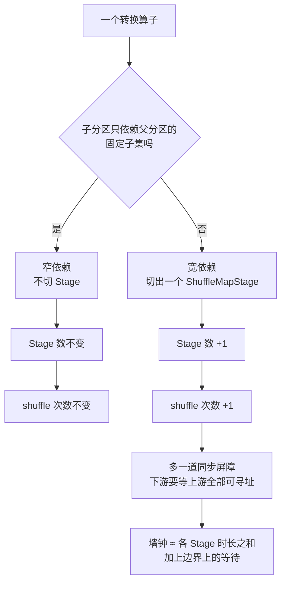
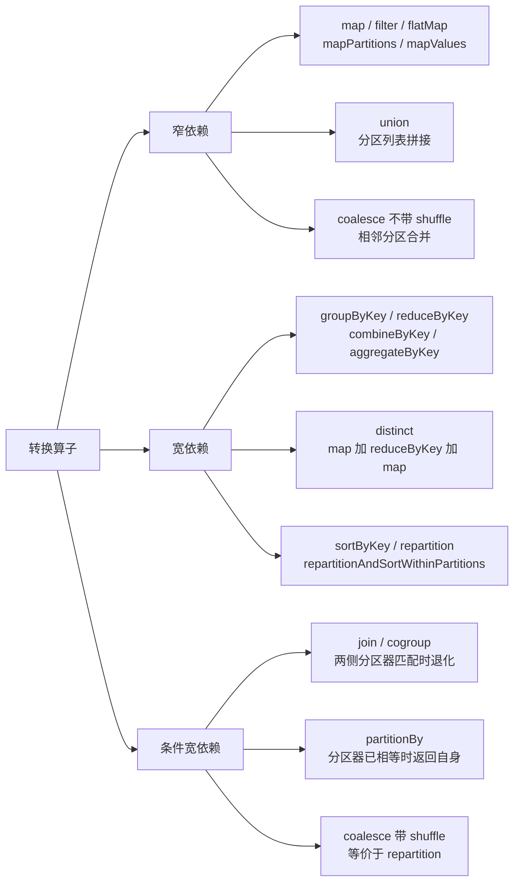
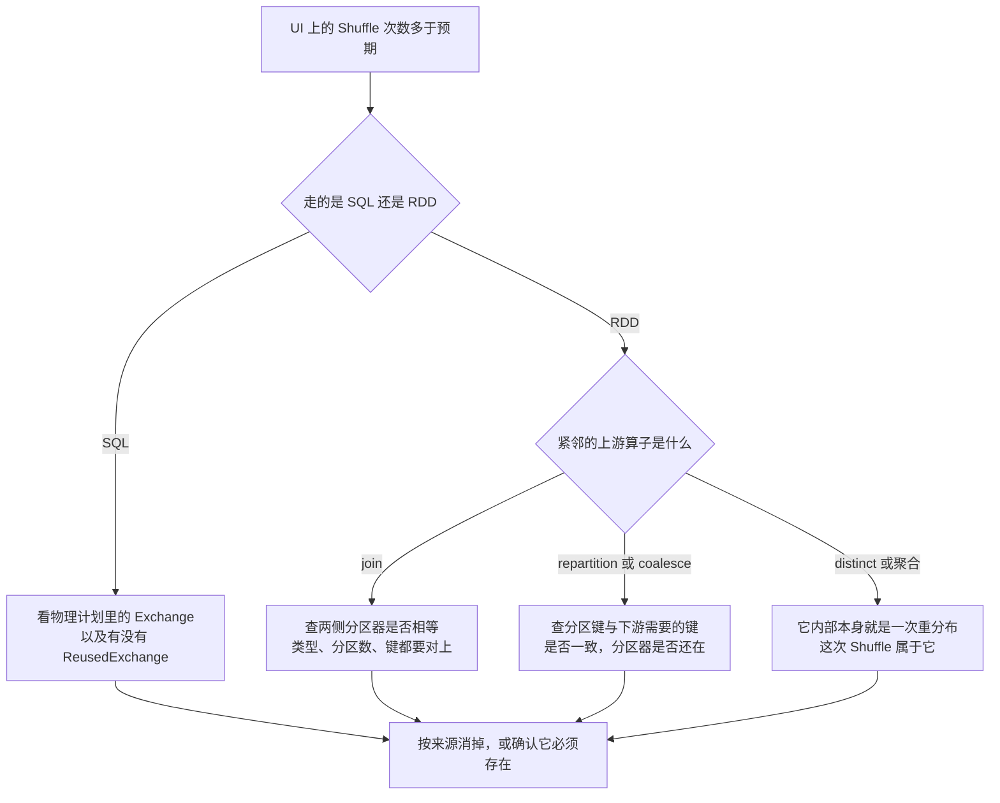
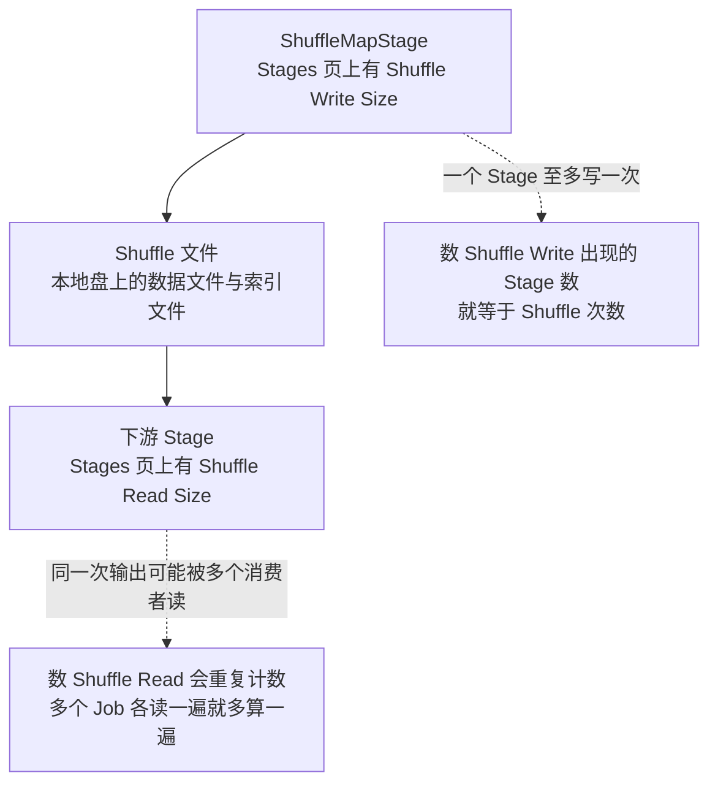
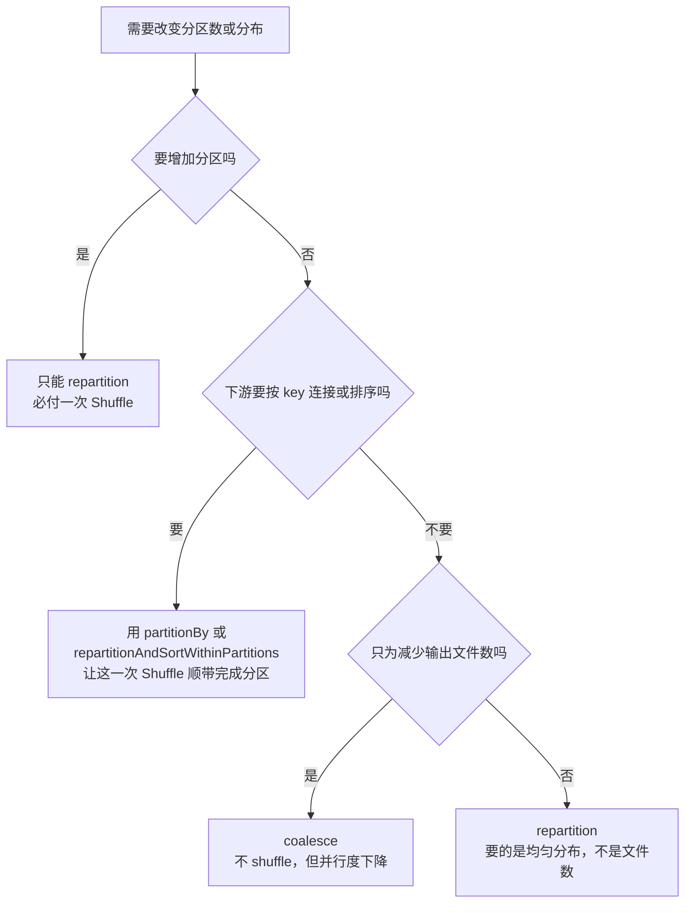

# 04 依赖关系的本质：宽依赖与窄依赖的结构定义与性能边界

**摘要：**

依赖关系的机制部分在内核系列已经拆过，本文只处理它落到运维上的那一面：依赖类型是 Stage 的唯一分界，Stage 数决定 shuffle 次数，shuffle 次数决定作业里有多少道同步屏障；三条串起来，"减少 shuffle"这句话才能改写成一个可执行的动作——阻止依赖类型从窄升级为宽。为此先把两种依赖的边界收成一句话（子分区依赖父分区的固定子集，还是依赖多个乃至全部分区），并点出三个常被误判的窄依赖与两个常被误判的宽依赖。接着给出 Stage 数与 shuffle 数的换算，以及它在四个地方的失效：缓存命中的 skipped Stage、跨 Job 共享的 Stage、AQE 的运行期重规划、4.x 的流水线 Shuffle。核心部分把"多了一次 shuffle"归成四类来源——SQL 层 `EnsureRequirements` 插入的 Exchange、join 前后没有复用分区器、`repartition` 之后又 `coalesce`、`distinct` 内部那次重排，每类给出判据与消除动作。其后是 UI 与物理计划的对账方法：数 Shuffle Write 出现的 Stage 数，而不是数 Read。最后落到宽依赖的三笔代价、`repartition` 与 `coalesce` 的四问判据、一张带两侧代价的参数表与四组反例。

---

## 第 1 章 两种依赖，一句话与两条推论

上午十点零七分，日报作业在 Stages 页上摊开六个 Stage。写代码的人记得自己只调了四个会重排的算子：一次 `repartition`、一次 `join`、一次 `groupBy`、一次 `distinct`。六个 Stage 意味着五次 Shuffle，四个调用对不上五个边界——差的那一次在 `join` 的右侧：`dim_sku` 那张 80 MB 的小表没有被广播，于是它自己也要按 `sku_id` 重分布一遍。作业没报错，也没人觉得慢，三十八分钟照常跑完。但这笔账迟早要对上：每一次对不上的 Shuffle，都是一份白付的落盘、一段白等的屏障，在 300 个节点、每天两千个作业的集群上要按月结算。

### 1.1 边界收成一句话

窄依赖是子分区只依赖父分区的一个**固定子集**，这个子集在提交之前就能枚举出来；宽依赖是子分区依赖父分区的**多个乃至全部分区**，究竟依赖哪些，由运行期的 key 分布决定，提交之前无从回答。

这句话只留了"能不能在提交前枚举"这一件事，却足够撑起后面所有判断，因为它直接导出两个后果。其一，窄依赖的每个子分区都能被一个 Task 独立完成，相邻的若干窄依赖还能被同一个 Task 的迭代器链串起来，中间不落地；宽依赖做不到，子分区要等上游所有分区都写出按目标分区归置好的数据，这个"写出—归置"的动作就是一次落盘。其二，窄依赖的失败重算范围是确定的，缺哪个分区补哪个分区；宽依赖则要按 Shuffle 输出记账。

机制那一侧的表达——窄依赖那个能在提交前回答"我要哪个父分区"的抽象方法、宽依赖为什么没有对应方法、`ShuffleDependency` 为什么必须携带分区器与聚合器——内核系列已经逐段拆过，见 [[大数据/Spark/读书笔记-spark内核/03_调度与执行机制/5. Spark_DAGScheduler_Stage划分|Stage 划分与提交顺序]] 第 1 章与 [[大数据/Spark/读书笔记-spark内核/05_Shuffle核心机制/1. Spark_Shuffle机制深度解析|Shuffle 的代价模型]] 第 1 章。本篇从这两个后果往下走，只回答三个问题：这个差别怎样变成 Stage 数，Stage 数怎样变成作业时间，以及线上怎样把多出来的那几次找出来。

### 1.2 两条推论

第一条推论是依赖类型构成 Stage 的**唯一分界**。DAGScheduler 从 Action 的末端反向走，沿窄依赖一路合并，遇到宽依赖就切一刀：宽依赖之前的那一段自成一个 ShuffleMapStage，之后的继续积累，直到下一个宽依赖或终点。这条遍历规则怎样实现、为什么必须反向、手写栈避开了什么，见内核 03/5 第 2 章，此处只取一个结论：Stage 数不由算子的个数决定，由这次 Job 血缘里宽依赖的个数决定。

第二条推论更实用：**宽依赖数就是 shuffle 数**，因此在"减少 shuffle"与"减少依赖类型升级"之间可以画等号。这个改写把一句口号变成一条可以逐行施加的判据——每个转换算子都问一句"它把依赖类型升级了吗"，升级的才有 shuffle，没升级的连讨论的必要都没有。反过来，只按"算子看起来慢不慢"判断的优化都没落到这条判据上，于是出现了改完分区数、Shuffle 总量与墙钟分毫未动的调优记录。

### 1.3 三个误判成宽的窄，两个误判成窄的宽

误判通常发生在算子名字上，而不在数据流上。三个常被当成宽依赖的窄依赖，恰好都在名字里带"分区"或"合并"这类字眼。

`coalesce(n)` 不带 `shuffle` 参数时是窄依赖。它把相邻的若干父分区归给一个子分区，一个 Task 顺序读多份数据，不跨节点搬运，因此不切 Stage、不落盘。两个硬约束也来自这条定义：只能减少不能增加，输出不再携带分区器。

`union(other)` 是窄依赖。分区列表直接拼接，依赖对象里记的是一张"子分区序号落在哪一段、对应哪个父 RDD 的哪个分区"的静态映射表，所以 `union` 之后的分布就是两份分布各自的拼接，谁倾斜还是谁倾斜。

`mapPartitions` 及其变体是窄依赖。它以分区为单位施加函数，子分区与父分区一一对应；只要函数内部不触发跨分区的动作（在 `mapPartitions` 里开 `collect` 就是对另一个 RDD 做 Action），依赖类型不升级。

反过来，两个常被当成窄依赖的宽依赖，问题出在语义直觉上。`sortByKey` 读起来像"排个序"，本质却是按 key 的区间重新分布，相近的 key 必须进同一个分区；而且边界数组要靠采样算出来，所以它还额外带一趟采样 Job。`distinct` 读起来像"过滤掉重复"，本质却是把元素当 key 做一次归并，同一元素必须聚到同一个分区才可能去重。

| 判据 | 窄依赖 | 宽依赖 |
| :--- | :--- | :--- |
| 子分区与父分区的关系 | 依赖一个固定子集，提交前可枚举 | 依赖多个或全部分区，取决于运行期 key 分布 |
| 中间结果是否落盘 | 否，记录在同一个 Task 的迭代器里流过 | 是，上游先按目标分区写盘，下游再拉取 |
| 是否构成 Stage 边界 | 否 | 是，每个宽依赖切出一个 ShuffleMapStage |
| 单个 Task 能否独立完成 | 能 | 不能，要等上游所有分区可寻址 |
| 失败重算范围 | 缺失分区所在的那一格 | 按 Shuffle 输出记账，可能牵动整个上游分支 |
| 典型算子 | `map`、`filter`、`flatMap`、`mapPartitions`、`union`、`coalesce(shuffle=false)`、`glom` | `groupByKey`、`reduceByKey`、`distinct`、`repartition`、`sortByKey`、分区器不匹配时的 `join` |

判断一个算子属于哪一边，问法要落在数据流上：它是否需要把记录从原分区搬到另一个分区。需要就是宽，不需要就是窄；名字里有没有 `group`、`sort`、`shuffle` 这些词，一点参考价值都没有。

---

## 第 2 章 判据视角：一条换算链

既然依赖类型决定 Stage，Stage 又决定 shuffle，那么从"依赖"到"作业时间"之间是一条四段式的换算链，每一段都能在 UI 上找到对应的读数。

### 2.1 换算的第一段：宽依赖数加一

一个 Job 的 Stage 数，在血缘是一棵树而不是一片林的前提下，等于**宽依赖数加一**。多出来的那个一是 ResultStage，它承接 Action 的结果，不写 Shuffle 文件；其余每一个宽依赖对应一个 ShuffleMapStage，任务是把数据按目标分区落盘，落给谁由依赖对象里的分区器决定，落得对不对由 `MapOutputTracker` 记账。

这条等式有三个容易被忽略的前提，正好也是换算失准的地方。其一，血缘里有分支时等式仍然成立，因为每个宽依赖各自对应一个 Stage，与分支个数无关；但同一个 `join` 会在两侧各建一个宽依赖，于是一个看起来是"一次连接"的操作，Stage 数加的是二。其二，`coalesce` 那一类窄依赖不参与计数，哪怕它把两百个分区合成二十个、让下游 Task 数掉了一个数量级，Stage 数一个都不动。其三，缓存、跨 Job 共享、AQE 都会让"跑了几次"与"切了几个"分家。

### 2.2 等式失效的四个地方

第一个地方是缓存。Stage 图的形状在 Job 提交时就已经定死，缓存只作用在"这个父 Stage 缺不缺"这一个判断上：全部分区都有缓存位置的 RDD 不再被深入遍历依赖，对应的父 Stage 不进入待提交集合。于是在 UI 上它显示为 skipped，看起来像不存在，实际上它一直在账本里。只数"真正跑了的"会低估宽依赖个数，连 skipped 一起数又会高估这次 Job 的计算量。

第二个地方是跨 Job 共享。`ShuffleMapStage` 以 `shuffleId` 为键登记，一个 Stage 完成后可以被后续 Job 直接复用，所以从单个 Job 的视角看，Stage 数可能少一到两个，第二次运行比第一次快往往就是这个原因。

第三个地方是自适应查询执行。SQL 作业的物理计划在 Shuffle 之后会被重新优化：合并小分区、切换连接策略、必要时把广播连接降级。降级这一种会直接增加 Shuffle 次数——运行期发现构建侧的真实大小远超阈值，`BroadcastHashJoin` 换成 `SortMergeJoin`，两侧各补一个 Exchange，Stage 数当场加二。静态数计划里的 Exchange 会数错，原因就在这里。

第四个地方是 4.x 的流水线 Shuffle。`spark.shuffle.manager.incremental`（默认 `streaming`）让一部分 Shuffle 的消费侧可以在生产侧还在跑的时候就开始读，这类 Shuffle 没有可寻址的持久输出，也不注册到 `MapOutputTracker`，可用性记在 Stage 自己身上。对这类 Shuffle，"下游必须等上游全部完成"这句话不成立，于是"多一道屏障"的成本估算也要跟着改。机制与失败语义见 [[大数据/Spark/读书笔记-spark内核/05_Shuffle核心机制/2. Spark_Shuffle框架设计与实现|Shuffle 框架的两支实现]]，本篇只记结论：默认路径上屏障仍然成立，估算可以照旧；一旦确认集群开了流水线 Shuffle，就要按另一套语义估。

### 2.3 换算的第三段：屏障怎样变成时间

屏障的成本不是"多花一段时间"，而是"这段时间里有一段是纯等待"。上游 Stage 的最后一批 Task 里有长尾，下游 Stage 的第一个 Task 要等所有 map 分区都可寻址才启动，两段长尾叠起来，边界处的空转就出现了。Stage 越多，这种窗口越多；而且每个窗口的宽度**由最慢的那个 Task 定价**，不由平均值定价——一个 2000 Task 的 Stage，中位 Task 跑两分钟、最慢的跑二十分钟，边界就是二十分钟。

把三段串起来可以给出一个量级判断：Stage 串行意味着墙钟近似等于各 Stage 时长之和，多一个 Stage 就多一段"上游最慢 Task 加下游最慢 Task"的时间，在 300 节点这个规模上通常落在单 Stage 平均时长的 0.5 到 1.5 倍。以下为示例推算：那个三十八分钟、六个 Stage 的日报作业，平均每 Stage 六分多；去掉与 join 键不匹配的那次 `repartition` 后变成五个 Stage，扫描量与 Shuffle 数据量都没变，省下的是落盘、拉取和一段屏障，大约四到六分钟。若每天两千个作业里百分之五存在这类可消的 Shuffle，折出来是每天十来个小时的作业时长。

### 2.4 回到六个 Stage

把上午那个作业的 Shuffle 逐笔摊开，五次的归属如下。表的价值不在数字，在"哪些是代码里看得见的"这个区分——它决定排查从哪一层入手。

| 序 | 这次 Shuffle 用在哪 | 代码里可见 | 是否必要 | 判据 |
| :--- | :--- | :--- | :--- | :--- |
| S1 | `repartition(400, city)` 把 4 TB 行为表按城市重分布 | 是 | 否 | 下游 join 用 `sku_id`，这次重分布一次都没被复用 |
| S2 | `join` 左侧按 `sku_id` 重分布 | 是（算在 join 里） | 是 | 计划里 join 左孩子的 Exchange |
| S3 | `join` 右侧 `dim_sku` 按 `sku_id` 重分布 | 否 | 否 | 80 MB 的表本可广播，省掉这次重分布 |
| S4 | `groupBy(city, category)` 的聚合前重分布 | 是 | 是 | Exchange 位于 Aggregate 之下 |
| S5 | `distinct()` 内部那次去重重分布 | 否 | 视语义 | Exchange 落在去重节点之下 |

五笔里两笔可消：S1 白付，S3 本该广播。消完是三次 Shuffle、四个 Stage。这就是"减少 shuffle 等于阻止依赖升级"在真实作业上的样子——没有一行代码是错的，只是有两处依赖被无意中升级了。

---

## 第 3 章 哪些算子会把依赖升级

一张算子清单比十句原则有用，但清单必须配判据，否则换一个自定义算子就失效。判据只有三问：这个算子是否需要把记录搬到别的分区；搬的依据是 key 还是位置；如果搬，分区器由谁定。

| 算子 | 依赖类型 | 判据 | 备注 |
| :--- | :--- | :--- | :--- |
| `map`、`filter`、`flatMap`、`mapValues` | 窄 | 逐条映射，不换分区 | 可流水线化，无落盘 |
| `mapPartitions`、`mapPartitionsWithIndex` | 窄 | 以分区为单位施加函数 | 函数内触发 Action 会另生 Job |
| `union`、`++` | 窄 | 分区列表拼接 | 不均衡、不去重、不改变倾斜 |
| `coalesce(n)` | 窄 | 只做相邻合并 | 不能增分区，输出丢失分区器 |
| `glom` | 窄 | 分区内聚合成数组 | 大分区会撑爆内存 |
| `zipWithIndex` | 窄 | 一对一加偏移 | 要先算分区起始偏移，额外一趟计数 Job |
| `cartesian` | 窄（特殊多父） | 每对分区组合 | 窄不等于便宜，代价按分区数相乘 |
| `partitionBy(p)` | 条件宽 | 分区器已相等则返回自身 | RDD 层唯一保留 key 语义的入口 |
| `join`、`cogroup`、`leftOuterJoin` | 条件宽，每侧一个 | 两侧分区器与目标相等则退化 | 一个 join 可能加两个 Stage |
| `groupByKey`、`reduceByKey`、`combineByKey`、`aggregateByKey` | 宽 | 同 key 必须聚到同一分区 | `reduceByKey` 有 map 端合并，机制见内核 05/1 第 5 章 |
| `distinct` | 宽 | 元素即 key，需聚拢才可去重 | 分区数取父 RDD 分区数 |
| `sortByKey` | 宽 | 按 key 区间重分布 | 附带一趟采样 Job |
| `repartition(n)`、`coalesce(n, shuffle=true)` | 宽 | 轮转重分布 | 输出不携带分区器 |
| `repartitionAndSortWithinPartitions` | 宽 | 一次完成分区与分区内排序 | 用来替代"先 repartition 再 sortByKey" |
| `repartitionByRange` | 宽 | 采样后按区间切 | 附带采样 Job |
| `intersection`、`subtract` | 宽，通常两个 | 内部是 `cogroup` | 两侧各一次，算 Stage 时常被漏掉 |
| `sortWithinPartitions`（SQL） | 窄 | 只做分区内排序 | 不产生 Exchange，与全局 `sort` 不是一回事 |

### 3.1 清单里最贵的三行

`join`、`intersection`、`subtract` 这三行值得单独留意，它们是"一个算子、两个宽依赖"的入口。两侧都没有目标分区器时，每侧各建一个宽依赖，于是 Stage 数加二而不是加一；`join` 之后紧接一个聚合，Stage 数就是四个，而代码只有两行。这个计数差异在跨团队交接时最容易被算错，接手的人按"两个算子两个 Stage"估算资源，实际要开四个。

### 3.2 条件宽依赖的三个入口

`join` 的退化条件是最常被援引的一条：两侧分区器相同，本次连接退化成窄依赖，Stage 不再新增（机制见内核 03/5 第 8 章）。`partitionBy(p)` 的退化更直接，分区器已经等于 `p` 时它返回自身，连新的 RDD 都不建。`coalesce(n, shuffle=true)` 则反向，它永远升级，而且与 `repartition(n)` 是同一个实现，只是走不同的入口。

两条退化路径加起来，就是"消除 Shuffle"的合法空间：让数据提前待在正确的位置上，或者让某一侧小到不需要重排（广播），没有第三条路。

### 3.3 窄依赖不等于免费

`zipWithIndex` 与 `cartesian` 是这条判据的反面教材。前者依赖类型确实是窄的，但要给每个分区算出全局起始偏移，必须先跑一趟计数 Job，于是 UI 上多一个 Job、不多一个 Stage。后者两个父 RDD 的任意一对分区组合成一个子分区，不涉及重排，可代价按分区数相乘——两百个分区乘两百个分区就是四万个 Task，任何一个 Stage 都不会这么贵。判断一次改造值不值得做，看的是"依赖类型有没有升级"和"这次计算量多大"两件事，只看前者会漏掉这两类。

---

## 第 4 章 多了一次 shuffle 的四种来源

线上追问"为什么多跑了一次 Shuffle"，答案绝大多数落在下面四类里。它们共同的特征是：代码里看不出，UI 上数得出，而且都能靠一条明确的判据定位。

### 4.1 SQL 层的 EnsureRequirements 插入

DataFrame 走的不是 RDD 的分区器判断，而是物理计划期的"需求与产出对账"：每个算子声明自己需要什么分布（按什么列聚簇、按什么列有序、有没有分区数要求），`EnsureRequirements` 拿子节点的产出分布去比对，不满足就在中间插一个 Exchange。**插进来的 Exchange 就是一次 Shuffle**，而源代码里往往一个字都没写。它插入位置与例外条款的完整推导在 [[大数据/Spark/Spark-SQL深度解析与性能调优/05 Physical Planning：从逻辑计划到物理算子的策略选择|物理规划与 EnsureRequirements]] 第 7 章，这里只留三条运维判据：两侧分区数不一致会补、聚合需要按 key 聚簇会补、排序需要有序分布而子节点不保序也会补。

定位手段有两条。一是看计划：`explain` 输出的 `Exchange` 节点数就是这次查询的 Shuffle 次数，若出现 `ReusedExchange`，说明有一段被复用了，实际次数要减。二是看日志：把 `spark.sql.planChangeLog.level` 设成 `WARN`、`spark.sql.planChangeLog.rules` 设成 `EnsureRequirements`，优化器每次插入 Exchange 都会留一行记录，写明在哪个节点前插入、为什么。这条日志在排查"我明明没写重排"时最省时间。

还有一类变体发生在运行期：AQE 发现构建侧实际大小超过 `spark.sql.autoBroadcastJoinThreshold`（默认 10m），把广播连接降级为 `SortMergeJoin`，两侧各补一个 Exchange。这类新增在静态计划里看不到，只有把 AQE 的最终计划打出来才看得见（`explain` 里 `AdaptiveSparkPlan` 的 `isFinalPlan` 为 `true` 的那一版）。

### 4.2 join 前后没有复用分区器

第二类来源是"已经分过区，但那个分区下游用不上"。三种形态，判据各不相同。

分区数对不上是第一种。两侧都用哈希分区，一边 200、一边 400，`CoGroupedRDD` 构造依赖时会拿目标分区器去比，比不过就两侧都重建，于是两次 Shuffle 一次不少。判据在计划里表现为两个 Exchange 相邻出现在同一个 join 之下。

分区函数不同是第二种。`sortByKey` 输出的是 `RangePartitioner`，`partitionBy(new HashPartitioner(200))` 输出的是哈希分区器，两者永不相等，所以"先 `sortByKey` 排序、再 `join`"必然是第二次重排，前面那次排序的重排白付。

分区器丢失是第三种，也是最隐蔽的一种。`coalesce(n)` 不 shuffle，代价是输出不再携带分区器；此后的 `join`、`sortByKey`、`partitionBy` 都要从头重排一遍。同理，RDD 层的 `repartition(n)` 是轮转重分布，输出同样没有分区器——它只保证均匀，不保证"按 key 落在正确的位置"。SQL 侧的 `df.repartition(n)` 输出 `RoundRobinPartitioning`，与连接所需的按 key 聚簇也不是一回事；想让这次重排同时满足连接，得写 `df.repartition(n, col("k"))` 或 RDD 的 `partitionBy`。

这类问题的通用判据只有一句话：**看紧邻的上游算子有没有把分区器改坏**。位置型重分布、合并型窄依赖、排序型重分布，三者的输出都不能直接喂给下一次按 key 的连接。

### 4.3 repartition 之后又 coalesce

第三类来源不增加 Shuffle 次数，但让其中一次变成纯浪费。`repartition(200).coalesce(20)` 这个组合里，`coalesce` 免费，`repartition` 照付；如果中间没有重计算，把 200 个分区算出来再合并成 20 个，等价于直接 `repartition(20)`，若上游本来就有 20 个以上分区，直接 `coalesce(20)` 一次 Shuffle 都不需要。

它之所以常见，是因为出自两个不同目的的叠加：写代码的人先为了并行度调大分区，后来又为了输出文件数调小，两次改动都合理，只是没放在一起看。判据是**两次分区数变更之间有没有重计算**——有，则两步都成立，`repartition` 买的是那一段的并行度；没有，则前一步纯属多余。

反过来也有一个对称的误判：以为 `coalesce` 之后还能 `repartition` 回来。那确实是两次动作，但只有后者产生 Shuffle，前者的成本以"并行度下降"的形式出现在墙钟上，不出现在 Shuffle 数据量里，于是从 Shuffle 指标上完全看不出来。

### 4.4 distinct 内部的那一次

`distinct` 的内部实现是三段：给每个元素套上 `(元素, null)`，按元素做一次 `reduceByKey`，再把 key 取回来。中间那一段就是**一次完整的 Shuffle**，分区数默认取父 RDD 的分区数。所以 `distinct` 在 UI 上表现为"一个没有显式重排的算子，却带来了一个 ShuffleMapStage"。

这个结构还解释了两件容易被误解的事。其一，`rdd.distinct()` 的分区数跟着上游走，上游 400 个分区，去重之后还是 400 个，随后若只要少量输出文件，仍要用 `coalesce` 收，这次收是免费的。其二，去重的键是元素本身，因此 `distinct` 输出的分区器作用在元素上；若紧接着要按这个元素做 `join`，且另一侧也在同样的分区数上按同一个键哈希，这次连接可以退化。同一份数据写成 `a.union(b).distinct()` 是一次 Shuffle，写成 `a.distinct().union(b.distinct())` 是两次，差别只在这个顺序上。

| 来源 | 症状 | 判据 | 处置 |
| :--- | :--- | :--- | :--- |
| SQL 的 `EnsureRequirements` | 计划里出现代码中没写的 `Exchange` | `explain` 的 Exchange 数与预期不符；`planChangeLog` 有插入记录 | 调整分区数或排序需求，让子节点直接满足；能广播就广播 |
| 未复用分区器 | join 前后各一个重分布 | 两侧分区器类型、分区数、键至少有一项对不上 | 统一到同一个分区器；用 `partitionBy` 或 `repartition(n, col)` |
| `repartition` 后又 `coalesce` | 分区数先增后减，中间无重计算 | 两次变更之间没有会改变数据量的算子 | 直接取目标分区数，或直接 `coalesce` |
| `distinct` 内部 | 无显式重排却多一个 Stage | 计划里 Exchange 落在去重节点之下 | 确认去重是否必要；能合并进同一链就不要拆成两段 |

---

## 第 5 章 从 UI 与计划对账

判断"多了一次"不能靠读代码猜，要靠两处读数互相对账：UI 的 Stage 页给出实际发生了几次，物理计划给出应该发生几次；两者不一致的时候，差值本身就是线索。

### 5.1 Stages 页：数写不数读

每个 Stage 的详情页底部有一组 Summary Metrics，其中 `Shuffle Write Size`、`Shuffle Write Records`、`Shuffle Write Time` 只出现在 ShuffleMapStage 上；带 `Shuffle Read` 的那几项则出现在任何有上游 Shuffle 的 Stage 上。于是"数 shuffle 次数"的正确读法是**数 `Shuffle Write` 非零的 Stage 个数**，而不是数 Read——后者会被重复消费放大：同一个 Stage 的输出被三个下游 Job 各读一遍，Read 侧就出现三行记录，而 Shuffle 只发生过一次。

Job 详情页顶部的 Stage 列表还带 skipped 标记，与 §2.2 的失效点一起用：总数减去 skipped 的，才是这次 Job 真正跑的 Stage。

### 5.2 SQL 页：Exchange 的个数

SQL 作业在 SQL 页上有一张查询计划图，`Exchange` 节点就是 Shuffle 边界，AQE 打开时同一张图会标注最终计划与初始计划的差别。数 Exchange 的个数，与 Stages 页上 `Shuffle Write` 非零的 Stage 个数对照：相等说明计划与实际一致；计划里的多说明有 Exchange 被复用（`ReusedExchange`）；UI 上的多说明有运行期新增，回到 §4.1 的降级那一条。

### 5.3 三条"不是这一层"的排除判据

Shuffle 次数多不等于 Shuffle 慢，Stage 多也不等于作业慢。`Shuffle Write` 正常而 `Shuffle Read` 偏长，问题在取数与网络侧；某次 Shuffle 的数据量远小于 Stage 时长应有的量级，问题在计算或倾斜；Stage 多而每个都很短，问题在提交与调度开销。三条都不是依赖类型这一层的问题。

| 观察点 | 读数 | 说明什么 | 常见误判 |
| :--- | :--- | :--- | :--- |
| Stages 页 | `Shuffle Write Size` 非零的 Stage 数 | Shuffle 次数 | 把 Read 也数进去，重复计数 |
| Job 详情 | Stage 列表中的 skipped 项 | 父 Stage 被缓存或复用，未实际执行 | 认为 Stage 不存在，低估宽依赖数 |
| SQL 页 | `Exchange` 节点个数 | 计划期应发生的 Shuffle 次数 | 忽略 `ReusedExchange`，多数一遍 |
| 失败 Stage | `FetchFailedException` 的栈 | 该 Stage 在拉取侧，问题在上游输出 | 直接归因为网络抖动 |
| Stage 指标 | 单 Stage 的 Task 数与最长 Task | 并行度与长尾 | 只调并行度，不看最长 Task |
| 事件日志 | Stage 的 attempt 编号 | 是否发生重提与熔断 | 把重提当成"跑了两次作业" |

---

## 第 6 章 宽依赖的三笔代价

宽依赖贵在三个地方，且三笔账不能互相抵扣：省了落盘，屏障还在；省了屏障，重算范围还在。

### 6.1 落盘

一次 Shuffle 至少要写一遍、读一遍本地盘。以上午那个作业的 S2 为例，4 TB 行为表过滤后仍有 1.2 TB 进入 Shuffle；按 300 节点、单节点 150 MB/s 的有效带宽估算，聚合吞吐约 45 GB/s，写与读各约半分钟（示例推算，不是基准数据）。磁盘账还有容量下限：Shuffle 文件在 Stage 完成后仍要留着供复用，本地盘紧张的集群上一次大 Shuffle 就能把节点写满，随后触发的取数失败与重算远贵于那半分钟 IO。

### 6.2 屏障

屏障的账是时间账，形态是"上游最慢 Task 完成后，下游才能起步"。它把并行窗口切成互不相交的段，段数等于 Stage 数；段内并行度再高，也补不回段与段之间的空转。这也是"Stage 数"值得单独盯的原因：它直接决定作业的时间下限，而分区数只决定每一段内部铺得多开。

### 6.3 重算

Shuffle 输出丢失会触发上游 Stage 的局部重提，重算范围按 Shuffle 输出记账：丢的是一个 map 分区，重算那一个分区，但所有读过它的下游分区都要等。这层机制、`ResubmitFailedStages` 的清理动作、以及连续失败打到熔断后的行为，见 [[大数据/Spark/读书笔记-spark内核/03_调度与执行机制/5. Spark_DAGScheduler_Stage划分|Stage 划分与提交顺序]] 第 7 章。运维上的判据是：一次 Shuffle 之后若出现大面积 `FetchFailedException`，先查提供 Shuffle 输出的那批 Executor 为什么消失，而不是下游的计算逻辑。

| 代价 | 量级 | 影响因素 | 缓解手段 |
| :--- | :--- | :--- | :--- |
| 落盘 | 与 Shuffle 数据量成正比，TB 级数据在分钟量级 | 数据量、压缩比、本地盘带宽与剩余容量 | 压小上游数据、开压缩、控制单 Stage 的 Shuffle 量 |
| 屏障 | 每多一个 Stage 多一段等待，宽度由最慢 Task 定价 | Stage 数、长尾、调度延迟 | 减少可消的 Shuffle、缓解倾斜、必要时用广播 |
| 重算 | 按 Shuffle 输出记账，最坏牵动整个上游分支 | 失败频率、Shuffle 文件保留策略、上游血缘长度 | 保住 Shuffle 输出、缩短血缘、对关键中间结果持久化 |

---

## 第 7 章 repartition 与 coalesce 的四问

这两个算子被混用的频率极高，判据其实只有四问，按顺序问下来必有一种写法。

第一问是要增还是要减，`coalesce` 做不到增加。第二问是下游要不要按 key 连接或排序：要，这次重排就得同时产出可复用的分区器，`coalesce` 与 RDD 层 `repartition(n)` 都不行，得用 `partitionBy`、`repartition(n, col)` 或 `repartitionAndSortWithinPartitions`。第三问是中间有没有重计算：没有，先增那一步就是白付。第四问是能否接受并行度下降，`coalesce` 之后 Task 数同步下降，数据量没变则单 Task 变重、长尾变长，这是固有代价，不是配置问题。

还有一个隐式差异值得单列：`coalesce` 之后分区器丢失，`repartition` 之后分区器是轮转的、对按 key 的语义也没用。**两者都切断了"上一次按 key 重排"的成果**，区别只是前者不花钱、后者花钱。真正能保住成果的只有 `partitionBy` 与 `repartitionAndSortWithinPartitions`。

| 维度 | `coalesce(n)` | `repartition(n)` | `repartition(n, col)` 与 `partitionBy` |
| :--- | :--- | :--- | :--- |
| 依赖类型 | 窄，不切 Stage | 宽，切一个 Stage | 宽，切一个 Stage |
| 能否增加分区 | 不能 | 能 | 能 |
| 输出分区器 | 无 | 无（轮转分布） | 有，按 key 哈希或区间 |
| 并行度 | 下降 | 可增可减 | 可增可减 |
| 倾斜 | 只合并相邻，可能放大 | 哈希打散，缓解但不消除 | 同左，且不消除热点 key |
| 典型用途 | 减少输出文件数、降低调度开销 | 提高并行度、打散极端集中 | 让后续 join 或排序复用这次分区 |

---

## 第 8 章 参数与阈值

真正影响 Stage 数与 Shuffle 次数的参数并不多，多数调优配置改变的是"每一次 Shuffle 有多贵"，而不是"有几次"。两类要分开记，否则会出现在调 `bypassMergeThreshold` 却指望 Stage 数下降的场面。

| 参数 | 默认值 | 决定什么 | 调大之后 | 调小之后 |
| :--- | :--- | :--- | :--- | :--- |
| `spark.sql.shuffle.partitions` | 200 | 每个 Exchange 的输出分区数 | Task 数与小文件数上升，调度与文件句柄开销增加 | 单分区变大，单 Task 内存压力与倾斜更集中 |
| `spark.default.parallelism` | 集群总核数 | 未显式设置时取父 RDD 最大分区数；设置后决定 join 与 reduceByKey 的输出分区数 | 显式调大：RDD Shuffle 更细，固定开销上升 | 显式调小：分区更粗，合并与溢写压力上升 |
| `spark.sql.adaptive.enabled` | true | 是否在 Stage 边界重规划 | 关闭后计划固定、可预测，倾斜与小分区不再被自动处理 | 保持开启，UI 的 Stage 与静态分析会不一致 |
| `spark.sql.adaptive.coalescePartitions.enabled` | true | 是否按实际数据合并读端分区 | 打开后 Task 数下降，但分区布局不再等于配置值 | 关闭后固定按上界切，小分区与小 Task 增多 |
| `spark.sql.adaptive.advisoryPartitionSizeInBytes` | 64m | 合并的目标分区大小 | 分区更少、单 Task 更重、倾斜更集中 | 分区更细、Task 更多、常驻开销增长 |
| `spark.sql.adaptive.skewJoin.enabled` | true | 倾斜分区是否拆分 | 打开缓解长尾，代价是读端分区被复制、Shuffle Read 放大 | 关闭后长尾原样保留，重算成本也被放大 |
| `spark.sql.autoBroadcastJoinThreshold` | 10m | 多大的一侧可以广播 | 调大省掉一次 Shuffle，代价是广播内容挤占 Driver 与 Executor 内存 | 调小退回 `SortMergeJoin`，多一次 Shuffle |
| `spark.shuffle.sort.bypassMergeThreshold` | 200 | 分区数低于此值时走不排序的合并路径 | 更多 Stage 免排序，但小文件与文件句柄压力上升 | 一律走排序，CPU 与溢写上升 |
| `spark.stage.maxConsecutiveAttempts` | 4 | 宽依赖边界处的重提上限 | 抖动多等几轮，持续故障时作业挂更久、占资源 | 更快暴露，瞬时抖动可能被误判为失败 |

三个不要动的地方。第一，`spark.sql.shuffle.partitions` 的无脑调大，它只在初始计划生效，AQE 会按实际数据重新合并，调成巨大值的结果是写端分区数虚高、索引条目膨胀，读端又被合并回来，两头都付了钱。第二，把 `spark.sql.adaptive.enabled` 关掉来"让计划可预测"，代价是倾斜与小分区回落到人工判断，在每天两千个作业的集群上等于把一件自动化的活摊回给人。第三，`spark.shuffle.manager` 设成 `tungsten-sort`，4.x 里它只是 `sort` 的别名，改它不产生收益，而 hash shuffle 在 4.x 已被移除，看到老资料里"小分区用 hash shuffle 更快"的说法，直接跳过。

版本口径按 4.3.0 记：`spark.api.mode` 默认 `classic`；Shuffle 管理层拆成阻塞式与流水线式两支，`spark.shuffle.manager` 只接受阻塞式实现，流水线式由 `spark.shuffle.manager.incremental`（默认 `streaming`）控制；`tungsten-sort` 解析到 `sort`；`spark.sql.adaptive.enabled` 默认开，`spark.sql.cbo.enabled` 与 `spark.sql.cbo.joinReorder.enabled` 默认关。参数名与默认值跨大版本改动较多，用之前回到对应版本的 Configuration 文档核一遍，见 [[大数据/Spark/读书笔记-spark内核/06_性能调优实战/6. Spark_Shuffle性能调优|Shuffle 性能调优的参数台账]]。

---

## 第 9 章 反例与边界

### 9.1 用 `groupByKey` 替代 `reduceByKey`

`groupByKey` 与 `reduceByKey` 的依赖类型相同，都是宽依赖、都切一个 Stage，因此从 Stage 数上看不出差别，差别在写出去的数据量。判据在 UI 上：`Shuffle Write Records` 与上游 Stage 的输出记录数接近，说明 map 端没有收缩，写出去的是原始值列表；换成 `reduceByKey`，这个数应当降一个量级。`groupByKey().mapValues(_.sum)` 与 `reduceByKey(_ + _)` 语义等价，前者写出的记录数等于输入记录数，后者在 map 端已按 key 收缩过。机制见内核 05/1 第 5 章，此处只记形态：Stage 数一样，Shuffle 数据量可能差一个数量级，而墙钟的差就出在这个数量级上。

### 9.2 先 `repartition` 再 `sortByKey`

这是"多一次 Shuffle"最常见的写法。`repartition(400)` 是轮转重分布，输出没有分区器；`sortByKey` 用 `RangePartitioner`，两者永不相等，于是两次 Shuffle 各自来一遍。正确写法只有两种：确实要"分区内有序"就用 `sortByKey` 一次，前面的 `repartition` 删掉；既要指定分区又要分区内有序，用 `repartitionAndSortWithinPartitions` 一次完成。SQL 侧同理，`sortWithinPartitions` 只做分区内排序、不产生 Exchange，与全局 `sort` 是两件事，把后者换成前者可以整段省掉一次重排。

### 9.3 `coalesce(1)` 汇总

把所有数据收进一个分区输出成单文件，是最容易写、也最容易出事的做法。一个 Task 要拉取全部上游数据，内存、本地盘、网络三条线同时成为瓶颈；更麻烦的是它把并行度压成一，原本两分钟的输出阶段变成四十分钟。判据是目标分区数乘单分区期望大小：总量几百 MB 以内可以接受，上 GB 就该先聚合降量再收，或接受多文件交由下游合并。若目的只是"文件数可控"，`coalesce(40)` 与 `coalesce(1)` 的差别仅在文件数、不在计算量；若目的是"单文件"，那是存储层的需求，不该由一个 Shuffle 阶段来承担。

### 9.4 用顺序换 Shuffle 次数

`a.union(b).distinct()` 是一次 Shuffle，`a.distinct().union(b.distinct())` 是两次，两段代码语义完全一样。同理，`join` 之后的 `distinct` 与 `distinct` 之后的 `join`，Shuffle 次数可以差一倍。这类优化的特点是零风险、零语义变化，只要把"能合并的先合并、能一次算完的不拆两次"当成习惯，收益就稳定存在。反过来，`cartesian` 与 `zipWithIndex` 都是窄依赖却都不便宜，§3.3 已经算过这笔账。

### 9.5 边界：Stage 少不等于快

三个边界要一起记住。其一，把两次 Shuffle 合成一次省下的是落盘、拉取与屏障，若被合并的那一段原本就能与前后重叠，收益会小于估算；4.x 的流水线 Shuffle 更是直接改了"屏障必然存在"这个前提。其二，缓存与 AQE 让 UI 上的计数与静态分析经常对不上，看到 skipped 的 Stage 不必认为它不存在，看到运行期多出的 Exchange 也不必认为计划写错了。其三，**Stage 数是下限而非目标**，用一次巨大的 `repartition` 吞掉中间步骤的写法会让单 Stage 又长又重，长尾与重算成本一起放大。

| 反例 | 表面现象 | 实际代价 | 处置 |
| :--- | :--- | :--- | :--- |
| `groupByKey` 替 `reduceByKey` | Stage 数一样，看不出问题 | Shuffle 写出量等于输入量，可能差一个数量级 | 换成可结合的聚合算子 |
| `repartition` 后 `sortByKey` | 两次重排都"有理由" | 第一次的分区器不被第二次接受，纯白付 | 合并为 `repartitionAndSortWithinPartitions` |
| `coalesce(1)` 汇总 | 输出单文件，看起来整洁 | 并行度压成一，单 Task 拉全量数据 | 先聚合降量，或接受多文件 |
| `distinct` 前后各接一次 join | 代码语义清晰 | 三次 Shuffle，其中一次本可合并 | 调整算子顺序，能合并的先合并 |
| `union` 后 `repartition` 求均衡 | 以为 `union` 之后分布变均匀 | `union` 是窄依赖，不改变分布；`repartition` 才付钱 | 确认是否需要均衡，文件数用 `coalesce` |

---

## 第 10 章 落点

回到上午那个作业。六个 Stage、五次 Shuffle、四个会重排的调用，差额不在代码写错，而在两处依赖被无意中升级：一次 `repartition` 的分区键与下游 join 的键不是同一个，一次本该广播的 80 MB 小表走了重分布。把它们消掉之后是三次 Shuffle、四个 Stage，扫描量一点没少，墙钟少了四五分钟。这类收益不来自任何参数，只来自一条判据：**每一次重排都要回答下游要什么分区**。

依赖关系的运维含义可以收成三句。它把"减少 shuffle"从口号变成可逐行施加的判据——看这个算子有没有把依赖类型从窄升级为宽。它把 Stage 数变成作业时间的下限——段内并行度再高，也补不回段间的等待。它把重算范围变成可定价的——窄依赖按分区补，宽依赖按 Shuffle 输出补。

"多了一次 shuffle"的四种来源，是同一件事的四种伪装：SQL 层替你升级了依赖、分区器没对上导致升级重复一次、分区数变更加了一次本可没有的升级、内部实现把一次升级藏进普通算子。四种都能在 UI 上数出来（数 `Shuffle Write` 出现的 Stage，不数 Read），也都能在计划上对上账（Exchange 个数与 `ReusedExchange` 标记）。

剩下的是取舍。宽依赖不是错误，它是"按 key 重新组织数据"这件事的唯一合法手段；要做的不是把它消灭，而是确保每一次都有人认领——要么它服务了一个必须跨分区才能完成的语义，要么它换来了可以复用的分区布局。认领不出来的那几次，就是账上多出来的那几行。

---

## 参考资料

- Zaharia, M., et al. "Resilient Distributed Datasets: A Fault-Tolerant Abstraction for In-Memory Cluster Computing." NSDI 2012.（窄依赖与宽依赖的原始定义，以及宽依赖为何必须落盘）<https://www.usenix.org/system/files/conference/nsdi12/nsdi12-final138.pdf>
- Apache Spark 4.3.0 Documentation: RDD Programming Guide（`coalesce`、`repartition`、`partitionBy`、`distinct` 的语义与分区数约定）<https://spark.apache.org/docs/latest/rdd-programming-guide.html>
- Apache Spark 4.3.0 Documentation: Configuration（`spark.sql.shuffle.partitions`、`spark.sql.adaptive.*`、`spark.shuffle.sort.bypassMergeThreshold`、`spark.stage.maxConsecutiveAttempts` 的默认值以此为准）<https://spark.apache.org/docs/latest/configuration.html>
- Apache Spark 4.3.0 Documentation: Performance Tuning（AQE 的合并分区、倾斜连接与动态切换连接策略三节）<https://spark.apache.org/docs/latest/sql-performance-tuning.html>
- Apache Spark 4.3.0 Documentation: Web UI（Stages 页的 Shuffle Write 与 Shuffle Read 指标，以及 skipped Stage 的呈现）<https://spark.apache.org/docs/latest/web-ui.html>
- Apache Spark 源码（v4.3.0）：`RDD.scala`（`coalesce`、`distinct`、`partitionBy` 的实现）、`CoGroupedRDD.scala`（依赖类型的选择）、`EnsureRequirements.scala`（Exchange 的插入条件）<https://github.com/apache/spark/blob/v4.3.0/core/src/main/scala/org/apache/spark/rdd/RDD.scala>

---

> [!note] 思考题
> 1. 你的作业里有多少次 Shuffle 能被一句话认领——它服务的下一个算子到底需要什么分区？认领不出来的那几次，分别落在本文四类来源的哪一类？
> 2. 一个 join 两侧分区数相同、分区键也相同，但一侧用 `HashPartitioner`、另一侧用 `RangePartitioner`，这次连接会重排几次？如果把两侧都改成 `partitionBy` 同一个 `HashPartitioner`，省下的是什么，付出的是什么？
> 3. `coalesce(40)` 之后接一个按 key 的 join，前面省下的一次 Shuffle 会在哪里还回来？你会怎么在提交前算出这笔账？
> 4. AQE 把广播连接降级成 `SortMergeJoin` 并在运行期加了两个 Exchange，这种"多出来的 Shuffle"该不该算在优化器头上？你会用什么观测手段在提交前发现它？
> 5. 在 Stage 数与墙钟之间，你能接受多切一刀换取更小的重算范围吗？判断依据是集群的故障频率，还是作业的排队压力，或者两者按什么权重相加？