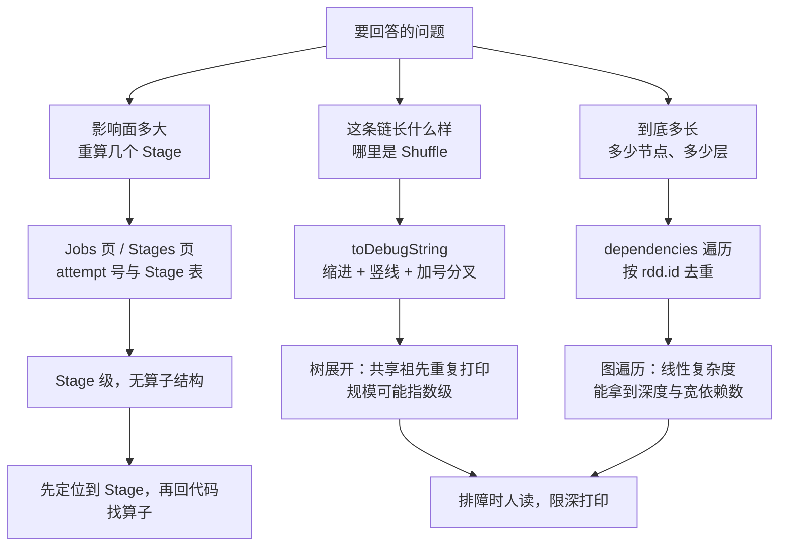
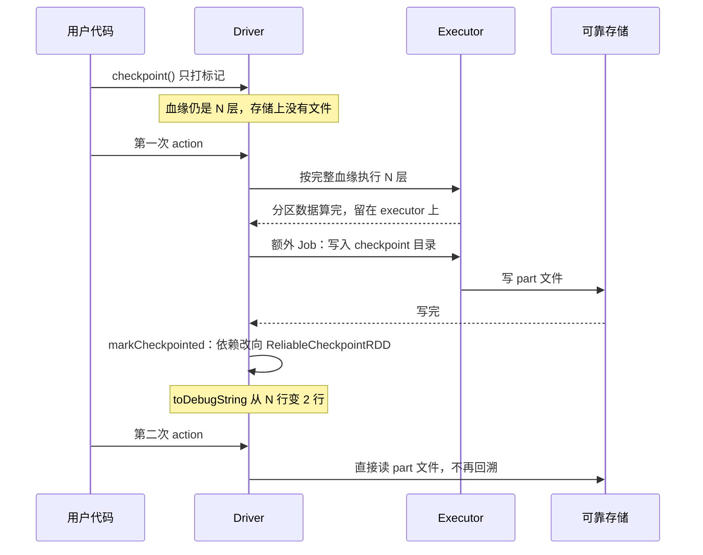
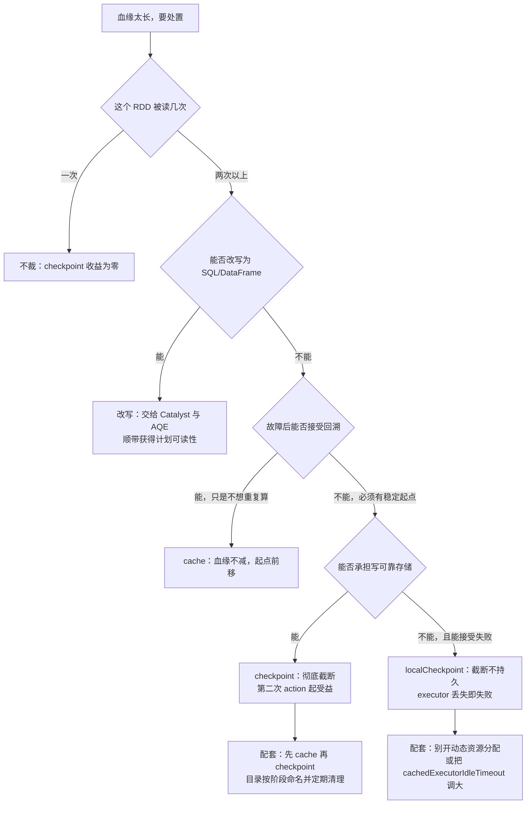
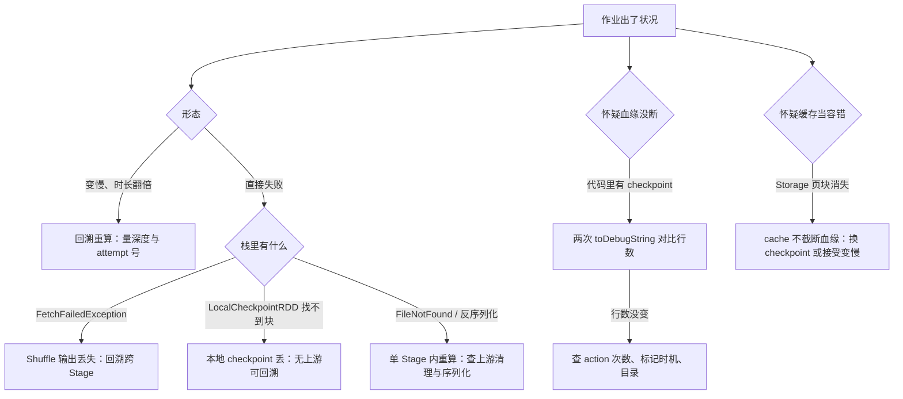

# 05 血缘（Lineage）与容错：以计算重构换取存储可靠性的权衡艺术

**摘要：**

血缘（Lineage）通常被当成一句设计宣言来讲：不存副本，只存"怎么算出来的"。但落到一个每天两千个作业、三百个节点的集群上，这句话真正逼人回答的是三个操作性问题——这条链在哪里能看见，多长算长，长了怎么裁。本文只谈这三件事。先给两种查看方式：`rdd.toDebugString()` 把对象图摊平成一棵树，读得出层数却读不出规模；递归 `rdd.dependencies` 才是量深度的正确工具，因为它按 RDD id 去重，不会被共享祖先的重复打印骗过去。再纠正一个普遍的错觉：Spark UI 上的 DAG 是 Stage 级的，Job 页与 Stage 页只有表格与时间线，SQL 页那张图画的计划节点而不是 RDD，算子级血缘在 UI 上根本不存在。然后给出"太长"的三条判据——绝对深度、打印与任务的规模、Stage 数与算子数之比——以及危害的三种形态：回溯重算、每个 task 的反序列化、栈深。核心交付是裁剪血缘的四种手段与选择判据：`checkpoint`、`cache`/`persist`、`localCheckpoint`、改写成 SQL/DataFrame，四者对"是否截断血缘、是否持久、何时生效、失效后是变慢还是直接失败"的回答各不相同；`localCheckpoint` 在 executor 丢失后的形态是作业失败而不是重算，这一条最容易被当成"便宜的 checkpoint"而误用。最后把节奏落到迭代计算上：每 N 轮 checkpoint 的 N 由恢复时长上限与物化开销占比两条约束夹出来；再讨论截断与可追溯性的矛盾。文中数字均标注为示例推算。

---

## 第 1 章 两条线索，三个问题

凌晨的处理窗口里，一份日报作业在第三个 Stage 上抛 `FetchFailedException`。三百个节点的集群每天跑两千个作业，这类失败天天有，按惯例重试就好；但这次重试四次仍然失败，值班的人必须回答一个问题：重置到哪一步重跑，才能既恢复又不把当天的窗口挤爆。

这个问题本该有现成答案。血缘记着每一步怎么算出来的，回溯到头就能重算。麻烦在于没人看得见这条链：`toDebugString` 打出来四百多行，扫过去满屏 `MapPartitionsRDD` 与 `at map at`；UI 上只有三行 Stage；重算范围只能凭经验猜。最后的处置是把上游两个作业一起重跑，代价四十分钟。

同一个月还有另一件事。一个推荐模型训练作业，两百轮迭代，每轮在上一轮结果上挂几个算子。跑到一百四十轮左右，作业没有失败，但每轮越来越慢，driver 的 CPU 一度打满；换一台机器重启之后，同样的代码直接抛 `StackOverflowError`。

两件事的病因是同一个：血缘既是容错机制赖以成立的账本，也是一个随作业推进不断变长的对象结构，而它变长的过程不产生任何提示。

### 1.1 重算范围是精确的，但不可读

丢了一个 Shuffle 文件，`DAGScheduler` 把 `missingPartitions` 标出来，只重提缺的那些分区所在的 Stage；丢了 RDD 分区，就按 `dependencies` 向上找最近的可复用点。机制上它是精确的，可"精确"不等于"可读"：上面那个作业的血缘四百多层、六层是 Shuffle，而 Stage 表只有六行，血缘里没有 Stage 编号，两者对不上号。要估算重跑代价，人得知道回溯到第一个丢失点要走多远、这一段每个分区要重读多少数据，前者能从血缘算出，后者要去 Stage 指标里读。处置退化成经验：看哪个 Stage 重试最多就重跑它的上游，多跑的账没人记，窗口会记。

迭代作业把这件事放大成结构性问题：每轮都在上一轮结果上追加算子，两百轮、每轮三层就是六百层，这个距离不报错，只在三条路径上收费——driver 维护整张对象图、每个 Stage 把链序列化进 task 闭包、task 内部按窄依赖逐层递归。那台重启后抛 `StackOverflowError` 的机器只是栈小一档，同一份代码在它上面先撞墙。

### 1.2 三个问题

其一，**怎么看见血缘**。不是"有没有这个东西"，而是"用哪种视图看、看到什么、看不到什么"，用错视图会得到错误结论。其二，**多长算长**。长度本身不是问题，问题是长度与代价的关系式里还缺几个量：千层全窄依赖链与六层宽依赖链哪个更危险，取决于回溯要重算多少分区、每分区多贵。其三，**长了怎么裁**。`checkpoint`、`cache`、`localCheckpoint` 在代码里都只有一行，语义却分属三个方向；第四个方向不在 RDD 里——改写成 SQL 或 DataFrame，让血缘这个结构从一开始就不存在。

### 1.3 分工：哪些内容不在本篇

机制那一侧不展开。四级失败与恢复动作见 [[大数据/Spark/读书笔记-spark内核/04_存储与容错机制/4. Spark容错机制与Runtime生命周期|容错机制与 Runtime 生命周期]]；打标记、两次 Job、`markCheckpointed` 如何改向依赖见 [[大数据/Spark/读书笔记-spark内核/04_存储与容错机制/6. Spark_Checkpoint机制|Spark Checkpoint 机制]]；惰性求值与链长拆分见 [[大数据/Spark/Spark-RDD核心原理解析/03 算子转换逻辑：惰性求值与 DAG 构建的底层机制|03 惰性求值与 DAG 构建]]；缓存级别与驱逐顺序见 [[大数据/Spark/Spark-RDD核心原理解析/08 缓存与持久化：StorageLevel 策略、BlockManager 协作与堆外内存实践|08 缓存与持久化]]。

另有一处划线：恢复要花多久、什么情况下重建会失败，那套成本模型另有专篇算过账，见 [[大数据/Spark/Spark-容错与状态管理深度解析/01 RDD Lineage 血缘容错：分布式计算的重建之道|01 血缘容错的重建成本]]。本篇不重复，只回答它的前置问题——要看那笔账，先得把血缘读出来、量出来、必要时裁掉。

---

## 第 2 章 看见血缘：两种方式与一个错觉

血缘的物理形态是 driver 堆上一串 RDD 对象，每个对象持有指向父 RDD 的依赖引用。要看它只有两条路：让 Spark 自己打印，或者自己遍历对象图。前者便宜但有变形，后者准确但要写几行代码。

### 2.1 `toDebugString`：把对象图摊平成一棵树

`rdd.toDebugString` 从调用它的那个 RDD 出发，沿 `dependencies` 递归向上，每深一层加一段缩进，宽依赖的父 RDD 用 `+-(` 起头，窄依赖的父 RDD 用竖线续接。行首括号里是分区数，方括号里是 RDD 的自增 id，`at` 之后是创建位置，也就是那行用户代码。

```text
(200) ShuffledRDD[41] at reduceByKey at DailyReport.scala:64
 +-(200) MapPartitionsRDD[40] at map at DailyReport.scala:62
    |  MapPartitionsRDD[39] at filter at DailyReport.scala:61
    |  HadoopRDD[38] at textFile at DailyReport.scala:52
```

这段是输出形态示意，省略了 scope 之类的尾部标记，结构是稳定的。读它有三处值得看：层数就是行数；`+-(` 出现的位置就是 Stage 边界，因为只有宽依赖会换 Stage；创建位置能直接指到"这一层是谁加的"。它同时是验证 `checkpoint` 是否真截断的最快判据——在两次 action 之间把同一个 RDD 的 `toDebugString` 各打一次，行数从几百降到两行、并出现一条 `ReliableCheckpointRDD`，就说明替身已经接管；目录可能因为权限、路径、前缀对不上号，对象图的状态骗不了人。局限同样明确：打印出来的是树不是图，共享祖先会被重复打印（id 相同、位置不同）；它不标 Stage 编号；它不显示分区器、数据量，也不显示分区是否已被缓存。

### 2.2 递归 `dependencies`：量深度要用图，不要用打印

既然打印会把图摊成树，量深度就得自己遍历。核心只有一句：按 `rdd.id` 记忆化，取各条路径上最长的那个。

```scala
import org.apache.spark.rdd.RDD
import org.apache.spark.ShuffleDependency

// 深度、节点数、宽依赖数；后者约等于 Stage 数减一
def lineageShape(root: RDD[_]): (Int, Int, Int) = {
  val depth = scala.collection.mutable.Map.empty[Int, Int]   // rddId -> 最长层数
  val nodes = scala.collection.mutable.Set.empty[Int]
  var shuffles = 0

  // 记忆化：每个节点只算一次。递归深度等于链长，几千层以内安全
  def walk(r: RDD[_]): Int = depth.getOrElseUpdate(r.id, {
    nodes += r.id
    val deps = r.dependencies
    deps.foreach(d => if (d.isInstanceOf[ShuffleDependency[_, _, _]]) shuffles += 1)
    if (deps.isEmpty) 1 else 1 + deps.map(d => walk(d.rdd)).max
  })

  walk(root)
  (depth(root.id), nodes.size, shuffles)
}
```

三个返回值各答一个问题。深度回答"回溯要走多远"，也就是重算的纵向范围。节点数回答"对象图有多大"，对应 driver 常驻内存与序列化的体量。宽依赖数回答"Stage 有几个"，因为它与 Stage 数差一——这条换算在没有 UI 的批处理脚本里特别有用，把三个数一起打进作业日志，就成了每次运行的固定头信息。顺带记一条：`getOrElseUpdate` 的递归深度等于链长，几千层时它能跑完但已逼近默认线程栈的余量，上万层的作业上巡检要改成显式栈。测量工具与它测量的对象共享同一个**脆弱的维度**。

### 2.3 一个错觉：UI 上的 DAG 是 Stage 级的

Spark UI 上有图，但它们都不是血缘图；"血缘看不清"的结论大多源于把 UI 当成了血缘查看器。

Jobs 页给的是作业列表，每行描述是 action 名与触发位置，点进去是 Stage 列表与时间线；Stages 页一行一个 Stage，给 task 数、输入量、Shuffle 读写量与失败次数。两页都没有算子级结构，数据源是 `SparkListener` 上报的事件——Stage 提交、Task 结束、指标累加，**RDD 对象图从来没有被上报给 UI**。

SQL 页确实有 DAG Visualization，画的是物理计划：`Scan`、`Filter`、`Project`、`Exchange` 这些节点与它们之间的数据流。那是计划树，不是血缘；它描述"要做什么"，而不是"哪个 RDD 对象依赖哪个"。一个纯 RDD 作业在 SQL 页上什么都没有。

| 页面 | 粒度 | 能看到 | 看不到 | 什么时候用 |
| :--- | :--- | :--- | :--- | :--- |
| Jobs 页 | Job 与 Stage | 重试次数（attempt）、Stage 归属、失败作用域 | 算子级依赖、血缘深度 | 判断失败影响面与重试历史 |
| Stages 页 | Stage | 输入量、Shuffle 读写量、task 分布 | Stage 内部算子顺序、链长 | 估算重算代价的横向量 |
| SQL 页 | 计划节点 | 算子级结构、`Exchange` 个数、AQE 前后计划 | RDD 血缘、闭包内容 | 判断优化空间与 Shuffle 次数 |
| Executors 页 | 进程 | 失败 task 数、GC 时间、堆使用 | 任何血缘信息 | 判断是否机器侧问题 |

### 2.4 三种观测面的边界

三种方式不是替代关系，而是三层：UI 看 Stage，`toDebugString` 看形状，`dependencies` 遍历看数值。



---

## 第 3 章 "太长"的判据：三条线

同一句判据放到两种作业上会给出相反结论：一条六百层的全窄依赖链，重算代价是"多扫一遍数据"；一条六层但每层都是宽依赖的链，重算代价可能是"重跑半小时"。所以判据得分三条线看。

### 3.1 第一条线：绝对深度

绝对深度是粗筛，回答"要不要细看"。经验值三档：几十层以内不必管，这是正常算子的堆叠深度；上百层值得看一眼，看打印规模与 driver 的图大小；上千层必须处置，此时已不是性能问题而是稳定性问题。三档的分界依赖四个量：算子语义决定每层价格（窄依赖只是多一次函数调用，宽依赖意味着一次落盘与一次网络重排）、分区数决定一层的任务数、单分区数据量决定每层的 CPU 与 I/O 时间、可接受恢复时长决定这条线本身。代入之后，深度不再是阈值，而是一个乘法：

```text
回溯代价 ≈ 深度 × 每层每分区处理时间 × 分区数（示例推算）
```

两百分区、每层每分区三秒的作业，回溯十层约十七分钟，五十层就是一个半小时；反过来，两千分区的作业即使只回溯三层也可能超过二十分钟。"深度大于多少就要裁"这句话本身不成立，成立的判据是**回溯代价大于可接受恢复时长**，深度只是乘法里的一个因子。

### 3.2 第二条线：规模，打印与任务各有一份账

打印规模可以直接量：`toDebugString` 的字符数与行数。六百层的迭代作业打印约六百行、五十四 KB（示例推算，按每行九十字节估），日志里每天打几十次就是十几 MB 噪音，而读它的人只看前后十行。

任务的规模更隐蔽。Stage 提交时，Spark 把"末端 RDD + 要执行的函数"序列化成二进制块并广播，每个 task 启动前从这个块反序列化出自己的 RDD 对象。序列化每个 Stage 一次，反序列化每个 task 一次；链越长块越大，task 启动成本越高。两千个 task 的 Stage 上这是可观测的启动延迟，而且它不出现在任何一项 task 指标里。

### 3.3 第三条线：Stage 数与算子数之比

第三条线看形状。把 `toDebugString` 的行数（约等于算子数）除以宽依赖数加一（约等于 Stage 数），得到"平均每个 Stage 里有多少层算子"。

比值极大，说明这条链几乎全由窄依赖组成：重算便宜，但 driver 的图、打印与反序列化都重，栈深风险集中在这里。比值接近一，说明几乎全由 Shuffle 组成：绝对层数不大，但任何一次 Shuffle 输出丢失都会把回溯推过好几个 Stage。前者该裁链，后者该在关键 Shuffle 之后落物化点。经验上单 Stage 算子数超过五十值得看一眼，超过两百基本可确定存在机器生成的重复结构，譬如循环里反复 `withColumn` 或每轮 `union` 一个小表。

### 3.4 危害的三种形态

血缘过长的危害不是"慢"，是三种可分辨的形态。回溯重算最容易认：失败后作业时长翻倍，Stages 页上某个 Stage 的 attempt 变成 2 或 3，输入量按回溯层数放大。task 反序列化开销表现为 Stage 启动慢、`Duration` 里有一大段不属于计算的时间、GC 同步上升，识别它要靠对照同一个 Stage 在血缘短时的启动速度。栈深更隐蔽：executor 按窄依赖逐层调 `compute`，递归深度等于链长，driver 侧打印与序列化同样是递归；默认线程栈几百 KB 到一 MB、每层帧几百字节，安全边界在几千层，超过之后 `StackOverflowError` 不挑数据、不挑分区，只挑栈最浅的线程。

### 3.5 判据表

| 判据 | 怎么量 | 经验阈值 | 阈值依赖什么 | 超了之后先做什么 |
| :--- | :--- | :--- | :--- | :--- |
| 绝对深度 | `dependencies` 遍历取最长路径 | 几十层不必管、上百层看一眼、上千层必须处置 | 算子宽窄、分区数、单分区数据量、可接受恢复时长 | 算一次回溯代价，与恢复窗口对比 |
| 打印规模 | `toDebugString` 的行数与字节数 | 超过几百行、几十 KB 就该限深 | 日志保留策略、排障频率 | 限深打印，或只在启动时打一次 |
| 形状比值 | 算子数 ÷ Stage 数 | 单 Stage 超过五十层算子需关注 | 是否存在循环生成结构 | 拆链、落物化点，或改写为 SQL |
| task 二进制 | Stage 序列化耗时与 task 启动延迟 | 千级链长时明显 | 分区数、广播体积 | 在链中部引入截断 |
| 栈深风险 | 递归层数对比线程栈配置 | 数千层 | `-Xss`、JVM 版本、调用链上的额外帧 | 截断，或调大 executor 栈 |

---

## 第 4 章 裁剪的四种手段与选择判据

四种手段都能让"血缘太长"不再成立，但语义分属三个方向：截断血缘、保留血缘但挪动重算起点、取消血缘这个概念本身。选错的代价不在性能上，在故障当天的行为上。

### 4.1 `checkpoint`：把 N 行压成一行

`checkpoint` 是唯一彻底截断的手段。标记之后，血缘在物化完成的那一刻被改向：原来的父 RDD 引用被换成一条指向 `ReliableCheckpointRDD` 的依赖，上游对象图从此不可达。这件事在 `toDebugString` 上最直观——截断前几百行，截断后两行：

```text
(200) MapPartitionsRDD[40] at map at DailyReport.scala:62
 |  ReliableCheckpointRDD[47]
```

关于生效时机，那一行代码只打标记、不写数据；物化发生在**之后第一次 action 的收尾处**，以一个额外 Job 的形式写进可靠存储，写完才截断。于是判据是"第二次 action 才见效"：第一次 action 走的仍是完整血缘，它承担写盘成本，收益从第二次开始兑现。推论有两层：一个 RDD 在应用里只被读一次时，`checkpoint` 收益为零而成本全额支付；它也保护不了第一次 action 自身的失败，文件还没写出来，恢复照样回溯。



代价有两条，都在代码之外。写路径上，额外那个 Job 会重新序列化、压缩、经网络写进可靠存储，算在第一次 action 的墙钟里；生命周期上，`spark.cleaner.referenceTracking.cleanCheckpoints` 默认为假，应用结束之后文件还在，长跑应用里 RDD 一直活着，清理器也没机会介入，迭代作业每十轮一个目录，一年下来这笔账没人认领。

还有一条语义边界：裸 RDD 的 checkpoint 文件在应用重启之后就无主了，目录里只有数据文件、没有东西记录它依赖谁，程序重新执行代码拿到的是全新对象图。**checkpoint 救的是应用内部的血缘断链**，不是应用可以重启。

### 4.2 `cache` / `persist`：不截断，只挪起点

`cache` 与 `persist` 把算好的分区放进 executor 的块存储，重算时优先读它，血缘一行不减。判断是否起效看的不是血缘，而是 Storage 页的命中率：命中时重算起点从数据源挪到缓存块，未命中（内存不足被驱逐、分区根本没算过）时一切照旧回到源头，血缘深度与缓存效果无关。

executor 丢失之后的行为是关键：块在 executor 上，机器没了块就没了，血缘还在，重算回到源头。这常被理解成"缓存没用"，其实是它的语义本来如此——它买的是"重复计算不必重来"，不是"故障之后不必回溯"。适合的场景因此很窄：短血缘、多次 action 复用中间结果。缓存级别与 GC 代价见 [[大数据/Spark/Spark-RDD核心原理解析/08 缓存与持久化：StorageLevel 策略、BlockManager 协作与堆外内存实践|08 缓存与持久化]]，此处只留一条判据：**被两个以上 action 复用、且重算代价明显高于缓存代价**，两个条件缺一个，缓存就是纯支出。

### 4.3 `localCheckpoint`：截断但不持久

`localCheckpoint` 站在两个世界的交界处：物化结果交给 executor 的块存储，不写外部存储；但它做的事是截断血缘，和 `checkpoint` 一样。

这个组合带来一种独特的失效形态。`cache` 丢了之后血缘还在，重算能走通，作业变慢；`localCheckpoint` 丢了之后血缘已被截断，对象图上没有上游可回溯，读那个分区的路径只剩一条——从块存储取，取不到就只能失败。现场表现是这样：某台 executor 被回收或掉线，之后某个 Stage 的 task 反复失败，栈里出现 `LocalCheckpointRDD`，错误消息大意是找不到那个 checkpoint 块（文案随版本略有差异）；重试到上限，Stage 失败、作业退出。同一台机器如果只做了 `cache`，同样的事故只会让作业变慢。

还有两处配套条件。动态资源分配会在回收空闲 executor 时连带清掉本地块，对策是把 `spark.dynamicAllocation.cachedExecutorIdleTimeout` 设得足够大，或者不把这两个特性放在一起；推测执行与 Stage 重提则可能让同一分区产生两份内容不同的块，Spark 4.3.0 里靠物化收口时的校验和挑一个版本。一句话概括它的定位：它是**用可靠性换存储成本**的赌注，赌的是 executor 不掉。

### 4.4 改写成 SQL / DataFrame：不是截断血缘，是取消它

前三种手段都在血缘内部做文章，第四种把桌子掀了：让血缘这个结构从根上不存在。RDD 的血缘是一张对象图，一旦成形就不可修改，因为每个节点都带着自己的闭包，语义绑死在对象上；DataFrame 交出去的是计划树，计划是声明式的——它描述"要什么"，不描述"按什么顺序在哪些对象上算"。于是优化器可以改它：规则优化下推谓词、裁剪列；自适应查询执行（AQE）在 Stage 边界拿到上游真实产出量后重新规划，合并小分区、拆开倾斜分区、把排序合并连接换成广播连接。

对应到本篇的题目，AQE 的意义是"运行期还能重规划"，这一点 RDD 做不到，`spark.sql.adaptive.enabled` 默认为真但它只对计划生效。代价是另一种失去：闭包不见了，血缘也不见了，排查从"读对象图"变成"读计划"——`explain`、`queryExecution` 的三份计划、SQL 页那张 DAG Visualization，且要求你把逻辑写成优化器看得懂的形式，UDF 会把这段逻辑从表达式体系里摘出去，`df.rdd` 则直接退回血缘世界。

迁移时有一处时序差容易忽略。`RDD.checkpoint()` 是惰性标记，等第一次 action 收尾才物化；`Dataset.checkpoint()` 默认 `eager = true`，**调用那一刻就提交一个作业把数据写出去**。同一行代码两种语义，从 RDD 改写成 DataFrame 时若不改调用姿势，Job 数量与执行顺序都会变。

### 4.5 四者对照

| 维度 | `checkpoint` | `cache` / `persist` | `localCheckpoint` | 改写 SQL / DataFrame |
| :--- | :--- | :--- | :--- | :--- |
| 是否截断血缘 | 是，彻底 | 否 | 是 | 血缘不存在，改由计划描述 |
| 是否持久 | 是，写可靠存储 | 否，executor 块存储 | 否，executor 块存储 | 不适用 |
| 何时生效 | 第一次 action 收尾物化，第二次起受益 | 首次 action 算完即生效 | 同样在第一次 action 收尾 | 无需生效，计划就是执行依据 |
| executor 丢失后 | 从存储读回，正常工作 | 块丢失，回溯重算，变慢 | 块丢失，无上游可回溯，失败 | 由 Shuffle 与 AQE 处理，与血缘无关 |
| 是否可跨应用 | 否，文件无主 | 否 | 否 | 表或视图可以，靠的是落表 |
| 可追溯性 | 丢，只剩替身一行 | 保留 | 丢 | 换成可读的计划 |
| 主要代价 | 一次写盘 + 目录生命周期 | 堆内存与 GC | 赌机器不掉 | 改写成本，UDF 与 `df.rdd` 削弱收益 |

### 4.6 选择判据

三个问题的顺序不能颠倒。第一问：这个 RDD 在应用内被读几次？一次，`checkpoint` 收益为零，直接排除；两次以上再进下一问。第二问：丢了之后能不能接受回溯？能接受、只是不想每次重算，`cache` 就够；不能接受、必须有个稳定起点，进第三问。第三问：能不能付出一次写可靠存储的代价？能，`checkpoint`；不能但能接受"机器掉了就失败"，`localCheckpoint`；能改写 SQL，改写通常比前三种都好，因为它连"裁多长"这个问题一起省掉了。



---

## 第 5 章 迭代计算：血缘增长最快的地方

迭代算法是血缘问题最集中的场景，因为增长是结构性的，不是写法问题。梯度下降、交替最小二乘、树模型的逐轮生长，每一轮都在上一轮结果上继续衍生，而 RDD 不可变意味着旧链必须留着。

### 5.1 为什么迭代会让深度线性增长

公式很直白：每轮新增 k 层，第 t 轮末端 RDD 到数据源的距离是 k×t 层。两百轮、每轮三层，六百层；每轮十层就是两千层，已进入栈深风险的区间。

增长有一个容易被忽视的性质：它由每轮的算子数决定，而不由数据量决定。数据量变小不会让血缘变短，只会让每层代价变小——样本采样之后的迭代作业仍然卡在血缘上，因为层数没变。

### 5.2 每 N 轮的判据

N 由两条约束夹出区间。

恢复窗口约束：从最近一次 checkpoint 点重算到故障点最多 N 轮，耗时为 N×T（T 是单轮时长），不能超过可接受恢复时长 R，于是 N ≤ R/T。

物化开销约束：每 N 轮付一次物化成本 C，它占这段总时长的比例不能太高，设上限 p，则 C/(N×T) ≤ p，于是 N ≥ C/(p×T)。

N 落在 [C/(p×T), R/T] 之间。区间为空，说明这套参数下 checkpoint 无论怎么排都不划算，该换的是别的参数：缩短物化成本（先 cache）、放宽恢复窗口，或者不在这条链上做 checkpoint。

| 场景 | 单轮时长 T | 物化成本 C | 可接受恢复 R | 推出的 N |
| :--- | :--- | :--- | :--- | :--- |
| 先 cache，写 HDFS 两百分区 | 90 秒 | 60 秒 | 15 分钟 | 7 到 10 |
| 不 cache，物化要重算全链 | 90 秒 | 360 秒 | 15 分钟 | 无解，先补缓存 |
| 小样本迭代，单轮 20 秒 | 20 秒 | 60 秒 | 15 分钟 | 20 到 45，取 20 上下 |
| 宽表迭代，物化 5 分钟 | 90 秒 | 300 秒 | 60 分钟 | 40 上下，开销占比压力大 |

表里是示例推算：第一行给出上界 900/90 等于 10、下界 60/(0.1×90) 约等于 7，落到 7 到 10 之间，习惯取 10，这也顺带说明了树模型的默认 `checkpointInterval` 为什么是十。第二行把"先 cache"去掉之后物化成本变成"写盘 + 全链重算"，下界涨到四十而阈值仍是十，区间为空——**空区间本身就是判据**：不缓存而直接 checkpoint 的迭代作业，在短恢复窗口下根本不成立。

### 5.3 MLlib 的 `checkpointInterval` 与静默失效

树模型这类内置迭代实现把这件事做成了参数：`checkpointInterval` 默认十，语义是每十轮对缓存做一次 checkpoint。看起来开箱可用，实际有前置条件——checkpoint 目录必须先设好，否则这个参数会被直接忽略。

忽略不报错，日志里也没有痕迹，现象就是"配了没效果、血缘照样长"。判据很直接：作业启动之后去可靠存储上找有没有 `rdd-<id>` 目录；没有，先怀疑目录没设，再怀疑 N 设成了负数（负数表示关闭）。

### 5.4 代码骨架与三处顺序问题

```scala
sc.setCheckpointDir("hdfs://nn/spark-checkpoint/reco-v4")   // 平台注入亦可，但必须存在

var state = loadFeatures(sc)                                  // 血缘起点
for (iter <- 1 to 200) {
  val next = update(state, data)                              // 每轮追加 k 层
  if (iter % 10 == 0) {
    next.persist(StorageLevel.MEMORY_AND_DISK)                // 先缓存：物化时不必重算全链
    next.checkpoint()                                          // 只打标记，此时什么都还没写
    next.count()                                               // 触发物化与截断，第二次读起受益
    // 截断之后 next 的父依赖已换成 ReliableCheckpointRDD，
    // 上游几百个 RDD 对象不再被引用，随 GC 释放
  }
  state = next
}
```

三处顺序问题都在这十行里。第一，`persist` 必须在 `checkpoint` 之前，否则物化那一次会把整条链重算一遍。第二，`checkpoint` 必须在第一次 action 之前，标记挂晚了物化机会就永远用掉，文件不会出现，血缘也不会断。第三，截断之后要继续迭代，应该在新对象上重新缓存——缓存挂在具体 RDD 对象上，截断改变了父依赖，但不会替你复制缓存。

还有一处不属于代码：目录。每十轮一个目录、两百轮二十个，加上重试产生的重复目录，一个训练作业留几十 GB 在存储上很常见；清理责任人在平台侧，把"按作业与阶段命名、保留最近 N 个"写进规范，比事后清理便宜。

---

## 第 6 章 可读性与可控性的矛盾

前面所有手段的收益都指向"可控"：链短了，driver 轻了，恢复范围已知了。但同一批手段也拿走了"可读"：截断之后再看这个 RDD，只剩自己加一个 `ReliableCheckpointRDD`，你怎么知道这份数据是从哪些算子、哪几个源算出来的？

### 6.1 截断之后还剩什么线索

还剩三样，都不在血缘里。一是 RDD 的名字，`rdd.setName("state@iter-150")` 不改变血缘结构，但让日志、Storage 页与脚本输出能对上号；在几百行打印里找一个叫这个名字的节点，比找 `MapPartitionsRDD[913]` 现实。二是创建位置，`toDebugString` 里 `at` 之后那行用户代码截断后仍在，它告诉你这个 RDD 是哪一行造出来的，虽然说不清上游经过了哪些变换。三是 checkpoint 目录本身，目录名带 `rdd-<id>`，若按阶段给路径（`.../iter-000150/`），目录就成了"截断点台账"，从文件名能倒推这一轮对应哪次迭代。

丢掉的是算子序列：从数据源到这个点之间每一层做了什么，追溯它只能靠截断之前的记录。

### 6.2 留痕的四个做法

限深打印一次：启动时、第一次 action 之前，对关键 RDD 打一次 `toDebugString`，按 `\n` 切分只取前若干层写进日志，成本几 KB，足够回答"链头是什么形状"。截断点台账：每次 `checkpoint` 前后各调一次第 2 章那个遍历函数，只输出三个数，一行日志就能画出这次作业的血缘曲线。命名规范：给血缘起点、每个截断点、跨模块传递的中间结果起名，把可读性需求从对象图转移到文本上。更彻底的一条：改写成 SQL 或 DataFrame 之后可读性由 `explain` 与 SQL 页提供，而且它是**声明式的、可重新生成的**——两次运行的计划可以不同（AQE 会改），但都能读，这与血缘是对象图快照、截断了就没有的性质正好相反。

### 6.3 取舍的不对称

判据是频率与价值的不对称：可控性的成本每次运行都要付，追溯的需求偶发但价值高。所以默认向可控性倾斜，用一次性留档补偿追溯；反过来，排障期的临时作业可以完全不截断，把原始 `toDebugString` 落到本地文件备查，用完即弃。

---

## 第 7 章 症状到判据：三个现场

三个现场的共同点是"看起来像同一个问题"，处置方向却分散在三个层面。

### 7.1 失败了，但算不出要回溯多远

先看 attempt 号，再看血缘深度。attempt 在 Stages 页，区分"重试一次就好了"与"反复失败"；深度要用脚本量，决定每次重试的代价：attempt 小但深度大是运气好，attempt 大且深度大则窗口一定被吃掉。再看失败点——丢 Shuffle 输出与丢 RDD 分区是两回事，前者把回溯推过 Stage 边界，后者只在一个 Stage 内，判据在失败任务的栈里：`FetchFailedException` 属前者，反序列化失败、`FileNotFoundException`、`LocalCheckpointRDD` 找不到块属后者。

### 7.2 打了 `checkpoint` 标记，血缘却没断

三种成因，判据都在对象图与存储上，不在代码里。没有 action，标记挂上而物化永不发生；标记晚于第一次 action，物化机会在第一次 action 收尾时用掉且不再重来，文件不出现、血缘不断、日志里没有异常；目录没设，4.x 之前调用时直接抛错，4.x 之后若有默认目录则不会，"没报错"不等于"设好了"。最快的验证是两次 `toDebugString` 对比：两次 action 之后各打一次，行数没变就是没截断。

### 7.3 `localCheckpoint` 在 executor 丢失后直接失败

症状很整齐：某个 Stage 的 task 反复失败，栈里有 `LocalCheckpointRDD`，重试到上限后 Stage 失败、作业退出。它和缓存丢失的区别是"变慢还是失败"。处置先判断这份数据值不值得赌：executor 稳定、或已调大 `cachedExecutorIdleTimeout` 的长链作业可以留着，关键路径上换成 `checkpoint`，或者退一步只做 `cache`。至于"用缓存当容错"的另一半症状——故障之后时长回到接近零缓存的水平、Storage 页上对应 RDD 的块从有到无——判据同样干脆：缓存块随 executor 生灭，血缘不随缓存变化。



| 症状 | 首看位置 | 判据 | 不属于本层的情况 | 处置方向 |
| :--- | :--- | :--- | :--- | :--- |
| 恢复时长不可控 | Stages 页 attempt + 血缘深度 | 深度大且 attempt 大 | 深度小但仍慢，查单分区数据量 | 在链中部截断 |
| 加了 checkpoint 没变化 | 两次 `toDebugString` 行数 | 行数不变即没截断 | 行数变了但仍慢，查物化成本 | 补 action、挪标记、确认目录 |
| 节点丢失后作业失败 | 失败栈 | 出现 `LocalCheckpointRDD` | 出现 `FetchFailed` 属 Shuffle 层 | 换可靠 checkpoint 或退为 cache |
| 节点丢失后时长翻倍 | Storage 页块与血缘深度 | 块消失但血缘完整 | 块还在却仍慢，查数据倾斜 | 接受变慢，或加 checkpoint |

---

## 第 8 章 参数与阈值

### 8.1 一张带两侧代价的参数表

| 参数 | 默认值 | 决定什么 | 调大或打开之后 | 调小或关闭之后 |
| :--- | :--- | :--- | :--- | :--- |
| `spark.checkpoint.compress` | 以所用版本的配置文档为准 | 物化写盘是否压缩 | 打开：字节数按压缩比下降，CPU 与编解码配置被绑定 | 关闭：写盘字节放大，读取端配置更宽松 |
| `spark.checkpoint.dir` | 空 | 可靠模式的默认目录（4.x 起可配） | 指向对象存储：省本地容量，写入时间成倍 | 指向本地路径：单机可用，集群模式失去可靠性 |
| `spark.checkpoint.checkpointAllMarkedAncestors` | false | 一次 action 是否连带物化祖先的标记 | 打开：一次 action 物化多个点，量按链长累加 | 关闭：链上多个标记只生效最近一个 |
| `spark.cleaner.referenceTracking.cleanCheckpoints` | false | RDD 回收后是否删 checkpoint 目录 | 打开：自动清理，但长跑应用对象不回收时形同虚设 | 关闭：目录长期占容量，清理靠平台 |
| `spark.task.maxFailures` | 4 | 单个 task 的重试上限 | 调大：多给机会，但每次重试按血缘深度付账 | 调小：更快暴露，恢复窗口更短 |
| `spark.dynamicAllocation.cachedExecutorIdleTimeout` | 极大值 | 有缓存的 executor 空闲多久被回收 | 调小：回收快、资源省，缓存与本地 checkpoint 一起丢 | 保持极大：资源占用高，块不会因回收消失 |
| `spark.sql.adaptive.enabled` | true | 计划是否在 Stage 边界重规划 | 打开：join 策略与分区数会变，对 RDD 链无效 | 关闭：计划可预测，倾斜与小分区不再自动处理 |

### 8.2 三个不要动的旋钮

`spark.task.maxFailures` 被当成"提高稳定性"的手段是反的：血缘越长，每次重试代价越大，调大上限经常只是把一次失败摊成五次，窗口照吃。`spark.cleaner.referenceTracking.cleanCheckpoints` 打开看起来是解决问题，实际只覆盖"RDD 对象被 GC"这一种情形，长跑应用里末端 RDD 一直被引用，目录一分不少；指望它自动清理而删掉平台清理任务，是最常见的误配。第三个是 `spark.checkpoint.compress` 的随手改：它改变的是写盘字节，读端必须用同一套编解码与序列化配置，换大版本或换序列化器之后旧文件读不回来是常见事故。

---

## 第 9 章 反例与边界

### 9.1 在热路径上打印超大血缘

单次几百行只是噪音，真正的问题是规模不线性。`toDebugString` 把图摊成树，同一个祖先在多条路径上被重复打印；当同一个 RDD 在血缘里被多个下游引用（自连接、反复 join 同一份特征、迭代里同时用到 state 与 input 的派生），路径数按分叉的乘积增长，二十层这样的分叉就是百万行量级（示例推算），一次打印足以把 driver 拖死。正确做法是按 `\n` 切分后只取前若干层。

### 9.2 迭代里不 checkpoint

理由是"checkpoint 拖慢每轮"。这个判断只对一半：物化确实花时间，但省下的不是时间，是**故障当天的恢复方式**。两百轮不截断，任何一次 executor 掉线都可能把作业打回第一轮，到第一百八十轮时这个代价是三个小时。

### 9.3 用 `cache` 替代 `checkpoint` 却期望容错

两者买的不是同一件东西：缓存买"重复计算不必重来"，checkpoint 买"故障之后不必回溯"。缓存全命中的日子里两者表现一样，差别只在故障那天出现，所以特别容易被自测放过。判据只有一条：这份数据的价值是否依赖"某台机器活着"。

### 9.4 把 `localCheckpoint` 当成便宜的 `checkpoint`

省掉外部存储与一次网络写，代价是把可靠性交给单机，失效形态是失败而不是变慢。能下这个注的条件有三个：executor 稳定、没开动态资源分配（或已把空闲回收调大）、作业可以接受失败重跑；缺一个就该换 `checkpoint`。

---

## 第 10 章 落点

回到凌晨那个现场。重试四次仍失败的根因是 Shuffle 输出丢失后回溯跨了三个 Stage，而这三个 Stage 之间的血缘深度没有人量过。若在那两个 Stage 边界之后各落一个物化点，重算范围会缩到一个 Stage；若连物化都不想付，至少应该在启动时把深度、节点数、宽依赖数写进日志。

血缘是便宜得惊人的设计：不存副本，只存怎么算。它的账单不在写入端，在**长度**上——长度决定了回溯多远、序列化多大、递归多深。这套设计在短链上免费，在长链上把成本从存储挪到了时间与稳定性，而这两样不出现在容量报表里。处置顺序因此固定：先看见，再量出来，再判长短，最后才是裁。

裁到这一步，一定丢掉可追溯性。这不是疏忽，是权衡的另一半：**可追溯与可计算互斥**——长血缘让人看得清数据怎么来的，短血缘让人算得准故障后要付多少。生产上更值钱的是后者，因为前者可以在截断之前留一份记录补回来，后者补不回来。至于什么时候不该裁，判断有共同形状：当这条链在应用里只被读一次，或者它短到回溯代价本就可接受时，任何裁剪都只是多欠一笔写盘的债。

---

## 参考资料

- Zaharia, M., et al. "Resilient Distributed Datasets: A Fault-Tolerant Abstraction for In-Memory Cluster Computing." NSDI 2012. <https://www.usenix.org/system/files/conference/nsdi12/nsdi12-final138.pdf>
- Apache Spark 4.3.0 Documentation: RDD Programming Guide（`checkpoint` 与 `localCheckpoint` 的语义差别、必须设置目录、`cache` 不截断血缘）. <https://spark.apache.org/docs/latest/rdd-programming-guide.html>
- Apache Spark 4.3.0 Documentation: Configuration（`spark.checkpoint.*`、`spark.cleaner.referenceTracking.cleanCheckpoints`、`spark.rdd.compress`、`spark.task.maxFailures` 等默认值以此为准）. <https://spark.apache.org/docs/latest/configuration.html>
- Apache Spark 4.3.0 Documentation: SQL Performance Tuning（AQE 的合并分区、倾斜 join 与动态切换 join 策略，以及 `spark.sql.adaptive.enabled` 默认开启）. <https://spark.apache.org/docs/latest/sql-performance-tuning.html>
- Apache Spark 4.3.0 源码：`core/src/main/scala/org/apache/spark/rdd/RDD.scala`（`checkpoint`、`localCheckpoint`、`doCheckpoint`、`toDebugString`、`dependencies` 的短路逻辑）与 `LocalCheckpointRDD.scala`. <https://github.com/apache/spark/blob/v4.3.0/core/src/main/scala/org/apache/spark/rdd/RDD.scala>
- Apache Spark 4.3.0 Documentation: MLlib 树模型（`checkpointInterval` 默认值与"未设置目录时该参数被忽略"的说明）. <https://spark.apache.org/docs/latest/ml-classification-regression.html#decision-tree-classifier>

---

> [!note] 思考题
> 1. 你手上的作业里，血缘最深的那条链有多少层？如果不写脚本，你会从哪里看出它很长——UI、日志，还是"它从不失败，但一失败就很久"？
> 2. `toDebugString` 打出来四百行，你能从这四百行里读出几个 Stage？如果读不出，你还缺哪一个视图？
> 3. 一个 RDD 在应用内只被读一次，但上游很贵。你会选 checkpoint、cache，还是什么都不做？三种做法各自把成本记在哪里？
> 4. 迭代作业跑到一半某台 executor 掉线、作业失败。你能从失败栈里判断出它用的是 `cache`、`localCheckpoint` 还是 `checkpoint` 吗？
> 5. 把一段 RDD 逻辑改写成 SQL 之后，血缘问题消失了，可读性问题换了形态。你更需要哪一种可读性——对象图的可追溯，还是计划的可解释？
