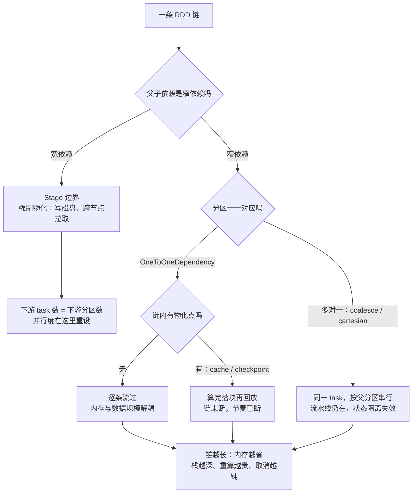
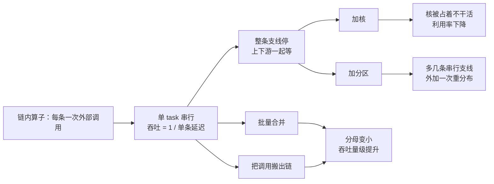
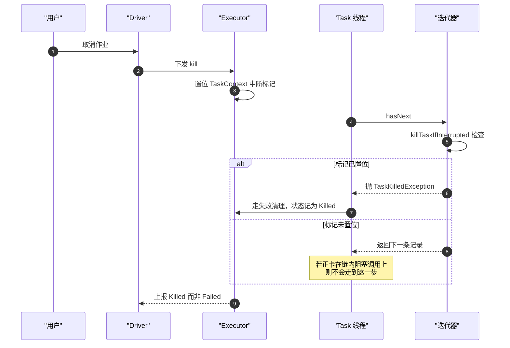
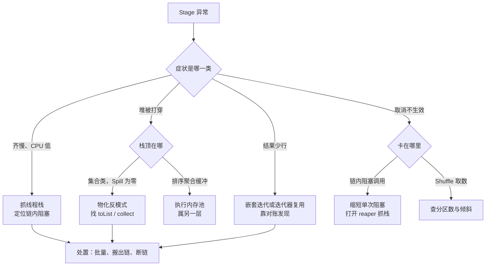

# 06 RDD 迭代器模型：流水线计算（Pipeline）与内存迭代器的实现深度分析

**摘要：**

迭代器模型常被当成一条性能优势来讲：不用算完再落地，所以能处理比内存大得多的数据。这句话没错，但它把流水线说成了一种常态，而流水线其实是有条件的——窄依赖、父子分区一一对应、链内没有物化点，三条同时成立，一条记录才会在同一个 task 里逐条穿过整条链；宽依赖一到，物化就是强制动作，没有例外。本文谈判据：先在 Stage 页与 `toDebugString` 上把"这条链有多长"读出来，再交付三件运维上要盯的事——停顿传染、`toList()` 造成的物化反模式、`Iterator[Iterator]` 的顺序依赖，各自给出现场形态、判据与阈值；随后顺着取消与清理讲 `InterruptibleIterator` 与任务完成监听器的真实边界；最后给出断链的五个手段与各自代价，落到一张症状判据表、一张流水线与物化的选择判据表和一张带两侧代价的参数表。全篇只回答一个问题：这条链什么时候替你省内存，什么时候替你攒账单，分界又在哪里；判据一律落在 UI、日志与线程栈上，不落在源码里。

---

## 第 1 章 四十七个节点的一条链

晚上九点十分，一份素材明细的清洗作业提交上去。它只有一个 Stage，DAG 图上从读文件到写 HDFS 排了四十多个节点，二百个 task 齐刷刷跑了九十六秒，GC 占任务时间的百分之三，Shuffle 写为零，CPU 利用率不到两成。值班的人按"并行度不够"处置，把分区数从二百提到四百，重跑一遍，单 task 九十四秒，总时长几乎没变；最后把执行线程的栈拉下来，四十多个线程停在同一个位置，链中段那个 HTTP 客户端在 `read()` 上等返回。

问题不在并行度。链上第三个算子在每条记录上做一次五十毫秒的外部查询，一个 task 里这条链是串行的，二百个 task 就是二百条串行支线，每条支线每秒最多处理二十条记录。把分区数翻倍只是把支线从二百条变成四百条，节奏一点没变，还额外付了一次重分布。要真正提速只有三条路：把单条等待降下来、把多次调用合成一次、把这段调用从链里挪出去，三条都在改"链"，没有一条在改"核"。

### 1.1 三条同时成立，才有一条链

窄依赖是流水的，这句话常被当成定义直接接受，但它其实是三个条件叠出来的结论。

第一条是**窄依赖**。子分区只依赖数量固定的一批父分区，对应关系在规划期就能写下来。宽依赖做不到，它依赖的是"全部 map 端中键值落在本区间的那些片段"，要等上游全部跑完才清楚。

第二条是**父子分区一一对应**，也就是 `OneToOneDependency` 那一支：子分区 `p` 的 `getParents(p)` 返回的就是 `List(p)`。这条是"逐条流过"能成立的真正原因——子算子的 `compute` 只需要拿到父 RDD 同一个分区的迭代器，包一层自己的转换函数返回，中间没有跨分区搬运。`map`、`filter`、`flatMap`、`mapPartitions` 全部落在这个形状里。

第三条是**链内没有物化点**。缓存、检查点、Shuffle 都会在链中间插一个"先写完、再回放"的动作，链在这里被切成两段。容易误判的是 `cache()`：它不产生新 Stage，从调度视角看链是连续的，但未命中时 task 必须先把自己算出来的分区完整落块再回放，那一刻流水线已经退化成"算完再吐"。机制见 [[大数据/Spark/读书笔记-spark内核/01_核心概念与基础/5. Spark_RDD内部机制深度解析|RDD 内部机制]] 第 2 章，此处只记结论：**缓存是链内的一个物化点**，代价是"一遍"变"一遍半"。

三条之外还有一类边界情形：窄依赖但不一一对应。`coalesce(n, shuffle = false)` 让一个子分区吃掉多个父分区，`cartesian` 让一个子分区读遍所有父分区，两者都不产生 Shuffle、仍是同一个 task，但"一条记录穿过整条链"变成了"一个父分区穿过再换下一个"。它不破坏流水线，却破坏了"任意时刻只有一条记录在内存里"的直觉，也把分区间的状态隔离变成真问题：同一个 task 线程连续处理多个父分区时，用户函数里捕获的 `var`、线程局部的统计量都会跨分区累积。

| 结构 | 依赖类型 | 是否同一个 task | 是否逐条流过 | 运维上的注意点 |
| :--- | :--- | :--- | :--- | :--- |
| `map` / `filter` / `mapPartitions` | `OneToOneDependency` | 是 | 是 | 链条主体，链长由此累积 |
| `union` | `RangeDependency`（偏移映射） | 是 | 是 | 分区数相加，链长不变，task 数变多 |
| `coalesce(n, shuffle = false)` | 窄依赖，多对一 | 是 | 否，按父分区串行 | 线程局部状态跨分区残留，并行度下降 |
| `cartesian` | 窄依赖，多对一 | 是 | 否，按父分区串行 | 数据量按分区数相乘，单 task 极重 |
| `repartition` / `sortByKey` / `join` | 宽依赖 | 否 | 否 | Stage 边界，强制物化 |
| `cache` 命中后继续下游 | 依赖不变 | 是 | 否，回放块迭代器 | 链内物化点，首算多一轮落块 |



### 1.2 宽依赖是强制的物化点

宽依赖必须物化，理由不在"磁盘比网络可靠"这类工程偏好上，而在等待的位置：一旦允许下游边读边等上游产出，等待就从调度层下沉到 task 内部，一个下游 task 可能长时间握着核空转、还握着已经读到的数据，上游最终失败时这份工作整个作废。Spark 把等待放在 Stage 之间，代价是一段吞吐空窗，收益是不出现"白跑一半再被推翻"的任务；推导见 [[大数据/Spark/读书笔记-spark内核/03_调度与执行机制/5. Spark_DAGScheduler_Stage划分|DAGScheduler 的 Stage 划分]] 第 5 章，其中提到的流水线式 Shuffle 依赖（`PipelinedShuffleDependency`）是 4.3.0 里一个受限例外，不能按默认行为规划容量。

结论只有一条：**Shuffle 之前的并行度与 Shuffle 之后的并行度是两套数**。前者上限由输入分区数决定，后者上限由 `spark.sql.shuffle.partitions` 或重分区算子决定；两者之间那次落盘，既是容器也是账单。

### 1.3 一个 task 一条线程

一个 Stage 里的 task 数等于本次要算的分区数，一个 task 占一个执行线程、默认占一个核（`spark.task.cpus` 默认 1），task 内部所有算子在同一线程里串行执行。链内任一处阻塞会让支线停下，任一处副作用会在重试时重放，任一处异常会让整条支线的产出作废：省下来的内存与欠下来的时间，记在同一本账的两栏上。

### 1.4 机制归机制，判据归判据

先把分工讲清楚，免得重复读。`compute` 的调用契约、迭代器只能被消费一次、缓存落块后回放这几件事，见 [[大数据/Spark/读书笔记-spark内核/01_核心概念与基础/5. Spark_RDD内部机制深度解析|RDD 内部机制]] 第 2 章；Stage 在哪里切开、task 数怎么算、失败为什么是分区级重提，见 [[大数据/Spark/读书笔记-spark内核/03_调度与执行机制/5. Spark_DAGScheduler_Stage划分|DAGScheduler 的 Stage 划分]] 第 5、6 章；一次 Shuffle 的写读开销，见 [[大数据/Spark/读书笔记-spark内核/05_Shuffle核心机制/1. Spark_Shuffle机制深度解析|Shuffle 的三笔账]]。

那三处回答的是"它为什么这样工作"。本篇回答另一半：同样的机制，为什么这个作业表现为"加核无效"，那个作业表现为"executor 堆被打穿"，第三个作业表现为"结果莫名其妙少了几行"。

---

## 第 2 章 在 UI 上数一条链

链长不是配置项，没有哪个参数直接写着"链有多长"，它要从结构图与指标表两处读出来，两处的数可能不一致，不一致本身就有信息。

### 2.1 结构图与指标表回答两个问题

Stage 详情页的 DAG Visualization 画的是这个 Stage 的逻辑结构，从读端到写端依次排开的节点就是算子，节点之间的边就是依赖；窄依赖表现为一串节点，宽依赖表现为一个明显的分界（Shuffle Write 与 Shuffle Read 两侧），数一数两个分界之间的节点个数，就是这条链的长度。命令行里能拿到同一件事：`rdd.toDebugString` 把血缘打印成一棵缩进的树，每缩进一层就是一个窄依赖，出现 `(N)` 的地方是 Shuffle 边界、括号里是分区数——它比 UI 多一个好处，能直接看到分区数在哪一层变了，那往往就是并行的断点。两个限制要记住：它按 driver 侧的递归方式打印，链极深时这个诊断本身也要付代价；它打出的是对象图而不是执行计划。

Tasks 表回答的是另一个问题：每个 task 的 Duration、GC Time、Peak Execution Memory、Shuffle Read 与 Write、Spill。它不告诉你链有多长，它告诉你链在哪一段贵。Summary Metrics 那张表比逐行看任务有用：Duration 的中位数与最大值接近说明所有 task 齐慢，最大值远大于中位数说明少数 task 特别重，两种形状的处置方向相反，先分清形状再看代码。

### 2.2 codegen 会把链内联掉

有一个反直觉的差别，直接影响判据能不能跨 API 套用：同样的算子在 RDD 上是嵌套迭代器链，每个算子一层 `Iterator` 包装；在 DataFrame 上，全阶段代码生成（`spark.sql.codegen.wholeStage`，默认打开）把一个 Stage 内的算子拼成一个生成类，执行时是大循环里的若干分支，没有 N 层迭代器嵌套。

于是"链太长会栈溢出"是 RDD 侧的典型现象，SQL 侧对应的是生成的方法体过长、编译变慢甚至失败。数链前先确认自己在哪一侧。

### 2.3 链长的四笔账

链长的好处只有一笔：单条记录在内存里的驻留量与链长无关，始终是常数个对象。代价有三笔，都随链长线性恶化。栈深是第一笔，每条记录穿过整条链，`next()` 的调用是嵌套的，一层算子占几个栈帧，上千层的链要在同一个线程栈里压进数千帧，而默认线程栈只有 1 MB；到一定深度，`StackOverflowError` 会出现在 executor 侧、栈顶停在 `Iterator.next` 的某一段，这个形态常被误读为"某个算子有问题"，其实问题在链的总长度。driver 侧也会炸，位置不同，出现在计划遍历、闭包序列化或血缘打印这些动作上。第二笔是重算范围，链内没有物化点，任何一次失败都要从链头重来。第三笔是取消粒度，检查落在迭代器上，只有在"取下一个"这个动作上才有机会被感知。

| 链长（Stage 内算子数） | 栈深量级（示例推算） | 现场判据 | 处置 |
| :--- | :--- | :--- | :--- |
| 几十 | 数百帧 | 无感 | 不必动作，留意复用点 |
| 数百 | 数千帧 | 打印变慢、取消响应变钝、失败重算贵 | 记下复用点，按需断开 |
| 上千 | 上万帧，接近默认线程栈 | executor 侧 `StackOverflowError`，栈顶在 `Iterator.next` | 必须断链：`checkpoint` 或中间表 |

---

## 第 3 章 风险一：停顿传染

链的物理前提是一个线程串行执行，这条前提带来一个不对称：快没上限，慢有下限。任何一个算子慢，整条链就慢，且慢的量逐条累加，不会因为下游被别的 task 并行处理而稀释。

### 3.1 同一个线程，谁慢谁堵

设链上有三个算子，中间那个对每条记录做一次外部调用，平均五十毫秒，首尾两个各占几十微秒，单 task 的吞吐就从每秒十万条量级掉到二十条。这是流水线结构本身的性质，与 Spark 实现得好不好无关，与"是否把它们拆成两个 Stage"有关。更麻烦的是它会伪装成资源不足：CPU 低、内存平稳、GC 正常、Shuffle 为零，四个指标都健康，只有 Duration 一排齐刷刷的五位数。

### 3.2 加并行度为什么无效

先把"并行度"拆开。RDD 作业里它等于 task 数，也等于本次要算的分区数；改分区数只有两条路，改读入切分（调小 `spark.sql.files.maxPartitionBytes`，或换更小的 HDFS block），或者显式 `repartition`，后者本身是一次 Shuffle，也就是一次断链。两条路都不缩短单条记录的等待，只改变并发支线的数量。

用排队论里最朴素的那条关系算一笔账：吞吐等于并发除以单条延迟。

| 处置 | 并发 task | 单条等待（示例推算） | 单 task 吞吐 | 集群吞吐 | 一百万条耗时 |
| :--- | :--- | :--- | :--- | :--- | :--- |
| 现状 | 200 | 50 ms | 20 条/秒 | 4 000 条/秒 | 250 秒 |
| 分区翻倍（需重分布） | 400 | 50 ms | 20 条/秒 | 8 000 条/秒 | 125 秒 |
| 批量：100 条一次调用，500 ms | 200 | 5 ms/条 | 200 条/秒 | 40 000 条/秒 | 25 秒 |
| 降低单次延迟到 5 ms | 200 | 5 ms | 200 条/秒 | 40 000 条/秒 | 25 秒 |

表里的数字只表达量级与方向：加并发是线性收益，还要额外付一次重分布；批量与降延迟改的是分母，差距按倍数拉开。另有一个隐藏代价，每个 task 在生命周期里占着一个核，阻塞型 task 占着核不干活，`spark.task.cpus` 调大也只按 `floor(核数 / task.cpus)` 把并发数降下来。

### 3.3 三个判据

判据一，Summary Metrics 里 Duration 的中位数与最大值接近且绝对值大，齐慢是链内阻塞的形状。

判据二，GC Time 占 Duration 的比例低，Peak Execution Memory 低，Spill 为零。三个指标一起正常，说明既不是对象膨胀，也不是执行内存池打架，时间花在了线程外面。

判据三，执行线程的栈。当 Stage 卡住不动时 `jstack` 一下 executor，看线程停在用户代码的哪一行；多个 executor 的 task 线程都停在同一个 socket 读或同一个连接池等待上，答案就确定了。

### 3.4 处置的三种形状

| 阻塞位置 | 加并行度是否有效 | 判据 | 处置 |
| :--- | :--- | :--- | :--- |
| 链中算子的同步外部调用 | 无效，只线性放大 | 线程栈停在 socket 或连接池 | 批量合并调用，或把调用搬到链外 |
| 链尾写外部系统（逐条写库） | 有限，受写入端并发限制 | 写入端 QPS 打满，task 齐慢 | 改成 `mapPartitions` 分批提交 |
| 读数据源本身慢 | 有效，但要先确认是读端瓶颈 | Input Size 增速低，磁盘或对象存储指标高 | 调小分区字节数，增加 task 数 |
| 上游 Shuffle 取数慢 | 无效，属于下一层 | Tasks 表里 Shuffle Read 大、Blocked 时间长 | 查 Shuffle 分区数与倾斜，见内核 Shuffle 篇 |



---

## 第 4 章 风险二：`toList()` 把流水线改成物化

流水线让内存与数据规模解耦，这个性质有一句隐含前提：链上没人把整段数据扣在手里。`toList()` 是最常见的一次违约，也是 RDD 作业里最典型的 OOM 形态。

### 4.1 发生时刻在 `compute` 里，不在消费时

`mapPartitions` 的函数签名是"给我一个迭代器，我返回一个迭代器"，Spark 在 `compute` 里调用它，把父分区的迭代器交进去。函数体里写 `iter.toList`，`toList` 当场严格求值，把整条上游链一次拉完，返回的 `Iterator` 只是这个 `List` 的遍历器。**整段数据在 task 开始时就位，此时还没吐出第一条记录。**

这个时刻决定了一个现场表现：失败发生在 task 的最开始而不是跑到一半，OOM 的栈停在集合类里而不是业务代码里，换一份小数据就好了，于是很容易被当成偶发。

```scala
// 反例：这一行把分区读进堆，且发生在上游第一次被拉取时
rdd.mapPartitions { iter =>
  val rows = iter.toList          // 严格求值，整分区就地物化
  val model = loadModel()
  rows.iterator.map(model.score)  // 后面这条链的"流水"只剩一层壳
}
```

### 4.2 一笔内存账

分区大小由读入切分决定，SQL 侧默认 `spark.sql.files.maxPartitionBytes` 为 128 MB。这个数字是压缩后或文件层面的字节数，落到堆上要经过两次放大：解压与反序列化。

| 环节 | 量级（示例推算） | 说明 |
| :--- | :--- | :--- |
| 单个分区读入字节 | 128 MB | `spark.sql.files.maxPartitionBytes` 默认值 |
| 解压与解码后 | 400~600 MB | 压缩比按 3~5 倍估，视编码而定 |
| 解成 JVM 对象后的对象图 | 1~1.5 GB | 对象头、装箱、字符串，膨胀按 2~3 倍估 |
| 额外挂一层 List 结构 | +40~56 字节/条 | 每元素一个 cons 节点与一个引用 |
| 单 executor 并发 4 个 task | 4~6 GB | `spark.executor.cores` 决定同时物化几份 |
| 16 GB 堆可用执行内存 | 约 9 GB | `spark.memory.fraction` 0.6，扣除保留区 |

作为对照，流水线状态下单个 task 的常驻内存只是同一条记录的几个中间形态，百字节到千字节量级；物化把这一栏换成了上表的 GB 量级。要读出来的是两个乘法：**分区大小乘以膨胀系数，再乘以并发 task 数**。代码里只有一处 `toList`，同时物化的却是 4 份甚至 8 份；四个 task 不必同时到达那一行，撞上两个就够把堆顶穿。

还有一处与参数相关的误判：`toList` 造出来的对象是普通 JVM 堆对象，不受统一内存管理器（UnifiedMemoryManager）管辖，`spark.memory.fraction` 调大也救不了它。统一内存池管的是缓存、Shuffle、聚合与排序这些走内存池的路径，用户代码里 `new` 出来的集合不在其中。看到 RDD 物化导致的 OOM 先去改执行内存，是方向性错误。

### 4.3 判据：四个一起看

第一，错误文案是 `java.lang.OutOfMemoryError: Java heap space`，栈里在 `MapPartitionsRDD.compute` 之下出现 `scala.collection.immutable.List` 或 `$colon$colon` 一类的帧，栈的形状几乎可以直接指认写法。第二，Tasks 表里 Spill 为零或接近零：RDD 层没有 spill 机制，物化只能撑或者不撑，有 spill 的场合是 Shuffle 写、排序与聚合，那些属于执行内存池。第三，GC Time 占 Duration 比例上升而 Peak Execution Memory 不涨，前者说明堆里有大量长寿对象，后者说明这些对象不走内存池，两条合起来就是"用户代码在堆上囤数据"的指纹。第四，失败分布：物化造成的 OOM 成片出现，同一 executor 上多个 task 一起失败并一起重试，换到别的 executor 有时能跑过去，于是表现为"重跑就好了"的偶发故障；倾斜造成的 OOM 集中在少数 task 上，反复重试反复失败。

### 4.4 合法边界：要全分区视图时该找 Shuffle

有些逻辑确实需要看到整个分区，譬如分区内排序、取前 K。需求本身没错，错在实现载体：RDD 的算子链没有 spill，任何"全量扣在堆上"的写法都只有成功与 OOM 两种结局。把这类需求交给带外部排序器的路径，结局就变成"慢但能跑完"：`sortBy` / `sortByKey` 走 Shuffle，写端用外部排序器，内存不足时溢写磁盘；`top(k)` 用有界堆，内存与 k 成正比而与分区大小无关；分区内去重若键空间有界用定长结构，否则只能靠重分区把键收敛。三条路的共同点是**内存上界可以事先算出来**，而 `toList` 的上界等于分区大小，提交前无法确定。

### 4.5 `mapPartitions` 的价值在初始化分摊

`mapPartitions` 之所以常被推荐，不是因为它"少一层迭代器"，而是因为它把每分区一次的开销摊到了整个分区上。`map` 的函数按记录调用，任何初始化都变成逐条开销；`mapPartitions` 的函数按分区调用，连接、模型、正则、凭证这些"建一次用很久"的东西可以只建一次。

| 写法 | 分区内初始化次数 | 每条记录分摊（示例推算） | 20 万条分区的总等待 |
| :--- | :--- | :--- | :--- |
| `map` 里建连接 | 20 万次 | 40 ms | 约 2.2 小时，不可接受 |
| `mapPartitions` 里建一次 | 1 次 | 0.2 µs | 40 ms |
| 每 500 条批量提交一次 | 400 次 | 0.12 ms | 约 24 秒 |

第三行是链内做外部调用时的正确形状，一个有界的批：批大小就是内存上界，也是失败重试的重放粒度。

分摊的代价藏在分母里：分区越多、每分区记录越少，初始化的相对成本越高；把 `maxPartitionBytes` 从 128 MB 调到 16 MB，分区数涨八倍，初始化次数也涨八倍。笔者见过一个反例，为了提升并行度把分区切到几 MB，同时每分区建一次数据库连接，结果连接建立成了主要耗时。

---

## 第 5 章 风险三：嵌套迭代的顺序依赖

### 5.1 契约：单向、深度优先、一次

迭代器模型的契约里有一条很容易被当成理论洁癖：只能被单向、深度优先地消费一次。流水线的消费方式因此是固定的：外层每取一条，就把整条内层链走一遍，走完才回头取下一条；没有随机访问，没有回头读，没有第二个消费者共享同一份流。这条契约在"一条链一个迭代器"的形态下几乎不会出事，一旦代码自己造出 `Iterator[Iterator]`，它立刻变成真问题。

### 5.2 三种来源，一种分水岭

第一种是复用同一块缓冲的子迭代器。把分区切成批次时，省内存的写法是复用一个 `ArrayBuffer`，每次 `next()` 清空重填，返回它的迭代器视图。

```scala
rdd.mapPartitions { it =>
  val buf = new ArrayBuffer[String]      // 所有批次共用这一块缓冲
  new Iterator[Iterator[String]] {
    def hasNext: Boolean = it.hasNext
    def next(): Iterator[String] = {
      buf.clear()
      while (buf.size < 100 && it.hasNext) buf += it.next()
      buf.iterator                        // 返回视图，不是快照
    }
  }
}
```

按顺序消费时这段代码没问题，`next()` 之后立刻把内层消费干净。写成 `val a = outer.next(); val b = outer.next(); a.foreach(...)` 就出错了：`a` 看到的是第二批的内容，前一百条原地消失，一行异常都没有。

第二种是 `it.duplicate`。它返回一对迭代器，第二个按需缓存第一个已经消费过的元素。如果第二个一直不被消费，第一个走过多少条，缓存里就留多少条，等价于把整个分区读进内存——内存后果与 `toList` 相同，但代码里看不到任何"收集"动作，排查时非常隐蔽。

第三种是 `grouped` 与 `sliding`。它们返回的批次是 `Seq`，每批先物化成小集合，内层不引用外层的位置，所以安全，代价是每批固定的内存。这条正是分水岭：**内层是否引用外层的位置**，引用就危险，物化才安全，而物化的上界必须是你自己定的数。

| 写法 | 内层与外层的关系 | 结果 | 内存上界 |
| :--- | :--- | :--- | :--- |
| 复用缓冲的批次迭代器 | 共享同一块缓冲 | 后取覆盖先取，数据错位或为空 | 无，取决于分区 |
| `it.duplicate` 第二个滞后消费 | 缓存已消费元素 | 静默等于全分区物化 | 无，取决于消费差距 |
| `it.grouped(n)` | 每批独立物化 | 正确 | n 条 |
| `it.toList` 后遍历 | 全量物化 | 正确 | 分区全量 |

### 5.3 失效形态：不报错，只错数

这类问题最消耗排查时间的地方在于它不产生异常。task 成功、Stage 成功、作业成功，只是结果少了一截，或者某几行字段串位，判据只能靠对账。

另一个隐蔽面是二次消费：上一个消费者把迭代器走完之后，下游再想读就只剩空；把 `rdd.iterator` 的结果存起来复用两次，第二次一定拿到空的。机制见 [[大数据/Spark/读书笔记-spark内核/01_核心概念与基础/5. Spark_RDD内部机制深度解析|RDD 内部机制]] 第 2 章末尾那个坑，处置只有一条：**同一份流要么一次消费完，要么先物化成确定的集合再复用**。

### 5.4 写法上的两条约束

其一，凡是返回 `Iterator[Iterator]` 的地方，内层要么自包含（批次物化），要么在同一个 `next()` 调用里被消费干净，绝不跨调用持有。其二，副作用不要放在迭代器里，放在批次边界上：每处理完一批提交一次、清理一次，这样重试的重放粒度就是批。

---

## 第 6 章 中断与清理：内存迭代器的真实边界

取消一个作业在 UI 上只是点一下，落到 executor 上是两件事：给 task 打一个中断标记，然后在某个时刻让 task 停下来。能不能停下来、多快停下来，取决于链上有多少"回到迭代器"的机会。

### 6.1 取消是怎么被感知的

被取消的 task 会在下一次调用 `hasNext` 时收到 `TaskKilledException`。这个检查由 `InterruptibleIterator` 完成：它包一层原有迭代器，`hasNext` 里先查 `TaskContext` 的中断标记，置位就抛，未置位才问底层还有没有下一条。注意检查落在 `hasNext` 而不是 `next`，只调 `next()` 的消费循环会漏检。

哪里的迭代器被包了这一层？`RDD.getOrCompute` 的三条分支——缓存命中、刚算出并落块、未命中直接返回计算迭代器——返回的都是包装过的迭代器，**纯计算路径上没有这层包装**。带缓存的作业取消响应明显更快，因为分区消费的起点就在中断检查之内；不带缓存的长链只能在算子边界被感知，或者干脆等 task 跑完。



### 6.2 为什么有些作业 kill 不掉

其一，链内有一次长时间阻塞的调用。线程停在 socket 读、大对象序列化、单条超时上，根本回不到 `hasNext`，中断标记只能等它自己回来；加核无效的那个算子在取消时同样无能为力。

其二，消费循环只调 `next()`，或者算子内部自己攒数据。`foreachPartition` 里先把整批读完再统一处理，被取消时只能等这批做完。出问题的往往不是层数多的链，而是"层数不多、单层很慢"的形状，这与链长的直觉正好相反。

### 6.3 task reaper 的兜底与它的代价

Spark 给这类"杀不掉"的 task 留了一个安全网，默认关着。`spark.task.reaper.enabled` 打开后，被 kill 的 task 会被 executor 按 `pollingInterval`（默认 10 秒）轮询，仍未退出就打警告，并在 `threadDump` 为真时打印该线程的栈。

代价在 `spark.task.reaper.killTimeout`：默认 -1 表示不启用自毁，设成正值后，超过这个时长的被杀 task 会让 executor 主动杀掉自己的 JVM。非本地模式下这个后果是双份的：executor 上所有缓存块一起丢失，依赖它们的下游要重算，重算又可能重跑上游 Stage。打开 reaper 并设超时，等于用"确定地丢一个 executor"换"确定地释放资源"。

| 位置 | 是否逐条检查中断 | 取消响应 | 说明 |
| :--- | :--- | :--- | :--- |
| 缓存分区的消费 | 是 | 快，下一条即停 | `getOrCompute` 三条分支都包了 `InterruptibleIterator` |
| 纯计算链的算子内部 | 否 | 慢，取决于算子何时返回 | 长阻塞调用期间完全无响应 |
| `mapPartitions` 的批次循环 | 取决于写法 | 中，每批一次机会 | 批越大越钝 |

### 6.4 清理回调的边界

`mapPartitions` 里管有状态资源的正解是 `TaskContext.addTaskCompletionListener`，把关闭动作注册成回调，让框架在任务结束时调用。它有三个容易踩错的边界。

回调按注册顺序的逆序执行，与资源获取的顺序相反，适合"先建的后关"这种嵌套资源。回调在成功、失败、被取消三种情况下都会执行，因为 task 的收尾路径统一走完成回调，失败路径上的清理也会发生，不必额外写 try/finally。若在回调里做阻塞 I/O 而线程已被中断，清理本身可能失败，日志里表现为一条被吞掉的异常，资源最终泄漏在外部系统那一侧。反面的写法是在 `mapPartitions` 的函数体里直接 `conn.close()`：返回的迭代器还没被消费，连接已经关了，真正的错误发生在下游第一次取数时，栈顶离现场很远。

---

## 第 7 章 什么时候该断开流水线

流水线不是越纯越好。链的收益是内存，成本是栈深、重算范围与取消粒度；当成本超过收益，就该主动在某个位置断开，让数据落一次地。

### 7.1 三个信号

信号一，栈。executor 侧出现 `StackOverflowError`、栈顶在 `Iterator.next` 的嵌套里，或 driver 侧在计划遍历与序列化时溢出。前者说明链在运行期太深，后者说明链在准备期太深，处置都是断链，而不是调大 `-Xss`。

信号二，复用。同一个中间结果被两个以上消费者使用，且重算代价明显高于物化代价；判据在 Stages 页很简单，累计输入量明显大于源表就是重算。

信号三，故障隔离。链尾失败要重跑整条链，链上有外部副作用（写库、发消息、调接口）时重跑意味着重复写。这时要在副作用之前断开。

### 7.2 五种断法，五笔代价

| 手段 | 断了什么 | 代价 | 适用 |
| :--- | :--- | :--- | :--- |
| `repartition(n)` | 新建 Stage，重设并行度 | 一次全量 Shuffle：写盘、拉取、可能排序 | 分区数明显不足或过多，且后续计算很重 |
| `rdd.checkpoint()` | 截断血缘，写到可靠存储 | 额外一遍全量读写；且要先算一遍才落盘 | 血缘极长，恢复起点必须固定 |
| `rdd.localCheckpoint()` | 截断血缘，物化到 executor 的块 | 不写可靠存储，块丢失后无法重算 | 血缘长、可接受极端情况重跑上游 |
| `persist` + 继续下游 | 插入物化点，但不截断血缘 | 内存或磁盘占用，淘汰后重算 | 中间结果被多次复用 |
| 写出中间表再读 | 最强边界，作业级隔离 | 最贵：两遍读写、两套调度 | 需要人工对账、跨作业复用、故障隔离 |

### 7.3 断在哪里

断在哪里、断不断，可以按一张二选一的判据表来定。

| 情形 | 保持流水线 | 主动物化 | 判据 |
| :--- | :--- | :--- | :--- |
| 链内无复用、分区数合适 | 是 | 否 | 断一次只多付一遍读写 |
| 中间结果被两个以上消费者复用 | 否 | 是 | Stages 页累计输入远大于源表 |
| 链尾失败要重跑整条链 | 否 | 是 | 链长与单次重算时长乘积大 |
| 链上有不可重放的副作用 | 否 | 是 | 重跑会重复写外部系统 |
| 栈深接近线程栈 | 否 | 是 | 出现过 `Iterator.next` 上的溢出 |
| 分区数需要重设 | 否 | 是 | 并行度上限由分区数决定 |

断点还有三个位置约束，按优先级排：断在复用点之后，否则被复用的是断点之前的部分；断在副作用之前，否则重放会重复产生副作用；断在分区数需要变化的位置，一次 Shuffle 把两件事一起办了。

### 7.4 两个不算断链的动作

`persist` 不截断血缘。它只是插入一个物化点，块被淘汰之后下游仍要沿血缘回溯重算，所以它解决复用，不解决血缘过长；想截断血缘必须用 `checkpoint`，这一点在缓存那一篇里有完整对照，见 [[大数据/Spark/Spark-RDD核心原理解析/08 缓存与持久化：StorageLevel 策略、BlockManager 协作与堆外内存实践|08 缓存与持久化]]。

`coalesce(n, shuffle = false)` 不产生新 Stage，它只是让一个 task 吃掉多个父分区的迭代器，链还在，并行度下降而断点没有出现。

---

## 第 8 章 症状到判据：四个现场

四个现场共用一张决策表：单 Stage 极慢而 CPU 低、executor 堆被打穿、结果少了一截而作业全绿、点了取消却还在跑。

| 症状 | 首看位置 | 判据 | 不属于本层的情况 | 处置方向 |
| :--- | :--- | :--- | :--- | :--- |
| 单 Stage 极慢、CPU 低 | Summary Metrics 的时长分布 | 中位数与最大值接近，齐慢 | 最大值远大于中位数属倾斜 | 抓线程栈，定位阻塞调用 |
| executor OOM | 失败 task 的栈顶 | 栈在集合类，Spill 为零 | 栈在排序或聚合缓冲属执行内存 | 找 `toList`、`collect`、大数组 |
| 结果少行、任务全绿 | 无 UI 痕迹 | 行数对账与抽样比对 | 过滤条件写错属逻辑问题 | 查嵌套迭代与迭代器复用 |
| 取消不生效 | executor 日志与线程栈 | 线程停在链内阻塞 | 停在 Shuffle 取数属下一层 | 缩短单次阻塞，打开 reaper |
| 执行内存高、Spill 多 | Tasks 表的 Peak Execution Memory | 走内存池，不是堆对象 | 与用户代码的集合无关 | 调分区与聚合策略，见内核内存篇 |



---

## 第 9 章 参数与阈值

链的行为落在下面这些旋钮上：分区大小、并发 task 数、每 task 占核、失败重试与推测执行，外加两个只影响取消的 reaper 参数。表里把两侧代价一并列出。

| 参数 | 默认值 | 决定什么 | 调大或打开之后 | 调小或关闭之后 |
| :--- | :--- | :--- | :--- | :--- |
| `spark.sql.files.maxPartitionBytes` | 128m | 单分区字节数，即单 task 数据量 | task 变少、初始化分摊变好、单 task 内存与时长上升、物化风险变大 | task 变多、调度与打开文件开销上升、`mapPartitions` 初始化次数增加 |
| `spark.executor.cores` | YARN 为 1，standalone 为 worker 全部核 | 单 executor 并发 task 数，即同时物化几份 | 并发高，堆压力与 GC 压力成倍 | 单 task 分到更多内存与核，并发下降 |
| `spark.task.cpus` | 1 | 一个 task 占多少核 | 对单线程 task 无加速，只减少并发 task 数 | 低于 1 可让多个 task 共享核 |
| `spark.task.maxFailures` | 4 | 单 task 重试上限 | 链内副作用重放次数上限提高，故障被拖得更久 | 偶发失败直接让作业失败，定位更快但更脆 |
| `spark.speculation` | false | 是否为慢 task 启动副本 | 纯函数链上能削长尾；有副作用的链上会并发重复执行 | 长尾只能靠调分区或倾斜处理 |
| `spark.task.reaper.enabled` | false | 被杀 task 是否被监视 | 日志里有线程栈，杀不掉的 task 可见 | 取消不生效时只能人工登录看栈 |
| `spark.task.reaper.killTimeout` | -1 | 被杀 task 超时后是否杀掉 executor | 打开后资源确定释放，代价是该 executor 的块全丢 | 不打开则可能长期挂着一个不干活的 task |
| `spark.sql.codegen.wholeStage` | true | Stage 内算子是否折成一个生成类 | 打开后链被内联，栈深问题消失，改为编译体积问题 | 关闭后逐算子解释执行，链深与栈深重新相关 |
| `spark.sql.execution.interruptOnCancel` | true（4.0 起） | 取消时是否中断运行中的 task | 关闭后取消变成"等 task 跑完"，资源释放慢 | 保持打开，SQL 作业取消响应快 |

三个不建议随手动的旋钮：`spark.task.reaper.killTimeout` 在缓存很多的 executor 上设短超时，等于给自己安排随机丢块；在有副作用的链上打开 `spark.speculation`，副本与原任务会同时写同一个外部系统，去重责任落到业务侧；把 `spark.task.cpus` 当成"给 task 更多算力"的开关，它只改核的分配方式，不改 task 内部的串行结构。

---

## 第 10 章 反例与边界

### 10.1 用 `toList` 做全分区排序

`mapPartitions(it => it.toList.sortBy(...).iterator)` 是这类反例的常见变体，作者知道分区内排序比全局排序便宜。代价是整分区物化，收益是省掉一次 Shuffle；在分区远小于堆时交易成立，在 128 MB 分区与 4 个并发 task 的默认配置下通常不成立。判据同 4.2 节那张表，算出来上了 GB 量级就该换成 `sortBy`。

### 10.2 链内做外部调用，同时打开推测执行

两个动作单独看都有道理：外部调用不可避免，推测执行能削长尾。合在一起就变成同一批数据被两个 task 同时处理，重复写进外部系统。判据是外部系统里的重复记录与 UI 里的 speculating 任务数；处置是二选一，关掉推测执行，或者在写外部系统之前先落地一次。

### 10.3 在迭代器里做副作用

把写日志、累加计数、发消息这类动作放进 `map` 的函数体里，实际上是把它挂在了"被消费"这个事件上：`take(10)` 只让前十条的副作用发生，`count()` 会让全部发生，作业重试会让它们再发生一遍。判据是同一个 action 跑两遍、外部系统的计数翻倍；处置是把副作用集中在 `foreachPartition` 或批次边界上。

### 10.4 以为 `persist` 能截断血缘

缓存把一个分区钉在内存里，血缘一点没短。块被淘汰、executor 丢失、缓存级别不够，都会让下游沿原路重算；链极长的作业在链中缓存一次，看起来像断开，其实只是多了一个可能命中的物化点。判据是 `toDebugString` 打出来的血缘长度没变，处置是 `checkpoint`。

---

## 第 11 章 落点

回到晚上九点那个作业。它的问题不在分区数，也不在机器数量，在于一条链上排了一个五十毫秒的同步调用，而链的结构决定了这条调用无法被并行稀释。把它改成每 100 条一次批量查询，单条等待从五十毫秒降到五毫秒；把这一步挪到链外先落一张中间表，取消与重试都变得干脆。两次改动都没有加一个核。

流水线的运维含义可以收成三句。它把内存占用与数据规模解耦，代价是把时间占用、并行上限、故障波及面绑在链这一个结构上，链长既不是好的方向也不是坏的方向，而是一个要读出来的量。它的成立需要三个条件同时满足，宽依赖一到就必须物化，而物化的位置决定了并行度的两套账与重算的起点。三个风险形态各不相同：停顿传染改的是吞吐，`toList` 改的是内存，嵌套迭代改的是正确性，前两个在 UI 上有指纹，第三个只能靠对账。

至于什么时候该主动断链，答案有共同的形状：当链这个结构本身开始比链上的计算更贵的时候。栈深接近线程栈、副作用必须在失败时只发生一次、同一份中间结果被反复重算，出现任何一个，断一次都比继续加核便宜。

---

## 参考资料

- Zaharia, M., et al. "Resilient Distributed Datasets: A Fault-Tolerant Abstraction for In-Memory Cluster Computing." NSDI 2012. <https://www.usenix.org/system/files/conference/nsdi12/nsdi12-final138.pdf>
- Apache Spark 4.3.0 Documentation: RDD Programming Guide（窄依赖与宽依赖下的执行形态、`mapPartitions` 与资源清理的官方提示）. <https://spark.apache.org/docs/latest/rdd-programming-guide.html>
- Apache Spark 4.3.0 Documentation: Configuration（`spark.task.reaper.*`、`spark.task.cpus`、`spark.task.maxFailures`、`spark.sql.files.maxPartitionBytes`、`spark.sql.execution.interruptOnCancel` 的默认值以此为准）. <https://spark.apache.org/docs/latest/configuration.html>
- Apache Spark 4.3.0 Documentation: Tuning Guide（执行内存池与 Spill 的边界、`spark.memory.fraction` 的作用范围）. <https://spark.apache.org/docs/latest/tuning.html>
- Apache Spark 源码：`RDD.scala` 的 `getOrCompute` 与 `InterruptibleIterator.scala`（缓存路径上的中断包裹）. <https://github.com/apache/spark/blob/master/core/src/main/scala/org/apache/spark/rdd/RDD.scala>

---

> [!note] 思考题
> 1. 你的作业里，Stage 内的链有多长？这个数是靠什么读出来的，读到之后你有没有做过处置？
> 2. 如果一个算子对每条记录做一次外部调用，批量、异步、搬出链这三条路，你会按什么顺序试，依据是什么？
> 3. `mapPartitions` 里的初始化成本与分区数之间是反比关系，什么情况下你会故意把分区调大，什么情况下会调小？
> 4. 结果少了几十行而作业全绿，你会先用什么手段定位，行数对账之外还有别的判据吗？
> 5. 打开 task reaper 并设一个超时值，等于接受"可能丢一个 executor"，这个代价在什么规模下是可以接受的？