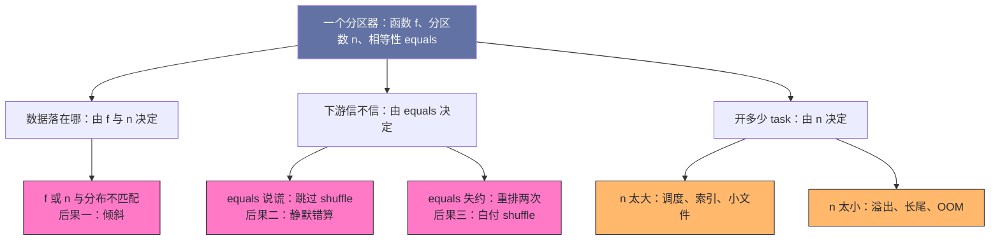
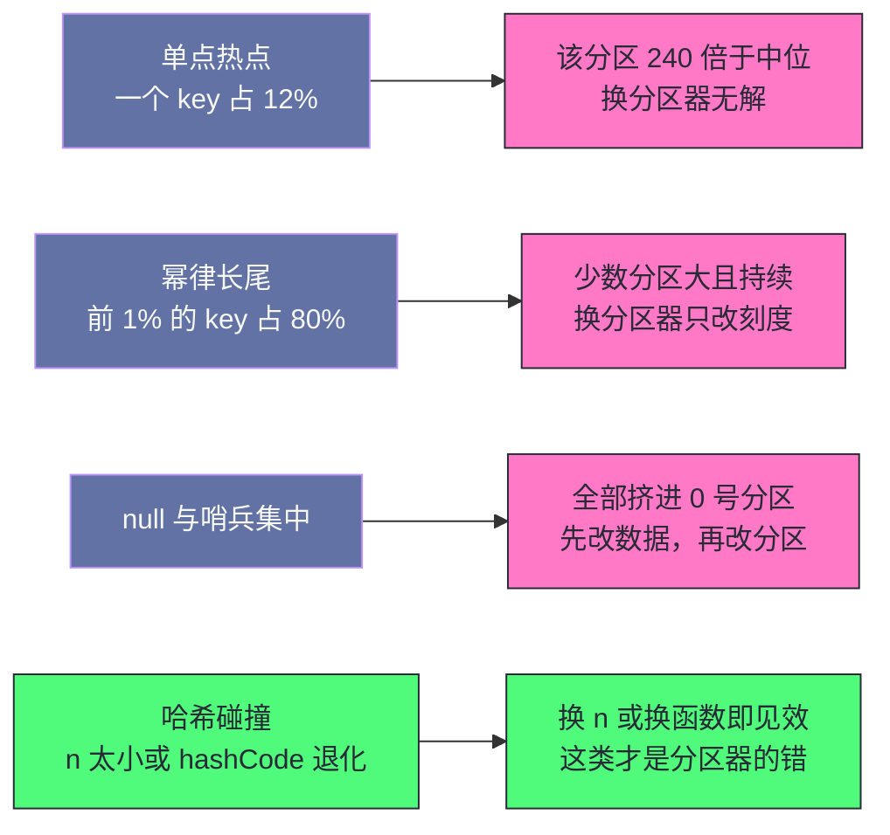
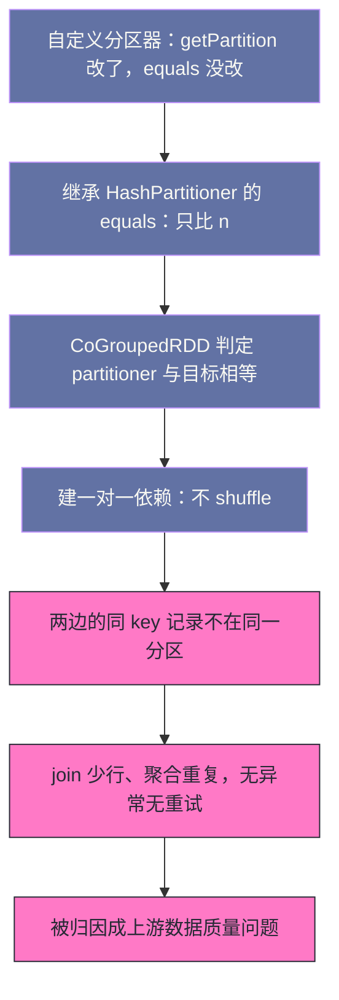
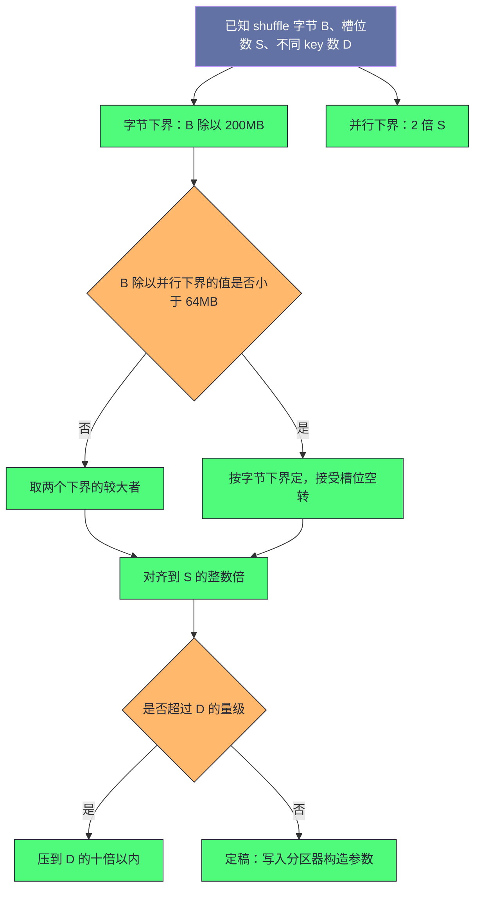
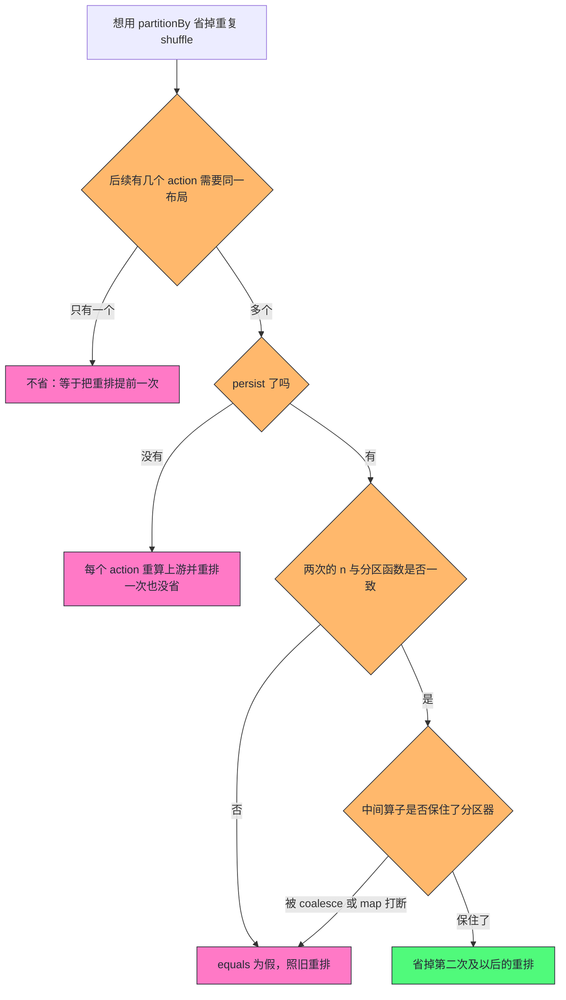
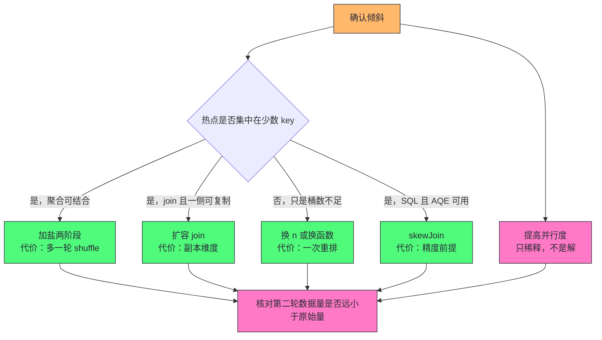

# 07 分区器（Partitioner）：分布式数据布局的数学逻辑与数据倾斜攻坚

**摘要：**

分区器怎么实现、`getPartition` 在哪一侧被调用、`ShuffledRDD` 怎样携带它，这些机制在内核系列已经拆过；本篇只处理它落到作业上的那一面——同一个 `n` 与同一份 `equals`，同时决定了数据落在哪、下游信不信、要开多少 task。先把两种内置实现收成一句话：`HashPartitioner` 是 hashCode 取模，`RangePartitioner` 是采样切区间。然后按三种后果展开。第一种是倾斜：hashCode 分布均匀不等于 key 频率均匀，四种形状里只有两种能靠换分区器解决。第二种是静默错算：`equals` 说了谎，`CoGroupedRDD` 就会把"分区器相等"当成"数据已在正确位置"的证明，短路掉 shuffle，结果少行而没有任何异常——这是本篇认为最危险的一条。第三种是白付 shuffle：`equals` 失约，同一份布局付两次钱。三者的症状、成本与排查入口完全不同，所以必须并排看。核心交付是 `n` 的五条判据与一份算例：字节区间、并行下界、2000 这条元数据分界线、key 基数上限，以及两侧代价的对照。其后是 `partitionBy` 的四条使用纪律、`RangePartitioner` 的采样代价、倾斜处置四条路的开销对照，以及六则反例。

---

## 第 1 章 一个 n，三个决定

三点十七分，`watch_daily` 的 Stage 页上摊开两千个 reduce task：两百多个在两分钟内跑完，三个跑到了四十多分钟，其中一个还带了两次 spill。同一个月里另外两件事没有这么显眼。一件是某条链路的 join 结果比前一天少了三点二个百分点，重算两遍还是少，日志里没有异常，没有重试，也没有失败任务。另一件是物理计划里两个本该复用的布局之间多出一个 `Exchange`，只让作业多花十一分钟，谁也没注意。三件事的症状分别是长尾、少行、多一次重排，落到代码里都只是同一个部件的几行声明：分区器。

`Partitioner` 只要求实现两个成员——`numPartitions` 与 `getPartition`——接口小到不像能惹出这么多种麻烦。但它在作业里的位置很特殊：不参与计算，只参与"谁和谁在一起"的判断；而 Spark 里几乎所有的正确性与代价，都建在这个判断之上。机制那一侧的表达——确定性要求、复用判据、宽依赖如何被改写成窄依赖、数组键为何被堵死——见 [[大数据/Spark/读书笔记-spark内核/01_核心概念与基础/5. Spark_RDD内部机制深度解析|RDD 内部机制]] 第 5 章，本篇从它的三个后果往下走。

### 1.1 两种内置实现，各一句话

**`HashPartitioner`**（哈希分区器）把 key 的 `hashCode` 对分区数取模得到分区号，取模用 `Utils.nonNegativeMod` 而不是 `%`，因为 Java 的 `hashCode` 可以是负数，而 `Math.abs(Integer.MIN_VALUE)` 仍是它自己，直接用绝对值取模会算出负的分区号。

**`RangePartitioner`**（范围分区器）在构造期对父 RDD 采样，按样本把 key 的取值空间切成 n 段连续区间，每个分区收一段，因此分区之间有全局顺序；`sortByKey` 不需要你指定，它自己就构造一个。

这两句话之外还有两个细节决定了后面后果的形态。其一，`HashPartitioner` 把 `null` 的哈希按 0 计，于是所有空 key 都落进 0 号分区，一个数据质量问题会直接变成一个布局问题。其二，两者的相等性口径不同：`HashPartitioner` 重写了 `equals`，判据只有一条——分区数相同——而 `RangePartitioner` 没有重写，两个实例按引用比较。前者让"不同的分区器互相冒充"成为可能，后者让"同一种分区器的两个实例互不相认"成为常态。

### 1.2 分区器携带的三条信息

摊开看，分区器携带三条彼此独立的信息：分区函数回答"这个 key 去哪一桶"，分区数 n 回答"一共几桶"，相等性回答"我这套布局能不能被下游当成已经摆好的布局直接复用"。前两条写在构造参数里，是显式的；第三条藏在 `equals` 的实现里，是隐式的，而它的影响比前两条都大——下游读不到你的函数，也读不到你的意图，只读得到一个布尔值：相等，就认为两侧数据已经对齐，跳过重排；不相等，才老老实实搬一遍。判断一个分区器写得对不对，实质上是判断这个布尔值诚不诚实。

三条信息各自出错的形态，就是本篇要讲的三件事；先给一张分流图，后面每一章对应其中一条分支。

三条分支的落点各不相同：倾斜是**慢**，静默错算是**错**，白付是**贵**。它们共用同一个部件，却需要三套排查方法，所以把三种后果混成一句"分区器选得不好"没有操作价值。

| 维度 | `HashPartitioner` | `RangePartitioner` |
| :--- | :--- | :--- |
| 分区函数 | `nonNegativeMod(key.hashCode, n)` | 对 `rangeBounds` 二分查找，落在第几段就是第几号分区 |
| 边界从哪来 | 无边界，纯函数 | 构造期采样算出 n-1 个边界点 |
| 相等性口径 | 重写 `equals`，只比分区数 | 未重写，按引用比较 |
| 构造期成本 | 零 | 一次采样 Job，读一遍父 RDD |
| 额外约束 | 数组键被禁止，`null` 归 0 号 | 需要 `Ordering`，key 基数小于 n 时出现空分区 |
| 典型入口 | `groupByKey`、`reduceByKey`、`partitionBy`、`join` 的默认分区器 | `sortByKey` 与需要全序的场景 |
| 对倾斜的态度 | 单 key 越大桶越斜，函数本身拆不开 key | 同样拆不开单 key，只能让边界按数据量加密 |

---

## 第 2 章 后果一：倾斜，以及"换分区器能不能救"的判据

倾斜被讨论得最多，也最容易被糊成一团，原因是一个区分没有先做：哈希函数的均匀性与 key 频率的均匀性是两件事。前者是"不同的 key 大致均匀地撒到 n 个桶"，后者是"每个桶里的记录数大致相等"。只要单个 key 的记录数远高于平均值，任何确定性函数都救不了——一个 key 只能进一个桶，这是分区的最小不可分单位。把这一条认下来，讨论才能落到"这堆倾斜里哪一部分是分区器的错"。

### 2.1 四种形状，两种可解

第一种是单点热点。促销日的某个商品、某个大 V 的账号、某次故障刷出来的重试记录，都是同一形态：一个 key 占掉全量的两位数百分比。`watch_daily` 那次是 12% 的记录压在三个视频上，n 取 2000 时这 12% 独占三个分区，其余各只 0.05% 左右，长尾倍数两百多倍（示例推算）。这种倾斜与分区器无关，是数据本身的形状。

第二种是幂律长尾。前 1% 的 key 占 80% 的记录，但没有哪个单 key 极端突出，最大的一批各占 0.3% 到 1%。它表现温和却更难缠：桶与桶的差距不是一两处极值，而是一条持续下降的曲线，任何按 key 哈希的方案都会把这把尺子的刻度照抄一遍。

第三种是 **`null` 与哨兵值集中**。字段缺失、外键对不上、占位符写成 `-1` 或 `""`，这些记录算同一个 key，全部落 0 号分区；更常见的是 `null` 混在业务 key 里，被按哈希 0 处理，于是 0 号分区一个人扛下整批脏数据。

第四种是哈希碰撞。它不是 key 频率不均，而是分区函数把本可分散的 key 撞到了一起：n 定得太小、自定义类型只拿一两个字段参与 `hashCode`、采样没采到某个密集区间。这一类的特征是"换 n 或换函数立刻见效"，因为桶数上限被低估了，而不是数据真的挤。

判断属于哪一类，有一个成本极低的实验：把 n 调大一个数量级重跑一次。第一种和第二种在 n 变大后长尾倍数基本不变（单 key 的绝对量不变，桶变多它反而更突出），第三种立刻好转，第四种明显改善但不彻底；用一次重跑换"该不该继续在分区器上花时间"的答案。

### 2.2 判据从哪一页读

判定不在本篇展开，只留一句口径：Stage 详情页的 Summary Metrics 给出 `Shuffle Read Size` 的分位数分布，用最大值除以中位数。选这一步而不是看 Duration，因为 Duration 混了数据量、GC、磁盘三种成分。长尾倍数、相对均匀度、单位成本三个比值怎样互相印证，哪一种形状对应"排除法里的另一类慢"，见 [[大数据/Spark/读书笔记-spark内核/06_性能调优实战/9. 数据倾斜解决方案_上|倾斜的判定]] 第 2 章与第 3 章；SQL 侧同一判定换成物理计划与 Stage 指标的口径，见 [[大数据/Spark/Spark-SQL深度解析与性能调优/10 数据倾斜：诊断、根因与系统性解决方案|SQL 层的倾斜诊断]] 第 6 章。

本篇补的是另一种读法：从"分区器视角"再读一次同一份指标。若某个分区的 `Records` 相对 `Size` 失衡，说明很多小 key 挤在一起，倾向第四类，处置是换 n 或换函数；若 `Size` 与 `Records` 按同一倍数放大，说明是真热点，处置只能落在 key 上。它替代不了判定，但能把"要不要动分区器"先决定掉。

| 形状 | 根因 | 分区器能否解决 | 首选动作 | 代价方向 |
| :--- | :--- | :--- | :--- | :--- |
| 单点热点 | 单个 key 占两位数百分比 | 不能，单 key 不可拆 | 加盐两阶段、扩容 join、AQE skewJoin | 多一轮 shuffle 或副本膨胀 |
| 幂律长尾 | 头部 key 集体重，无单点极值 | 只能稀释，不能解决 | 提高并行度摊薄、按业务分流 | 固定开销上升，长尾仍在 |
| `null` 与哨兵 | 数据质量，脏值合成一个 key | 先把它们分开就解决 | 上游过滤、单独打标分流 | 改语义，需业务确认 |
| 哈希碰撞 | n 过小、`hashCode` 退化 | 能，且是唯一正解 | 换 n、换分区函数、补哈希字段 | 一次重排，几乎无副作用 |

---

## 第 3 章 后果二：静默错算，以及 equals 为什么会说谎

三种后果里，只有这一种会把结果算错。发生机制不复杂，但需要先看清短路点在哪里。

`join` 与 `cogroup` 都落到 `CoGroupedRDD`，它构造时持有一个目标分区器，然后对每个父 RDD 逐一判断"你的分区器是不是和我的一样"。一样，就建一对一依赖，第 i 个分区只读父 RDD 的第 i 个分区，不重排；不一样，才建宽依赖、才 shuffle。这套判断本身是对的——分区器相等在语义上确实等价于"同一个 key 在两侧已坐在同一号分区里"，短路只是把这个事实用起来。问题在于证明责任落在用户身上：Spark 检查的是 `equals` 的返回值，不是两个函数在全部 key 上的一致性。

### 3.1 三种让证明失效的写法

第一种，继承 `HashPartitioner` 只改 `getPartition`。这是最常见的一种，因为写法最省事：想让某些前缀的 key 落到特定分区，于是 `class PrefixedPartitioner(n: Int) extends HashPartitioner(n)`，只重写 `getPartition`。继承来的 `equals` 判据是"对方也是 `HashPartitioner` 且分区数相同"，于是它与一个货真价实的 `HashPartitioner(200)` 判等——`CoGroupedRDD` 据此认为右侧数据已按目标布局摆好，建一对一依赖、跳过重排，而右侧的实际布局是按前缀摆的。两侧同 key 记录不在同一号分区，`cogroup` 便配不上对。

第二种，自定义分区器的 `equals` 写宽了。写成"分区数相同即相等"，或者更糟，写成"对方是任何 `Partitioner` 即相等"。后一种在本地测试里几乎必然通过，因为单机小数据集的 join 往往落到本地执行路径上，短路与否看不出差别。

第三种不在分区器上，但走同一条短路：`mapPartitionsWithIndex(f, preservesPartitioning = true)`。这个参数的含义是"新的 RDD 仍保持父 RDD 的分区语义"，一旦函数体里改了 key，这句保证就是假的，`MapPartitionsRDD` 会照单全收地继承父分区器。`filter` 与 `mapValues` 保留分区器则是正确的，因为不改 key——错的是把"保留分区器"当成可以随便用的开关。

### 3.2 错误的形状：少行、重复，而不是异常

短路之后的错误形态取决于下游算子，这解释了它为什么难抓。若是 `join`，同 key 的两条记录分处不同分区号，`cogroup` 把它们当成两个不同的 key 各配一次，`inner join` 直接丢行——少掉的正是"两边都有、却落在不同桶"的 key，表现在报表上是一个百分之几的缺口，看起来像上游迟到数据。若是 `reduceByKey` 之后的分区器被下游误信，同一个 key 的聚合结果会分裂成两条记录落在两个分区，不聚合就表现为重复行，聚合了才会被"压"回去——错误在一层消失、在另一层重现，追查的人往往在错误的层上找原因。

最阴的一层是**它不随时间恶化**：分区逻辑写错，从第一批数据就是错的，幅度稳定在几个百分点，很容易被归因成"上游数据质量问题"而长期挂着；相比之下，倾斜会随数据增长越来越慢，至少还会自己暴露。

### 3.3 三条契约与一条灰盒验证

要让这条短路可靠，分区器必须满足三条契约。第一条是 **`equals` 与 `getPartition` 等价**：`p1.equals(p2)` 为真，必须蕴含"任取 key，`p1.getPartition(key) == p2.getPartition(key)`"。这条不能靠推理保证，只能靠写法保证：不要继承语义不同的父类却只改一半，也不要在 `equals` 里用分区数替代分区函数。第二条是纯函数：`getPartition` 里不能有随机、不能读当前时间、不能依赖只在 driver 上初始化成功的静态变量；分区器要被序列化进任务、在 executor 上执行，任何一个 executor 拿到旧状态或空状态，同一份数据就会被分到不同桶，而结果同样表现为少行，且无法从 driver 侧复现。确定性的要求本身在内核 01/5 第 5.1 节已说透，这里补的是它在"跨进程重建"这一侧的失效面。第三条是序列化后仍然成立：构造期读进来的表、阈值、热点集合都要能随对象一起过去，并且体积可控。

验证不必等到线上。取 1% 样本把同一条链路写两遍：一遍 `partitionBy(p)` 之后 join，一遍 `repartition` 之后 join（后者一定触发真正的重排），对比行数、去重后的 key 集合与每个 key 的聚合值。一致说明 `p` 的布局与真实重排等价，不一致就是 `equals` 在说谎；成本是两条临时链路加一个样本。

| 缺陷形态 | 短路发生在哪 | 结果表现 | 发现方式 |
| :--- | :--- | :--- | :--- |
| 继承 `HashPartitioner` 只改 `getPartition` | 继承来的 `equals` 与目标判等 | join 少行，缺口稳定 | 样本对照 `partitionBy` 与 `repartition` |
| `equals` 写成"同 n 即等" | `CoGroupedRDD` 建一对一依赖 | 少行或聚合结果重复 | 同上，并打印两侧 `partitioner` |
| `mapPartitions` 谎报 `preservesPartitioning` | `MapPartitionsRDD` 继承父分区器 | 下游 join 少行 | 审查所有 `preservesPartitioning = true` |
| `getPartition` 依赖 executor 侧可变状态 | 各 executor 分区结果不一致 | 少行且不可复现 | 单机重跑与集群重跑对比 |

---

## 第 4 章 后果三：白付 shuffle，以及 equals 的另一侧失约

与说谎相对的失约代价轻得多，却更常见：布局其实摆好了，但 `equals` 说不一样，下游重新搬一遍。它只花时间、不改结果，所以总被当成"Spark 就是这样"。

### 4.1 先把一个流传的说法纠正掉

流传最广的是"自定义分区器没重写 `equals`/`hashCode`，所以下游多一次 shuffle"。多一次 shuffle 的根因只在 `equals`：`==` 对引用类型落到 `equals`，默认实现是引用相等，两个分别 `new` 出来的实例永远不等，于是同一份布局付两次钱。`hashCode` 不参与这件事，Spark 内部并不把分区器放进哈希容器；但它仍须与 `equals` 成对实现，否则一旦有人把分区器当 `Map` 的键用，就会出现"等却落在不同桶"的契约破损。排错方向由此明确：查白付只盯 `equals`。

### 4.2 三条断链

第一条是 n 不一致。一侧 `new HashPartitioner(200)`，另一侧 `new HashPartitioner(201)`，或者更隐蔽地，一侧按 `spark.default.parallelism` 造出 400，另一侧按上游分区数造出 200。分区数不同意味着桶数不同，`equals` 为假是对的；问题在于人以为"都是哈希分区、两百来桶"就等于一致。

第二条是两种分区器混用。一侧 `sortByKey` 之后的 `RangePartitioner(200)`，另一侧 `partitionBy(new HashPartitioner(200))`，n 相同但函数不同，`equals` 为假。还有一层更少被注意：`RangePartitioner` 没有重写 `equals`，两个 `sortByKey` 出来的实例即使 n 相同也按引用不等，于是一条链路上做过两次排序的两个 RDD 相互 join 时，只有一个能复用，另一个照旧重排。用 `println(rdd.partitioner)` 加一次 `equals` 比对就能确认，代价为零。

第三条是 **`defaultPartitioner` 的两个例外**。不显式给分区器时，`join`、`cogroup`、`reduceByKey` 会调用它挑一个：优先沿用分区数最大的那一侧的分区器，这个规则让 `partitionBy` 的复用常常自动成立。但它有两个出口会另造一个 `HashPartitioner`——`spark.default.parallelism` 被显式配置且大于那一侧的分区数，或者各输入的分区数相差到量级（判据是 `log10` 之差小于 2 才算同一量级）。这两个出口使"我以为它会复用"变成需要验证的事；完整判据与 `spark.default.parallelism` 在文档与代码口径上的三处错位，见 [[大数据/Spark/读书笔记-spark内核/06_性能调优实战/3. Spark集群资源分配与并行度调优|资源分配与并行度]] 第 5 章。

还有一条常被当作"复用手段"的写法：`repartition(n)`。它只接收分区数、不接收分区器，产出既不携带你需要的分区函数，也就谈不上与下游判等；想复用布局只有 `partitionBy` 一条路。把 `repartition` 当 `partitionBy` 用，结果是每一处都以为自己省了，每一处都在搬。

### 4.3 判据：数写，不数读

白付的判据很硬：数 Stage 页里出现 `Shuffle Write` 的 Stage 个数，而不是数 `Shuffle Read`。一个 Stage 只要写了 shuffle 输出就说明它重排过；读端多、写端少往往只是分区数偏大造成的读端任务多。第二个入口是物理计划里的 `Exchange` 节点数，两个本该对齐的输入之间出现一对 `Exchange`，说明布局没有复用上。

落到账上：一次多余的 shuffle 约等于它搬的字节在写读两侧各走一遍，加上 m×r 的寻址成本——m 是上游 map 任务数，r 是分区数，网格里每一格都是一次可寻址的输出段。m 与 r 各两千时，一次白付的重排就是四百万个格子重新编址；为什么放大按乘积走，见 [[大数据/Spark/读书笔记-spark内核/05_Shuffle核心机制/1. Spark_Shuffle机制深度解析|Shuffle 的代价模型]] 第 3 章。

| 断链原因 | UI 与计划特征 | 修法 | 代价 |
| :--- | :--- | :--- | :--- |
| 两侧 n 不一致 | 两个 Stage 各写一次 | 统一 n，用同一个分区器实例 | 一次重排无法退回 |
| Hash 与 Range 混用 | join 前多一个 `Exchange` | 需要复用的一侧改用同一种分区器 | 全局有序与复用二选一 |
| `RangePartitioner` 按引用比较 | 同一链路两次排序后互不认 | 显式把一侧的分区器传给另一侧 | 需要改代码传参 |
| `defaultPartitioner` 另造实例 | 计划里出现意外的 `HashPartitioner` | 显式传 `partitionBy` 与分区器 | 把默认行为写死 |
| 自定义分区器未重写 `equals` | 同一份数据被写两次 | 实现 `equals` 与 `hashCode` | 一次性成本 |

---

## 第 5 章 分区数怎么定

前面三章讲"分区器写对没有"，这一章讲"n 该写多少"，它是本篇的核心交付，因为 n 是分区器上唯一一个必须由人拍板、又同时作用在三个地方的数字。

### 5.1 RDD 侧没有 AQE 兜底

先划边界。SQL 路径上 `spark.sql.shuffle.partitions`（4.3.0 默认 200）是初始值，AQE 开启时（4.3.0 默认开启）可在运行期按实际数据量合并小分区，目标大小由 `spark.sql.adaptive.advisoryPartitionSizeInBytes`（默认 64 MB）给出；SQL 侧定大了是"先铺大再回收"。RDD 侧没有这条回收通道：`partitionBy(new HashPartitioner(n))` 里的 n 是**终值**，随 RDD 走完整个血缘，下游每个 task 数、每份索引、每个输出文件都由它决定，没人替你合并。

常见现象是：同数据量下 SQL 作业把 `shuffle.partitions` 从 200 调到 2000 之后提速了；RDD 作业照抄 2000，却出现几万个不到 30 MB 的分区。两者的 n 不是同一种东西——前者是上限，后者是定值。

### 5.2 五条判据

第一条是**字节区间**。单个分区承载的数据量应落在 128 MB 到 200 MB 之间，下限放到 64 MB 防止任务过碎，上限压在 200 MB 以内防止单任务溢出，由此得到 `n ≥ 总字节 ÷ 200 MB`。取 128 到 200 而非 SQL 侧 64 的起点，是因为 RDD 侧的 n 无法在运行期回收，定小了溢出、定大了没有回头路。

第二条是**并行下界**。n 不小于集群槽位数的两倍（2 到 4 倍是常见区间），用来填充流水线、稀释倾斜、降低单任务失败的重算成本；这条经验关系买到了什么、为什么只是地板，见 [[大数据/Spark/读书笔记-spark内核/06_性能调优实战/3. Spark集群资源分配与并行度调优|并行度与槽位]] 第 6 章，此处只取结论：`n ≥ 2 × 槽位数`。

第三条是**元数据与阈值**，最少被提及。写侧每个 map 任务的索引条目数等于 r，总条目数就是 m×r；读端取数请求也按 r 分摊。而 `MapStatus` 有一道分界线——分区数超过 `spark.shuffle.minNumPartitionsToHighlyCompress`（默认 2000）时，状态从"每个 map 为每个分区记一条大小"退化成 `HighlyCompressedMapStatus`，只精确记录超过 `spark.shuffle.accurateBlockThreshold`（默认 100 MB）的块，其余按平均块大小记账。元数据因此不再是 m×r 的线性膨胀，分区数从 2000 涨到 20000 时 driver 没有被压垮；但块大小精度下降，而取数扫描与 AQE 的倾斜检测都读这份统计——把分区数从 2000 调到 2001 之后倾斜反而看不见，是有据可查的现象（修复状态随版本而变，上生产前应实测）。倾斜治理若依赖运行期统计，就要么把 r 压在 2000 以下，要么接受精度退化。

第四条是 **key 基数上限**。n 不应超过不同 key 数量的量级，因为空分区不免费：仍要一个 task、一份索引条目、一次取数请求。一千个不同 key 配两万个分区，就是九成五的任务在空跑。

第五条是**对齐**。n 取槽位数的整数倍，可以消掉最后一波的槽位空转，机制与算例见内核 06/3 第 6.4 节。

### 5.3 一份算例

落到具体作业。`watch_daily` 的 shuffle 写侧 2.4 TB，300 节点、每节点 32 核，按一核一槽位算 9600 个槽位，读入按 128 MB 切块，于是 m 约等于 19200。

| 口径 | 算式 | 结果 | 落到每分区 | 说明 |
| :--- | :--- | :--- | :--- | :--- |
| 字节下界（200 MB） | 2.4 TB ÷ 200 MB | 12,288 | 200 MB | 防止单任务溢出 |
| 并行下界（2 倍） | 9600 × 2 | 19,200 | 128 MB | 正好落在区间内，两条判据不冲突 |
| 并行下界（4 倍） | 9600 × 4 | 38,400 | 64 MB | 已在区间下沿，固定开销占比上升 |
| 索引条目 | m × n | 3.7 亿条 | — | 每条 8 字节偏移约 3 GB（量级判断） |
| 本章取值 | max(12,288, 19,200) 并对齐 9600 | 19,200 | 128 MB | 两波整齐，每波 9600 个 task |

同一套判据换到别的量级，结论会翻转，这正是"照抄别人配置"行不通的原因（下表为示例推算）：

| shuffle 字节 | 字节下界 | 并行下界 | 本章取值 | 每分区 | 现象 |
| :--- | :--- | :--- | :--- | :--- | :--- |
| 40 GB | 205 | 19,200 | 640 | 64 MB | 不足一波，说明该作业不该占满集群 |
| 400 GB | 2,048 | 19,200 | 6,400 | 64 MB | 约三分之二波，槽位仍有空转 |
| 2.4 TB | 12,288 | 19,200 | 19,200 | 128 MB | 两波整齐，判据不冲突 |
| 20 TB | 102,400 | 19,200 | 105,600 | 194 MB | 十一波，字节判据主导 |

最关键的是 40 GB 那行：并行下界说两万，字节下界说两百，差两个数量级。正确的做法不是听并行下界，而是承认作业喂不饱集群，按字节下界走，把空出来的槽位交给别的作业——动态分配正是为此存在。两个下界无条件取大者会得到"40 GB 配 19200 个分区、每分区 2 MB"的结果，任务数上去了，有效工作时间不到一成。

### 5.4 两侧的代价

`n` 没有最优值，只有两侧的代价。把偏大与偏小各自付的账并排放进一张表，比记一条经验倍数有用。

| 参数或口径 | 4.3.0 默认 | 作用 | 调大的代价 | 调小的代价 |
| :--- | :--- | :--- | :--- | :--- |
| `new HashPartitioner(n)` 里的 n | 无默认，由代码给定 | RDD 侧分区数与 task 数的终值 | task 固定开销、索引条目 m×r、每分区一个输出文件 | 单分区超过 200 MB，溢出与 GC 上升，长尾加重 |
| `spark.default.parallelism` | 未设，跟随 `defaultParallelism` | 不显式给分区器时的 n 来源 | 默认分区数变大，小作业也被铺碎 | 默认分区数偏小，`reduceByKey` 直接继承 |
| `spark.sql.shuffle.partitions` | 200 | SQL 侧 shuffle 的初始分区数 | 初始分区多，AQE 合并有额外开销；超过 2000 触发状态压缩 | 单分区过大，AQE 合并不下去 |
| `spark.sql.adaptive.advisoryPartitionSizeInBytes` | 64 MB | AQE 合并的目标分区大小 | 合并后分区变大，长尾仍可能溢出 | 分区变小，task 数上升 |
| `spark.shuffle.minNumPartitionsToHighlyCompress` | 2000 | 超过该值启用压缩状态 | 精度下降，倾斜检测与取数估算变粗 | 元数据按 m×r 线性增长 |
| `samplePointsPerPartitionHint` | 20 | `RangePartitioner` 每分区采样点数 | 采样 Job 更贵，边界更准 | 边界失真，分区大小偏差变大 |

偏小那一侧还有一条不在参数表里的账：并行度不足会让倾斜从"慢"升级成"跑不完"。n 只有几十个而一个热点 key 占三成数据时，那个 task 独自扛下三成，其余槽位早已空转；n 大一些不能消掉倾斜，但能把同样的绝对量摊到更多桶上，把尾任务的墙钟从小时级压到分钟级。这是稀释，不是解决。

### 5.5 自检三步

不必等作业跑完，Stage 跑起来就能读。第一步看中位 task 的 `Shuffle Read Size`：中位数已超过 200 MB，n 偏小；不到 30 MB 而 task 数上万，n 偏大。第二步看 `Spills` 与 `Duration` 的关系：中位 task 有溢出而长尾 task 没有，问题在分布不在 n；两者都有溢出，n 偏小。第三步看 `Scheduler Delay` 与 `Task Deserialization Time` 占总时长的比例：占比偏高说明任务过碎，调度成了瓶颈。三步都对照中位数而非平均值，推导见内核 06/9 第 2.3 节。

---

## 第 6 章 partitionBy 的四条纪律与 RangePartitioner 的采样

`partitionBy` 是 RDD 侧唯一一个"把布局写下来"的入口，语义比签名复杂：签名只是 `partitionBy(partitioner): RDD[(K, V)]`，真正做的事是"在某个时刻插入一次重排，并把这套布局声明给下游"。

### 6.1 返回新 RDD，惰性，必须装配在 action 之前

`partitionBy` 是转换算子，返回新 RDD，原 RDD 不变；只在 action 触发时才真的重排。所谓"必须在 action 之前调用"，含义不是语法位置，而是要复用的几个 action 都必须从这次重排的结果往下走。如果先对一个 RDD 做 action、再 `partitionBy`、再做一次 action，那就是两次独立重排，第一次的布局没有被任何人继承——顺序写错不报错，只会多付一次钱。顺带一个细节：目标分区器与当前 RDD 相同时，`partitionBy` 直接返回原对象、一次重排都不发生，这是它唯一不需要付钱的情形，机制见内核 01/5 第 3.3 节。

### 6.2 只有 persist 过才有复用价值

重排结果不留在内存或磁盘上，下一次 action 会沿血缘从上游重算，重排也跟着重来。复用的完整写法是三件事：`partitionBy`、`persist`、在同一个 RDD 上做多次 action。缺了 `persist`，`partitionBy` 只是把 shuffle 提前了一次，复用一次都没发生；只用一次时这笔重排本来也躲不掉，等于白写一行。

| 写法 | 会发生几次重排 | 是否省 shuffle | 代价 |
| :--- | :--- | :--- | :--- |
| 每次 action 前各自 `partitionBy` | 与 action 次数相同 | 不省，反而更多 | 每次都重排，且上游重算 |
| `partitionBy` 后不 `persist`，多次 action | 每次 action 一次 | 不省 | 上游重算加重复重排 |
| `partitionBy` 后 `persist`，多次 action | 一次 | 省掉后续全部 | 常驻内存或磁盘，需要 `unpersist` |
| `repartition(n)` 后多次 action | 每次 action 一次 | 不省，且无分区器可复用 | 白付，还不能被下游继承 |

`persist` 本身也要付账：缓存挤占执行内存，`MEMORY_ONLY` 下分区被挤掉后下游仍要重算，`MEMORY_AND_DISK` 下退化成磁盘读。问法很朴素——这份结果会被几个 action 用、每次用它的计算量是否远大于一次重排；用一次不缓存，用三次以上基本都值得。

### 6.3 四个陷阱

第一个是 `partitionBy` 之后 `map` 改了 key。`map` 会丢弃分区器（`MapPartitionsRDD` 在 `preservesPartitioning = false` 时置空），下游于是重新建依赖、重新重排——这个行为是对的，key 变了布局就失效；真正的坑在于有人为了"省一次 shuffle"把它改回来写成 `mapPartitions(f, preservesPartitioning = true)`。第二个是 `partitionBy` 之后 `coalesce` 减少分区数：分区数变了 `equals` 就不成立，复用链断得毫无提示。第三个是 `persist` 后忘了 `unpersist`，长驻内存挤掉别人的缓存，表现为几小时后整个作业群变慢。第四个是把 n 定得远大于 key 数量，空分区照付 task 与索引条目。

### 6.4 RangePartitioner 的采样：一句话机制与它的账单

`RangePartitioner` 的边界不是算出来的，是采样估出来的：构造期按"每个分区约 20 个采样点、总数封顶 100 万"向父 RDD 要样本，每个父分区用蓄水池采样（reservoirSampling）抽固定条数，再按各分区数据量加权定出 n-1 个边界点。

账单有三项。第一项是采样要跑一个 Job，父 RDD 被读一遍——若来自 HDFS 且没缓存，就是多读一次。第二项是边界只算一次，之后数据再变也不更新，只适合"一次构造、一次使用"。第三项是对倾斜无能为力：所有记录属于同一个 key 时，边界无论怎么加密都切不开它。三项并排，结论是只有确实需要跨分区全局有序时才用 `sortByKey`。

若只需要"每个分区内部有序"，`repartitionAndSortWithinPartitions` 用你给的分区器加 key 排序，省掉采样 Job，代价是分区之间没有顺序；其余构造路径与采样判据见内核 01/5 第 5 章。

---

## 第 7 章 倾斜的处置，以及每条路的代价

处置手段不在本文展开，只给账：加盐的盐数算式与两轮聚合的形状见 [[大数据/Spark/读书笔记-spark内核/06_性能调优实战/9. 数据倾斜解决方案_上|倾斜的判定与两轮聚合]] 第 7 章；join 侧的四条路与选型框架见 [[大数据/Spark/读书笔记-spark内核/06_性能调优实战/10. 数据倾斜解决方案_下|Join 倾斜的四条路]] 第 3 章到第 6 章；SQL 层的四类形态与手段对照见 [[大数据/Spark/Spark-SQL深度解析与性能调优/10 数据倾斜：诊断、根因与系统性解决方案|SQL 倾斜诊断]] 第 9 章与第 10 章。

从分区器角度，只需记住一条分界：靠"换函数、换 n"能解决的，成本是一次重排；靠"改 key"能解决的，成本是多一轮重排或一份副本；两者都不行的，只能改数据或改语义。六种手段与开销摆在一起，选型反而清楚了。

| 手段 | 治的是哪一种 | 前提 | 代价 | 什么时候不要用 |
| :--- | :--- | :--- | :--- | :--- |
| 换 n 或换分区函数 | 哈希碰撞、n 过小 | 倾斜来自桶数不足而非单 key | 一次重排 | 单 key 占两位数百分比时无效 |
| 加盐两阶段聚合 | 单点热点，聚合可结合 | 运算满足结合律与交换律 | 多一轮 shuffle，中间量按盐数放大 | 不可结合的运算、下游还要按原 key 分组 |
| 自定义分区器 | 已知热点身份、可预先分配 | 分区函数语义正确且有 `equals` | 一次重排加维护成本 | 热点动态变化，写错即静默错算 |
| 扩容 join | join 键倾斜，维度可复制 | 一侧可复制成若干份 | 副本维度进键空间，两侧数据量按副本数放大 | 维度侧本身很大 |
| 提高并行度 | 幂律长尾、槽位空转 | 只是稀释 | 固定开销与元数据上升 | 被当成倾斜的解药时 |
| AQE skewJoin | SQL 侧 join 倾斜 | AQE 开启，统计精度足够 | 运行期拆分与重跑 | 分区数跨过 2000 的精度退化之后 |

AQE 的倾斜拆分读的是 `MapStatus` 报上来的块大小，而块大小精度在分区数跨过 2000 之后下降——"把 `shuffle.partitions` 调大到几千"与"指望 AQE 自动救倾斜"可能是互相拆台的。它能救到什么程度、判据是哪个倍数、失效在哪里，见 [[大数据/Spark/Spark-SQL深度解析与性能调优/10 数据倾斜：诊断、根因与系统性解决方案|SQL 倾斜诊断]] 第 8 章与 [[大数据/Spark/读书笔记-spark内核/06_性能调优实战/9. 数据倾斜解决方案_上|倾斜的判定与两轮聚合]] 第 8.3 节。

---

## 第 8 章 六则反例

第一则，`partitionBy` 之后不 `persist`。代码看起来完全正确：一次重排、多次使用；实际每次 action 都从上游重算，Stage 页上同一个 Shuffle Write 反复出现。判据是同一 `shuffleId` 的写侧重复出现。

第二则，自定义分区器不重写 `equals`。两个分别 `new` 出来的实例互不相等，join 时两侧各重排一次。它不报错、不算错，只是每次都多花十几分钟。

第三则，自定义分区器重写了 `equals`，但判据是分区数。这一则会算错，而且错得不多。判据就是第 3.3 节那条样本对照——`partitionBy` 之后 join 与 `repartition` 之后 join，行数不一致。

第四则，分区数照抄别人的配置。别人 400 GB 的作业配 2000 个分区，每个 200 MB；你的 40 GB 照抄 2000，每个 20 MB，有效计算占比掉到三成。反过来，别人 40 GB 配 200 个分区，你的 4 TB 也配 200，每个 20 GB，跑到一半就 OOM。

第五则，用 `Random` 在 `getPartition` 里打散热点。把倾斜问题挪成正确性问题的典型写法：分区器变成非确定性的，同一个 key 在两次调用里落到不同分区，聚合结果分裂且不报错。确定性为什么是地基，见内核 01/5 第 5.1 节；正确的打散方式是在 key 上做，不是在函数里做。

第六则，把 `sortByKey` 当成"顺便分区"。它确实顺带给了全局有序，代价是一次采样 Job 加一次重排；下游只做一次聚合、并不需要有序时，这次采样就是纯开销。

| 反例 | 症状 | 一句话判据 | 修法 |
| :--- | :--- | :--- | :--- |
| `partitionBy` 不 `persist` | 同一 Shuffle Write 反复出现 | 数同一 `shuffleId` 的写侧次数 | `persist` 后再多次 action |
| 不重写 `equals` | 两侧都重排 | 两侧都有分区器却都在写 | 实现成对契约 |
| `equals` 只比分区数 | 结果少几个百分点 | 样本对照两种链路 | 收敛到"同函数"判据 |
| 分区数照抄 | 任务过碎或单分区过大 | 字节区间与槽位下界 | 按算例重定 n |
| `getPartition` 里用随机 | 结果分裂且不可复现 | 单机重跑对比 | 在 key 上加盐 |
| `sortByKey` 当分区用 | 多一次采样 Job | 看是否需要全局有序 | 改用 `repartitionAndSortWithinPartitions` |

---

## 第 9 章 落点

分区器把一个本该在运行期才回答的问题——数据落在哪——提前成了一次代码里的承诺。n 写进构造器，`equals` 写进类定义，两条声明一旦写错，要么被数据形状惩罚（慢），要么被依赖判定误信（错），要么被重复付费（贵）。三种代价形状不同，所以"分区器调优"这句话本身要拆开：它有时是并行度问题，有时是正确性问题，有时只是复用问题。

n 的定法没有一条能独立成立的公式：字节区间管住单任务的生死，槽位下界管住流水线的填充，2000 那条线管住运行期统计的精度，key 基数管住空分区的浪费。四条判据互相牵制，最终取值是取舍的结果而不是计算的结果；凡是能算出标准答案的场合，往往是因为另外几条判据此刻不紧。

值得记住的判断只有一条：先确认这个慢或这个错是不是分区器引起的。把单 key 热点交给加盐、把脏值交给上游、把白付交给 `persist`，剩下的才轮到调 n。分区器很薄，能承担的比期待的要少，一旦被误用，代价又是三套不同的账单。

---

## 参考资料

- Apache Spark 4.3.0 官方文档，《RDD Programming Guide》与《Tuning Guide》中关于 `partitioner`、`partitionBy`、`reduceByKey` 与 shuffle 分区的章节。
- Apache Spark 4.3.0 官方文档，《Spark Configuration》中 `spark.sql.shuffle.partitions`、`spark.sql.adaptive.advisoryPartitionSizeInBytes`、`spark.shuffle.minNumPartitionsToHighlyCompress`、`spark.shuffle.accurateBlockThreshold`、`spark.shuffle.mapOutput.minSizeForBroadcast` 等条目。
- Apache Spark 源码 `core/src/main/scala/org/apache/spark/Partitioner.scala`、`rdd/PairRDDFunctions.scala`（`defaultPartitioner` 与 `cogroup` 的依赖判定）、`rdd/CoGroupedRDD.scala`、`rdd/RangePartitioner.scala`。
- SPARK-36967：`MapStatus` 对超大块精确上报的改动，以及 `spark.shuffle.accurateBlockThreshold` 的来由。
- Apache Spark 开发列表关于"2000 个分区以上倾斜检测失效"的讨论（SPARK-48290），涉及 `HighlyCompressedMapStatus` 与 AQE 倾斜判据的关系。
- 站内：[[大数据/Spark/读书笔记-spark内核/01_核心概念与基础/5. Spark_RDD内部机制深度解析|RDD 内部机制]]、[[大数据/Spark/读书笔记-spark内核/05_Shuffle核心机制/1. Spark_Shuffle机制深度解析|Shuffle 代价模型]]、[[大数据/Spark/读书笔记-spark内核/06_性能调优实战/3. Spark集群资源分配与并行度调优|分区数与槽位]]。

> [!note] 思考题
> 1. 一个作业的 `partitionBy` 与 `persist` 都写了，Stage 页上仍看到同一个 Shuffle Write 出现两次。除了"写错了位置"，还有哪些原因会让 `persist` 失效？
> 2. `RangePartitioner` 没有重写 `equals`。若让你补这个实现，判据应该包含哪些字段？只比分区数会带来什么后果，把边界数组也比进去又会带来什么后果？
> 3. 集群 9600 个槽位，一个 2.4 TB 的 shuffle 按本章算例取了 19200 个分区。若把 `spark.shuffle.minNumPartitionsToHighlyCompress` 调到 100000，元数据与倾斜检测各自怎样变化，代价落在谁身上？
> 4. 自定义分区器继承了 `HashPartitioner` 并改写了 `getPartition`，单机本地模式测试通过、集群上少 3% 的行。请解释本地为什么能通过，以及最小成本的复现方式。
> 5. 一个 join 的两侧都做过 `sortByKey`，n 相同。按 `defaultPartitioner` 的规则，哪一侧能复用、哪一侧必须重排？要让两侧都复用，代码该怎么写？