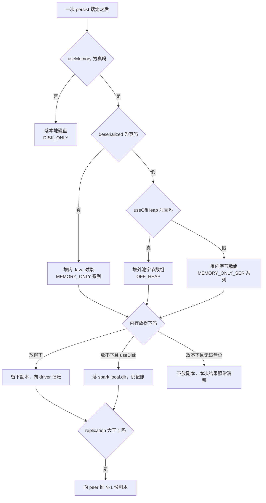
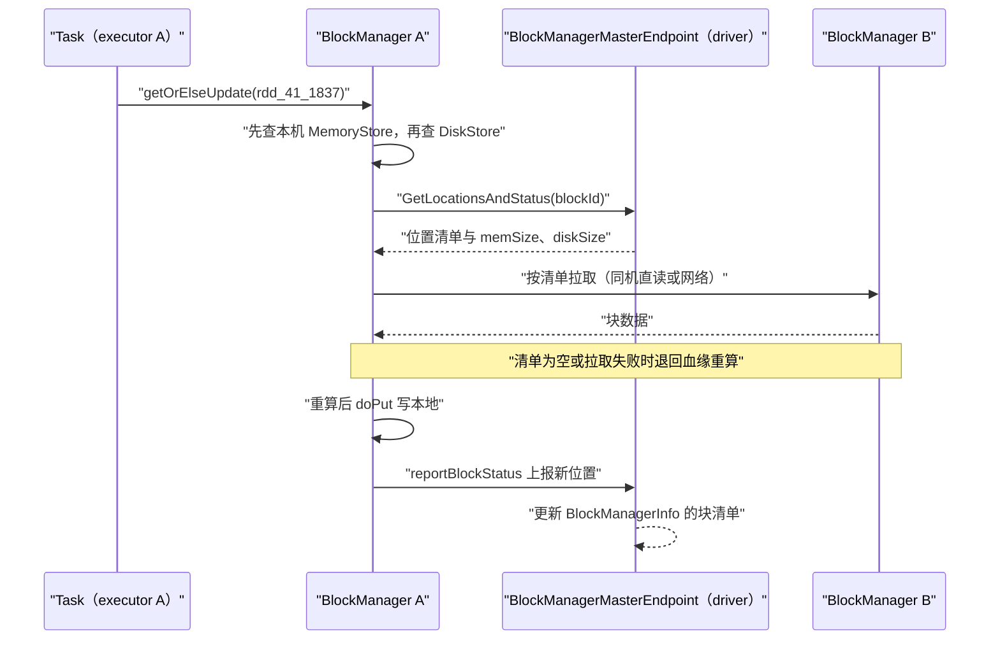
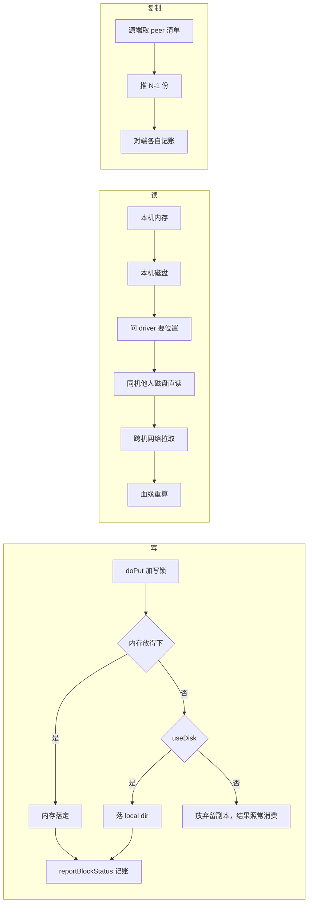
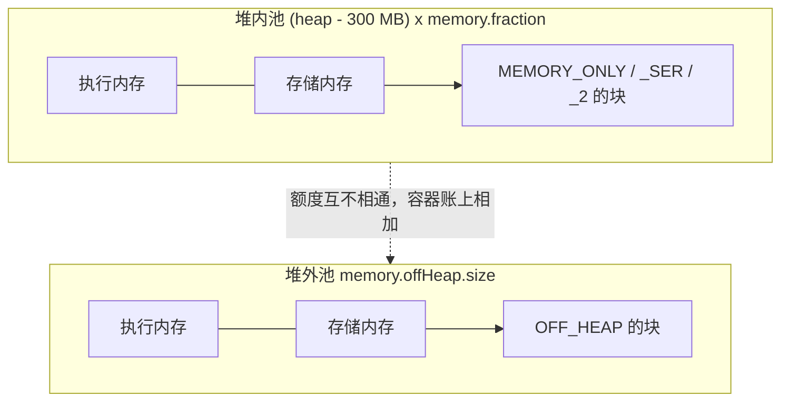
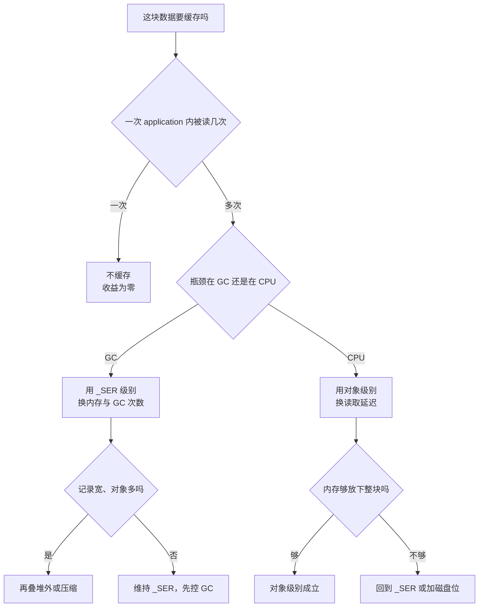

# 08 缓存与持久化：StorageLevel 策略、BlockManager 协作与堆外内存实践

**摘要：**

一个 `persist()` 调用真正改变的，不是作业跑得快不快，而是集群里凭空多出一份副本——这份副本落在哪个介质、占谁的额度、由谁记账、什么时候退租，四件事全由存储层决定，与"内存池为什么驱逐"是两个问题。本篇按存储层视角把这四件事拆开：先把 `StorageLevel` 还原成四个布尔位加一个整数的五维组合，给出常用级别的物理落点与内存倍数，并纠正三个常见记错；再把"数据到底存在哪"收成一张判据表，覆盖堆内对象、堆内字节数组、`spark.local.dir`、堆外池与跨 executor 副本，逐项给出观察位置与失效形态；核心部分讲 `BlockManager` 的四个角色，说明块位置靠 driver 的记账而不是广播，以及这本账在元数据成本、心跳滞后、application 生命周期三处的后果；随后是块的三条路径与它们各自的失败面。堆外部分只讲边界：它有独立额度、不与堆内池互借，因此只是把缓存搬出 GC 扫描范围，并不缓解堆压力。最后落到序列化级别的选择算例、缓存该不该用的不等式、`unpersist` 的默认语义与四类泄漏。

---

## 第 1 章 一份副本，四个问题

周四上午九点四十，那张 620 GB 的用户行为宽表第二次被扫。上一轮回放作业从 HDFS 起算，三十四分钟；这一轮十二分钟，差的那二十二分钟就是缓存省下的读取与解析。同一份代码、同一份数据，唯一的变化是上个月有人加了一行 `persist()`。

但缓存不是免费的午餐券，它是一笔资产，资产就要记账。当天下午查另一件事时，同一个作业的 executor 日志里出现了这行：

```text
WARN BlockManager: Persisting block rdd_41_1837 to disk instead.
```

`rdd_41` 用 `Dataset.persist()` 的默认级别（`MEMORY_AND_DISK`），所以这行本身没问题——内存放不下的那部分块主动落本地盘，正是这个级别的设计意图。问题在它出现的位置：前一行是 `MemoryStore: Memory use = 1.9 GiB (blocks) + 96.0 MiB (scratch space shared across 4 task(s)) = 2.0 GiB. Storage limit = 2.2 GiB.`，存储池已贴顶，而同一时刻这台 executor 上的 Stage 正在做 `SortMergeJoin`，执行侧要内存却拿不到。

这就是存储层与内存池层的分野。内存池层回答"为什么缓存会被驱逐"：`storageFraction` 划出的保护下限、执行侧向存储侧借用的先后顺序、驱逐之后那几笔重算的账，这一侧已在 [[大数据/Spark/Spark-Shuffle与内存管理机制深度解析/07 Execution 与 Storage 的动态边界|Execution 与 Storage 的动态边界]] 里讲透，本篇不重复其推导。存储层回答另外四问：副本物理上待在哪、`StorageLevel` 的哪些取值把它放在那、谁记着它的位置、它怎么被退回来。四问串起来，才能回答线上最常被问的那一句：Storage 页显示 100%，作业为什么还是慢。

先把这一层最容易踩的一处认知摆正：**缓存不是容错**。块丢了，Spark 的处理是沿血缘重算，不是从副本恢复；副本数为 2 的级别能免掉大部分重算，但那仍然是"另一台机器上有一份"，不是"数据被可靠持久化"。要可靠性就得上 checkpoint，那一侧见 [[大数据/Spark/读书笔记-spark内核/04_存储与容错机制/6. Spark_Checkpoint机制|checkpoint 机制]]，本篇只在第 8 章交代边界。

还有一个前提：下文的"块"（Block）指 `BlockId` 命名的存储单元，RDD 分区的块名形如 `rdd_41_1837`。缓存、广播变量、Shuffle 输出、Task 结果共用同一套块名字空间，区别在类型前缀与由谁托管；Shuffle 块那一支另有地址簿与外部服务托管路径，见 [[大数据/Spark/读书笔记-spark内核/05_Shuffle核心机制/7. Spark_Shuffle与Storage交互|Shuffle 与 Storage 的交互]]，本篇只处理缓存块与广播块。

---

## 第 2 章 StorageLevel 的五个维度

### 2.1 五个维度各自换什么

`StorageLevel` 是一个只有五个字段的类：四个布尔位加一个整数。名字上的七八个级别全是这五个字段的取值组合，理解组合比背名字有用。

| 维度 | 字段 | 打开之后换来什么 | 代价落在哪 |
| :--- | :--- | :--- | :--- |
| 用内存 | `useMemory` | 块常驻堆内，读命中不走磁盘与网络 | 占堆内存储池；对象越多，GC 扫得越久 |
| 用磁盘 | `useDisk` | 内存放不下时不重算，落到 `spark.local.dir` | 本地盘容量与 I/O；读时要反序列化 |
| 用堆外 | `useOffHeap` | 字节放在 native 内存，不进堆的 GC 扫描 | 堆外额度独立，容器要跟着变大 |
| 序列化 | `deserialized=false` | 分区压成一个字节数组（4.3.0 里默认再压一层） | 每次读都要反序列化，CPU 换内存 |
| 副本数 | `replication` | 其他 executor 上再放 N-1 份，掉机不重算 | 单机内存不变，集群账单乘 N；写放大 |

这五维里最容易被忽略的是第三与第二的组合关系：`useOffHeap` 只在 `useMemory` 为真时才有意义，因为堆外是"内存"这个维度下的一种介质，不是与内存并列的另一种落点。它解释了后面那个反直觉的事实——`OFF_HEAP` 的磁盘位是打开的。

### 2.2 常用八种级别的物理形态

| 级别 | 五位取值 | 物理落点 | 内存倍数 | 放不下时 | 常见误用 |
| :--- | :--- | :--- | :--- | :--- | :--- |
| `MEMORY_ONLY` | 内存、反序列化、1 副本 | 堆内 Java 对象 | 2 至 5 倍 | 丢弃，不缓存 | 大宽行对象，Old Gen 直接打满 |
| `MEMORY_ONLY_2` | 同上，2 副本 | 两台 executor 的堆 | 2 倍再乘 2 | 同左 | 拿它当高可用，忘了写放大 |
| `MEMORY_ONLY_SER` | 内存、序列化、1 副本 | 堆内字节数组 | 0.2 至 0.5 倍 | 丢弃 | 默认被压缩，倍数比老资料更小 |
| `MEMORY_AND_DISK` | 内存加磁盘、反序列化 | 堆内对象，溢出到本地盘 | 2 至 5 倍 | 落 `spark.local.dir` | 磁盘那半从不 unpersist |
| `MEMORY_AND_DISK_SER` | 内存加磁盘、序列化 | 堆内字节，溢出到本地盘 | 0.2 至 0.5 倍 | 同上 | 反序列化开销被低估 |
| `DISK_ONLY` | 只有磁盘、序列化 | 仅本地盘文件 | 堆内为 0 | 一直落盘 | 以为磁盘不占内存，忽略读的代价 |
| `OFF_HEAP` | 内存加磁盘加序列化、堆外 | 堆外池字节，溢出到本地盘 | 0.2 至 0.5 倍 | 落 `spark.local.dir` | 以为能省堆、以为不会落盘 |
| `NONE` | 全关 | 无副本 | — | — | `unpersist` 之后的状态 |

「内存倍数」相对同一份数据序列化成字节后的倍数，数字为示例推算，取常见记录宽度（五六列、含一到两个字符串）的量级。稀疏宽表与大量小对象会把 `MEMORY_ONLY` 推得更高，压缩率高的文本会把 `_SER` 压得更低；用法是估量级，不是套公式。

### 2.3 三个容易记错的点

第一个是 `cache()` 的级别。RDD 上 `cache()` 就是 `persist()`（源码 `def cache(): this.type = persist()`），而 `persist()` 取 `MEMORY_ONLY`，所以 RDD 的默认缓存是"反序列化对象加只在内存"。

第二个是 `Dataset` 的默认级别不同。`Dataset.persist()` 走 SQL 侧的 `CacheManager`，默认 `MEMORY_AND_DISK`，注释给的理由是重建内存列式表示很贵，宁可落盘也不重算。同一份宽表用 `Dataset` 缓存会在磁盘上长出副本，用 RDD 缓存则放不下的分区直接丢弃、下次重算；两边行为不同，混着排查会得出矛盾结论。机制见 [[大数据/Spark/读书笔记-spark内核/04_存储与容错机制/3. Spark_数据缓存机制|数据缓存机制的存储级别与写入落点]] 第 3 章。

第三个是 `OFF_HEAP` 的磁盘位。它的定义是 `StorageLevel(true, true, true, false, 1)`，磁盘位为真。文档写"similar to `MEMORY_ONLY_SER`"是就"序列化字节加内存优先"说的简化话；按位读下去，堆外池放不下时它照样落 `spark.local.dir`，日志里同样出现 `Persisting block ... to disk instead.`。以为堆外"绝不碰磁盘"的人，会在 Storage 页看到 `Size on Disk` 有值，然后怀疑配置没生效。

顺带一条语言差异：PySpark 没有 `_SER` 系列级别，RDD 元素恒由 Pickle 序列化，可选级别只有 `MEMORY_ONLY`、`MEMORY_AND_DISK`、`DISK_ONLY` 及其 `_2`、`_3` 变体——"序列化"这个维度在 Python 侧不存在。

### 2.4 五个维度怎么变成一张账单

从维度到集群账单隔着一次换算：单机占用乘副本数，再乘块数。以那张 620 GB 宽表为例，按每台 executor 8 GiB 堆、统一内存池 `(8 GiB - 300 MiB) × 0.6 × 0.5` 算出的存储额度约 2.2 GiB。

| 估算法 | 算式 | 620 GB 宽表的结果（示例推算） |
| :--- | :--- | :--- |
| 对象级估算 | 数据量 × 2 至 5 | 堆内 1.2 至 3.1 TB |
| 序列化后估算 | 数据量 × 0.2 至 0.5 | 堆内 124 至 310 GB |
| 加副本 | 上面任一结果 × 2 | 账单翻倍，写带宽翻倍 |
| 加磁盘溢出 | 数据量 − 实际装下的量 | 本地盘 0 至 620 GB |

这张表的形状比数字重要：副本数是乘法项，序列化是除法项，磁盘溢出是减法项；调优无非在这三处选一个动，动哪个都要付账。

---

## 第 3 章 数据到底存在哪：一张判据表

五个维度说的是"允许放哪"，实际落在哪还要看内存够不够。把五种落点摊开，每种给出物理形态、失效方式与观察位置，遇到"缓存没生效"的疑问就按这张表逐行排除。



### 3.1 堆内 Java 对象

`MEMORY_ONLY` 存的是对象引用数组，每个元素都是完整 Java 对象，带着对象头、字段引用与装箱值。读时零转换，代价是这块内存对 GC 完全可见，一个分区就是一大串互相引用的对象，标记阶段要逐个走。

观测上最典型的组合是：Executors 页的 `Storage Memory` 接近上限、`GC Time` 持续上升、Shuffle 的 spill 指标却安静。这基本可以把问题钉在存储侧——是缓存对象在抬 GC，不是执行侧的排序与聚合在撑内存；若 `GC Time` 上升的同时 spill 也在涨，指向的就是内存池篇那一侧。

### 3.2 堆内字节数组

`MEMORY_ONLY_SER` 把分区序列化成一个字节数组，通常包装成一串 `ByteBuffer`。它仍是堆内对象，但只是一个（或几个）大数组，GC 标记一次就过。这一层还有一个容易漏的默认值：`spark.rdd.compress` 在 4.3.0 里默认 `true`，算法取 `spark.io.compression.codec`（默认 lz4），序列化级别的块默认已压过一层，"省内存"的幅度比多数老资料大，而"每次读要反序列化"这句代价不变。

日志指纹很干净：字节数组写入成功是 `Block rdd_41_1837 stored as bytes in memory (estimated size ..., free ...)`，对象级是 `stored as values in memory`。两行在 executor 日志里各出现一次，直接告诉你这块当前是哪种形态。

### 3.3 本地磁盘

磁盘落点是 `spark.local.dir`，默认 `/tmp`，可被 `SPARK_LOCAL_DIRS`（Standalone）或 `LOCAL_DIRS`（YARN）覆盖。落到这里的是 `DiskStore` 的文件，文件名就是块名，按哈希散进两级子目录；内存里那份被驱逐后，磁盘这份还在，读时取回再反序列化。

`/tmp` 这个默认值在容器化部署里是**定时炸弹**：它往往挂在系统盘上，或被镜像配置限制得很小，几百 GB 的副本很容易填满它，症状是写缓存时抛磁盘相关的 IOException，而不是缓存未命中。K8s 集群应当把它指到挂载的空目录卷上，对应判据见 [[大数据/Spark/Spark-on-Kubernetes工程实践/10 故障排查手册：从 Pod 状态到性能瓶颈的诊断链路|Kubernetes 故障排查]]。

磁盘落点还有两个细节。其一，从磁盘读块时，超过 `spark.storage.memoryMapThreshold`（默认 2m）的块走内存映射，映射数随并发大块读线性增长，而 Linux 的 `vm.max_map_count` 有上限，撞上后的症状是 `Map failed`，看着像内存不足，实际是映射数不够。其二，若同一节点上另一个 executor 也存着这份磁盘副本，读端可以直读它的本地目录绕过网络，日志写 `Read rdd_41_1837 from the disk of a same host executor is successful.`；这条路径依赖 driver 缓存的"executor 到本地目录"映射，容量由 `spark.storage.localDiskByExecutors.cacheSize` 决定，默认 1000 个 executor。

### 3.4 堆外池

`OFF_HEAP` 的字节由 `MemoryMode.OFF_HEAP` 一侧的池子记账，额度来自 `spark.memory.offHeap.size`。它不在堆上，RSS 上看得见、GC 看不见。观察位置与堆内不同：堆内看 Executors 页与 GC 日志，堆外看容器物理内存用量与内核 OOM 记录。

### 3.5 跨 executor 的副本

`replication` 大于 1 时，同一份块在别的 executor 上还有一份或两份，物理形态与源端一致，由源端推送。它让"掉一台 executor"从"要重算"变成"换一台读"，代价是内存账单乘 N、写入流量乘 N。

| 落点 | 谁记账 | 物理形态 | 失效方式 | 观察位置 | 典型症状 |
| :--- | :--- | :--- | :--- | :--- | :--- |
| 堆内对象 | 堆内存储池 | 反序列化对象数组 | 驱逐后丢弃或落盘 | Executors 页存储内存、GC 日志 | Old Gen 高、Full GC 秒级 |
| 堆内字节 | 堆内存储池 | 序列化字节数组 | 同上 | Storage 页 `Size in Memory`、`stored as bytes` 日志 | 反序列化 CPU 高、GC 平稳 |
| 本地磁盘 | 无独立额度，占磁盘 | `DiskStore` 文件 | 驱逐时保留，显式删除才清 | Storage 页 `Size on Disk`、`spark.local.dir` 用量 | 本地盘满、`Map failed` |
| 堆外池 | 堆外存储池 | native 字节 | 同堆内规则，额度独立 | 容器 RSS、内核 OOM 记录 | 容器被杀、堆 GC 正常 |
| 其他 executor | driver 记账 | 与源端一致的副本 | 掉机即失效，只剩余下副本 | Storage 详情页的分区分布 | 拉取失败后重算 |

这张表倒着看：先看症状落在哪一行，再看观察位置出现了什么，最后回到级别配置确认该不该这样。三层对上了才动手，对不上说明判断错了层。

---

## 第 4 章 BlockManager 的四个角色

### 4.1 谁管什么

存储层在运行时由四个角色构成，分清它们所在的进程，才能理解"块在哪"为什么必须有一个中心答案。

| 角色 | 所在进程 | 持有什么 | 挂掉或不一致时的表现 |
| :--- | :--- | :--- | :--- |
| `BlockManagerMaster` | driver | driver 侧门面，把查询与上报转给 `BlockManagerMasterEndpoint`，后者持有 `BlockManagerId` 到 `BlockManagerInfo` 的映射与反查表 | 门面与账本同在一个进程，driver 一挂全丢 |
| `BlockManager` | 每个 executor，driver 也有一个 | 本机的 `MemoryStore`、`DiskStore`、块读写锁、传输服务 | 掉线后本机块全部失效，账本删条目 |
| `BlockManagerSlaveEndpoint` | 每个 executor | executor 侧 RPC 端点：remove、replicate、getStatus；慢操作另走 `BlockManagerStorageEndpoint` 的独立线程池 | 端点无响应时删块与复制指令堆积，unpersist 变慢 |
| `BlockManagerInfo` | driver 堆内 | 每台 executor 的块清单与每块的 `memSize`、`diskSize`，堆内与堆外额度及剩余 | 心跳滞后时它仍指着已死的 executor |

`BlockManagerId` 是这套记账的主键，由 executorId、host、port 与拓扑信息构成，"同机架优先"要靠它；没有它，账本只能回答"有没有块"，回答不了"该往哪台机器要"。

### 4.2 账本里记的是什么

driver 那本账**按 executor 分组**记两样东西。一样是额度：堆内存储上限、堆外存储上限、当前剩余。另一样是块清单：每块的 `BlockId`，以及内存里占多少、磁盘上占多少两个字节数。有了这两样，driver 才能回答三类问题——某个块现在在哪些 executor 上、每台还剩多少存储空间、某个 RDD 整体缓存了多少分区。

这一层的成本要估清楚。每块一条记录，量级在百字节上下；十万个块就是十几 MB 的 driver 堆（示例推算）。块数上到百万级、又有频繁增删时，driver 这条路径的 GC 与 RPC 压力会变成可观测的问题，症状是 driver GC 上涨、块状态查询变慢，而不是 executor 报错。

### 4.3 为什么是记账不是广播

"块在哪"最自然的直觉是广播：谁有块就广播一条，各家更新本地表，读时连 driver 都不用问。Spark 没这么做，源码给的理由很直白：所有远程块都在 driver 注册过，没必要向所有存储端点问状态。但广播方案在三个地方过不去。

其一，广播分发的是不可变值，块位置是持续变化的可变状态。一次广播发出后，接收方何时收到、是否收到、收到后是否又变了，广播都不提供确认与版本收敛；而块位置每秒都在变，需要的是有权威版本、可增量更新、能容错的账本。

其二，成本与变更频率成正比。600 个 executor 的集群，每写一块广播一次，一小时就是几十万次全量送达；记账把这些变化攒在心跳里增量上报，成本低两个数量级。

其三，读侧只需要一次询问。读一个远程块只向 driver 要一份位置清单，清单里带着每处副本的内存与磁盘大小，读端据此决定拉哪一份、按多大缓冲拉：



注意最后两步的顺序：**写完才记账**。块刚写完、还没上报的那一小段时间里，账本上查不到它，别的 executor 不会来拉，只有本机读得到。这个窗口通常只有一次心跳的零头，但同一个 Stage 里大量 task 并发写同一批块时，重复计算并非不可能——重复算出的块会被"块已存在"的判断挡掉，日志里留下 `Block rdd_41_1837 already exists on this machine; not re-adding it`，算一次无害但可观测的浪费。

### 4.4 记账带来的四个运维后果

第一，driver 是单点，失效模式不是"数据丢了"而是"整个 application 重来"。账本在 driver 堆里，driver 一挂，缓存连同广播变量一起归零，重跑之后所有块都要从数据源与血缘重建；缓存带来的加速是"这一次 application 之内"的加速，跨 application 复用只能靠中间结果落 HDFS 或表。

第二，账本是"最后一次上报"的快照，不是强一致的状态机。executor 静默失联（网络分区、长时间 Full GC、容器卡住）期间，账本仍指着它，读端会拿到一份指向死节点或假死节点的清单；拉取失败后退回重算，于是 Stage 的 Task 时长抬升、Shuffle 指标毫无变化——这是"缓存命中率 100%、作业却变慢"最常见的一种成因。

第三，记账时效由心跳决定。`spark.executor.heartbeatInterval` 默认 10s，判定失联的兜底是 `spark.network.timeout` 默认 120s，一个 executor 从死到被账本删掉最长有分钟级滞后，这段时间它的块仍被视作可用。

第四，删账本会触发补副本。executor 被移出账本时，若某块副本数因此低于声明值、且 `spark.storage.replication.proactive`（默认 `true`）开着，driver 会挑一台仍持有该副本的 executor 让它再复制一份，日志是 `Using BlockManagerId(...) to pro-actively replicate rdd_41_1837`。这让副本级别的实际保护强于"另一台机器上正好有一份"，代价是掉机后有一波额外复制流量。

---

## 第 5 章 块的三条路径

写入先内存后磁盘的顺序、读取的三级降级、副本推送的取舍，机制推导见 [[大数据/Spark/读书笔记-spark内核/04_存储与容错机制/3. Spark_数据缓存机制|数据缓存机制的写入与读取]] 第 4、5 章，本篇只取运维那一面：每条路径留下什么日志、失败时什么表现、代价落在哪。

### 5.1 写：内存优先，磁盘兜底，放弃是最后一档

写入顺序固定：先按级别的内存模式往内存放（这一步进堆内池还是堆外池，取决于 `useOffHeap`），`deserialized` 为真走对象路径，为假走字节路径；内存放不下且级别带磁盘位，就落 `spark.local.dir`；两者都不行则本次不留副本，但算出来的结果照样被当前 task 消费掉，只是下次需要它时重算。源码注释把顺序写死了：先放内存，即便磁盘位也为真，装不下才降到磁盘。

三种结局对应三行日志，是排查写入最快的判据：成功是 `stored as values in memory` 或 `stored as bytes in memory`；降级是 `Persisting block ... to disk instead.`；放弃是 `Not enough space to cache ... in memory!` 加 `Will not store ...`。第一行说明级别生效，第二行说明生效但内存不足，第三行说明这个级别在当前内存下根本留不下副本，缓存等于没开。

### 5.2 读：一条六级的降级链

读的顺序是六段：本机内存、本机磁盘、向 driver 要位置清单、同机另一个 executor 的磁盘直读、跨机网络拉取、血缘重算。

每层代价差别很大（示例推算）：堆内命中微秒级；本机磁盘命中几十微秒到毫秒级，另加一次反序列化；同机他人磁盘与跨机网络都在毫秒到几十毫秒级，取决于块大小与带宽；重算是整段血缘，从扫源开始。六级之间是**数量级关系**而非线性关系，这也是"缓存命中率"本身不够用的原因——命中率只说命中了，不说命中在哪一级。

位置信息还会往下游走一步：块在哪些 executor 上会变成调度侧的本地性偏好，让后续 task 尽量派到有块的机器。机制见内核 [[大数据/Spark/读书笔记-spark内核/04_存储与容错机制/3. Spark_数据缓存机制|缓存位置与数据本地性]] 第 8 章，这里只留一条判据：若 Stage 的 task 本地性以 `PROCESS_LOCAL` 与 `NODE_LOCAL` 为主却仍然慢，问题不在数据搬运，要看单 task 的计算与反序列化。

### 5.3 复制：源端推、对端记

副本数大于 1 时，源端写完本地后从 driver 取一份 peer 清单（本地还缓存一段时间），按复制策略挑出 N-1 个目标逐个推送，推送成功的目标自己去 driver 记账。失败容忍次数由 `spark.storage.maxReplicationFailures` 控制（内部配置，默认 1），超过就放弃这次复制，本地副本不受影响。



复制的代价：推送走 executor 之间的网络，写入带宽与常驻内存都按副本数放大，副本数 3 在 600 个 executor 的集群上是三倍账单。收益只在一种情形下兑现——掉 executor 的概率与重算代价同时高；对每天重跑十几次的探索型作业，副本数 2 换来的容错多半抵不过它占掉的内存。

### 5.4 三条路径共同的失败面

三条路径有一个共同的性格：失败都不吵。写入失败只打 WARN 然后降级或放弃，读取失败触发重算而 task 正常返回，复制失败只影响副本数——整套设计对作业正确性负责，对"缓存到底生效了多少"完全不负责。所以证据只能自己找：Storage 页看级别、分区数、内存与磁盘大小，Executors 页看每台的存储内存、磁盘用量与 GC 时间，日志里那几行固定英文短语；三者对上之后，再回第 2 章的表里确认级别取值，才轮到改配置。

---

## 第 6 章 OFF_HEAP 的边界

### 6.1 两个前提与一份独立额度

开堆外要同时设两个配置：`spark.memory.offHeap.enabled=true` 与一个正的 `spark.memory.offHeap.size`（默认 0）。文档对这一对的表述很直接——启用堆外时 `size` 必须为正。

额度结构在内存管理器构造时就定死了：堆外总池等于 `offHeap.size`，其中按 `spark.memory.storageFraction` 切一块给堆外存储池，剩下的给堆外执行池。堆外这一侧内部依然有执行与存储的划分、依然有借用与驱逐，规则与堆内同构；**但两本账之间没有借用通道**。堆内池的算式里没出现过 `offHeap.size`，堆外池的算式里也没出现过堆大小。



### 6.2 所以它不缓解堆压力

把这条事实翻译成一句可执行的判断：堆外缓存不是"把堆里的对象挪到别处"，而是"另开一本账记数据"。堆内池的 `(heap - 300 MiB) × 0.6` 一分没变，多出来的是容器账上的一项，`offHeap.size` 加到 `memory + memoryOverhead + offHeap.size + pyspark.memory` 的加法里，这套容器额度算法见 [[大数据/Spark/Spark-调度系统与执行模型深度解析/07 执行器（Executor）底层机制：任务运行环境、线程池管理与资源隔离|executor 的三本账]]。

于是"开了堆外，堆压力就小了"这个期待会落空，两种情形下还更糟。第一种，容器额度没跟着加：堆没胀、RSS 先胀，容器被杀，症状是 `OOMKilled` 而 GC 日志一片正常。第二种，指望堆外替执行侧分担：执行侧需求记在堆内执行池上，堆外池再大也无关，该 spill 还是 spill。

它兑现的收益只有一个：缓存块不再进堆的 GC 扫描。对象越多、嵌套越深的形态收益越大；反过来，`MEMORY_ONLY_SER` 已把块压成一个字节数组时，堆外多给的只是"连这一个大数组也不归 GC 管"。差别在 Full GC 频繁的集群上可见，在 GC 本来平稳的集群上等于没有。

| 维度 | `MEMORY_ONLY_SER` | `OFF_HEAP` |
| :--- | :--- | :--- |
| 额度来源 | 堆内存储池，受 `storageFraction` 保护下限约束 | 独立堆外池，按同一比例另行划分 |
| 是否进入堆的 GC | 是，但只是一个字节数组 | 否 |
| 读取代价 | 反序列化 | 反序列化，外加一次 native 到堆视图的包装 |
| 放不下时 | 落 `spark.local.dir` | 同样落 `spark.local.dir` |
| 容器额度影响 | 无 | 加 `offHeap.size` |
| 官方定位 | 正式级别 | 文档仍标注 experimental |

### 6.3 两个过头的期待

第一条是"堆外能省内存"。省的是"GC 扫过这些对象"的成本，不是"这些字节占的内存"；后者从堆搬到 RSS，总量还增加了——除非同时缩小 `-Xmx`，而那正是多数人没做的事。

第二条是"堆外不受驱逐"。堆外池内部照样按借用规则运转，存储块一样会被驱逐、落盘或丢弃，`storageFraction` 的保护下限也照样生效，只是保护的是堆外那份额度。机制见 [[大数据/Spark/读书笔记-spark内核/04_存储与容错机制/2. Spark内存管理模型深度解析|统一内存池的两个视图与借用路径]]。

还有一条边界值得单提：DataFrame 的列存缓存不走 `StorageLevel`。`Dataset.persist()` 缓存的是列式批次，形状由 `spark.sql.inMemoryColumnarStorage.batchSize`（默认 10000）与 `compressed`（默认 `true`）决定，没有对应的堆外开关；想给 DataFrame 缓存省内存，能动的是压缩与批大小，代价见 [[大数据/Spark/读书笔记-spark内核/04_存储与容错机制/3. Spark_数据缓存机制|数据缓存机制的列存形态]] 第 3 章与 [[大数据/Spark/Spark-Shuffle与内存管理机制深度解析/09 堆外内存与 Tungsten Unsafe 内存世界|Tungsten 的堆外世界]]。

---

## 第 7 章 序列化级别与非序列化级别的判据

### 7.1 三笔开销

选择 `_SER` 与否，本质在三种开销之间换：写入时序列化一次、每次读取时反序列化一次、数据在堆里期间每一轮 GC 都要扫过整个对象图。第一笔一次性，第二笔按读取次数线性累加，第三笔按 GC 次数累加，而 GC 次数又随对象数量上升。三条曲线形状不同，答案就不会统一。



### 7.2 一个算例

取一个 100 万条记录的分区，五六列、含两个字符串字段。以下为示例推算，用来说明量级而非给出结论：

| 项 | `MEMORY_ONLY`（对象） | `MEMORY_ONLY_SER`（字节，含默认压缩） |
| :--- | :--- | :--- |
| 单条记录占用 | 约 120 B | 约 20 至 40 B |
| 分区内存 | 约 120 MB | 约 20 至 40 MB |
| 单次读取开销 | 无转换 | 每条约 0.3 µs，百万条约 0.3 s |
| 对 GC 的影响 | 约百万个对象参与标记 | 只有几个大数组参与标记 |
| 适合的读取次数 | 少次、要求低延迟 | 多次、内存紧张 |

若这块数据在一次 application 里被读 5 次，`MEMORY_ONLY_SER` 多付约 1.5 秒反序列化，换来 80 至 100 MB 的内存差额；这 100 MB 若正好让同机执行侧少溢写一次盘，那一次溢写的成本通常远超 1.5 秒，选择成立。反过来，只读 1 次时那 0.3 秒是纯亏，不缓存才对。

### 7.3 判据与版本细节

判据压成三问：这块数据一次 application 内被读几次；读取发生在同一次 task 内还是跨 task、跨 Stage；集群当前瓶颈是 GC 还是磁盘与网络。答案指向三档：读一次不缓存、读多次且内存紧用序列化级别、读多次且 CPU 紧用对象级别。

版本细节补三处。`spark.serializer` 换成 `KryoSerializer` 并注册自定义类，`_SER` 的收益才兑现；`spark.kryoserializer.buffer.max` 默认 64m，单个对象超过它会在序列化时抛缓冲区溢出；压缩算法换 zstd 能再省空间但要多付 CPU。默认值随大版本改过，用前回对应版本文档核一遍。

---

## 第 8 章 缓存该不该用

### 8.1 一条不等式

判断标准可以写成一个不等式：**复用次数 × 单次重算成本** 大于写入成本加常驻成本，才值得缓存。左边是收益，右边是支出，其中常驻成本最容易被漏掉——它不是"占了多少内存"，而是"这些内存本来能给执行侧用"，在高并发 Stage 期间，这笔机会成本会以溢写与长尾的形式还回来。

官方文档在"要不要落磁盘"上给过一条更保守的建议：除非计算数据集的函数很贵、或过滤掉了大量数据，否则不要往磁盘落，因为重算一个分区可能与从磁盘读一样快。这句话的适用范围比"落磁盘"更宽：缓存的收益来自"重算比读副本贵"这个差额，差额不成立时缓存就是纯支出。

### 8.2 四问判据

第一问，这块数据被几个 action 用到？一个 action 用一次、之后再也不用的中间结果，缓存收益为零。

第二问，每个 action 会不会从同一个截断点重新扫源？若下游第一个算子就把数据重分区成完全不同的布局，缓存上游的意义有限，下游复用不到同一批块。

第三问，单次重算有多贵？扫描量、外部调用、UDF 复杂度，任何一项高都值得缓存；反过来，从小内存表 join 出来的结果，重算可能比读缓存更快。

第四问，这份副本要常驻多久，期间有没有 Shuffle 高峰？常驻越久、期间执行压力越大，机会成本越高。

### 8.3 五类反例

| 反例 | 表面现象 | 实际代价 | 处置 |
| :--- | :--- | :--- | :--- |
| 大宽行对象用 `MEMORY_ONLY` | 缓存"成功" | 对象图撑满 Old Gen，Full GC 秒级，task 超时重试 | 改 `MEMORY_ONLY_SER` 或 `MEMORY_AND_DISK` |
| 开 `OFF_HEAP` 想省堆 | 堆 GC 变好 | 容器额度没加，进程被 OOMKilled | 同步重算容器额度并缩堆 |
| 缓存一次性数据 | Storage 页有记录 | 写入成本加驱逐别人的缓存，收益为零 | 删掉 persist，或改到复用点之后 |
| persist 之后从不 unpersist | 长时间高水位 | 内存与本地盘双份占用，挤出后续作业 | 用完即 unpersist，见第 9 章 |
| 用 cache 代替 checkpoint | 看起来"数据保住了" | 块丢了照样重算，血缘长时一次失败放大成雪崩 | 需要可靠性就 checkpoint |

### 8.4 与 checkpoint 的边界

缓存与 checkpoint 都产生"另一份数据"，契约完全不同：缓存是尽力而为的副本，随时可能被驱逐、丢弃，丢了靠血缘重算；checkpoint 是截断血缘的可靠副本，写完不再依赖上游。经典写法是先 `cache` 再 `checkpoint`，让 checkpoint 那一次计算不必二次重算，顺序与代价见 [[大数据/Spark/读书笔记-spark内核/04_存储与容错机制/6. Spark_Checkpoint机制|checkpoint 机制]]。存储层的判断只需一句：丢了重算得起，用缓存；丢了重算不起，用 checkpoint；两者都要，就都写。

---

## 第 9 章 unpersist 与内存泄漏

### 9.1 unpersist 的真实语义

`unpersist` 的签名是 `unpersist(blocking: Boolean = false)`，即**默认不阻塞**。调用后它做三件事：把 RDD 从持久化列表里去掉、把该 RDD 的 `storageLevel` 置为 `NONE`、通知所有持有该 RDD 块的 executor 删块。默认不阻塞意味着返回时块可能还在删，若紧接着要立刻回收本地盘空间，得传 `blocking = true`。

"默认不阻塞"这条与不少流传的写法相反——常见说法是 `unpersist()` 同步等待、`unpersist(blocking = false)` 才异步，实际默认参数就是 `false`。差异在迭代作业里会显形：以为已同步回收，下一轮立刻开始分配，本地盘或堆还没腾出来，观测到的就是"回收不及时"。

`storageLevel` 被置回 `NONE` 也值得记：unpersist 之后再 action，这块数据会重新计算，但不会自动重新缓存，想要就重新 persist 一次。

### 9.2 四类泄漏

第一类是磁盘副本的泄漏。`MEMORY_AND_DISK` 的内存那半被驱逐时，磁盘那半不跟着消失，这是级别的设计意图；但代码里从不 unpersist，这些文件会一直留在 `spark.local.dir` 里直到 executor 退出。判据很直接：Storage 页的 `Size on Disk` 只增不减，而 `Size in Memory` 在波动。

第二类是**引用泄漏**，比块泄漏更常见。ContextCleaner 靠弱引用发现"业务代码已不再引用这个 RDD"，然后才去清块；只要 RDD 对象还被某个长生命周期容器、闭包或单例字段持有，弱引用就不会失效，清道夫永远不动手。典型写法是把每轮迭代的 RDD 塞进列表做"方便回看"，症状是水位只涨不落而代码里"明明没人用它了"。

第三类是漏掉的 unpersist：多 Job 流水线里前一个 Job 的中间结果不再需要却留着副本，探索型作业每次交互都 persist 一次，一天下来几百个 RDD 挂着。

第四类是清道夫的时效。ContextCleaner 只在弱引用被 GC 回收后才动手，而 driver 堆压力小时 GC 可能很久不发生，清理也就很久不发生，`spark.cleaner.periodicGC.interval`（默认 30min）就是为此加的周期触发器。文档对这一项的说明很直白：长期不清，executor 的本地盘会被填满。泄漏的终点往往不是 OOM，而是本地盘满导致的写入失败。

### 9.3 释放的节奏

迭代与流水线作业里，节奏应当是**先算新的，再释旧的**：新一轮算出并 action 之后，再 unpersist 上一轮。顺序反了会在两轮之间出现"旧块已删、新块未算"的空窗，下一轮从血缘重算，白丢一轮。

```scala
var current = base.cache()
current.count()

for (round <- 1 to 40) {
  val next = transform(current).persist(StorageLevel.MEMORY_AND_DISK_SER)
  next.count()                        // 先把新一轮算出来并落定
  current.unpersist(blocking = true)  // 再回收上一轮，需要立刻腾盘时用 blocking
  current = next
}
current.unpersist(blocking = true)
```

---

## 第 10 章 参数与阈值

影响存储层的参数不多，但要分清哪些改的是"副本放在哪"，哪些改的是"记账怎么记"，哪些改的是"清理多快"。

| 参数 | 默认值 | 决定什么 | 调大之后 | 调小之后 |
| :--- | :--- | :--- | :--- | :--- |
| `spark.memory.offHeap.enabled` | false | 是否启用堆外池 | 打开后 `OFF_HEAP` 才有额度，容器额度要同步加 | 保持关闭，堆外缓存只能落盘 |
| `spark.memory.offHeap.size` | 0 | 堆外池总额度 | 容器变大，堆外可缓存更多，堆内不变 | 堆外池变小，`OFF_HEAP` 更早落盘 |
| `spark.local.dir` | `/tmp` | 磁盘级别块的落点 | 多盘分摊 I/O，管理成本上升 | 单盘 I/O 集中，系统盘易被填满 |
| `spark.storage.memoryMapThreshold` | 2m | 多大以上的磁盘块走内存映射 | 映射数压力小，大块读变慢 | 映射数上升，可能撞上 `vm.max_map_count` |
| `spark.storage.replication.proactive` | true | 副本不足时是否主动补 | 掉机后自动补副本，复制流量增加 | 副本数长期不达标，容错下降 |
| `spark.storage.unrollMemoryThreshold` | 1 MiB | 展开块前先申请的初始额度 | 大块一次到位，短时峰值内存高 | 小额多次申请，展开失败重试增多 |
| `spark.storage.localDiskByExecutors.cacheSize` | 1000 | 缓存多少个 executor 的本地目录 | 同机直读命中率高，元数据占用增加 | 淘汰频繁，同机直读退化为网络拉取 |
| `spark.cleaner.periodicGC.interval` | 30min | 周期触发 GC 以推进清道夫 | 清理更及时，driver GC 次数增加 | 清理滞后，executor 本地盘可能写满 |
| `spark.cleaner.referenceTracking.blocking` | true | 清道夫是否阻塞等清理任务 | 清理确定，调度线程占用时间长 | 异步清理，短时回收不及时 |
| `spark.eventLog.logBlockUpdates.enabled` | false | 事件日志是否记录块变更 | 能复盘块增减，事件日志显著变大 | 日志小，事后无法复盘缓存行为 |
| `spark.rdd.compress` | true | 序列化级别的块是否再压缩 | 省内存，读时多一次解压 CPU | 省 CPU，内存与本地盘写入量上升 |
| `spark.sql.inMemoryColumnarStorage.batchSize` | 10000 | 列存缓存的批大小 | 压缩率更好，缓存时 OOM 风险上升 | 压缩效果差、元数据开销上升 |
| `spark.storage.decommission.enabled` | false | 下线 executor 前是否迁移块 | 优雅下线、块可迁移，下线耗时变长 | 直接杀进程，块丢失后重算 |

三个**不要轻易动**的地方。第一，把 `spark.local.dir` 留在容器里的默认 `/tmp`，几乎必然在某次大缓存之后触发磁盘写满。第二，为了"省网络"关掉 `spark.storage.replication.proactive`，省的是掉机后那点复制流量，代价是副本数长期不达标。第三，为了"让缓存别被驱逐"去调 `spark.memory.storageFraction`，那是内存池侧的旋钮，边界见内存池篇。

版本口径按 4.3.0 记：`spark.serializer` 默认仍是 `JavaSerializer`（换 Kryo 才拿得到 `_SER` 的收益），其余默认值见上表；`spark.local.dir` 还会被集群管理器注入的 `SPARK_LOCAL_DIRS` 或 `LOCAL_DIRS` 覆盖。默认值跨大版本改动较多，用前回对应版本文档核一遍。

---

## 第 11 章 落点

回到周四那个作业。620 GB 宽表缓存之后，第二轮省下二十二分钟，这是缓存该拿的收益；同一台 executor 上 `Storage limit = 2.2 GiB` 贴顶、日志不断出现 `Persisting block ... to disk instead.`，这是付款方式——一部分数据住在本地盘上，读回来要反序列化，而堆里那 2.2 GiB 一直被占着，同一时刻的 join 只能靠溢写换空间。

三个判断收束全文。级别是五个维度的取值组合，不是一串名字，记住组合才能推出"放不下时去哪"；块的位置靠 driver 的一本账，不靠广播，账本的滞后与生命周期决定了"命中率"这个指标的上限；释放是**显式动作**，不是 GC 的副产品，`MEMORY_AND_DISK` 的磁盘那半与长生命周期的 RDD 引用是两个最容易漏的角落。

堆外也一样，把它当成"另一本账"就不会用错：它能做的是让缓存块不进堆的 GC 扫描，做不了的是替堆承担压力，也改不了一次反序列化的成本。要不要开取决于集群当下的瓶颈到底是 GC 还是别的；这一点没有普适答案，只有对自己集群症状的准确归因。

---

## 参考资料

- Apache Spark 4.3.0 Documentation: RDD Programming Guide，RDD Persistence 与 Which Storage Level to Choose 两节（级别语义、`cache()` 的默认级别、落盘取舍）<https://spark.apache.org/docs/latest/rdd-programming-guide.html>
- Apache Spark 4.3.0 Documentation: Configuration，`spark.memory.offHeap.*`、`spark.local.dir`、`spark.rdd.compress`、`spark.storage.*`、`spark.cleaner.*`、`spark.sql.inMemoryColumnarStorage.*` 的默认值以此为准 <https://spark.apache.org/docs/latest/configuration.html>
- Apache Spark 4.3.0 Documentation: Web UI，Storage 与 Executors 页的字段含义，以及"未物化的 RDD 不出现在 Storage 页"这条说明 <https://spark.apache.org/docs/latest/web-ui.html>
- Apache Spark 4.3.0 Documentation: Tuning Guide，Data Serialization 与 Memory Management 两节（Kryo 与 Java 序列化的取舍）<https://spark.apache.org/docs/latest/tuning.html>
- Zaharia, M., et al. "Resilient Distributed Datasets." NSDI 2012.（`persist` 与存储级别的原始动机，"缓存不是容错"的定位）<https://www.usenix.org/system/files/conference/nsdi12/nsdi12-final138.pdf>
- Apache Spark 源码：`BlockManager.scala`（写入顺序、复制、同机直读与远程读）、`BlockManagerMasterEndpoint.scala`（账本结构与主动补副本）、`MemoryManager.scala`（两类池子的独立额度）、`StorageLevel.scala`（位取值）、`RDD.scala`（`persist` 与 `unpersist`）、`MemoryStore.scala`（写入与丢弃日志）。所引结构性实现在 3.5 与 4.x 分支一致，路径形如 <https://github.com/apache/spark/blob/master/core/src/main/scala/org/apache/spark/storage/BlockManager.scala>

---

> [!note] 思考题
> 1. 你的集群里 `MEMORY_AND_DISK` 缓存出来的 `Size on Disk` 与 `Size in Memory` 之比是多少？这个比值能不能反过来帮你估序列化与压缩的实际效果？
> 2. 一个 executor 在 Full GC 里卡了九十秒，期间它的块在 driver 账本上仍可用。这九十秒里去拉它块的 task 会发生什么，重算的代价落在哪个 Stage 上？
> 3. `OFF_HEAP` 的磁盘位是打开的。堆外池只有 4 GiB、单个分区 6 GiB 时，`persist(OFF_HEAP)` 之后这块数据会在哪里，Storage 页怎么显示？
> 4. 你能否给团队里每一条 `persist()` 写出它的复用次数与单次重算成本？写不出来的那几条，是不是该先删掉再谈调优？
> 5. 一个进程被 `OOMKilled` 而 GC 日志完全正常，这个组合指向堆外、容器额度还是别的层？你会按什么顺序排除？