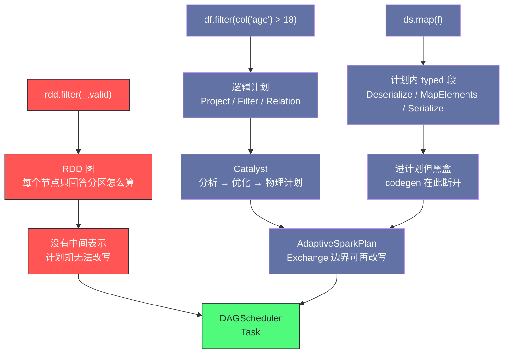
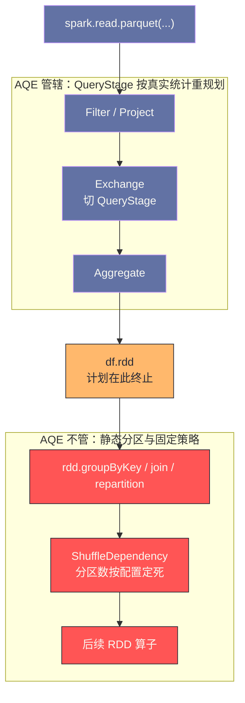
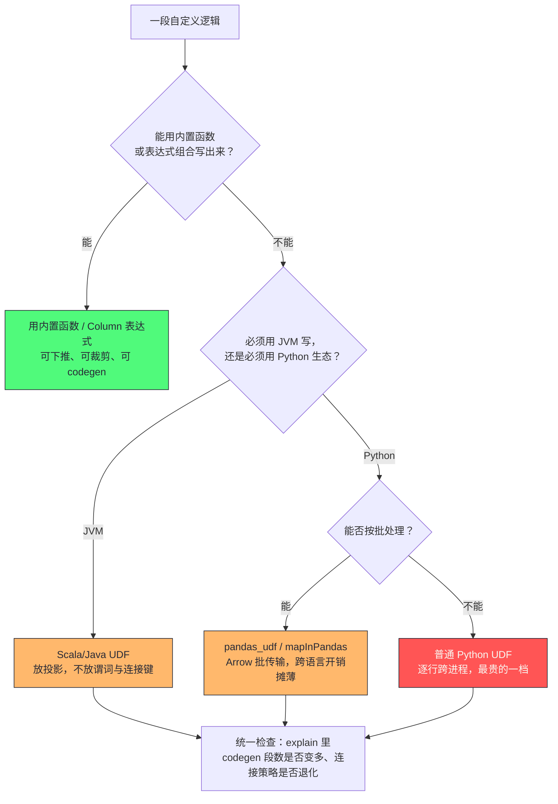
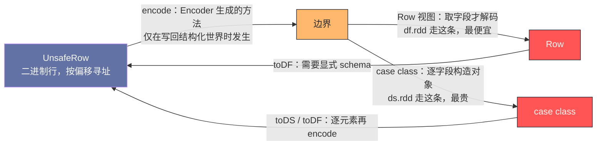

# 09 范式演进与回归：从 RDD 到 DataFrame & Dataset 的结构化跃迁

**摘要：**

RDD、DataFrame、Dataset 三者的差别，教科书式的说法停在"抽象层次不同"。但在一台每天两千个作业、三百个节点的集群上，这句话要被翻译成两个能当场回答的问题：这段计算该交给哪一层；已经写成 DataFrame 的作业，又在哪些地方悄悄掉回了 RDD。本篇只回答这两个。先把三者各压成一句话——RDD 是无结构、完全控制、无优化；DataFrame 是有 schema、声明式、被 Catalyst 优化；Dataset 是有 Encoder 类型、编译期检查、同样进 Catalyst，而它跟 RDD 的真正分界不在"有没有优化器"，在"运行期还能不能改写"。接着给出一张选型判据表，按"必须用 RDD 的五种情形、必须用 DataFrame 的三种情形"分列，每一行都配一条在 UI 或计划上能看见的判据。核心交付是"从 DataFrame 掉回 RDD"的四道入口——`df.rdd`、typed lambda 算子、`foreach`/`foreachPartition`、UDF——逐条说明它们断掉哪几件事、代价落在哪个量级、在 SQL 页与 Stages 页上留下什么痕迹，并交代一条常被记错的事实：`spark.sql.adaptive.enabled` 默认开在 4.x，但 AQE 的管辖范围止于 SQL 计划的 Exchange 边界，边界之后新产生的每一次 RDD shuffle 都不在它的重规划范围内。其后是 UDF 与内置函数的选择顺序、`Row` 与 case class 的取舍账、五组反例，以及一张带两侧代价的参数表。文中的量化一律标为示例推算或量级判断。

---

## 第 1 章 三条路，两个分岔

凌晨两点，`daily_user_profile` 这个作业在第四十七分钟结束，没有报错，也没谁觉得它慢。它是这么写的：从 Hive 表读当天的曝光日志，八十来列、十来 TB，过滤掉黑名单里的设备号，按设备与小时去重，拼上用户画像，最后写回宽表，顺带用 `foreachPartition` 把当天活跃设备推一份到 Redis。

问题出在翻代码的时候。三段看起来都正常的写法摆在那里：一段把 DataFrame 转成 `RDD[Row]` 去重再转回来，一段用 Python UDF 做设备号归一化，一段用 `foreachPartition` 写 Redis。三段各有理由——去重逻辑用 SQL 写不顺手、归一化的规则只有 Python 侧的库能算、写 Redis 没有内置连接器。但把当天的监控摊开，三个信号一起出现：

其一，SQL 页的执行计划只有一段 `WholeStageCodegen`，之后在 SQL 页上再也看不见；其二，三个 Stage 的 task 数正好等于 `spark.default.parallelism`，而单 task 输入只有几 MB；其三，Redis 侧记录的写入条数比作业统计的输出条数多出一点几个百分点。

三个信号指向同一件事：作业在三个地方从结构化世界掉回了无结构世界，而掉回去本身不告警、不失败、不写日志，只在墙钟与外部系统的账上留下痕迹。

### 1.1 一句话各定位

撇开演进史与实现细节，三者各压成一句：

RDD 是**无结构、完全控制、无优化**。它交给引擎的只有一段"我这个分区的数据怎么算"的函数，引擎能读到的元信息仅限于分区数、父节点、分区器与数据偏好；换来的是对分区布局、计算顺序、副作用的完全控制权，代价是所有优化决定都由写代码的人来做。

DataFrame 是**有 schema、声明式、被 Catalyst 优化**。它交给引擎的是一棵可被遍历、被模式匹配、被替换的逻辑计划树，每列有名字有类型；换来的是谓词下推、列裁剪、连接策略选择、代码生成与运行期重规划，代价是计算必须约束成表达式写得出来的形状。

Dataset 是**有 Encoder 的类型、编译期检查、同样进 Catalyst**。它比 DataFrame 多带一个 `Encoder[T]`，把 JVM 类型与二进制行之间的双向转换也写成可被编译的计划；换来的是编译期能查字段名与类型，代价是这层类型只在写代码时存在，运行期仍要过编解码。

| 维度 | RDD[T] | DataFrame | Dataset[T] |
| :--- | :--- | :--- | :--- |
| 引擎看到的东西 | 一段函数闭包 | 逻辑计划树 + schema | 逻辑计划树 + Encoder |
| 优化器能否改写 | 不能 | 能 | 能（但 typed 算子段是黑盒） |
| 运行期能否重规划 | 不能 | 能（SQL 计划的 Exchange 边界） | 能，除非这段是 typed 算子 |
| 类型检查发生在 | 编译期（泛型 T） | 运行期（列名字符串） | 编译期（Encoder 驱动） |
| 逐行对象开销 | 有（Java/Kryo 序列化） | 无（二进制行） | 边界处有（编解码） |
| 分区与顺序控制权 | 完全 | 几乎没有 | 几乎没有 |

### 1.2 分岔一：描述能不能被改写

第一条分岔决定的是"计划期有没有优化器"。RDD 的图已经是可以直接执行的图，节点里存的是 `Function1`、`Function2`，引擎不敢对这段计算的任何一步动手；DataFrame 与 Dataset 的图是逻辑的图，与执行之间隔着一道可以被反复穿越的门。这道门的存在与否，决定了谓词能不能下推到存储层、宽表能不能只读需要的列、一段链式算子能不能融合成一个 `while` 循环。

这一点在内核系列已经推导透，本篇不复述，见 [[大数据/Spark/读书笔记-spark内核/01_核心概念与基础/2. Spark的灵魂_深入理解RDD与DataSet|RDD 与 Dataset 的抽象对比]]。运维上只需要记住它的外部表现：同一个过滤条件，写成 Column 表达式会出现在 `explain` 的扫描节点里，写成 lambda 只会留在扫描之后的算子中。

### 1.3 分岔二：改写发生在计划期还是运行期

第二条分岔在 3.0 之后才变得要紧，也最容易被记混。DataFrame 的计划不是一次成型就冻结：`AdaptiveSparkPlan` 会在 Exchange 边界把计划切成若干 QueryStage，前一段跑完、拿到真实数据量之后，再决定后一段怎么写——分区数合并、连接策略降级为广播、倾斜分区拆分，都发生在这一刻。

这条能力有明确的管辖范围：它改写的是 SQL 执行计划，边界是计划里的 Exchange。RDD 的 `ShuffleDependency` 不构成 QueryStage，因此不在这套机制眼里。于是出现一个不对称：两段同样"没有优化器"的算子，一段以 typed lambda 的形式留在 SQL 计划里，另一段以 `df.rdd` 之后的 RDD 算子形式存在，前者仍可能被 AQE 按运行时统计改写，后者一次都不会。

下图把三条路并排放在一起。它们最终都要汇到调度器变成 Task，差别只在到达调度器之前，那张图经过了谁的手。



### 1.4 分工与不在本篇的范围

机制那一侧本篇不碰。抽象层的对照、Encoder 如何把转换编译掉、UDF 为什么是悬崖，见 [[大数据/Spark/读书笔记-spark内核/01_核心概念与基础/2. Spark的灵魂_深入理解RDD与DataSet|内核 01/2]]；RDD 图与物理计划在 DAGScheduler 之前分岔又汇合，见 [[大数据/Spark/读书笔记-spark内核/03_调度与执行机制/3. Spark逻辑处理流程详解|逻辑处理流程与惰性求值的边界]]；代码生成的分段规则见 [[大数据/Spark/Spark-SQL深度解析与性能调优/07 Whole-Stage CodeGen：JVM 字节码级别的性能飞跃|Whole-Stage CodeGen]]；列式与向量化的边界见 [[大数据/Spark/Spark-SQL深度解析与性能调优/08 向量化执行引擎：列式处理与 SIMD 的力量|向量化执行引擎]]；AQE 如何切 QueryStage 见 [[大数据/Spark/Spark-SQL深度解析与性能调优/06 AQE：运行时自适应查询优化|AQE 运行时自适应]]。

本篇只回答三件事：这段计算该交给谁；已经写成 DataFrame 的作业在哪些地方掉回了 RDD、代价多大；在 UI、计划与参数上怎么把这两件事确认下来。

---

## 第 2 章 判据表：这段计算该交给谁

选型问题最容易被简化成"哪个快"，而快慢取决于场景，没有普适答案。更可用的是一条元判据，由三个能否构成：这段计算**能不能用表达式写出来**、是不是逐行或逐组的无状态变换、结果是不是只由输入决定。

三个问题都答"能"，交给 DataFrame；有一问答"不能"且落在热路径上，就该考虑 RDD。三个问题对应优化器的三项本事：表达式化对应计划可改写，无状态对应可并行重排与下推，只由输入决定对应可重算、可跳读。任何一项失效，优化器要么无从下手，要么动手之后结果会错。

### 2.1 主表

下表是本篇的骨架。每一行都配一条现场判据，判据的意思是：如果你在 UI 或计划上看到这个形态，说明这一行的选择已经在发生，或者已经被违反。

| 场景 | 首选 | 现场判据 | 反例与边界 |
| :--- | :--- | :--- | :--- |
| 宽表扫描、过滤、聚合、窗口 | DataFrame | `explain` 里 Filter 出现在扫描节点内，扫描列少于表列 | 源必须支持下推；`textFile` 起手即失效 |
| 多表 join、维表关联 | DataFrame | SQL 页出现 `BroadcastHashJoin` 或 `SortMergeJoin`，而非 `CartesianProduct` | 连接键被 UDF 或 lambda 包裹时策略退化 |
| 需要与 SQL、BI、Thrift Server 互操作 | DataFrame | 同一份计划既被 SQL 字符串用，也被 DataFrame 用 | 视图与临时表只认结构化计划 |
| 读写带格式与下推能力的数据源 | DataFrame | 扫描节点上报 `PushedFilters`、`ReadSchema` | 自定义数据源若只实现到 RDD 层，下推无从协商 |
| 领域模型贯穿、需要编译期查字段 | Dataset | 代码里 `ds.filter(p => p.age > 18)` 出现在冷路径 | 热路径全是 typed 算子时，按 RDD 的账算 |
| 非结构化文本、二进制、图像、序列化块 | RDD | 计划里没有列的概念，扫描节点只有 `HadoopRDD` | 解析完转 DataFrame 时注意源头不可下推 |
| 自定义分区器、热点打散、按拓扑放置 | RDD | `rdd.partitionBy(new XxxPartitioner(...))`，UI 上分区大小按设计分布 | 分区数最终仍受调度器与资源约束 |
| 图迭代、自定义采样、状态机 | RDD | 循环体在 driver 侧，每轮提交一个新 Job | 中间结果要自己管缓存，见 [[大数据/Spark/Spark-RDD核心原理解析/08 缓存与持久化：StorageLevel 策略、BlockManager 协作与堆外内存实践\|08 缓存与持久化]] |
| 逐条调用外部服务、写外部系统 | RDD | `mapPartitions` / `foreachPartition` 出现在作业末尾 | 幂等与重试语义要自己兜 |
| 结构化流、增量处理 | Structured Streaming | 计划里出现 `StreamingRelation`、`StateStoreSave` | DStream 是 RDD 时代的旧抽象，已属遗留 |

### 2.2 必须用 RDD 的五种情形

第一种是自定义对象与算法。图迭代、自定义采样、要在分区内维护跨行状态的解析器，计算结构本身就是算法性的，优化器即便看懂也无从改写，因为改写的前提是"每行独立"或"可按组交换"。判据很直接：循环写在 driver 侧、每轮提交一个新 Job，中间结果由你自己 `cache`。

第二种是非结构化数据。二进制文件、图像、无固定列的日志块，这些数据没有"列"可以描述，`binaryFiles`、`wholeTextFiles` 拿到的是字节块或整段文本。硬塞进 DataFrame，要么切出一个假 schema 丢掉原始结构，要么用单列 `binary` 存着，后续每一步都在跟这层壳搏斗。

第三种是 schema 未定的预处理。脏数据进湖之前常常要先探形——统计分隔符、字段数、异常行比例，用 `map` 拿字段数、用 `reduce` 求分布，比先猜一个 schema 再反复修更省事。边界在于：schema 一定下来，后续就该回到 DataFrame。

第四种是精确控制分区与计算。自定义 `Partitioner`、按热点 key 打散、把特定分区固定到特定节点、控制 task 内的批大小与提交节奏，这些在 DataFrame 侧没有对应入口——物理规划对用户透明，注入不了自定义分区逻辑。这条控制权是 RDD 最硬的价值，也最容易被滥用：多数时候人以为自己需要控制分区，实际需要的是"分区数与数据量匹配"，而 `repartition` 与 AQE 的分区合并已经能做。

第五种是必须的副作用与顺序。逐条调用外部服务打标、按固定顺序写一个只接受追加的日志、在 partition 级复用连接池，这些操作的语义里带着顺序，引擎一旦重排或重算就会出错。判据是：这段逻辑被重试两次，结果会不会不一样；会，就不该交给优化器。

### 2.3 必须用 DataFrame 的三种情形与 Dataset 的位置

反过来，有三种情形几乎不给 RDD 留位置。

其一，需要优化器。宽表只取几列、大表带选择率高的过滤、多表 join，这三类计算的主要成本在 I/O 与网络，而省下它们的唯一手段是下推、裁剪与连接策略。这三件事只有拿到计划的引擎才做得了，写代码的人手工做不了，因为决定它们的信息（分区统计、列基数、选择率）在运行期才出现。

其二，需要 SQL 互操作。临时视图、CTAS、BI 直连、Thrift Server、Spark Connect 的远程计划，这些入口只认逻辑计划。一段 RDD 逻辑进不了这些通道，只能作为 UDF 或 `mapInPandas` 的边角存在。

其三，需要读写数据源。Parquet 的 row group 裁剪、ORC 的 stripe 统计、JDBC 的谓词下推、Delta 与 Iceberg 的文件跳过，全部通过数据源接口协商，而协商发生在计划期。从 `spark.read` 读进来下推才存在，`textFile` 起手再 `toDF` 等于在源头就放弃了它。

Dataset 的位置要单独说一句。它买到的不是更快的执行，而是边界处的编译期检查；它的执行路径与 DataFrame 是同一套 Catalyst 与同一套 codegen，差别只在多一层 Encoder 编解码。所以它的适用区间很窄：领域模型贯穿、字段多、拼写错误代价高，而且热路径不用 typed 算子。一旦热路径全是 `ds.map`，这段流水线的账要按 RDD 来算，因为它断掉的东西与 RDD 同一批——这一点在第 3 章入口二里展开。

---

## 第 3 章 掉回 RDD 的四道入口

结构化世界与对象世界之间有四道门。四道门都不难推开，难的是推开之后没人记账：优化器不报错，AQE 不报错，作业照常跑完，只有墙钟变长、外部系统看见重复写入。这一章逐道门算账。

### 3.1 入口一：`df.rdd`

最直白的一道。`df.rdd` 做两件事：把当前计划执行成 `RDD[InternalRow]`，再逐行包成 `Row` 交出去；此后所有算子都在 RDD 世界里。

第一笔代价是计划固化。转过之后新接的算子不在任何计划里，`explain` 看不到它们，SQL 页的 DAG 到边界为止，后续只出现在 Stages 页。这意味着两个方向的信息都断了：往上，优化器不知道后面还要做什么，无法为它准备分布（比如按后续 join 的键预分区）；往下，你也不知道引擎打算怎么跑这一段。

第二笔代价是逐行反序列化。`Row` 多数情况下是对底层二进制行的视图，取字段时才解码，所以从 `df.rdd` 拿到 `RDD[Row]` 这一步本身不贵；但如果代码里写的是 `ds.rdd`（Dataset 转 RDD），那就是逐行逐字段地构造 case class 对象，行数越多越贵，构造出来的对象立刻成为 GC 的负担。这一点在第 6 章单独算。

第三笔代价是 AQE 失效。边界之后新产生的每一次 RDD shuffle——`groupByKey`、`reduceByKey`、`join`、`repartition`——分区数按代码或 `spark.default.parallelism` 定死，不合并小分区、不拆倾斜、不换连接策略。第 4 章专门讲这条。

现场判据有三条，都不需要读源码：SQL 页的 DAG 在中途断掉，之后只剩 Stages 页的表格；Stages 页出现 task 数恰好等于 `spark.default.parallelism` 而单 task 输入很小的 Stage；`rdd.toDebugString` 在末端能打出几百行，而 `df.explain` 只有十几行。

量级上给个示例推算：八十列宽表只用到其中五列，`df.rdd` 之后列裁剪失效，扫描要按全列走，I/O 与解压成本按列宽比例放大——列宽分布均匀时，读五列与读八十列的差在十倍以上；行数一亿级时，这一项通常是分钟级。这不是精确数字，量级判断够用：**入口一买到的灵活性，价格通常以"十倍 I/O"或"分钟级墙钟"计价。**

### 3.2 入口二：typed lambda 算子

这一道最容易记错，也最值得说清：它**不是 RDD**。

在 Scala 里写 `ds.filter(p => p.age > 18)` 或 `ds.map(f)`，计划里出现的是一组 typed 节点——`DeserializeToObject` 把二进制行还原成对象，用户函数被包进 `MapElements` 之类的节点，`SerializeFromObject` 再写回二进制行（节点名以对应版本的 `explain` 为准）。这组节点在计划树里，因此仍归 Catalyst 与 AQE 管：周围的 Exchange 仍会被 QueryStage 切开并重规划。

但它断掉的是另外三件事。第一，代码生成融合。整段 codegen 要求每个算子都能被编译进同一个循环，typed 段做不到——中间要塞进一次"还原成对象、调用函数、再写回字节"的过程，`CollapseCodegenStages` 只能在它两侧断开，一段查询被切成"生成 → 黑盒 → 生成"。第二，列裁剪。用户函数读哪些字段，引擎不知道，只能把对象整行还原，宽表读进来的列一列都省不掉。第三，谓词下推。过滤条件藏在闭包里，数据源不认识它，这个合取项只能留在扫描之后执行。

于是这条入口的账与入口一不同：入口一丢的是"之后所有优化"，入口二丢的是"这一段周围的优化"，AQE 还在，下推与裁剪不在。两者在墙钟上可能差一个数量级，取决于这段代码站在流水线的什么位置、周围有多少宽表扫描。

还有一处必须纠正的老说法：在 PySpark 里，`df.filter` 只接受 Column 或 SQL 字符串，`lambda` 根本没这个入口；要按行处理，得走 `df.rdd.map`（这已经是入口一）或者 `mapInPandas` / `applyInPandas`（这是批式 Python 接口）。把 Python 里的 lambda 说成"绕过 Catalyst 的 typed 算子"，是把 Scala 的机制套到了 Python 的 API 上，结论对不上代码。

现场判据：`explain` 输出的计划里出现 `DeserializeToObject` / `SerializeFromObject`；`WholeStageCodegen` 的段数比算子链长多出好几段，段与段之间夹着孤立的节点。看到这两样，说明热路径上有一段黑盒。

### 3.3 入口三：`foreach` 与 `foreachPartition`

这一道不改变数据形态，改变的是语义位置。`foreach` 是 action，写在作业末尾，看着像"出口"，实际上它把写外部系统这件事放进了 Task 里执行，而 Task 是可以重试、可以被推测执行、可以因为 executor 丢失而重跑的。

代价有三层。第一层是语义：Spark 的写出协议（commit 协议、`_SUCCESS` 标记、覆盖语义）只覆盖通过 DataSource 写出的路径；`foreachPartition` 直连外部系统，绕过这套协议，重试一次就重复写一次。作业统计的输出条数与外部系统收到的条数不一致，第一个该查的就是 Stage 的重试次数，而不是代码逻辑。

第二层是并发形态：每个分区一条连接，连接数等于分区数，而分区数由计划决定。一个 2000 分区的 Stage 就是 2000 条并发连接，Redis 或 MySQL 通常扛不住这个数字，表现为超时、重连、写入抖动，而 Spark 侧看到的只是 task 变慢。

第三层是背压：RDD 的 action 没有速率控制，唯一能减速的手段是人为 `sleep` 或加大批大小，两者都在浪费资源。所以替代路径取决于语义要求：要精确一次，用 Structured Streaming 的 `foreachBatch`，它带批号与重放语义；要幂等，在写入端做去重键；只是"尽力写一份"，就接受至少一次，并在监控上把重复率当成已知量。

### 3.4 入口四：UDF

UDF 的位置决定代价的量级，这一条在第 5 章展开，这里只记账。落在投影里的 UDF，影响是这一列退化成解释执行；落在谓词里的 UDF，影响是这个合取项下推不了、选择率估不准；落在连接键上的 UDF，影响是等值连接识别不出来，策略退到嵌套循环——这一档的代价与前面几档不在一个量级。

Python UDF 还要再叠一层跨语言开销，逐行过一次 JVM 与 Python 进程之间的序列化，第 5 章单独算。

### 3.5 四道门的账

| 入口 | 代码形态 | 计划上的表现 | 断掉什么 | AQE 是否还管 | 代价量级 |
| :--- | :--- | :--- | :--- | :--- | :--- |
| `df.rdd` | `df.rdd.filter(...)` | SQL 计划在边界处终止 | 之后全部：下推、裁剪、codegen、重规划 | 否 | 十倍级 I/O 或分钟级墙钟（示例推算） |
| typed lambda | `ds.map(f)`、`ds.filter(p => ...)` | `DeserializeToObject` / `MapElements` / `SerializeFromObject` | 周围一段：codegen 融合、列裁剪、谓词下推 | 是 | 一个数量级以内（量级判断） |
| `foreach` / `foreachPartition` | 作业末尾的 action | 计划正常，执行在 Task 内 | 提交协议、重试语义、背压 | 是（分区数仍归计划） | 重复写按重试次数放大 |
| UDF（Scala/Python） | `udf(...)`、`pandas_udf(...)` | `ScalaUDF` / `BatchEvalPython`，codegen 断开 | 本节点及其两侧的融合、下推 | 是 | 投影档可忽略，连接键档数量级跃迁 |

---

## 第 4 章 AQE 的管辖边界

关于 AQE 有一句流传很广但并不准确的话："AQE 是运行期的优化器，所以开了自适应，RDD 也能被优化。"前半句要改写，后半句不成立。

准确的说法是：AQE 在 Exchange 边界把 SQL 执行计划切成 QueryStage，前一段物化后按真实统计重写后一段；它改写的是计划，不是算子。RDD 的 `ShuffleDependency` 不在任何计划里，因此不在它的视野内。

### 4.1 一条容易记错的事实

`spark.sql.adaptive.enabled` 在 4.x 默认是 `true`。这个默认值让很多人以为"自适应默认开，所以我的作业都被优化过"。事实是：它对 `df.rdd` 之后的世界完全空转。

要说清边界，得分两段看。`df.rdd` 之前的 SQL 部分仍是一次查询，它自己的 Exchange 边界仍会被切开、仍会被重规划；`df.rdd` 之后新接的 RDD 算子产生的是 RDD 的 shuffle，分区数按代码与配置定死，一次重规划都不会有。所以"用了 AQE"这句话对一段混合流水线只覆盖前半段，后半段的分区数、连接策略、倾斜处理全部退回静态时代。

下图把管辖边界画出来。虚线以上是 AQE 的地盘，虚线以下的所有 shuffle 都不归它管。



### 4.2 三个后果

分区数固定。边界之后的 shuffle 输出分区数取 `spark.default.parallelism`（未显式设置时取父 RDD 最大分区数），或代码里写死的数字。数据量小时是一堆小分区与小 task，分布偏时就是一个巨大分区拖住整个 Stage。这本该由 AQE 自动合并，而边界之后没有这条路径。

连接策略固定。静态规划时若没有准确统计，两张表会走 `SortMergeJoin`；AQE 在 Shuffle 完成后发现一侧只有几十 MB，就降级成广播，省掉一次 Shuffle 与一次落盘。RDD 侧的 `join` 没有这个机制：`spark.sql.autoBroadcastJoinThreshold` 只作用于 SQL 计划，`rdd.join` 一律走 co-group 加 Shuffle。

倾斜不处理。AQE 的倾斜处理按 Shuffle 分区大小分布识别长尾，拆成多个子分区并行读。RDD 侧的倾斜只能人工加盐、改分区器或换聚合方式，而人工处置的前提是先看见长尾，也就是在 Stages 页翻每个 task 的 Shuffle Read Size。

### 4.3 判据：在 UI 与计划上确认边界

三条判据，从便宜到贵排：

其一，看 `explain` 顶层节点。出现 `AdaptiveSparkPlan isFinalPlan=false` 说明计划仍在 AQE 手里；若一段流水线只有前半段带这个节点、后半段是 `ShuffledRDD`，边界就在两者之间。

其二，看 SQL 页的 final plan。SQL 页只画计划节点，`df.rdd` 之后的 RDD 算子不出现在这张图上；图断在哪里，优化就断在哪里。

其三，看 Stages 页的 Shuffle Read Size 分布。分区大小高度不均且 task 数等于配置值，是"静态分区 + 倾斜"的典型形态；AQE 处理过的 Stage 通常能看到分区被合并，实际 task 数小于配置值。

### 4.4 参数表

下表只列与本章相关的参数，代价一列是调大与调小的对价。

| 参数 | 默认值 | 决定什么 | 调大 / 打开的代价 | 调小 / 关闭的代价 |
| :--- | :--- | :--- | :--- | :--- |
| `spark.sql.adaptive.enabled` | true | SQL 计划是否在 Exchange 边界重规划 | 计划不可静态预测，UI 与提交前分析会不一致 | 倾斜与小分区回落到人工，等于把一件自动活摊回给人 |
| `spark.sql.adaptive.coalescePartitions.enabled` | true | 是否按实际数据合并读端分区 | 分区布局不再等于配置值，可复现性下降 | 小分区与小 task 增多，固定开销上升 |
| `spark.sql.adaptive.advisoryPartitionSizeInBytes` | 64m | 合并的目标分区大小 | 分区更少、单 task 更重、倾斜更集中 | 分区更细、task 更多、调度与句柄开销上升 |
| `spark.sql.adaptive.skewJoin.enabled` | true | 倾斜分区是否拆分 | 读端分区被复制，Shuffle Read 放大 | 长尾原样保留，Stage 尾部时间由最慢 task 决定 |
| `spark.sql.autoBroadcastJoinThreshold` | 10m | 多小的一侧可以广播（SQL 侧） | 广播内容挤占 driver 与 executor 内存，大表误判会 OOM | 退回 `SortMergeJoin`，多一次 Shuffle 与落盘 |
| `spark.default.parallelism` | 集群总核数 | RDD shuffle 的输出分区数 | RDD 侧分区更细、task 更多 | 分区更粗、单 task 内存与溢写压力上升 |
| `spark.sql.execution.arrow.pyspark.enabled` | 以版本文档为准 | PySpark 的 collect 与批式接口是否走 Arrow | 内存峰值上升，需与批大小一起调 | 跨语言按行传输，小数据量也付固定开销 |
| `spark.sql.execution.arrow.maxRecordsPerBatch` | 10000 | 批式 Python 接口每批行数 | 单批内存上升，GC 与 OOM 风险增加 | 批数变多，固定开销占比上升 |

有两件事不要做。其一，为了"让计划可预测"把 `spark.sql.adaptive.enabled` 关掉——可预测性换来的是倾斜与小分区全部回到人工，这笔账算不过来；真要可预测，就把关键 Stage 的分区数显式定下来。其二，用调大 `spark.default.parallelism` 来"提升并行度"——它只影响 RDD 侧，SQL 侧看的是 `spark.sql.shuffle.partitions`，两边一起调高只会让 task 数虚高。

本篇口径按 4.3.0（Scala 2.13）记；参数名与默认值跨大版本改动较多，Arrow 相关几项尤甚，用前回对应版本文档核一遍。

### 4.5 混合编排的停靠点

真实的作业很少纯用一种抽象，问题不在混，而在哪里停。一条能落地的编排是：入口用 `spark.read` 从支持下推的源读成 DataFrame，拿到裁剪与下推；中段全部用表达式做过滤、聚合、连接，让 codegen 与 AQE 有活干；遇到引擎确实看不懂的那一小段算法，用 `rdd` 或 `mapInPandas` 出去，做完就地结束。

关键在最后一句：**别再转回来。** `df.rdd.filter(...).toDF()` 这种写法，往返一次要付两次编解码加一个优化断点，而转回来的计划源头仍是一个不可下推的叶子，列裁不动、谓词推不进、统计信息只剩一个按列数估出来的默认值。它看起来像"回到结构化世界"，实际是"在结构化世界里带着一个黑盒源头"。

---

## 第 5 章 UDF 还是内置函数

UDF 的代价从来不是"这个函数跑得慢"。一个自己写的字符串切分函数，执行时间可能只有内置函数的 1.5 倍；但它所在的那段查询可能慢十倍。原因在于它把四件事一起打断了：谓词下推、列裁剪、代码生成融合、等值连接识别。四件事里前三件是"有无"问题，不是"多少"问题。

### 5.1 选择顺序

按可优化性从高到低排，选择顺序是固定的：

内置函数 → 表达式组合 → Scala/Java UDF → `pandas_udf` / Arrow UDF → 普通 Python UDF。

前两档是同一个层次，因为内置函数本身就是表达式，多个表达式可以组合成 `when` / `regexp_extract` / `from_json` / `array_sort` 链，整条链仍是一棵可被优化与代码生成的表达式树。分水岭在第三档：一进 UDF，节点就成黑盒，优化器只看得见它的输入列与输出类型。

下图把这条选择链画成决策路径。每一档的判断只需要一个问题：这段逻辑能不能用表达式表达。



### 5.2 位置决定量级

同一段 UDF 放在不同位置，代价差一到两个数量级。判断它的真实代价，要问的不是"它快不快"，而是"它站在计划里的哪儿"。

| UDF 的位置 | 计划上的表现 | 断掉的能力 | 代价量级 | 能否局部挽回 |
| :--- | :--- | :--- | :--- | :--- |
| 投影（`select`） | `WholeStageCodegen` 在此断开，前后各成一段 | 代码生成融合；入参出参装箱 | 一个数量级以内 | 减少 UDF 数量，或先投影出必要列 |
| 谓词（`where`） | 该合取项留在扫描之后 | 谓词下推、选择率估算 | 随选择率放大 | 拆出可下推的等值条件，UDF 只处理残余 |
| 连接键（`join on`） | 出现 `CartesianProduct` 或嵌套循环 | 等值连接识别 | 数量级跃迁，随两侧行数乘积放大 | 不可挽回，必须换掉连接键上的 UDF |
| 分组键（`groupBy`） | 哈希分布按 UDF 结果计算 | 分区裁剪、部分下推 | 常数倍到数量级，取决于基数 | 先物化一列再分组 |

### 5.3 Python 的三段成本

Python UDF 比 Scala UDF 多三段成本，且三段都逐行发生：JVM 侧把参数从二进制行拆出来装箱、序列化后通过 socket 送进 Python worker 进程、算完再把结果序列化回来。三段合起来的固定开销按行计，行数越多总成本越高，且这部分成本不随数据变小而消失——它只随行数变。

Arrow 优化改变的是"逐行"这个前提：`pandas_udf` 与 `mapInPandas` 按批传输，一批一万行只过一次序列化与进程间通信，固定开销被摊到批上。这也是为什么同样的逻辑，逐行 UDF 与批式 UDF 的差距往往是十倍而不是百分之几十。

给个量级判断：普通 Python UDF 的单核吞吐通常比同一段 Scala 逻辑低一个数量级，跨语言那部分占大头，函数体本身往往不是瓶颈；改成 `pandas_udf` 之后差距通常收敛到两三倍以内，剩下的来自 UDF 仍是黑盒、codegen 仍断开。

### 5.4 什么时候 UDF 无可替代

有三种情况绕不开：外部字典查询（规则在数据库或配置文件里，编译期不知道）、非 JVM 生态的库（Python 的 NLP、图像、科学计算栈）、以及复杂到无法用表达式表达的字符串解析。

既然绕不开，就把代价控制住：放投影不放谓词与连接键；能用批式接口就用批式接口；在 UDF 之前先把宽表投影到必要列，别让黑盒节点拖着一整行；出计划之后用 `explain` 确认两件事——`WholeStageCodegen` 的段数没有暴增，连接策略没有从 `SortMergeJoin`/`BroadcastHashJoin` 掉到 `CartesianProduct`。这两眼检查只要几秒钟。

---

## 第 6 章 `Row` 与 case class 的取舍

掉回对象世界的时候，手上拿到的是什么类型的对象，是一个独立的选择。三种形态各有位置：引擎内部的二进制行、边界上的 `Row` 视图、用户定义的 case class。

### 6.1 三种形态与两次转换

引擎内部的数据是二进制行，字段按偏移量寻址，没有对象头、没有装箱、可以连续排列；`Row` 是这层二进制行在 API 边界上的一层视图，取字段时才解码，`getAs[T]` 在那一刻做类型转换；case class 是用户自己的类型，从二进制行构造出来要逐字段读、逐字段赋值，构造完之后与 Spark 无关，纯粹是一个 JVM 对象。

下图把三次转换画出来，箭头上的标注是每次转换谁在付钱。



### 6.2 取舍表

| 维度 | `Row` | case class（`Dataset[T]`） |
| :--- | :--- | :--- |
| 字段访问 | `getAs[T](i)` 或 `getAs[T]("name")`，运行期强转 | 直接 `p.field`，编译期检查 |
| 构造开销 | 低，多数情况是视图，取字段时才解码 | 高，逐行逐字段构造对象 |
| GC 压力 | 小 | 大，每行一个对象，长寿则晋升老年代 |
| 列名错误 | 运行期抛异常，通常在中途某个 task 上 | 编译期报错（对字段而言；`as[T]` 不校验 schema） |
| 适用位置 | 边界上短暂停留，逐行处理后立刻回结构化世界 | 领域逻辑贯穿、需要类型收口、且不在热路径上逐行调用 |
| 典型误用 | 全程用 `RDD[Row]` 做业务计算，靠 `getAs` 到处取值 | 热路径全用 `ds.map`，类型安全买到了，执行退化成黑盒流水线 |

这份取舍的落点是一句判断：**类型安全的价值在边界之前，编解码的成本在边界之后。**在边界处用 case class 把字段名与类型收口，再往下走纯表达式，不要一边保留 case class、一边在热路径上逐行调用它。

### 6.3 边界处收口

有一处容易踩空：`df.as[T]` 不做 schema 校验，它只是把 `Row` 的解释方式换成 `Encoder[T]`。字段名对不上、类型宽窄不一致，都要等某个 task 反序列化时才炸，而报错往往是 `NullPointerException` 或类型转换异常，堆栈落在表达式里，看不出与 schema 有关。

可操作的收口方式是三步：先拿 `df.schema` 与期望的 `StructType` 显式比对，或者用 `select` 把列名与顺序投影成期望形状，再 `as[T]`，最后把 `getAs` 集中写进一个函数。出错位置就此收敛在一处。

### 6.4 `Row.getAs` 的运行期风险

`getAs` 有三个稳定的坑。其一是列序：按序号取值（`row.getAs[String](1)`）在 schema 变化时会静默取错列，而按名取值（`row.getAs[String]("name")`）会多一次哈希查找。其二是类型宽化：`Int` 与 `Long` 在 `getAs` 里不会自动升格，取错会抛 `ClassCastException`，而这个异常只在有数据的分区上出现。其三是 null：`getAs` 返回的是装箱类型，null 会原样返回，`getAs[Int]` 拿到 null 之后参与算术就是 `NullPointerException`。

三条指向同一个操作结论：`getAs` 只该出现在边界的一小段代码里，且要显式处理 null 与类型；把业务逻辑写在 `RDD[Row]` 上、靠 `getAs` 反复取值，等于把编译期能查出的错误推迟到运行期，还放弃了列裁剪与下推。

---

## 第 7 章 五组反例

### 7.1 用 `df.rdd` 做本该 `filter` 的事

```scala
// 反例：过滤条件写在 RDD 侧，计划在边界处终止
val filtered = df.rdd
  .filter(row => row.getAs[String]("status") == "paid" && row.getAs[Long]("amount") > 100)
  .toDF()

// 正例：条件是表达式，能下推到扫描层
val filtered = df.where(col("status") === "paid" && col("amount") > 100)
```

两者的语义完全一样，执行路径差着三样东西：谓词不再下推到 Parquet 的 row group，列裁剪失效，后续算子脱离计划。判据在计划上——正例的 `Filter` 会出现在扫描节点内部，反例的 `Filter` 出现在边界之后的 RDD 世界，`explain` 里根本看不到。

这个反例的变体更常见：为了用 `Row` 上的某个方法，比如判断某列是不是空字符串、是不是合法 JSON，随手转成 `RDD[Row]`。这些判断用 `isNull`、`get_json_object` 都能表达，没必要跨边界。

### 7.2 用 Python UDF 做内置函数的转换

```python
# 反例：每行一次跨进程调用
norm = udf(lambda s: s.strip().lower() if s else None, StringType())
df.withColumn("device", norm(col("device_raw")))

# 正例：同一语义的表达式，可下推、可 codegen
df.withColumn("device", lower(trim(col("device_raw"))))
```

这段代码在功能上等价，代价差一个数量级：前者逐行过 JVM-Python 序列化，后者编译进整段循环。如果确实需要 Python 侧的库，换成 `pandas_udf` 按批处理，把固定开销摊到批上。

### 7.3 用 Dataset 处理非结构化数据

```scala
// 反例：为了"类型安全"给非结构化数据套一个壳
case class Blob(path: String, bytes: Array[Byte])
val ds: Dataset[Blob] = sc.binaryFiles("hdfs://logs/").map { case (p, c) => Blob(p, c.toArray) }.toDS()

// 正例：解析阶段留在 RDD，解析完再结构化
val parsed: RDD[LogRecord] = sc.binaryFiles("hdfs://logs/").flatMap { case (_, c) => parse(c) }
```

`Array[Byte]` 放进 case class 之后，每次编解码都要对整块字节拷一次，换来的只是"字段检查"，不是"执行优化"，解析逻辑对优化器仍然不可见。解析阶段本该留在 RDD，等变成正常的列式结构再进 DataFrame。

### 7.4 把 `foreachPartition` 当"至少一次"

```scala
// 反例：Task 重试就会重复写，外部系统看到条数与作业统计不一致
df.foreachPartition { rows =>
  val conn = JedisPool.get()
  rows.foreach(r => conn.zadd("active:" + day, r.getAs[Long]("ts"), r.getAs[String]("device")))
  conn.close()
}
```

这段代码在正常情况下没问题，出问题的是重试：executor 丢掉一个 task，或者推测执行同时跑了两份，写入就会翻倍。正确做法要么在写入端用幂等键（`zadd` 本身对同一 member 幂等，但换成 `incr` 或消息队列就不是了），要么改用 `foreachBatch` 这类带批次语义的接口。

### 7.5 反例汇总

| 反例 | 表面现象 | 实际代价 | 处置 |
| :--- | :--- | :--- | :--- |
| `df.rdd.filter(...).toDF()` | 代码看着更"灵活" | 下推、裁剪、codegen 全丢，还多一次编解码 | 改写成 Column 表达式 |
| Python UDF 做字符串清洗 | 逻辑直白 | 逐行跨进程，吞吐降一个数量级 | 内置函数或 `pandas_udf` |
| 给非结构化数据套 case class | 类型齐全 | 每行一次全量字节拷贝，优化器仍看不见解析 | 解析留 RDD，出口再结构化 |
| `foreachPartition` 写外部系统 | 省掉一个连接器 | 重试重复写，连接数等于分区数 | 幂等键或 `foreachBatch` |
| 全程 `RDD[Row]` + `getAs` | 跳过 schema 设计 | 运行期类型错误，且放弃全部优化 | 边界处收口，中间用表达式 |

---

## 第 8 章 落点

回到凌晨那个作业。三处改动之后，第四十七分钟变成二十九分钟：去重从 `df.rdd` 侧搬回表达式（`dropDuplicates` 加窗口），拿回列裁剪与下推；设备号归一化从逐行 Python UDF 换成 `pandas_udf`；写 Redis 那一段加了幂等键，条数对上了。三段代码长度差不多，收益全部来自"少穿一次边界"。

三者之间的关系收成三句。RDD 把控制权留给写代码的人，代价是性能责任也归他；DataFrame 把性能责任交给引擎，代价是计算必须能被表达式描述；Dataset 在边界上多一道编译期检查，代价是运行期多一层编解码，而它在执行上与 DataFrame 同一套引擎，所以"Dataset 比 DataFrame 快"在纯 typed 算子的流水线上恰好反过来。

四道入口的价值不在"能不能用"，而在"知道自己在付什么"。`df.rdd` 付的是之后全部优化与重规划；typed lambda 付的是周围一段的融合与裁剪；`foreach` 付的是提交语义；UDF 付的是这一节点及其两侧的可优化性。四笔账量级不同，共同点是都不报错。

最后是 AQE 那条边界。它把 3.0 之后"计划可以在运行期改"这件事变成了默认行为，但也把一条分界线画得更清楚了：**进不了计划的算子，只能在静态世界里执行。**所以选型的实质不是"哪个 API 更先进"，而是你希望这段计算被谁管——被引擎管，就交出表达方式的自由；被自己管，就接过全部优化责任。

---

## 参考资料

- Zaharia, M., et al. "Resilient Distributed Datasets: A Fault-Tolerant Abstraction for In-Memory Cluster Computing." NSDI 2012.（RDD 的原始抽象与血缘容错）<https://www.usenix.org/system/files/conference/nsdi12/nsdi12-final138.pdf>
- Armbrust, M., et al. "Spark SQL: Relational Data Processing in Spark." SIGMOD 2015.（Catalyst 与 DataFrame 的设计动机）<https://people.csail.mit.edu/matei/papers/2015/sigmod_spark_sql.pdf>
- Apache Spark 4.3.0 Documentation: Configuration（`spark.sql.adaptive.*`、`spark.sql.autoBroadcastJoinThreshold`、`spark.default.parallelism`、`spark.sql.execution.arrow.*` 的默认值以对应版本文档为准）<https://spark.apache.org/docs/latest/configuration.html>
- Apache Spark 4.3.0 Documentation: Performance Tuning（AQE 的分区合并、倾斜连接、动态切换连接策略三节）<https://spark.apache.org/docs/latest/sql-performance-tuning.html>
- Apache Spark 4.3.0 Documentation: Arrow in PySpark（`pandas_udf` 与 Arrow 优化的适用范围与批大小配置）<https://spark.apache.org/docs/latest/api/python/user_guide/arrow_pandas.html>
- Apache Spark 源码（v4.3.0）：`Dataset.scala`（`rdd`、`toDF`、`as`、typed 算子的实现）、`AdaptiveSparkPlanExec.scala`（QueryStage 的切分与重规划时机）<https://github.com/apache/spark/blob/v4.3.0/sql/core/src/main/scala/org/apache/spark/sql/Dataset.scala>

---

> [!note] 思考题
> 1. 你手上的作业里，有多少段代码是"为了用某个方法"而跨到 RDD 侧去的？这些方法里，有几个其实有内置函数或表达式的等价实现？
> 2. 一个 Stage 的 task 数恰好等于 `spark.default.parallelism`，而单 task 输入只有几 MB。这条线索能指向哪几种成因，你会按什么顺序排除？
> 3. 同样是"逐行处理"，`ds.map`、`df.rdd.map`、`pandas_udf` 三者丢掉的优化各不相同。如果要在一段流水线里选一个，你会先看哪两处 `explain` 输出？
> 4. AQE 在 Exchange 边界重规划，而 RDD 的 ShuffleDependency 不在计划里。这个边界对你的混合编排意味着什么——你是否接受"前段自适应、后段静态"这种不对称？
> 5. 一段 `foreachPartition` 写外部系统的代码，在 task 重试三次之后，外部系统会看到什么？你会用幂等键、还是改用带批次语义的接口，判断依据是什么？