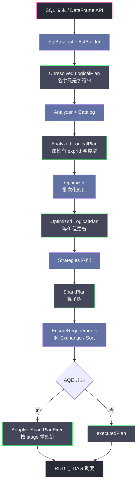
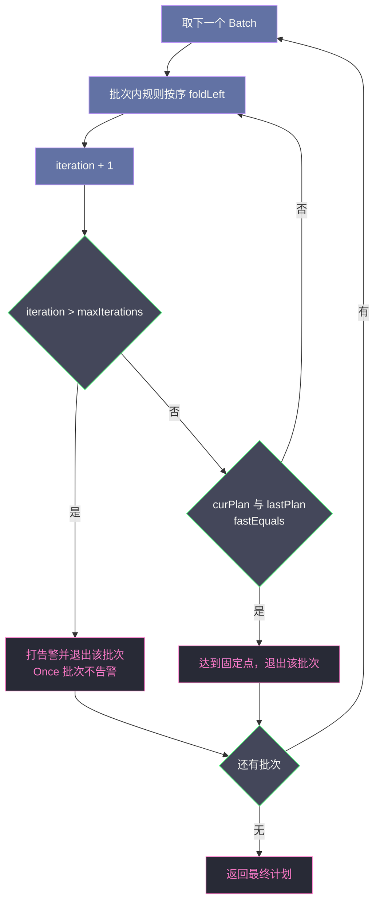
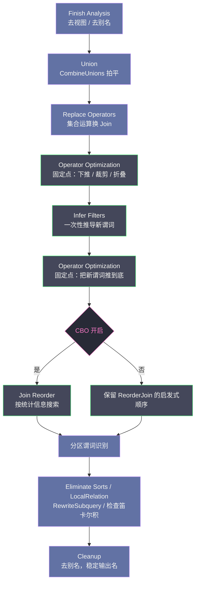
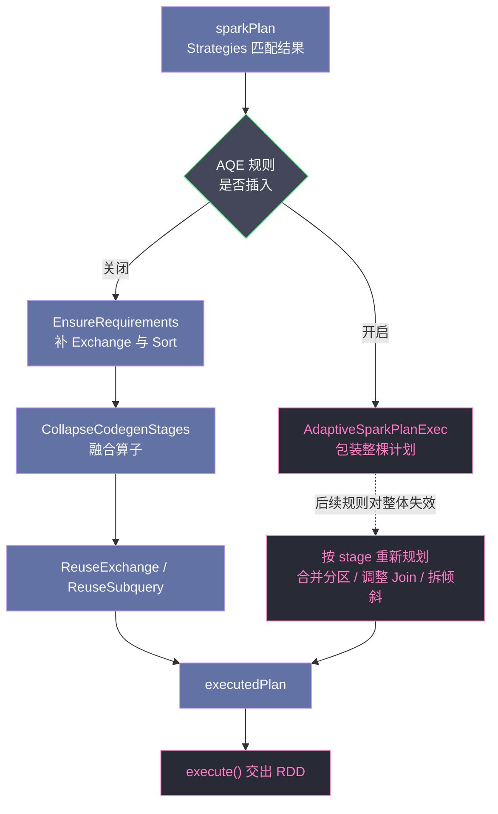
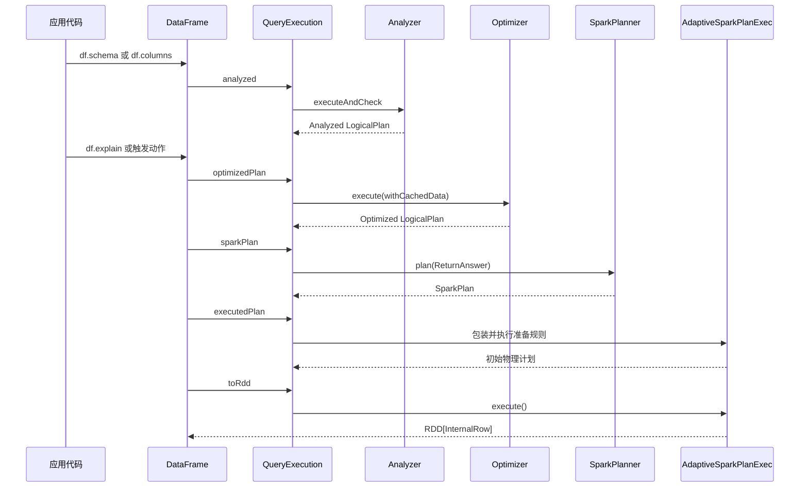

# 01 Spark SQL 全局架构：从 SQL 文本到 RDD 执行的完整旅程

**摘要：**

本文讨论的范围限定在一条查询从文本到可执行 RDD 之间的那段路，也就是 Spark SQL 的编译链路；真正落到 Executor 上的调度、Shuffle 与内存行为不在本文的射程之内。之所以要把这段路拆开看，是因为它由五层彼此不等价的表示串成：SQL 文本被 `SqlBase.g4` 与 `AstBuilder` 译成未解析的逻辑计划，`Analyzer` 借 `Catalog` 把名字换成有出处的属性，`Optimizer` 用批次化的规则把它改写成更便宜的形式，`Strategies` 把它匹配成物理算子并补上 Exchange 与 Sort，最后 `SparkPlan.execute()` 才交出 RDD。每一层都只回答有限的问题，也都留下无法回答的部分，弄清这条边界比记住类名有用得多。本文沿这条主线逐层展开：先讲清 `TreeNode` 与 `RuleExecutor` 的变换机制与固定点迭代，再交代 `Analyzer` 与 `Optimizer` 的批次顺序为什么不能随意调换，随后落到 `QueryExecution` 的五个惰性属性、`EXPLAIN` 各模式能看与不能看的东西，以及 `SessionState` 的不可变替换方式。文中给出的耗时为量级判断，示例推算与实测基准会分别标注，不混为一谈。文末给出四类常见误判：拿 `EXPLAIN EXTENDED` 当统计报告、把 `optimizedPlan` 当最终执行计划、在分析阶段期待看到优化结果，以及把 DataFrame 当成没有编译成本；每一类都附上了应该看哪一层、哪一份计划的判据。

---

## 第 1 章 一条查询要经过几道手

### 1.1 分层不是设计趣味，是接口契约

把查询编译拆成多层，这件事比 Spark 本身要早得多。1979 年 System R 就把 SQL 的处理划成解析、语义检查、访问路径选择与代码生成几段，理由很朴素：一段文本要变成机器能跑的指令，中间必须存在若干"半成品"，而每个半成品都必须是可检查、可交换、可替换的数据结构。Spark SQL 在 2015 年的 SIGMOD 论文里把这套思路搬到了分布式场景，但它面对的环境比单机数据库苛刻——数据在几百台机器上，扫描代价与网络代价的量级差了几个数量级，中间还夹着一层会失败、会重算的调度系统。

正因为如此，五层表示之间的接口不是"函数调用"，而是"**计划树**"。上一层交给下一层的，永远是一棵可以打印、可以比较、可以被规则改写、但绝不会自己跑起来的树。这个约束带来了一个很实际的后果：任何一层出问题，你都可以在它的输出上原地观测，而不必启动一个作业。`EXPLAIN` 之所以能在秒级返回，正是因为整条链路的前四层都是纯结构变换。

### 1.2 五层表示各自回答什么问题

理解这条链路最省力的方式，是记住每一层"能回答什么、答不了什么"，而不是背类名。下面这张表是全文的骨架，后面各章基本是在给每一行补充细节。

| 层 | 产物 | 能回答的问题 | 答不了的问题 | 失败的形态 |
|---|---|---|---|---|
| 解析 | `Unresolved LogicalPlan` | 这段文本符合语法吗，结构长什么样 | 表存在吗，列是什么类型 | `ParseException`，带行列位置 |
| 分析 | `Analyzed LogicalPlan` | 每个名字指向哪个对象，类型是什么 | 哪种执行方式更便宜 | `AnalysisException`，通常带错误类名 |
| 逻辑优化 | `Optimized LogicalPlan` | 有没有更省数据的等价写法 | 该用哪种 Join 实现，要几次 Shuffle | 一般不失败，规则本身可能有缺陷 |
| 物理规划 | `SparkPlan` | 用哪个算子，数据怎么分区与排序 | 运行时数据到底多大 | 策略匹配失败，或 `EnsureRequirements` 插不出合法计划 |
| 执行 | `RDD[InternalRow]` | 结果是什么 | 上游规划是否合理 | 任务失败、溢出、数据倾斜 |

这张表里最容易被忽略的是"答不了的问题"这一列。绝大多数线上误判，都源于指望某一层回答它本来不负责的问题，譬如在 `Analyzed LogicalPlan` 里找谓词下推的结果，或者拿 `Optimized LogicalPlan` 判断会不会广播。

### 1.3 贯穿案例

后面各章围绕同一条查询展开，它足够短，能完整打印，又同时牵动谓词下推、列裁剪、广播 Join、分区裁剪与聚合，足以把五层的差异暴露出来。

```sql
SELECT o.shop_id,
       d.region,
       date_trunc('day', o.paid_at) AS day,
       sum(o.amount)                AS gmv,
       count(DISTINCT o.buyer_id)   AS buyers
FROM orders o
JOIN dim_shop d ON o.shop_id = d.shop_id
WHERE o.dt >= '2026-10-01' AND o.dt < '2026-11-01'
  AND o.paid_at >= '2026-10-01'
  AND d.status = 'active'
GROUP BY o.shop_id, d.region, date_trunc('day', o.paid_at)
```

`orders` 是按天分区的宽表，量级在十亿行以上；`dim_shop` 是几万行的维表，`status` 绝大多数为 `active`。这条查询在五层里的形态差别很大：解析后它是一棵只看语法结构的树，分析后它知道了 `orders` 有哪几十列，优化后 `orders` 只需四个扫描列、过滤被拆成两段下推，物理规划后它被钉成"广播维表 + 分区交换 + 两阶段聚合"，执行时才变成一组任务。

### 1.4 全链路一览

下图把五层、每层的入口类与产物放在一起。注意图中每个节点之间交换的都是计划树，而不是数据。



这张图里有一个容易读漏的分叉：AQE（Adaptive Query Execution）默认开启，所以默认情况下 `executedPlan` 的根节点并不是你精心规划出来的那棵算子树，而是一个 `AdaptiveSparkPlanExec` 包装器。这件事对"读懂执行计划"的影响，要比任何单条优化规则都大。

---

## 第 2 章 第一层：解析不追求懂，只追求认得

### 2.1 语法文件与访问者

Spark SQL 的语法写在 `sql/catalyst/src/main/antlr4/.../SqlBase.g4` 里，用 ANTLR4 生成词法与语法分析器。`SqlBase.g4` 把 SQL 切成 `singleStatement`、`query`、`querySpecification`、`fromClause`、`expression` 等规则，每条规则生成一个 `Context` 类；`AstBuilder` 继承生成的 `SqlBaseBaseVisitor`，把每个 `Context` 翻译成一个 Catalyst 节点。这套分工的结果是：语法变更只需要动 `.g4` 与 `AstBuilder`，下游规则一行都不用改。

`ParserInterface` 上的入口不止一个，理解这一点有助于区分不同的报错来源。`parsePlan` 处理查询语句，`parseExpression` 处理单个表达式，`parseTableIdentifier` 与 `parseMultipartIdentifier` 处理多段名（`catalog.db.table`），`parseTableSchema` 处理建表语句里的列定义，`parsePartition` 处理分区规格。生产上常见的 `spark.sql.dialect` 与 `spark.sql.parser.escapedStringLiterals` 这类配置，作用点都在这一层。

### 2.2 解析产物长什么样

以贯穿案例的前半段为例，解析出来的树没有任何类型信息，所有名字都还是原始文本。下面用缩进表示层级，刻意不用框线字符，因为这类图在纯文本环境里会随字体错位。

```text
Aggregate [shop_id, region, date_trunc(day, paid_at)],
          [shop_id, region, date_trunc(day, paid_at), sum(amount), count(buyer_id)]
  Filter [paid_at >= 2026-10-01 AND dt >= 2026-10-01 AND dt < 2026-11-01 AND status = active]
    Join Inner, [o.shop_id = d.shop_id]
      SubqueryAlias o
        UnresolvedRelation [orders]
      SubqueryAlias d
        UnresolvedRelation [dim_shop]
```

树里的关键节点都是 `Unresolved` 家族的成员：`UnresolvedRelation` 只持有一个多段名，`UnresolvedAttribute` 只持有一个名字片段序列，`UnresolvedFunction` 只持有函数名与参数，`UnresolvedStar` 表示那个还没展开的星号，`UnresolvedAlias` 表示还没确定输出名的别名。这些节点的共同特征是——只要你去读它们的 `output`、`dataType`、`resolved`，就会拿到一个 `UnresolvedException`，因为那些信息此时根本不存在。

### 2.3 解析层刻意保留的三处歧义

解析器并不试图把一切都定下来，它主动把**三类判断推给分析层**，这个选择值得专门说清。

第一类是限定名与嵌套字段的歧义。`o.shop_id` 在解析后是 `UnresolvedAttribute(Seq("o", "shop_id"))`，而 `d.meta.region` 是 `UnresolvedAttribute(Seq("d", "meta", "region"))`；仅凭名字片段序列，无法判断第一个片段是表别名还是结构体列名。真正的判定要等分析层拿到作用域，先尝试"表别名 + 列名"，失败再尝试"列名 + 字段路径"。`spark.sql.caseSensitive` 会影响这一步的比较方式。

第二类是星号。`SELECT *` 是 `UnresolvedStar(None)`，`SELECT o.*` 是 `UnresolvedStar(Some(Seq("o")))`，展开动作发生在分析层，因为只有拿到表的 Schema 才知道有多少列、叫什么。

第三类是序号。`GROUP BY 1` 在解析后是 `UnresolvedOrdinal(1)`，直到分析层的 `SubstituteUnresolvedOrdinals` 规则才被替换成对应的投影表达式。这解释了一个常见困惑：为什么 `GROUP BY 1` 在嵌套查询里常常指向意料之外的列——它替换的是该层 `SELECT` 列表的第一项，而这个列表本身可能已经过展开。

### 2.4 解析器答不了什么

解析层唯一的失败形态是 `ParseException`，消息里带出错位置与期望的记号集合（`mismatched input`、`extraneous input`、`Syntax error at or near`）。它不会告诉你表不存在，也不会告诉列类型不匹配——那些是分析层的事。这个划界带来一个很实用的排障顺序：如果报错信息里有行列位置和期望记号，就别去看 Catalog；如果报错里出现表名、列名或建议列表，就别怀疑语法。

DataFrame API 在这一层有等价物，但没有文本解析的开销。`spark.read.table("orders")` 直接构造 `UnresolvedRelation`，`col("shop_id")` 直接构造 `UnresolvedAttribute`，`df.filter($"amount" > 100)` 直接构造 `Filter` 节点。省掉的只是 ANTLR 的建树过程，而建树在毫秒量级，对整体耗时几乎没有意义。真正省不掉的是从 `UnresolvedRelation` 到 `LogicalRelation` 的那一步——也就是说，DataFrame API 跳过了解析，但没有**跳过分析**。

---

## 第 3 章 第二层：分析把名字变成有出处的属性

### 3.1 Analyzer 也是一个 RuleExecutor

`Analyzer` 继承自 `RuleExecutor[LogicalPlan]`，它的工作方式与优化器完全同构：一组批次，每批若干规则，按策略迭代。不同的是它要解决的问题——把"字符串引用"变成"有 `exprId` 与数据类型的属性引用"，把"表名"变成"带 Schema 与统计信息的关系节点"。这个差别决定了它的批次划分方式。

| 批次 | 策略 | 主要职责 | 失败时的典型表现 |
|---|---|---|---|
| Substitution | 固定点 | 展开 CTE、窗口定义，扁平化 UNION，替换序号 | 自引用 CTE 报循环引用 |
| Resolution | 固定点 | 解析关系、属性、函数、类型，插入隐式转换 | 列名拼错、表不存在、类型不匹配 |
| Nondeterministic | 一次 | 把非确定性表达式提到确定的层级 | 一般静默改写 |
| UDF | 一次 | 处理 UDF 的 NULL 输入语义 | 一般静默改写 |
| UpdateOuterReferences | 一次 | 修正外连接引入的可空性 | 一般静默改写 |
| FixNullability | 一次 | 统一输出列的可空标记 | 一般静默改写 |
| Cleanup | 固定点 | 清理别名，稳定输出列名 | 一般静默改写 |

`Resolution` 是整个分析阶段的**重量级批次**，它内部装着几十条规则，按依赖顺序排布：先 `ResolveRelations` 把表名换成关系节点，再 `ResolveReferences` 用作用域解析每一处属性引用，随后是函数与算符的解析，最后才是类型强制的一组规则。批次策略是固定点，因为类型强制会插入新的 `Cast` 表达式，而新插入的表达式可能又需要一轮解析，这个反馈环要靠迭代收敛。其中每条规则的匹配条件与失效边界属于 02、03 两篇的展开范围，本节只交代顺序与分界。

### 3.2 Catalog 的三级查找

`ResolveRelations` 拿到的只是一个多段名，它要在 `Catalog` 里找到对应的关系。查找顺序是有讲究的：先查会话临时视图，再查全局临时视图，然后是当前数据库下的表，最后才是跨 Catalog 的解析（`spark_catalog` 是多 Catalog 场景下的默认入口）。这个顺序解释了为什么临时视图会**遮蔽**同名物理表——在排障时如果发现查询读到的数据与表里不一致，第一件事应该是查临时视图，而不是怀疑缓存。

`SessionCatalog` 是会话级门面，背后挂的是 `ExternalCatalog`：没有开启 Hive 支持时，实现是进程内的 `InMemoryCatalog`；开启之后换成 `HiveExternalCatalog`，元数据落到 Metastore。这个切换对上层是透明的，但对排障不透明——同一段 SQL 在两种模式下能解析到的表集合可能不同，`spark.sql.catalogImplementation` 的值值得在怀疑"表明明存在"时先确认一遍。

### 3.3 属性身份：exprId 而不是名字

分析层最容易被低估的产出，是每个属性都获得了一个 **exprId**。名字可以重复、可以被子查询遮蔽、可以在别名后改变，但 `exprId` 在同一棵计划里唯一标识一个属性引用。`ResolveReferences` 解析列名的实质，就是把名字匹配成 `exprId`，生成 `AttributeReference(name, dataType, nullable, exprId)`。

这个身份机制有两个下游后果，都值得记住。一是语义等价比对依赖它：两个计划是否等价，不能看名字，要看 `canonicalized` 之后的结构，而 `exprId` 是结构的一部分。二是收敛判据依赖它：优化器判断"计划有没有变化"，用的是结构相等的 `fastEquals`，如果某条规则每次都生成新的 `exprId`，那么新旧计划永远不相等，固定点迭代就永远不收敛。第 4 章会回到这个坑。

### 3.4 类型推断与隐式转换的位置

分析层要在两个地方遇到类型。一处是函数与算符的签名匹配：`sum(amount)` 要确认 `amount` 是可求和的类型，`date_trunc('day', paid_at)` 要确认第二个参数是时间类型。另一处是隐式转换，也就是当实际类型与期望类型不一致时自动插入 `Cast`。

Spark 把这件事拆成几条规则协作，边界各不相同。`ImplicitTypeCasts` 处理"节点声明了期望输入类型、实际参数类型不匹配"的情况，插入 `Cast` 补齐；`PromoteStrings` 处理字符串与数值、日期混用时的提升方向；`WidenSetOperationTypes` 处理 `UNION` 两侧的公共类型收敛；`PromoteStringLiterals` 则在字面量参与比较时优先把字面量转成列的类型，而不是把整列转成字符串。最后这条规则是 3.0 之后才成为默认的，它让 `where dt = '2026-10-01'` 这类写法能保住分区裁剪，而在旧行为下整列被转成字符串后，分区过滤就失效了。

这里有一处细节常被误读：`Cast` 是分析层的产物，会出现在 `Analyzed LogicalPlan` 里，但它**不保证活到执行**。后续的常量折叠、条件化简、分区裁剪、甚至整条谓词被判定为恒假导致计划被替换成空关系，都可能让某个 `Cast` 消失。所以拿 `analyzed` 里的 `Cast` 数量当作"运行时真的做了多少次类型转换"的证据，是不可靠的。

### 3.5 两种异常的边界

`UnresolvedException` 与 `AnalysisException` 经常被混为一谈，但它们的出现位置完全不同。

`UnresolvedException` 是"你访问了不存在的元信息"时抛出的，抛出点在未解析节点自身——`UnresolvedRelation.output`、`UnresolvedAttribute.dataType` 这类访问器一被触碰就炸。它的典型触发场景是绕过分析直接读解析产物，譬如 `spark.sessionState.sqlParser.parsePlan("select a from t").output`，或者在自定义规则里过早访问子节点的 `output`。它本质上是 API 误用的信号。

`AnalysisException` 是分析阶段的闸门给出的裁决。`Analyzer.executeAndCheck` 在跑完所有批次之后会调用 `checkAnalysis`，遍历全树找剩余的未解析节点、检查聚合与排序的合法性、检查笛卡尔积等，把发现的问题汇总成一条带错误类的消息。这就是为什么"表不存在"这种错误总是在规划末尾才报出来，而不是解析时——分析阶段是逐个批次推进的，中途出现异常状态是正常现象，只有收敛之后仍然残留的问题才算错。

### 3.6 4.x 的 ANSI 默认值改变了什么

从 4.0 起 `spark.sql.ansi.enabled` 的默认值改为开启，这个改动落在分析层，影响面比看起来大。开启之后类型提升遵循更严格的优先级表，字符串与数值之间的"随手提升"变少，该报错的地方直接报 `DATATYPE_MISMATCH` 一类错误，而不是静默转成 `NULL`。对常量表达式，折叠在分析期就可能抛出数值溢出或非法转换的异常，错误提前到了"还没开始跑"的阶段。

不过解析层几乎不受影响，因为 `spark.sql.ansi.enforceReservedKeywords` 的默认值仍是关闭，关键字依然按非保留字处理。也就是说，ANSI 默认开启改的是**语义检查的严格程度**，不是语法接受的宽松程度，把这两件事混在一起会让排障方向完全跑偏。

---

## 第 4 章 第三层：优化器的机制

### 4.1 一切都是树，规则就是局部改写

`TreeNode` 是 Catalyst 所有节点的基类，逻辑计划、物理计划、表达式都是它的子类。它提供的核心能力是三种遍历：`transformDown` 从根往下，先对当前节点应用规则，再递归处理子节点；`transformUp` 反过来，先处理子节点再处理父节点；`transform` 是 `transformDown` 的别名。此外还有 `mapChildren` 用于只改子节点、`foreach` 用于只读遍历。

遍历方向不是风格问题，而是规则语义的一部分。谓词下推用 `transformDown`，因为它的目标是"把 Filter 尽量往叶节点挪"，而 `transformDown` 在替换父节点之后会继续遍历替换出来的新子树，于是一次下行就能把一个 Filter 连推几层。反过来，列裁剪这类需要"先知道父节点要什么列、再告诉子节点"的规则，就必须用 `transformUp`，信息流方向和遍历方向必须一致。

规则本身只是一个偏函数：匹配到某种子树形状就返回改写后的树，不匹配就原样返回。这种"**局部改写、全局不变**"的设计，让每条规则都可以独立编写、独立测试、独立开关，代价是没法保证单条规则的全局最优——最优性只能靠规则之间的配合与批次的顺序去逼近。

### 4.2 批次与策略

规则被组织成 `Batch`，每个批次带一个 `Strategy`。`Once` 表示这个批次只执行一遍，`FixedPoint(n)` 表示反复执行直到计划不再变化或达到 `n` 次上限。上限的来源有两处：策略构造时写死的值，或者策略上登记的配置项键名——`FixedPoint` 的 `maxIterationsSetting` 字段就是干这个的，命中上限时的日志会把该配置名直接打出来。

`RuleExecutor.execute` 的结构是两层循环，外层遍历批次，内层对批次内的规则做一次 `foldLeft`，然后判断是否继续。伪代码大致如下，这段结构值得记住，因为几乎所有的"优化器为什么反复跑"的问题都能在它里面找到答案。

```scala
batches.foreach { batch =>
  var iteration = 1
  var lastPlan = curPlan
  var continue = true
  while (continue) {
    // 批次内规则串行执行，一条的输出是下一条的输入
    curPlan = batch.rules.foldLeft(curPlan) { (plan, rule) => rule(plan) }
    iteration += 1
    if (iteration > batch.strategy.maxIterations) {
      // Once 批次因为 iteration == 2 而不告警，FixedPoint 命中上限才告警
      logWarning(s"Max iterations (${iteration - 1}) reached for batch ${batch.name}")
      continue = false
    }
    // 收敛判据：结构相等，不是语义等价
    if (curPlan.fastEquals(lastPlan)) continue = false
    lastPlan = curPlan
  }
}
```

这段代码里有两个细节值得单独拎出来。一是 `Once` 批次命中上限时不会告警，因为第一次执行后 `iteration` 恰好等于 2，日志条件把它排除了——这解释了为什么有些"只跑一遍"的批次即便把计划改坏了也不会在日志里留下痕迹。二是收敛判据用的 `fastEquals`，它比的是树的**结构相等**，而不是经过 `canonicalized` 处理后的语义等价。

### 4.3 固定点为什么不收敛

`fastEquals` 的比较逻辑本身没有问题，问题在于规则会生成新对象。假设某条规则每次命中都重建一个 `Alias`，并分配一个新的 `exprId`，那么改写后的结构在字段层面就与改写前不同，`fastEquals` 返回假，迭代继续；下一轮同样如此，直到撞上 100 次上限。日志里会出现类似 `Max iterations (100) reached for batch Operator Optimization before Inferring Filters, please set 'spark.sql.optimizer.maxIterations' to a larger value` 的警告。

这条警告在生产上往往被忽略，因为作业照样能跑完，只是规划慢了几十毫秒到几百毫秒。但它是一个明确的信号：有规则在做无意义的重建，或者自定义规则没有保持幂等。把上限调大不是解法，那只是让无意义的重建多做几百次；正确的处置是找出那条每次都产生新身份的规则。自定义规则尤其容易踩这个坑，因为插件作者常常只考虑"改对"，没考虑"改完之后再跑一遍会不会又改一次"。

### 4.4 规则为什么需要多轮

如果每条规则都只在自己那一小片区域改动，理论上跑一遍就够。实际上至少有三类原因要求多轮迭代。

其一是依赖链。谓词下推把 Filter 推到 Join 两侧之后，列裁剪才可能发现某些列不再需要；列裁剪删掉列之后，投影合并才能把两层 `Project` 并成一层。上一轮的输出是下一轮的输入形状，一轮吃不完。

其二是新结构需要其它规则收拾。`ReplaceOperators` 把 `Intersect` 换成 `SemiJoin` 之后，新出现的 Join 需要下推规则处理；类型强制插入的 `Cast` 需要化简规则判断能否消除。这种"改写产生新形态"的连锁反应，靠固定点迭代兜住。

其三是批次之间的分工。`InferFiltersFromConstraints` 会从已有的等值约束与谓词里推导出新谓词，这些新谓词如果停在原地，扫描量一点都不会减少，所以必须由后续的批次再推一遍。这就是第 5 章要讲的"两个 Operator Optimization 批次"的由来。

从量级上看，一条十来个节点的计划通常在三到六轮内收敛，简单查询两轮即达固定点（量级判断，随版本与查询形态浮动）；真正跑满一百次的，基本都是规则不幂等的信号。

### 4.5 观测规则执行的手段

判断优化器到底做了什么，有三类可用手段，成本依次升高。

最轻的是 `EXPLAIN`，它只看结果，不告诉你哪条规则改的。稍重一点的是计划变更日志：设置 `spark.sql.planChangeLog.rules` 指定要跟踪的规则名（或 `spark.sql.planChangeLog.batches` 指定批次），再配 `spark.sql.planChangeLog.level`，就能在 driver 日志里看到每条规则生效前后的计划并排对比。这套日志默认不开，因为一次复杂查询会产生几十条并排输出。

最重的是剔除规则做对照：`spark.sql.optimizer.excludedRules` 接受逗号分隔的规则类名，把怀疑的规则排除掉再跑一次，对比计划差异。这是个诊断手段而不是调优手段，把它长期留在生产配置里，等于让优化器带病工作。

此外 `RuleExecutor` 自身维护了按规则名聚合的度量，包括调用次数、有效次数与耗时，可以通过 `RuleExecutor.getCurrentMetrics()` 在 driver 侧读取。对自定义规则做性能回归时，这比在规则里埋计时日志干净得多。

### 4.6 迭代循环的形状

下图把上面这段逻辑画成流程。注意 `Once` 与 `FixedPoint` 在同一个循环结构里，区别只在退出条件。



---

## 第 5 章 优化器的批次顺序

### 5.1 顺序即语义

批次是有序的，**顺序不能随便换**。原因不神秘：规则之间有前置条件。下推规则要求树上已经出现 `Filter` 节点；推导规则的输入是已经被下推过的谓词；代价模型要算选择率，得先看到下推之后的过滤条件。把这些规则换个位置，结果就从"少扫九成数据"变成"全量扫完再过滤"，而计划本身看上去仍然合法。

下面这张表按稳定顺序列出主要批次。批次的划分与成员在版本之间有过微调，判断某一版的具体细节应以源码里 `Optimizer` 的批次定义为最终依据；但表中"为什么在这个位置"这一列的逻辑是跨版本稳定的。

| 顺序 | 批次 | 策略 | 关键成员 | 为什么在这个位置 |
|---|---|---|---|---|
| 1 | Finish Analysis | 一次 | 去视图、去子查询别名、重写 distinct 聚合 | 让后续规则只面对干净的关系节点 |
| 2 | Union | 一次 | `CombineUnions` | 先把嵌套 UNION 拍平，后面只需处理一种形状 |
| 3 | Subquery | 一次 | `OptimizeSubqueries` | 子查询先独立优化，避免外层规则反复穿透 |
| 4 | Replace Operators | 固定点 | `Intersect` 换 SemiJoin、`Except` 换 AntiJoin | 集合运算归一成 Join，后续只需处理 Join |
| 5 | Aggregate | 固定点 | 去常量分组键、去重复分组键 | 缩小聚合的分组维度，为下推做准备 |
| 6 | Operator Optimization before Inferring Filters | 固定点 | 谓词下推、`ReorderJoin`、列裁剪、常量折叠、外连接消除 | 主力批次，绝大多数收益来自这里 |
| 7 | Infer Filters | 一次 | `InferFiltersFromConstraints` | 从已下推的谓词与等值约束推导新谓词 |
| 8 | Operator Optimization after Inferring Filters | 固定点 | 与第 6 批同一规则集 | 把第 7 批新推导出的谓词再推一次 |
| 9 | Push extra predicate through join | 一次 | 条件补推 | 处理连接条件下推的剩余情形 |
| 10 | Early Filter and Projection Push-Down | 一次 | 元数据查询优化、分区谓词识别 | 分区裁剪要在物理扫描前确定文件列表 |
| 11 | Join Reorder | 一次 | `CostBasedJoinReorder` | 依据统计信息排连接顺序，故必须在下推之后 |
| 12 | Eliminate Sorts | 固定点 | 删除无用排序 | 排序需求已由物理层接管 |
| 13 | LocalRelation | 一次 | `ConvertToLocalRelation` | 全常量计划直接变本地关系，不启动作业 |
| 14 | RewriteSubquery | 一次 | 子查询转 Join、列裁剪、投影合并 | 最后收口子查询 |
| 15 | Check Cartesian Products | 一次 | 笛卡尔积检查 | 计划定型后统一闸门 |
| 16 | Cleanup | 固定点 | `CleanupAliases` | 去掉冗余别名，稳定输出列名 |

### 5.2 两遍 Operator Optimization 的意义

第 6 批与第 8 批用的是同一套规则，中间夹着一个只跑一次的推导批次。这个结构初看冗余，实际是整条链路里最关键的一处安排。

`InferFiltersFromConstraints` 做的事情是：在一棵已经完成下推的计划上，收集所有已知的谓词约束，包括 `WHERE` 里的条件、Join 的等值条件、`HAVING` 里的过滤，然后推导出原本没写出来但逻辑上成立的谓词。贯穿案例里，`o.shop_id = d.shop_id` 与 `d.status = 'active'` 并存时，推导规则可以推出 `o` 侧也存在一个与 `d.status` 相关的约束；再譬如 `o.dt >= '2026-10-01'` 这种分区列谓词，也可能被补到 Join 的另一侧。

推导出来的谓词如果不推下去，就只是挂在 Join 之上的空转约束，对扫描量毫无帮助。所以第 8 批必须存在，它的任务就是把第 7 批的产出推到底。如果架构上只保留一批，那么要么放弃推导（损失一部分过滤能力），要么让推导与下推在同一批里互相等待（规则之间出现循环依赖，无法用简单的串行结构表达）。分成两批、各跑一次固定点，是用结构上的重复换来了逻辑上的解耦。

顺带解释一个常被问到的现象：为什么同一条查询在不同 Spark 版本上优化结果不同。批次顺序调整、某条规则被并入别的批次、某条规则的匹配条件放宽，都会改变最终形态，而 `EXPLAIN` 只呈现结果，不呈现过程。

### 5.3 靠前的规范化批次

`Finish Analysis` 与 `Union` 排在最前面，动机是降低后续规则的复杂度。`EliminateSubqueryAliases` 与 `EliminateView` 把视图与别名层剥掉，后续规则就不必为"别名包了一层"再多写分支；`CombineUnions` 把 `Union(Union(a,b),c)` 拍平成三元 Union，后续的列裁剪、类型收敛只需处理一种形状。

这种"先归一化、再优化"的做法在编译器里很常见，代价也一致：归一化后的计划离用户写的 SQL 更远，`EXPLAIN` 读起来更费劲，排障时容易对不上号。遇到对不上的情况，应该往早批次看，而不是怀疑优化器改错了语义。

### 5.4 Join 重排的位置与 4.x 的默认值

`CostBasedJoinReorder` 排在谓词下推与推导之后，理由很直接：代价估算需要每张表在过滤之后的行数，而下推之前算出来的是过滤前的行数，用它排连接顺序等于在错误的基数上做决策。这条规则还受 `spark.sql.cbo.joinReorder.dp.threshold` 限制，超过阈值的关系数不走动态规划搜索，因为搜索空间的增长速度远快于线性（三表以上是组合爆炸的量级），用启发式的 `ReorderJoin` 兜底更划算。

统计信息的收集方式与代价公式本身是另一条线索，属于 04 篇的范围；这一节只关心它在批次链上的位置。需要明确的是 4.x 的默认值：`spark.sql.cbo.enabled` 与 `spark.sql.cbo.joinReorder.enabled` 都是关闭。也就是说默认情况下这一批是空转，连接顺序由 `ReorderJoin` 的启发式决定——把 Join 排成左深树，尽量让过滤后的小关系先参与连接。这一点对读计划的影响很大：如果你在 `EXPLAIN` 里看到连接顺序不理想，先确认 CBO 是否开启、统计信息是否收集过，再考虑加提示。

### 5.5 末尾的收口批次

`ConvertToLocalRelation` 把"全常量的计划"直接换成进程内的本地关系。`SELECT 1`、`SELECT current_date()`、带 `WHERE false` 的查询都会走到这里，结果是连作业都不启动，driver 直接返回结果。这是个容易被忽略的优化：它把"查询编译"从"必须调度"里解耦了出来。

`CheckCartesianProducts` 是最后一道语义闸门，在 `spark.sql.crossJoin.enabled` 关闭时拒绝无条件笛卡尔积。它排在最后而不是最前，是因为前面的规则可能把带条件的 Join 化简成无条件 Join（谓词被折叠成恒真），只有在计划定型后检查才不会漏。

`CleanupAliases` 负责把中间层为了可读性保留的别名去掉。它对结果没有影响，但对输出列名有影响——如果你的下游依赖列名，别名清理的行为变化会在升级时表现为"列名变了"，而不是"数据错了"。

### 5.6 批次链的形状

下图只画主线，省略了若干一次性批次，重点是看清第 6 到第 8 批的那个"夹心"结构。



---

## 第 6 章 第四层：物理规划

### 6.1 策略竞赛

从逻辑计划到物理计划，走的不是"翻译"，而是"匹配"。`QueryPlanner` 持有一个策略序列，对树的当前根节点依次尝试，**第一个返回候选的策略获胜**；节点的子树不在这时候规划，而是先填一个占位符 `PlanLater`，等父节点定了再递归下去。这种"局部决策、全局组合"的做法让策略可以自由组合：`BasicOperators` 只处理最普通的算符，`JoinSelection` 只管 Join，谁也不必知道整棵树长什么样。

策略序列是有优先级的，靠前的策略先拿到机会。数据源相关的策略优先于通用策略，这样 `DataSourceV2` 的表能用自己的扫描实现；聚合、窗口、Join 各有专门策略；最后才落到 `BasicOperators` 兜底。如果你的表接入了自定义数据源但扫描节点没按预期出现，第一个要确认的就是数据源策略有没有被正确注册。

### 6.2 Join 的选择逻辑

`JoinSelection` 是一棵决策树，把"用哪种 Join"拆成按序判断的若干问题。第一步看提示，`BROADCAST`、`MERGE`、`SHUFFLE_HASH`、`SHUFFLE_REPLICATE_NL` 这几种 hint 会直接指定方向；第二步看等值条件与两侧的估算大小，能广播就广播（判据是 `spark.sql.autoBroadcastJoinThreshold`，默认 10MB，设成 -1 表示禁用）；第三步在等值 Join 里比较排序归并与 Shuffled Hash 的适用性，后者要求一侧能构建成 HashMap 且不至于撑爆内存；第四步对不同类型的外连接、半连接、反连接分别限定可用策略；非等值条件最后落到嵌套循环。

贯穿案例里，`dim_shop` 过滤后只有几万行，远小于 10MB 的广播阈值，所以物理规划会选中广播哈希 Join。这个决策发生在编译期，依据的是元数据里的文件大小——**注意是文件大小**，不是过滤后的真实行数。如果维表的文件大小超过阈值但过滤后很小，编译期就会放弃广播，转而去做 Shuffle；这时要么调阈值，要么依赖 AQE 在运行时改判。

### 6.3 EnsureRequirements 的强制满足

物理计划里每个算子都会声明它对子节点的要求：需要什么分区方式（`requiredChildDistribution`）、需要什么排序（`requiredChildOrdering`）。`EnsureRequirements` 逐层检查这些要求是否被满足，不满足就插入 `ShuffleExchangeExec` 或 `SortExec`。

分区方式的判定要看具体类型：`AllTuples` 要求全部数据在一个分区，`ClusteredDistribution` 要求按某些表达式聚集分布，`HashClusteredDistribution` 是最常见的一种（等价于"按这些键做过哈希分区"），`OrderedDistribution` 要求有序，`BroadcastDistribution` 要求广播，`UnspecifiedDistribution` 什么都不要求。判断"已满足"的方式是比较当前子节点的输出分区与要求，而不是看它上面有没有 Exchange 节点——这就是为什么两层相同键的聚合只会出现一次 Shuffle：第二层的 `ClusteredDistribution` 被第一层的哈希分区满足了。

这条机制也解释了另一类常见困惑：为什么在 `groupBy` 前后各加一次 `repartition` 反而更慢。每次 `repartition` 都改变输出分区，后一个算子的要求可能因此不再被满足，`EnsureRequirements` 只能再插一次 Exchange；而多余的那次 Exchange 是实打实的一次全量网络传输。

### 6.4 preparations 与 AQE 的插入位置

`sparkPlan` 到 `executedPlan` 之间要过一组准备规则，顺序是：AQE 适配规则、`EnsureRequirements`、列式规则、`CollapseCodegenStages`、`ReuseExchange`、`ReuseSubquery`。

这个顺序里藏着一个关键事实：AQE 规则排在最前面，一旦它把整个计划包进 `AdaptiveSparkPlanExec`，后面几条规则作用的对象就变成了这个包装器的子节点快照，对真正的执行计划不再生效——因为真正的计划要到运行时才在包装器内部按 stage 生成。源码注释明确写了这一点：AQE 插入之后，后续规则对原始计划的修改都是无效的，同样的工作改由 AQE 在每个 stage 内部完成。

AQE 的几类重规划策略与 stage 的切分方式在 06 篇展开，这里只关心插入位置与它对静态计划的影响。于是就有了一条必须记住的推论：开启 AQE 时，`executedPlan` 展示的是"**初始物理计划**"，`EnsureRequirements` 的最终产物、代码生成的最终产物、甚至 Join 方式，都可能在运行时变化。`EXPLAIN` 里看到的 `BroadcastHashJoin` 到了某个 stage 可能变成 `SortMergeJoin`，看到的 `Exchange` 可能被合并成更少的分区。



---

## 第 7 章 第五层：执行

### 7.1 execute 是模板方法

`SparkPlan.execute()` 是个模板方法：先做准备工作，包括注册度量、等待子查询就绪，然后才调用具体算子实现的 `doExecute()` 产出 RDD。叶子节点往往还提供 `executeCollect`、`executeTake` 这类捷径，把结果直接拉回 driver，绕开会把整个 RDD 物化的路径。

从这一层往下的机制——分区、调度、Shuffle 文件、内存管理、失败重算——属于 RDD 与调度系统本身，不在本文射程内。需要知道的是边界的形状：`ShuffleExchangeExec` 的 `doExecute()` 会产生一个带 `ShuffleDependency` 的 RDD，DAGScheduler 据此切分 stage；也就是说，一次 `execute()` 交出的不是"一个作业"，而是一张 RDD 图，stage 边界由 Shuffle 决定。AQE 的 `QueryStage` 边界同样以 Shuffle 为准，这不是巧合，而是同一件事的两种说法。Shuffle 一侧的实现细节可以看 [[大数据/Spark/读书笔记-spark内核/05_Shuffle核心机制/1. Spark_Shuffle机制深度解析|Shuffle 机制深度解析]]，容错一侧可以看 [[大数据/Spark/读书笔记-spark内核/04_存储与容错机制/5. Spark错误容忍机制|错误容忍机制]]。

### 7.2 代码生成的融合边界

`CollapseCodegenStages` 把可融合的算子串成流水线，`WholeStageCodegenExec` 生成一段在分区内循环执行的 Java 代码，把算子之间的虚调用摊平成局部变量。**融合不是无条件的**：支持列式输出的算子走另一条路径，带子查询的算子会打断流水线，输入字段数超过 `spark.sql.codegen.maxFields`（默认 100）时会被切开，单个方法字节码超过 `spark.sql.codegen.methodSplitThreshold`（默认 1024）时会被拆成多个方法，编译失败时按 `spark.sql.codegen.fallback`（默认开启）退回解释执行。

这四条边界解释了两种常见现象。一是宽表查询里 `EXPLAIN` 会出现多个 `WholeStageCodegen` 段而不是一段——不是配置错了，是字段数越界。二是偶发的"同一份代码有时快有时慢"，如果伴随代码生成回退的日志（`fallback` 相关告警），那多半是某个算子生成的代码触发了 JVM 的方法体上限或编译错误。

### 7.3 执行层答不了什么

执行层只负责把计划跑出来，它不知道计划是否合理。一个本该广播的 Join 在物理规划阶段被判成排序归并，执行层会忠实地做完全量 Shuffle，然后跑得很慢；一个谓词忘了下推，执行层会忠实地扫完全部数据再做过滤。这两类问题的现场表现都是"任务跑得久"，而根因在更上游。这也是为什么读计划要先看边界再看算子：扫描节点读了多少列、有没有分区过滤、Exchange 有几次、Join 是哪种实现，这四个问题的答案决定了性能上限，算子内部的细节只影响常数项。

### 7.4 三个入口的汇合点

SQL 文本、DataFrame、Dataset 三种写法在入口处分岔，在漏斗处汇合。SQL 文本要过 ANTLR 建树，构造出 `UnresolvedRelation` 与各种 `UnresolvedAttribute`；DataFrame API 直接用 `col(...)`、`filter(...)` 这类方法拼装同一族节点，省掉的是建树；两者在进入 `Analyzer` 之前已经完全同构，这就是为什么同一段逻辑用 SQL 写和用 DataFrame 写，性能没有差别——它们此后走的是同一批规则、同一批策略、同一次代码生成。

Dataset 的强类型接口多拐了一道弯。`as[Order]` 给后续算子套上编码器，`map(_.amount)`、`mapGroups(...)` 这类 lambda 无法被展开成可优化的表达式，物理计划里于是出现 `MapElements`、`SerializeFromObject`、`DeserializeToObject` 一类节点：先反序列化成 JVM 对象，中间跑用户代码，再序列化回去。带类型的 `filter` 更隐蔽一点，它生成的谓词要在每一行上先反序列化再调 lambda，条件本身进不了列的表达式体系。这些构造在优化器眼里是不透明的——谓词下推推不进去，列裁剪裁不掉，Whole-Stage CodeGen 也融不进去，因为内部行为只有 JVM 知道。

说"退化为 RDD 执行"并不准确：RDD 那套 API 有自己的血缘与算子，而 Dataset 的 lambda 段仍在 Catalyst 计划里，只是以黑盒算子的形式存在。它的代价也确实存在，主要是每行的对象分配与编解码，量级取决于 lambda 段处理的数据量占整体的比例——如果 lambda 只是对聚合结果做一次轻量映射，占比可以忽略；如果是逐行的大范围转换，这段就会成为 CPU 热点。把倍数说成固定区间没有意义，因为它随对象大小、字段数、GC 压力浮动。

实践上的取舍很清楚：需要类型安全就在边界处要，中间层用 SQL 或 DataFrame 表达。读取后 `as[T]` 一次、输出前再 `as[T]` 一次，中间的连接、聚合、过滤全部用无类型的写法，既拿到编译期检查，又不必为序列化付全链路的代价。

---

## 第 8 章 QueryExecution 的五个惰性属性

### 8.1 logical 与 analyzed 不是一回事

一个**常见的误解**是把 `df.queryExecution.logical` 当成"分析后的计划"。实际上 `logical` 是构造这个 DataFrame 时传进来的那棵初始树，对 `spark.sql("...")` 和 `spark.read.table(...)` 来说都是未解析的，里面还带着 `UnresolvedRelation` 与 `UnresolvedAttribute`；`analyzed` 才是跑完分析批次、通过 `checkAnalysis` 闸门之后的版本。

用 `df.explain(true)` 验证最直接：输出分四段，`Parsed Logical Plan` 是未解析的，`Analyzed Logical Plan` 才有 `Relation` 与带 `exprId` 的属性。想看未解析计划而不触发分析，可以走 `spark.sessionState.sqlParser.parsePlan(sql)`；想直接看分析方法，就访问 `spark.sessionState.analyzer`。这两个入口在排查"到底哪一层把计划改坏了"时很有用，因为它们把隐式的惰性触发拆成了显式调用。

### 8.2 五个惰性属性加一个隐藏项

`QueryExecution` 里那条链是五个 `lazy val`：`analyzed`、`optimizedPlan`、`sparkPlan`、`executedPlan`、`toRdd`。它们串行依赖，每个都在**第一次被访问时计算并缓存**。真正完整的一条链其实还藏了第六项 `withCachedData`，它夹在 `analyzed` 与 `optimizedPlan` 之间，负责拿缓存管理器去替换计划里的关系节点——如果某张表被缓存过，`withCachedData` 会把对应的 `LogicalRelation` 换成 `InMemoryRelation`，于是优化器面对的计划与 `analyzed` 展示的计划并不相同。

| 属性 | 计算时机 | 触发它的常见操作 | 是否包含缓存替换 |
|---|---|---|---|
| analyzed | 首次访问 | `df.schema`、`df.columns`、`df.explain` | 否 |
| withCachedData | 首次访问 optimizedPlan 时 | 间接触发 | 是 |
| optimizedPlan | 首次访问 | `df.explain`、读优化结果 | 是 |
| sparkPlan | 首次访问 | 需要物理算子时 | 是 |
| executedPlan | 首次访问 | `df.explain`、AQE 包装 | 是 |
| toRdd | 首次执行 | `count`、`collect`、`write` 等动作 | 是 |

这条链的触发关系可以用时序表达出来，它同时说明了"为什么取一次 Schema 就要跑分析"以及"为什么 `EXPLAIN` 不碰执行"。



### 8.3 惰性带来的两个副作用

第一个副作用是隐式触发。`df.schema` 会访问 `analyzed`，也就是说取一次 Schema 就把分析和 Catalog 查询跑完了；`df.columns` 同理。在循环里对大量 DataFrame 取 Schema，累计的分析开销不可忽略，尤其是在 Cold Catalog、Metastore 延迟高的环境里。

第二个副作用是观测与执行不一致。`EXPLAIN` 只推进到 `executedPlan`，**不会触发 `toRdd`**，所以它看不到运行时的自适应改写，也看不到真实的数据分布。同一个 DataFrame 被 `EXPLAIN` 过一次之后再执行，前四层的结果直接命中缓存，只有执行部分是新跑的——这解释了为什么第二次执行看起来"快了一点"，那点差异来自规划，与数据无关。

还有一点值得提醒：这些属性是 `lazy val`，缓存的是第一次算出来的对象，而 `SQLConf` 是可在会话中修改的。如果在规划完成之后改了 `spark.sql.adaptive.enabled` 之类的配置，已经缓存的计划不会重算。想让新配置生效，得构造新的 DataFrame 或新的会话。

### 8.4 分阶段耗时

规划耗时在绝大多数作业里可以忽略，但在"查询本身只跑几秒、却要调几百次"的场景里会变成主要成本。下面这张表给的是量级判断，不是基准测试结果：前四层加起来的量级在毫秒到百毫秒，执行在秒到小时。

| 阶段 | 量级判断 | 影响它的因素 | 观测入口 |
|---|---|---|---|
| 解析 | 个位数毫秒 | SQL 长度、表达式嵌套深度 | Spark UI 的 SQL 页 Parsing |
| 分析 | 十几到几十毫秒 | 表数量、列数量、Catalog 延迟、UDF 数量 | SQL 页 Analysis |
| 逻辑优化 | 几十毫秒，复杂查询可达秒级 | 规则迭代次数、Join 数量、CBO 是否开启 | SQL 页 Optimization |
| 物理规划 | 十几毫秒 | 策略匹配、Exchange 插入、代码生成 | SQL 页 Planning |
| 执行 | 秒到小时，与数据量同阶 | 扫描量、Shuffle 量、倾斜 | stage 与 task 明细 |

举个示例推算：一条扫描十亿行、跑三分钟（180 秒）的聚合查询，前四层合计大约 50 到 200 毫秒，规划占比在千分之一以下，此时任何"优化规划速度"的努力都没有意义。反过来，一条只扫几万行、执行 300 毫秒的查询，同样 100 毫秒的规划开销就占了四分之一，这时降低 Catalog 往返、复用 DataFrame、避免重复 `EXPLAIN` 才是有效手段。

---

## 第 9 章 EXPLAIN 的五种模式

### 9.1 各模式能看什么

`EXPLAIN` 是实现"观测而不执行"最标准的手段，它有五种模式，覆盖的信息层次不同。

| 模式 | 输出内容 | 能看什么 | 看不到什么 |
|---|---|---|---|
| simple | 物理计划 | 算子链、Join 方式、Exchange 次数 | 逻辑计划、统计信息、扫描细节 |
| extended | 解析、分析、优化、物理四段 | 每层形态差异、规则改了什么 | 节点级统计、扫描下推细节 |
| formatted | 物理计划加节点明细 | 输出列、参数、统计、下推与分区过滤 | 逻辑层的规则作用过程 |
| cost | 带统计的优化计划与物理计划 | 行数、字节数等估算 | 节点参数细节 |
| codegen | 生成的 Java 源码 | 融合后的执行代码、字段读取方式 | 计划结构本身 |

选择模式的经验是：判断"优化有没有生效"看 extended 的前后差异；判断"扫描是否省了"看 formatted 的扫描节点；判断"代价估算是否可信"看 cost；判断"代码生成有没有断"看 codegen；日常排查先看 simple 建立骨架。

### 9.2 formatted 里的分区信息

`formatted` 相对 `extended` 的最大价值，是把每个节点的明细摊开，文件扫描节点上会同时出现几个不同的过滤字段，它们的含义完全不同，混为一谈会导致误判。下面是从中摘出的关键字段——真实输出把这些属性挤在一行里以逗号分隔，这里按字段拆行只是为了便于阅读。

```text
FileScan parquet spark_catalog.default.orders[shop_id#12, paid_at#15, amount#16, buyer_id#17]
  PartitionFilters: [isnotnull(dt#10), (dt#10 >= 2026-10-01), (dt#10 < 2026-11-01)]
  PushedFilters: [IsNotNull(paid_at), GreaterThanOrEqual(paid_at, 2026-10-01 00:00:00)]
  ReadSchema: struct<shop_id:string, paid_at:timestamp, amount:decimal(18,2), buyer_id:string>
```

`PartitionFilters` 是作用在分区列上的谓词，决定扫描哪些目录，代价几乎为零；`PushedFilters` 是下推到文件读取器的谓词，借助 Parquet、ORC 的行组统计跳过数据块；`ReadSchema` 是列裁剪之后真正读取的列，直接决定 IO 量。三者叠加才是这条查询的**实际扫描成本**，只看其中一个都会得出错误的结论。

较新版本里还会出现 `DataFilters` 一类的字段，用于那些无法静态下推、只能靠运行时信息过滤的谓词，典型场景是动态分区裁剪。看到这类字段说明优化器已经尽力而为，剩下的过滤要等运行时才能完成。

### 9.3 AQE 视角下的 EXPLAIN

开启 AQE 时，`EXPLAIN` 输出的物理计划会被 `AdaptiveSparkPlan` 包住，并标注 `isFinalPlan=false`。这不是 bug，而是这一层的固有属性：AQE 的改写发生在每个 stage 执行完之后，而 `EXPLAIN` 只做规划、不跑 stage，自然看不到最终形态。

想看最终形态，只有两条路：一是去 Spark UI 的 SQL 详情页，执行完成之后那里会展示最终的物理计划与被合并的分区数；二是把结果 `collect` 到 driver 之后再看，但那时代价已经付过了。这也意味着拿 `EXPLAIN` 的输出与 Spark UI 的输出对比时，发现两者不一致是正常的，前者是**初稿**，后者是**定稿**。

### 9.4 读计划的一条纪律

读计划应当自上而下、先边界后算子。先数 Exchange 的个数，它决定了网络传输的次数；再看 Join 的实现，它决定了是否需要排序与构建哈希表；再看扫描节点，读了多少列、有没有分区过滤与下推过滤；最后才看聚合、排序、投影这些算子里有没有明显的浪费。

这个顺序的道理在于代价的量级差异：一次多余的 Exchange 通常是数秒到数分钟，一次错误的 Join 选择可能是数倍差距，少读一列在宽表上可能是成倍的 IO 差异，而算子内部一个多余的表达式通常只是毫秒级。把注意力放在常数项上，是读计划最常见的浪费。

---

## 第 10 章 SessionState：配置从哪来，改到哪去

### 10.1 共享状态与会话状态

`SparkSession` 内部切分成两块：`sharedState` 与 `sessionState`。前者跨会话共享，装着外部 Catalog、全局临时视图管理器、函数注册表、缓存管理器、类加载器；后者每个会话独立，装着 `Catalog` 操作入口、解析器、分析器、优化器、物理规划器、`SQLConf`、监听器与扩展点。

这个切分决定了隔离的粒度。不同会话的配置、临时视图、注册的 UDF 互不可见，但它们看到同一份外部元数据与同一个缓存区；不同会话的作业共享同一个 `SparkContext`，因此在同一个 Executor 池里抢资源。排障时如果发现"同一个 Session 里缓存生效、另一个 Session 里没生效"，那不是缓存坏了，而是访问了不同会话的视图。

### 10.2 copy 与不可变替换

`SessionState` 被设计成不可变对象，`copy(...)` 返回一个新实例，换掉其中一个组件，其余照旧。这个模式让定制变得很干净：想换优化器，就把自己的 `Optimizer` 子类传进去；想加规则，就走 `spark.sql.extensions` 注入，框架内部也是通过重建 `SessionState` 来落地的。

代价是理解成本。`copy` 出来的状态与原来共享大部分组件，但也共享它们内部的可变状态——`SQLConf` 是可变的，缓存管理器也是。所以"复制一份会话再改配置"并不能得到一份干净的配置快照，除非显式克隆配置。`spark.newSession()` 提供了另一条路：它新建一个会话，配置从零开始，共享底层 `SparkContext`，适合在同一个应用里跑互不干扰的多租户逻辑。

`spark.conf.set` 修改的是当前会话的 `SQLConf`，改动立即对后续规划生效，但对已经缓存的计划不生效，对已经在跑的作业也不生效。这条边界在动态调参时经常被忽略：改完配置要新建 DataFrame，旧的那个还带着旧计划。

### 10.3 影响编译链路的配置

下面这张表只收对"编译链路"有直接影响的配置，执行侧的参数不在其中。判断代价的方向时请注意：这类配置没有普适的最优值，调大或开启往往是用规划时间换执行确定性，或者反过来。

| 配置 | 默认值 | 作用层 | 调大或开启的代价 | 调小或关闭的代价 |
|---|---|---|---|---|
| `spark.sql.optimizer.maxIterations` | 100 | 优化 | 不收敛的规则会多做无意义迭代，规划变慢 | 复杂查询可能停在半优化状态 |
| `spark.sql.analyzer.maxIterations` | 100 | 分析 | 同上，且可能掩盖循环解析问题 | 深层嵌套表达式可能解析不全 |
| `spark.sql.cbo.enabled` | false | 优化 | 需要统计信息，缺失时估算更差，规划变慢 | 连接顺序只能靠启发式，多表查询易选错 |
| `spark.sql.cbo.joinReorder.enabled` | false | 优化 | 超过阈值退回启发式，规划耗时不稳定 | 多表 Join 顺序不随数据量自适应 |
| `spark.sql.cbo.joinReorder.dp.threshold` | 12 | 优化 | 搜索空间快速增长，规划时间不可控 | 表数略多就退回启发式，CBO 形同虚设 |
| `spark.sql.adaptive.enabled` | true | 物理与执行 | 计划被包装，静态可读性下降，每 stage 有额外开销 | 静态估算失真时无法自救，倾斜与分区过大只能硬扛 |
| `spark.sql.optimizer.dynamicPartitionPruning.enabled` | true | 物理 | 需要额外一次子查询执行与广播，小表场景不划算 | 大表 Join 小表时少一层运行时裁剪 |
| `spark.sql.autoBroadcastJoinThreshold` | 10MB | 物理 | 广播体过大易 OOM，driver 与 Executor 都受影响 | 本可广播的维表被迫 Shuffle |
| `spark.sql.codegen.maxFields` | 100 | 执行 | 单段代码字段过多，生成代码膨胀，编译变慢 | 融合段被切碎，虚调用开销回来 |
| `spark.sql.ansi.enabled` | true（4.x） | 分析 | 更严格，历史脏数据在转换处直接报错 | 静默转 NULL，问题推迟到下游才发现 |
| `spark.sql.caseSensitive` | false | 分析 | 严格匹配，大小写不一致的老查询立刻失败 | 同名不同大小写的列可能被合并 |

---

## 第 11 章 四类常见误判

### 11.1 拿 extended 当统计报告

`EXPLAIN EXTENDED` 输出四段计划，看起来很完整，但它不含任何统计信息。想知道扫描节点会读多少字节、Join 两侧估算多少行，得看 `formatted` 或 `cost`。用 extended 判断"这次优化有没有省 IO"是无效的，因为它展示的是结构，不是量。

更隐蔽的一层是：即便用了 `formatted`，看到的统计也未必是真实值。文件大小来自元数据，行数来自统计信息表，而统计信息是否收集过、收集之后数据有没有变化，都会让估算偏离。把估算当成事实去推理，比不看统计更危险。

### 11.2 把 optimizedPlan 当最终执行计划

`optimizedPlan` 只是逻辑层的结果，它连"用哪种 Join"都还没决定，更不用说分区与排序。真正的执行计划要经过策略匹配、`EnsureRequirements`、代码生成，开了 AQE 还要经过运行时重规划。

一个具体的差别：`optimizedPlan` 里 `Join` 是一个抽象节点，两侧各有一个 `LogicalRelation`，看不出会不会广播；`executedPlan` 里才出现 `BroadcastHashJoinExec` 与 `BroadcastExchangeExec`。如果拿 `optimizedPlan` 去论证"这个查询不会 Shuffle"，结论可能完全相反。

### 11.3 在分析层期待优化结果

`Analyzed LogicalPlan` 的职责只有一个：让每个名字有出处、每个表达式有类型。它不保证谓词已下推、不保证列已裁剪、不保证投影已合并。在 `analyzed` 里找"扫描了几列"是找错了地方，那里展示的仍是逻辑关系节点的完整 Schema。

同样的道理，在 `analyzed` 里数 `Cast` 也不可靠。前面说过，类型强制插入的 `Cast` 会在优化阶段被化简、折叠、甚至随整条谓词一起消失；要判断类型问题，应该看优化后的计划与 `formatted` 里的 `ReadSchema`。

### 11.4 以为 DataFrame 没有解析与分析成本

DataFrame API 省掉的是文本解析，省不掉的是分析与优化。每次 `spark.read.table(...)` 都构造未解析的计划，每次 `df.schema` 或 `df.columns` 都触发一次分析，每次跨会话复用同一段逻辑都重新走一遍编译。在元数据服务慢、表数量多的环境里，这部分开销会积少成多。

对这类开销的正确态度是"知道它存在，然后按量级决定是否优化"。执行时间以分钟计的作业，不必为几十毫秒的规划操心；执行时间以百毫秒计的查询服务，规划开销就值得单独优化。

---

## 小结

Spark SQL 的编译链路是五层彼此不等价的表示的串联：文本解析只认语法，分析只为名字找出处，逻辑优化只做等价改写，物理规划只做算子选择与数据布局，执行只负责把计划跑出来。每层的产物都是可打印、可比较的计划树，这让"观测而不执行"成为可能，也让每层的失败形态有明确边界。

真正决定这条链路实用性的，是几个不显眼的结构选择。批次化让规则可以独立演进，但把顺序变成了语义的一部分；固定点迭代让规则之间不必互相知道，代价是可能出现不收敛；`QueryExecution` 的惰性让规划可以按需推进，但也让观测与执行之间存在时间差；AQE 把一部分规划推迟到运行时，收益是能纠正错误的估算，代价是静态计划的可读性下降。

所有这些取舍指向同一个结论：链路的每一层都在用确定性换灵活性，或者反过来。判断一次调优是否值得做，先要判断瓶颈落在哪一层；判断一个现象是否异常，先要判断它在当前层是否本来就可能发生。把层次分清楚，比记住更多参数有用。

---

## 参考资料

- [Deep Dive into Spark SQL's Catalyst Optimizer（Databricks Blog, 2015）](https://www.databricks.com/blog/2015/04/13/deep-dive-into-spark-sqls-catalyst-optimizer.html)
- [Spark SQL: Relational Data Processing in Spark（Armbrust 等，SIGMOD 2015）](https://people.csail.mit.edu/matei/papers/2015/sigmod_spark_sql.pdf)
- [Spark SQL 官方文档：Performance Tuning](https://spark.apache.org/docs/latest/sql-performance-tuning.html)
- [Spark SQL 官方文档：ANSI Compliance](https://spark.apache.org/docs/latest/sql-ref-ansi-compliance.html)
- [SPARK-44444：Use ANSI SQL mode by default（Apache JIRA）](https://issues.apache.org/jira/browse/SPARK-44444)
- Apache Spark 源码：`org.apache.spark.sql.catalyst.rules.RuleExecutor`（批次策略与固定点迭代）
- Apache Spark 源码：`org.apache.spark.sql.catalyst.analysis.Analyzer`（分析批次与 `checkAnalysis`）
- Apache Spark 源码：`org.apache.spark.sql.catalyst.optimizer.Optimizer`（优化批次顺序）
- Apache Spark 源码：`org.apache.spark.sql.execution.QueryExecution`（惰性属性与准备规则）

---

> [!note] 思考题
> 1. 某个批次的固定点迭代每次都撞到 100 次上限，日志里有警告，但作业结果正确。你会先怀疑哪个环节，又凭什么把它和"规则数量多导致正常多轮迭代"区分开？
> 2. 两个逻辑计划在语义上等价，但 `fastEquals` 返回假。除了 `exprId` 不一致，还有哪些结构差异会让这个判据失灵，它对收敛意味着什么？
> 3. 开启 AQE 之后，`EXPLAIN` 显示的物理计划与 Spark UI 里执行完成后的计划不一致是常态。如果要以静态计划为依据做容量评估，应该评估哪一份，误差又从哪来？
> 4. 如果只允许你保留一种 `EXPLAIN` 模式来排查"扫描量异常"的问题，你会选哪一种，另外四种各自缺了什么关键信息？
> 5. `QueryExecution` 的惰性属性把规划结果缓存了下来，而 `SQLConf` 是可变的。这种组合在什么情况下会让"改了配置却没生效"，如何设计一个不受它影响的调参流程？